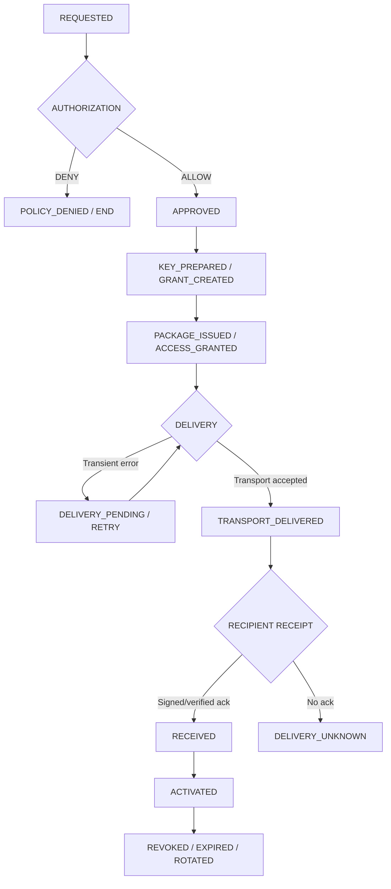
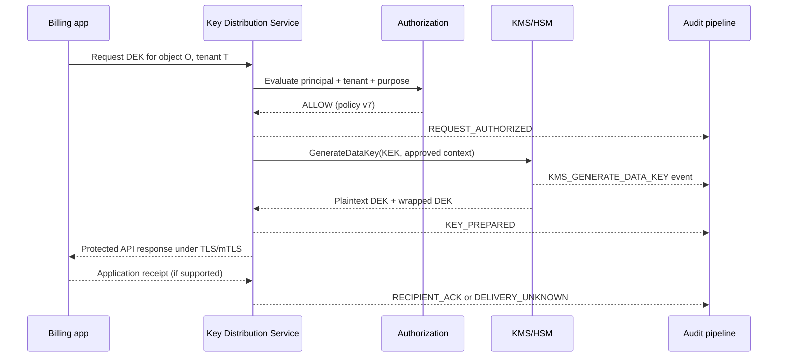
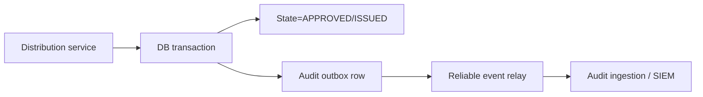
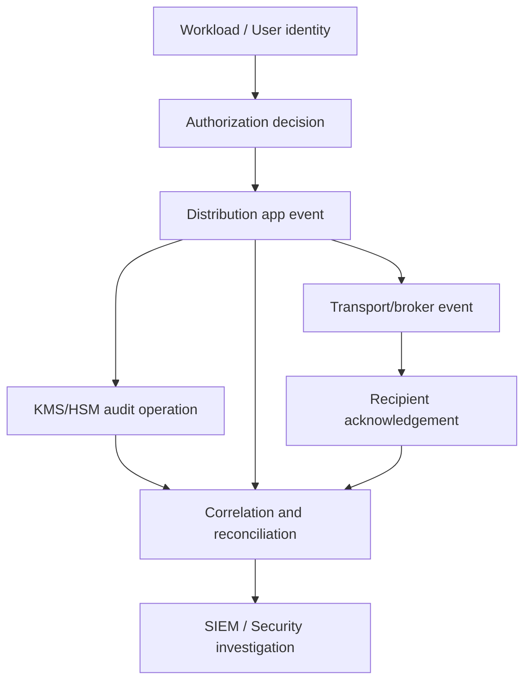
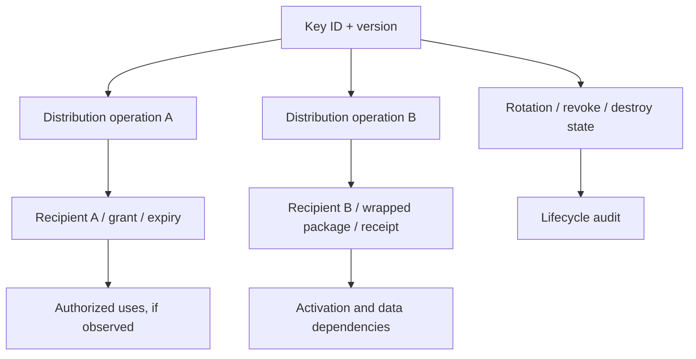
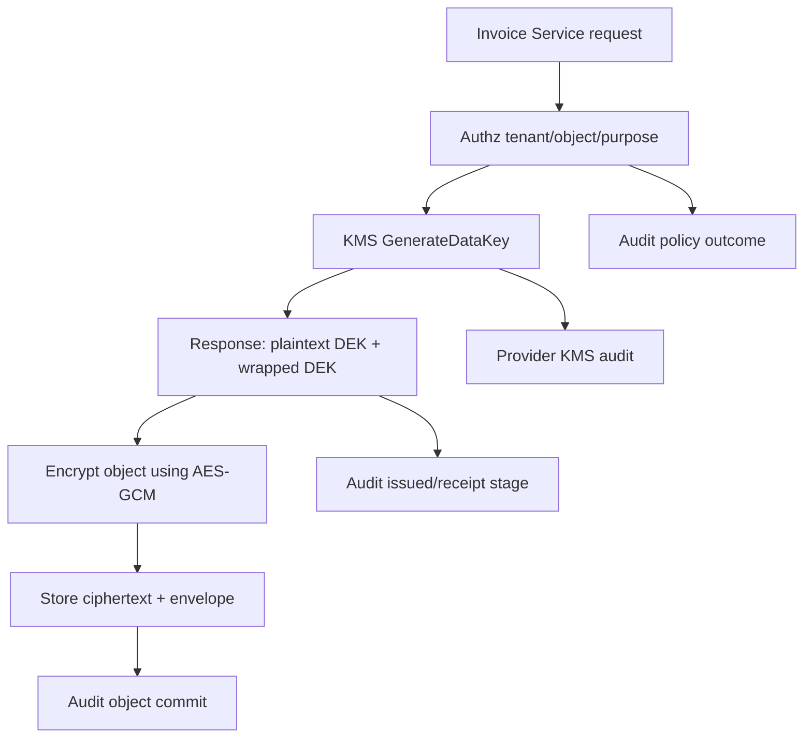
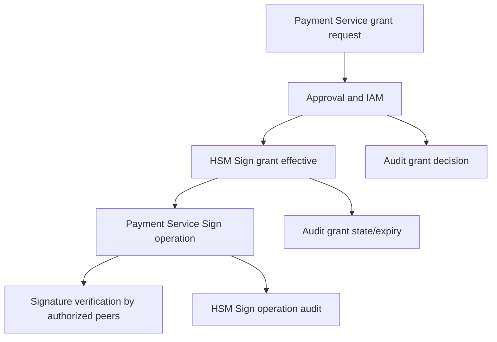

# Ghi audit việc phân phối khóa: Dấu vết kiểm toán từ cấp quyền đến xác nhận bên nhận

> **Chương:** Key distribution  
> **Bài học:** Ghi audit việc phân phối  
> **Module:** `SECURITY_KEY_MANAGEMENT_FUNDAMENTALS` — hiểu vòng đời khóa mật mã từ tạo, cấp phát, lưu trữ, sử dụng, xoay vòng đến thu hồi và hủy; kết nối mật mã đối xứng, bất đối xứng, chữ ký số, KMS/HSM, envelope encryption, kiểm soát truy cập và kiểm toán để thiết kế hệ thống bảo vệ khóa an toàn.

## 1. Tình huống mở đầu: “KMS gọi thành công” có nghĩa khóa đã đến nơi chưa?

Một hệ thống thương mại điện tử dùng một **Key Distribution Service** để cấp keying material cho các dịch vụ. `Billing Service` cần một DEK để mã hóa hóa đơn; `Payment Service` cần quyền ký bằng private key trong HSM; một đối tác cần nhận **wrapped secret key** để xác thực thông điệp.

Một ngày, đội vận hành nhận được yêu cầu:

> “Hãy chứng minh khóa `billing-dek-v7` đã được cấp cho đúng workload, đúng tenant, đúng thời điểm, qua cơ chế được cho phép và không ai khác nhận khóa đó.”

Dashboard chỉ hiển thị:

```text
2026-11-28 09:03:10 KMS GenerateDataKey SUCCESS
```

Thông tin này **chưa đủ**. Nó không trả lời:

- Ai là người hoặc workload thực sự yêu cầu?
- Có kiểm tra quyền theo tenant, environment và key purpose không?
- KMS đã sinh DEK, nhưng **bên nhận nào** được cấp plaintext DEK?
- Có một proxy/backend khác đã gọi KMS thay mặt workload không?
- Wrapped DEK được gửi cho ai và đặt ở object nào?
- Caller có nhận response không, hay bị timeout trước khi nhận?
- Có retry tạo thêm DEK hoặc giao nhiều lần không?
- Key version nào đang được dùng sau rotation?
- Có chứng cứ bên nhận đã **tiếp nhận/kích hoạt** không?
- Log có đủ tính toàn vẹn và thời hạn lưu để phục vụ điều tra không?
- Có bị ghi **raw DEK, private key, password hoặc wrapped key blob** vào log không?

**Ghi audit việc phân phối khóa** là thiết kế và vận hành **chuỗi sự kiện có thể kiểm chứng** liên quan tới yêu cầu, phê duyệt, đóng gói, chuyển giao, nhận, kích hoạt, thay đổi quyền và thu hồi quyền sử dụng khóa.

Điểm cốt lõi:

> **Audit là bằng chứng về những gì hệ thống quan sát và ghi nhận; audit không tự làm quy trình phân phối an toàn, cũng không tự chứng minh bên nhận đã thực sự nhận hoặc dùng khóa.**

### Mục tiêu học tập

Sau bài này, bạn có thể:

1. Phân biệt **audit**, **application logging**, **tracing**, **security monitoring** và **cryptographic proof**.
2. Xác định đầy đủ các mốc sự kiện trong quá trình phân phối khóa, kể cả **deny, timeout, retry và nhận xác nhận**.
3. Thiết kế audit schema với **actor, recipient, immutable key ID/version, operation, tenant, result, correlation và policy version**.
4. Biết **tuyệt đối không đưa key material** và những secret liên quan vào audit.
5. Liên kết audit ứng dụng với KMS/HSM, IAM, PKI, secret manager, workload identity, SIEM và key inventory.
6. Phân biệt các mô hình phân phối **key bytes/wrapped key**, **key handle/grant**, **public key/certificate** và **shared secret dẫn xuất qua giao thức**.
7. Hiểu replay, idempotency, partial failure, event ordering và **delivery acknowledgement** trong môi trường phân tán.
8. Thiết kế bảo vệ tính toàn vẹn, retention, phân quyền đọc/sửa và điều tra đối với audit evidence.
9. Đọc ví dụ **Java 17 structured security audit event** không chứa bí mật.
10. Xây dựng negative tests, runbook và chỉ số kiểm soát cho phân phối key trong production.

---

## 2. Trước hết: “Phân phối khóa” là những hoạt động nào?

Trong quản lý khóa, **distribution** có thể nghĩa là **vận chuyển vật liệu khóa**, hoặc **cấp quyền sử dụng key đã nằm trong KMS/HSM**, hoặc **công bố public key**. Không được gộp thành một thao tác `KEY_SENT`.

### 2.1. Bốn hình thức phân phối

| Hình thức | Thực chất điều gì được chuyển? | Ví dụ | Audit cần lưu điều gì? |
|---|---|---|---|
| **Chuyển plaintext key có bảo vệ theo protocol** | Bên nhận có raw symmetric/secret material sau khi giải mã transport. | KMS `GenerateDataKey` trả plaintext DEK cho application. | Caller, key origin, scope, endpoint/API, kết quả, thời điểm, quyền được duyệt; **không log raw key**. |
| **Chuyển wrapped/encrypted key** | Key material ở dạng được bảo vệ; bên nhận cần cơ chế unwrap. | Wrapped DEK trong envelope object; BYOK/HSM key transport. | Key reference, wrapping algorithm, recipient key/identity, context, giao nhận và policy. |
| **Cấp handle/grant cho key non-exportable** | Quyền gọi operation lên key object, không chuyển raw private key. | HSM `Sign`, KMS `Decrypt` grant, tokenized key reference. | Principal nhận quyền, operations, key ID/version, grant TTL, approval, revoke. |
| **Phân phối public key/certificate** | Public material và trust binding. | JWKS, X.509 certificate, SSH public key. | Issuer/subject, fingerprint công khai, version, trust chain, publication/activation/revocation. |

Mức độ bí mật và bằng chứng cần thiết rất khác nhau. Ví dụ public key có thể được công bố rộng, nhưng tính toàn vẹn **identity → trusted public key** vẫn phải bảo vệ.

### 2.2. Distribution khác với generation và usage

```text
Generate:    vật liệu khóa được tạo.
Distribute:  vật liệu/quyền sử dụng được cấp tới đối tượng đích.
Activate:    bên nhận bắt đầu sử dụng khóa/khả năng mới.
Use:         hoạt động Encrypt/Decrypt/Sign/MAC thực tế.
Rotate:      chuyển sang key/key version mới.
Revoke:      ngừng cho phép sử dụng, thu hồi grants/tokens.
Destroy:     hủy vật liệu theo policy và dependency gate.
```

Một key có thể **được sinh nhưng chưa từng phân phối**. Một grant có thể **đã tạo nhưng recipient chưa gọi API**. Một private signing key có thể **không bao giờ rời HSM**, nhưng quyền `Sign` vẫn được phân phối.

Do đó audit `KEY_GENERATED` không được thay thế bằng audit `KEY_DISTRIBUTED`, và `GRANT_CREATED` không được tuyên bố thành `KEY_USED`.

### 2.3. Một key có thể được phân phối tới nhiều recipient

Ví dụ:

```text
KEK trong KMS
    |
    +--> Grant cho workload A
    +--> Grant cho workload B
    +--> Temporary permission cho recovery operator
```

Phạm vi thực sự chịu tác động là **tập các principal có khả năng dùng hoặc nhận key**, không phải chỉ số lượng raw key copies.

Một audit log hữu ích phải giúp truy vấn:

> “Trong khoảng T0–T1, những principal nào từng được cấp quyền `Decrypt` đối với KEK K, bằng quy trình nào, và các grants nào đã bị thu hồi?”

---

## 3. Audit, log, trace và cryptographic proof: Không đồng nghĩa

### 3.1. Các lớp bằng chứng

| Thành phần | Mục đích | Điều không tự chứng minh |
|---|---|---|
| **Application log** | Quan sát lỗi và luồng ứng dụng. | Không bảo đảm tính toàn vẹn, completeness hoặc security review. |
| **Structured security audit event** | Ghi hành động nhạy cảm với schema ổn định, actor/resource/outcome. | Không chứng minh event chưa từng bị giả/sửa nếu sink không bảo vệ. |
| **Distributed trace** | Liên kết request qua các service. | Trace sample có thể bị bỏ; trace ID không phải chứng cứ chữ ký. |
| **KMS/HSM audit log** | Provider quan sát thao tác tạo, dùng, thay policy của key. | Không biết luôn business authorization của object/tenant. |
| **Recipient acknowledgement** | Bên nhận xác nhận nhận package hoặc activate key. | Ack có thể chỉ chứng minh nhận HTTP response, không chứng minh giữ bí mật hay đã sử dụng đúng. |
| **Signed receipt/attestation** | Một dạng bằng chứng được bảo vệ mật mã, với phạm vi định nghĩa. | Không tự bảo đảm danh tính/key custody nếu verification chain không đáng tin. |
| **SIEM alert** | Phát hiện pattern bất thường để ứng cứu. | Alert không phải bằng chứng đầy đủ mọi lần phân phối. |

### 3.2. Đừng dùng trace sampling cho audit bắt buộc

Một tracing system có thể lấy mẫu 1% request để giảm chi phí. Nếu sự kiện key distribution chỉ nằm trong trace, **99% thao tác có thể không để lại bằng chứng được yêu cầu**.

Thiết kế đúng:

```text
Security audit path:  có coverage và retention theo policy.
Observability trace:  hỗ trợ chẩn đoán, có thể sample.
```

Hai dòng có thể liên kết qua `traceId` và `correlationId`, nhưng không thay thế nhau.

### 3.3. Success ở lớp A không có nghĩa success ở lớp B

```text
IAM authorization      = ALLOW
KMS GenerateDataKey     = SUCCESS
Network response        = TIMEOUT
Recipient app loaded DEK= UNKNOWN
Object encryption       = NOT_CONFIRMED
```

Mỗi event có **outcome riêng**. Không ghi một dòng “KEY_DISTRIBUTED=SUCCESS” vì service nguồn thấy KMS success.

### 3.4. Phạm vi của non-repudiation

Một số sự kiện được ký số hoặc có signed receipt nhằm tăng khả năng quy trách nhiệm. Nhưng **non-repudiation** không đến từ việc đơn giản ký một JSON.

Cần xét: chứng thực danh tính, quyền người ký, sự bảo vệ private key, đồng hồ/thời gian, chain of custody, cơ chế phê duyệt, khả năng sửa log và quy định pháp lý/kinh doanh.

**Audit có chữ ký** giúp kiểm tra tính toàn vẹn/nguồn gốc trong phạm vi thích hợp, nhưng không mặc nhiên bảo đảm người dùng không thể chối bỏ một hành động.

---

## 4. Mô hình trạng thái phân phối có thể kiểm toán

### 4.1. Phân tách các mốc nghiệp vụ



Đây là **mô hình tham khảo**. Không phải provider nào cũng có API cho `RECEIVED` hoặc `ACTIVATED`; khi thiếu evidence phải dùng `UNKNOWN`, không tự suy luận.

### 4.2. Tên trạng thái nên nói chính xác điều gì đã được chứng minh

- `REQUESTED`: có yêu cầu, chưa chắc hợp lệ.
- `POLICY_DENIED`: policy engine từ chối; ghi mã lý do, không ghi secret.
- `APPROVED`: phê duyệt thành công theo rule/policy version.
- `PREPARED`: key/wrapped material/grant đã tạo ở nguồn.
- `ISSUED`: payload/handle/grant đã được phát từ service nguồn.
- `TRANSPORT_DELIVERED`: transport layer xác nhận mức nào theo giao thức.
- `RECEIVED`: recipient có acknowledgement đáng tin ở lớp đã định nghĩa.
- `ACTIVATED`: recipient hoặc trusted manager xác nhận key version đang được dùng.
- `EXPIRED/REVOKED`: entitlement hoặc key state thay đổi.
- `FAILED`: thao tác kết thúc không thành công theo phạm vi.
- `UNKNOWN`: không đủ bằng chứng để phân loại.

### 4.3. Không tạo trạng thái “SUCCESS” không có object

Một event tốt:

```text
operation=WRAPPED_KEY_DELIVERY
stage=RECIPIENT_ACK
outcome=SUCCEEDED
recipient=spiffe://example.org/ns/payments/sa/settlement
keyId=dek-opaque-017
keyVersion=v3
```

Một event mơ hồ:

```text
message="key transfer successful"
```

không đủ vì thiếu key, recipient, scope và stage.

### 4.4. Có thể chỉ cấp capability thay vì gửi key bytes

Ví dụ HSM private signing key:

```text
GRANT_REQUESTED
GRANT_AUTHORIZED
GRANT_CREATED
GRANT_EFFECTIVE
FIRST_SIGN_OBSERVED (nếu có)
GRANT_REVOKED
```

Không ghi `PRIVATE_KEY_SENT`, vì không có private key xuất khỏi HSM theo mô hình non-exportable.

### 4.5. Không bắt buộc tất cả hệ phải có delivery acknowledgement

Trong một số KMS API, service chỉ có thể ghi:

```text
KMS GenerateDataKey succeeded and response was returned at endpoint
```

Ứng dụng không luôn biết recipient downstream đã dùng DEK hay không. Có thể xây ack/activation riêng ở application layer.

**Thiếu một sự kiện không đồng nghĩa chắc chắn việc phân phối không xảy ra**; phải điều tra độ bao phủ, event loss, timeouts và callback retries.

---

## 5. Threat model của audit phân phối khóa

### 5.1. Mối đe dọa chính

| Rủi ro | Ví dụ | Control |
|---|---|---|
| **Phân phối sai recipient** | DEK tenant A đến service B. | Authenticated recipient identity, tenant/purpose binding, IAM deny và audit. |
| **Lộ raw key qua audit** | Log serialized KMS response có plaintext DEK. | Event schema allowlist, redaction, deny secret bytes. |
| **Mất sự kiện** | App crash sau KMS call trước log commit. | Reliable outbox/reconciliation, provider log đối chiếu. |
| **Sự kiện giả** | Attacker gửi `DELIVERED=true` không có proof. | Authenticated producer, verified receipt, write protections. |
| **Sửa/xóa log** | Admin chỉnh lịch sử distribution. | Append-only/retention, integrity, separation of duties. |
| **Replay request** | Giao cùng wrapped key nhiều lần hoặc tạo key mới khi retry. | Idempotency key, bounded retries, per-attempt audit. |
| **Không thu hồi recipient** | Grant vẫn hiệu lực sau offboarding. | Grant expiry/revoke event, reconciliation. |
| **Dùng sai key version** | Consumer dùng KEK v2 sau cutover v3. | Immutable key ID/version và activation evidence. |
| **Không đồng bộ thời gian** | Nhiều region ghi timestamp lệch. | UTC, monotonic/local sequence, receivedAt, correlation. |
| **Lộ tenant/PII qua context** | Encryption context chứa email/ID cá nhân. | Opaque IDs, minimization, RBAC/audit retention. |
| **Compromised logger** | Workload có thể báo success giả. | Nhiều nguồn evidence, signer/sink trust, external verification. |
| **Trích xuất key qua sink** | Audit platform cho phép đọc mọi secrets từ request dump. | Never-log-secret design, schema constraints, scanner. |

### 5.2. Audit không thay authorization

Việc ghi:

```text
UNAUTHORIZED_KEY_DISTRIBUTION
```

sau khi gửi raw key không thể thu hồi bản sao đã rơi vào tay attacker.

Ưu tiên **chặn trước** ở policy/IAM, và thêm audit để phát hiện bypass, điều tra và chứng minh.

### 5.3. Đừng làm audit thành một kho bí mật thứ hai

Một thiết kế nguy hiểm:

```json
{
  "event": "key-delivered",
  "keyMaterialBase64": "...",
  "recipient": "..."
}
```

Nếu SIEM, log archive hoặc support portal bị lộ, attacker lấy được secret mà không cần phá KMS. **Audit data nên chứa key reference, outcome và metadata tối thiểu, không chứa raw key, private key hoặc wrapped material đầy đủ khi không cần thiết.**

---

## 6. Audit schema: Những trường tối thiểu và ý nghĩa

### 6.1. Sự kiện có cấu trúc

Một audit record có thể gồm các nhóm:

| Nhóm | Các trường ví dụ | Mục đích |
|---|---|---|
| **Event identity** | `eventId`, `eventType`, `schemaVersion`, `eventTimeUtc` | Định danh duy nhất và parser đúng version. |
| **Request identity** | `correlationId`, `operationId`, `attemptNumber`, `traceId` | Nối những bước của một giao dịch. |
| **Actor** | `initiatorPrincipal`, `serviceIdentity`, `delegatedActor` | Ai khởi tạo và có thực thi thay mặt ai. |
| **Recipient** | `recipientPrincipal`, `recipientTenant`, `recipientEnvironment` | Ai được dự kiến nhận key/capability. |
| **Key identity** | `immutableKeyId`, `keyVersion`, `keyPurpose`, `keyOrigin` | Truy vết vật liệu/phiên bản. |
| **Distribution method** | `channel`, `deliveryMode`, `wrappingAlgorithm`, `recipientKeyRef` | Cơ chế cấp key và ranh giới. |
| **Authorization** | `policyId`, `policyVersion`, `decision`, `approvalRef`, `grantRef` | Vì sao yêu cầu được cho phép/từ chối. |
| **Result** | `stage`, `outcome`, `reasonCode`, `providerRequestId` | Kết quả thực tại từng layer. |
| **Context** | `region`, `account`, `resourceId`, `tenantIdOpaque` | Scope và location nếu cần. |
| **Evidence** | `receiptRef`, `providerAuditRef`, `manifestDigestRef` | Nguồn để kiểm chứng độc lập. |
| **Collection** | `observedAtUtc`, `ingestedAtUtc`, `producerVersion` | Độ trễ và lineage của log. |

Một số trường không có trong mọi sự kiện. Ví dụ một `POLICY_DENIED` thường chưa có `grantRef`. Không được điền giá trị giả chỉ để đủ schema.

### 6.2. Immutable key ID khác alias

Giả sử:

```text
alias/payments-current -> key-2026-v4
```

Sau cutover, alias có thể trỏ sang `key-2026-v5`. Nếu audit cũ chỉ lưu alias, người điều tra **không thể chắc chắn key material nào được phân phối**.

Nên ghi:

```text
logicalKeyName = payments-current
resolvedImmutableKeyId = kms-opaquekey-204
resolvedKeyVersion = v4
```

và audit sự kiện alias resolution khi có ý nghĩa.

### 6.3. Actor và recipient không được trộn

Ví dụ:

```text
Actor:      api-gateway-service
OnBehalfOf: tenant-42 billing-job
Recipient:  billing-worker instance 17
KeyOwner:   tenant-42
Approver:   key-custodian role
```

Một service có thể yêu cầu KMS thay mặt người khác, còn key được cấp tới một workload thứ ba. Các trường phải tách nếu threat model đòi hỏi.

**Không lấy `actor` hay `tenantId` trực tiếp từ request body chưa xác thực**. Gắn danh tính từ mTLS, workload identity, verified token hoặc audit provider.

### 6.4. UTC và thời gian nhận log

Lưu ít nhất:

```text
eventTimeUtc
observedAtUtc hoặc ingestedAtUtc
correlationId
```

Trong hệ phân tán, đồng hồ các node có thể lệch. Không thể dựng thứ tự tuyệt đối chỉ từ timestamp nếu độ phân giải hoặc đồng bộ không đủ.

Khi cần causal ordering, dùng request/operation IDs, event sequence per operation, event parent links hoặc transaction log position.

### 6.5. Outcome có ít nhất ba trạng thái

```text
SUCCEEDED
FAILED
UNKNOWN
```

`UNKNOWN` quan trọng khi:

- KMS đã xử lý nhưng network timeout.
- Wrapped key đã gửi nhưng recipient chưa ack.
- Audit pipeline không truy vấn được.
- Hệ thống chưa biết grant đã hiệu lực ở replica hay chưa.

**Không tự coi `UNKNOWN` là `SUCCEEDED`**; cũng không suy diễn chắc chắn `FAILED`.

---

## 7. Những dữ liệu tuyệt đối không được ghi vào audit

### 7.1. Danh mục cấm

Không đưa vào log:

- Raw DEK, KEK, symmetric HMAC key.
- Private signing key, private SSH/TLS key.
- DRBG seed, key derivation input bí mật, recovery seed.
- Passphrase, PIN, OTP, API token hoặc bearer token.
- Plaintext customer data hoặc toàn bộ object nhạy cảm.
- KMS `GenerateDataKey` response chứa plaintext key.
- HSM session tokens, import credentials hoặc wrapping secrets có thể sử dụng để lấy key.
- Full decrypted key package, unprotected PKCS#8/PKCS#12 secret.
- Thông tin từ exception/HTTP trace có thể chứa bí mật, kể cả trong query string.

### 7.2. Có nên log wrapped DEK không?

**Thường không cần log toàn bộ wrapped DEK**. Wrapped material có thể không phải plaintext, nhưng:

- Tạo bản sao ở hệ audit với quyền truy cập rộng hơn.
- Tăng dữ liệu bị ảnh hưởng nếu KEK sau này compromised.
- Có thể chứa provider-sensitive format hoặc identifier.
- Khi log toàn bộ blob, log trở thành một phụ bản của key inventory/backup.

Thay bằng:

```text
wrappedDekReference = object/envelope-id
envelopeVersion = 2
kmsKeyId = immutable-key-id
kmsRequestId = provider-request-id
```

Nếu cần kiểm chứng payload, lưu **digest/reference được thiết kế phù hợp** với integrity evidence, không biến log thành nơi cất material.

### 7.3. Có nên log SHA-256 của raw key?

Không mặc định an toàn. Hash của secret có entropy thấp có thể phục vụ tấn công thử đoán/offline validation. Với key mạnh, fingerprint của secret vẫn tăng khả năng liên kết các bản sao và có thể vi phạm key custody policy.

Ưu tiên **key ID/version provider cấp**, **HSM handle**, **receipt ID** hoặc **metadata digest của package công khai/không chứa key bytes**.

Nếu tổ chức yêu cầu key check value (KCV), chỉ dùng phương án được thiết kế chuẩn và có giới hạn phù hợp; không tự invent hash raw secret làm audit ID.

### 7.4. Encryption context không tự là nơi lưu PII

Nhiều KMS ghi encryption context vào audit. Tránh:

```json
{"customerEmail": "alice@example.org", "nationalId": "..."}
```

Khi có thể, dùng opaque IDs:

```json
{"tenantRef": "tenant-42", "purpose": "OBJECT_DEK"}
```

Vẫn cần xem opaque ID có bị coi là dữ liệu nhạy cảm theo policy hay không.

### 7.5. Redaction không chỉ bằng regex

Một regex xóa `BEGIN PRIVATE KEY` **không phát hiện mọi khóa nhị phân, base64, JWT hoặc exception serialization**.

Mạnh hơn:

1. **Allowlist event schema** chỉ chấp nhận các trường metadata định sẵn.
2. Tách đối tượng audit khỏi KMS response chứa secret.
3. Không dùng `toString()` của secret-bearing objects.
4. Không log HTTP full bodies ở key APIs.
5. Scan/test để phát hiện secret leakage.
6. Hạn chế quyền đọc audit sink và retention.

---

## 8. Chuỗi audit cho một lần cấp DEK bằng KMS

### 8.1. Phân phối plaintext DEK tới ứng dụng



**Lưu ý**: hình vẽ đơn giản hóa đường audit KMS. Trong thực tế provider gửi audit bất đồng bộ; thứ tự hiển thị event có thể khác. Không mặc định gateway nhận được KMS provider audit event ngay trong cùng transaction.

### 8.2. Không tuyên bố KMS đảm bảo recipient thực sự nhận bytes

Các trường hợp:

| Gateway | KMS | Network/app | Outcome nên ghi |
|---|---|---|---|
| AUTHZ deny | Không gọi | Không có payload | `POLICY_DENIED`. |
| AUTHZ allow | Generate failed | Không có DEK | `PREPARATION_FAILED`. |
| AUTHZ allow | Generate succeeded | Response timeout | `KEY_PREPARED`, `DELIVERY_UNKNOWN`. |
| AUTHZ allow | Generate succeeded | Recipient ack hợp lệ | `DELIVERY_CONFIRMED` theo nghĩa ack. |
| AUTHZ allow | Generate succeeded | Recipient báo apply key version mới | `ACTIVATED` với nguồn evidence rõ. |

### 8.3. Một request ID xuyên suốt

Ví dụ:

```text
operationId   = kd-54f2...
requestId     = req-34bc...
kmsRequestId  = kms-opaque-7d...
recipientAckId= ack-05dd...
keyVersion    = dek-material-v8
```

`operationId` đại diện quy trình cấp phát; `requestId` là một attempt; `kmsRequestId` giúp đối soát provider. Không trộn vì retry có thể tạo nhiều request IDs cho cùng operation.

### 8.4. Nếu KMS trả DEK plaintext thì audit khác metadata key

Một audit record **không bao giờ** nên chứa:

```text
GenerateDataKeyResponse.plaintext
```

Chỉ ghi:

```text
kmsApi = GenerateDataKey
wrappingKeyRef = kms-immutable-key-id
recipientPrincipal = billing-workload-id
outcome = SUCCEEDED
```

Cần lưu ý một số KMS API có thể trả cả plaintext và wrapped material; **việc KMS quản lý KEK không đồng nghĩa DEK chưa từng nằm trong app RAM**.

### 8.5. Audit key usage là một chuỗi khác

DEK đã cấp không tự chứng minh hóa đơn đã được mã hóa. Bên nhận có thể thất bại khi AES-GCM encrypt hoặc bị lỗi storage.

Có thể cần liên kết tiếp:

```text
DEK_RECEIVED
DATA_ENCRYPTION_COMPLETED
ENVELOPE_STORED
OBJECT_STORAGE_COMMIT_CONFIRMED
```

Các sự kiện này phục vụ **end-to-end business trace**, nhưng không lẫn với giai đoạn phân phối.

---

## 9. Audit khi chỉ phân phối wrapped DEK hoặc encrypted key package

### 9.1. Luồng wrapped key

```text
Sender / key manager
  ├─ authorize recipient and purpose
  ├─ identify recipient key or KEK
  ├─ wrap DEK under approved mechanism
  ├─ bind context (tenant/object/key version)
  ├─ deliver wrapped package
  └─ record receipt/ack if available

Recipient
  ├─ verify sender / protocol / package scope
  ├─ unwrap under authorized key
  ├─ validate metadata/version
  └─ optionally acknowledge activation
```

### 9.2. Event schema gợi ý

| Mốc | Event | Bằng chứng |
|---|---|---|
| Đã xác minh recipient | `RECIPIENT_AUTHORIZED` | Principal, tenant, policy version. |
| Key package được tạo | `KEY_PACKAGE_WRAPPED` | Wrapping key ID, algorithm, context reference. |
| Package được phát | `KEY_PACKAGE_ISSUED` | Package ID, transport channel, destination. |
| Transport nhận | `TRANSPORT_DELIVERED` | Message/request ID, delivery status của channel. |
| Recipient đã nhận | `RECIPIENT_RECEIPT_VERIFIED` | Verified signed ack/token/session proof nếu có. |
| Recipient đã mở/activate | `KEY_ACTIVATED` | Attestation/application audit theo protocol. |
| Có lỗi | `KEY_PACKAGE_REJECTED` | Reason code không chứa secret. |

### 9.3. Recipient identity phải được xác thực

Một ciphertext đã wrap đúng dưới recipient public key **không tự chứng minh public key đó thực sự thuộc recipient**.

Cần kiểm tra certificate, trust chain, fingerprint đã được đăng ký, key usage và identity mapping theo chính sách.

Audit nên ghi `recipientTrustedKeyRef`, không lấy fingerprint/key ID chỉ do client đưa lên mà không kiểm tra.

### 9.4. Ack khác khả năng dùng khóa

HTTP `200 OK` từ message broker có thể chỉ nói **broker nhận message**, không nói recipient đã xử lý.

Một ack từ recipient có thể chứng minh đã đọc package, nhưng chưa chắc đã unwrap/activate. Nếu compliance cần “key đã được phân phối và kích hoạt”, phải có một **sự kiện ở recipient** với nghĩa rõ ràng.

### 9.5. HMAC/MAC receipts không phải non-repudiation mặc định

Nếu hai bên dùng chung HMAC secret, cả hai có thể tạo MAC tương ứng. HMAC receipt có thể chứng minh thông điệp đến từ **một bên biết secret**, nhưng **không phân biệt tuyệt đối bên nào đã tạo**.

Khi yêu cầu truy trách nhiệm mạnh, cần thiết kế danh tính và signed receipts theo trust framework phù hợp.

---

## 10. Audit khi phân phối quyền dùng key non-exportable

### 10.1. Không có raw private key di chuyển

Với HSM signing key:

```text
keyId = hsm-signing-key-v4
privateKeyExportable = false
```

Ứng dụng nhận quyền gọi `Sign`, không nhận raw private key.

Audit đúng:

```text
GRANT_REQUESTED
GRANT_APPROVED
GRANT_CREATED
GRANT_EFFECTIVE
SIGN_OPERATION_OBSERVED (nếu có)
GRANT_REVOKED
```

Không ghi `PRIVATE_KEY_TRANSFERRED`.

### 10.2. Trường cần lưu

```text
principalGranted
delegator/approver
immutableKeyId/version
allowedOperations = [SIGN]
resourceScope
tenant/environment
grantId
startTime/endTime or TTL
conditions / policyVersion
authorization outcome
reasonCode
```

### 10.3. Grant tồn tại khác grant được dùng

Một grant có thể được tạo nhưng workload chưa từng gọi KMS. Nếu audit chỉ có `GRANT_CREATED`, kết luận:

> Workload đã **được cấp quyền**, không phải chắc chắn đã tạo chữ ký.

Khi cần audit hoạt động thực tế, đối chiếu KMS/HSM data-plane `Sign` events. Nếu dịch vụ có caching/aggregation, cần hiểu mức chi tiết provider thực sự ghi nhận.

### 10.4. Grants ngắn hạn và break-glass

Một capability khẩn cấp có thể chỉ mở trong khoảng ngắn:

```text
GRANT_CREATED reason=INCIDENT_RECOVERY
grantExpiry=...
GRANT_USED (nếu xảy ra)
GRANT_REVOKED
POST_INCIDENT_REVIEW_COMPLETED
```

Phải có owner, approval, expiry và cơ chế xử lý khi revocation lỗi. Không biến `break-glass` thành tài khoản có quyền `Decrypt *` vĩnh viễn.

---

## 11. Audit phân phối public key, certificate và trust anchors

### 11.1. Public material không nhất thiết bí mật

Khi công bố JWKS hoặc certificate:

- Public key có thể được tải công khai.
- Rủi ro chính là **key substitution**, stale key hoặc issuer mapping sai.
- Cần chứng minh public key/version nào đã được phát hành, ai phê duyệt, khi nào active và revoked.

### 11.2. Event khuyến nghị

```text
PUBLIC_KEY_REGISTERED
CERTIFICATE_ISSUED
TRUST_BINDING_APPROVED
JWKS_PUBLISHED
PUBLIC_KEY_ACTIVATED
OLD_KEY_VERIFY_ONLY
CERTIFICATE_REVOKED
TRUST_ENTRY_REMOVED
```

### 11.3. `kid` là selector, không phải authority

Một JWT header có:

```json
{"kid":"payment-signing-v3","alg":"RS256"}
```

không tự chứng minh key đúng. Verifier phải chọn public key từ **trust registry/issuer đã được cấu hình**, kiểm thuật toán cho phép và quan hệ danh tính.

Audit việc publish/rotate JWKS nên gồm issuer, immutable public key reference/fingerprint, effective time, prior version và approval.

### 11.4. Certificate distribution và private key distribution khác nhau

Không ghi:

```text
Certificate published -> private signing key distributed
```

Một certificate thường chứa **public key**. Private key có thể vẫn giữ non-exportable trong HSM. Đây là sự khác biệt quan trọng khi đọc audit.

### 11.5. Old public key không nên xóa mù quáng

Public key cũ có thể cần verify chữ ký lịch sử trong retention. Audit trạng thái nên phân biệt:

```text
SIGN_NEW disabled
VERIFY_HISTORICAL allowed under policy
```

Thu hồi trust do key compromise cần đánh giá các chứng cứ/chữ ký trong thời gian có thể bị ảnh hưởng.

---

## 12. Audit key establishment qua TLS/ECDHE

### 12.1. Có phải TLS “phân phối session key” trực tiếp không?

Trong authenticated ECDHE/TLS hiện đại, các bên thường trao đổi public ephemeral parameters và **dẫn xuất traffic secrets cục bộ** theo key schedule của protocol.

Không có một bản plaintext traffic key nhất thiết được “gửi” trực tiếp giữa hai bên. Vì vậy không nên thiết kế audit như:

```text
TLS_SESSION_KEY_DELIVERED bytes=...
```

### 12.2. Audit có thể ghi gì?

```text
handshake protocol version
authenticated peer identity/certificate reference
approved cipher suite / group
session established/failed
key establishment policy version
result/time/correlation
```

**Không log TLS traffic secrets, master secrets, exporter secrets hoặc key log files** trong production audit. Những tính năng key logging phục vụ debug có thể làm lộ toàn bộ traffic, cần bị chặn theo chính sách.

### 12.3. Audit handshake không tự chứng minh app data hợp lệ

TLS giúp bảo vệ kênh với các bảo đảm phụ thuộc cấu hình và authentication. Nhưng **thành công handshake** không đồng nghĩa người gọi được phép lấy KEK hoặc DEK của tenant khác.

Phải kiểm tra authorization ở lớp ứng dụng/KMS bên trên.

### 12.4. Khi dùng key agreement cho giao thức riêng

Một giao thức tự thiết kế có thể cần audit:

- Peer identities đã được xác thực.
- Protocol/parameter set được phép.
- Key agreement session ID và transcript reference không bí mật.
- Key confirmation outcome.
- Key activation/expiration.
- Replay rejection.

Không ghi shared secret. Với giao thức phức tạp, ưu tiên protocol đã được thẩm định thay vì tự sáng tạo key distribution.

---

## 13. Chống replay, retry và key cấp trùng

### 13.1. Retry không đồng nghĩa duplicate distribution

Một request:

```text
operationId = dist-123
attempt 1 -> timeout
attempt 2 -> success
```

có thể có hai tình huống:

1. Attempt 1 chưa thực thi ở KMS; attempt 2 tạo/trao key mới.
2. Attempt 1 **đã tạo key**, chỉ mất response; attempt 2 có thể tạo thêm key khác.

Nếu audit ghi một event `SUCCESS` mà không có attempts, người điều tra không thấy key orphaned hoặc double issuance.

### 13.2. Idempotency key

Một giao thức có thể dùng:

```text
operationId / idempotencyToken
recipient
purpose
immutable target key ID or intended scope
policy revision
```

Khi provider hỗ trợ idempotency token, dùng đúng contract. Khi không hỗ trợ, cần **reconciliation** qua provider request ID/key registry, không giả định retry tự động an toàn.

### 13.3. Key distribution ledger theo operation

Ví dụ:

| Operation | Attempt | Provider result | Recipient ack | Điều tra |
|---|---:|---|---|---|
| `dist-201` | 1 | Success | Ack | Đã xác minh trong phạm vi ack. |
| `dist-202` | 1 | Success | Timeout | Chưa biết recipient nhận hay chưa. |
| `dist-202` | 2 | Success | Ack | Kiểm tra có hai DEK/packages hay không. |
| `dist-203` | 1 | Denied | N/A | Không phát key. |

Một dòng `dist-202 SUCCESS` che mất trạng thái chưa biết của attempt đầu.

### 13.4. Chống replay package

Khi phân phối wrapped key bằng message queue/API:

- Có `packageId`, `keyVersion`, `recipientIdentity`, `issuedAt`, expiry hoặc freshness control phù hợp.
- Xác thực package/recipient binding bằng cơ chế có integrity.
- Kiểm tra state để không activate package/key version đã revoke.
- Dùng deduplication/idempotent consumer.
- Không tự coi timestamp là chống replay nếu attacker có thể thay timestamp hoặc đồng hồ lệch.

### 13.5. Event order và các hệ phân tán

Log có thể tới SIEM không đúng thứ tự:

```text
KEY_ACTIVATED nhận trước DELIVERY_ACK vì network delay.
```

Đừng chỉ dùng `eventTime` để quy kết một service gian lận. Dùng `operationId`, `attempt`, `sequence`, producer identity và causal links; đánh dấu bất thường cần điều tra khi không thể xây dựng chuỗi hợp lệ.

---

## 14. Reliable audit: Ghi log trước hay sau phân phối?

### 14.1. Hai lỗ hổng kinh điển

**Ghi trước rồi thao tác thất bại:**

```text
Audit: "DELIVERED"
Network: send failed
```

Log nói sai sự thật nếu stage ghi trước là `DELIVERED`; nên ghi `DELIVERY_ATTEMPTED`.

**Thao tác thành công rồi crash trước log:**

```text
KMS GenerateDataKey SUCCESS
Process crashes before application audit
```

Provider có thể có event riêng, nhưng application audit bị thiếu.

### 14.2. Sự kiện theo stage thay vì một event duy nhất

Thiết kế tốt hơn:

```text
REQUEST_ACCEPTED
POLICY_EVALUATED
KEY_PREPARATION_REQUESTED
KEY_PREPARATION_CONFIRMED
DELIVERY_ATTEMPTED
DELIVERY_ACKNOWLEDGED / DELIVERY_UNKNOWN
RECIPIENT_ACTIVATED (if evidenced)
```

Mỗi stage được ghi sau khi có bằng chứng tương ứng. `CONFIRMED` của một layer không thay thế confirmation của layer khác.

### 14.3. Transactional outbox cho trạng thái ở database

Khi ứng dụng cập nhật một record trạng thái và tạo audit event, có thể ghi trong cùng transaction DB:



**Transactional outbox** giảm nguy cơ ứng dụng commit trạng thái thành công nhưng mất event trước khi gửi tới broker.

Tuy nhiên:

- KMS/HSM calls **không nằm cùng transaction** của database ứng dụng.
- Outbox relay có thể gửi lại nhiều lần → consumer phải idempotent.
- Sự kiện trong outbox vẫn cần được bảo vệ integrity và access.
- Không tuyên bố distributed exactly-once end-to-end nếu chưa chứng minh.

### 14.4. KMS reconciliation giải quyết partial failure

Ví dụ:

```text
Application event REQUESTED recorded.
KMS CreateGrant succeeded.
App crashed before GRANT_CREATED event.
```

Một reconciliation job nên tìm sự kiện KMS/actual grant state phù hợp:

```text
operationId/requestId + keyRef + principal + time window
```

và ghi **RECONCILIATION_OBSERVED** với nguồn evidence. Không tự bịa lại event như thể ứng dụng đã ghi tại thời điểm trước.

### 14.5. Audit pipeline outage: Fail closed hay degrade?

Không có quy tắc duy nhất cho mọi workload:

- Với phân phối **root/recovery/signing master key**, tổ chức có thể yêu cầu durable audit acceptance trước khi tiếp tục thao tác nguy hiểm.
- Với high-volume DEK issuance, có thể thiết kế local protected spool và asynchronous forwarding để tránh outage diện rộng, nếu policy cho phép.
- Nếu yêu cầu pháp lý/bảo mật bắt buộc không thể chứng minh, có thể **fail closed** cho action mới và báo lỗi rõ.
- Khi audit sink chậm, cần backpressure, bounded queue, retry và alert; không âm thầm bỏ event.

Quyết định phải đánh giá **availability vs accountability**, độ bền local spool, khóa bảo vệ spool, failover và thời gian phục hồi.

### 14.6. Không cache raw keys trong audit spool

Một event queue lưu trước khi gửi SIEM **chỉ chứa metadata đã cho phép**, không chứa raw key/recipient package. Mã hóa disk của spool không biến việc log secret thành một ý tưởng đúng.

---

## 15. Correlation giữa application, IAM, KMS và recipient

### 15.1. Bốn góc nhìn



### 15.2. Các trường kết nối

| Nguồn | ID cần thiết | Rủi ro nếu thiếu |
|---|---|---|
| API gateway | `requestId`, authenticated principal | Không biết requester thực. |
| Policy engine | `authorizationDecisionId`, policy version | Không chứng minh lý do permit/deny. |
| Distribution service | `operationId`, `attemptId`, key/recipient | Không biết stage và retry. |
| KMS/HSM | `providerRequestId`, immutable key ref | Không biết key operation thực. |
| Message broker/transport | Message/package ID | Không biết package được gửi/kênh nào. |
| Recipient | Receipt/activation ID | Không biết có nhận/activate không. |
| Inventory | Key origin/version/custody | Không biết key nào bị phân phối. |

### 15.3. Không trộn request ID của tầng khác

KMS request ID có thể được cấp **sau** khi KMS xử lý, trong khi operation ID của app đã có từ trước. Phải ghi rõ `idType`; không ghi một trường `id` dùng lẫn cả hai.

### 15.4. `traceId` không phải secret nhưng không phải quyền

Trace ID, correlation ID giúp nối dữ liệu, nhưng **không được dùng làm bearer token hay chứng minh authorization**. Đừng cấp quyền nhận khóa chỉ vì request chứa một correlation ID có vẻ hợp lệ.

### 15.5. Đồng bộ đồng hồ

Nên dùng UTC nhất quán, nhưng khi chứng cứ cần thứ tự chính xác phải xem:

- NTP/time synchronization và sai lệch cho phép.
- KMS provider timestamp và application timestamp.
- Ingest lag và pipeline delay.
- Sequence per operation hoặc logical ordering.
- Trusted time service nếu chính sách/chứng cứ yêu cầu.

---

## 16. Java 17: Xây structured audit event không chứa key bytes

Ví dụ này cho thấy cách **tạo sự kiện audit có cấu trúc** với những trường cho phép và escape JSON để tránh log injection. Nó **không tạo, không phân phối và không ghi key material**.

Thiết kế:

- Dùng `enum` cho event type và outcome thay vì chuỗi tùy ý.
- Audit event có `eventId`, `operationId`, `attempt`, `actor`, `recipient`, `immutableKeyId`, `keyVersion`, `policyVersion`, `reasonCode`.
- Mọi identity trong ví dụ là **ID giả**, không có PII.
- Không có trường `keyBytes`, `plaintextDek`, `privateKey` hoặc `kmsResponse`.
- `toJson()` escape JSON strings, không `toString()` các đối tượng chứa secret.
- Demo chỉ in sự kiện mô phỏng; production phải gửi tới sink được bảo vệ, có delivery/reconciliation.

```java
import java.time.OffsetDateTime;
import java.time.ZoneOffset;
import java.util.Locale;
import java.util.Objects;
import java.util.UUID;

public final class KeyDistributionAuditDemo {

    enum EventType {
        REQUEST_RECEIVED,
        POLICY_DENIED,
        REQUEST_AUTHORIZED,
        KEY_PREPARATION_CONFIRMED,
        DELIVERY_ATTEMPTED,
        DELIVERY_UNKNOWN,
        RECIPIENT_ACK_VERIFIED,
        GRANT_CREATED,
        GRANT_REVOKED
    }

    enum Outcome {
        SUCCEEDED,
        FAILED,
        UNKNOWN
    }

    record AuditEvent(
            String schemaVersion,
            String eventId,
            String operationId,
            int attempt,
            String eventTimeUtc,
            EventType eventType,
            Outcome outcome,
            String actorPrincipal,
            String recipientPrincipal,
            String tenantReference,
            String immutableKeyId,
            String keyVersion,
            String keyPurpose,
            String policyVersion,
            String reasonCode) {

        AuditEvent {
            Objects.requireNonNull(schemaVersion);
            Objects.requireNonNull(eventId);
            Objects.requireNonNull(operationId);
            Objects.requireNonNull(eventTimeUtc);
            Objects.requireNonNull(eventType);
            Objects.requireNonNull(outcome);
            Objects.requireNonNull(actorPrincipal);
            Objects.requireNonNull(recipientPrincipal);
            Objects.requireNonNull(tenantReference);
            Objects.requireNonNull(immutableKeyId);
            Objects.requireNonNull(keyVersion);
            Objects.requireNonNull(keyPurpose);
            Objects.requireNonNull(policyVersion);
            Objects.requireNonNull(reasonCode);

            if (attempt < 1) {
                throw new IllegalArgumentException(
                        "Attempt number must be positive");
            }
        }

        String toJson() {
            // Fixed allowlist: audit only metadata, never raw keys.
            return "{"
                    + "\"schemaVersion\":" + quote(schemaVersion) + ","
                    + "\"eventId\":" + quote(eventId) + ","
                    + "\"operationId\":" + quote(operationId) + ","
                    + "\"attempt\":" + attempt + ","
                    + "\"eventTimeUtc\":" + quote(eventTimeUtc) + ","
                    + "\"eventType\":" + quote(eventType.name()) + ","
                    + "\"outcome\":" + quote(outcome.name()) + ","
                    + "\"actorPrincipal\":" + quote(actorPrincipal) + ","
                    + "\"recipientPrincipal\":" + quote(recipientPrincipal) + ","
                    + "\"tenantReference\":" + quote(tenantReference) + ","
                    + "\"immutableKeyId\":" + quote(immutableKeyId) + ","
                    + "\"keyVersion\":" + quote(keyVersion) + ","
                    + "\"keyPurpose\":" + quote(keyPurpose) + ","
                    + "\"policyVersion\":" + quote(policyVersion) + ","
                    + "\"reasonCode\":" + quote(reasonCode)
                    + "}";
        }
    }

    private KeyDistributionAuditDemo() {}

    static AuditEvent event(
            String operationId,
            int attempt,
            EventType type,
            Outcome outcome,
            String actor,
            String recipient,
            String tenant,
            String immutableKeyId,
            String keyVersion,
            String keyPurpose,
            String policyVersion,
            String reasonCode) {

        return new AuditEvent(
                "key-distribution-audit-v1",
                UUID.randomUUID().toString(),  // event ID, not a secret
                operationId,
                attempt,
                OffsetDateTime.now(ZoneOffset.UTC).toString(),
                type, outcome,
                actor, recipient, tenant,
                immutableKeyId, keyVersion,
                keyPurpose, policyVersion, reasonCode);
    }

    static String quote(String value) {
        StringBuilder result = new StringBuilder("\"");

        for (int i = 0; i < value.length(); i++) {
            char ch = value.charAt(i);

            switch (ch) {
                case '"' -> result.append("\\\"");
                case '\\' -> result.append("\\\\");
                case '\n' -> result.append("\\n");
                case '\r' -> result.append("\\r");
                case '\t' -> result.append("\\t");
                case '\b' -> result.append("\\b");
                case '\f' -> result.append("\\f");
                default -> {
                    if (ch < 0x20) {
                        result.append(String.format(
                                Locale.ROOT, "\\u%04x", (int) ch));
                    } else {
                        result.append(ch);
                    }
                }
            }
        }

        return result.append('"').toString();
    }

    public static void main(String[] args) {
        // Đây là request mô phỏng, KHÔNG có KMS call thật.
        String operationId = "dist-demo-001";

        AuditEvent authorized = event(
                operationId, 1,
                EventType.REQUEST_AUTHORIZED,
                Outcome.SUCCEEDED,
                "billing-distributor",
                "billing-worker-17",
                "tenant-42",
                "kms-key-opaque-04",
                "v3", "OBJECT_DEK",
                "distribution-policy-v7",
                "POLICY_ALLOW");

        // Demo giả định có một acknowledgement hợp lệ.
        // KHÔNG ghi event này trước khi xác minh receipt thật.
        AuditEvent acknowledged = event(
                operationId, 1,
                EventType.RECIPIENT_ACK_VERIFIED,
                Outcome.SUCCEEDED,
                "billing-distributor",
                "billing-worker-17",
                "tenant-42",
                "kms-key-opaque-04",
                "v3", "OBJECT_DEK",
                "distribution-policy-v7",
                "RECIPIENT_ACK_OK");

        System.out.println(authorized.toJson());
        System.out.println(acknowledged.toJson());
    }
}
```

### 16.1. Kết quả dự kiến

Mỗi dòng sẽ là JSON có các trường như:

```json
{
  "schemaVersion": "key-distribution-audit-v1",
  "eventId": "a-unique-uuid",
  "operationId": "dist-demo-001",
  "attempt": 1,
  "eventTimeUtc": "2026-11-28T00:00:00Z",
  "eventType": "REQUEST_AUTHORIZED",
  "outcome": "SUCCEEDED",
  "actorPrincipal": "billing-distributor",
  "recipientPrincipal": "billing-worker-17",
  "tenantReference": "tenant-42",
  "immutableKeyId": "kms-key-opaque-04",
  "keyVersion": "v3",
  "keyPurpose": "OBJECT_DEK",
  "policyVersion": "distribution-policy-v7",
  "reasonCode": "POLICY_ALLOW"
}
```

`eventId` và thời gian thực tế khác mỗi lần chạy. Dòng JSON trên là **ví dụ về cấu trúc**, không phải kết quả đã chạy hay bằng chứng KMS thật.

### 16.2. Vì sao cần JSON escaping?

Nếu `reasonCode` hay một field không đáng tin chứa newline:

```text
DENIED
KEY_DELIVERED=SUCCESS
```

và logger ghi chuỗi thô không escape, log có thể bị **log injection/forgery** khi hiển thị theo dòng.

Bộ escape ở ví dụ giúp giữ JSON string đúng cú pháp với những ký tự control thông dụng. Production nên dùng **serializer được kiểm thử** cùng schema validation/size limits, không duy trì một bộ JSON serializer tự viết cho mọi kiểu dữ liệu.

### 16.3. Những giới hạn của demo

- `AuditEvent` không chứa raw key nhưng **metadata vẫn có thể nhạy cảm**; cần xác thực input, chọn opaque IDs và kiểm soát quyền đọc.
- `System.out.println()` chỉ minh họa output, **không phải durable audit sink**.
- Không có actor authentication, KMS API, policy engine, receipt signature verification hay SIEM integration.
- Không có transaction/outbox, retries, dedup, key distribution state machine hoặc clock sync.
- Không tự chứng minh một receipt hợp lệ; `RECIPIENT_ACK_VERIFIED` trong demo chỉ là **sự kiện mô phỏng**.
- JSON serializer không giới hạn độ dài fields; producer ngoài thực tế cần bounds/allowed characters để chống spam/DoS.
- Event timestamp do host tạo, chưa có trusted timestamp attestation.
- Không có hash chaining, signing, encryption at rest hay append-only storage.

### 16.4. Mapping vào một hệ thống thật

```text
Authentication -> actorPrincipal
Authorization  -> policyVersion, decision, reasonCode
KMS/PKCS#11    -> immutableKeyId, keyVersion, providerRequestId
Transport      -> delivery attempt/result, channel reference
Recipient      -> signed/verified receipt or activation event
Audit sink     -> durable event ID, ingestion timestamp, integrity
Inventory      -> key lifecycle, grant/recipient linkage
```

Hãy phát sự kiện **sau khi tầng tương ứng cung cấp bằng chứng**, không điền `SUCCEEDED` trước khi network/KMS trả kết quả.

---

## 17. Schema evolution, versioning và điều kiện kiểm tra

### 17.1. Audit schema phải version hóa

Một tổ chức có thể bắt đầu với:

```text
v1: eventType, keyId, actor, outcome
```

Sau đó bổ sung:

```text
v2: recipient, keyVersion, tenant, operationId, policyVersion, receiptRef
```

Nếu SIEM và query cũ không hiểu v2, điều tra có thể mất dữ liệu. Cần schema registry, compatibility tests và parser theo version.

### 17.2. Không dùng free-form log message làm nguồn dữ liệu chính

Sai:

```text
"Dispatched key " + key + " to " + receiver
```

- Dễ log nhầm raw key object.
- Không có schema ổn định.
- Trộn actor và recipient.
- Khó query, index và alert.
- Dễ injection.

Tốt hơn:

```json
{
  "eventType": "KEY_PACKAGE_ISSUED",
  "keyId": "opaque-key-id",
  "recipientPrincipal": "approved-workload-id",
  "outcome": "SUCCEEDED"
}
```

### 17.3. Controlled vocabulary

Dùng enum hoặc allowlist cho:

```text
eventType
deliveryMode
outcome
keyPurpose
environment
reasonCode
```

Không để một service ghi `OK`, service khác `SUCCESSFUL`, service thứ ba `Done`, rồi SIEM đếm sai.

### 17.4. Bảo đảm thay đổi schema không làm log secret

Code review/test nên kiểm tra bất kỳ field mới nào:

1. Có phải raw key hoặc bearer secret?
2. Có PII hoặc customer data không?
3. Có thể xuất hiện trong KMS encryption context/log không?
4. Có cần retention lâu như audit không?
5. Có được phép đọc bởi SOC/auditor không?
6. Có bị attacker điều khiển để log injection/DoS không?
7. Có canonical identity/version/format không?

---

## 18. Tính toàn vẹn và chống sửa log audit

### 18.1. Tại sao append-only cần thiết?

Nếu attacker có quyền sửa log, họ có thể xóa sự kiện `GRANT_CREATED` hoặc thay `recipient=B` thành `recipient=A`.

Audit cần bảo vệ:

- Không cho workload tự xóa/sửa các bản ghi đã chấp nhận.
- Tách quyền ghi (ingestion) và quyền đọc/retention admin.
- Có cơ chế immutable retention/WORM hoặc append-only storage khi yêu cầu.
- Có integrity verification, backup và audit truy cập chính audit store.
- Quản lý đồng hồ, schema và source identity.

### 18.2. Hash chain

Một log segment có thể liên kết:

```text
H0 = trusted checkpoint
H1 = Hash(H0 || canonicalEvent1)
H2 = Hash(H1 || canonicalEvent2)
...
```

Nếu sửa bản ghi ở giữa, việc kiểm tra chain từ một **checkpoint được tin cậy** có thể phát hiện thay đổi.

**Giới hạn:** kẻ tấn công có thể viết lại cả chuỗi nếu có toàn quyền và không có checkpoint/chữ ký được giữ ở nơi độc lập. Hash chain không tự giải quyết **độ đầy đủ**: event chưa từng được ghi vẫn có thể không xuất hiện.

### 18.3. Sign/MAC audit batches

Có thể ký số hoặc MAC các batch audit để tăng khả năng kiểm chứng. Cần:

- Key riêng cho audit integrity, không dùng KEK/DEK đang phân phối.
- Key custody và rotation.
- Domain separation, canonical serialization và batch sequence.
- Trusted verification keys và timestamp/checkpoint.
- Quản lý missing segments và duplicate events.
- Quy tắc đánh giá khi audit signer bị compromise.

**HMAC** có thể chứng minh integrity trong phạm vi bên giữ shared secret, nhưng không cung cấp non-repudiation giữa hai bên cùng biết HMAC key.

### 18.4. Encryption at rest của audit

Mã hóa audit store giúp bảo vệ confidentiality của metadata, nhưng không tự bảo đảm append-only hoặc không mất event.

Khi KMS key dùng mã hóa audit store bị xóa, tổ chức có thể **mất chứng cứ kiểm toán**. Vì vậy key lifecycle của audit sink cũng cần inventory, retention và DR.

### 18.5. WORM không chặn khai sai tại nguồn

Ngay cả khi lưu log immutable, một compromised app có thể cố ghi event giả `DELIVERED`. Muốn tăng độ tin cậy, phải **đối chiếu application với KMS/HSM, transport và recipient**.

WORM bảo vệ record sau khi ingest, không tự chứng minh record đúng khi được tạo.

---

## 19. Quyền truy cập audit và separation of duties

### 19.1. Các vai trò chính

| Vai trò | Quyền phù hợp | Không nên có |
|---|---|---|
| **Distribution workload** | Ghi event thuộc own scope qua ingestion API. | Xóa/sửa lịch sử, đọc toàn bộ các tenant khác. |
| **KMS operator** | Quản lý KMS/grants theo approval. | Đơn phương xóa audit evidence. |
| **Security operations** | Đọc/điều tra/cảnh báo theo scope. | Raw key, sửa kết quả audit. |
| **Auditor/compliance** | Read-only reports và integrity evidence. | Decrypt/Sign ngoài nhiệm vụ. |
| **Audit platform admin** | Vận hành sink/retention theo change control. | Quyền sửa log tùy ý không được phát hiện. |
| **Privacy owner** | Phê duyệt retention và data minimization. | Tự động xem raw key/client plaintext. |
| **Incident responder** | Truy xuất evidence với workflow được kiểm toán. | Break-glass không thời hạn/không hậu kiểm. |

### 19.2. Multi-tenant audit

Không nên cho tenant A đọc sự kiện phân phối key của B chỉ vì chung một SIEM cluster. Audit index/retention/access phải xét tenant boundary, môi trường và dữ liệu nhạy cảm.

Một event có thể chỉ lộ:

```text
key existence
tenant ID
recipient identity
operation time
service topology
```

Đây vẫn là metadata có giá trị với attacker.

### 19.3. Không tự cấp quyền kiểm toán để dùng khóa

Để chứng minh rằng `DEK` được phân phối đúng, auditor thường **không cần và không nên có quyền Decrypt/Export raw DEK**. Họ cần access vào metadata, policy decisions, KMS request refs và test results.

### 19.4. Audit của quyền truy cập audit

Nên theo dõi:

```text
who read sensitive audit records
who exported reports
who changed retention/access policy
who disabled logging or ingestion
who attempted deletion
```

Một audit log bảo vệ khóa cần chính nó được quản trị như một tài sản an ninh.

---

## 20. SIEM và cảnh báo bất thường

### 20.1. Những pattern nên phát hiện

- Phân phối key tới recipient chưa thuộc allowlist.
- `GRANT_CREATED` với `Decrypt *` hoặc scope quá rộng.
- KMS GenerateDataKey tăng bất thường theo actor, tenant hoặc giờ.
- Cấp cùng key tới môi trường `dev` và `prod` ngoài policy.
- Quá nhiều requests denied rồi có một success.
- Distribution attempt sau khi key `DISABLED`/`REVOKED`.
- `RECIPIENT_ACK` không có `PACKAGE_ISSUED` tương ứng.
- Repeated `DELIVERY_UNKNOWN` không được reconcile.
- `KEY_ACTIVATED` thuộc version đã retire.
- Import/BYOK không có approved source/provenance.
- Key package gửi sang cross-region/cross-account trái data residency.
- Audit ingestion bị tắt hoặc delay tăng.
- Missing KMS events so với state change/inventory.
- Emergency grant không bị thu hồi sau thời hạn.
- Giao khóa đến một recipient bị offboarded.

### 20.2. Rule minh họa

```text
RULE: KEY_DISTRIBUTION_OUT_OF_SCOPE

When:
    eventType = KEY_PACKAGE_ISSUED
    AND recipientPrincipal NOT IN approvedRecipients(
        immutableKeyId, tenantId, environment, policyVersion
    )
Then:
    create high-priority alert
    link eventId, operationId, actor, keyRef
    open incident triage
```

Đây là pseudo-rule, không phải syntax SIEM cụ thể. Nó phụ thuộc **trusted recipient registry**, không lấy allowlist từ chính event bị nghi sai.

### 20.3. “Missing event” cần kiểm soát riêng

Một KMS operation có audit provider nhưng không có application request mapping có thể là:

- Direct KMS usage ngoài workflow.
- Log bị mất.
- KMS caching/batch behavior khác dự kiến.
- Job maintenance hợp lệ nhưng thiếu correlation.
- Compromised principal.

Không kết luận ngay là breach, nhưng cần điều tra có căn cứ.

### 20.4. Cảnh báo không đồng nghĩa incident đã được xử lý

Một detective control hữu hiệu cần:

```text
rule
owner
severity
notification channel
triage runbook
response SLA
evidence preservation
closure criteria
```

Alert không ai nhận có giá trị rất hạn chế.

---

## 21. Metrics và kiểm soát độ bao phủ

### 21.1. Các chỉ số hữu ích

| Metric | Ý nghĩa | Cảnh báo về cách diễn giải |
|---|---|---|
| `% requests with authorization event` | Độ bao phủ policy decision. | Không chứng minh key delivery. |
| `% issued packages with recipient ack` | Tỷ lệ có receipt trong scope hỗ trợ. | Ack có mức tin cậy khác nhau. |
| `distribution unknown rate` | Tỷ lệ operation không rõ kết quả. | Không tự gộp vào success/failure. |
| `audit ingestion lag p95/p99` | Độ trễ tới sink. | Xem percentile theo producer/region. |
| `KMS-app reconciliation gap` | Chênh giữa API KMS và audit app. | Caching/batch/provider behavior ảnh hưởng. |
| `% grants with owner and expiry` | Chất lượng capability distribution. | Grant ngắn hạn chưa chắc least privilege. |
| `expired-grants-still-active` | Quyền quá hạn chưa revoke. | Cần lấy actual provider state. |
| `keyVersion-activation-drift` | Bên nhận dùng key version khác dự kiến. | Phải có recipient evidence. |
| `secret-leakage detections in logs` | Phát hiện field/bytes cấm. | Scanner có false negative; ưu tiên allowlist schema. |
| `retention/integrity verification rate` | Audit evidence còn kiểm được. | Không tự chứng minh event completeness. |
| `incident triage MTTR` | Phản ứng khi distribution bất thường. | Định nghĩa start/stop rõ ràng. |

### 21.2. “100% audited” nên có định nghĩa

Có thể cần nêu:

```text
scope = production DEK issuance via Key Distribution Service
period = calendar month
covered events = REQUESTED + POLICY_DECISION + KMS_OPERATION + OUTCOME
excluded = TLS ephemeral session secrets
exception = approved migration workflow
```

Nếu còn một con đường direct KMS API không qua distribution service, báo cáo “100%” phải xem đường đó nằm trong scope và có evidence tương ứng không.

### 21.3. PASS, FAIL, UNKNOWN, EXEMPTED

- `PASS`: evidence phù hợp được xác minh.
- `FAIL`: có vi phạm hoặc test không đạt.
- `UNKNOWN`: không đủ evidence, collector/provider unavailable.
- `EXEMPTED`: exception đã được approve, scope và expiry còn hiệu lực.

**UNKNOWN không được tự chuyển thành PASS.**

---

## 22. Key inventory: Biết khóa nào đã đi đến đâu

### 22.1. Mối quan hệ cần lưu



Một key có thể có nhiều recipients, nhiều grants và nhiều versions. Key inventory và audit events nên tham chiếu nhau bằng IDs bất biến.

### 22.2. Bản ghi phân phối tối thiểu

```yaml
distributionId: kd-example-0004
keyId: kms-immutable-204
keyVersion: v3
keyPurpose: OBJECT_DEK_WRAP
owner: billing-security
recipientPrincipal: billing-worker
tenantScope: tenant-42
environment: prod
deliveryMode: KMS_GRANT
grantRef: kms-grant-opaque-07
requestedAt: example-time
authorizedAt: example-time
issuedAt: example-time
receiptStatus: NOT_APPLICABLE
activationStatus: UNKNOWN
policyVersion: key-dist-policy-v7
auditCorrelationRef: event-collection-ref
```

Ví dụ này **không chứa material**. Với KMS grant, `receiptStatus` có thể không phù hợp; việc capability có hiệu lực được chứng minh qua provider state, chứ không phải một gói tin chứa key.

### 22.3. Key rotation không tự revoke mọi quyền cũ

Giả sử `alias/current` chuyển từ KEK-v2 sang KEK-v3:

- Các grants đối với KEK-v2 có thể vẫn tồn tại tùy provider.
- Wrapped DEKs cũ có thể vẫn cần v2.
- Các client cache key reference/bytes.
- Audit cần biết recipient nào còn quyền dùng v2.
- Việc xóa v2 quá sớm có thể làm dữ liệu cũ không decrypt được.

Inventory giúp trả lời **ai còn khả năng sử dụng khóa cũ**, không chỉ alias đang trỏ tới đâu.

### 22.4. Không đưa raw key vào inventory

Một bản ghi tốt:

```text
keyId, materialVersion, purpose, origin, recipient, grant, auditRef
```

Không:

```text
base64Key, plaintextDek, privateKeyPem
```

Inventory là công cụ quản trị, không phải nơi lưu thêm một bản sao secret.

---

## 23. Audit và toàn vòng đời DEK/KEK trong envelope encryption

### 23.1. DEK distribution qua GenerateDataKey

```text
Tenant T requests object encryption.
KMS generates DEK under KEK K.
App receives plaintext DEK and wrapped DEK.
App encrypts payload with AES-GCM.
App stores ciphertext + wrapped DEK + immutable KEK reference.
```

Audit nên phân tách:

```text
DEK_REQUEST_AUTHORIZED
KMS_GENERATE_DATA_KEY_CONFIRMED
DEK_RESPONSE_ISSUED
DATA_ENCRYPTION_COMPLETED
WRAPPED_DEK_STORED
```

KMS audit không nhất thiết chứa thông tin `objectId` nếu context không cung cấp; ứng dụng cần ghi liên kết ở scope phù hợp, **không log plaintext DEK**.

### 23.2. KEK grant distribution

Khi cấp quyền unwrap cho reader:

```text
KMS_GRANT_CREATED
RECIPIENT_PRINCIPAL_AUTHORIZED
DECRYPT_OPERATION_OBSERVED
KMS_GRANT_REVOKED
```

`DECRYPT_OPERATION_OBSERVED` không tự chứng minh người dùng cuối đã được business authorization; app phải audit user/resource/tenant đúng.

### 23.3. Rewrap không đồng nghĩa phân phối DEK mới

Ví dụ:

```text
DEK-A wrapped under KEK-v2
    -> authorized unwrap/rewrap
DEK-A wrapped under KEK-v3
```

Audit:

```text
REWRAP_REQUESTED
SOURCE_KEK_USED
TARGET_KEK_USED
REWRAP_COMPLETED
ENVELOPE_METADATA_COMMITTED
```

**Không ghi `NEW_DEK_GENERATED` nếu chỉ rewrap cùng material**.

### 23.4. Compromised DEK

Khi raw DEK bị lộ, việc đổi wrapping key không làm DEK bí mật lại. Cần:

1. Điều tra khi nào/key nào có thể đã bị phân phối hoặc đọc trái phép.
2. Sinh DEK mới từ nguồn CSPRNG/KMS phù hợp.
3. Re-encrypt dữ liệu trong phạm vi bị ảnh hưởng.
4. Cập nhật metadata/key refs.
5. Xử lý copies/backups/snapshots và access.
6. Lưu audit các hành động khắc phục, không lưu raw DEKs.

### 23.5. Hủy KEK cần nhìn distribution history

Nếu một KEK từng cấp quyền unwrap cho 20 ứng dụng, xóa KEK không tự khiến tất cả plaintext DEK caches biến mất. Cần xem:

- Recipients từng được cấp quyền.
- Raw/wrapped DEK copies.
- Các object/backups còn phụ thuộc KEK.
- Grants/tokens vẫn còn.
- Cache TTL và memory exposure.
- Legal retention/DR.

---

## 24. Audit cross-tenant và cross-region

### 24.1. Xác định scope từ nguồn đáng tin

Một request:

```json
{
  "tenantId": "tenant-b",
  "recipient": "service-b",
  "keyId": "kms-key-b"
}
```

không nên được chấp thuận chỉ vì fields tự khớp nhau. Phải kiểm:

- Authenticated initiator identity và tenant.
- Authorized resource/key purpose.
- Recipient identity được đăng ký.
- Key ID thực sự thuộc tenant/scope.
- Destination environment/region phù hợp.
- Approval/key custody policy.

Audit phải phản ánh **quyết định đã kiểm tra**, không sao chép nhãn do client khai rồi gọi là bằng chứng.

### 24.2. Cross-region distribution

Một key package từ region A tới B có thể gặp:

- Data residency restrictions.
- KMS key/replica availability khác nhau.
- Clock skew và logging delay.
- Recipient ở account/tenant khác.
- Import/export policy khác.
- Audit sink ở region B chưa sẵn.

Nên ghi source region, destination region, key reference, recipient, approval và kết quả; không log raw transferred material.

### 24.3. Khả năng nhiều audit sinks

Một doanh nghiệp có thể lưu:

```text
regional operational audit
central security SIEM
regulated archive
```

Cần kiểm soát **quyền dữ liệu nhạy cảm khi chuyển log qua region**, retention và consistency. Centralize không có nghĩa copy mọi PII/key package sang mọi nơi.

### 24.4. Multi-tenant negative tests

Một bộ test cần chứng minh:

```text
Tenant A cannot request key for tenant B.
Tenant A cannot grant recipient from B without explicit authorized flow.
Tenant B cannot query A's audit evidence.
A service cannot change recipient/keyId mid-operation without re-authorization.
```

**Denied events** cũng phải được audit để điều tra hành vi dò khóa.

---

## 25. Auditing BYOK, key transport và imported material

### 25.1. BYOK có thêm ranh giới nguồn

Khi một khách hàng mang key material vào KMS đích:

```text
Source HSM/key custodian
    -> approved export/wrapping
    -> transport/import session
    -> destination KMS/HSM
```

Audit phải liên kết **chuỗi provenance**, không chỉ destination import API thành công.

### 25.2. Những sự kiện có giá trị

```text
SOURCE_KEY_GENERATION_APPROVED
SOURCE_KEY_EXPORT_AUTHORIZED
IMPORT_SESSION_CREATED
DESTINATION_BINDING_VERIFIED
WRAPPED_MATERIAL_PREPARED
IMPORT_ATTEMPTED
IMPORT_SUCCEEDED / IMPORT_FAILED / IMPORT_UNKNOWN
DESTINATION_ATTRIBUTES_VERIFIED
SOURCE_COPY_DISPOSITION_RECORDED
```

Không gộp “imported” thành “generated inside destination”.

### 25.3. Cấp quyền export là hành động nhạy cảm

Một key được đánh dấu non-exportable tại destination **không xóa lịch sử nó từng tồn tại ở source**. Audit source export, số lượng bản sao, escrow và quyền recipient là thiết yếu.

### 25.4. Audit import token

Một số provider dùng import token/wrapping public key có expiry và ràng buộc destination. Audit có thể ghi:

```text
importSessionId
tokenValidityWindow (metadata)
targetKeyId
sourceKeyRef
approvedWrappingMechanism
outcome
```

Không log **token secret/bearer credentials hoặc raw material**. Nếu token là public data theo API cụ thể, vẫn chỉ ghi những trường cần thiết.

### 25.5. Reimport cùng material không phải rotation

Nếu một imported KEK hết hạn tại destination và được reimport bằng **cùng bytes**, audit đúng là:

```text
MATERIAL_REIMPORTED
```

không phải `KEY_MATERIAL_ROTATED`.

Khi cần material mới phải tạo/import mới có **provenance và key identity/version** phù hợp.

---

## 26. Retention, privacy và pháp lý của audit

### 26.1. Giữ bao lâu?

Không có một con số retention audit áp dụng cho mọi tổ chức. Phải xem:

- Phân loại key/dữ liệu.
- Quy định pháp lý, hợp đồng và ngành.
- Thời hạn điều tra sự cố.
- Vòng đời chứng thư/chữ ký và dữ liệu lịch sử.
- Quyền riêng tư và data minimization.
- Nhu cầu forensic, DR và retention/legal hold.

Một signing key có thể được dùng cho chứng cứ tồn tại nhiều năm, nhưng không phải vì vậy mà cần lưu raw signature input hoặc PII trong audit vô hạn.

### 26.2. Nên lưu những trường nào để giảm privacy impact?

Ưu tiên:

```text
opaque tenant reference
service identity
immutable key ID/version
operation/result/policy version
event/request IDs
```

Chỉ ghi user ID hoặc object ID chi tiết khi thật cần. Có thể dùng mapping được bảo vệ riêng để tra cứu khi điều tra có thẩm quyền.

### 26.3. Redaction khi export audit report

SOC/auditor có thể cần xem ai phân phối key nhưng không cần mọi tenant metadata. Hệ thống nên hỗ trợ:

- Role-based field filtering.
- Scoped queries theo case/tenant.
- Audit report export logging.
- Retention/destroy theo policy.
- Integrity evidence vẫn kiểm được sau khi trình bày bản đã redacted (qua cơ chế báo cáo riêng, không sửa bản gốc).

### 26.4. Legal hold và log integrity

Khi có điều tra, có thể cần **giữ nguyên các bằng chứng liên quan** bất chấp lịch xóa thông thường theo quy trình hợp pháp. Không nên tự động kéo dài retention cho mọi audit record vô hạn; cần rõ phạm vi, approval và kết thúc hold.

---

## 27. Kiểm thử audit key distribution

### 27.1. Functional cases

| Test ID | Tình huống | Kỳ vọng |
|---|---|---|
| `T-AUD-01` | Request hợp lệ, cấp key thành công. | Đủ request/authz/preparation/issued events. |
| `T-AUD-02` | Policy deny request. | Deny event có actor, keyRef, reasonCode. |
| `T-AUD-03` | KMS failure. | Event `PREPARATION_FAILED`, không giả success. |
| `T-AUD-04` | Network timeout sau KMS success. | `DELIVERY_UNKNOWN`, có reconciliation. |
| `T-AUD-05` | Recipient ack hợp lệ. | `RECIPIENT_ACK_VERIFIED` có receiptRef. |
| `T-AUD-06` | Key grant created và revoked. | Grant IDs, principal, TTL, lifecycle events. |
| `T-AUD-07` | Public certificate publish. | Trust binding/issuer/keyVersion, không ghi private key. |
| `T-AUD-08` | Retry cùng operationId. | Attempt IDs phân biệt, dedup/reconciliation. |
| `T-AUD-09` | Rotate KEK/rewrap DEK. | Phân biệt key version, material và rewrap event. |
| `T-AUD-10` | Recipient activation thất bại. | Không ghi activated success. |

### 27.2. Security negative cases

| Test ID | Tình huống | Kỳ vọng |
|---|---|---|
| `T-SEC-01` | Tenant A request B's key. | Denied; không giao key; audit evidence. |
| `T-SEC-02` | Actor không quyền `CreateGrant`. | KMS/IAM deny; ghi event phù hợp. |
| `T-SEC-03` | Client giả `recipientPrincipal`. | Authz reject; audit true authenticated actor. |
| `T-SEC-04` | Key disabled nhưng distribution request. | Reject; audit state/policy result. |
| `T-SEC-05` | Key rotation nhưng dùng alias cũ. | Inventory/policy detect version mismatch. |
| `T-SEC-06` | Log string chứa newline/JSON control chars. | JSON escaping/schema validation. |
| `T-SEC-07` | Developer log KMS response. | Secret leak test fail, chặn release. |
| `T-SEC-08` | Attacker giả recipient ack. | Signature/identity/receipt verification fail. |
| `T-SEC-09` | Rewrite/delete accepted audit event. | Access deny hoặc integrity alert. |
| `T-SEC-10` | Unknown import provenance. | Không báo generated/approved; review/deny. |

### 27.3. Resilience tests

- Audit sink timeout hoặc down trong thời gian giới hạn.
- Outbox relay crash rồi khởi động lại.
- Duplicate broker messages.
- Mất kết nối KMS giữa request và response.
- Recipient ack đến muộn sau expiration.
- Region failover gây event reordering.
- Key disabled/revoked trong lúc đang delivery.
- Clock skew giữa source và recipient.
- Audit retention policy bị sửa trái phê duyệt.
- Event quá lớn/contains unsafe fields bị reject.
- Inventory service không sẵn để resolve immutable key ID.
- KMS logs có call mà app audit không có.

### 27.4. Kiểm thử không dùng raw keys production

Dùng test HSM/KMS resources, data giả và recipient test. Không cố tạo tình huống “xuất private key production” chỉ để xem audit bắt được hay không.

Nếu cần test audit cho privileged operations, có thể sử dụng API permission simulation hoặc test key/cert đã được phê duyệt, với scope và cleanup rõ ràng.

---

## 28. Case study: Phân phối DEK và quyền ký cho nền tảng thanh toán

### 28.1. Kiến trúc

Nền tảng có:

- `Invoice Service`: nhận DEK từ KMS để mã hóa object bằng AES-GCM.
- `Payment Service`: ký message bằng private key non-exportable trong HSM.
- `Key Distribution API`: kiểm tra policy, grant và key delivery khi cần.
- `KMS/HSM`: tạo, bảo vệ và dùng khóa.
- `Identity Platform`: workload identity, mTLS và tenant mapping.
- `Object Storage`: giữ ciphertext, wrapped DEK và key references.
- `Audit Platform/SIEM`: lưu events và giám sát.
- `Key Inventory`: quản lý versions, grants và recipients.

### 28.2. Hai luồng audit riêng

**Luồng A — Cấp DEK:**



**Luồng B — Quyền ký:**



Ở luồng B **không phân phối raw private key**, chỉ capability được cấp.

### 28.3. Chuỗi sự kiện minh họa

```text
09:00:00 REQUEST_RECEIVED       op=kd-721  recipient=invoice-worker-3
09:00:00 REQUEST_AUTHORIZED     op=kd-721  policy=dist-v9
09:00:01 KEY_PREPARATION_CONFIRMED op=kd-721 providerReq=kms-112
09:00:01 DELIVERY_ATTEMPTED     op=kd-721  attempt=1
09:00:02 DELIVERY_UNKNOWN       op=kd-721  reason=NETWORK_TIMEOUT
09:00:03 DELIVERY_ATTEMPTED     op=kd-721  attempt=2
09:00:04 RECIPIENT_ACK_VERIFIED op=kd-721  receipt=ack-882
09:00:05 ENVELOPE_STORED        op=kd-721  object=opaque-object-v7
```

Đây là timeline giả định. Khi điều tra phải kiểm tra attempt 1 có tạo/trao một DEK khác hay không, và **không gộp hai attempts thành một event success duy nhất**.

### 28.4. Incident: Grant ngoài phạm vi

Một security alert:

```text
GRANT_CREATED
principal = unknown-maintenance-job
keyId = prod-payment-signing-key-v4
operations = SIGN
approvalRef = none
```

Runbook:

1. Bảo toàn event IDs, KMS grant state và provider audit.
2. Kiểm tra principal, IAM changes và approval.
3. Thu hồi grant nếu không được phép; không xóa evidence.
4. Điều tra mọi `Sign` calls trong cửa sổ grant hiệu lực.
5. Đánh giá signing key compromise/abuse theo threat model.
6. Tạo/rotate/revoke key khi thực sự cần và bảo vệ trust chain của verifier.
7. Xác minh không có grants tương tự ở key/region khác.
8. Sửa policy-as-code và reconciliation rules.
9. Hậu kiểm response time, root cause và coverage.

**Không giả định private key bytes đã bị xuất** chỉ vì có grant `Sign`; nhưng khả năng ký trái phép vẫn là sự cố nghiêm trọng.

### 28.5. RACI minh họa

| Vai trò | Trách nhiệm |
|---|---|
| **Crypto policy owner** | Xác định yêu cầu audit, retention, exception và rủi ro còn lại. |
| **Key custodian/KMS owner** | Key origin, operation policies, grant lifecycle, provider logs. |
| **Application owner** | Tenant authorization, distribution stage events, recipient contract. |
| **Platform/SRE** | Reliable ingestion, outbox, monitoring và DR. |
| **Security operations** | SIEM detection, response, evidence preservation. |
| **Auditor** | Đánh giá control coverage và integrity evidence, không nhận raw keys. |

### 28.6. Tiêu chí chấp nhận release

Trước release:

1. Mọi key distribution paths nằm trong inventory và threat model.
2. Authenticated actor, recipient, tenant và key scope được kiểm tra.
3. Audit events đủ `operationId`, `eventType`, outcome và key ID/version.
4. Không có raw key trong log/tracing/error responses.
5. KMS provider audit và application audit có cơ chế đối soát.
6. Deny/timeout/retry có events và không báo success giả.
7. Có integrity/retention/access policy cho audit sink.
8. Negative tests, chaos tests và incident drill được review.
9. Grant expiration/revocation có evidence.
10. Có dashboard cho `UNKNOWN` và audit coverage, không chỉ đếm successes.

---

## 29. Sai lầm thường gặp khi ghi audit phân phối khóa

| Sai lầm | Tác động | Cách sửa |
|---|---|---|
| Log raw DEK/KEK/private key để “chứng minh đã giao” | Biến audit thành nơi rò rỉ key. | Chỉ log refs, scope và outcome. |
| Gộp `KEY_CREATED` thành `KEY_DELIVERED` | Không biết recipient có nhận không. | Audit từng stage riêng. |
| Coi HTTP 200 của broker là recipient đã activate | Hiểu sai contract. | Verified recipient receipt/activation nếu cần. |
| Ghi “SUCCESS” trước KMS/network call | Bằng chứng sai. | `ATTEMPTED`, rồi result đúng layer. |
| Bỏ event khi request deny | Mất dấu vết probing. | Audit authorization failures. |
| Retry mà không có operation/attempt IDs | Orphaned/double issuance. | Idempotency và reconciliation. |
| Dùng alias mà không có key version | Không biết material nào đã cấp. | Immutable key ID/version. |
| Log actor theo body input không xác thực | Attacker giả actor/tenant. | Workload identity và verified claims. |
| Chỉ dựa vào KMS audit | Không biết business authorization/recipient. | App/KMS/recipient correlation. |
| Chỉ dựa vào app log | Không biết KMS thực sự làm gì. | Provider logs và actual-state readback. |
| Dùng sampled tracing làm audit bắt buộc | Thiếu events ngoài sample. | Dedicated audit pipeline. |
| Xem timestamp là thứ tự tuyệt đối | Sai khi clock skew. | Operation sequence/causal IDs. |
| Ghi wrapped DEK đầy đủ vô hạn | Tăng blast radius nếu KEK bị lộ. | Reference và metadata tối thiểu. |
| Hash raw key làm fingerprint tùy ý | Có thể hỗ trợ offline guessing/linkability. | Provider key ID hoặc approved KCV. |
| Chỉ mã hóa audit store, không chống sửa | Có thể vẫn delete/rewrite. | Append-only/retention/integrity. |
| Chỉ dùng hash chain không có trusted checkpoint | Attacker có thể rewrite chain. | Independent checkpoint/signing và SoD. |
| Coi WORM là log luôn đúng | Event có thể bị khai giả trước ingest. | Cross-source reconciliation. |
| SIEM alert nhưng không có owner | Không phản ứng kịp. | On-call, SLA, runbook và drill. |
| Không audit grant revoke | Không chứng minh entitlement đã kết thúc. | Grant lifecycle và actual state checks. |
| Reimport cùng material báo `ROTATED` | Báo sai vòng đời. | Phân biệt reimport, rewrap, rekey. |
| Key non-exportable nên “không cần audit distribution” | Capability vẫn có thể bị lạm dụng. | Audit grants và operations. |
| Public key publish được coi private key distribution | Sai ranh giới bí mật. | Tách public trust vs private key custody. |
| TLS handshake audit log session secret | Lộ traffic decryption secrets. | Chỉ log protocol/peer metadata. |
| Audit retention không xét legal hold/DR | Mất evidence. | Versioned policy, backup và hold workflow. |
| Tenant A đọc audit tenant B | Lộ metadata/key topology. | Scoped audit RBAC/ABAC. |
| UNKNOWN chuyển thành PASS | Che khoảng trống evidence. | Reconciliation và escalation. |

---

## 30. Checklist production: Ghi audit việc phân phối

### Xác định phạm vi và sự kiện

- [ ] Liệt kê mọi cách phân phối: plaintext DEK, wrapped key, grants/handles, public keys và key agreement.
- [ ] Phân biệt event request, authorize, prepare, issue, receipt, activate, revoke.
- [ ] Có immutable key ID/version, purpose, tenant/environment, actor và recipient.
- [ ] Có `operationId`, `attemptId`, provider request ID và correlation ID.
- [ ] Event outcome phân biệt `SUCCEEDED`, `FAILED`, `UNKNOWN`.
- [ ] Không tuyên bố recipient đã nhận khi chỉ có transport send success.
- [ ] Audit cả denial và failure, không chỉ happy path.
- [ ] Ghi grants và revoke/expiry cho key non-exportable.

### Không rò rỉ key material

- [ ] Không raw DEK/KEK/private key/HMAC secret/seed trong audit.
- [ ] Không log KMS response bodies chứa plaintext.
- [ ] Không lưu bearer/import token hoặc passphrase trong event.
- [ ] Wrapped key blobs chỉ lưu khi thực sự cần và được policy bảo vệ; ưu tiên refs.
- [ ] Không tự hash raw secret thành audit fingerprint.
- [ ] Encryption context không chứa PII hoặc bí mật không cần thiết.
- [ ] Audit schema có allowlist, sanitizer và size limits.
- [ ] Tracing/debug/exception logs được kiểm tra secret leakage.

### Tin cậy và bảo toàn evidence

- [ ] Authenticated producer và principal/recipient identity đã được xác minh.
- [ ] Audit ingestion có retry, bounded queue, backpressure và error visibility.
- [ ] Có outbox/reconciliation khi KMS và database không transaction chung.
- [ ] Có cơ chế chống sửa/xóa, backup, retention và integrity checks.
- [ ] Audit sink áp least privilege, SoD và audit chính việc đọc/xuất log.
- [ ] Có UTC, ingest timestamp, causal IDs/ordering khi cần.
- [ ] Có policy xử lý audit outage, không âm thầm bỏ sự kiện.
- [ ] Có schema versioning và compatibility tests.
- [ ] Có privacy/access control cho multi-tenant audit metadata.

### Monitoring và lifecycle

- [ ] SIEM phát hiện recipient sai, grant quá rộng, distribution spike và deny probing.
- [ ] Theo dõi delivery unknown, orphaned grants và audit ingestion lag.
- [ ] Inventory liên kết key versions với recipients/grants/distributions.
- [ ] Audit rotation/rewrap/rekey/reimport phân biệt chính xác.
- [ ] Có evidence grant expiry/revoke và actual provider state.
- [ ] HSM/KMS audit đối soát với ứng dụng và recipient khi có thể.
- [ ] Có runbook cho compromised recipient, leaked key và illegal grants.
- [ ] Legal hold/retention và key destruction không làm mất evidence.

### Kiểm thử

- [ ] Có test hợp lệ và unauthorized cross-tenant/cross-environment.
- [ ] Có test KMS timeout sau provider success và network retry.
- [ ] Có test duplicate event, event out-of-order và reconciliation.
- [ ] Có negative test forged acknowledgement.
- [ ] Có test không lộ secrets qua log/trace.
- [ ] Có test audit sink failure và behavior theo risk policy.
- [ ] Có test integrity violation/tamper detection của audit store.
- [ ] Không dùng production private key thật để test export.
- [ ] Có owner cho alert và thử incident drill.
- [ ] Không báo audit coverage 100% khi còn paths/evidence UNKNOWN.

---

## 31. Câu hỏi tự kiểm tra

**Câu 1.** KMS ghi `GenerateDataKey SUCCESS`. Đã đủ chứng minh DEK đến đúng recipient chưa?

**Gợi ý:** chưa; KMS không biết tất cả business context và network/recipient acknowledgement.

**Câu 2.** Phân phối key handle/grant có giống gửi raw private key không?

**Gợi ý:** không. Cần audit quyền/capability và operations, trong khi private key có thể ở lại HSM.

**Câu 3.** Vì sao không lưu raw key trong audit dù audit store được mã hóa?

**Gợi ý:** tạo thêm bản sao và bề mặt truy cập secret, tăng rủi ro khi sink/KMS bị lộ.

**Câu 4.** Sự khác nhau giữa `DELIVERY_ATTEMPTED` và `RECIPIENT_ACK_VERIFIED`?

**Gợi ý:** một bên chứng minh đã thử gửi; bên kia chứng minh receipt theo protocol/identity kiểm chứng.

**Câu 5.** Vì sao `HTTP 200` từ broker không luôn chứng minh recipient đã dùng key?

**Gợi ý:** broker có thể chỉ ack queueing; recipient processing/activation là sự kiện khác.

**Câu 6.** Actor, recipient và approver có thể là ba principal khác nhau không?

**Gợi ý:** có, nhất là delegation và SoD.

**Câu 7.** Khi KMS call đã thành công nhưng app crash trước ghi audit, làm sao xử lý?

**Gợi ý:** outbox cho local state + provider-log reconciliation/actual state readback, không khẳng định transaction xuyên KMS.

**Câu 8.** Vì sao retry không có idempotency dễ tạo thêm key/grant?

**Gợi ý:** timeout không chứng minh thao tác đầu chưa diễn ra.

**Câu 9.** Một alias trỏ sang key version mới; audit cũ chỉ lưu alias có đủ không?

**Gợi ý:** không; cần immutable key ID/material version đã resolve tại thời điểm thực hiện.

**Câu 10.** Trace ID có phải bằng chứng authentication hoặc authorization không?

**Gợi ý:** không; chỉ là correlation ID.

**Câu 11.** HMAC receipt có bảo đảm non-repudiation giữa hai bên cùng giữ HMAC secret không?

**Gợi ý:** không; hai bên đều có thể tạo MAC.

**Câu 12.** Vì sao audit public certificate publication khác audit private key delivery?

**Gợi ý:** public material không phải private secret; trọng tâm là issuer/trust binding.

**Câu 13.** Trong TLS/ECDHE hiện đại, có nên ghi traffic keys để chứng minh handshake không?

**Gợi ý:** không. Keys được dẫn xuất theo protocol; ghi traffic secrets là rò rỉ nghiêm trọng.

**Câu 14.** Hash chain của audit không có checkpoint độc lập có hạn chế gì?

**Gợi ý:** attacker kiểm soát toàn bộ log có thể xây lại chuỗi; không chứng minh completeness.

**Câu 15.** Khi audit pipeline không hoạt động, có nên tiếp tục cấp recovery master key không?

**Gợi ý:** phụ thuộc risk policy; với thao tác rủi ro cao có thể yêu cầu fail closed hoặc durable evidence trước khi cho phép.

**Câu 16.** Vì sao `UNKNOWN` cần được báo riêng?

**Gợi ý:** timeout/missing receipt không đồng nghĩa thành công hay thất bại, cần reconcile.

**Câu 17.** Đổi KEK và rewrap cùng DEK có nghĩa DEK được sinh mới không?

**Gợi ý:** không; đó là thay lớp bảo vệ DEK.

**Câu 18.** Có thể kết luận recipient không dùng key chỉ vì KMS audit không có mỗi lần decrypt không?

**Gợi ý:** không; còn caching, provider behavior và app-side uses.

**Câu 19.** Một key non-exportable trong HSM vẫn cần audit gì?

**Gợi ý:** IAM grants, người được cấp quyền Sign/Decrypt, usage, expiration, revoke và policy changes.

**Câu 20.** Một audit event ghi recipient do HTTP client khai. Tại sao không đáng tin?

**Gợi ý:** client có thể giả mạo; phải đối chiếu authenticated identity và allowed recipient mapping.

**Câu 21.** Tại sao không coi hash raw key là fingerprint an toàn mặc định?

**Gợi ý:** có thể tạo oracle kiểm tra candidate với low-entropy material và tăng linkability.

**Câu 22.** Một hệ thống log mọi event nhưng lưu retention không đủ và không có integrity control. Có đạt mục tiêu audit đầy đủ không?

**Gợi ý:** chưa; cần khả năng xác minh, truy xuất và bảo toàn evidence theo chính sách.

---

## 32. Tổng kết: Audit phân phối khóa phải là chuỗi bằng chứng, không phải một dòng log

**Ghi audit việc phân phối** không chỉ là thêm `logger.info("Key sent")`. Mục tiêu là xác định **ai yêu cầu, ai phê duyệt, key ID/version nào, quyền hoặc material nào được cấp, cho ai, bằng cơ chế nào, kết quả ở từng layer và bằng chứng nào có thể kiểm tra độc lập**.

Một kiến trúc đáng tin cần liên kết:

```text
Authenticated request
    -> Authorization and policy decision
    -> Key/capability preparation in KMS/HSM
    -> Secure distribution attempt
    -> Transport/recipient receipt as available
    -> Activation or authorized use
    -> Expiry/revocation/rotation
    -> Correlated, protected audit evidence
```

Những kết luận cần ghi nhớ:

1. **Sinh khóa, cấp quyền, vận chuyển, nhận và sử dụng** là các giai đoạn khác nhau.
2. **KMS success không tự chứng minh recipient nhận hoặc dùng key**.
3. **Private key non-exportable không cần phân phối raw material**, nhưng grants/usage vẫn phải được audit.
4. **Không ghi raw key/secret vào audit**; dùng immutable refs, metadata tối thiểu, reason codes và correlation.
5. **Audit app + KMS/HSM + transport + recipient** cần được đối soát; mỗi nguồn chỉ biết phần mình.
6. **UNKNOWN là trạng thái có ý nghĩa**, nhất là khi timeout hoặc thiếu acknowledgement.
7. **Idempotency, outbox và reconciliation** quan trọng khi mạng/tiến trình lỗi.
8. **Hash chaining/WORM/signature** có thể tăng integrity, nhưng không tự bảo đảm log đã đầy đủ hoặc sự kiện đúng ở nguồn.
9. **Role-based access, retention, privacy và SIEM response** là các thành phần của kiểm soát vận hành, không phải tính năng phụ.
10. **Audit giúp điều tra và chứng minh control**, nhưng phải kết hợp authorization, key management policy, HSM/KMS và incident response để ngăn phân phối sai từ đầu.

Một hệ thống bảo vệ khóa an toàn phải trả lời được không chỉ **“khóa đang ở đâu?”**, mà còn **“khóa đã được cấp tới ai, qua những sự kiện được xác minh nào, và ai còn quyền sử dụng nó hôm nay?”**

### Tài liệu nền

- **NIST SP 800-57 Part 1**, *Recommendation for Key Management* — key distribution, key usage, lifecycle, authorization và cryptoperiod.
- **NIST SP 800-130**, *A Framework for Designing Key Management Systems* — thiết kế key management systems, quản trị, audit và quản lý trách nhiệm.
- **NIST SP 800-53 Rev. 5**, *Security and Privacy Controls for Information Systems and Organizations* — các nhóm control về audit, access control và system integrity.
- **NIST SP 800-92**, *Guide to Computer Security Log Management* — thu thập, bảo vệ, phân tích và vận hành security logs.
- **NIST SP 800-38F**, *Recommendation for Block Cipher Modes of Operation: Methods for Key Wrapping* — wrapped key transport/storage.
- **FIPS 140-3**, *Security Requirements for Cryptographic Modules* — module boundary, roles, services và key handling.
- **PKCS #11 (Cryptoki) specification** — C_GenerateKey, C_WrapKey, C_UnwrapKey, key usage/grants và provider-specific audit considerations.
- **RFC 8446**, *The Transport Layer Security (TLS) Protocol Version 1.3* — authenticated key establishment, key schedule và giới hạn log session secrets.
- **Java SE 17**, *java.time, java.util.logging, java.security, JCA/JCE* — các API nền và lưu ý khi tích hợp logging/crypto.
- **OWASP Logging Cheat Sheet** — sự kiện bảo mật, sanitization, tránh lộ secret/PII và log integrity.
- **OWASP Key Management Cheat Sheet** — quản trị, phân phối, cấp quyền và lifecycle khóa.
- **OWASP Secrets Management Cheat Sheet** — secret access, rotation, audit và incident response.
- **OWASP Cryptographic Storage Cheat Sheet** — DEK/KEK, envelope encryption và bảo vệ dữ liệu.
