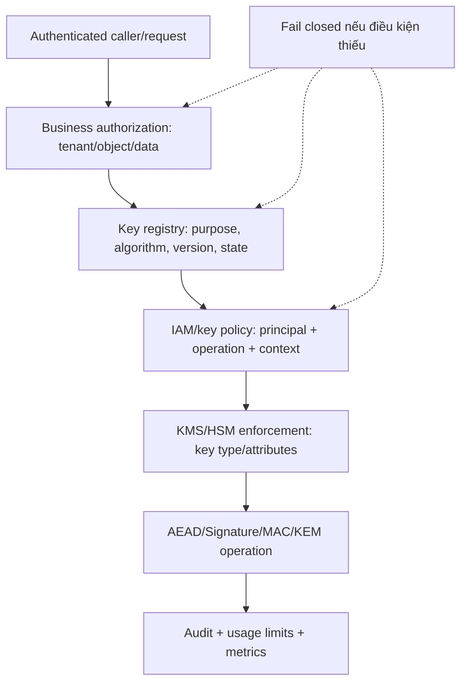
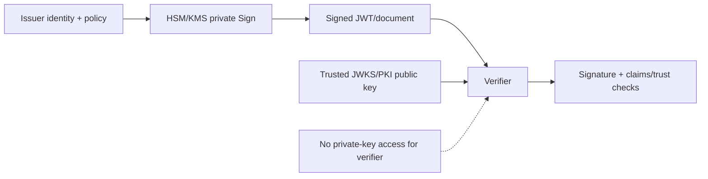
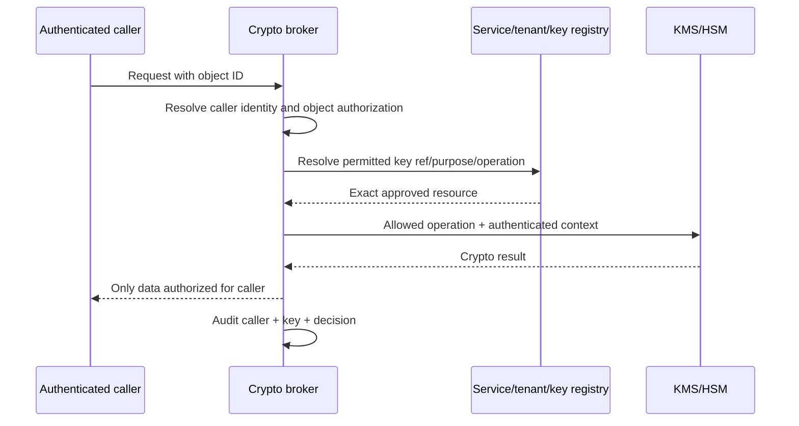
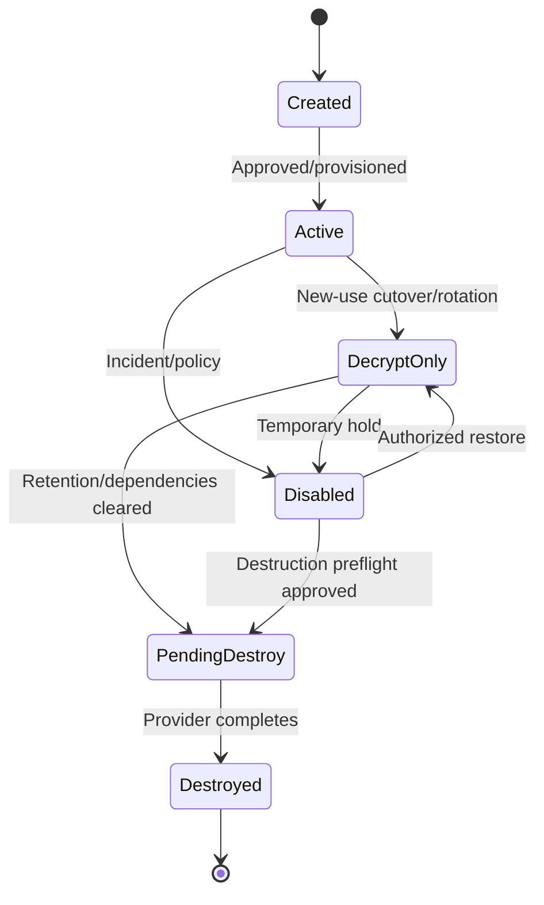

# Key usage restriction

## 1. Key usage restriction là gì?

**Key usage restriction (giới hạn mục đích và quyền sử dụng khóa mật mã)** là việc quy định và thực thi **khóa nào được phép thực hiện phép toán gì, bởi danh tính nào, trong phạm vi dữ liệu/ngữ cảnh nào, ở thời điểm nào và dưới những điều kiện nào**.

Khóa mật mã không phải một “mật khẩu vạn năng”. Một **private signing key** chỉ nên được dùng ký theo mục đích đã phê duyệt; **public verification key** phục vụ xác minh chữ ký; **KEK** bảo vệ DEK qua Wrap/Unwrap; **DEK** mã hóa nội dung; **HMAC key** tạo/kiểm MAC; **private KEM key** phục vụ decapsulation theo giao thức. Dùng đúng thuật toán nhưng dùng **sai mục đích, sai principal hoặc sai tenant** vẫn có thể gây sự cố nghiêm trọng.

Ví dụ: hệ thống hóa đơn có một KEK trong KMS. Nếu `invoice-writer` chỉ cần **Wrap/GenerateDataKey**, cấp thêm quyền `Decrypt/Unwrap` toàn bộ dữ liệu lịch sử sẽ mở rộng tác động nếu service bị chiếm. Tương tự, một private signing key có thể nằm trong HSM không export được nhưng tài khoản có quyền `Sign` vẫn có thể yêu cầu ký thông điệp trái phép. **Non-exportable không đồng nghĩa không thể lạm dụng key operation**.

Bài thuộc chương **Key use** của module `SECURITY_KEY_MANAGEMENT_FUNDAMENTALS`, liên kết trực tiếp với vòng đời khóa từ **tạo, cấp phát, lưu trữ, sử dụng, xoay vòng đến thu hồi và hủy**, cùng mật mã đối xứng/bất đối xứng, chữ ký số, KMS/HSM, **envelope encryption**, IAM và kiểm toán. Key usage restriction là lớp bảo vệ tại **thời điểm dùng**, bổ trợ cho việc sinh và lưu khóa an toàn.

### 1.1. Mục tiêu học tập

Sau bài học, bạn có thể:

1. Phân biệt **key purpose, allowed operation, principal authorization, data authorization, cryptoperiod và key state**.
2. Xác định phép toán thích hợp cho **DEK, KEK, AES-GCM, HMAC, signing key, KEM/DH key và public key**.
3. Thiết kế chính sách **deny by default**, least privilege và separation of duties theo service, tenant, environment và thời hạn.
4. Hiểu giới hạn của **IAM/key policy/KMS grants, HSM key attributes, X.509 KeyUsage/EKU, JWK `use`/`key_ops`**.
5. Phân biệt **originator use period** với **recipient use period** khi rotation, legacy decryption và signature verification.
6. Ràng buộc operation với **key ID/version, purpose, encryption context/AAD và dữ liệu nghiệp vụ**.
7. Nhận biết rủi ro **confused deputy, cross-tenant decrypt, signing oracle, MAC forgery, exported secret và API abuse**.
8. Xây dựng ví dụ **Java 17** với policy deny-by-default và AES-GCM để mô phỏng key ACTIVE/DECRYPT_ONLY.
9. Lập **ma trận kiểm thử**, sự kiện audit, chỉ số vận hành và runbook xử lý sự cố cấp quyền quá rộng.
10. Tổ chức rotation, revoke, key compromise, backup/DR và destruction mà không làm mất khả năng đọc dữ liệu cần giữ.

## 2. Bản chất của hạn chế sử dụng khóa: năm câu hỏi

Trước mỗi key operation, hệ thống cần trả lời được:

| Câu hỏi | Ví dụ | Lớp thực thi chủ yếu |
| --- | --- | --- |
| **Khóa này dùng để làm gì?** | `invoice-kek` chỉ dùng bọc DEK, không dùng ký JWT | Crypto policy, key metadata, HSM/KMS key usage attributes |
| **Phép toán nào được phép?** | Writer `Wrap`, reader `Unwrap`; verifier `Verify`, issuer `Sign` | KMS/HSM operation policy, IAM grants, crypto adapter |
| **Ai được phép gọi?** | Workload `invoice-reader` với principal đã xác thực | IAM, mTLS/workload identity, service authorization |
| **Trên dữ liệu và phạm vi nào?** | Chỉ tenant A, hóa đơn có quyền đọc, môi trường production | Business authorization, tenant mapping, AAD/context |
| **Khi nào và trong state nào?** | v3 đã retired: được Unwrap legacy, không Wrap mới | Key lifecycle policy, key state, cryptoperiod, approval |

Một kịch bản có thể đáp ứng bốn câu đầu nhưng vẫn sai câu cuối: ví dụ **Encrypt bằng key đã hết thời kỳ tạo ciphertext mới**. Ngược lại, key đang ACTIVE và operation hợp lệ nhưng principal không được phép thì vẫn phải từ chối.

### 2.1. Một quyết định an toàn cần ghép nhiều điều kiện

```text
ALLOW(key operation) chỉ khi:

  authenticated principal
  AND principal authorized for operation
  AND exact key/version approved
  AND key purpose/algorithm match
  AND key state and time permit usage
  AND environment/tenant/object access allowed
  AND context/AAD/wrapping policy satisfied
  AND required approvals/limits are satisfied

Nếu thiếu hoặc không xác minh được điều kiện bắt buộc:
  DENY hoặc DEFER theo policy; không tự suy ra ALLOW.
```

**Chính sách mặc định nên là không cấp quyền**. Không nên dùng `allow=true` nếu trường metadata trống, không tìm thấy owner hoặc KMS trả lỗi rồi tự chuyển sang key local.

### 2.2. Authentication khác authorization

- **Authentication:** biết caller là `invoice-writer` hay `invoice-reader` bằng workload identity/mTLS/token đáng tin.
- **Authorization:** caller đó **được phép làm gì** với key nào và object/tenant nào.
- **Cryptographic enforcement:** key metadata, provider/HSM attributes và thuật toán **không cho dùng** sai loại hoặc sai operation khi hỗ trợ.
- **Data authorization:** user/business principal có quyền xem hóa đơn hay không; KMS `Decrypt success` **không chứng minh** điều này.

Một TLS/mTLS certificate hợp lệ chỉ xác nhận peer theo cấu hình; nó không cấp quyền giải mã toàn bộ dữ liệu nghiệp vụ.

## 3. Taxonomy: không dùng mọi khóa cho mọi operation

Một số phép toán thường gặp:

| Operation | Mục đích | Key material điển hình | Điều kiện quan trọng |
| --- | --- | --- | --- |
| **Encrypt** | Mã hóa nội dung | AES DEK | AEAD suite đúng, nonce uniqueness, data authorization |
| **Decrypt** | Giải mã và xác thực ciphertext | Cùng AES DEK | Tag/AAD hợp lệ, đúng object/tenant/version |
| **Wrap/EncryptKey** | Bảo vệ khóa khác | KEK/wrapping key | Scheme, integrity, recipient/context binding |
| **Unwrap/DecryptKey** | Khôi phục DEK từ wrapped form | KEK và key ref đúng | IAM, retention, no key export ngoài mục đích |
| **Sign** | Ký thông điệp/token | Private signing key | Key purpose, nội dung được phép ký, approval/rate limit |
| **Verify** | Xác minh chữ ký | Public verification key | Trust store/JWKS/PKI và claims policy |
| **GenerateMac** | Tạo MAC | HMAC/CMAC secret | Shared-secret custody, message policy |
| **VerifyMac** | Kiểm MAC | Cùng MAC secret hoặc HSM capability | Không suy ra “verify-only” nếu có raw bytes |
| **DeriveKey** | Dẫn xuất subkey | Master/IKM/DH shared secret | KDF chuẩn, context/domain separation, scope |
| **Encapsulate** | Tạo shared secret + KEM ciphertext | Public encapsulation key | Public-key authenticity, protocol binding |
| **Decapsulate** | Khôi phục shared secret từ KEM ciphertext | Private decapsulation key | IAM, error handling/oracle resistance |
| **Import/Export** | Đưa material qua trust boundary | Key material/wrapped package | Custody, approval, provenance, audit |
| **Rotate/Disable/Destroy** | Quản trị vòng đời | Key reference/metadata | Separation of duties, dependencies, retention |

**Chú ý:** các tên `Wrap`, `GenerateMac` hoặc `Decapsulate` là mô tả nghiệp vụ. Tên API và phân quyền thực tế thay đổi theo provider, key type và SDK. Không tự giả định cloud KMS nào cũng hỗ trợ tất cả các operation trên cùng một key object.

### 3.1. Chọn đúng thuật toán trước khi chọn operation

- **AES-GCM** là mã hóa đối xứng có xác thực, không phải chữ ký số.
- **HMAC-SHA256** tạo MAC bằng shared secret, không có public verification key.
- **Ed25519** là chữ ký số, không phải cặp khóa ECDH dùng để mã hóa dữ liệu.
- **X25519/ECDH** dùng thỏa thuận shared secret, không trực tiếp là chữ ký số.
- **KEM** tạo shared secret qua encapsulation/decapsulation; dữ liệu vẫn cần KDF/AEAD phù hợp.
- **HKDF** dùng tách subkeys từ input đủ entropy, không phải password hashing thay Argon2id/PBKDF2.
- **RSA-OAEP** dùng cho các trường hợp mã hóa/transport khóa theo protocol; **RSA-PSS** phục vụ chữ ký, không tự hoán đổi purpose.

Một API chạy thành công không đủ chứng minh operation **được phép theo thiết kế**.

## 4. Key purpose separation và nguyên tắc sử dụng một khóa cho một mục đích

**Key purpose separation** là tránh dùng cùng vật liệu khóa cho những chức năng độc lập khi không có phân tích giao thức và chính sách cụ thể.

Ví dụ:

```text
Sai:
  secretK = 32 bytes
  AES-GCM encrypt with secretK
  HMAC-SHA256 with secretK
  password reset token = hex(secretK)
  use secretK to derive another key by ad-hoc hashing

Đúng theo mẫu thông dụng:
  DEK_AES    <- CSPRNG/KMS or approved KDF context "invoice/aead/v1"
  HMAC_KEY   <- CSPRNG/KMS or approved KDF context "webhook/mac/v1"
  TOKEN_KEY  <- CSPRNG/KMS or approved KDF context "token/v1"
  KEK        <- managed KMS/HSM, restricted to wrapping purpose
```

### 4.1. Vì sao reuse nguy hiểm?

Khi một key dùng nhiều mục đích, compromise ở một interface có thể ảnh hưởng các interface khác:

- Service chỉ cần tạo HMAC nhưng được cấp raw AES DEK.
- Một bug trong API ký cho phép ký dữ liệu mà hệ thống khác chấp nhận như authorization token.
- Một KEK có thể dùng trực tiếp để mã hóa payload lớn, phá ranh giới quản lý DEK.
- Giám sát không phân biệt purpose nên khó xác định phạm vi ảnh hưởng khi key bị lộ.

Không phải mọi reuse đều không an toàn về mặt toán học trong mọi protocol. Nhưng **mặc định nên tách các mục đích** và chỉ cho phép reuse khi một thiết kế được phân tích rõ và phê duyệt.

### 4.2. KDF có thể tách miền nếu được thiết kế chuẩn

Nếu hệ thống có một master secret entropy cao, có thể dùng **HKDF** với các giá trị `info`/domain separation độc lập:

```text
High-entropy master secret
           |
           v
    HKDF approved suite
       /       \
  info=enc/v1  info=mac/v1
      |            |
  AEAD key      HMAC key
```

Các subkeys có thể độc lập về sử dụng theo security proof của KDF và các giả định phù hợp. Tuy nhiên **master key compromise có thể ảnh hưởng tất cả derived keys**, nên phải quản lý quyền `DeriveKey` và không xuất master secret khi không cần thiết.

## 5. Bốn lớp chính sách cần thực thi đồng thời



### 5.1. Layer 1 — Kiểm soát nghiệp vụ

Business service cần xác định:

- Caller có quyền **đọc/ghi/ký** object cụ thể không?
- Object thuộc **tenant** nào và classification nào?
- Hành động có nằm trong workflow hợp lệ (ví dụ chỉ ký manifest đã được duyệt)?
- Cần approval, quota, rate limit hoặc hạn chế thời gian không?

KMS thường không biết các rule nghiệp vụ này. Vì vậy, một principal có `Decrypt` chưa được phép trả mọi plaintext cho người dùng.

### 5.2. Layer 2 — Trusted key registry

Registry giữ metadata **key ID/version, owner, environment, purpose, algorithm, state, consumers và cryptoperiod**. Caller không được tự đưa một KMS URI bất kỳ để crypto broker gọi.

Một registry có giá trị phải:

- Được thay đổi qua workflow có quyền, audit và review.
- Duy trì **exact key/version mapping** cho dữ liệu lịch sử.
- Không lưu raw KEK/private key chỉ để tiện lookup.
- Phân biệt key **active for new use** và key **legacy decrypt/verify**.
- Thống nhất key metadata với provider Describe/attributes và inventory.
- Hỗ trợ kiểm kê dependency để biết có thể retire/destroy version nào.

### 5.3. Layer 3 — IAM/key policy/grants

IAM hoặc key policy kiểm tra principal có quyền gọi **operation trên resource thực**. Phải hạn chế theo môi trường, service, region và context mà provider hỗ trợ; có thể thêm time-bound approvals và conditional grants.

**Chú ý về hiệu lực:** identity policy **ALLOW** không tự bảo đảm request được chấp nhận nếu resource/key policy còn DENY, và ngược lại; semantics phụ thuộc provider. Không mô tả mô hình IAM của mọi hãng như một phép OR/AND cố định.

### 5.4. Layer 4 — HSM/KMS key attributes

Một số HSM có key attributes/usage flags ở mức object, ví dụ:

- Khóa chỉ được `Encrypt` hay `Decrypt`.
- Private key chỉ được `Sign` hoặc `Unwrap`.
- `extractable=false` hoặc đặc tính tương đương.
- Key được tạo trong token/partition cụ thể.

Các thuộc tính này **có thể tạo ranh giới cứng** hơn logic application, nhưng phụ thuộc algorithm, provider, token và key lifecycle. **Không giả định một flag chỉ hiện trên giao diện đã được module cryptographic enforce**; cần kiểm thử API thực tế và kiểm tra sản phẩm.

### 5.5. Không cấp quyền dùng khóa bằng cách đưa raw bytes

Nếu ứng dụng có **raw HMAC/AES key bytes**, bạn khó áp dụng chính sách “chỉ Verify” ở tầng provider đối với chính những bytes ấy: caller có thể tạo MAC/giải mã trực tiếp bằng thư viện cục bộ.

Muốn ràng buộc operation cần:

1. **Không phát raw material** khi có thể.
2. Chỉ cấp một **cryptographic capability** qua KMS/HSM/crypto broker.
3. Đặt quyền operation ở tầng provider và ràng buộc purpose/identity.
4. Tách quyền quản trị và quyền dùng; audit các lời gọi.

Một secret manager giúp quản lý phân phối raw secret nhưng **không tự thực thi giới hạn operation sau khi bytes đã được lấy**.

## 6. Ràng buộc key usage theo người dùng, workload và vai trò

### 6.1. Dùng workload identity thay vì chia sẻ credential

Hệ thống production nên phân biệt principals:

| Principal | Nhu cầu hợp lệ | Không nên mặc định có |
| --- | --- | --- |
| `invoice-writer` | Tạo DEK hoặc Wrap/Encrypt cho dữ liệu mới | Unwrap/Decrypt mọi hóa đơn lịch sử |
| `invoice-reader` | Unwrap/Decrypt đối tượng đã được cấp quyền | CreateKey, Rotate, Destroy hoặc Sign JWT |
| `auth-issuer` | Sign bằng signing key cụ thể | Export private key, sửa JWKS trust tùy ý |
| `jwt-verifier` | Verify bằng trusted public key | Private Sign |
| `webhook-producer` | GenerateMac cho message hợp lệ | Export HMAC secret, dùng MAC key sang AES |
| `webhook-consumer` | VerifyMac; nếu có raw secret thì cần quản trị rủi ro | Quản trị key, vô hiệu hóa audit |
| `backup-restore` | Legacy Unwrap/Decrypt trong DR workflow | Quyền production thường trực không hạn chế |
| `key-administrator` | Provision/Rotate/Disable theo approval | Tự decrypt mọi data hoặc tự destroy không kiểm soát |
| `security-auditor` | List/Describe/read audit evidence | Encrypt/Decrypt/Sign/Destroy hoặc xem raw secret |
| `incident-responder` | Cô lập/quản trị theo break-glass | Bỏ qua approval, retention, logging tùy ý |

Tài khoản chung `crypto-admin` vừa sửa policy vừa giải mã payload và xóa log làm tổ chức khó phát hiện key abuse và khó quy trách nhiệm.

### 6.2. Role-based và attribute-based restrictions

**RBAC** là giới hạn theo role: `invoice-writer` có `Encrypt`. **ABAC**/policy theo thuộc tính có thể xét thêm:

- `environment=prod`;
- `tenantId=tenant-01`;
- `keyPurpose=invoice-payload`;
- `dataClassification=confidential`;
- `region=approved-region`;
- `requestTime` trong cửa sổ bảo trì;
- `approvalRef` được ký/đã xác thực;
- `deviceTrust` hoặc ràng buộc endpoint khi hệ thống yêu cầu.

**Role name không phải nguồn chân lý.** Các attributes phải đến từ identity provider và domain registry đáng tin; đừng tin `X-Role`, `tenant` hoặc `userId` trong header do caller tự điền.

### 6.3. Least privilege và time-bound access

Các permission có phạm vi nhạy cảm như `Decrypt, Unwrap, Sign, Export, ScheduleDestroy` nên:

- Scope tới đúng key resource/version khi khả thi.
- Giới hạn thời gian/grant expiration đối với công việc bất thường.
- Ghi người phê duyệt khác người thực hiện.
- Giới hạn API/cost/rate để giảm abuse.
- Thu hồi khi service nghỉ, principal bị compromise hoặc dự án kết thúc.
- Có cơ chế kiểm tra grant thật, không chỉ bảng role documentation.

## 7. Hạn chế theo trạng thái và thời gian của khóa

Key usage restriction là một phần của **key lifecycle**. Khóa có thể còn tồn tại nhưng **không còn được dùng cho operation mới**.

| Trạng thái chính sách | Encrypt/Wrap/Sign mới | Decrypt/Unwrap/Verify lịch sử | Hành vi quản trị |
| --- | --- | --- | --- |
| **Created/Pending approval** | Không | Không, trừ test có phép | Chờ approval và activation |
| **Active** | Có nếu được phép | Có nếu được phép | Monitor usage/version |
| **Decrypt-only/recipient-use** | **Không** | Có trong hạn cho phép | Hỗ trợ legacy data |
| **Disabled/Suspended** | Không | Thông thường không qua API | Có thể điều tra/khôi phục theo policy |
| **Revoked trust/compromised** | Không | Quyết định riêng theo loại key, dữ liệu và trust | Incident workflow |
| **Pending destruction** | Không | Theo provider policy; thường bị chặn | Kiểm dependencies/retention |
| **Destroyed** | Không | Không nếu material thật sự đã bị hủy | Lưu audit metadata cần thiết |

**Đây là state machine nghiệp vụ minh họa.** Một provider có thể chỉ có `Enabled/Disabled/PendingDeletion`, không có trạng thái `Decrypt-only` native. Khi đó phải **thực thi policy originator/recipient ở IAM/broker**; không gắn cờ giả vào key rồi mặc định HSM tự hiểu.

### 7.1. Originator-usage period và recipient-usage period

- **Originator use:** thời kỳ key được phép **tạo dữ liệu/chữ ký/MAC mới**.
- **Recipient use:** thời kỳ key hoặc public verification material còn cần để **đọc/xác minh dữ liệu lịch sử**.

Hai thời kỳ có thể khác nhau. Với KEK v3:

```text
2026-01             2026-07                 2027-07
   |--------------------|------------------------|
   KEK v3 Wrap mới      Retire v3                Retention kết thúc
   & Unwrap hợp lệ      Chỉ Unwrap lịch sử        Xem xét destroy v3
   ^                    ^
   originator end       recipient may continue
```

Không được tiếp tục **Wrap mới** bằng v3 sau khi policy đã retire cho new use chỉ vì vẫn cần v3 để Unwrap backup. Cần tách hai phép toán cả ở tài liệu policy lẫn enforcement.

### 7.2. Signing key cũ và quyền Verify

Khi private signing key retired:

- Issuer phải dừng **Sign mới** bằng private key cũ.
- Verifier có thể cần public key cũ để **xác minh chữ ký lịch sử** tùy trust, expiry và validation policy.
- Nếu private key bị compromise, **toán học của chữ ký cũ không đổi**, nhưng policy chấp nhận chữ ký có thể thay đổi.
- Với JWT/JWS, phải xem **JWKS rollout, issuer/audience, expiry, revocation và cache**; không chỉ xóa private key ở issuer.

### 7.3. Key expiration không đồng nghĩa tất cả dữ liệu đã hết hạn

Một key có thể vượt **cryptoperiod cho Encrypt mới** nhưng vẫn phải đọc bản ghi thuộc **data retention**. Trước khi destroy, cần kiểm kê **live data, archive, backup, queue, external consumers và legal hold**, không chỉ xem `lastUsedAt`.

## 8. Ràng buộc theo algorithm và cryptographic parameters

Một key chỉ được dùng cho algorithm/suite phù hợp:

| Key type | Phép toán được xem xét | Nguy cơ khi cho dùng sai |
| --- | --- | --- |
| AES DEK | AEAD Encrypt/Decrypt, ví dụ AES-GCM | ECB, reuse nonce, không xác thực AAD |
| AES KEK | Key Wrap/Unwrap theo AES-KW/KWP hoặc provider scheme | Dùng trực tiếp mã hóa payload sai mục đích |
| HMAC-SHA256 secret | Generate/Verify HMAC | Trộn key với AES hoặc xác thực thông điệp ngoài domain |
| Ed25519 private key | Sign | Trích raw private key hoặc dùng làm ECDH/KEM key tùy tiện |
| Ed25519 public key | Verify với nguồn trust đáng tin | Tin public key do token/untrusted sender chọn |
| RSA private key | RSA-PSS Sign hoặc RSA-OAEP Decrypt tùy **key purpose/policy** | Dùng cùng key cho các protocol không tương thích |
| X25519 private key | ECDH/derive theo giao thức | Dùng làm Ed25519 Sign |
| KEM private key | Decapsulate theo parameter set | Dùng decapsulation secret ngoài scope/thiếu error handling |
| HKDF source/master | Derive subkeys theo context được duyệt | Derive tùy ý làm lộ quan hệ giữa ứng dụng/tenant |

### 8.1. Không chọn mode/padding từ untrusted request

Nếu API nhận một field `algorithm` do client cung cấp rồi chạy bất cứ cipher nào hỗ trợ, attacker có thể ép vào chế độ yếu hoặc nhầm thuật toán.

Cần **server-side allowlist**:

- Algorithm family và tham số nằm trong policy.
- Key type được provider xác nhận.
- Ciphertext envelope có format version và algorithm suite đã biết.
- Parser từ chối unknown critical fields và algorithm downgrade.
- Không fallback từ AEAD sang CBC/ECB hoặc “decrypt without tag” chỉ để giữ tương thích.

### 8.2. AES-GCM: nonce restriction là một phần của key usage

Một key AES-GCM không được dùng với **nonce lặp dưới cùng key**. Do đó, chính sách key usage cần kiểm soát:

- Nonce strategy (counter/partitioned counter hoặc random với usage bound đúng).
- Số lần `Encrypt` dưới cùng key và sự phối hợp đa instance.
- Key/nonce state qua restart, clone, rollback, backup.
- AAD schema và key/tenant/context binding.
- Chặn Encrypt mới khi gần vượt giới hạn sử dụng.

**CSPRNG không bảo đảm tuyệt đối nonce không trùng** khi dùng random 96-bit nonce ở quy mô lớn. Giới hạn số invocation và rotation policy vẫn cần thiết.

### 8.3. Hạn mức không chỉ để tiết kiệm chi phí

Rate limit và usage quota cho **Decrypt/Sign/Unwrap** có thể giảm blast radius của một principal bị chiếm. Nhưng hạn mức phải phù hợp workload; một đợt DR restore hợp lệ có thể cần lượng Unwrap lớn có approval/time-bound exception.

Không dùng quota làm kiểm soát duy nhất: kẻ tấn công có thể sử dụng số lượng lời gọi nhỏ nhưng có tác động lớn.

## 9. KMS/HSM enforce key usage thế nào?

### 9.1. KMS key purpose/operations

Cloud KMS thường phân biệt loại key và tập phép toán hỗ trợ. Ví dụ một signing key không thể tự biến thành key symmetric decrypt chỉ bằng sửa alias. Tuy nhiên, mức độ chi tiết của operation permission, key version và context khác nhau theo provider.

Auditor/engineer phải kiểm:

1. **Key spec/algorithm/key origin** thực tế tại provider.
2. **Policy/grants** đã hiệu lực và identity đang được sử dụng.
3. **Operation API** được provider hỗ trợ cho key type.
4. **State** của key và khả năng dùng old versions.
5. **Provider encryption context/AAD** có áp dụng cho operation đó không.
6. **Non-exportability** và cách data-key API có thể trả raw DEK.
7. **Logging/metrics** có bao phủ operation và principal không.

### 9.2. HSM/PKCS#11 usage attributes

Trong một số HSM theo PKCS#11, attributes như `CKA_ENCRYPT`, `CKA_DECRYPT`, `CKA_SIGN`, `CKA_VERIFY`, `CKA_WRAP`, `CKA_UNWRAP`, `CKA_DERIVE` hoặc `CKA_EXTRACTABLE` giúp giới hạn capability của object.

**Những lưu ý:**

- Không phải mọi algorithm/implementation cho phép mọi tổ hợp thuộc tính.
- Thuộc tính do token/module quản lý; application policy ngoài HSM vẫn cần IAM.
- `CKA_EXTRACTABLE=false` bảo vệ việc xuất material qua API phù hợp, **không chặn lạm dụng `Sign`** nếu principal có quyền.
- Không nhầm key attribute với chứng chỉ X.509 KeyUsage hoặc JWT metadata `key_ops`.
- Phải xem tài liệu thiết bị, version, allowed mechanisms và actual enforcement; không chỉ dựa vào ảnh chụp cấu hình.

### 9.3. KMS không tự biết object-level authorization

`KMS Decrypt(success)` có nghĩa API được provider cho phép theo contract và tham số; **không chứng minh** người dùng cuối có quyền xem hóa đơn. Nếu crypto broker có quyền Decrypt rộng, business authorization phải được kiểm **trước KMS call** và trước trả plaintext.

### 9.4. Key version và managed rotation

Một số provider luân chuyển backing material **bên trong một logical KMS key**, giữ key ID logic ổn định và để provider tự chọn material cũ khi giải mã ciphertext blob. Trong trường hợp đó:

- Không tự bịa `keyVersion=v3` cho nội bộ provider không expose.
- Key usage restriction có thể áp dụng theo **logical resource và operation**, không phải mọi internal version.
- Nếu ứng dụng quản lý **nhiều key resources/versions riêng**, cần exact mapping.
- Giữ ciphertext/wrapped DEK theo format của provider để hỗ trợ legacy decrypt/restore.

## 10. IAM và separation of duties cho key usage

**Separation of duties (SoD)** nhằm tránh một người có quyền tự tạo, tự duyệt, tự sử dụng và tự xóa dấu vết.

| Tác vụ | Người/phần mềm phù hợp | Xung đột cần kiểm soát |
| --- | --- | --- |
| Đề xuất key/purpose | Data/service owner | Không tự cấp quyền admin vô hạn |
| Phê duyệt CreateKey/rotation | Key owner + security governance | Người tạo không tự duyệt mọi key nhạy cảm |
| Provision key | Key custodian/automation | Không tự cấp Decrypt toàn bộ data |
| Wrap/Encrypt | Writer identity | Không cần Unwrap mọi archive |
| Unwrap/Decrypt | Reader identity sau data auth | Không sửa key policy |
| Sign | Issuer/signing service | Không đồng thời tự kiểm trust/verifier policy khi không kiểm soát |
| Quản trị IAM grants | IAM administrator có workflow | Không tự cấp Sign/Decrypt cho mình và xóa log |
| Schedule/Destroy | Authorized operator với dual control | Không là người yêu cầu và duyệt đơn độc |
| Audit | Independent auditor | Không cần raw key hoặc destructive capability |

### 10.1. Break-glass là một quyền đặc biệt, không phải đường tắt

Một tình huống khẩn cấp có thể cần `Decrypt` hoặc `Disable` vượt quyền thường ngày. Nhưng break-glass vẫn nên:

- Yêu cầu xác minh identity mạnh.
- Ràng buộc mục đích, target key, thời hạn và approval phù hợp.
- Ghi event/alert ngay cả khi workflow thông thường bị gián đoạn.
- Có post-incident review và thu hồi grants.
- Không tắt audit hoặc đưa raw master key vào một file cấu hình chung.

### 10.2. Dual control khác hai tài khoản

Nếu hai approvers đều do cùng một người điều khiển, chỉ đếm hai account IDs không nhất thiết đạt dual control. Tổ chức cần xác minh **danh tính cá nhân, role, quyền ủy nhiệm, target và thời điểm phê duyệt**.

## 11. Key usage restriction trong envelope encryption

**Envelope encryption** tách:

- **DEK:** mã hóa dữ liệu bằng AEAD.
- **KEK:** bọc DEK; thường giữ trong KMS/HSM.
- **Wrapped DEK:** lưu cạnh ciphertext.
- **Key ID/version:** giúp định tuyến đúng KEK qua các thế hệ.
- **AAD/encryption context:** ràng buộc ciphertext và wrapped DEK với metadata, tenant, object hoặc purpose.

```mermaid
sequenceDiagram
    participant W as Invoice writer
    participant R as Trusted key registry
    participant K as KMS/HSM
    participant S as Storage
    participant D as Invoice reader
    W->>R: Resolve approved KEK for invoice Wrap
    R-->>W: Key ref + allowed operation
    W->>K: GenerateDataKey/Wrap with principal + context
    K-->>W: Wrapped DEK + temporary DEK per API
    W->>W: AES-GCM encrypt with fresh nonce and AAD
    W->>S: Store ciphertext, nonce/tag, wrapped DEK, ref/version
    D->>D: Authorize authenticated caller for invoice
    D->>S: Load exact envelope
    S-->>D: Ciphertext + envelope metadata
    D->>K: Unwrap/Decrypt with allowed reader principal/context
    K-->>D: DEK or provider-specific result
    D->>D: AEAD verify/decrypt; return only authorized data
```

### 11.1. Writer và reader không cần cùng KMS grants

Một pattern:

| Identity | `GenerateDataKey/Wrap` | `Unwrap/DecryptKey` | `ScheduleDestroy` |
| --- | --- | --- | --- |
| `invoice-writer` | ALLOW đúng KEK/purpose | DENY | DENY |
| `invoice-reader` | DENY | ALLOW theo tenant/object policy | DENY |
| `backup-restore` | DENY thường ngày | CONDITIONAL/JIT trong DR | DENY |
| `key-admin` | Theo policy provision | DENY nếu không có nhiệm vụ | CONDITIONAL + approvals |

**Điều chỉnh cho provider:** một số `GenerateDataKey` API yêu cầu quyền/điều kiện khác với `Encrypt/Wrap` và trả plaintext DEK. Không áp một bảng nghiệp vụ như IAM JSON của mọi cloud.

### 11.2. Context/AAD ràng buộc usage, không thay authorization

Ví dụ metadata:

```yaml
formatVersion: 2
contentAlgorithm: AES-256-GCM
kekReference: billing/prod/invoice-kek
kekVersion: v4
tenantId: tenant-01
objectId: INV-0042
aadSchema: invoice-payload-v2
wrappedDek: "<opaque-encrypted-dek>"
nonce: "<base64url-nonce>"
ciphertextAndTag: "<base64url-output>"
```

Payload `tenantId/objectId` trong storage có thể bị attacker sửa. Backend cần lấy ownership/tenant từ **authenticated domain context**, đối chiếu với metadata, rồi tạo AAD đúng chuẩn.

Nếu rewrap KEK làm thay `kekVersion` mà `kekVersion` đã nằm trong **payload AAD**, phải cập nhật authentication/tag/payload tương ứng; không chỉ thay wrapped DEK và field version. Có thể dùng thiết kế payload AAD ổn định và wrapping AAD riêng để rewrap nhanh, nhưng phải **authenticate wrapping header/key reference** một cách độc lập.

### 11.3. Không dùng `Decrypt` như oracle hoặc key enumeration

Một crypto broker không nên thử lần lượt tất cả KEKs, hoặc tiết lộ cho caller:

```text
"Key X exists, key Y does not, key Z is disabled"
```

trừ khi đó là metadata được phép xem. Thay vào đó, dùng **exact trusted key reference**, xử lý lỗi an toàn, rate limit và internal audit với request ID. Không cho client tự chọn KMS URI hay provider account theo untrusted header.

## 12. Signing key restriction: chữ ký số, JWT và X.509

### 12.1. Quyền `Sign` là capability có rủi ro cao

Private signing key không export được vẫn có thể bị lạm dụng nếu caller được phép `Sign` bất kỳ byte sequence nào.

Một signing service nên hạn chế:

- **Loại thông điệp:** JWT access token, release manifest, firmware digest, document approval?
- **Issuer/audience/tenant:** các claims và subject nào được ký?
- **TTL/expiry:** JWT có hạn trong policy?
- **Key ID/algorithm:** exact signing key, algorithm allowlist, không `alg=none`.
- **Requester identity:** service được phép hay không?
- **Rate/approval:** giao dịch/firmware cần hai người duyệt hoặc signed build manifest?
- **Audit:** subject/reference, signing request ID, key/version, result, không log private key.

### 12.2. Public Verify khác private Sign



Verifier thông thường **chỉ cần public verification key**. Dùng `kid` như key-selection hint nhưng phải ràng buộc với **trusted issuer/JWKS/PKI**; không tải bất kỳ URL `jku`/`x5u` do token chỉ định nếu không có policy.

### 12.3. X.509 KeyUsage và ExtendedKeyUsage

Một chứng chỉ X.509 có thể mang **KeyUsage** và **ExtendedKeyUsage (EKU)** giúp xác định mục đích của khóa/chứng chỉ:

- KeyUsage có các bit như `digitalSignature`, `keyEncipherment`, `keyAgreement`, `keyCertSign`, `cRLSign`.
- EKU có các mục đích như **TLS server authentication** hoặc **client authentication** trong những profile tương ứng.
- CA/PKI policy quyết định cách kiểm tra và diễn giải certificate constraints.

**Không hiểu đây là firewall cho private key.** X.509 KeyUsage/EKU có hiệu lực khi **verifier hoặc giao thức thực sự validate certificate và purpose**. Một người có raw private key vẫn có thể thử dùng nó ngoài certificate profile ở nơi khác. Vì vậy cần **private key custody và HSM/IAM operation restrictions** bổ sung.

### 12.4. JWT/JWK `use` và `key_ops`

Trong JSON Web Key, metadata có thể khai:

```json
{
  "kty": "OKP",
  "crv": "Ed25519",
  "kid": "issuer-2026-v4",
  "use": "sig",
  "key_ops": ["verify"],
  "x": "<public-key-coordinate>"
}
```

Đây là ví dụ **JWK public key**; `x` là placeholder. `use` và `key_ops` truyền đạt **intended usage**, nhưng **không phải enforcement tự động cho private material**. Bên tiêu thụ phải validate issuer, algorithm, key type, key provenance, purpose và các ràng buộc tương thích theo chuẩn/profile.

Đừng gắn `key_ops: ["verify"]` vào một raw private key rồi tuyên bố nó không thể Sign nếu material đã phân phối cho caller.

### 12.5. Retire signing key nhưng vẫn cần trust lịch sử

Có thể giữ public verification key và chứng cứ chữ ký/PKI/timestamp lâu hơn thời kỳ private key được phép ký mới. Với key compromise, phải xem revocation và trust policy; **việc destroy private key không tự làm những chữ ký trước đó sai về mặt mật mã**.

## 13. HMAC/MAC restriction: “Verify-only” có giới hạn

**HMAC** dùng cùng shared secret để tạo và kiểm tag. Nếu hai service cùng có raw HMAC secret, cả hai đều có thể **GenerateMac** ngay cả khi ứng dụng chỉ viết code `verify()`.

| Mô hình | Có tách Generate/Verify thực sự? | Điều cần xem |
| --- | --- | --- |
| Raw HMAC bytes ở producer và consumer | **Không ở mức vật liệu** | Hai bên đều có capability tạo tag |
| Secret manager trả raw HMAC key | Không, sau khi ứng dụng đã nhận bytes | IAM chỉ kiểm soát lúc lấy secret |
| HSM/KMS key non-exportable với operation policy | **Có thể**, nếu provider hỗ trợ và enforce | Flags/permissions, key type, audit |
| Chữ ký bất đối xứng | Có phân tách private Sign/public Verify | Trust mapping và private-key custody |

### 13.1. Replay protection vẫn cần dù HMAC đúng

Webhook có HMAC hợp lệ vẫn có thể bị **phát lại** nếu server không kiểm timestamp, nonce/event ID, idempotency và expiry window. Usage restriction có thể buộc MAC chỉ áp dụng cho **canonical message** và context cụ thể.

### 13.2. Key rotation cho HMAC

Khi rotate shared secret:

- Producer chuyển sang key mới để tạo MAC.
- Verifier có thể chấp nhận key cũ **trong cửa sổ hẹp được duyệt**.
- Dùng key ID/version có nguồn xác thực để chọn đúng secret.
- Không thử mọi key một cách không giới hạn.
- Khi key lộ, cần xác định message/token đã bị giả, không chỉ thay secret manager value.

## 14. Restriction cho key establishment, DH và KEM

### 14.1. Key agreement có scope và identity

Trong ECDH/X25519, private key dùng tạo shared secret theo protocol; public key của peer **phải được xác thực** để tránh MITM. Một shared secret thường đi qua HKDF/key schedule để dẫn xuất traffic keys hoặc subkeys có domain separation.

Không sử dụng raw ECDH shared secret trực tiếp làm AES-GCM key mà bỏ qua KDF/context và các kiểm tra protocol. Không dùng private ECDH key như private Ed25519 signing key chỉ vì cùng một nhóm đường cong thường được nhắc tới.

### 14.2. KEM encapsulate và decapsulate

Với KEM:

- **Public encapsulation key:** bên gửi sử dụng để encapsulate shared secret.
- **Private decapsulation key:** bên nhận giữ kín, có quyền Decapsulate.
- **KEM ciphertext:** có thể truyền/lưu cùng metadata để bên nhận decapsulate.

Giới hạn cần thiết:

1. Key pair/parameter set đúng policy.
2. Public key nhận từ nguồn xác thực, không bị attacker thay.
3. Decapsulation principal được kiểm soát; không phát private bytes bừa bãi.
4. KDF/AEAD/protocol binding của shared secret được thực hiện đúng.
5. Xử lý invalid ciphertext theo specification, tránh oracle do lỗi quá chi tiết.
6. Key ID/version và archive dependencies được quản lý trước rotation/destruction.

**KEM Decapsulate không tự xác thực sender.** Nếu protocol cần authentication, phải thêm cơ chế được thiết kế đúng.

## 15. Restriction theo tenant, environment và data classification

Một hệ thống nhiều tenant có thể dùng:

- **KEK riêng theo tenant** để giảm blast radius; hoặc
- **KEK dùng chung có context/policy tách tenant**, khi risk model chấp nhận;
- **DEK riêng mỗi object** hoặc mỗi batch/partition.

### 15.1. Không tin tenant header từ client

Một crypto broker có quyền Unwrap cho nhiều tenant là mục tiêu nguy hiểm. Nếu nó thực thi:

```text
request.tenantId = "tenant-02"
request.keyId = "billing/prod/tenant-02/kek"
broker uses broad KMS grant without verifying requester ownership
```

thì service tenant A có thể yêu cầu broker giải mã DEK tenant B. Đây là dạng **confused deputy**: broker dùng quyền của chính mình theo chỉ dẫn không được ủy quyền.

Phương án đúng:



### 15.2. Không cho staging dùng production key

Các môi trường nên có **identity, key resources và policy** tách nhau. Nếu staging có quyền `Decrypt` production để “test cho tiện”, một hệ thống dev/staging thường kém bảo vệ hơn có thể trở thành đường exfiltrate data.

Bản dữ liệu thử nên được **khử nhạy cảm** hoặc mã hóa bằng test keys riêng. Không copy raw production KEK vào test fixture/CI.

### 15.3. Data classification cũng ảnh hưởng usage

Khóa bảo vệ dữ liệu tài chính, sức khỏe, root CA hoặc firmware release có thể cần:

- Stronger authentication hoặc step-up authorization.
- Dual approval cho signing/export/destruction.
- Mức quota/monitoring khắt khe.
- HSM-backed non-exportable custody.
- Ngắn hạn hơn cho grants, không nhất thiết ngắn hơn cho mọi cryptoperiod.
- Audit retention/incident escalation phù hợp.

Những yêu cầu này cần **được policy chính thức chấp thuận**, không tự giả định mọi tổ chức có cùng mức kiểm soát.

## 16. Java 17: mô phỏng key usage restriction theo principle of least privilege

Ví dụ sau dùng **Java 17+** và JCA AES-GCM để cho thấy **chính sách usage được kiểm tra trước phép toán mật mã**.

Mô hình:

- Key `invoice-data-key:v1` ở trạng thái **DECRYPT_ONLY**: không được Encrypt mới.
- Key `invoice-data-key:v2` ở trạng thái **ACTIVE**: writer được Encrypt mới, reader được Decrypt theo policy.
- `invoice-writer` không có quyền Decrypt.
- `invoice-reader` không có quyền Encrypt.
- Quyền và key scope phải khớp **tenant, purpose, key ID/version và thời gian**.
- Envelope có key ID/version, tenant, object và **AAD length-prefixed**.
- Thay key version, ciphertext hoặc object context không được trả plaintext.

**Đây là local demo**, key bytes hiện diện trong một registry của process; **không thay thế HSM/KMS enforcement**. Identity và object ownership ở ví dụ là dữ liệu mô phỏng tin cậy, trong production phải được xác thực từ IAM/DB.

### 16.1. Source: `KeyUsageRestrictionDemo.java`

```java
import java.io.ByteArrayOutputStream;
import java.io.DataOutputStream;
import java.io.IOException;
import java.nio.charset.StandardCharsets;
import java.security.GeneralSecurityException;
import java.security.MessageDigest;
import java.security.SecureRandom;
import java.time.Instant;
import java.util.Arrays;
import java.util.HashMap;
import java.util.Map;
import java.util.Objects;
import java.util.Set;
import javax.crypto.AEADBadTagException;
import javax.crypto.Cipher;
import javax.crypto.KeyGenerator;
import javax.crypto.SecretKey;
import javax.crypto.spec.GCMParameterSpec;

public final class KeyUsageRestrictionDemo {

    enum Operation { ENCRYPT, DECRYPT }
    enum State { ACTIVE, DECRYPT_ONLY, DISABLED, DESTROYED }

    static final String KEY_ID = "billing/invoice-data-key";
    static final String PURPOSE = "invoice-payload";
    static final int GCM_TAG_BITS = 128;
    static final int GCM_NONCE_BYTES = 12;
    static final SecureRandom RNG = new SecureRandom();

    record KeyRef(String id, String version) {}

    // Identity PHẢI được tạo từ authentication layer đáng tin.
    record Identity(
        String principalId,
        String tenantId,
        Set<String> roles
    ) {}

    record KeyMeta(
        KeyRef ref,
        String tenantId,
        String purpose,
        State state,
        Instant notBefore,
        Instant encryptUntil,
        Instant decryptUntil
    ) {}

    record KeyResource(KeyMeta meta, SecretKey material) {}

    // DTO chỉ là demo: production phải defensive-copy byte arrays.
    record Envelope(
        KeyRef ref,
        String tenantId,
        String objectId,
        byte[] nonce,
        byte[] ciphertextAndTag
    ) {}

    static final class TrustedRegistry {
        private final Map<KeyRef, KeyResource> keys = new HashMap<>();

        void register(KeyResource resource) {
            keys.put(resource.meta().ref(), resource);
        }

        KeyResource require(KeyRef ref) {
            KeyResource key = keys.get(ref);
            if (key == null) {
                throw new SecurityException("KEY_NOT_APPROVED");
            }
            return key;
        }
    }

    static SecretKey newAesKey() throws GeneralSecurityException {
        KeyGenerator generator = KeyGenerator.getInstance("AES");
        generator.init(256, RNG);
        return generator.generateKey();
    }

    static void requireAllowed(
        Identity caller,
        KeyResource resource,
        Operation operation,
        String expectedTenant,
        Instant now
    ) {
        if (caller == null || resource == null || operation == null
                || expectedTenant == null || now == null
                || caller.roles() == null) {
            throw new SecurityException("INVALID_AUTH_CONTEXT");
        }

        KeyMeta meta = resource.meta();
        if (isBlank(caller.principalId())
                || isBlank(caller.tenantId())
                || !Objects.equals(caller.tenantId(), expectedTenant)
                || !Objects.equals(meta.tenantId(), expectedTenant)
                || !KEY_ID.equals(meta.ref().id())
                || !PURPOSE.equals(meta.purpose())
                || meta.state() == State.DISABLED
                || meta.state() == State.DESTROYED
                || now.isBefore(meta.notBefore())) {
            throw new SecurityException("KEY_SCOPE_OR_STATE_DENIED");
        }

        switch (operation) {
            case ENCRYPT -> {
                if (meta.state() != State.ACTIVE
                        || !now.isBefore(meta.encryptUntil())
                        || !caller.roles().contains("invoice-writer")) {
                    throw new SecurityException("ENCRYPT_NOT_ALLOWED");
                }
            }
            case DECRYPT -> {
                if ((meta.state() != State.ACTIVE
                        && meta.state() != State.DECRYPT_ONLY)
                        || !now.isBefore(meta.decryptUntil())
                        || !caller.roles().contains("invoice-reader")) {
                    throw new SecurityException("DECRYPT_NOT_ALLOWED");
                }
            }
        }
    }

    static void writeField(DataOutputStream out, String s)
            throws IOException {
        byte[] bytes = s.getBytes(StandardCharsets.UTF_8);
        out.writeInt(bytes.length);
        out.write(bytes);
    }

    // Stable, versioned, length-prefixed AAD.
    static byte[] aad(Envelope envelope) throws IOException {
        ByteArrayOutputStream bytes = new ByteArrayOutputStream();
        try (DataOutputStream out = new DataOutputStream(bytes)) {
            writeField(out, "invoice-payload/aead/v1");
            writeField(out, envelope.ref().id());
            writeField(out, envelope.ref().version());
            writeField(out, envelope.tenantId());
            writeField(out, envelope.objectId());
        }
        return bytes.toByteArray();
    }

    static Envelope encrypt(
        TrustedRegistry registry,
        Identity writer,
        KeyRef selectedKeyFromTrustedConfig,
        String tenant,
        String objectId,
        byte[] plaintext,
        Instant now
    ) throws Exception {
        KeyResource key = registry.require(selectedKeyFromTrustedConfig);
        requireAllowed(writer, key, Operation.ENCRYPT, tenant, now);
        if (isBlank(objectId) || plaintext == null) {
            throw new SecurityException("INVALID_OBJECT");
        }

        byte[] nonce = new byte[GCM_NONCE_BYTES];
        RNG.nextBytes(nonce);
        Envelope header = new Envelope(
            key.meta().ref(), tenant, objectId, nonce, null
        );

        Cipher cipher = Cipher.getInstance("AES/GCM/NoPadding");
        cipher.init(
            Cipher.ENCRYPT_MODE, key.material(),
            new GCMParameterSpec(GCM_TAG_BITS, nonce)
        );
        cipher.updateAAD(aad(header));
        return new Envelope(
            header.ref(), tenant, objectId, nonce,
            cipher.doFinal(plaintext)
        );
    }

    static byte[] decrypt(
        TrustedRegistry registry,
        Identity reader,
        Envelope envelope,
        String expectedTenantFromAuthenticatedDomain,
        String expectedObjectIdFromDomain,
        Instant now
    ) throws Exception {
        if (envelope == null || envelope.ref() == null
                || isBlank(envelope.ref().id())
                || isBlank(envelope.ref().version())
                || isBlank(envelope.tenantId())
                || isBlank(envelope.objectId())
                || envelope.nonce() == null
                || envelope.nonce().length != GCM_NONCE_BYTES
                || envelope.ciphertextAndTag() == null
                || envelope.ciphertextAndTag().length < 16) {
            throw new SecurityException("INVALID_ENVELOPE");
        }

        // expectedTenant/Object được xác thực từ domain layer.
        if (!Objects.equals(
                envelope.tenantId(),
                expectedTenantFromAuthenticatedDomain)
                || !Objects.equals(
                    envelope.objectId(),
                    expectedObjectIdFromDomain)) {
            throw new SecurityException("OBJECT_CONTEXT_DENIED");
        }

        KeyResource key = registry.require(envelope.ref());
        requireAllowed(
            reader, key, Operation.DECRYPT,
            expectedTenantFromAuthenticatedDomain, now
        );

        Cipher cipher = Cipher.getInstance("AES/GCM/NoPadding");
        cipher.init(
            Cipher.DECRYPT_MODE, key.material(),
            new GCMParameterSpec(
                GCM_TAG_BITS, envelope.nonce()
            )
        );
        cipher.updateAAD(aad(envelope));
        return cipher.doFinal(envelope.ciphertextAndTag());
    }

    static boolean isBlank(String s) {
        return s == null || s.isBlank();
    }

    public static void main(String[] args) throws Exception {
        Instant now = Instant.parse("2026-11-28T08:00:00Z");
        TrustedRegistry registry = new TrustedRegistry();
        KeyRef v1 = new KeyRef(KEY_ID, "v1");
        KeyRef v2 = new KeyRef(KEY_ID, "v2");

        registry.register(new KeyResource(
            new KeyMeta(
                v1, "tenant-01", PURPOSE, State.DECRYPT_ONLY,
                Instant.parse("2025-01-01T00:00:00Z"),
                Instant.parse("2026-09-01T00:00:00Z"),
                Instant.parse("2027-09-01T00:00:00Z")
            ),
            newAesKey()
        ));

        registry.register(new KeyResource(
            new KeyMeta(
                v2, "tenant-01", PURPOSE, State.ACTIVE,
                Instant.parse("2026-09-01T00:00:00Z"),
                Instant.parse("2027-09-01T00:00:00Z"),
                Instant.parse("2028-09-01T00:00:00Z")
            ),
            newAesKey()
        ));

        Identity writer = new Identity(
            "principal://prod/billing/writer",
            "tenant-01", Set.of("invoice-writer")
        );
        Identity reader = new Identity(
            "principal://prod/billing/reader",
            "tenant-01", Set.of("invoice-reader")
        );
        Identity otherTenantReader = new Identity(
            "principal://prod/other/reader",
            "tenant-02", Set.of("invoice-reader")
        );

        byte[] message = "invoice=INV-42;amount=1000"
            .getBytes(StandardCharsets.UTF_8);
        Envelope envelope = encrypt(
            registry, writer, v2, "tenant-01", "INV-42",
            message, now
        );
        byte[] recovered = decrypt(
            registry, reader, envelope,
            "tenant-01", "INV-42", now
        );
        System.out.println(
            "Valid decrypt: "
            + MessageDigest.isEqual(message, recovered)
        ); // true

        // v1 DECRYPT_ONLY -> không được Encrypt mới.
        boolean retiredEncryptDenied = false;
        try {
            encrypt(
                registry, writer, v1,
                "tenant-01", "INV-43", message, now
            );
        } catch (SecurityException expected) {
            retiredEncryptDenied = true;
        }
        System.out.println(
            "Retired Encrypt denied: " + retiredEncryptDenied
        ); // true

        // Writer không có role reader -> không được Decrypt.
        boolean writerDecryptDenied = false;
        try {
            decrypt(
                registry, writer, envelope,
                "tenant-01", "INV-42", now
            );
        } catch (SecurityException expected) {
            writerDecryptDenied = true;
        }
        System.out.println(
            "Writer Decrypt denied: " + writerDecryptDenied
        ); // true

        // Tenant khác không thể dùng cùng DEK thông qua service.
        boolean crossTenantDenied = false;
        try {
            decrypt(
                registry, otherTenantReader, envelope,
                "tenant-01", "INV-42", now
            );
        } catch (SecurityException expected) {
            crossTenantDenied = true;
        }
        System.out.println(
            "Cross-tenant denied: " + crossTenantDenied
        ); // true

        // Đổi ciphertext phải bị AEAD tag từ chối.
        byte[] tampered = envelope.ciphertextAndTag().clone();
        tampered[0] ^= 1;
        Envelope altered = new Envelope(
            envelope.ref(), envelope.tenantId(),
            envelope.objectId(), envelope.nonce(), tampered
        );
        boolean tamperRejected = false;
        try {
            decrypt(
                registry, reader, altered,
                "tenant-01", "INV-42", now
            );
        } catch (AEADBadTagException expected) {
            tamperRejected = true;
        }
        System.out.println(
            "Tampering rejected: " + tamperRejected
        ); // true

        Arrays.fill(message, (byte) 0);
        Arrays.fill(recovered, (byte) 0);
        Arrays.fill(tampered, (byte) 0);
    }
}
```

### 16.2. Chạy demo

Lưu file `KeyUsageRestrictionDemo.java` rồi chạy trong terminal với JDK 17+ và provider hỗ trợ AES-256-GCM:

```bash
javac KeyUsageRestrictionDemo.java
java KeyUsageRestrictionDemo
```

Kết quả dự kiến:

```text
Valid decrypt: true
Retired Encrypt denied: true
Writer Decrypt denied: true
Cross-tenant denied: true
Tampering rejected: true
```

### 16.3. Vì sao ví dụ có ý nghĩa?

- **Deny by default:** key thiếu registry, state không hợp lệ hoặc operation sai role bị từ chối.
- **Encrypt và Decrypt là hai quyền riêng:** `DECRYPT_ONLY` không được tạo ciphertext mới.
- **Exact key reference:** envelope ghi `id/version`; không dùng alias `current` cho decrypt lịch sử.
- **Tenant scope:** reader tenant khác bị chặn trước phép toán.
- **AAD canonical:** key ID/version, tenant, object được xác thực cùng ciphertext.
- **AEAD integrity:** sửa ciphertext sẽ thất bại và không trả plaintext chưa xác thực.
- **No hardcoded secret key:** demo sinh AES keys bằng JCA `KeyGenerator`/`SecureRandom`.

### 16.4. Giới hạn của ví dụ

1. **Không có KMS/HSM thật:** Java process nắm `SecretKey`; người chiếm process có thể bỏ qua policy adapter và gọi Cipher trực tiếp. Muốn ràng buộc mạnh cần **KMS/HSM non-exportable + provider operation restrictions**.
2. **Không có IAM thật:** `Identity` được dựng trong demo. Production phải xác thực principal qua workload identity/mTLS/token, không tin record tự gửi.
3. **Không có object-level ACL:** ví dụ chỉ so tenant/object fields; production còn kiểm owner/quyền của user với record từ database đáng tin.
4. **Key metadata có thể bị sửa nếu lưu local:** registry thật cần access control, change approval, integrity và audit.
5. **DEK per key version minh họa:** production envelope thường sinh **DEK riêng cho object/batch** và bọc bằng KEK trong KMS/HSM; không để một AES key lâu dài làm key của mọi record khi threat model không phù hợp.
6. **Nonce random 96 bit:** dùng đúng chiến lược bảo đảm uniqueness/usage bounds ở quy mô production; không coi collision là bất khả thi.
7. **Không có serialization/defensive-copy byte arrays:** record `Envelope` là demo, production phải kiểm schema/limits/copy và atomic persistence.
8. **Không có replay/rollback defense:** AAD xác thực dữ liệu nhưng không tự chứng minh record là version mới nhất.
9. **Không có key destruction, rotation migration/backup:** phải xây runbook riêng trước khi xóa v1.
10. **Không có rate limits/audit thật:** API cần giới hạn Decrypt/Sign và phát hiện lạm dụng.
11. **Cố định thời gian để demo tái lập:** trong production, policy phải lấy thời gian từ nguồn tin cậy, không chấp nhận timestamp do client tự khai.
12. **Không có zeroization tuyệt đối:** `Arrays.fill` trên mảng do app sở hữu không xóa mọi bản sao trong JVM/provider.

**Về an toàn:** không thêm một hàm `decryptUnsafe()` bỏ qua policy chỉ để khắc phục lỗi migration. Đường khẩn cấp phải được phê duyệt, hạn chế và kiểm toán.

## 17. Ví dụ policy-as-code cho key usage

Một policy mô tả được các điều kiện để hệ thống và auditor cùng kiểm tra. Ví dụ YAML học thuật:

```yaml
policyId: invoice-key-usage-v4
scope:
  environment: production
  service: invoice-platform
  tenantScope: tenant-01
key:
  reference: billing/prod/invoice-kek
  keyType: symmetric-wrapping
  origin: managed-kms
  exportable: false
  intendedPurpose: invoice-dek-wrapping
  algorithmSuite: provider-approved-wrapping
defaultDecision: DENY
rules:
  - id: WRITER_WRAP
    principals: [invoice-writer]
    operations: [Wrap, GenerateDataKey]
    when:
      keyState: ACTIVE_FOR_NEW_USE
      businessAction: invoice-create
      tenantOwnershipVerified: true
    decision: ALLOW

  - id: READER_UNWRAP
    principals: [invoice-reader]
    operations: [Unwrap]
    when:
      keyState: [ACTIVE_FOR_NEW_USE, DECRYPT_ONLY]
      businessAction: invoice-read
      objectReadAuthorizationVerified: true
      envelopeContextVerified: true
    decision: ALLOW

  - id: DR_RESTORE
    principals: [backup-restore]
    operations: [Unwrap]
    when:
      emergencyApprovalVerified: true
      timeBoundGrant: true
      restoreTicketPresent: true
    decision: ALLOW_CONDITIONAL
audit:
  include: [principal, keyRef, operation, tenantScope, requestId, result]
  exclude: [rawKey, rawDek, plaintext, bearerToken, password]
```

**Không phải cú pháp IAM của cloud KMS cụ thể.** Những trường như `tenantOwnershipVerified` cần được xác minh tại ứng dụng/crypto broker hoặc enforcement engine tin cậy; KMS không tự hiểu cờ YAML do client đưa tới.

### 17.1. Từ YAML policy tới enforcement

Một pipeline có thể:

1. Chủ sở hữu xác định **key purpose và allowed operations**.
2. Security governance review policy/version và separation of duties.
3. Automation provision KMS/HSM key attributes + IAM grants đúng khả năng provider.
4. Crypto broker/application adapter enforce **business object/tenant context**.
5. Integration tests kiểm các operation được phép và bị từ chối.
6. Runtime audit lưu principal, operation, ref/version, policy decision và provider result.
7. Policy review định kỳ đối chiếu **declared vs configured vs observed**.
8. Key rotation/incident áp dụng state transition có bằng chứng.

**Không tự xem một YAML policy được commit là đã enforce.** Phải kiểm chứng hệ thống hiện chạy đúng cấu hình và mọi đường truy cập không thể bypass nó.

## 18. Thời gian, quota, approval và usage restrictions động

### 18.1. Restriction theo thời gian

Các ví dụ:

- Signing key chỉ được `Sign` release manifest trong cửa sổ phát hành đã duyệt.
- Break-glass `Decrypt` chỉ hiệu lực trong thời hạn incident ticket.
- Retired KEK chỉ được legacy `Unwrap` trong kỳ retention.
- Client certificate/credential hết hạn không còn được chấp nhận.
- Key rotation deadline chặn new-use trên version cũ.

Tránh tin thời gian do caller tự truyền. KMS/broker có thể dùng **server time** và state từ trusted policy store.

### 18.2. Restriction theo số lượng/khối lượng

Một số hệ mã có **giới hạn lượng dữ liệu hoặc số lần mã hóa** với cùng key/nonce strategy. Hạn mức cũng có thể là:

- `Sign` tối đa theo service/quy trình đã duyệt.
- `Decrypt` theo principal/rate/time window để phát hiện exfiltration.
- Quota KMS để giảm API abuse/chi phí.
- AEAD nonce invocation bounds và key rotation thresholds.

Không dùng một quota chung không xét batch/DR, nhưng cũng không cấp quyền vô hạn vì lo ảnh hưởng latency.

### 18.3. Restriction theo approval và nội dung

Với firmware signing, chữ ký chỉ nên được tạo khi:

- Build artifact có hash/manifest được ghi nhận.
- Provenance/CI build đạt kiểm tra cần thiết.
- Hai người hoặc workflow đã phê duyệt release theo policy.
- Signing key đúng product/environment và signer không tự sửa approval.
- HSM ký **digest/message đã được ràng buộc với approval**.

Một HSM non-exportable key chỉ bảo vệ không export material; **nó không tự phân biệt “firmware hợp lệ” với “firmware do attacker upload”**.

## 19. Rotation, revoke và destruction dưới góc độ key usage



Đây là **mô hình chính sách**, không phải API state machine của một KMS cụ thể.

### 19.1. Key rotation không chỉ là đổi alias

Khi rotate từ v3 sang v4:

1. Writer/issuer phải ngừng **Encrypt/Wrap/Sign mới** dưới v3.
2. Reader/verifier có thể tiếp tục **Decrypt/Unwrap/Verify cũ** theo policy.
3. IAM và broker policy cần thể hiện sự khác biệt đó.
4. Ciphertext/wrapped DEK/signatures lịch sử phải có version/trust metadata tương thích.
5. Backup/DR cần giữ khả năng đọc cho dữ liệu còn retention.
6. Giám sát **new-use by old key** để phát hiện producer chưa cutover.

### 19.2. Rewrap khác re-encrypt

- **Rewrap:** chuyển DEK từ KEK cũ sang KEK mới, DEK vẫn giữ nguyên.
- **Re-encrypt:** dùng DEK mới để mã hóa lại payload, thay ciphertext/tag.
- **Signing trust rollover:** cập nhật issuer/verifier/PKI/JWKS, không đơn thuần rewrap private key.

Nếu **DEK đã bị lộ**, rewrap dưới KEK mạnh không khiến DEK cũ bí mật trở lại. Nếu private signing key lộ, hủy bản KMS cũng không tự xóa bản attacker giữ.

### 19.3. Revoke khác Disabled và Destroyed

- **Thu hồi IAM grant**: chặn principal sử dụng key API; key material có thể còn.
- **Disable key**: provider chặn operation trong phạm vi nó quản lý; thường có thể enable lại tùy quyền.
- **Certificate/JWKS distrust/revocation**: ảnh hưởng việc **chấp nhận** chữ ký hoặc trust.
- **Destroy/zeroize**: loại bỏ key material trong phạm vi xác nhận, có thể làm mất khả năng decrypt lịch sử.

Một lỗi `PermissionDenied` không chứng minh key đã Destroyed. Auditor phải kiểm authoritative state và copies/backup.

### 19.4. Destruction preflight

Trước khi destroy KEK/private decapsulation key, cần:

- Exact resource/version và owner.
- Live/archive/queue/backup/external dependencies.
- Legal hold và retention clearance.
- Bằng chứng migration/rewrap hoặc restore compatibility.
- IAM/dual approval và separation of duties.
- Provider operation/state và waiting period theo contract.
- Imported/exported copies assessment.
- Audit/incident hold nếu đang điều tra.

**Không cấp một quyền `Destroy` tự động chỉ dựa vào thời hạn cryptoperiod** khi vẫn còn dữ liệu cần giữ.

## 20. Incident response khi usage restriction bị phá vỡ

Một key có thể được sinh tốt, lưu trong HSM an toàn nhưng vẫn bị **abuse** nếu principal hoặc API policy bị chiếm.

### 20.1. Các loại sự cố cần phân biệt

| Sự cố | Điều thật sự bị đe dọa | Hướng hành động |
| --- | --- | --- |
| Principal được cấp `Decrypt` quá rộng | Unauthorized plaintext/DEK retrieval | Thu hẹp grant, điều tra logs và data scope |
| HSM signer bị lạm dụng `Sign` | Chữ ký giả được tạo dù private key không export | Chặn Sign, trust/revocation review, kiểm chứng signed outputs |
| Raw KEK bị export | Wrapped DEKs có thể bị mở ở ngoài KMS | Key copies assessment, rotation, data incident response |
| Raw DEK bị lộ | Ciphertext tương ứng có thể bị giải mã | Re-encrypt với DEK mới khi cần, backup/exports |
| HMAC secret bị lộ | Attacker có thể tạo MAC hợp lệ | Rotate shared secret, hạn chế overlap, replay analysis |
| KEM private decapsulation key bị lộ | Shared secrets/ciphertexts của giao thức có nguy cơ | Rotate/migrate, đánh giá archival/protocol |
| Legacy key tiếp tục Encrypt/Sign | Dữ liệu mới gắn version quá hạn | Chặn producer, kiểm kê dữ liệu và sửa policy |
| Crypto broker tin tenant header | Cross-tenant confused deputy | Fix authorization, IAM segmentation, incident assessment |
| Admin tắt audit hoặc sửa grants | Mất khả năng phát hiện/truy vết | Tách vai trò, khôi phục log và forensic review |

### 20.2. Runbook rút gọn

1. **Xác nhận event**: principal, operation, key ref/version, data scope, thời điểm, kết quả.
2. **Phân loại**: exfiltration raw material hay **API capability abuse**? Có thể đồng thời.
3. **Giới hạn tác động**: thu hồi grant/session/credential hoặc disable operation/key có kiểm soát.
4. **Giữ bằng chứng**: KMS/HSM logs, broker traces, IAM changes, tickets và timestamps; không copy raw key vào báo cáo.
5. **Khoanh vùng phụ thuộc**: ciphertext, wrapped DEKs, signatures/tokens, backups, tenant, third parties.
6. **Tạo key sạch/credentials mới** từ nguồn được duyệt khi cần.
7. **Migrate**: rewrap/re-encrypt/trust rollout/secret rotation theo loại key và exposure.
8. **Kiểm thử chức năng và restore** trước destructive actions.
9. **Thực thi policy chặn tái diễn**: least privilege, SoD, rate/tenant binding, approval.
10. **Hậu kiểm** và thông báo theo nghĩa vụ áp dụng.

**Không tự xóa KEK production đang bảo vệ backup cần giữ** chỉ vì phát hiện một IAM grant bất thường; ứng cứu phải cân bằng cô lập rủi ro và khả năng phục hồi.

## 21. Kiểm toán và giám sát key usage

### 21.1. Audit event chỉ nên chứa metadata an toàn

```yaml
event: crypto.key.use
eventTime: "2026-11-28T09:00:00Z"
requestId: "req-kuse-0028"
principal: "principal://prod/billing/invoice-reader"
authenticatedService: invoice-reader
tenantScope: tenant-01
objectReference: INV-0042
keyReference: billing/prod/invoice-kek
keyVersion: v4
operation: Unwrap
policyVersion: invoice-key-usage-v4
keyStateAtOperation: DECRYPT_ONLY
authorizationDecision: ALLOW
providerOperationReference: kms-op-0028
result: success
secretMaterialLogged: false
```

Các trường là **schema minh họa**. Không log raw DEK/KEK/private key/HMAC secret/password/seed, plaintext hoặc bearer token. Key ID và object ID có thể nhạy cảm, cần RBAC và retention thích hợp trên chính audit store.

### 21.2. Điều cần theo dõi

| Metric/tín hiệu | Rủi ro/câu hỏi |
| --- | --- |
| `Encrypt/Wrap` bằng key đã retired | Producer chưa cutover, policy bypass |
| `Decrypt/Unwrap` từ principal mới/lạ | IAM drift, compromised workload |
| `Sign` tăng đột biến hoặc ngoài release window | Signing oracle abuse |
| Cross-tenant denied requests | Có thử dò key/authorization không? |
| Quota/operation volume theo key/version | Abuse, nonce/cryptoperiod bounds, capacity |
| `GenerateMac` từ verifier-only workflow | Raw secret/permission separation chưa đúng |
| `Import/Export` ngoài quy trình | Secret custody failure |
| `Disable/Destroy` không có approval | Destructive privilege misuse |
| Unknown key ID/version | Metadata tampering hoặc migration error |
| KMS logs thiếu so với broker/API counters | Logging/ingestion gap |
| Key không có owner/purpose | Key sprawl, unmanaged legacy material |
| Break-glass grant quá hạn | Access chưa được thu hồi |

### 21.3. Audit completeness và tamper resistance là hai việc khác nhau

Một log immutable nhưng chỉ ghi 80% operations **không chứng minh usage được kiểm soát đầy đủ**. Auditor cần đối chiếu:

- KMS provider operation logs và broker/app correlation IDs.
- Principals/grants trong IAM thực tế.
- Inventory/declared key purpose với configured key attributes.
- Key use events theo account/region/tenant.
- Request metrics và log ingestion gaps.
- Local/offline use của key đã export, nơi KMS không nhìn thấy operations.

### 21.4. Phân biệt design effectiveness và operating effectiveness

- **Design:** chính sách quy định writer chỉ Wrap, reader chỉ Unwrap.
- **Operation:** trong kỳ, IAM thực sự chặn writer Unwrap, và KMS logs/negative tests chứng minh điều đó.

Một file YAML nói `DENY` chưa đủ, cũng như screenshot IAM tại một ngày không chứng minh policy đã hoạt động trong cả quý.

## 22. Case study: writer có quyền Unwrap ngoài nhiệm vụ

### 22.1. Bối cảnh

`invoice-platform` dùng envelope encryption:

- `invoice-writer` cần GenerateDataKey hoặc Wrap.
- `invoice-reader` cần Unwrap/Decrypt theo object authorization.
- `backup-restore` cần legacy Unwrap trong DR.
- KMS giữ KEK không export được.
- Writer, reader có service accounts khác nhau.

Một lần cấu hình nhanh đã cấp cùng `kms-crypto-user` role cho cả writer và reader. Role đó cho phép **Wrap lẫn Unwrap**. KMS audit sau đó ghi các lần Unwrap từ writer.

### 22.2. Vì sao đây là vấn đề?

- Writer có thể lấy DEK từ wrapped DEK của hóa đơn lịch sử nếu có ciphertext/context phù hợp.
- Nếu principal writer bị chiếm, attacker có thêm năng lực đọc dữ liệu.
- Non-exportable KEK không giúp chặn `Unwrap` nếu IAM cho phép.
- KMS log `Unwrap success` chưa tự chứng minh dữ liệu đã bị đọc; cần correlation với storage/object access.
- Nếu broker nhận tenantId tự khai, rủi ro có thể mở rộng sang tenant khác.

### 22.3. Điều tra và khắc phục

1. Đối chiếu IAM actual grants, key policy và mọi principal dùng chung role.
2. Kiểm tra KMS usage logs theo key/version, principal, outcome, time, context.
3. So storage/object access events, crypto broker audit và authenticated request identity.
4. Thu hẹp writer grants chỉ còn **new-use operations** được phê duyệt.
5. Giữ reader `Unwrap` theo đúng object/tenant authorization.
6. Tách DR grant với approval/time limit, không cấp vĩnh viễn cho writer.
7. Kiểm thử negative: writer `Unwrap` phải denied; writer `Wrap` hợp lệ còn chạy.
8. Rà soát data exposure và quyết định có cần rotate/re-encrypt hay không.
9. Ghi finding, remediation owner và retest độc lập.

### 22.4. Một finding minh họa

```yaml
findingId: KUSE-2026-014
control: key-usage-least-privilege
condition: invoice-writer had Unwrap permission on production KEK
criteria: writer may only create/wrap data keys for authorized objects
evidence:
  - iam-policy-snapshot-2026-11-28
  - kms-usage-report-kuse-014
risk: unauthorized DEK retrieval if writer principal is compromised
owner: billing-platform
severity: HIGH
correctiveActions:
  - remove-Unwrap-grant-from-writer
  - review-affected-usage-events
  - enforce-tenant-object-context-in-broker
closureTests:
  - writer-Unwrap-denied
  - writer-Wrap-succeeds
  - grants-and-usage-reconciled
status: OPEN
```

Severity ở đây là **ví dụ**, phải được điều chỉnh dựa trên blast radius, dữ liệu, quyền thực tế, compensating controls và bằng chứng.

## 23. Case study: private signing key được dùng ký ngoài quy trình

### 23.1. Bối cảnh

Một tổ chức giữ private Ed25519 key trong HSM để ký **release manifest**. Key non-exportable. Release pipeline chỉ định signer chính thức, nhưng API ký ban đầu chấp nhận **bất kỳ digest** từ một service account chung.

Đối thủ chiếm credential pipeline có thể gọi `Sign` cho một manifest không được phê duyệt. **Không cần lấy private key bytes** để tạo chữ ký hợp lệ.

### 23.2. Kiểm soát cần có

- IAM chỉ cho service signing được phép dùng private key.
- Signing API xác minh **manifest provenance, target product, version, artifact digest và approval**.
- Tách người duyệt release khỏi người quản trị key policy.
- Audit key ID/version, release ID, input digest/reference và approvers; không log private material.
- Rate-limit, anomaly detection và JIT approval cho thao tác nhạy cảm.
- Verifier kiểm đúng public key/PKI, artifact identity và release trust policy.

### 23.3. Nếu key bị lạm dụng

Không thể chỉ “đổi HSM key” rồi coi mọi bản đã ký trong thời gian compromise là đáng tin. Cần:

1. Khoanh vùng signing events và artifacts.
2. Cập nhật signer IAM/credential, khóa đường cấp chữ ký trái phép.
3. Xác định các chữ ký cần distrust/revoke theo trust model.
4. Phân phối public key mới qua kênh xác thực nếu rotation.
5. Quản lý chữ ký lịch sử, verifier caches, offline devices và audit trail.

**Chữ ký kiểm đúng về toán học vẫn có thể bị policy từ chối** nếu key hoặc quy trình ký đã bị compromise.

## 24. Những hiểu nhầm phổ biến

| Hiểu nhầm | Thực tế |
| --- | --- |
| “Khóa AES-256 đủ mạnh nên không cần giới hạn operation.” | Key mạnh vẫn có thể bị dùng sai mục đích, bởi principal không phù hợp. |
| “HSM non-exportable nên không thể lạm dụng.” | `Sign/Decrypt/Unwrap` có thể bị abuse qua API. |
| “IAM cho Decrypt tức user có quyền xem dữ liệu.” | Phải kiểm object/tenant/business authorization. |
| “Một key dùng AES và HMAC không sao vì đều an toàn.” | Nên tách purpose; reuse cần giao thức được phân tích. |
| “Writer cần Wrap thì cấp luôn Unwrap cho dễ.” | Vi phạm least privilege, mở rộng blast radius. |
| “Verifier cần private signing key.” | Thông thường chỉ cần public verification key đáng tin. |
| “JWK `key_ops` tự chặn API dùng sai.” | Metadata phải được verifier/engine thực sự enforce. |
| “X.509 KeyUsage bảo vệ raw private key khỏi mọi cách dùng.” | Certificate constraints chỉ có hiệu lực tại nơi validate; cần custody/provider policy. |
| “HMAC verifier không thể tạo MAC dù biết raw key.” | Ai biết shared secret có thể tạo MAC. |
| “Retired key phải destroy ngay.” | Legacy decrypt/verify và backup có thể còn cần. |
| “Rotate alias làm ciphertext cũ tự chuyển key.” | Wrapped DEK/ciphertext vẫn phụ thuộc version cũ nếu chưa migrate. |
| “KMS provider luôn expose internal key-material version.” | Managed rotation có thể giữ logical key ID và ẩn backing versions. |
| “Timestamp do client gửi đủ để cấp phép.” | Dùng server-trusted time và policy state. |
| “Có mTLS thì request tenant hợp lệ.” | Peer auth khác tenant/object authorization. |
| “AES-GCM nonce random chắc chắn không trùng.” | Cần usage bounds/nonce strategy; random có collision probability. |
| “KMS operation success chứng minh AEAD payload hợp lệ.” | AEAD verify/tag và dữ liệu nghiệp vụ là bước riêng. |
| “Rewrap DEK bị lộ làm nó bí mật trở lại.” | DEK đã có raw copy vẫn lộ; có thể cần re-encrypt. |
| “Hủy private signing key làm JWT cũ sai chữ ký.” | Verifier có thể còn tin public key cũ; cần trust/revocation policy. |
| “Quyền Destroy có thể được cấp tự động theo tuổi key.” | Phải xét retention, legal hold, backup và dual control. |
| “Dùng role `admin` để dễ audit.” | Role rộng gây xung đột quyền và khó truy vết. |
| “Policy YAML ghi DENY nghĩa API đã enforce.” | Phải đối chiếu IAM/provider/broker behavior. |
| “Không thấy event Decrypt tức key chưa từng dùng.” | Local/exported keys và log gaps có thể bị bỏ sót. |
| “Chỉ cần quota để chặn signing abuse.” | Một chữ ký giả quan trọng có thể đủ gây hại. |
| “Một key ID có thể trỏ key tùy ý do client chọn.” | Cần trusted registry, key purpose và allowlist. |

## 25. Ma trận kiểm thử key usage restriction

| Nhóm | Tình huống | Kết quả mong đợi |
| --- | --- | --- |
| **Unknown key** | Caller dùng key ID không có trong trusted registry | DENY trước crypto operation. |
| **Wrong purpose** | Key `jwt-signing` được chọn để Wrap DEK | DENY. |
| **Wrong algorithm** | Header yêu cầu cipher ngoài allowlist | DENY; không downgrade. |
| **Writer role** | Writer gọi Wrap đúng KEK | ALLOW khi object/tenant/state hợp lệ. |
| **Writer misuse** | Writer gọi Unwrap lịch sử | DENY ở IAM/broker/provider khi hỗ trợ. |
| **Reader role** | Reader gọi Unwrap đúng object | ALLOW sau business authorization. |
| **Reader misuse** | Reader gọi CreateKey/Sign/ScheduleDestroy | DENY. |
| **Key state** | Key Disabled được Encrypt/Decrypt | DENY hoặc provider-specific fail closed. |
| **Originator expiry** | Key DECRYPT_ONLY được Encrypt mới | DENY. |
| **Recipient window** | Key DECRYPT_ONLY được Decrypt trong hạn | ALLOW khi retention/auth hợp lệ. |
| **Recipient expiry** | Decrypt sau hạn/retention | DENY hoặc workflow exception được duyệt. |
| **Wrong tenant** | Tenant A chọn key/record tenant B | DENY trước KMS call. |
| **Staging/prod** | Staging principal gọi production KEK | DENY. |
| **Confused deputy** | Broker tin `X-Tenant` tự khai | Test phải thất bại; sửa binding. |
| **KMS API** | App policy ALLOW nhưng provider IAM DENY | Operation vẫn DENY. |
| **Non-exportable** | Caller thử Export private KEK | API/attributes từ chối theo policy. |
| **Signing content** | Signer yêu cầu ký manifest chưa duyệt | DENY dù Sign key hợp lệ. |
| **Verifier trust** | JWS `kid` từ issuer không tin cậy | DENY. |
| **HMAC** | HMAC raw key bị gửi cho verifier-only app | Finding: không còn tách capability bằng policy chữ. |
| **KEM** | Decapsulation key dùng sai suite/context | DENY, không oracle. |
| **GCM tampering** | Sửa ciphertext/tag/AAD | AEAD decrypt thất bại. |
| **GCM nonce** | Encrypt lặp nonce dưới cùng key | Test/monitor phát hiện và xử lý sự cố. |
| **Rate limit** | Sign/Decrypt tăng bất thường | Alert, throttle theo policy. |
| **Break-glass** | Grant hết hạn hoặc thiếu approval | DENY, audit. |
| **Rotation** | Writer vẫn Wrap bằng v3 sau cutover | Alert/finding, không cho new use. |
| **Legacy restore** | Backup còn wrapped DEK v3 | Decrypt theo recipient policy khi còn retention. |
| **Destruction preflight** | Live count=0 nhưng DR snapshot còn phụ thuộc | Chặn destroy. |
| **Audit evidence** | Log có raw DEK/KEK/private key | Vi phạm, xử lý exposure. |
| **Failure mode** | KMS unavailable, policy store lỗi | Fail closed; không fallback hardcoded key. |
| **Incident** | Principal Sign bị compromise | Revoke grants, evaluate signed artifacts/trust. |

## 26. Checklist production cho Key usage restriction

1. **Key purpose:** mỗi key có mục đích rõ (DEK, KEK, Sign, MAC, KEM, master/derive)?
2. **Algorithm:** key type/suite/parameters có khớp chính sách và provider thực tế?
3. **Allowed operation:** Encrypt/Decrypt/Wrap/Unwrap/Sign/Verify/GenerateMac/Derive/Decapsulate được tách rõ?
4. **No arbitrary reuse:** không dùng raw key chung cho AES, HMAC, JWT hay token tùy tiện?
5. **Authentication:** caller là principal đã xác thực qua IAM/mTLS/workload identity?
6. **Authorization:** operation được cấp cho đúng principal và exact key resource/version?
7. **Business scope:** kiểm tenant, object ID/ownership, purpose và classification trước khi dùng/đưa plaintext ra ngoài?
8. **Key registry:** key ID/version/purpose/state/owner được quản lý trong nguồn đáng tin?
9. **Default DENY:** thiếu metadata, IAM/grant, policy store hay context phải fail closed?
10. **Provider enforcement:** có key attributes/KMS purpose flags/grants thực thi thật, không chỉ YAML?
11. **Non-exportability:** private signing key/KEK có thể giữ trong KMS/HSM; vẫn bảo vệ API use capability?
12. **Raw DEK:** app có phải nhận plaintext DEK không; lifetime, memory, logging, storage được kiểm soát?
13. **Separate writer/reader:** writer Wrap/Encrypt, reader Unwrap/Decrypt theo nhiệm vụ, không dùng shared admin principal?
14. **Signing:** Sign chỉ đúng message/issuer/release, có approval và rate limit?
15. **Verification:** verifier dùng public key từ trusted JWKS/PKI, không có quyền Sign?
16. **X.509/JWK:** KeyUsage/EKU/`key_ops` được validate khi áp dụng, không nhầm metadata với HSM enforcement?
17. **HMAC:** raw shared secret không thể bảo đảm verify-only; đã thiết kế đúng capability/risk?
18. **KEM/DH:** sử dụng đúng scheme/parameter set, authenticated peer public key, KDF/context và không có oracle?
19. **Nonce/AAD:** AES-GCM nonce không lặp dưới cùng key, authenticated tenant/object/key metadata và version?
20. **Cryptoperiod:** originator-use và recipient-use được tách; key DECRYPT_ONLY không được new Encrypt/Wrap/Sign?
21. **State:** Created/Active/Retired/Disabled/PendingDestroy/Destroyed được map đúng provider và policy?
22. **Rotation:** new-use cutover, legacy decrypt/verify, key ring và data dependencies đã kiểm?
23. **Backup/DR:** khôi phục được ciphertext lịch sử với đúng key versions trong kỳ giữ?
24. **Rate/quotas:** hạn mức Sign/Decrypt/Unwrap và cảnh báo bất thường đủ để phát hiện lạm dụng?
25. **SoD:** ai tạo, duyệt, dùng, sửa IAM, disable và destroy? Có conflict of interest?
26. **Break-glass:** grant time-bound, target-specific, có approval/audit/review?
27. **Export/import:** vật liệu/bản sao nằm ở đâu, có custody và deletion scope?
28. **Audit:** log principal, operation, ref/version, tenant scope, decision, timestamp, provider result mà không có raw key?
29. **Coverage:** đã so KMS/HSM event logs với broker/API, accounts/regions và local key use chưa?
30. **Negative tests:** wrong role, key, tenant, algorithm, state, expiry, missing policy và tampered data đều bị từ chối?
31. **Incidents:** đã phân biệt key material exfiltration với API capability abuse khi ứng cứu?
32. **Destruction:** chỉ hủy sau khi giải quyết dependencies, retention/legal hold, restore, approval và final state evidence?

**Ghi nhớ:** **Key usage restriction** là nguyên tắc **một khóa được dùng đúng mục đích, bởi đúng danh tính, đúng phép toán, đúng dữ liệu và đúng giai đoạn vòng đời**. Thuật toán mạnh, KMS/HSM non-exportable hay TLS/mTLS không tự thay thế IAM và business authorization. Một chính sách an toàn cần kết hợp **key metadata, trusted registry, provider/HSM enforcement, least privilege, separation of duties, authenticated context, audit và kiểm tra âm tính**. Khi rotation, hãy tách **new-use** khỏi **legacy decrypt/verify**; khi compromise, phân biệt **lộ raw key** với **lạm dụng API**; trước destruction, kiểm kê **toàn bộ dữ liệu và backup phụ thuộc**. Khóa được bảo vệ tốt chỉ thực sự có giá trị khi quyền sử dụng nó cũng được kiểm soát xuyên suốt vòng đời.
