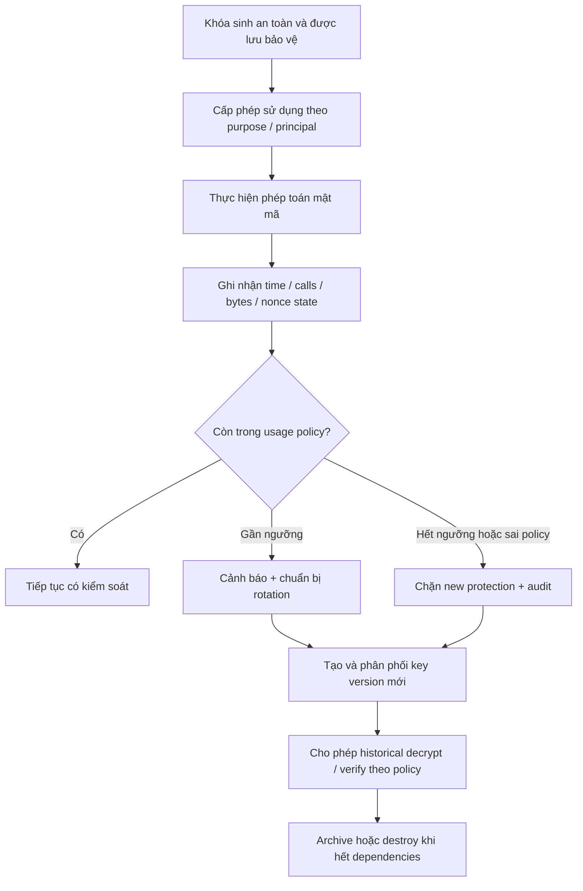
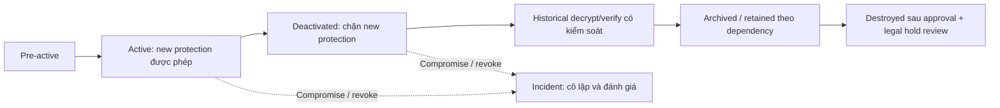
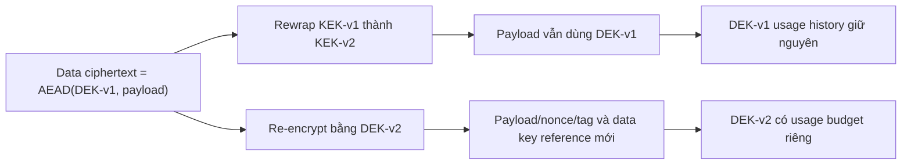
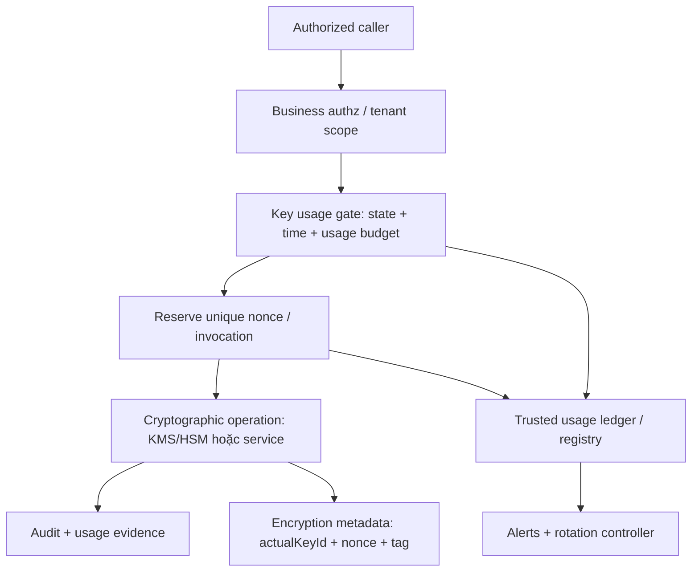
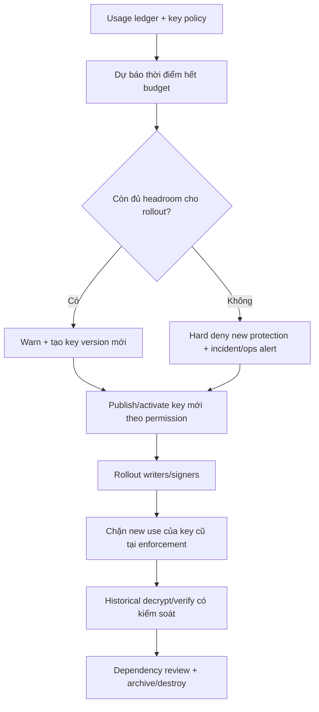

# Key usage limit — Giới hạn sử dụng khóa mật mã

Trong chương **Key use** của module **SECURITY_KEY_MANAGEMENT_FUNDAMENTALS**, **key usage limit** là tập giới hạn xác định **một khóa được phép dùng cho phép toán nào, trong thời gian nào, bao nhiêu lần, trên bao nhiêu dữ liệu và dưới những điều kiện bảo mật nào**. Khái niệm này rất quan trọng vì **một khóa được tạo bằng CSPRNG tốt, lưu trong KMS/HSM và cấp phát đúng cách vẫn có thể trở nên rủi ro nếu bị sử dụng quá mức hoặc sai mục đích**.

Ví dụ: một **AES-GCM DEK** có thể bị dùng lặp nonce nếu nhiều worker cùng mã hóa dưới một khóa; một **private signing key** có thể bị khai thác để ký quá nhiều giao dịch nếu API không giới hạn phạm vi; một **KEK** có thể tiếp tục bọc DEK mới sau thời điểm đáng lẽ phải ngừng; hoặc một **JWT signing key** đã hết cryptoperiod vẫn được dùng ký token mới tại một region chưa nhận chính sách rotation.

**Key usage limit không phải chỉ một con số `maxRequests`.** Cần kết hợp **cryptographic limit** (giới hạn do thuật toán/mode và phân tích bảo mật), **policy limit** (giới hạn do tổ chức đặt ra), **lifecycle limit** (thời gian và trạng thái khóa), **authorization limit** (ai được dùng khóa làm gì) và **operational quota** (hạn mức phục vụ của API). Những giới hạn này có mục tiêu khác nhau và không thay thế cho nhau.

Bài học kết nối giới hạn sử dụng khóa với **vòng đời khóa từ tạo, cấp phát, lưu trữ, sử dụng, xoay vòng đến thu hồi và hủy**, mật mã đối xứng/bất đối xứng, chữ ký số, KMS/HSM, envelope encryption, kiểm soát truy cập và kiểm toán.

## 1. Mục tiêu học tập

Sau bài này, bạn có thể:

- Giải thích **key usage limit** và phân biệt giới hạn theo **purpose, operation, time, invocation count, data volume, nonce, tenant và security domain**.
- Phân biệt **protection cryptoperiod** với thời gian còn cần **decrypt/verify** dữ liệu lịch sử.
- Hiểu tại sao **AES-GCM nonce uniqueness** và mức dùng khóa là ràng buộc bảo mật, không phải quota tính phí đơn thuần.
- Thiết kế giới hạn riêng cho **DEK, KEK, HMAC key, RSA/ECDSA/Ed25519 signing key, agreement/KEM key**.
- Phân biệt **giới hạn theo thuật toán** với **rate limit, KMS quota, key policy, certificate keyUsage extension và cryptoperiod**.
- Xây cơ chế **atomic reservation, usage ledger, alert, deny, rotation và reconciliation** khi nhiều node hoặc region cùng dùng khóa.
- Đọc ví dụ **Java 17** dùng `AtomicReference` để minh họa kiểm soát quota ở một process, đồng thời nhận biết vì sao code đó **không đủ** cho hệ phân tán hoặc nonce management.
- Thiết kế kiểm thử âm tính, quy trình xử lý khi đã vượt hạn mức và quản trị dữ liệu/backup còn phụ thuộc khóa cũ.

## 2. Cần giới hạn việc dùng khóa vì sao?

Các primitive mật mã thường được phân tích bảo mật dưới **mô hình số lượng phép toán, độ dài bản tin, số lần xác thực hoặc mức độ tiết lộ thông tin có giới hạn**. Khi ứng dụng vượt các giả định đó, khả năng tấn công có thể tăng hoặc các bảo đảm về an toàn không còn phù hợp với mục tiêu đặt ra.

Ngoài lý do toán học, sử dụng khóa quá lâu hoặc quá rộng còn làm tăng **blast radius**:

- Một DEK bị lộ ảnh hưởng nhiều object hơn nếu nó mã hóa hàng tỷ bản ghi.
- Một KEK bị lộ có thể ảnh hưởng rất nhiều wrapped DEK và cả backup.
- Một signing key bị lộ cho phép đối thủ giả mạo tài liệu/token trong phạm vi khóa còn được tin cậy.
- Một HMAC secret dùng chung cho nhiều partner tạo khả năng giả mạo giữa các bên.
- Một key version tiếp tục được dùng sau khi lẽ ra ngừng bảo vệ mới làm trì hoãn rotation và kéo dài thời gian tồn tại secret.



**Không đợi đến lần mã hóa gây nguy hiểm rồi mới rotate.** Hệ thống cần dự đoán mức tiêu thụ, đặt ngưỡng vận hành **thấp hơn giới hạn tuyệt đối áp dụng** và bảo đảm key mới sẵn sàng trước khi chặn key cũ.

## 3. Phân loại các loại giới hạn

| Loại giới hạn | Ví dụ | Điều nó kiểm soát | Không tự bảo đảm |
| --- | --- | --- | --- |
| **Key purpose/operation** | Chỉ `Encrypt`, không `Sign` hay `Wrap`. | Ngăn dùng khóa sai primitive/mục đích. | Không giới hạn tổng số lần dùng nếu không có counter. |
| **Protection cryptoperiod** | Không mã hóa mới sau thời điểm đã duyệt. | Khoảng được tạo **bảo vệ mới**. | Không tự xử lý ciphertext lịch sử. |
| **Invocation count** | Tối đa N lần encrypt/wrap/sign theo key version. | Tổng phép toán được cho phép. | Không tự bảo đảm nonce uniqueness. |
| **Data volume** | Tối đa B byte/khối dữ liệu bảo vệ mới. | Mức xử lý dữ liệu cộng dồn. | Không thay thế giới hạn từng bản tin. |
| **Per-message bound** | Kích thước plaintext/ciphertext tối đa cho mode. | Ngăn một invocation vượt giới hạn thuật toán. | Không giới hạn tổng lần dùng key. |
| **Nonce/IV space** | Không dùng lại nonce dưới cùng AES-GCM key. | Tính duy nhất của trạng thái mã hóa. | Không tự có quota hay counter toàn hệ thống. |
| **Security/tenant scope** | Key chỉ cho tenant A, service X, region Y. | Blast radius và authorization boundary. | Không ngăn attacker đã chiếm đúng principal hợp lệ. |
| **Key-state limit** | Deactivated/compromised/revoked. | Cho phép hoặc chặn loại operation theo trạng thái. | Không tự biết các DEK/backup đang phụ thuộc. |
| **KMS/HSM API quota** | Requests/second, burst, concurrency. | Availability, chi phí, fairness của dịch vụ. | Không tương đương giới hạn an toàn mật mã. |
| **Budget/chi phí** | Chi phí KMS calls theo tenant. | Sử dụng tài nguyên/hóa đơn. | Không thể thay nonce hoặc cryptoperiod policy. |

### 3.1. Hard limit và soft limit

Một policy nên có **hai lớp ngưỡng**:

- **Soft threshold:** gần hết usage budget → phát cảnh báo, tạo khóa mới, chuẩn bị rollout, đối soát các consumer.
- **Hard threshold:** không còn phép toán bảo vệ mới được phép → **fail closed** cho những operation tương ứng.

Ví dụ ngưỡng cảnh báo 70%, 85% và 95% có thể giúp vận hành, nhưng **đây là ví dụ về cách tổ chức cảnh báo, không phải mức chuẩn mật mã**. Giới hạn tuyệt đối cần lấy từ **thuật toán/mode, cấu hình, kích thước bản tin, threat model và chính sách áp dụng**, rồi dành biên an toàn cho hoạt động thực tế.

### 3.2. Cùng một khóa có nhiều “ngân sách”

```text
keyId = billing/dek-v7
algorithm = AES-256-GCM
purpose = encrypt-invoice
protectionUntil = thời điểm đã duyệt
maxNewEncryptCalls = ngưỡng theo policy
maxProtectedBytes = ngưỡng theo policy
noncePolicy = unique per DEK
allowedTenants = [billing-prod]
allowedActors = [billing-writer-role]
historicalDecrypt = policy riêng
```

Đây là **policy logic**, không phải schema của một KMS cụ thể. Một key có thể chưa hết hạn thời gian nhưng **đã hết quota encrypt**, hoặc còn quota nhưng **không được dùng từ region khác**, hoặc chưa hết byte budget nhưng có dấu hiệu **nonce reuse**. Chỉ cần một điều kiện bắt buộc thất bại thì new encryption phải bị từ chối.

## 4. Protection cryptoperiod và thời gian xử lý lịch sử

**Cryptoperiod** là một khái niệm trung tâm trong quản lý khóa. Ở đây cần phân biệt ít nhất hai khoảng:

1. **Protection period:** thời gian khóa được phép tạo bảo vệ mới — ví dụ encrypt, MAC generation, sign hoặc wrap DEK.
2. **Processing/historical-use period:** thời gian khóa hoặc khả năng liên quan còn được giữ để decrypt, verify, unwrap, điều tra, khôi phục hoặc phục vụ nghĩa vụ lưu trữ theo policy.

Cách đặt tên chính thức và chi tiết phụ thuộc tiêu chuẩn/tổ chức; điều quan trọng là **không đánh đồng hết hạn dùng cho bảo vệ mới với việc phải hủy toàn bộ khả năng xử lý dữ liệu cũ**.



### 4.1. Khóa cũ được phép decrypt nhưng không encrypt mới

Ví dụ khóa AES-GCM dùng mã hóa tài liệu:

- Trong protection period, workload writer được phép `Encrypt` trong hạn mức.
- Khi rotation, key bị chuyển sang **deactivated logic**: **không mã hóa dữ liệu mới bằng key cũ**.
- Reader được phép `Decrypt` ciphertext lịch sử trong một thời gian nhất định và theo quyền nghiệp vụ.
- Khi toàn bộ dữ liệu và backup đã migrate/hết retention, có thể hủy khóa theo thủ tục.

**Không suy rằng nút `DisableKey` của một KMS tương đương “chỉ chặn encrypt mới”.** Nhiều provider có thao tác disable chặn **cả encrypt và decrypt/unwrap**; cần hiểu semantics thật trước khi áp dụng.

### 4.2. Key compromised không chỉ là “hết hạn”

Nếu key material đã bị lộ hoặc có dấu hiệu bị lạm dụng, **không giữ trạng thái historical-use một cách máy móc**. Incident team phải đánh giá data exposure, chữ ký giả, trust, wrapped DEK và yêu cầu khôi phục. Có thể cần chặn cả decrypt/unwrap trong tình huống nhất định hoặc cấp đường forensic/recovery hạn chế.

### 4.3. Protection validity và certificate validity khác nhau

Một **X.509 certificate** có `notBefore/notAfter` và extension **keyUsage** như `digitalSignature` hay `keyEncipherment`. Những trường này nói về **chứng chỉ và mục đích sử dụng khóa theo PKI**, **không tự tạo bộ đếm “tối đa 10.000 chữ ký”**.

Tương tự, token JWT có `exp` không làm private signing key tự hết quyền `Sign` trên KMS. Token lifetime và signing-key cryptoperiod phải được quản trị riêng.

## 5. Giới hạn dùng AES-GCM: nonce là ràng buộc số một

Khi AES-GCM mã hóa hai bản tin dưới **cùng key và cùng nonce**, các bảo đảm về confidentiality và integrity có thể bị tổn hại nghiêm trọng. Vì vậy **nonce uniqueness theo key** là điều kiện bắt buộc của cách dùng GCM thông thường.

### 5.1. Nonce, IV, tag và số lần gọi

```text
Encrypt:
  DEK = AES-256-GCM key
  nonce = giá trị unique cho DEK này
  AAD = tenantId, objectId, version
  payload = plaintext bytes
  result = ciphertext + authentication tag
```

Các biến ảnh hưởng risk gồm:

- **Tổng số lần mã hóa dưới cùng DEK**, cả nhiều process/region.
- **Chiều dài từng plaintext/AAD** và tổng lượng dữ liệu xử lý.
- **Cách tạo nonce:** random, counter, namespace theo writer hay scheme khác.
- **Độ dài authentication tag** theo protocol và mức cho phép.
- **Số lần attacker thử tạo ciphertext/tag giả** và số truy vấn giải mã.
- **Thời gian key còn hoạt động** và khả năng state bị reset sau lỗi/restore.

**Không có một “mức an toàn theo số lần dùng AES-GCM” phổ quát cho mọi cấu hình**. Giới hạn cụ thể phụ thuộc mode, IV construction, tag length, message lengths, phân tích an toàn và chính sách. Đọc tài liệu thuật toán/provider và các tiêu chuẩn áp dụng trước khi đặt hard limits.

### 5.2. Nonce ngẫu nhiên 96 bit vẫn có xác suất trùng

Với nonce 96 bit **độc lập và phân phối đều**, xác suất va chạm xấp xỉ theo birthday bound khi số lần mã hóa \(q\) còn đủ nhỏ so với không gian nonce:

\[
P_{\mathrm{collision}} \approx \frac{q(q-1)}{2^{97}}
\]

Công thức chỉ mô tả **va chạm nonce ngẫu nhiên lý tưởng**, không thay phân tích an toàn toàn diện của GCM. Nó cũng không áp dụng nguyên xi cho cơ chế counter đã phân hoạch hoặc RNG lỗi. Khi nhiều worker cùng dùng một DEK, \(q\) là **tổng các invocation liên quan tới DEK trên tất cả worker**, không phải số lần mỗi worker thấy.

**Kết luận thực tiễn:** chỉ đặt nonce là “12 random bytes” không đủ làm usage policy cho key có lưu lượng lớn và thời gian sống dài. Cần tính **global invocation budget**, lựa chọn chiến lược uniqueness và rotation trước khi gần giới hạn đã được phê duyệt.

### 5.3. Counter nonce phải không bị reset hoặc cấp trùng

Một số hệ thống sử dụng nonce dựa trên counter hoặc phân chia miền:

```text
Writer A:
  key DEK-X, reserved nonce range A

Writer B:
  key DEK-X, reserved nonce range B

A và B không bao giờ phát cùng nonce dưới DEK-X.
```

Phải giải quyết:

- **Crash/restart:** counter tiếp tục từ state đã lưu bền vững hoặc bỏ hẳn dải chưa chắc đã dùng.
- **VM snapshot/clone:** không tái sử dụng state cũ.
- **Active-active:** cấp vùng nonce không giao nhau; tránh hai leader cùng cấp một range.
- **Failover:** region B không bắt đầu counter 0 nếu A đã dùng giá trị đó dưới cùng DEK.
- **Overflow:** chặn new encryption trước khi vượt không gian/budget đã phân phối.
- **Key switching:** counter gắn với **actual key ID/version**, không chỉ alias `current`.

**Một usage counter đếm số phép encrypt không tự phát hiện hai nonce giống nhau.** Cần **nonce issuance policy** hoặc cách thiết kế đảm bảo uniqueness thực tế.

### 5.4. Giới hạn số byte/block và bản tin

GCM còn có các giới hạn theo **độ dài bản tin, số block và xác suất giả mạo**. Không được suy rằng một key có thể mã hóa vô hạn dữ liệu chỉ vì nonce chưa trùng. Với file lớn, cần dùng **authenticated streaming/chunking** được thiết kế có nonce, chunk index, manifest và finalization chính xác.

Giới hạn per-message và tổng per-key là **hai phép kiểm tra khác nhau**:

```text
Per-message:
  plaintext.length <= limit cho mỗi Encrypt invocation

Per-key:
  sum(plaintext.length) <= policy byte budget
  totalNewEncryptCalls <= policy invocation budget
  nonce state vẫn unique theo key
```

Đơn vị cũng phải rõ: **byte plaintext, block 128-bit, byte ciphertext hay tổng byte bao gồm AAD**? Các tiêu chuẩn có thể dùng các đại lượng khác nhau. Không đổi đơn vị hoặc bỏ qua AAD một cách tùy tiện trong triển khai hard limit.

## 6. Giới hạn theo DEK và KEK trong envelope encryption

Envelope encryption chia khóa thành:

- **DEK — Data Encryption Key:** mã hóa payload.
- **KEK — Key Encryption Key:** bảo vệ/bọc DEK.

Cùng một ứng dụng có thể có **hàng triệu DEK** nhưng chỉ một số KEK quản lý tập trung.

### 6.1. DEK usage limit

Một chính sách có thể tạo **DEK riêng cho mỗi object**. Khi đó mỗi DEK được dùng mã hóa object một lần hoặc số lần rất nhỏ theo scheme, giúp hạn chế blast radius và đơn giản hóa nonce scope.

Nếu dùng **DEK theo tenant/batch** để giảm chi phí, phải theo dõi:

- Tổng encrypt calls và bytes dưới **cùng DEK**.
- Nonce issuance trên tất cả writer.
- Kích thước payload và giới hạn per-message.
- Tenant/object scope và operation purpose.
- Thời điểm rotation và historical decrypt.
- Tác động nếu DEK bị lộ (nhiều object hơn).

**DEK không trở thành an toàn hơn vì được wrap bằng một KEK mới.** Nếu dùng cùng DEK để encrypt không ngừng, các giới hạn của DEK vẫn cộng dồn qua mọi lần **rewrap KEK**.

### 6.2. KEK usage limit

KEK có một ngân sách và vòng đời **độc lập**:

| Sự kiện | Cần tính vào usage policy nào? |
| --- | --- |
| Tạo/mã hóa payload dưới DEK-A | DEK-A encrypt calls/bytes/nonce. |
| Wrap DEK-A dưới KEK-1 | KEK-1 wrap calls/bytes/nonce hoặc scheme limits. |
| Rewrap DEK-A dưới KEK-2 | KEK-2 wrap usage; không tự reset DEK-A usage. |
| Unwrap DEK-A bằng KEK-1 | Quyền truy cập/historical unwrap, audit, abuse rate. |
| Decrypt payload bằng DEK-A | Quyền/historical decrypt, verification attempts, audit. |
| Thay alias `activeKek` sang KEK-2 | Không tự thay các ciphertext đã bọc bởi KEK-1. |

Một **KEK AES-GCM dùng wrap DEK** cần nonce uniqueness **dưới KEK**. Nếu dùng **AES Key Wrap/AES-KWP** hoặc wrapping API chuyên biệt, tham số và giới hạn không nhất thiết giống GCM. **Không áp usage policy GCM cho mọi thuật toán bọc khóa** mà không xét scheme.

### 6.3. Rewrap khác re-encrypt dữ liệu



Nếu **DEK-v1 đã lộ**, rewrap nó dưới KEK-v2 không làm dữ liệu đã bị attacker đọc trở lại bí mật. Nếu **KEK-v1 bị lộ**, wrapped DEK trong backup/ciphertext đã bị thu thập có thể bị ảnh hưởng; rotation và điều tra phải đánh giá dữ liệu quá khứ.

## 7. Giới hạn sử dụng khóa ký số

**Signing keys** bảo vệ tính xác thực của thông điệp, token, chứng từ hoặc phần mềm. **Không phải mọi thuật toán chữ ký đều có một ngưỡng số lần ký giống nhau**, nhưng mỗi khóa ký nên có **mục đích, phạm vi và cryptoperiod** rõ.

### 7.1. Những yếu tố cần kiểm soát

- **Phép toán được phép:** `Sign` với đúng algorithm/profile; `Verify` có thể dùng public key riêng.
- **Số chữ ký/tần suất:** hạn chế lạm dụng API, phạm vi ký sai, chính sách rủi ro và một số scheme có giả định riêng.
- **Thông điệp được phép ký:** business authorization, schema, domain separation, issuer, tenant, transaction context.
- **Độ dài/lối xử lý input:** hashing, prehash hoặc thông điệp đúng profile; không tự đổi primitive.
- **Thời gian ký mới:** protection cryptoperiod của private key.
- **Cửa sổ xác minh lịch sử:** tùy tài liệu, token TTL, chứng chỉ, trust và retention.
- **Sự cố private key bị lộ:** revocation/trust update và đánh giá các chữ ký có thể bị giả.

### 7.2. RSA-PSS, ECDSA và Ed25519 khác nhau

| Scheme | Lưu ý về usage |
| --- | --- |
| **RSA-PSS** | Signing key cần dùng đúng scheme/digest/MGF/salt policy, purpose, cryptoperiod, key-size policy. Số lần ký do threat model/policy và giới hạn triển khai, không áp một con số cho mọi RSA key. |
| **ECDSA** | **Nonce ký phải không được lặp/đoán** theo thiết kế; sự cố nonce có thể lộ private key. Invocation limit không thay thế kiểm tra nonce generation. |
| **Ed25519** | Thiết kế chữ ký khác ECDSA và có cách tạo per-message giá trị nội bộ theo thuật toán; vẫn cần bảo vệ private key, authorization, domain/profile, cryptoperiod. |
| **ML-DSA và scheme khác** | Bộ tham số, randomization/signing behavior, key policy cần theo chuẩn/provider tương ứng; không tự áp hạn mức từ ECDSA. |

Đừng dùng chung một private key để ký JWT, ký thanh toán và ký bản phát hành chỉ để “giảm số khóa phải quản lý”. **Purpose separation** và IAM chuyên biệt giúp giảm phạm vi ảnh hưởng khi một service bị chiếm.

### 7.3. Verify public key không đồng nghĩa tiếp tục cho Sign

Ví dụ JWT:

```text
Signing key v4:
  new Sign allowed trước cutoff
  new Sign denied sau cutoff

Public verification key v4:
  có thể còn cần cho JWT đã phát hành,
  với issuer, audience, exp, alg và trust checks

Signing key v5:
  bắt đầu Sign sau publish-before-use
```

Một hệ thống có thể giữ **public key** để xác minh token/tài liệu lịch sử mà **không cần giữ khả năng dùng private key cũ để ký mới**. Nếu key v4 bị compromise, verifier phải xử lý lại trust theo incident policy; không máy móc chấp nhận mọi chữ ký có tag hợp lệ.

### 7.4. Giới hạn Sign không thay quyền nghiệp vụ

Nếu một KMS/HSM chỉ cho service tạo tối đa 100.000 chữ ký mỗi ngày, điều đó **không chứng minh cả 100.000 yêu cầu đều được phê duyệt hợp lệ**. Payment service vẫn phải kiểm tra **người yêu cầu, tài khoản nguồn, số tiền, trạng thái giao dịch và chống replay** trước khi gọi `Sign`.

## 8. Giới hạn sử dụng HMAC và các khóa chia sẻ

Với **HMAC key**, các bên biết secret đều có thể tạo MAC mới. Do đó bên cạnh giới hạn số lần/tần suất, phải kiểm soát **phân phối secret, purpose và số đối tác cùng biết key**.

### 8.1. HMAC usage dimensions

- **Tag length/truncation:** một giao thức cho phép cắt tag có ảnh hưởng trực tiếp tới xác suất đoán giả mạo; không cắt tùy tiện.
- **Verification attempts:** giới hạn tốc độ và số lần thử theo caller/partner để giảm khả năng brute-force/online forgery.
- **Key scope:** key riêng theo đối tác, tenant, hướng truyền hoặc API domain.
- **Message format:** timestamp, nonce/request ID, method, path, body digest và context phải được MAC khi thiết kế yêu cầu.
- **Key rotation/overlap:** cho phép xác minh tạm thời với v1 và v2 nhưng không kéo dài vô thời hạn.
- **Abuse monitoring:** bất thường về MAC failures, số yêu cầu, key IDs và sự cố partner.

Một kiểm tra **MAC verification thất bại** cũng là một truy vấn trong mô hình an toàn của hệ thống; không chỉ đếm **GenerateMac** rồi cho attacker gọi `VerifyMac` vô hạn với cùng secret và tag ngắn.

### 8.2. Vì sao keyUsage limit không chỉ là requests/second?

Giả sử một HMAC key chỉ nhận 1.000 yêu cầu/giây; nếu key vẫn hoạt động **nhiều năm** và chia sẻ với rất nhiều đối tác, tổng mức dùng/blast radius vẫn lớn. Cần **cryptoperiod, scope isolation và lifetime usage counters** bên cạnh rate limit.

### 8.3. Không nhầm HMAC với password verifier

Password được bảo vệ bằng Argon2id/scrypt/PBKDF2 có các **cost parameters** và salt riêng. Chúng không phải “usage limit của HMAC key”, mặc dù một hệ password có thể dùng **pepper** lưu trong KMS/HSM. Nếu pepper bị lộ hoặc dùng cho toàn hệ, mức ảnh hưởng lớn và yêu cầu rotation phải được hoạch định riêng.

## 9. Giới hạn sử dụng RSA decrypt, ECDH/KEM và khóa bất đối xứng

Không chỉ keys dùng encrypt/sign mới cần usage policy.

### 9.1. RSA recipient key và key transport

Một RSA private key dùng giải mã RSA-OAEP hoặc khôi phục secret cần:

- Đúng **algorithm/scheme**, key usage/purpose và modulus policy.
- Giới hạn phạm vi ciphertext/tenant và operation `Decrypt`.
- Rate limit/quota phục vụ chống lạm dụng, kiểm soát lỗi **không tạo decryption oracle**.
- Rotation và khả năng giải mã ciphertext lịch sử.
- Cơ chế chống replay/authentication ở giao thức phía trên khi cần.

**Không đánh đồng max plaintext size của RSA-OAEP** với usage lifetime của private key. OAEP có các ràng buộc input theo modulus và hash, nhưng đó là **per-operation bound**, không phải tổng số lần key được phép dùng.

### 9.2. ECDH/X25519 và KEM

Khóa thỏa thuận hoặc decapsulation có thể dùng để thiết lập shared secret:

- **Ephemeral private key** thường có phạm vi rất hẹp theo protocol/session; không tự tái sử dụng ngoài profile.
- **Static private key** cần cryptoperiod, access scope và chính sách rotation.
- **X25519** cần xử lý public key và shared secret theo protocol, bao gồm các trường hợp output không hợp lệ; derive keys theo KDF/key schedule đúng.
- **ML-KEM** có parameter set, encoding và algorithm usage riêng; không dùng để ký số.
- **Số lần encapsulate/decapsulate** và protocol transcript binding cần theo phân tích của scheme/giao thức, không dùng một hạn mức AES-GCM cho mọi KEM.
- Nếu private key bị lộ, đánh giá liệu ciphertext/session secrets lịch sử có thể bị ảnh hưởng theo mô hình giao thức.

**Key agreement không tự xác thực peer**. Kể cả khóa còn trong quota, nếu public key đối tác bị tráo, protocol có thể bị tấn công man-in-the-middle.

## 10. Giới hạn “sử dụng khóa” và “sử dụng API” không giống nhau

Đây là một nguồn gây lỗi vận hành thường xuyên.

| Hạn mức | Ví dụ | Rủi ro khi nhầm |
| --- | --- | --- |
| **Cryptographic lifetime budget** | Tổng số encrypt/byte/nonce dưới AES-GCM key. | Quota API nhỏ không ngăn ứng dụng mã hóa offline nhiều lần bằng DEK đã cache. |
| **KMS request quota** | Giới hạn requests/second cho API `Decrypt`. | Nếu nhiều DEK dùng trong RAM, số lần mã hóa dữ liệu có thể lớn hơn số KMS calls. |
| **Business rate limit** | Mỗi user tạo tối đa N giao dịch/phút. | User cap không thay tổng key usage từ mọi user. |
| **Per-principal quota** | Workload A được tối đa X calls/giờ. | Nhiều workload cộng lại có thể vượt ngân sách per-key. |
| **Per-key quota** | Tổng new `Encrypt`/`Sign` trên key ID. | Nếu counter chỉ ở từng node, toàn hệ vượt hạn. |
| **Provider billing** | Giá cho mỗi crypto operation. | Giảm chi phí không chứng minh đã giảm rủi ro mật mã. |
| **Certificate keyUsage** | `digitalSignature`, `keyEncipherment`. | Extension không theo dõi tổng bytes/operations. |

### 10.1. Khi DEK được cache

Với envelope encryption:

```text
KMS GenerateDataKey: 1 lần
App Encrypt bằng DEK đã cache: 10.000 lần

KMS API request count ≠ số lần AES-GCM Encrypt.
```

Nếu policy đặt DEK usage limit dựa trên **KMS API calls**, hệ thống có thể đánh giá sai nghiêm trọng. Phải quan sát **mức dùng thực sự của DEK tại nơi thực hiện cipher**, bao gồm các cache hits và tất cả instances.

### 10.2. KMS/HSM có hỗ trợ counter không?

Khả năng khác nhau giữa provider/module:

- Có thể chỉ cung cấp IAM và request quotas, **không có hard lifetime counter cho mỗi key**.
- Có thể giới hạn một số operation hoặc key attributes.
- Có thể có audit logs nhưng counters được tổng hợp bất đồng bộ.
- Có thể cung cấp HSM session/operation limits, nhưng không đảm bảo là **cryptographic message budget** ứng dụng cần.

**Phải kiểm tra capability thực tế**. Nếu module không hỗ trợ hard budget, cần một **enforcement point** đáng tin ở application/crypto service và thiết kế ngăn bypass. Không khẳng định rằng đặt tag `maxEncryptCalls` trong metadata sẽ tự được KMS cưỡng chế.

## 11. Mô hình dữ liệu cho key usage policy

Một **key inventory** nên ghi đủ metadata để đo và cưỡng chế giới hạn.

Ví dụ JSON **minh họa**, không phải schema của một KMS cụ thể:

```json
{
  "actualKeyId": "billing/dek-v7",
  "keyVersion": 7,
  "algorithm": "AES-256-GCM",
  "purpose": "encrypt-invoice",
  "tenantScope": "billing-prod",
  "state": "ACTIVE",
  "protectionNotBefore": "2026-11-01T00:00:00Z",
  "protectionNotAfter": "2026-12-01T00:00:00Z",
  "allowedNewOperations": ["ENCRYPT"],
  "allowedHistoricalOperations": ["DECRYPT"],
  "maxNewProtectionCalls": 100000,
  "maxNewProtectedBytes": 1073741824,
  "nonceStrategyId": "unique-nonce-issuer-v2",
  "usageLedgerRef": "usage/billing/dek-v7",
  "rotationWarningPolicy": "warnings-before-hard-limit",
  "keyOwner": "billing-security",
  "policyVersion": 12,
  "regionStrategy": "single-writer-or-globally-coordinated"
}
```

**Các số 100.000 và 1.073.741.824 byte chỉ là số liệu demo để hình dung schema**, không phải giới hạn an toàn được khuyến nghị cho AES-GCM hoặc mọi hệ thống. Hard limits trong production phải dựa trên **thuật toán, mode, số lượng thông điệp, độ dài, cách cấp nonce, threat model và policy**. Ví dụ chỉ cho thấy loại dữ liệu cần quản lý.

### 11.1. Dữ liệu nên định danh bằng actual key ID

Không dùng alias `billing/current` làm khóa chính của usage ledger. Alias có thể chuyển từ v7 sang v8; nếu counter gắn với alias, hệ thống có thể:

- Đếm lẫn mức dùng của hai key versions.
- Reset counter khi đổi alias và vô tình bỏ qua quota key cũ.
- Cộng nhầm crypto operations sau rollback.
- Không xác định được ciphertext nào dùng DEK nào khi điều tra.

Dùng **actual immutable key ID/version** và **usage domain** rõ ràng. Nếu cùng key material được replicate ở hai regions, usage budget phải phản ánh **toàn bộ cách dùng material đó** theo thiết kế, không giả định mỗi region có key ID khác là hai khóa toán học khác nhau.

### 11.2. Những trường cần phân tách

- **Key state:** ACTIVE, DEACTIVATED, COMPROMISED, DESTROYED.
- **Allowed operations:** quyền theo thuật toán, key purpose và IAM.
- **Protection deadline:** ngày không còn được tạo bảo vệ mới.
- **Total usage:** number of calls, bytes/blocks, nonce issuance hoặc signing count.
- **Usage scope:** principal/tenant/region; phân biệt per-key và per-principal metrics.
- **Warning thresholds:** phát hiện sớm trước khi hết budget.
- **Historical access policy:** decrypt/verify/unwrap đúng điều kiện.
- **Data dependencies:** ciphertext, wrapped DEK, signatures, backup và retention.
- **Policy version:** phiên bản có hiệu lực, approvals, exceptions.
- **Audit references:** actor, operation, timestamp, result và provider operation IDs.

**Usage ledger không nên chứa raw secret**, nonce seed, private key hoặc plaintext.

## 12. Cưỡng chế key usage limit tại đâu?

Một policy chỉ có ý nghĩa khi **mọi con đường thực thi có liên quan đều không thể vượt qua nó**.

### 12.1. Các điểm cưỡng chế



- **Business gate:** kiểm tra caller và dữ liệu có quyền xử lý.
- **Crypto gate:** kiểm tra key type, operation, state, cryptoperiod và quota.
- **Nonce allocator:** cấp nonce/counter đúng dưới key; không lấy từ request client.
- **Cryptographic provider:** thực hiện đúng scheme, giới hạn operation và kiểm tra tag.
- **Usage ledger:** lưu mức dùng bền vững; xử lý idempotency và concurrent reservation.
- **Monitoring/rotation:** cảnh báo và chuẩn bị key version mới trước khi hard stop.

### 12.2. Chỉ kiểm tra ở application code có đủ không?

Nếu cùng tài khoản có quyền gọi thẳng `KMS.Sign` hoặc `KMS.Decrypt` mà không qua crypto gate, attacker hoặc một code path quên kiểm tra có thể **bypass usage policy**. Cần:

- Giới hạn IAM/KMS permissions ở **đúng broker/crypto service**.
- Không để workload nói chung có quyền direct-use key vượt policy.
- Tách key admin khỏi crypto user và permission grant management.
- Đặt policies/guards **ở enforcement point không thể bỏ qua**.
- Đánh giá key material có thể đã bị export/cached ở nơi khác không.

Với **software-held DEK**, nếu nhiều process sở hữu raw DEK, việc cưỡng chế tuyệt đối usage cap trước mỗi phép encrypt rất khó. Khi yêu cầu là hard guarantee, nên cân nhắc **DEK per object**, hạn chế bản sao, crypto service tập trung hoặc giao thức cấp nonce/quota được thiết kế cho hệ phân tán.

## 13. Thiết kế usage ledger và atomic reservation

### 13.1. Vấn đề race condition

Giả sử key còn **1 phép encrypt**:

```text
Worker A đọc remainingCalls = 1
Worker B đọc remainingCalls = 1

A quyết định cho phép
B cũng quyết định cho phép

Tổng cộng thực hiện 2 phép encrypt -> vượt hard limit.
```

Dùng cơ chế **atomic compare-and-swap (CAS)** hoặc transaction có điều kiện ở nguồn state tin cậy. Trong hệ phân tán, CAS nội bộ JVM **không đủ**: cần coordination/ledger bền vững và tất cả worker sử dụng cùng nguồn, hoặc partition budget đã được phân bổ đúng.

### 13.2. Reservation trước operation

Một luồng an toàn hơn:

1. Đọc/khóa policy version và key state được tin cậy.
2. Kiểm tra principal/operation/tenant/region.
3. **Reserve** một đơn vị usage và lượng dữ liệu dự kiến bằng transaction/CAS.
4. Nếu mã hóa có nonce, **cấp nonce duy nhất** theo policy cùng transaction hoặc cơ chế tương đương.
5. Thực hiện crypto operation.
6. Ghi audit, key ID, operation/correlation ID, kết quả và đối soát.
7. Nếu lỗi giữa chừng, xử lý reservation theo runbook **không tái phát nonce hoặc trả lại budget thiếu an toàn**.

Tùy thiết kế, một request thất bại **trước khi cipher bắt đầu** có thể được hủy reservation an toàn khi có bằng chứng chắc chắn; nhưng nếu không biết nonce đã dùng hay ciphertext đã được tạo, **đếm bảo thủ** để tránh vượt hạn. **Không nên tự trả budget** chỉ vì client timeout và không thấy response.

### 13.3. Exactly-once khó hơn idempotency

Một request có `idempotencyKey` có thể bị retry sau timeout. Nếu worker đã encrypt ở lần đầu, retry không được dùng lại nonce dưới cùng DEK với plaintext khác. Nên:

- Gắn idempotency key với **trusted operation identity**, key ID, version và parameters.
- Trả về **kết quả đã commit** của operation trước nếu thiết kế cho phép.
- Không tự tái tạo ciphertext bằng nonce cũ từ client request.
- Dùng transaction/conditional writes cho object và usage reservation.
- Phân biệt **duplicate request** với **new cryptographic invocation** thực sự.

Nếu provider tự quản lý nonce/crypto, vẫn cần theo dõi key usage policy và retry semantics của provider.

## 14. Java 17: minh họa policy gate có giới hạn calls và bytes

Ví dụ này chỉ minh họa **cách ra quyết định atomic trong một JVM**. Nó **không tạo khóa, không gọi KMS/HSM và không thực hiện AES-GCM**, vì như vậy dễ đánh lạc hướng khỏi câu hỏi chính: **đếm và chặn new key protection operations đúng chính sách**.

Các thuộc tính được mô phỏng:

- Phân biệt `ENCRYPT`/`WRAP`/`SIGN`/`MAC_CREATE`/`DERIVE` là nhóm **new protection** với `DECRYPT`/`UNWRAP`/`VERIFY`/`MAC_VERIFY` là nhóm xử lý lịch sử.
- New protection yêu cầu key **ACTIVE** và trước `protectUntilExclusive`.
- `allowedOperations` giới hạn operation; không tự cấp thêm quyền.
- Hai hạn mức **maxProtectionCalls** và **maxProtectedBytes** được cập nhật **cùng một CAS** qua `AtomicReference`.
- Một reservation thất bại **không tiêu thụ budget**, còn reservation thành công giữ nguyên ngay cả khi operation sau đó lỗi — đó là cách đếm bảo thủ cho demo.
- `DEACTIVATED` có thể cho historical decrypt khi policy cho phép, nhưng không cho encrypt mới.
- `COMPROMISED` hoặc `DESTROYED` bị từ chối trong demo; production cần runbook riêng cho recovery/forensics.

```java
import java.time.Clock;
import java.time.Instant;
import java.time.ZoneOffset;
import java.util.Objects;
import java.util.Set;
import java.util.concurrent.atomic.AtomicReference;

public final class KeyUsageLimitDemo {

    enum Operation {
        ENCRYPT, DECRYPT, WRAP, UNWRAP,
        SIGN, VERIFY, MAC_CREATE, MAC_VERIFY, DERIVE
    }

    enum State {
        ACTIVE, DEACTIVATED, COMPROMISED, DESTROYED
    }

    record KeyPolicy(
            String actualKeyId,
            State state,
            Set<Operation> allowedOperations,
            Instant protectUntilExclusive,
            long maxProtectionCalls,
            long maxProtectedBytes) {

        KeyPolicy {
            Objects.requireNonNull(actualKeyId);
            Objects.requireNonNull(state);
            Objects.requireNonNull(allowedOperations);
            Objects.requireNonNull(protectUntilExclusive);
            allowedOperations = Set.copyOf(allowedOperations);
            if (actualKeyId.isBlank()
                    || maxProtectionCalls < 0
                    || maxProtectedBytes < 0) {
                throw new IllegalArgumentException("Invalid key policy");
            }
        }
    }

    record Meter(long calls, long bytes) {}

    static final class UsageGate {
        private final KeyPolicy policy;
        private final Clock clock;
        private final AtomicReference<Meter> current =
                new AtomicReference<>(new Meter(0, 0));

        UsageGate(KeyPolicy policy, Clock clock) {
            this.policy = Objects.requireNonNull(policy);
            this.clock = Objects.requireNonNull(clock);
        }

        static boolean createsNewProtection(Operation operation) {
            return switch (operation) {
                case ENCRYPT, WRAP, SIGN, MAC_CREATE, DERIVE -> true;
                case DECRYPT, UNWRAP, VERIFY, MAC_VERIFY -> false;
            };
        }

        void reserve(Operation operation, long inputBytes) {
            Objects.requireNonNull(operation);
            if (inputBytes < 0) {
                throw new IllegalArgumentException("Negative byte count");
            }

            if (!policy.allowedOperations().contains(operation)) {
                throw new SecurityException("Operation not permitted");
            }

            // Demo: key đã compromised/destroyed không được dùng.
            if (policy.state() == State.COMPROMISED
                    || policy.state() == State.DESTROYED) {
                throw new SecurityException("Key state denies use");
            }

            if (!createsNewProtection(operation)) {
                // Historical operations vẫn cần IAM, rate limit và audit
                // ở bên ngoài class demo này.
                return;
            }

            if (policy.state() != State.ACTIVE
                    || !clock.instant()
                            .isBefore(policy.protectUntilExclusive())) {
                throw new SecurityException("Protection period ended");
            }

            for (;;) {
                Meter before = current.get();

                // Tránh phép cộng tràn số khi kiểm tra bytes.
                boolean tooManyCalls =
                        before.calls() >= policy.maxProtectionCalls();
                boolean tooManyBytes =
                        inputBytes > policy.maxProtectedBytes()
                                - before.bytes();

                if (tooManyCalls || tooManyBytes) {
                    throw new SecurityException("Key usage limit reached");
                }

                Meter after = new Meter(
                        before.calls() + 1,
                        before.bytes() + inputBytes);

                if (current.compareAndSet(before, after)) {
                    // Reservation thành công; không tự hoàn quota
                    // khi bên gọi gặp timeout hay crypto error.
                    return;
                }
            }
        }

        Meter snapshot() {
            return current.get();
        }
    }

    public static void main(String[] args) {
        Clock clock = Clock.fixed(
                Instant.parse("2026-11-28T00:00:00Z"),
                ZoneOffset.UTC);

        KeyPolicy active = new KeyPolicy(
                "billing/dek-v7",
                State.ACTIVE,
                Set.of(Operation.ENCRYPT, Operation.DECRYPT),
                Instant.parse("2026-12-01T00:00:00Z"),
                2,       // Ví dụ: 2 phép bảo vệ mới, KHÔNG phải chuẩn GCM.
                1024);   // Ví dụ: 1024 byte, KHÔNG phải chuẩn GCM.

        UsageGate gate = new UsageGate(active, clock);

        gate.reserve(Operation.ENCRYPT, 400);
        gate.reserve(Operation.ENCRYPT, 600);

        System.out.println("Calls used: " +
                gate.snapshot().calls());
        System.out.println("Bytes used: " +
                gate.snapshot().bytes());

        try {
            gate.reserve(Operation.ENCRYPT, 1);
            throw new AssertionError("Third encrypt was accepted");
        } catch (SecurityException expected) {
            System.out.println("Third encrypt rejected: true");
        }

        // Historical decrypt không sử dụng quota new protection
        // trong policy demo, nhưng vẫn cần authorization khác.
        gate.reserve(Operation.DECRYPT, 500);
        System.out.println("Decrypt allowed: true");

        KeyPolicy deactivated = new KeyPolicy(
                active.actualKeyId(),
                State.DEACTIVATED,
                active.allowedOperations(),
                active.protectUntilExclusive(),
                active.maxProtectionCalls(),
                active.maxProtectedBytes());

        UsageGate oldKeyGate = new UsageGate(deactivated, clock);
        oldKeyGate.reserve(Operation.DECRYPT, 500);
        try {
            oldKeyGate.reserve(Operation.ENCRYPT, 1);
            throw new AssertionError("Old key encrypted");
        } catch (SecurityException expected) {
            System.out.println("Old key encrypt rejected: true");
        }
    }
}
```

Đầu ra dự kiến:

```text
Calls used: 2
Bytes used: 1000
Third encrypt rejected: true
Decrypt allowed: true
Old key encrypt rejected: true
```

### 14.1. Đọc hiểu cơ chế `compareAndSet`

`AtomicReference<Meter>` giữ **một cặp counters** gồm calls và bytes. Nếu hai thread đồng thời nhìn thấy cùng giá trị cũ, chỉ một cập nhật CAS thành công. Thread còn lại phải đọc giá trị mới và đánh giá lại budget, tránh kiểu kiểm tra–rồi–cộng gây vượt hạn **trong cùng process**.

Code sử dụng điều kiện:

```text
before.calls >= maxProtectionCalls
inputBytes > maxProtectedBytes - before.bytes
```

Phép trừ giúp tránh lỗi tràn số nguyên khi tính `before.bytes + inputBytes` trước khi kiểm tra. Invariant bắt đầu với 0 và không cho vượt max đã duyệt.

### 14.2. Giới hạn quan trọng của demo

1. **Không có ledger bền vững:** restart JVM sẽ tạo counter mới; không được áp dụng trực tiếp để cưỡng chế cryptographic lifetime limit.
2. **Không có coordination đa node/region:** `AtomicReference` chỉ đồng bộ các thread của **một JVM**. Production cần shared transaction/leased budget hoặc kiến trúc khác được kiểm định.
3. **Không tạo nonce:** đếm calls không bảo đảm AES-GCM nonce unique. Cần **nonce allocator** riêng gắn với actual key ID.
4. **Không gọi provider:** một caller có quyền KMS/HSM trực tiếp có thể bypass class; phải giới hạn quyền thực tế.
5. **Không có IAM/business authz:** role, tenant, object authorization và key usage purpose phải được thực thi ở lớp khác.
6. **Không có idempotency:** cùng request retry có thể tiêu thụ thêm reservation; production cần durable operation IDs.
7. **Không đo bytes thực tế:** code nhận `inputBytes` từ caller; production không tin giá trị do client tự khai, đặc biệt với streaming và các thuật toán tính block/AAD khác nhau.
8. **State transition demo tạo gate mới:** việc tạo `UsageGate` cho `DEACTIVATED` không phải cách chuyển trạng thái thật; sẽ reset meter. Production phải giữ **usage ledger liên tục theo actual key ID** qua mọi state transition.
9. **Time check không đủ chống TOCTOU:** policy/state có thể đổi sau reserve; cần recheck/version ở điểm thực thi khi threat model yêu cầu.
10. **Historical operations không miễn nhiễm abuse:** `Decrypt`, `Unwrap`, `Verify` và `MAC_VERIFY` vẫn cần rate limits, authorization, audit và các ràng buộc thuật toán/giao thức.
11. **DERIVE được tính như new protection minh họa:** thuật toán KDF, key hierarchy và dữ liệu dẫn xuất có policy khác; không áp dụng quy tắc đếm này máy móc.
12. **Key compromise khác deactivation định kỳ:** dùng key bị compromise cho historical decrypt/verify có thể cần luồng đặc biệt, không đi qua gate thông thường.
13. **Không phải mức crypto chuẩn:** hai phép gọi và 1.024 byte trong demo chỉ để kiểm tra nhánh reject, tuyệt đối không diễn giải thành mức NIST khuyến nghị.

**Bài học từ code:** usage quota cần **atomic accounting**, nhưng an toàn sản xuất còn đòi hỏi **durability, nonce uniqueness, IAM, policy version, global scope và không có đường bypass**.

## 15. Đa vùng, nhiều writer và key usage budget toàn cục

Trong một hệ active-active, cùng một key material có thể được sử dụng tại **region A và B**. Nếu mỗi vùng có counter riêng `0..N` mà không phân bổ ngân sách, tổng số lần dùng có thể vượt giới hạn.

### 15.1. Mô hình nguy hiểm

```text
Policy toàn cục:
  DEK-X maxNewEncryptCalls = 1.000

Region A:
  local counter = 800

Region B:
  local counter = 800

Tổng đã dùng = 1.600 > 1.000

Mỗi region riêng lẻ vẫn tưởng "chưa hết hạn".
```

### 15.2. Các cách tổ chức

| Phương án | Ý tưởng | Nguy cơ/điều kiện |
| --- | --- | --- |
| **Global strongly consistent ledger** | Mọi writer reserve qua cùng dịch vụ state. | Network partition/latency, HA của coordinator và fail-closed policy. |
| **Leased sub-budgets** | Chia một ngân sách hữu hạn thành các lease không chồng lấn cho regions. | Không cấp lại lease đã có thể sử dụng, xử lý expiry/crash/split-brain. |
| **Per-region key material** | Mỗi region dùng DEK riêng, budget riêng theo key. | Metadata/rotation rõ; data portability cần rewrap/re-encrypt hợp lý. |
| **Per-object DEK** | Khóa mới cho mỗi object, giảm tổng encrypt per DEK. | Cần key issuance/storage và KEK wrapping phù hợp. |
| **Central crypto service** | Mọi encrypt qua điểm có quota và nonce state. | Availability, IAM, performance, không có bypass. |

**Per-region key IDs không nhất thiết nghĩa là per-region key material khác nhau.** Nếu provider replicate cùng KEK/DEK material, các giới hạn gắn với **vật liệu mật mã thực** có thể cần xem xét tổng usage xuyên vùng, ngay cả khi object ID ở provider khác.

### 15.3. Failover và nonce state

Trong failover:

- Không reset counter nếu vẫn dùng cùng key material.
- Không tái cấp nonce range đã có thể được writer cũ dùng.
- Kiểm tra lease/epoch/leader fencing trước khi B trở thành writer.
- Xác minh key state, protection cutoff, IAM grants và usage ledger đã đồng bộ.
- Nếu không biết chắc usage state sau thảm họa, **dùng key mới** cho new protection khi có thể, thay vì đoán phần budget còn lại.

Một key cũ vẫn có thể giữ cho **historical decrypt** theo policy, trong khi writer mới sử dụng DEK/KEK version mới để tránh nguy cơ nonce/budget.

## 16. Cảnh báo, rotation và hard stop

### 16.1. Điều gì nên kích hoạt rotation?

Không chỉ thời hạn trên lịch:

- **Sắp hết cryptoperiod**.
- **Sắp đạt max encrypt/sign/wrap calls**.
- **Sắp đạt byte/block budget** theo scheme.
- **Nonce allocator còn ít không gian hợp lệ** hoặc phát hiện nguy cơ cấp trùng.
- **Lưu lượng tăng đột biến**, usage vượt baseline hoặc key bị chia sẻ sai.
- **Provider/algorithm policy thay đổi** hoặc giảm mức bảo mật được chấp nhận.
- **Compromise nghi ngờ/đã xác nhận**, principal bị lộ hoặc quyền IAM mở rộng sai.
- **Thay tenant/owner, offboarding, key import provenance hoặc residency policy**.
- **Dịch chuyển workload sang region mới** ảnh hưởng nonce scope và budget.

### 16.2. Mẫu quy trình cảnh báo



**Không “cứu” downtime bằng cách tăng key usage limit ngoài phân tích bảo mật** hoặc bỏ qua nonce uniqueness. Nếu là soft business quota, có thể điều chỉnh theo approval; nếu là hard cryptographic bound, cần **key mới hoặc đổi scheme**.

### 16.3. Chuyển giao giữa key versions

Với **AES-GCM DEK**, writer phải bắt đầu dùng DEK mới với nonce domain mới; reader vẫn cần metadata để chọn DEK đúng khi decrypt lịch sử.

Với **KEK**, writer chuyển sang wrap DEK mới dưới KEK v2; wrapped DEK cũ có thể giữ dưới v1 hoặc rewrap theo kế hoạch.

Với **signing key**, public key mới phải được xuất bản và trust phù hợp **trước khi signer tạo chữ ký mới**, rồi giữ public verification key lịch sử theo policy.

Với **HMAC**, các bên có thể có overlap xác minh v1/v2 tạm thời; giới hạn việc tạo MAC mới bằng secret cũ và không mở overlap vô hạn.

## 17. Usage limit theo trạng thái và loại operation

Một ma trận logic minh họa:

| Trạng thái key | New Encrypt/Wrap/Sign/MAC | Historical Decrypt/Unwrap | Verify (public hoặc shared) |
| --- | --- | --- | --- |
| **PRE-ACTIVE** | Không. | Thường không, trừ migration được duyệt. | Tùy public-key trust trước activation. |
| **ACTIVE** | Có nếu **IAM + budget + nonce + purpose** PASS. | Có nếu được cấp quyền. | Có theo trust/policy. |
| **DEACTIVATED** | **Không** cho new protection. | Có thể có theo retention/authorization. | Có thể còn cần cho dữ liệu lịch sử. |
| **COMPROMISED** | **Không**. | Chỉ theo incident/recovery policy đặc biệt nếu cần. | Cần đánh giá trust; không mặc định chấp nhận như trước. |
| **DESTROYED** | Không. | Không thể dùng material đã thật sự bị hủy. | Public verification data có thể được lưu riêng; vẫn xét trust. |

**Đây là mô hình lifecycle logic**, không phải khẳng định mọi KMS cung cấp sẵn đủ năm trạng thái hoặc cho phép cấu hình riêng encrypt/decrypt theo bảng. Có nhà cung cấp dùng state `DISABLED` chặn toàn bộ operations. Muốn historical decrypt phải thiết kế quyền, state và archiving đúng API.

### 17.1. Decryption cũng có thể có usage/rate limit riêng

Bảng trên không có nghĩa `Decrypt` vô hạn là an toàn. Có thể cần:

- Quota theo caller để ngăn thu thập hàng loạt dữ liệu.
- Giới hạn per-tenant/object và cảnh báo bất thường.
- Kiểm soát số lần thử decrypt với wrong key/tag để giảm oracle/DoS.
- Thời hạn retention; từ chối sau khi hết quyền hợp pháp.
- Audit các request được phép và bị từ chối.

Tuy nhiên, nếu một key hết **new encrypt budget**, không nên tự chặn historical decrypt **chỉ vì cùng counter tăng đủ N**, trừ khi đó là quy định được phân tích và cho phép mất quyền đọc dữ liệu cũ. **Tách counters và chính sách theo operation**.

## 18. Kiểm toán và observability

### 18.1. Những sự kiện cần ghi

```text
KEY_USAGE_RESERVED
KEY_OPERATION_EXECUTED
KEY_OPERATION_FAILED
KEY_USAGE_WARNING
KEY_USAGE_HARD_LIMIT_REACHED
KEY_NONCE_ISSUANCE_FAILED
KEY_NONCE_REUSE_SUSPECTED
KEY_NEW_PROTECTION_BLOCKED
KEY_ROTATION_STARTED
KEY_ROTATION_ACTIVATED
KEY_DEACTIVATED_FOR_NEW_USE
KEY_HISTORICAL_ACCESS_GRANTED
KEY_USAGE_LEDGER_RECONCILED
KEY_COMPROMISE_DECLARED
```

Không phải API tiêu chuẩn; đây là **tên sự kiện minh họa**. Phải phân biệt **request bị deny trước crypto** với **reservation đã cấp và operation có thể đã bắt đầu** để tránh đếm sai budget.

### 18.2. Audit record tối thiểu

| Trường | Mục đích |
| --- | --- |
| `actualKeyId/keyVersion` | Không nhầm alias với key thực. |
| `algorithm/keyPurpose` | Kiểm tra loại operation đúng. |
| `actor/workloadIdentity` | Ai dùng key và IAM context. |
| `tenant/objectRef` | Phạm vi nghiệp vụ, có bảo vệ metadata nhạy cảm. |
| `region/instanceId` | Tổng hợp usage xuyên fleet. |
| `operation/type` | Encrypt, Decrypt, Wrap, Sign, MAC... |
| `reservationId/idempotencyKey` | Chống double count/retry và audit reconciliation. |
| `inputBytes/blocks` | Theo dõi volume đúng đơn vị đã quy định. |
| `usageBefore/usageAfter` | Bằng chứng đã không vượt hard cap. |
| `nonceIssuerRef/sequenceRange` | Theo dõi uniqueness nếu scheme cho phép. |
| `policyVersion/keyState` | Điều kiện tại thời điểm kiểm tra. |
| `providerOperationId` | Đối chiếu HSM/KMS/crypto service thực. |
| `timestamp/result/errorClass` | Điều tra và báo động. |

**Không ghi raw DEK, KEK, private key, HMAC secret, seed, ciphertext nhạy cảm không cần thiết, plaintext hoặc bearer token**. Nếu ghi nonce hoặc key ID vào log, cân nhắc mức độ nhạy cảm của metadata, dung lượng log và chính sách bảo vệ dữ liệu; nonce bản thân thường không phải secret.

### 18.3. Metrics và alert

- `new_encrypt_calls_total`, `new_wrap_calls_total`, `new_sign_calls_total` theo actual key/version.
- `protected_bytes_total` và `remaining_usage_budget`.
- `nonce_allocations_total`, `nonce_range_utilization` và anomaly về reuse.
- `key_usage_warning_events` và `key_hard_limit_denials`.
- `historical_decrypt_requests` và tỉ lệ truy cập bất thường.
- `counter_reconciliation_lag` giữa instances/regions.
- `rotation_rollout_progress` và số writer còn dùng key cũ.
- `key_usage_after_protection_end` (phải bằng 0 ở enforcement point).
- `provider_quota_errors` tách khỏi `cryptographic_budget_exhaustion`.
- `policy_drift` giữa registry, IAM và provider.

Metrics là **bằng chứng vận hành**, không phải tự động bảo đảm ràng buộc mật mã: một bộ đếm cập nhật bất đồng bộ có thể báo đúng sau khi hệ thống đã vượt hard limit.

## 19. Incident response khi vượt hạn hoặc mất kiểm soát

### 19.1. Khi vượt hard cryptographic limit

1. **Dừng new protection** bằng key tương ứng tại mọi enforcement point.
2. Xác định **actual key ID/material**, tổng usage, nonce state và regions bị ảnh hưởng.
3. Tạo/activate key mới theo thuật toán và policy được duyệt; không reset counter của key cũ.
4. Kiểm tra ciphertext/signatures đã phát hành trong khoảng nghi vấn, đánh giá rủi ro theo scheme.
5. Đánh giá **re-encrypt** nếu data confidentiality/integrity không còn bảo đảm.
6. Duy trì historical decrypt/verify chỉ khi policy và rủi ro cho phép.
7. Đối soát ledger, retries, caches, grants và API bypass.
8. Báo cáo sự cố, cập nhật inventory/audit và nguyên nhân gốc.

### 19.2. Khi phát hiện nonce reuse AES-GCM

Đây là dấu hiệu **rủi ro mật mã nghiêm trọng**. Không chỉ tiếp tục chạy với nonce mới và xem như không có gì xảy ra:

- Cô lập writer/key scope, không phát thêm encrypt cùng key.
- Xác minh có thật trùng **cặp (key, nonce)**, đối tượng/ciphertext nào liên quan.
- Đánh giá khả năng lộ plaintext/forgery theo thuật toán và số lượng bản tin.
- Sinh DEK mới, chuyển new writes, xem xét re-encrypt dữ liệu bị ảnh hưởng.
- Xử lý nguồn gốc: counter reset, clone VM, phân phối range trùng, lỗi concurrency hoặc key alias.
- Nếu nghi có tấn công, bảo vệ audit, điều tra phạm vi và thông báo theo nghĩa vụ áp dụng.

**Rewrap DEK dưới KEK mới không sửa được việc cùng DEK đã dùng trùng nonce trong quá khứ.**

### 19.3. Nếu key material bị lộ

Usage limit **không khiến secret đã lộ trở lại bí mật**. Một private key bị lấy có thể được dùng **ngoài KMS/HSM** nếu attacker có bản sao; quota API của hệ thống không giới hạn chữ ký attacker tạo offline. Với DEK bị lộ, ciphertext liên quan có thể bị đọc bất kể app đã chặn encrypt mới.

Cần incident response cho **key compromise**, không chỉ xử lý như quota exhaustion. Quyền tin cậy và dữ liệu lịch sử có thể cần thay đổi.

## 20. Backup, DR và việc giữ usage state

Một bản sao dữ liệu có thể được phục hồi nhưng **usage ledger** hoặc nonce state có thể bị rollback. Đây là nguy cơ đặc biệt với AES-GCM.

### 20.1. Restore không được “trẻ hóa” khóa

```text
Trước backup:
  DEK-X usedNonceRange = 0..9999
  DEK-X remainingBudget = 100

Restore snapshot cũ:
  counter chỉ nhớ 0..6999
  remainingBudget bị tính lại cao hơn

Nếu tiếp tục encrypt với DEK-X:
  có nguy cơ tái cấp nonce và vượt hạn lifetime.
```

Cần:

- Ledger/state bền vững và cơ chế chống rollback.
- Snapshot-aware key/nonce policy.
- Lưu **fencing epoch**, leader lease hoặc range allocation state khi phù hợp.
- Không cấp lại nonce ranges đã có thể được sử dụng.
- Khi không thể chứng minh state đúng, **dùng khóa mới cho new protection**.
- Kiểm thử failover **khi primary không online**, không chỉ thử app chạy khi mọi backend còn sống.

Đặt **RPO (Recovery Point Objective)** cho usage ledger và nonce state theo mức rủi ro: không được mất dấu những nonce hoặc reservations có thể đã sử dụng để rồi cấp lại chúng dưới cùng khóa. **RTO (Recovery Time Objective)** phải tính cả thời gian phục hồi coordinator/counter bền vững, xác minh key state và chuyển writer sang **key version mới** nếu không chứng minh được lịch sử sử dụng của key cũ. Không dùng một mục tiêu RPO/RTO chỉ dành cho database để mặc định usage state cũng an toàn.

### 20.2. KEK và backup lịch sử

Nếu KEK cũ chỉ còn cho `Unwrap` backup, việc đạt **new wrap call budget** không tự cho phép hủy KEK. Các wrapped DEK và backup còn phụ thuộc phải được rewrap/retire hoặc có kế hoạch restore đã kiểm chứng.

### 20.3. Signing key và chữ ký lịch sử

Ngừng ký mới bằng private key đã hết hạn sử dụng không có nghĩa chữ ký cũ tự trở nên không hợp lệ. Việc xác minh phụ thuộc vào **trust, certificate/status, timestamp, thuật toán và chính sách lưu giữ**. Cần quản lý public verification material tách khỏi private signing key.

## 21. Tình huống thực tế: hóa đơn, JWT và webhook

Giả sử một nền tảng Java quản lý hóa đơn và thanh toán.

### 21.1. Hóa đơn mã hóa bằng envelope encryption

- **DEK AES-256-GCM per-object** cho mỗi hóa đơn lớn hoặc object.
- **KEK trong KMS** bọc các DEK, có cryptoperiod và quyền `Wrap/Unwrap` độc lập.
- Writer ghi `actualDekId`, `actualKekRef`, `nonce`, ciphertext/tag và AAD-bound metadata.
- Nếu dùng DEK per-batch, có global invocation/byte budget và nonce issuer theo batch.
- Khi DEK hết new protection budget, writer dùng DEK khác; reader vẫn đọc hóa đơn cũ theo policy.
- Khi KEK rotate, rewrap DEK lịch sử nếu cần, không tự reset DEK usage history.

### 21.2. JWT signing key

- Private signing key được giữ trong KMS/HSM khi phù hợp.
- Signing service kiểm tra issuer, tenant, request purpose trước `Sign`.
- Hạn usage được đặt theo protection cryptoperiod và policy/abuse limits.
- Phát public key mới vào JWKS **trước khi** signer bắt đầu dùng version mới.
- Giữ public verification key cũ theo token TTL/trust policy; không tự ký token mới bằng private key cũ.
- Nếu key bị compromise, cần xử lý trust/issuer/token revocation, không chỉ đợi đến ngày đổi khóa.

### 21.3. HMAC webhook đối tác

- Mỗi đối tác có HMAC secret riêng, không dùng chung secret cho nhiều tenant.
- Rate limit `VerifyMac` và chống replay bằng timestamp/request ID.
- Secret v1 và v2 có cửa sổ overlap giới hạn; sau cutoff ngừng tạo MAC bằng v1.
- Log chỉ ghi partner/key version và error class; không ghi secret hoặc payload nhạy cảm.
- Một partner bị lộ secret không được mặc nhiên ảnh hưởng các partner khác.

### 21.4. Mô hình vận hành

| Thành phần | Việc quản lý |
| --- | --- |
| **Key Owner/Security** | Chọn limits, cryptoperiod, risk acceptance, rotation và exceptions. |
| **KMS/HSM admin** | Tạo key, phân quyền, trạng thái, audit và backup theo approval. |
| **Crypto gateway** | Cưỡng chế đúng operation/purpose/budget tại điểm không thể bypass. |
| **Nonce/usage service** | Cấp nonce/ranges và quản lý durable usage ledger. |
| **Writer/Signer workloads** | Dùng actual key ID, không cache vượt policy, kiểm tra nghiệp vụ. |
| **Reader/Verifier** | Historical decrypt/verify theo quyền, không tự khôi phục new protection. |
| **Auditor/Incident team** | Kiểm tra số liệu, quyền, drift, alerts, compromise và restore drills. |

## 22. Những sai lầm thường gặp

| Sai lầm | Hậu quả | Cách xử lý |
| --- | --- | --- |
| Chỉ dựa vào tuổi key, không xét usage count/bytes. | Key có thể vượt budget trước ngày rotation. | Kết hợp time, calls, volume và nonce limits. |
| Đặt quota KMS = key usage limit. | DEK được cache có thể mã hóa hàng nghìn lần mà không gọi KMS. | Đếm crypto operations tại enforcement point thực. |
| Một counter riêng cho mỗi process. | Tổng mức dùng vượt cap do race/distribution. | Durable atomic ledger hoặc phân vùng budget không chồng lấn. |
| Reset counter khi restart/restore. | Dùng lại nonce và “trẻ hóa” key đã gần hết hạn. | Durable state, anti-rollback, rotate key khi uncertain. |
| Hai region dùng cùng DEK và nonce counter bắt đầu 0. | Lặp nonce AES-GCM. | Key/nonce domain riêng hoặc allocation toàn cục. |
| Tăng hard GCM budget để tránh outage. | Có thể vượt giới hạn được phân tích bảo mật. | Rotate key/chuyển scheme, không bypass giới hạn. |
| Chỉ đếm successful encrypt response. | Timeout/retry vẫn có thể đã dùng nonce. | Reserve trước, đếm bảo thủ, idempotency. |
| Đếm operation nhưng không đo bytes/blocks. | Dữ liệu rất lớn có thể vượt per-key volume policy. | Counter theo đúng đơn vị thuật toán/policy. |
| Đếm bytes nhưng không cấp nonce duy nhất. | Hai bản tin nhỏ vẫn có thể dùng trùng nonce. | Nonce issuer đúng scope và usage budget. |
| Dùng alias làm khóa chính của ledger. | Rotation trộn/reset counters. | Actual key ID/version + material identity. |
| Mặc định deactivated = disable toàn KMS. | Có thể chặn cả historical decrypt/unwrap. | Kiểm tra provider semantics và phân quyền. |
| Khóa cũ đạt max encrypt nên xóa ngay. | Dữ liệu/backup còn phụ thuộc không thể giải mã. | Historical-use và dependency retention review. |
| Giữ private signing key vì còn cần verify. | Tăng khả năng tạo chữ ký giả. | Giữ public verification key theo trust. |
| Coi certificate keyUsage là max call count. | Không có lifetime counter thực. | Key policy/ledger riêng. |
| Chỉ hạn chế `Sign` theo giây, không kiểm tra nội dung. | Ký được giao dịch không hợp lệ trong quota. | Business authorization trước signing. |
| Cho `VerifyMac` vô hạn với tag ngắn. | Tăng bề mặt thử đoán MAC trực tuyến. | Rate limit, tag policy và anti-replay. |
| Rewrap DEK rồi reset DEK usage count. | Tiếp tục dùng DEK đã gần/vượt giới hạn. | DEK usage history bất biến qua KEK rotation. |
| Tin báo cáo metrics bất đồng bộ là hard enforcement. | Counter cập nhật sau khi đã vượt hạn. | Atomic reservation tại enforcement point. |
| KMS non-exportable nên bỏ kiểm soát quyền `Decrypt`. | Workload bị chiếm có thể unwrap dữ liệu hàng loạt. | IAM least privilege và object authorization. |
| Cho client tự khai số bytes/operation type. | Lách quota hoặc ghi sai usage. | Tính ở crypto service từ input tin cậy. |
| Dùng `AtomicReference` JVM làm global counter. | Mọi JVM/region có counter riêng. | Shared ledger/leases hoặc keys riêng. |
| Bỏ qua failure path và nonce on retry. | Trùng nonce, double write và counters sai. | Durable idempotency và reservation state. |
| Coi key usage limit ngăn được attacker đã có raw key. | Attacker có thể dùng key ngoài hệ thống. | Key secrecy, incident response, rotation/re-encrypt/trust. |

## 23. Checklist triển khai key usage limits

1. **Key identification:** mỗi key có actual immutable ID/version và owner/purpose?
2. **Operation allowlist:** chỉ permit `Encrypt`/`Sign`/`Wrap`/`MAC`/`Derive` đúng key type?
3. **Cryptoperiod:** có thời hạn protection khác historical decrypt/verify?
4. **Hard mathematical bound:** giới hạn theo mode/algorithm, key size, nonce, input length và threat model?
5. **Policy headroom:** soft warnings và hard stop đặt trước khi rủi ro tăng vượt mức cho phép?
6. **Invocation count:** đã tính tất cả new protection calls trên mọi process?
7. **Data volume:** đã đếm bytes/blocks/AAD theo đơn vị policy đúng?
8. **Per-message:** đã validate kích thước input trước crypto?
9. **Nonce issuer:** đảm bảo uniqueness AES-GCM theo actual DEK, kể cả restart/VM clone/failover?
10. **KEK usage:** bọc DEK có budget/scheme riêng, không nhầm với payload encryption?
11. **DEK scope:** per-object/per-batch/per-tenant được quyết định theo blast radius?
12. **Sign/MAC:** có business policy, message format, verification rate limits và replay defense?
13. **Quota semantics:** phân biệt API rate quota, billing quota và cryptographic lifetime budget?
14. **KMS/HSM capability:** provider có hard counter hay cần crypto gateway riêng?
15. **Bypass prevention:** các workload có đường gọi trực tiếp bỏ qua usage gate không?
16. **Atomic ledger:** các counters được reserve bằng transaction/CAS ở trust boundary đúng?
17. **Idempotency:** timeout/retry không làm tái sử dụng nonce hoặc trả lại budget sai?
18. **Multi-region:** cùng key material có global usage tracking hoặc budget partitions độc lập?
19. **Time/state:** key state, policy version, deadline được lấy từ nguồn tin cậy?
20. **Rotation:** key mới được chuẩn bị/phân phối trước cutoff, new writes đã chuyển?
21. **Historical processing:** decrypt/verify/unwrap cũ còn hoạt động theo data retention?
22. **Backup/DR:** usage ledger và nonce state không bị rollback sau restore?
23. **Monitoring:** có alert sớm về consumption, nonce anomalies, stale policy và key-use-after-expiry?
24. **Audit:** operation IDs, actor, key IDs, reservation result được ghi không lộ secret?
25. **Incident:** có runbook cho quota exhaustion, nonce reuse, key compromise và credential abuse?
26. **Destruction:** chỉ hủy key khi dependencies/backup/legal hold đã xử lý và có approval?
27. **Testing:** negative tests với race, restart, failover, stale key, duplicate requests và hard stop?
28. **Compliance:** giới hạn phản ánh tiêu chuẩn/provider và chính sách thực tế, không dùng số ví dụ làm chuẩn?

## 24. Câu hỏi tự kiểm tra

1. **Key usage limit** khác gì **KMS API rate limit** và **certificate keyUsage extension**?
2. Một key có thể chưa hết ngày cryptoperiod nhưng đã hết hạn mức sử dụng hay không? Nêu ví dụ.
3. Vì sao cần phân biệt **protection cryptoperiod** và **historical decrypt/verify period**?
4. Giới hạn số lần mã hóa có tự đảm bảo **AES-GCM nonce uniqueness** không? Vì sao?
5. Với nonce ngẫu nhiên 96 bit, xác suất collision tăng theo tổng số lần mã hóa dưới cùng key như thế nào?
6. Nếu DEK được cache và encrypt 10.000 lần nhưng KMS chỉ nhận một `GenerateDataKey`, phải đếm usage ở đâu?
7. Tại sao giới hạn per-message bytes và tổng per-key bytes là hai kiểm soát khác nhau?
8. Một DEK đã được rewrap dưới KEK mới có được reset `encryptCalls` về 0 không?
9. Vì sao key wrap bằng AES-GCM cần cân nhắc usage/nonce dưới **KEK**, tách với data nonce dưới DEK?
10. RSA-OAEP max plaintext size có phải tổng lifetime usage limit của RSA private key không?
11. ECDSA nonce sai có thể làm lộ private key ra sao? Tại sao quota `maxSignCalls` không giải quyết được lỗi nonce?
12. Ed25519 signing key hết thời gian ký mới có bắt buộc xóa public verification key lập tức không?
13. Rate-limit `VerifyMac` và độ dài HMAC tag liên quan thế nào tới khả năng giả mạo trực tuyến?
14. Một attacker đã lấy được raw private signing key có bị ràng buộc bởi `KMS.Sign` quota không?
15. Khi cùng key material dùng tại hai regions, vì sao mỗi region đếm calls riêng có thể gây vượt budget?
16. Nếu active-active writers dùng cùng AES-GCM DEK nhưng counter nonce đều bắt đầu 0, rủi ro là gì?
17. Vì sao retry sau timeout có thể phải tính vào budget dù client không nhận được ciphertext?
18. Trong Java demo, `AtomicReference<Meter>` giải quyết race condition gì và không giải quyết những gì?
19. Vì sao code demo không nên tạo `UsageGate` mới cho key deactivated trong production?
20. Có những con đường nào khiến một ứng dụng bypass usage gate nếu IAM/KMS grants quá rộng?
21. Nếu key đã deactivated nhưng KEK vẫn cần historical unwrap, tại sao `DisableKey` của provider có thể gây outage?
22. Nếu phát hiện AES-GCM nonce reuse, chỉ rotate KEK mà giữ DEK cũ có đủ không?
23. Một restore snapshot cũ làm giảm usage counter gây nguy cơ gì? Nên xử lý ra sao?
24. Những metrics/audit fields nào chứng minh hệ thống không vượt hard cryptographic budget?
25. Hãy thiết kế usage policy riêng cho ba khóa: **AES-GCM DEK hóa đơn**, **JWT signing key** và **HMAC webhook partner key**.
26. Khi hard budget sắp hết nhưng key mới chưa deploy kịp, hệ thống nên ưu tiên bảo mật hay availability? Những kịch bản nào yêu cầu fail closed?
27. Nếu một provider không hỗ trợ lifetime key-operation counter, bạn sẽ đặt điểm cưỡng chế ở đâu để không bị bypass?
28. Tại sao **key usage limits** là một phần của lifecycle, chứ không chỉ là một dashboard vận hành?

**Ghi nhớ:** **Key usage limit phải bao quát thời gian, phạm vi, số lần dùng, dung lượng dữ liệu, nonce/algorithm constraints, trạng thái khóa và authorization**, không chỉ đếm request KMS. Với **AES-GCM**, **nonce uniqueness theo DEK** và usage budget toàn hệ là bắt buộc; với **KEK**, việc wrap/unwrap có giới hạn và vòng đời khác với DEK; với **signing/HMAC keys**, cần mục đích, quyền nghiệp vụ, cryptoperiod và giới hạn lạm dụng. Hệ thống production cần **durable atomic usage accounting, không có đường bypass, key ID/version tin cậy, cảnh báo–rotation trước hard stop, audit và DR chống rollback counter**. Khi đã vượt giới hạn mật mã hoặc bị lộ khóa, không thể chữa bằng cách tăng quota hoặc đổi alias: phải xử lý rủi ro và vòng đời khóa thực tế.
