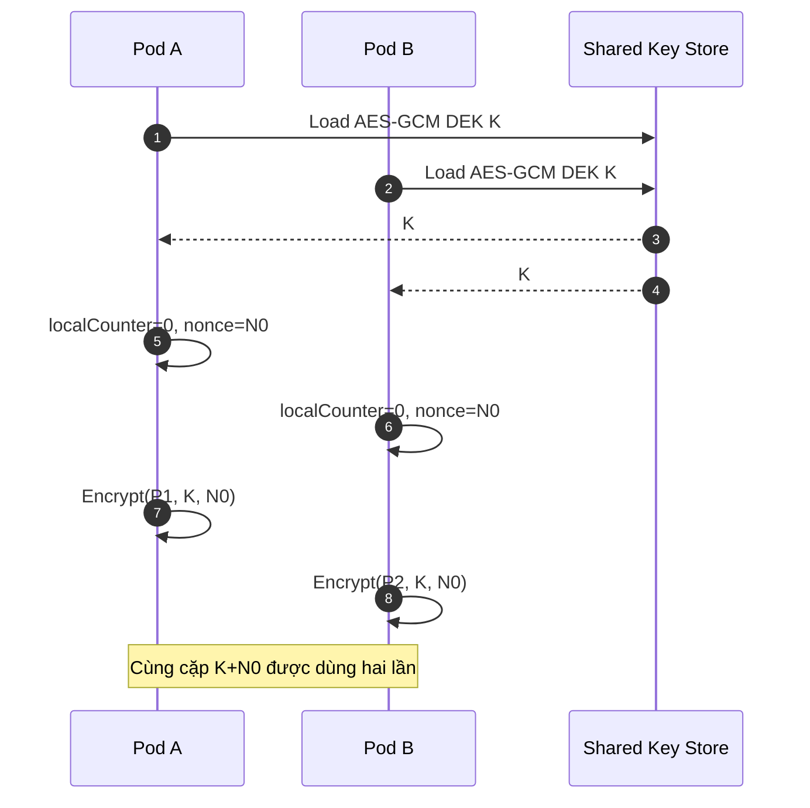
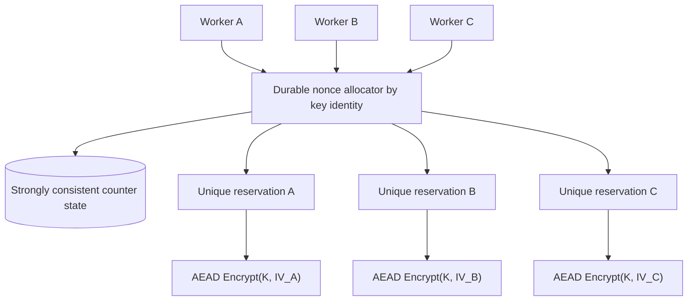
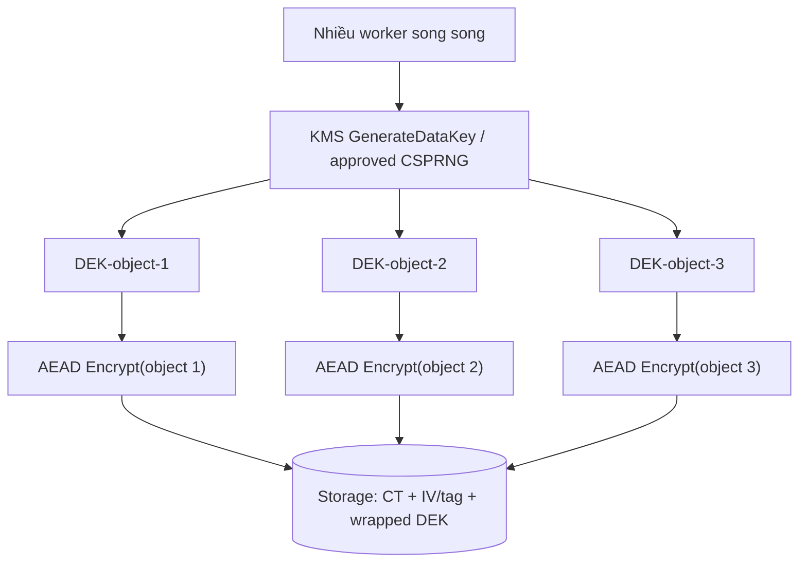
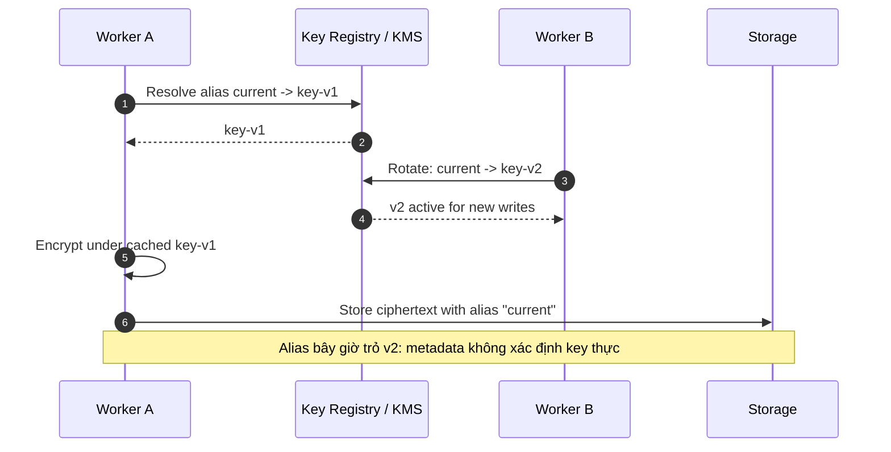
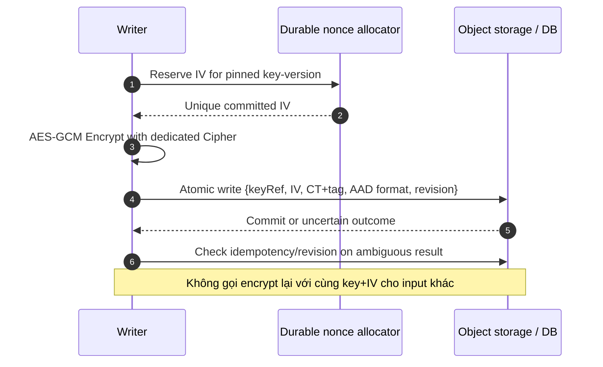
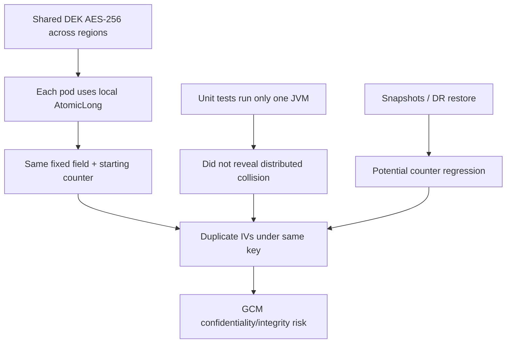
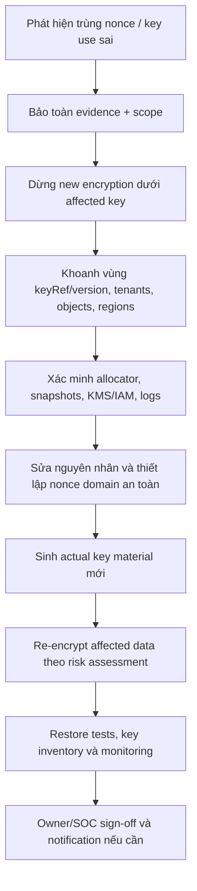

# Concurrent key use — Sử dụng khóa mật mã an toàn khi nhiều tác vụ chạy đồng thời

> **Chương:** Key use  
> **Module:** SECURITY_KEY_MANAGEMENT_FUNDAMENTALS — hiểu vòng đời khóa mật mã từ tạo, cấp phát, lưu trữ, sử dụng, xoay vòng đến thu hồi và hủy, kết nối mật mã đối xứng, bất đối xứng, chữ ký số, KMS/HSM, envelope encryption, kiểm soát truy cập và kiểm toán nhằm thiết kế hệ thống bảo vệ khóa an toàn.

## 1. Mục tiêu học tập

Sau bài học, bạn có thể:

1. Giải thích **concurrent key use** là gì ở cấp thread, process, container, machine, region, batch job và KMS/HSM.
2. Phân biệt **chia sẻ key material** với **chia sẻ đối tượng mật mã có trạng thái**; nhận biết điều gì có thể dùng lại, điều gì cần tách theo thao tác.
3. Phân tích tại sao **AES-GCM key + nonce/IV bị lặp** dưới tải đồng thời có thể gây tổn hại nghiêm trọng cả bí mật và tính toàn vẹn dữ liệu.
4. Thiết kế **nonce allocation** cho một khóa AEAD dùng chung: random IV có giới hạn, bộ đếm bền vững, reservation theo block, cấp phát theo shard và cơ chế chống reuse sau failover.
5. Xác định **cryptoperiod, usage limits và key version** theo tổng tải toàn hệ thống, không chỉ theo một worker.
6. Sử dụng an toàn Java JCA với `Cipher`, `Mac`, `Signature`, `SecretKey` và `SecureRandom` trong môi trường nhiều thread.
7. Xử lý các tình huống KMS/HSM: **key handle, session pool, quotas, rate limiting, grant revocation, audit và partial failures**.
8. Giải thích race condition giữa **encrypt/rotate/decrypt**, cache khóa, alias đổi đích, decrypt-only key và distributed rollback.
9. Thiết kế idempotency, transaction và observability để tránh dữ liệu mới bị mã hóa bằng khóa/nonce cũ trong retry.
10. Tạo checklist, negative tests, runbook sự cố và các biện pháp kiểm soát phù hợp với data classification, IAM và key inventory.

## 2. Concurrent key use là gì?

**Concurrent key use** là tình huống **hai hoặc nhiều thao tác mật mã sử dụng cùng key material hoặc cùng key resource trong các khoảng thời gian chồng lấn nhau**. Các thao tác có thể xảy ra trong cùng JVM, nhiều pods Kubernetes, các worker async, nhiều data centers hoặc thông qua một KMS/HSM.

Ví dụ:

- 100 threads đồng thời mã hóa hóa đơn bằng **cùng một AES-GCM DEK**.
- Hai pods tự cấp **nonce/counter** cho cùng key mà không phối hợp.
- Hàng nghìn requests cùng dùng HMAC key để kiểm tra token.
- Nhiều workers ký tài liệu bằng cùng private key trong HSM.
- Một key alias chuyển từ `v1` sang `v2` khi batch mã hóa đang chạy.
- KMS access grant bị thu hồi nhưng nhiều service còn cache plaintext DEK.
- Replica được khôi phục từ snapshot cũ và tiếp tục dùng counter/DRBG state trước đây.

Việc nhiều thao tác dùng cùng key **không tự động là lỗi**. Nhiều thuật toán hỗ trợ các lần dùng có kiểm soát dưới cùng key. Vấn đề là **trạng thái riêng của mỗi phép toán, uniqueness requirements, usage limits, authorization và vòng đời khóa** có thể bị vi phạm khi các thao tác chạy đồng thời.

### 2.1. Ba lớp trạng thái không nên trộn

| Lớp | Ví dụ | Cần điều phối thế nào? |
| --- | --- | --- |
| **Key material / key handle** | AES key, HMAC key, KMS key reference | Có thể cùng tham chiếu theo policy; giới hạn purpose và cryptoperiod |
| **Per-operation crypto state** | `Cipher` instance, GCM nonce/counter, `Mac`/`Signature` state | Tách biệt mỗi invocation/thread; không chia sẻ mutable instance |
| **Global key-use state** | Tổng invocation count, next nonce, active version, grants, ownership | Điều phối bền vững xuyên tiến trình/region, audit và enforcement |

Một lỗi thường gặp là **khóa có thể dùng chung** nên lập trình viên suy ra **`Cipher` hoặc bộ đếm nonce trong RAM cũng có thể dùng chung**. Hai kết luận này không tương đương.

### 2.2. Concurrent use không giống concurrent key generation

- **Concurrent key generation:** nhiều worker sinh **khóa mới**, cần entropy/CSPRNG đáng tin, uniqueness và provisioning.
- **Concurrent key use:** nhiều worker sử dụng **cùng khóa hiện hữu**, cần uniqueness của tham số theo mỗi invocation, usage limits và policy.

Có thể có cả hai cùng lúc. Ví dụ KMS sinh DEK per object song song, rồi mỗi worker mã hóa một object. Khi **mỗi DEK thực sự độc lập và chỉ dùng một lần**, việc quản lý nonce dễ hơn so với một global DEK dùng cho hàng tỷ lần mã hóa, dù vẫn cần bảo vệ key và trạng thái.

## 3. Ví dụ gây lỗi: hai worker dùng cùng AES-GCM key + nonce

Giả sử hệ thống có cùng **DEK K** và bộ đếm IV bắt đầu từ 0 ở mỗi process.



Từng pod có thể pass unit test và `Cipher.doFinal()` không báo lỗi. Nhưng **cặp key + IV của AES-GCM bị lặp**, phá giả định bảo mật cốt lõi. GCM dựa trên CTR mode và authentication; nonce reuse có thể tiết lộ quan hệ giữa plaintext và tạo điều kiện tấn công integrity.

**Tăng độ dài key lên AES-256, bật TLS hoặc đặt KEK trong HSM không sửa được lỗi reuse nonce tại data encryption layer.**

### 3.1. Điều phải là duy nhất

Với AES-GCM, các invocation mã hóa dưới **cùng key** phải dùng IV/nonce theo construction và giới hạn bảo đảm uniqueness của chuẩn.

- Cùng **nonce** dưới **hai DEK độc lập thật sự** không phải cùng một vi phạm như reuse dưới một DEK.
- Cùng **DEK** dưới **hai nonce khác nhau hợp lệ** có thể được phép trong cryptoperiod, giới hạn invocation và data size.
- Cùng **DEK + nonce** để mã hóa hai plaintext khác nhau là tình huống nguy hiểm.
- Không được suy ra **thread ID** hay **request ID** tự động tạo nonce duy nhất xuyên restart/region.

### 3.2. Nonce thường không bí mật

Nonce có thể lưu cạnh ciphertext. Nhiệm vụ của nó là bảo đảm **uniqueness/other mode-specific requirements**, không phải che giấu như secret key. Còn DEK phải bí mật.

```text
DEK:        32 byte AES-256, bí mật
GCM nonce:  12 byte trong một profile phổ biến, thường không bí mật
AAD:        context có xác thực, thường không bí mật
Ciphertext: ciphertext + authentication tag
```

Một GCM nonce có 12 byte **không phải** khóa AES. Một UUID hay timestamp cũng không phải một thiết kế nonce an toàn chỉ vì “khó trùng trong unit test”.

## 4. Thread safety và cryptographic safety khác nhau

### 4.1. Thread-safe API chưa đủ an toàn giao thức

Một counter `AtomicLong` có thể cấp số duy nhất giữa các threads **trong một process**. Tuy vậy:

- Pod A và B có **hai AtomicLong khác nhau**.
- Sau restart counter có thể bắt đầu lại từ 0.
- Restore snapshot có thể đưa counter lùi về giá trị cũ.
- Deploy nhiều region không chia sẻ trạng thái.
- Một key version có thể được load đồng thời dưới các alias khác nhau.

Vì vậy một đoạn code có **thread-safety ở JVM** vẫn có thể **cryptographic key/nonce collision** ở cấp distributed system.

### 4.2. Cryptographic safety chưa đủ bảo đảm dữ liệu nhất quán

Ngược lại, dù mỗi worker có nonce riêng, các tác vụ đồng thời vẫn có thể:

- Ghi đè ciphertext/nonce mới bằng row cũ.
- Chọn wrong key version khi alias rotate.
- Dùng dữ liệu AAD sai object/tenant.
- Mã hóa dữ liệu mới bằng retired key.
- Import wrapped DEK hai lần do retry.
- Bỏ qua quyền đọc khi decrypt-only grant vừa bị revoke.

Cần cả **crypto correctness, data consistency, authorization và key lifecycle**.

### 4.3. Một thao tác mã hóa phải gắn đầy đủ metadata

Bản ghi an toàn nên ràng buộc:

```text
keyMaterialVersion / canonical key ID
algorithm profile
unique nonce under that exact key
AAD schema and trusted scope
ciphertext + authentication tag
object version / write revision
cryptoperiod / key use policy
```

Nếu key ID/nonce/ciphertext được ghi ở những transaction khác nhau, có thể tạo tổ hợp không decrypt được hoặc mất integrity khi có race.

## 5. Những kiểu primitive và rủi ro concurrency

| Primitive / thao tác | Có thể dùng cùng key trong nhiều invocation? | Kiểm soát concurrency trọng tâm |
| --- | --- | --- |
| **AES-GCM / GCM AEAD** | Có, trong giới hạn thuật toán/key policy | **IV uniqueness** dưới cùng key, invocation/data limits, tag verification |
| **ChaCha20-Poly1305** | Có, theo profile | Không lặp nonce dưới cùng key; counter/limits riêng |
| **AES-CBC với PKCS#7** | Có trong profile phù hợp, nhưng không có authentication | IV đúng mode; cân nhắc AEAD thay thế, tránh padding oracle |
| **AES-CTR** | Có khi dùng counter ranges không trùng | Không lặp keystream (key+counter blocks) |
| **AES-SIV / misuse-resistant AEAD** | Tùy profile, có thuộc tính chịu lỗi nonce tốt hơn | Vẫn tuân constraints; không dùng làm cớ bỏ key policy |
| **HMAC** | Có | Không chia sẻ mutable `Mac` instance; key purpose, protocol context và replay |
| **RSA-PSS signatures** | Có | Một `Signature`/operation; RNG salt đúng profile, key usage limits |
| **ECDSA signatures** | Có | Ephemeral nonce `k` an toàn/không bị reuse giữa signatures; library chuẩn |
| **Ed25519/EdDSA** | Có theo scheme | Provider/state per operation, policy; không tự dựng nonce |
| **KMS/HSM Wrap/Unwrap** | Có theo quotas và permission | Session isolation, rate limit, key state/rotation, audit |
| **Key derivation (HKDF)** | Có thể dẫn xuất nhiều child keys | Domain separation/context uniqueness và key schedule đúng |
| **TLS session traffic keys** | Do giao thức quản lý | Thư viện TLS phụ trách counters/key update; không lấy raw key tự dùng |

**Không áp cùng một công thức nonce, counter, padding hoặc key use limit cho mọi primitive.** Ví dụ một key HMAC có thể được dùng xác minh nhiều messages mà không có nonce kiểu GCM, nhưng business protocol có thể vẫn cần **anti-replay**.

### 5.1. HMAC: cùng key, khác state

Nhiều requests có thể tạo HMAC dưới cùng secret và cùng algorithm nếu đúng policy. Để tránh race:

- Mỗi operation sử dụng **`Mac` instance riêng** hoặc pool được thiết kế chặt.
- Không gọi `update` / `doFinal` trên cùng mutable `Mac` từ hai threads.
- Tách key cho các mục đích khác nhau bằng KDF/keys riêng nếu cần.
- Nếu cùng message + key cho cùng MAC, output giống nhau là bình thường.
- **HMAC không tự chống replay** một thông điệp hợp lệ cũ.

### 5.2. Chữ ký số: key dùng chung, operation state phải đúng

Một private signing key có thể phục vụ nhiều requests, nhưng:

- Không chia sẻ mutable `Signature` instance giữa threads.
- RSA-PSS cần salt generation và digest/MGF parameters đúng profile.
- **ECDSA nonce tái sử dụng** giữa các thông điệp có thể làm lộ private key; không tự tạo `k` từ timestamp/thread ID.
- EdDSA có cách tạo giá trị mỗi chữ ký theo scheme chuẩn; không tùy tiện áp chiến lược random nonce của ECDSA.
- HSM signing queue/session pools phải được điều phối theo API/provider.
- Authorization, audit và key purpose phải áp dụng cho **từng yêu cầu ký**, không chỉ lúc khởi động app.

## 6. AES-GCM nonce: lựa chọn construction

### 6.1. Nonce 96 bit

Trong GCM, **IV dài 96 bit** là lựa chọn phổ biến với đường xử lý được chuẩn hóa và tối ưu. Tuy nhiên, **độ dài 96 bit không tự chứng minh uniqueness**.

Hai cách tiếp cận lớn trong NIST SP 800-38D:

- **Deterministic construction:** cấu trúc gồm phần cố định và invocation field, quản lý uniqueness toàn bộ instantiations của một key.
- **RBG-based construction:** IV từ random bit generator theo yêu cầu và giới hạn của chuẩn, có xác suất va chạm phải quản lý.

**Không trộn hai IV constructions cho cùng key một cách tùy tiện.** Chọn profile nhất quán và giữ invariant toàn hệ thống.

### 6.2. Random nonce có xác suất trùng

Nếu IV là 96 bit uniformly random và độc lập, với `q` lần sinh, xấp xỉ xác suất va chạm kiểu birthday khi `q` còn nhỏ so với không gian:

\[
P_{\mathrm{collision}} \approx \frac{q(q-1)}{2^{97}}.
\]

Đây là **xấp xỉ**, không phải giấy phép cho một hạn mức invocation cụ thể. NIST SP 800-38D đặt các giới hạn/điều kiện theo IV construction; hệ thống phải tuân chuẩn và có **giới hạn vận hành bảo thủ** theo key, đặc biệt khi nhiều nodes cùng mã hóa.

Quan trọng: số `q` là **tổng lần mã hóa của tất cả workers sử dụng cùng key material**, không phải số lần của riêng một JVM.

### 6.3. Deterministic IV: fixed field + invocation field

Một ví dụ thiết kế nội bộ cho **96-bit IV**:

```text
IV = fixed_field(32 bit) || invocation_counter(64 bit)
```

Lưu ý:

- Đây là **một lựa chọn phân bổ bit minh họa**, không phải bố cục bắt buộc duy nhất của NIST.
- Fixed field có thể là giá trị được gán/kiểm soát cho key hoặc instantiation theo thiết kế, **không chỉ lấy hostname bị trùng**.
- Mọi invocation dưới cùng key cần **cặp fixed field + invocation field không trùng**.
- Counter phải đủ bền vững hoặc được phân vùng sao cho không reuse sau crash/failover.
- Không cho overflow hoặc quay vòng.
- Cần đảm bảo vùng/shard khác không dùng cùng fixed field với overlapping counters.
- Usage limits và chính sách cryptoperiod vẫn áp dụng dù counter chưa hết miền 64 bit.

### 6.4. Tách domain theo key version

Một counter của key `v1` và counter của key `v2` có thể đều bắt đầu từ 0 **nếu v1 và v2 là key material độc lập** và việc versioning chính xác. Nhưng:

- Đổi **alias** mà thực tế vẫn dùng key material cũ không tạo domain mới.
- Một KMS key rotation có thể có semantics khác nhau giữa providers.
- Nonce allocation domain phải gắn **actual cryptographic key identity**, không chỉ tên service.
- Metadata decrypt cần lưu đúng key identity/version hoặc wrapped DEK.

### 6.5. “UUID cho nonce” không đủ là một phương pháp

Một UUID version 4 thường gồm 128 bit với các bit phiên bản/variant cố định; cắt 12 byte hoặc hash nó không tự chứng minh thỏa **RBG-based IV requirements và invocation limits**. Nếu dùng random IV, sinh trực tiếp từ approved CSPRNG theo profile và giới hạn số invocation, không tự dùng request ID hoặc timestamp làm “randomness”.

## 7. Điều phối nonce trên nhiều threads, pods và regions

### 7.1. Phạm vi process-local

Trong **một process** có một key cố định và một bộ đếm atomically incremented, việc cấp số có thể được đồng bộ giữa threads. Nhưng invariant đó **chỉ giữ trong process**, không bảo đảm an toàn khi:

- Spawn process thứ hai với cùng key.
- Pod restart.
- VM snapshot restore/fork.
- DR failover.
- Scale-out multi-region.
- Counter state bị reset thủ công.

```java
// CHỈ LÀ PROCESS-LOCAL, KHÔNG ĐỦ cho multi-pod nếu cùng DEK.
private static final java.util.concurrent.atomic.AtomicLong COUNTER =
    new java.util.concurrent.atomic.AtomicLong(0L);

// Hai replicas đều có COUNTER=0 và cùng DEK -> có thể trùng nonce.
```

### 7.2. Global durable allocator

Một cách tiếp cận là có **bộ cấp phát nonce trung tâm bền vững** cho mỗi actual key identity, ví dụ database transaction/counter service có tính nhất quán phù hợp.

Yêu cầu:

1. Cấp **unique counter/range** dưới mỗi key identity.
2. Commit reservation **trước** khi sử dụng counter để encrypt nếu operation có thể tồn tại ngoài transaction.
3. Không cấp lại counters đã reservation dù worker crash hoặc không dùng hết.
4. Không restore counter xuống giá trị đã cấp trước đó.
5. Hạn chế authorization đối với thao tác cấp và reset counter.
6. Không reuse cùng prefix/counter ranges giữa các regions.
7. Có quỹ hạn mức/cryptoperiod và policy xử lý counter exhaustion.
8. Kiểm soát thay key material/alias đồng thời với allocation.



### 7.3. Phân vùng counters theo worker/region

Có thể cấp **fixed fields/prefixes độc lập**, hoặc các counter ranges không giao nhau cho từng worker/region. Nhưng việc gán prefix cũng là một bài toán distributed uniqueness.

Không dùng:

```text
prefix = hash(hostname) lấy 32 bit
counter = 0 khi process boot
```

mà không chứng minh các prefix/counter domains **không trùng trên toàn bộ lifetime của key**. Hostname có thể thay, clone VM có thể giữ cùng hostname, hash có thể collision, counter sau restart có thể reset.

### 7.4. Reservation theo block và gaps

Để giảm chi phí cấp phát per-invocation:

```text
Allocator:
  atomic reserve [1000, 1999] for worker A
  atomic reserve [2000, 2999] for worker B

Worker A:
  use 1000..1135, crash
  1136..1999 remain unused but MUST NOT be reallocated

Worker B:
  use 2000..all its values
```

**Khoảng trống (gaps) an toàn hơn tái sử dụng một nonce**. Reservation phải được commit bền vững trước khi cấp range cho worker; trong failover phải ngăn worker cũ và mới sở hữu các ranges chồng lấn.

### 7.5. Fencing tokens và stale workers

Nếu cluster dùng lease để phân phối quyền cấp counters hoặc encrypt, worker mất lease nhưng vẫn đang chạy có thể tiếp tục dùng key. **Lease expiration một mình không bảo đảm fencing**. Hệ thống cần:

- Monotonically increasing fencing token.
- Kiểm tra token tại storage/counter service được tin cậy.
- Chặn stale writer hoặc bảo đảm ranges cấp cho các workers hoàn toàn disjoint.
- Quy tắc restart/DR tránh cấp lại ranges cũ.
- Key version và prefix ownership được ghi bền vững.

Nếu không thể bảo đảm điều phối toàn hệ thống, **DEK riêng cho từng object/batch nhỏ** có thể là lựa chọn giảm độ phức tạp hơn.

## 8. Gợi ý thay kiến trúc: DEK per object

Một cách tránh chia sẻ cùng DEK cho vô số workers là **sinh DEK mới cho mỗi object**, bọc DEK bằng KEK trong KMS/HSM và lưu wrapped DEK cùng ciphertext.



### 8.1. Lợi ích

- Tách nonce domains theo **key riêng**.
- Blast radius nếu lộ một DEK thường nhỏ hơn.
- Dễ rotate/re-encrypt một object.
- Ít phụ thuộc vào global nonce counter đối với **một invocation per DEK**.
- Có thể xử lý song song tự nhiên, nếu KMS throughput/limits đáp ứng.

### 8.2. Đánh đổi

- Nhiều wrapped DEKs và metadata.
- Nhiều KMS requests hoặc key generations.
- Recovery phải giữ KEK, wrapped DEK, key references.
- Plaintext DEK có thể đi vào application memory nếu KMS API trả nó.
- Nếu một object có **nhiều chunks**, cùng DEK được dùng nhiều invocation, vẫn cần nonce allocation hoặc authenticated chunking scheme.
- Nếu retry tái sử dụng DEK để encrypt khác plaintext, phải kiểm soát nonce mới.

Không phải mọi bài toán đều cần DEK per object, nhưng đây là **một lựa chọn để giảm rủi ro concurrency** thường hữu ích cho dữ liệu at rest.

## 9. Java JCA: đừng chia sẻ mutable Cipher/Mac/Signature

### 9.1. `Cipher` có trạng thái mỗi phép toán

Một `Cipher` đi qua các bước `init`, `updateAAD`, `update`, `doFinal`; state của nó gồm key, mode, IV, buffer và cơ chế padding/AEAD. Dùng chung một instance trên nhiều threads có thể dẫn tới:

- Một thread đổi key/mode trước khi thread kia kết thúc.
- AAD được đưa vào sai message.
- Buffer/counter bị lẫn.
- Lỗi interleaving khó tái hiện.
- Nhầm ciphertext/nonce/tag metadata.

**Không chia sẻ một `Cipher` mutable giữa các requests.** Tạo instance mới per operation, hoặc dùng cơ chế quản lý instance isolation được thẩm định.

### 9.2. `Mac` và `Signature` cũng có trạng thái

`Mac.init/update/doFinal` và `Signature.initSign/update/sign` không nên gọi đồng thời trên **cùng một instance** từ nhiều threads.

Một `SecretKey` reference có thể được nhiều operations sử dụng nếu provider/key usage policy hỗ trợ, nhưng **mỗi operation có crypto object riêng**. Điều này không làm mất invariant global nonce/usage counts.

### 9.3. `SecureRandom` là trường hợp khác

`SecureRandom` là API JCA với cơ chế thread-safe theo contract của Java platform (providers có thể tự khai báo thread safety; implementation có synchronization theo quy tắc JDK). Nhưng:

- **Thread safety không chứng minh entropy hoặc provider assurance**.
- Có thể có contention/latency khi rất nhiều threads cùng gọi.
- Provider/DRBG state khi fork/snapshot cần được đánh giá theo môi trường.
- Không tự seed bằng timestamp hoặc cố định vì mục tiêu deterministic test.
- Không giả định `SecureRandom.getInstanceStrong()` luôn phù hợp hơn cho mọi workload về blocking/throughput.

### 9.4. Dùng key object trong nhiều threads

Một `SecretKey` immutable hoặc key handle có thể được chuyển tới nhiều operations theo API/provider. Nhưng hãy tránh:

- Đưa raw `byte[]` chứa key cho nhiều consumers rồi cho phép sửa nó.
- Gọi `getEncoded()` để copy raw key qua shared caches/logs.
- Dùng cùng key cho AES-GCM và HMAC không có domain separation.
- Giả định HSM key handle có thể dùng bởi mọi session/thread mà không có provider restrictions.
- Cho key bị rotate trong lúc operation đang tham chiếu metadata cũ mà không gắn version vào kết quả.

## 10. Java 17: safe per-invocation AES-GCM với nonce allocator

Mã sau minh họa **tách per-operation `Cipher`**, còn **nonce allocator** là một dependency với contract bảo mật mạnh. Mục tiêu là phân biệt **thread safety trong Java** và **global nonce uniqueness**.

Các interface `DurableNonceAllocator`, `KeyResolver` và `AccessPolicy` là ranh giới cần triển khai/thẩm định trong production; đoạn mã này **không tự bảo đảm an toàn phân tán**.

```java
import java.nio.ByteBuffer;
import java.nio.charset.StandardCharsets;
import java.security.GeneralSecurityException;
import java.util.Objects;
import java.util.UUID;

import javax.crypto.Cipher;
import javax.crypto.SecretKey;
import javax.crypto.spec.GCMParameterSpec;

public final class ConcurrentGcmService {
    private static final int IV_BYTES = 12;
    private static final int TAG_BITS = 128;
    private static final String ALGORITHM = "AES-256-GCM";

    public record KeyRef(
            String canonicalKeyId,
            String materialVersion,
            String purpose) {}

    public record KeyBinding(
            KeyRef ref,
            SecretKey key) {}

    public record EncryptedObject(
            UUID objectId,
            KeyRef keyRef,
            byte[] iv,
            byte[] ciphertextAndTag) {}

    public interface KeyResolver {
        // Phải trả đúng key material cho ref được ghim phiên bản.
        KeyBinding currentEncryptKey(String trustedTenant)
                throws Exception;

        KeyBinding historicalDecryptKey(
                String trustedTenant, KeyRef ref) throws Exception;
    }

    public interface DurableNonceAllocator {
        // Contract: 12 byte không trùng với MỌI invocation
        // mã hóa dưới actual key material, across all workers/regions.
        // Đã reserve/commit bền vững trước khi trả về.
        byte[] reserveUniqueIv(KeyRef keyRef) throws Exception;
    }

    public interface AccessPolicy {
        void requireEncrypt(String tenant, UUID objectId);
        void requireDecrypt(String tenant, UUID objectId);
        void requireAllowedKey(String tenant, KeyRef ref);
    }

    private final KeyResolver keys;
    private final DurableNonceAllocator nonces;
    private final AccessPolicy policy;

    public ConcurrentGcmService(
            KeyResolver keys,
            DurableNonceAllocator nonces,
            AccessPolicy policy) {
        this.keys = Objects.requireNonNull(keys);
        this.nonces = Objects.requireNonNull(nonces);
        this.policy = Objects.requireNonNull(policy);
    }

    public EncryptedObject encrypt(
            String trustedTenant, UUID objectId, byte[] plaintext)
            throws Exception {

        Objects.requireNonNull(plaintext);
        policy.requireEncrypt(trustedTenant, objectId);

        KeyBinding selected = keys.currentEncryptKey(trustedTenant);
        KeyRef ref = selected.ref();
        policy.requireAllowedKey(trustedTenant, ref);

        // Provider must return a policy-approved AES-256 key;
        // getEncoded() có thể null nếu key là HSM handle.
        byte[] iv = nonces.reserveUniqueIv(ref);
        if (iv == null || iv.length != IV_BYTES) {
            throw new GeneralSecurityException("Invalid IV");
        }

        // Cipher RIÊNG cho mỗi invocation; không chia sẻ instance.
        Cipher cipher = Cipher.getInstance("AES/GCM/NoPadding");
        cipher.init(Cipher.ENCRYPT_MODE,
            selected.key(), new GCMParameterSpec(TAG_BITS, iv));
        cipher.updateAAD(aad(trustedTenant, objectId, ref));
        byte[] ciphertextAndTag = cipher.doFinal(plaintext);

        return new EncryptedObject(
            objectId, ref, iv.clone(), ciphertextAndTag);
    }

    public byte[] decrypt(
            String trustedTenant, EncryptedObject record)
            throws Exception {

        policy.requireDecrypt(trustedTenant, record.objectId());
        policy.requireAllowedKey(trustedTenant, record.keyRef());

        KeyBinding selected = keys.historicalDecryptKey(
            trustedTenant, record.keyRef());

        if (!record.keyRef().equals(selected.ref())
                || record.iv() == null
                || record.iv().length != IV_BYTES
                || record.ciphertextAndTag() == null
                || record.ciphertextAndTag().length < TAG_BITS / 8) {
            throw new GeneralSecurityException("Invalid envelope");
        }

        Cipher cipher = Cipher.getInstance("AES/GCM/NoPadding");
        cipher.init(Cipher.DECRYPT_MODE,
            selected.key(),
            new GCMParameterSpec(TAG_BITS, record.iv()));
        cipher.updateAAD(
            aad(trustedTenant, record.objectId(), record.keyRef()));

        // doFinal chỉ return khi AEAD tag được xác minh.
        return cipher.doFinal(record.ciphertextAndTag());
    }

    private static byte[] aad(
            String tenant, UUID object, KeyRef ref) {

        byte[] t = tenant.getBytes(StandardCharsets.UTF_8);
        byte[] k = ref.canonicalKeyId()
            .getBytes(StandardCharsets.UTF_8);
        byte[] v = ref.materialVersion()
            .getBytes(StandardCharsets.UTF_8);
        byte[] p = ref.purpose()
            .getBytes(StandardCharsets.UTF_8);

        ByteBuffer b = ByteBuffer.allocate(
            4 + t.length + 16
            + 4 + k.length + 4 + v.length + 4 + p.length);
        b.putInt(t.length).put(t);
        b.putLong(object.getMostSignificantBits());
        b.putLong(object.getLeastSignificantBits());
        b.putInt(k.length).put(k);
        b.putInt(v.length).put(v);
        b.putInt(p.length).put(p);
        return b.array();
    }
}
```

### 10.1. Điều đoạn code này giải quyết

- **Mỗi call có `Cipher` riêng**, không interleave mutable crypto state.
- Key selection trả **key version đã ghim** (pinned) thay vì chỉ alias biến động.
- IV do một service cấp với contract uniqueness **theo actual key identity**.
- AAD gắn tenant/object/key reference/purpose theo byte format xác định.
- Decrypt sử dụng historical key matching record, không tự dùng alias đang active.
- AEAD tag được verify ở `doFinal`, không trả plaintext một phần.

### 10.2. Điều đoạn code chưa giải quyết

1. Không có implementation của **distributed durable nonce allocator**; chính đó là thành phần quyết định an toàn. Không dùng `AtomicLong` local thay thế khi nhiều replicas cùng key.
2. Không có storage transaction, concurrency revision/optimistic locking hoặc persistence của ciphertext+metadata.
3. `KeyResolver` phải validate key material version, policy và cryptoperiod thực tế.
4. `AccessPolicy` là interface, chưa có business authorization; không coi là sẵn an toàn.
5. `byte[]` trong record là mutable; production cần defensive copies, input size limits.
6. Không có max invocation count enforcement, key usage monitoring hoặc global quota.
7. Không có KMS/HSM session management, latency/backoff/audit.
8. Không có rollback/fork/snapshot handling của allocator/DR.
9. Nếu decrypt chunked streaming, phải có authenticated chunk framing/sequence/nonce scheme riêng.
10. Không có data retention/rotation handling hoặc key revoke response.

**Đây là minh họa cấu trúc đúng hướng, không phải bằng chứng hệ thống production đã đạt bảo đảm cryptographic concurrency.**

## 11. Java: HMAC và chữ ký khi nhiều threads dùng chung key

### 11.1. Một `Mac` mới cho mỗi operation

```java
import java.nio.charset.StandardCharsets;
import java.security.GeneralSecurityException;
import javax.crypto.Mac;
import javax.crypto.SecretKey;

public final class ConcurrentHmac {
    private ConcurrentHmac() {}

    // SecretKey có thể dùng chung theo policy;
    // mutable Mac instance KHÔNG được chia sẻ giữa threads.
    public static byte[] compute(SecretKey hmacKey, String message)
            throws GeneralSecurityException {

        Mac mac = Mac.getInstance("HmacSHA256");
        mac.init(hmacKey);
        return mac.doFinal(message.getBytes(StandardCharsets.UTF_8));
    }
}
```

Cùng key + message cho HMAC cho cùng MAC là hành vi bình thường. Tuy nhiên một protocol xác thực request có thể cần **nonce/timestamp/request ID + replay cache**, không phải do HMAC tự cung cấp.

### 11.2. Một `Signature` mới cho mỗi operation

```java
import java.security.GeneralSecurityException;
import java.security.PrivateKey;
import java.security.Signature;

public final class ConcurrentSigner {
    private ConcurrentSigner() {}

    public static byte[] signPss(
            PrivateKey key, byte[] message)
            throws GeneralSecurityException {

        Signature signer = Signature.getInstance("RSASSA-PSS");
        signer.setParameter(new java.security.spec.PSSParameterSpec(
            "SHA-256",
            "MGF1",
            java.security.spec.MGF1ParameterSpec.SHA256,
            32,
            java.security.spec.PSSParameterSpec.TRAILER_FIELD_BC
        ));
        signer.initSign(key);
        signer.update(message);
        return signer.sign();
    }
}
```

Đoạn này chỉ minh họa **per-operation state và PSS parameters**, không phải một signing service hoàn chỉnh. Production cần validate private key, key strength, issuer identity, purpose, access policy, provenance, audit và provider/HSM capabilities. Không chia sẻ `Signature` mutable giữa threads.

### 11.3. ECDSA nonce khi ký song song

Khi cùng EC private key ký đồng thời:

- Mỗi signature phải được tạo bằng cơ chế nonce/ephemeral scalar an toàn theo scheme.
- **Reuse `k`** giữa các signatures có thể khiến private key bị suy ra.
- Không tự cấp `k = currentTimeMillis()` hay `k = threadId`.
- Dùng JCA/provider/hardware implementation được thẩm định; deterministic ECDSA profile chỉ khi được phép và đúng chuẩn.
- Cần phân biệt **ECDSA signature nonce** với **AES-GCM IV**; hai giá trị đều không được xử lý bằng một thuật toán cấp phát tùy tiện.


## 12. PostgreSQL: ví dụ cấp phát counter bền vững theo key

Một triển khai có thể dùng **transaction của PostgreSQL** để reserve invocation counters cho một GCM key. Mục đích chính là **ngăn hai worker nhận cùng counter** khi tất cả cùng dùng một bộ cấp phát được bảo vệ.

**Giả định thiết kế:**

- Một key reference tương ứng đúng **một version của actual AES key material**, không phải alias động.
- IV có 96 bit, gồm **fixed field 32 bit** và **invocation field 64 bit** trong profile này.
- Một hàng counter duy nhất được quản trị cho toàn bộ lifetime của actual key.
- Transaction reservation phải được **commit trước khi mã hóa**.
- Bộ cấp phát có quyền từ chối khi hết hạn mức; không chỉ dựa vào tràn số.
- Một rollback DB/snapshot phải được xử lý bằng cơ chế **reconciliation với high-water mark ngoài snapshot hoặc ngừng sử dụng key cũ**, không được tiếp tục cấp lại counter.

### 12.1. Schema minh họa

```sql
-- PostgreSQL: bảng quản lý nonce domain theo actual key identity.
-- Không lưu raw AES key, chỉ giữ opaque key reference và state.
CREATE TABLE gcm_nonce_cursor (
    key_material_ref  TEXT PRIMARY KEY,
    fixed_field       BYTEA NOT NULL,
    next_counter      BIGINT NOT NULL DEFAULT 0,
    policy_limit      BIGINT NOT NULL,
    state             TEXT NOT NULL DEFAULT 'ACTIVE',
    updated_at        TIMESTAMPTZ NOT NULL DEFAULT CURRENT_TIMESTAMP,
    CHECK (octet_length(fixed_field) = 4),
    CHECK (next_counter >= 0),
    CHECK (policy_limit > 0),
    CHECK (next_counter <= policy_limit),
    CHECK (state IN ('ACTIVE', 'DRAINING', 'DISABLED'))
);
```

`policy_limit` phải được tính theo **cryptographic usage constraints và thiết kế**. Không đặt nó bằng `BIGINT` maximum chỉ vì column còn chứa được số lớn. Số counter duy nhất có thể cấp không phải giới hạn an toàn duy nhất của GCM.

Nếu một key có nhiều independent IV fixed fields, schema phải **mở rộng với ownership và uniqueness** cho từng field/range. Ví dụ này cố ý dùng **một fixed field và một row per key** để dễ thấy invariant.

### 12.2. Cấp một counter atomically

```sql
-- :key_material_ref là bind parameter của ứng dụng,
-- không phải cú pháp chạy trực tiếp trong psql.
UPDATE gcm_nonce_cursor
SET next_counter = next_counter + 1,
    updated_at = CURRENT_TIMESTAMP
WHERE key_material_ref = :key_material_ref
  AND state = 'ACTIVE'
  AND next_counter < policy_limit
RETURNING fixed_field, next_counter - 1 AS allocated_counter;
```

Với PostgreSQL, cập nhật cùng một row được serialize theo row-lock/transaction semantics. Khi có nhiều transactions đồng thời, mỗi update thành công sẽ nhận một giá trị khác nhau **nếu các transactions commit và mọi writer tuân cùng allocator**.

Nhưng lưu ý cực kỳ quan trọng:

> **Bộ cấp phát không được trả một counter để worker mã hóa dữ liệu rồi rollback transaction reservation.** Nếu rollback, counter đó có thể được cấp lại trong tương lai.

Cách sử dụng an toàn ở mức khái niệm:

```text
BEGIN TRANSACTION
  UPDATE ... RETURNING counter = C
COMMIT
  (xác nhận commit thành công, bền vững)
THEN
  IV = fixedField || encode_uint64_be(C)
  AEAD_ENCRYPT(actualKeyVersion, IV, plaintext, AAD)
```

Nếu commit outcome bất định, **không được giả định counter chưa được cấp và dùng lại nó**. Xử lý theo trạng thái đã commit hoặc bỏ counter đó và reserve mới. Gaps không phá nonce uniqueness; reuse mới phá.

### 12.3. Counter cấp xong chưa chắc được sử dụng

Ví dụ worker reserve `C=1234` rồi crash trước khi mã hóa:

- `1234` trở thành unused gap.
- Recovery không nên cấp lại `1234`.
- Invocation count/reservation metrics có thể khác số ciphertext được lưu.
- Không lấy “max nonce trong database ciphertext” làm source duy nhất vì ciphertext có thể được lưu ở object store/backup khác.

Nếu có nhiều ciphertext/versions ngoài DB, **high-water mark của allocator phải bền vững và không lùi sau restore**.

### 12.4. Reserve một block counter

```sql
-- Reserve một range [old_next, old_next + block_size - 1].
-- Thực thi trong transaction và COMMIT trước khi giao range.
UPDATE gcm_nonce_cursor
SET next_counter = next_counter + :block_size,
    updated_at = CURRENT_TIMESTAMP
WHERE key_material_ref = :key_material_ref
  AND state = 'ACTIVE'
  AND :block_size > 0
  AND next_counter <= policy_limit - :block_size
RETURNING
    fixed_field,
    next_counter - :block_size AS range_start,
    next_counter - 1           AS range_end;
```

Sau khi commit, worker sở hữu range đã reserve. Nếu worker crash khi chưa dùng hết range, các giá trị còn lại **không được tái phân phối**.

**Không đủ để chỉ lưu range trong memory:** cần quản lý stale workers, fencing/ownership và tính toàn vẹn của key version/prefix. Nếu DR khôi phục DB snapshot trước khi block được cấp, một instance mới có thể reserve trùng range trước đây — phải có **DR anti-rollback strategy**.

### 12.5. Chuyển counter sang byte IV

```java
import java.nio.ByteBuffer;
import java.util.Arrays;

public final class GcmIvEncoding {
    private GcmIvEncoding() {}

    // fixedField do hệ thống provisioning quản lý cho actual key;
    // counter đã được reserve+commit, không âm và trong policy limit.
    public static byte[] encode(byte[] fixedField, long counter) {
        if (fixedField == null || fixedField.length != 4
                || counter < 0) {
            throw new IllegalArgumentException("Invalid IV fields");
        }

        ByteBuffer out = ByteBuffer.allocate(12);
        out.put(fixedField);
        out.putLong(counter); // big-endian mặc định của ByteBuffer
        return out.array();
    }
}
```

`long` của Java là signed, do đó sample chỉ dùng miền counter không âm nhỏ hơn \(2^{63}\). Chính sách phải dừng **sớm hơn khi cryptographic usage limits yêu cầu**. Nếu phải khai thác một miền unsigned 64-bit rộng hơn, cần thiết kế encoding/overflow/limit riêng và review; không đổi `long` thành âm rồi kỳ vọng counter hợp lệ.

### 12.6. Giới hạn của database allocator

PostgreSQL giúp serialize row updates, nhưng **không tự bảo đảm**:

- Mọi môi trường dùng đúng một primary/state.
- Failover/snapshot không gây regression.
- Không có rogue writer bypass allocator.
- Key alias/version là canonical.
- Data AEAD nonce/IV không bị reuse bởi một service khác dùng cùng key.
- Prefix/domain là duy nhất across regions.
- Tất cả operations chịu invocation limit.
- Old encryption workers bị dừng sau key rotation.

Bộ cấp phát **là một phần của thiết kế**, không thay kiểm thử failure modes và quản trị key lifecycle.

## 13. Key usage limits phải tính trên toàn bộ hệ thống

### 13.1. Một key có hạn mức toàn cục, không phải từng worker

Ví dụ 50 pods, mỗi pod gửi 1 triệu AES-GCM encryptions dưới **cùng key**. Tổng usage là 50 triệu lần. Nếu mỗi pod chỉ lưu “đã dùng 1 triệu” và tự cho rằng còn nhiều budget, hệ thống có thể vượt **global invocation limit**.

Cần theo dõi:

- Tổng encryption invocations per actual key version.
- Số lượng bytes/blocks theo giới hạn primitive.
- Phương pháp IV construction và random collision budget.
- Cryptoperiod, data sensitivity và risk acceptance.
- Encryption vs decryption count (không nhất thiết có cùng kiểu giới hạn).
- Data key scope (per-message, per-object, per-batch, per-tenant).
- Giới hạn provider/HSM, hardware usage và key strength.

### 13.2. Nonce range chưa hết không chứng minh key còn an toàn

Một counter 64 bit có không gian rất lớn nhưng **GCM có các giới hạn an toàn dựa trên authentication forgery bounds, IV construction, invocation count và tổng dữ liệu**. Không dùng `Long.MAX_VALUE` làm giới hạn mật mã.

Bộ đếm và policy có thể đặt:

```text
remaining_encryption_budget =
    min(
        configured_invocation_limit - allocated_invocations,
        policy_max_cryptoperiod_guard,
        data_volume_limit_guard,
        provider_usage_guard
    )
```

Đây là mô hình **kiểm soát khái niệm**; các đại lượng có đơn vị khác nhau, nên một implementation thật phải so **từng constraint độc lập**, không dùng `min` trực tiếp giữa số lần, thời gian và byte. Mục tiêu là **mọi ràng buộc đều phải thỏa**.

### 13.3. Early rotation

Đừng đợi:

- Counter tràn số.
- KMS trả “key disabled”.
- HSM báo quota exhausted.
- Một nonce collision được phát hiện.
- Key đã quá tuổi mà data streaming vẫn đang hoạt động.

Cần dùng **threshold warning**, ví dụ ngưỡng vận hành nội bộ thấp hơn policy limit, để có thời gian chuyển các writer sang key mới, thử khôi phục và xử lý outlier.

### 13.4. HMAC và chữ ký có cách đếm khác

Không áp AES-GCM nonce counter lên HMAC, RSA-PSS hoặc Ed25519. Nhưng vẫn cần:

- Cryptoperiod/number-of-uses theo chính sách key.
- HSM/provider quotas.
- Rate limits chống abuse.
- Per-operation authorization và audit.
- Tách key purposes.
- Chống replay ở mức giao thức nếu messages cần tính mới.

## 14. Rotation đồng thời với traffic: bài toán key version

### 14.1. Race khi alias đổi đích



Sai lầm chính là **ghi alias động thay cho actual key version**. Khi decrypt, app đọc alias `current` và lấy v2, nhưng ciphertext được mã hóa bằng v1.

### 14.2. Pin key material version cho mỗi operation

Một operation mã hóa nên được cung cấp một **immutable binding**:

```text
KeyBinding:
  canonicalKeyResourceId
  actualKeyMaterialVersionOrHandle
  algorithmProfile
  keyPurpose
  allowedNewUse
  cryptoperiod
  approvedNonceDomain
```

Kết quả ciphertext phải lưu reference đủ để decrypt bằng **đúng key material** và chứng minh AAD/context compatibility. Alias có thể dùng để chọn **new key khi bắt đầu**, không phải định danh duy nhất của ciphertext lịch sử.

### 14.3. Pinning không tự đóng race policy

Ngay cả khi worker A đã pin v1, key owner có thể **thu hồi quyền encrypt-new của v1** trong lúc A chuẩn bị encrypt. Cần định nghĩa nhất quán:

- Có cho phép hoàn tất những operations đã được **admit trước cutoff** không?
- Có cần một **lease/fencing token** chứng minh quyền dùng key đến một mốc nào?
- Key revocation khẩn cấp phải **ngắt ngay** mọi operations hay chỉ new admissions?
- KMS có enforce key state cho mỗi operation không, hay app giữ plaintext cached DEK?
- Có cần key usage budget check và nonce reservation **cùng một admission decision**?

Một thay đổi alias đơn thuần không thể ngăn worker đã cache plaintext DEK tiếp tục mã hóa. Nếu yêu cầu **strict cutoff**, phải kết hợp workload fencing, shared admission gate, key custody ở KMS/HSM và các controls đảm bảo không còn stale writers.

### 14.4. Encrypt-new vs decrypt-old

Rotation bình thường cần chuyển:

```text
Key v1: ENABLED_FOR_NEW_USE
  -> DECRYPT_ONLY / HISTORICAL_USE
  -> DISABLED
  -> DESTROYED (khi hết dependencies)

Key v2: PENDING
  -> ENABLED_FOR_NEW_USE
```

Tên trạng thái là **mô hình quản trị**, không nhất thiết trùng API state của KMS. Hệ thống cần:

- Dùng v2 cho encryption mới sau cutoff.
- Cho phép v1 decrypt dữ liệu lịch sử nếu retention yêu cầu.
- Không tự dùng v2 decrypt ciphertext dưới v1.
- Không hủy v1 chỉ vì active alias đổi sang v2.
- Có key usage audit và exceptions có thẩm quyền nếu cần.

### 14.5. Rotation ở nhiều regions

Một region đã switch v2 trong khi region khác vẫn dùng v1. Phải xác định đây là **rolling transition được phép** hay policy violation. Nếu rolling transition:

- Mỗi ciphertext phải lưu key material identity.
- Nonce allocators cho v1/v2 vẫn phải duy nhất.
- Usage budgets của v1 tính trên toàn region.
- Đọc lịch sử có key availability ở cả nơi cần.
- Có deadline/convergence monitoring.
- Không destroy v1 trước backup/DR và late writers reconciliation.

## 15. KMS/HSM concurrency: key handle, session và quotas

### 15.1. Một key resource có thể phục vụ nhiều calls

KMS/HSM thường hỗ trợ nhiều thao tác `Encrypt/Decrypt/GenerateDataKey/Sign/Wrap/Unwrap` với cùng key resource, nhưng:

- Provider có **request rate/throughput quotas**.
- HSM có giới hạn sessions, slots, handles hoặc concurrent operations.
- Một **session object** có thể không được dùng đồng thời ở hai threads.
- Multipart operation có thể giữ state trên session.
- Latency có thể tăng theo queue depth.
- Errors như throttling/busy có thể yêu cầu retry/backoff.
- Key policy và state có thể thay trong lúc request đang chờ.

**Không kết luận một HSM key non-exportable luôn được dùng an toàn chỉ vì `Cipher` Java đã tách per-thread.** Phải tuân theo provider session/operation semantics.

### 15.2. Session pool

Nếu ứng dụng dùng PKCS#11/HSM provider:

- Pool các **sessions được phép** theo docs provider.
- Không chia sẻ một session mutable giữa hai operations nếu API không cho phép.
- Giới hạn max in-flight requests theo hardware capacity.
- Đặt timeout/cancellation/error recovery rõ.
- Không leak session/key handles khi exceptions.
- Phân biệt **login state, operation state và key handles** của từng session.
- Kiểm tra behavior khi token reset, HA failover hoặc PIN/credential rotation.

Một **connection pool của database** không thay cho HSM session pool. Cả hai có lifecycle và failure modes khác nhau.

### 15.3. Một shared key handle cần policy

Khi multiple workloads có cùng HSM key handle:

- Giới hạn per-workload IAM/grants.
- Tách `Sign` và `Decrypt` theo key usage.
- Có approval cho new service principal.
- Audit operation count, source identity, key version, outcome.
- Không export raw key để “tăng tốc” nếu policy cấm.
- Đánh giá crypto performance/SLA và DoS khi một tenant dùng vượt quota.

### 15.4. Key material có thể rời KMS dù KEK không export

Một API kiểu `GenerateDataKey` có thể trả **plaintext DEK + wrapped DEK**. Khi nhiều workers dùng KMS đồng thời:

- Từng worker phải bảo vệ plaintext DEK trong RAM.
- Không log toàn bộ KMS response.
- Không dùng chung DEK của worker khác nếu policy là per-object.
- Không cache vô hạn các DEK do KMS trả.
- Khi API fail, không fallback sang weak RNG/key.
- Audit key generation/unwrap bằng request identity, không bằng raw key bytes.

### 15.5. Quota exhaustion và availability

Hệ thống cần:

- Deadline/budget cho key operations.
- Bounded queues thay vì vô hạn pending requests.
- Backoff với jitter theo docs provider.
- Circuit breaker/fallback **chỉ tới DR được phê duyệt**.
- Per-tenant fairness để chống một tenant chiếm hết HSM/KMS.
- Khả năng phát hiện key access bị revoke khác với transient throttling.
- Không retry vô hạn khiến audit/quotas bùng nổ.

## 16. Idempotency, retries và một encryption invocation

### 16.1. Retry không có nghĩa “dùng lại key+nonce một cách tùy tiện”

Giả sử request encrypt timeout sau khi `doFinal` đã chạy:

- Nếu application **giữ nguyên ciphertext output** và retry **ghi lại y nguyên bytes** tới storage, đó không phải một invocation AES-GCM mới.
- Nếu application **gọi `Cipher.encrypt` lại**, nên dùng **nonce mới** (hoặc quy trình idempotent đã được chứng minh an toàn) và ghi envelope tương ứng.
- Nếu application gọi encrypt với **cùng key+nonce cho plaintext/AAD khác**, đó là vi phạm nghiêm trọng.
- Nếu key version đã rotate trong lúc retry, cần quyết định có dùng v2 hay giữ object revision/old binding theo contract.

Thay vì “nếu timeout thì cứ chạy lại y nguyên”, cần phân biệt **retry transport/storage** với **retry cryptographic operation**.

### 16.2. Stable request ID vs cryptographic nonce

Một `idempotencyKey` là một **business identifier** để tránh tạo trùng object. Nó không nhất thiết ngẫu nhiên đều 96 bit và **không được dùng làm GCM nonce trực tiếp** nếu chưa có design được thẩm định.

```text
requestId: "payment-2026-00037"
idempotencyKey: stable across API retries
GCM IV: unique under actual DEK per encryption invocation
document revision: identifies the persisted envelope version
```

Ba mục đích khác nhau, không nên đồng nhất.

### 16.3. Lưu envelope nguyên tử



Ciphertext phải được lưu cùng **IV, tag, key reference và AAD schema** của đúng invocation. Nếu một worker ghi ciphertext trước, worker khác ghi nonce sau, row có thể trở thành **không thể decrypt** hoặc chứa metadata sai.

### 16.4. Cross-service event processing

Message queue có thể redeliver cùng event. Worker cần:

- Message ID/idempotency state theo policy.
- Xác thực sender và tenant/object authority.
- Đúng key version/usage.
- Nonce mới cho **mỗi encryption invocation thực sự**.
- Atomic output + event ack strategy.
- Không lộ plaintext key trong DLQ/logs.
- Xử lý out-of-order events và stale revisions.

### 16.5. Concurrent writers và optimistic locking

Khi hai workers cùng cập nhật một object, có thể dùng optimistic revision/CAS:

```sql
UPDATE encrypted_document
SET ciphertext_tag = :ciphertext_tag,
    iv = :iv,
    key_material_ref = :key_ref,
    crypto_revision = crypto_revision + 1,
    updated_at = CURRENT_TIMESTAMP
WHERE tenant_id = :tenant_id
  AND object_id = :object_id
  AND crypto_revision = :expected_revision
RETURNING crypto_revision;
```

Nếu **0 rows** được cập nhật, worker không được ghi đè mù quáng. **Nonce đã dùng cho một failed compare-and-swap vẫn phải coi là đã sử dụng**, không trả về allocator để dùng lại.

## 17. Distributed failure: snapshot, fork và disaster recovery

### 17.1. Snapshot rollback của nonce state

Tình huống:

1. Production allocator đã cấp counters tới `50,000`.
2. Database snapshot chỉ ghi nhận `next_counter=40,000`.
3. Restore snapshot lên một primary mới.
4. Primary tiếp tục cấp `40,000` dưới **cùng DEK**.
5. Một số ciphertext tạo trước snapshot đã tồn tại trong object store/backup.

Các counters `40,000...` có thể bị **reuse**, vi phạm uniqueness.

### 17.2. Những chiến lược giảm rủi ro

- Lưu high-water mark trong **nguồn state không bị rollback cùng snapshot** và đối soát/fencing khi khôi phục.
- **Rotate sang actual key material mới** trước khi cho phép encrypt sau một restore không thể chứng minh counter state đúng.
- Có key-version-aware nonce domains, immutable epoch và provisioning policy.
- Không active đồng thời primary cũ và DR primary mới với cùng domain chưa phân vùng.
- Không dùng local volatile counter trên các clones.
- Thử recovery với bản ciphertext ngoài database để phát hiện regression.
- Báo alert nếu allocator state, fencing epoch hoặc key version có mismatch.

### 17.3. VM/container fork và RNG state

Nếu process image hoặc VM được clone với DRBG state giống nhau, những lần sinh random IV/key sau clone có thể cần đánh giá theo OS/JDK/provider và fork/restore semantics. Đừng tự khắc phục bằng `setSeed(System.currentTimeMillis())` hoặc entropy từ PID.

Sử dụng platform crypto được hỗ trợ, cấu hình đúng, kiểm tra lifecycle của VM/DRBG/entropy source; nếu không thể bảo đảm uniqueness khi tái sử dụng key, cần thay key hoặc chuyển sang design nonce allocation khác.

### 17.4. Multi-primary / active-active regions

Hai primarys cùng cấp counters cần:

- Một allocator **globally strongly consistent**, hoặc
- Fixed-field/prefix/counter partitions **disjoint được chứng minh**, hoặc
- Các **actual data keys khác nhau** cho từng region/scope, có metadata đầy đủ và migration policy.

Không có distributed lock nào bảo đảm mọi trường hợp split-brain **nếu key use tiếp tục ở hai bên** mà state/counters có thể overlap. Availability cao phải được cân bằng với key/nonce safety.

### 17.5. Backup/restore cần cả khóa và nonce lịch sử

Để đọc ciphertext cũ, backup cần ciphertext, IV/tag, key references/versions, wrapped DEK/KEK và AAD format. Để **tiếp tục mã hóa mới** dưới cùng key, còn cần **nonce high-water mark và key policy** hợp lệ.

Hai mục tiêu khác nhau:

- **Decrypt old data:** có đúng key/material/metadata.
- **Encrypt new data safely:** ngoài key còn có uniqueness state/usage budget không rollback.

## 18. Cache, revoke và stale permissions

### 18.1. Key cache làm thay đổi semantics của revoke

Một service đã unwrap DEK plaintext và cache trong memory có thể tiếp tục decrypt/encrypt **mà không gọi KMS** sau khi KMS grant bị revoke hoặc KEK disabled.

Điều này có thể phù hợp hoặc không tùy policy; phải ghi rõ:

- Cache TTL và max uses.
- Tenant/key/purpose isolation.
- Invalidation khi rotate/revoke/disable.
- Stale key handling nếu KMS unavailable.
- Memory exposure, heap dumps, telemetry.
- Per-operation access policy dù key cached.
- Strict cutoff semantics nếu có yêu cầu pháp lý/sự cố.

### 18.2. Encryption key cache khác decryption key cache

- **Encrypt-new cache** nguy hiểm nếu key đã retired, nonce allocator stale hoặc quota hết.
- **Decrypt-old cache** có thể được cho phép trong retention để phục vụ dữ liệu cũ, nhưng IAM/tenant authorization vẫn phải kiểm tra trên từng read.
- Một cache keyed bằng alias `current` có thể trả sai key sau rotation; nên key bằng **actual key material identity/version**.
- Nếu key material có nhiều phiên bản, không overwrite bytes dưới một key name duy nhất.

### 18.3. Clock skew và policy updates

Đừng dựa duy nhất vào clock của mỗi pod để quyết định key đã hết hạn:

- Time skew giữa nodes có thể gây new writes dưới retired key.
- Policy có thể bị revoke trước mốc schedule.
- Cần authoritative policy/version, cutoff semantics và monitoring.
- Nếu phép toán đã bắt đầu khi còn quyền, hệ thống phải định nghĩa rõ có cho finish hay không.

### 18.4. Một crypto call đã chạy không tự bị đảo ngược

Thu hồi grant sau khi request đã được xử lý **không xóa ciphertext/signature vừa sinh**, và không khiến recipient quên DEK đã unwrap. Revocation kiểm soát **future authorized use**, còn historical exposure cần phân tích và có thể rekey/re-encrypt.

## 19. Authentication, authorization và tenant isolation dưới tải

### 19.1. Key use phải nằm sau object authorization

Một request decrypt cần:

1. Authenticate caller và xác định identity đáng tin.
2. Authorize tenant + data object.
3. Xác minh key reference/algorithm/key purpose theo registry đáng tin.
4. Kiểm tra key operation được phép trong trạng thái hiện tại.
5. Nếu cần, gọi KMS/HSM unwrap/decrypt.
6. Verify AEAD tag/AAD.
7. Trả plaintext chỉ sau mọi bước thành công.
8. Ghi audit metadata không có raw key.

Không thể lấy một `tenantId` từ request chưa xác thực rồi coi đó là quyền chỉ vì AAD khớp.

### 19.2. Concurrent access không được xuyên tenant

Cần tránh:

- Một shared mutable `Cipher` bị init bằng key tenant A rồi thread B dùng.
- Cache map chỉ keyed bằng alias `active`, bỏ tenant/key version.
- KMS role có `Decrypt` trên mọi tenant trong khi app không kiểm tra object.
- Thread-local context giữ tenant từ request trước do cleanup lỗi.
- AAD sai object ID/tenant do shared buffers.
- Redis locks/counters không namespace theo actual key.
- Queue reprocessing của tenant A dưới permission tenant B.

### 19.3. KMS authorization không tự biết end-user

Một KMS có thể xác thực **service role**, nhưng không tự biết **end-user** đang có quyền với object cụ thể. Application authorization và KMS IAM là **hai lớp khác nhau**. Không dùng quyền KMS rộng thay thế kiểm tra tenant/object ở business layer.

### 19.4. Rate limiting và fairness

Một tenant có thể flood `Decrypt` hoặc `Sign` và chiếm HSM sessions/KMS quotas của toàn platform. Có thể cần:

- Per-tenant concurrency limits.
- Per-key in-flight quotas.
- Bounded queue và deadline.
- Bulkhead isolation.
- Circuit breaker có quan sát rõ.
- Per-operation audit/abuse detection.

Không cần lưu raw keys trong metrics để xác định tenant hoặc key usage; dùng canonical key references và hashed identifiers theo data classification.

## 20. Observability: đo đúng điều cần thiết, không log bí mật

### 20.1. Metrics theo key identity/version

Các metrics vận hành:

| Metric | Ý nghĩa |
| --- | --- |
| `key_use_encrypt_total{keyRef,version}` | Tổng new encrypts để theo dõi limits |
| `nonce_allocated_total{keyRef,version}` | Số IV/counters đã reserve |
| `nonce_alloc_failed_total{reason}` | Lỗi quota/state/collision/fencing |
| `key_use_decrypt_total{keyRef,version}` | Lưu lượng decrypt lịch sử |
| `key_use_denied_total{reason}` | Policy/authorization denial |
| `kms_operation_latency_ms` | Tình trạng provider |
| `kms_throttle_total` | Quotas và overload |
| `hsm_sessions_in_use` | Tình trạng pool/concurrency |
| `rotation_stale_writer_total` | Writer dùng version quá cutoff |
| `aead_tag_failure_total` | Lỗi integrity/tampering/key/metadata |
| `key_version_unknown_total` | Không tìm thấy key material version |
| `replay_or_rollback_detected_total` | Freshness/anti-replay findings |

Các tên metrics là **ví dụ**; không tạo label có cardinality vô hạn cho từng object ID nếu không cần. Việc quan sát encryption invocations thực tế và nonce reservations phải tính tới **idempotency/failed calls**.

### 20.2. Những trường không được đưa vào logs

Không log:

```text
plaintext DEK/KEK
SecretKey.getEncoded() / Base64(rawKey)
HSM PIN / KMS credentials
DRBG seed/state
plaintext payloads nhạy cảm
full KMS GenerateDataKey response
unwrapped private keys
AEAD partial plaintext
```

Có thể log:

```text
timestamp
approved keyRef + materialVersion
operation type + outcome
workload identity
tenant/data asset reference theo policy
request correlation ID
nonce allocation epoch/block identifier (không cần raw key)
KMS/HSM error code
policy version / authorization decision
```

**Đừng log tất cả nonce/ciphertext chỉ để có thể kiểm tra uniqueness**, nếu điều đó tạo rủi ro dữ liệu và telemetry volume lớn. Dùng allocator invariants, sampling/analytics phù hợp và security events.

### 20.3. Audit phải chống mất dấu khi tải tăng

Một số KMS/HSM logs hoặc metrics có **sampling, retention, delay hoặc event coverage khác nhau**. Không mặc định mọi encryption invocation đều có log vĩnh viễn. Cần hiểu:

- Logs nào do provider phát, logs nào do app phát.
- Có event delay/partial loss trong overload không.
- Retention/immutable storage và quyền auditor.
- Những hoạt động chỉ chạy local với cached key có được đo không.
- Có thể đối soát key-use counts với allocator state/storage revisions không.

## 21. Chữ ký và HMAC khi có hàng nghìn lời gọi đồng thời

### 21.1. Chữ ký RSA-PSS

Một private key có thể được nhiều operations ký theo policy. Mỗi invocation cần `Signature` mới/per-operation state, PSS digest/MGF/salt length đúng, entropy source phù hợp và được phép bởi key usage.

Không share một `Signature` instance rồi dùng `synchronized` để “khắc phục throughput” nếu đang cố đạt parallelism; có thể mất lợi ích concurrency và tạo bottleneck. Thiết kế thích hợp hơn là **operation isolation** và HSM session/quotas theo provider.

### 21.2. Chữ ký ECDSA

**Nonce `k`** trong mỗi ECDSA signature là thuộc tính an toàn cực kỳ quan trọng. Nếu ECDSA reused nonce giữa hai chữ ký của những digest khác nhau, có thể suy ra private key. Đây không phải race về AES-GCM IV, nhưng có chung bài học: **concurrent key use cần quản lý per-operation randomness/state**.

Không tự tạo `k` bằng counter/threadId/time. Dùng implementation tuân scheme, approved RNG hoặc deterministic nonce derivation theo profile được phê duyệt.

### 21.3. EdDSA

Ed25519/Ed448 có scheme và encoding đặc thù; không áp “random ECDSA k per call” vào EdDSA. Việc ký song song vẫn cần:

- Signature instances độc lập.
- Correct key usage/domain separation.
- Key handle authorization và audit.
- Provider/session concurrency rules.
- Không dùng cùng private key cho các mục đích tùy tiện.

### 21.4. HMAC và replay

HMAC của cùng input/key cho cùng output là một tính chất bình thường, **không phải nonce collision**. Nhưng nếu HMAC dùng làm authentication cho request tài chính, attacker có thể **phát lại request+MAC hợp lệ**. Cần sequence/request ID/timestamp/nonce trong **authenticated message** và replay-state theo protocol.

Một thread-safe `Mac` implementation không tạo anti-replay tự động.

### 21.5. Concurrent key derivation

Nếu HKDF được dùng để dẫn xuất nhiều subkeys từ master secret, cần:

- Domain separation bằng **protocol labels** chuẩn.
- `info` chứa purpose/tenant/session/algorithm version theo canonical encoding.
- Không để nhiều callers dùng cùng labels và tưởng rằng output khác nhau.
- Tránh master secret export rộng.
- Theo dõi key schedule/cryptoperiod.
- Không dùng HKDF để “thêm entropy” cho password yếu.

## 22. Concurrent rewrap và thay KEK trong envelope encryption

Một hệ thống có hàng triệu wrapped DEKs; migration worker rewrap dưới KEK-v2 trong khi application tiếp tục decrypt/encrypt các objects.

### 22.1. Những thao tác có thể xảy ra cùng lúc

- New object được mã hóa bằng **DEK mới**, wrapped dưới KEK-v2.
- Old object còn wrapped DEK dưới KEK-v1, được decrypt bởi reader.
- Migration worker rewrap **cùng DEK** từ KEK-v1 sang v2.
- Application cập nhật object ciphertext dưới **DEK mới** vì data rotation.
- Backup job snapshot một tập dữ liệu vào giữa quá trình migration.

### 22.2. Rewrap không phải re-encrypt

- **Rewrap:** DEK không đổi, data ciphertext thường không đổi, nhưng wrapped DEK/key reference thay.
- **Re-encrypt:** DEK mới và data ciphertext/nonce/tag/AAD-related metadata có thể thay.
- **KEK rotation:** chỉ chuyển active wrapping key cho new operations, không tự migrate all old envelopes.

Race khi rewrap và re-encrypt phải được kiểm soát: không cho worker rewrap một old DEK rồi **ghi đè wrapped DEK mới** của object đã re-encrypt.

### 22.3. Optimistic concurrency

```sql
UPDATE encrypted_object
SET wrapped_dek = :new_wrapped_dek,
    wrapping_kek_ref = :new_kek_ref,
    envelope_revision = envelope_revision + 1
WHERE tenant_id = :tenant_id
  AND object_id = :object_id
  AND envelope_revision = :expected_revision
RETURNING envelope_revision;
```

Kết quả **0 rows** có thể là object thay hoặc không tồn tại; migration worker phải đọc lại và retry logic an toàn. **Không overwrite mù quáng**.

### 22.4. Key alias và historical decryption

Bản ghi lịch sử phải giữ key reference đủ để unwrap đúng key/material version theo semantics provider. Không dùng alias `current` ở read path để tự suy rằng ciphertext cũ luôn dùng key hiện tại.

### 22.5. Khi KEK bị compromise

Rewrap có thể không đủ vì attacker đã có KEK-v1 và wrapped DEKs v1, có thể đã phục hồi plaintext DEK. Cần đánh giá **DEK exposure** và khả năng phải re-encrypt data, không chỉ cập nhật envelope metadata.

## 23. Failure modes: sự cố concurrency thường bị bỏ sót

| Sự cố | Nguyên nhân | Hậu quả / xử lý |
| --- | --- | --- |
| Cùng key+IV ở 2 pods | Process-local counter reset | GCM nonce reuse; dừng key, điều tra |
| Same counter sau restore | Snapshot rollback allocator | Collision với ciphertext cũ; rotate key/fence |
| 2 regions cùng prefix+range | Split-brain hoặc phân vùng sai | Duplicate nonce, khó phát hiện |
| `Cipher` instance dùng chung | Mutable state interleaving | Sai AAD/IV/ciphertext, lỗi integrity |
| `Mac` instance dùng chung | State bị trộn | MAC sai/undefined request association |
| `Signature` instance dùng chung | Concurrent mutable state | Signature sai, provider exceptions |
| ECDSA nonce reuse | RNG/provider bug hoặc self-implemented k | Có thể lộ private key |
| KMS session pool quá nhỏ | In-flight concurrency quá cao | Throttle/latency, queue buildup |
| HSM session dùng bởi 2 threads | Vi phạm session semantics | Operation state corruption |
| Key alias rotate trong encrypt | Alias không ghim version | Ciphertext metadata sai key |
| Decrypt-old key bị xóa sớm | Retention dependency thiếu | Data không thể restore |
| Stale cached DEK sau revoke | Cache không invalidated | Tiếp tục use ngoài policy |
| Retry reuse nonce cho input khác | Crypto retry không phân biệt | AEAD security violation |
| Storage CAS thất bại | Concurrent object write | Nonce đã dùng vẫn phải bỏ, không tái cấp |
| Wrong tenant cache key | Cache không namespace | Cross-tenant key/data access |
| Key budget count chỉ trong 1 pod | Thiếu global usage accounting | Vượt invocation/key limits |
| KMS outage fallback weak key | Availability workaround sai | Keys dễ đoán và mất bảo mật |
| Audit drop khi overload | Log pipeline throttling | Thiếu evidence, khó điều tra |
| Worker cũ vẫn hoạt động sau lease | Không có fencing/kill | New use dưới key cũ hoặc range conflict |
| DR region alias giống production | Key material không tương thích | Decrypt fail hoặc key confusion |
| Same HKDF info nhiều purpose | Domain separation sai | Dẫn xuất cùng subkey ngoài ý định |
| HMAC hợp lệ bị phát lại | Không có replay protocol | Duplicate business operation |
| DB restore và object store lệch mốc | Ciphertext mới + nonce allocator cũ | Có thể trùng nonce sau recovery |


## 24. Case study: ba vùng cùng mã hóa hóa đơn bằng một DEK

### 24.1. Bối cảnh

Một nền tảng SaaS dùng **InvoiceEncryptionService** với ba vùng triển khai:

- **Region A:** 12 pods chạy Java 17.
- **Region B:** 10 pods và một batch job xử lý lưu lượng đêm.
- **Region C:** môi trường DR, thỉnh thoảng được kích hoạt để xử lý.
- **KMS:** giữ KEK, bảo vệ DEK của hệ thống.
- **Object storage:** lưu ciphertext hóa đơn.
- **PostgreSQL:** lưu object metadata và nonce allocation state.
- **SOC:** theo dõi IAM/key usage và sự cố.

Để giảm số lượt gọi KMS, team quyết định **một DEK AES-256 dùng cho tất cả các hóa đơn trong tháng**.

Mỗi pod thực hiện:

```java
// MÃ SAI trong multi-pod shared-DEK design:
private final java.util.concurrent.atomic.AtomicLong counter =
    new java.util.concurrent.atomic.AtomicLong(0L);

byte[] nonce = java.nio.ByteBuffer.allocate(12)
    .putInt(0x12345678)
    .putLong(counter.getAndIncrement())
    .array();
```

Đoạn mã có vẻ **thread-safe** trong một JVM. Nhưng tất cả 22 pods cùng dùng fixed field và counter ban đầu 0. Hệ thống tạo **nhiều ciphertext dưới cùng DEK+nonce** ngay ở phút đầu triển khai.

### 24.2. Phân tích nguyên nhân



Các nguyên nhân đồng thời:

1. Thiết kế cấp phát nonce chỉ xét **thread safety**, không xét global uniqueness.
2. Không có canonical **actual key material ID + nonce domain**.
3. Cùng prefix cố định được dùng bởi mọi pod.
4. Counter khởi tạo lại sau restart.
5. Không có global invocation budget hoặc anti-rollback checkpoint.
6. Unit test chạy một JVM nên không bộc lộ race giữa pods/regions.
7. KMS/HSM bảo vệ KEK không kiểm soát nonce của **application-level AES-GCM**.

### 24.3. Hai phương án sửa

**Phương án A — DEK riêng cho mỗi hóa đơn.**

- Mỗi encryption object có DEK được sinh từ KMS/CSPRNG.
- DEK plaintext chỉ tồn tại ngắn hạn trong app.
- Dữ liệu dùng AES-GCM với IV đúng profile, không dùng lại DEK cho object khác.
- Wrapped DEK lưu cạnh ciphertext, key ID/version và AAD schema.
- KMS grants và rate limits phù hợp workload.
- Không có một **global DEK** dùng trên toàn bộ fleet.

Phương án này dễ giảm nonce coordination complexity và blast radius, đổi lại **chi phí KMS, metadata và backup/restore dependencies**.

**Phương án B — shared DEK với global durable nonce allocation.**

- Mọi workers dùng cùng actual key material phải lấy **IV từ allocator được thẩm định**.
- Một strong-consistency counter service hoặc các fixed-field/range partitions disjoint.
- Range reservation bền vững trước encrypt.
- Key version ghim cùng allocator domain.
- Quota/cryptoperiod và early rotation theo tổng workload.
- Fencing stale workers, DR anti-rollback và audit.
- Không cấp lại counters dù retry/CAS fail.

Phương án B phức tạp hơn và phải được đánh giá kỹ ở các tình huống active-active regions, split-brain và rollback.

### 24.4. Quyết định của nhóm

Team chọn **DEK per invoice** cho dữ liệu restricted, dùng KMS GenerateDataKey theo provider policy. Hệ thống vẫn duy trì quota và kiểm tra nonce vì mỗi file có thể có nhiều encrypted chunks; với file lớn, nhóm dùng một **authenticated chunking format được review**, chứ không chia plaintext thành chunks và gọi GCM dưới cùng nonce.

Đối với một số batch ETL nội bộ, team dùng DEK per batch nhỏ với nonce counter allocator đã kiểm thử và **quota** riêng. Không dùng lại DEK batch cho hóa đơn online.

### 24.5. Thử nghiệm sau thay đổi

- Chạy 50, 100 và 500 đồng thời encryptions trên **cùng JVM**.
- Chạy nhiều pods trên staging với cùng key version.
- Mô phỏng crash giữa `reserve counter` và `encrypt`.
- Mô phỏng DB failover khi một worker còn giữ range.
- Restore DB snapshot cũ trong khi object store còn ciphertext mới.
- Mô phỏng alias KEK/DEK rotation giữa 10.000 requests.
- Tắt/revoke grants giữa đang xử lý.
- Gây KMS throttling và session exhaustion.
- Verify ciphertext/nonce/keyRef/AAD đúng từng object.
- Tìm raw DEK trong logs, traces, crash artifacts theo quy trình phù hợp.
- Rà usage budgets/counters across all regions.

### 24.6. Rủi ro còn lại

DEK per object giảm blast radius nhưng không loại trừ:

- App runtime compromise.
- KMS role quá rộng.
- Lỗi authorization tenant/object.
- DEK lộ qua log/heap.
- Nonce reuse trong streaming/chunking của cùng object.
- Key availability khi KMS/DR region bị lỗi.
- Old backups cần unwrap qua retired KEK.

**Kết luận:** Concurrent encryption phải được đánh giá ở **quy mô toàn hệ thống**, không chỉ trong một thread-safe Java class.

## 25. Incident response khi nghi ngờ nonce/key reuse

### 25.1. Tín hiệu cảnh báo

- Hai encryption events có **cùng actual key identity và IV**.
- Một allocator quay lại `next_counter` sau restore.
- Một pod restart tạo lại chuỗi nonces cũ.
- Cùng fixed field/range được gán cho hai regions.
- Usage count vượt cryptoperiod/limit.
- AAD/ciphertext/metadata không khớp sau retry.
- Nhiều AEAD tag failures bất thường.
- KMS/HSM grants/keys bị thay ngoài approval.
- Bằng chứng plaintext DEK đã xuất vào logs hoặc cache ngoài policy.
- Ký ECDSA với dấu hiệu reuse nonce/provider RNG bug.

### 25.2. Trình tự phản ứng



### 25.3. Không chỉ “reset counter”

Nếu phát hiện GCM nonce collision, **reset counter về 0** làm tình hình tệ hơn. Chỉ tăng counter lên một số tùy ý cũng **không chứng minh** nó lớn hơn mọi giá trị đã dùng trên các regions/backups.

Các lựa chọn cần được review:

- **Ngừng dùng affected key cho new encryption**.
- Xác định high-water mark/tập invocations đã xảy ra nếu có evidence.
- **Tạo actual DEK mới** và binding nonce domain mới.
- Đánh giá confidentiality/integrity impact của ciphertext tạo trong khoảng lỗi.
- Re-encrypt/migrate dữ liệu còn kiểm soát với key mới khi cần.
- Giữ khả năng decrypt lịch sử theo retention **có kiểm soát**, không coi dữ liệu cũ tự trở lại an toàn.
- Kiểm tra log/backup/copies do attacker có thể đã lấy.

### 25.4. Lỗi cryptographic đã xảy ra không đảo ngược được

Nếu attacker từng có ciphertext của nhiều messages dưới cùng key+nonce, việc sửa allocator hôm nay **không làm những ciphertext cũ trở nên bí mật lại**. Cần phân tích mức độ phơi lộ và các nghĩa vụ thông báo theo luật, hợp đồng và security policy.

### 25.5. Khi signing key có nguy cơ bị lộ do ECDSA nonce reuse

Không chỉ re-sign documents bằng **cùng private key có nguy cơ lộ**. Cần:

- Dừng key use, điều tra provider/RNG.
- Đánh giá whether private key material có thể bị suy ra.
- Rotate/revoke signing key/certificate theo trust model.
- Rà chữ ký và hệ thống phụ thuộc.
- Sửa nguyên nhân trước khi phát hành key/signature mới.
- Kiểm tra audit, chain of trust, notification và lưu trữ lịch sử.

## 26. Runbook triển khai an toàn cho shared-key concurrency

### 26.1. Trước khi triển khai

1. Xác định data asset, key owner, key purpose và mức nhạy cảm.
2. Chọn algorithm/mode; ưu tiên AEAD đúng policy.
3. Quyết định có thực sự cần **shared DEK** hay dùng per-object DEK.
4. Nếu shared DEK, viết **nonce allocation invariants** thành tài liệu reviewable.
5. Định danh **actual key material version**, không chỉ alias.
6. Thiết kế strong-consistency state, DR anti-rollback và fencing.
7. Đặt usage limits và cryptoperiod với global counters/thresholds.
8. Đảm bảo `Cipher/Mac/Signature` per-operation isolation.
9. Kiểm tra HSM/KMS session/operation semantics và quotas.
10. Thiết kế business authorization trước key use và audit không lộ secrets.
11. Định nghĩa retry/idempotency cho crypto operations vs storage writes.
12. Thiết kế rotation/retired-key policy và historical decrypt.
13. Test backup/restore cả key availability và nonce state.
14. Thu thập approval theo key/risk policy.

### 26.2. Khi rollout

- Bắt đầu ở staging với **nhiều workers và key scopes thực tế**.
- Dùng canary, theo dõi allocator monotonicity và key usage budget.
- So sánh `keyRef/version` của actual encryption với envelope metadata.
- Giới hạn in-flight requests trong những KMS/HSM operations đắt.
- Kiểm tra không có stale workers sau key rotation.
- Không cho new writers khởi động nếu allocator/registry không healthy.
- Gắn alarms cho nonce allocation errors, budget threshold và invalid AEAD tags.
- Không tự bật insecure fallback khi canary gặp KMS throttling.

### 26.3. Sau rollout

- Đối soát total encryption operations, reserved counters và ciphertext objects.
- Kiểm tra alerts và invalid key version errors.
- Rà KMS grants, HSM sessions và cache TTL.
- Kiểm thử restart và failover có kiểm soát.
- Đảm bảo old key versions vẫn decrypt được theo retention.
- Review findings/unknown dependencies và cập nhật key inventory.
- Diễn tập emergency revoke/rotate/DR với owner và SOC.

### 26.4. Rollback deployment không đồng nghĩa rollback key state

Code có thể rollback về version cũ, nhưng **nonce counters, key material, cryptoperiod và encryption versions không được rollback** một cách vô điều kiện.

Nếu application release cũ không hiểu key version/nonce protocol mới, có thể **không được phép rollback release đó** cho tới khi có compatibility plan. Không hi sinh cryptographic uniqueness chỉ để nhanh chóng khôi phục throughput.

## 27. Checklist đánh giá Concurrent key use

| Hạng mục | Câu hỏi kiểm tra | Bằng chứng |
| --- | --- | --- |
| **Key purpose** | Key dùng AES-GCM, HMAC, Sign hay Wrap? | Algorithm/use policy |
| **Actual key identity** | Có ghim material version không? | KeyBinding + envelope metadata |
| **Crypto state** | `Cipher/Mac/Signature` per operation? | Code review/concurrency tests |
| **Nonce uniqueness** | Có đảm bảo across all workers? | IV allocation design/invariants |
| **Fixed-field ownership** | Prefixes có độc lập và không trùng? | Provisioning registry/leases |
| **Counter durability** | Reservation commit trước encryption? | Transaction tests |
| **Range leasing** | Crash có tái cấp gaps/ranges không? | Fault-injection evidence |
| **Fencing** | Stale workers bị ngăn sau lease/rotation? | Split-brain tests |
| **DR rollback** | Counter/high-water mark không lùi? | Restore/failover tests |
| **Usage budget** | Tổng invocations/bytes được kiểm soát? | Global metrics/quota policy |
| **Key rotation** | Encrypt-new và decrypt-old tách rõ? | Cutover runbook |
| **Alias** | Alias chỉ chọn key mới, không thay identity lịch sử? | Format/version tests |
| **Cache** | TTL/scope/invalidation theo revocation? | Cache policy |
| **Authorization** | Kiểm tra principal+tenant+object trước key use? | Negative tests |
| **KMS grants** | Wrap/Unwrap/Decrypt/Sign phân quyền? | IAM policy review |
| **HSM sessions** | Tuân provider thread/session semantics? | Provider integration tests |
| **Rate limiting** | Không để tenant chiếm hết slots/quotas? | Load tests/metrics |
| **Retry** | Không reuse key+nonce cho input khác? | Idempotency tests |
| **Storage atomicity** | KeyRef+IV+CT/tag cùng revision? | DB transaction/CAS tests |
| **AEAD tags** | Không trả plaintext khi verification fail? | Tampering tests |
| **No raw key logging** | Key material có bị log/cache bất hợp lệ? | DLP/log review |
| **Audit** | Có key-use events/exception visibility? | SOC dashboards |
| **Incident response** | Có runbook nonce collision/key compromise? | Exercised playbook |
| **Backup** | Restore decrypt cũ, encrypt mới an toàn? | DR evidence |
| **Ownership** | Có owner, cryptoperiod và exception approvals? | Key inventory/RACI |

## 28. Negative tests cho nhiều luồng và hệ thống phân tán

Các test này cần được thực hiện trong môi trường **test cô lập**, không phải bằng production key material hoặc tạo hàng loạt ciphertext nhạy cảm cho mục đích thống kê.

| Test | Mô phỏng | Kết quả mong đợi |
| --- | --- | --- |
| 100 threads, một JVM | Calls dùng cùng DEK và allocator hợp lệ | Không dùng chung mutable `Cipher`, nonce unique |
| 20 pods, một DEK | Mỗi pod encrypt song song | Không trùng IV under same key |
| Process restart | Reset volatile memory | Nonce allocator không quay lại state cũ |
| VM snapshot clone | Clone RNG/counter state | Fail closed hoặc nonce domains/key material độc lập |
| DR snapshot rollback | Restore allocator state cũ | Chặn new use under affected key hoặc reconcile high-water |
| Multi-region split-brain | Hai writers độc lập | Không có overlapping fixed fields/ranges |
| Lease expiry | Worker cũ tiếp tục chạy | Fencing/ownership ngăn conflict |
| Range reservation crash | Crash sau commit, trước use | Unused counters không được tái cấp |
| DB rollback | Encrypt trước khi reservation commit | Test phải phát hiện violation; design ngăn |
| Counter overflow | Đạt threshold/limit | Từ chối cấp, rotate key |
| Key alias rotation | Alias đổi khi nhiều requests đang encrypt | Actual key version được ghi chính xác |
| Strict cutoff | Disable v1 khi workers cached v1 | Không new use trái policy |
| Historical decrypt | Object v1 sau khi v2 active | Dùng đúng historical key |
| Cache wrong tenant | Cache key không namespace | Từ chối cross-tenant |
| HSM session contention | Share một session sai | Test phát hiện, dùng đúng session pool |
| KMS throttling | Quota/busy responses | Backoff/fail closed, không weak fallback |
| Partial storage write | Ciphertext commit trước metadata | Atomic operation chặn |
| CAS conflict | Two writers update same object | Không overwrite, nonce đã dùng không tái cấp |
| Retry after timeout | Không rõ commit đã xảy ra | Idempotency đúng, không reuse IV cho input khác |
| Data AAD mismatch | Đổi tenant/object/version | AEAD verification fail |
| GCM tag tampering | Đảo byte ciphertext/tag | Không trả plaintext |
| ECDSA signer concurrency | Many signatures under same key | Provider tạo nonce đúng, no mutable state reuse |
| HMAC replay | Phát lại request+MAC hợp lệ | Protocol replay cache/sequence từ chối khi yêu cầu |
| KMS role revoke | Tắt quyền decrypt khi nhiều calls | Future authorized use bị chặn theo semantics |
| Logging pressure | Load test và debug on | Không raw keys trong logs/traces |
| Audit backpressure | Logging pipeline overload | Phát hiện audit gap, không lặng lẽ báo đủ evidence |
| Old key deletion | Backup vẫn còn v1 ciphertext | Retirement gate chặn destroy |
| Provider drift | Upgrade JDK/HSM client | Revalidate thread/session and algorithm profile |
| Mixed key version | Metadata v2 nhưng ciphertext dùng v1 | Detect integrity/format error, investigate |

### 28.1. Kiểm thử không trùng IV chưa chứng minh toàn bộ an toàn

Việc không tìm thấy nonce collision trong một triệu thử nghiệm **không chứng minh** hệ thống an toàn khi failover sau ba năm, khi active-active regions split-brain hoặc khi các workers bypass allocator.

Cần phối hợp:

- Design invariants có thể review.
- Provider/algorithm assurance.
- Deterministic model-based/fault-injection tests.
- Khôi phục từ snapshots cũ.
- Permissions/race/rotation tests.
- Code review của key identity + nonce allocation.
- Monitoring key-use budgets và incident controls.

### 28.2. Sử dụng công cụ concurrency đúng mục đích

Load test, race detectors, stress testing và chaos engineering có thể phát hiện **thread/synchronization bugs**. Nhưng chúng không thay chứng minh **global cryptographic uniqueness**. Các bất biến phải được thể hiện bằng state machine, allocator contract, DB constraints/transactions và deployment topology phù hợp.

### 28.3. Không dùng production key để kiểm thử collision

Không ghi hàng triệu DEK/nonce/ciphertexts production ra CSV để kiểm tra. Có thể dùng key test riêng trong môi trường cô lập, synthetic payloads, metrics không bí mật và audit theo quyền.

## 29. Bài tập tình huống và thiết kế

### 29.1. Tình huống A — shared key cho 10 pods

Mười pods dùng cùng DEK, mỗi pod có `AtomicLong(0)` và một IV prefix cố định. Hãy chỉ ra **ít nhất ba vi phạm** và đề xuất một phương án mới.

**Gợi ý:** Counter trùng across pods/restart, prefix không phân vùng, không có global quota. Cân nhắc DEK per object hoặc durable allocator/range partition với version/fencing.

### 29.2. Tình huống B — zero downtime rotation

Key v1 được chuyển sang decrypt-only, trong khi 5.000 requests đã lấy plaintext key v1 từ cache. Chủ sở hữu yêu cầu **không có encrypt-new nào dưới v1 sau cutoff**. Thiết kế cần gì?

**Gợi ý:** Admission gate/fencing, cache invalidation, boundary thực thi quyền per operation, drain/abort inflight requests theo policy và audit; đổi alias không đủ.

### 29.3. Tình huống C — khôi phục sau snapshot

Object storage đã có ciphertext với counter đến 90.000, nhưng DB allocator restore về 60.000. Bạn có thể cho phép encrypt tiếp bằng same key không?

**Gợi ý:** Không khi chưa chứng minh high-water mark an toàn. Reconcile với monotonic source đáng tin hoặc chuyển sang actual key material mới.

### 29.4. Tình huống D — HSM quota

Một tenant gửi 50.000 requests/giây, HSM chỉ đáp ứng một lượng nhỏ. Tại sao không nên export KEK ra app để tăng tốc?

**Gợi ý:** Phá key custody boundary, tăng blast radius; nên có quotas, batching/throughput planning, session pool, workload isolation và được review theo policy.

### 29.5. Tình huống E — idempotent retry

Worker mã hóa dữ liệu thành công, nhưng DB commit timeout. Lần retry nên xử lý nonce/key/reference như thế nào?

**Gợi ý:** Truy vấn idempotency/revision trước, retry lưu nguyên ciphertext nếu đã tạo và còn hợp lệ; nếu gọi encrypt lần nữa, dùng một IV mới hợp lệ và envelope tương ứng, không reuse key+IV cho payload khác.

### 29.6. Tình huống F — HMAC authentication

Nhiều threads dùng một HMAC key cho xác thực webhook. Hệ thống vẫn nhận lại cùng event đã từng hợp lệ. Vì sao?

**Gợi ý:** HMAC bảo vệ tính toàn vẹn/xác thực theo secret, không tự cung cấp freshness; cần authenticated event ID/timestamp/sequence và replay handling.

### 29.7. Tình huống G — ECDSA implementation

Một nhóm tự sinh ECDSA `k` từ `System.currentTimeMillis()` để có thể debug chữ ký. Vì sao nguy hiểm hơn một lỗi thread-safety thông thường?

**Gợi ý:** Reuse/dễ đoán nonce có thể khiến private signing key bị suy ra. Chuyển sang implementation/provider đúng chuẩn và điều tra key compromise.

### 29.8. Tình huống H — multi-tenant cache

Cache DEK có key `"active"` cho tất cả tenants. Tại sao dù `ConcurrentHashMap` thread-safe vẫn không an toàn?

**Gợi ý:** Identity/scope collision: tenant A có thể nhận key tenant B. Cache key phải chứa canonical key identity/tenant/purpose/version; business authorization vẫn bắt buộc.

## 30. Câu hỏi tự kiểm tra

**Câu 1.** Concurrent key use là gì?

**Gợi ý:** Nhiều operations dùng cùng key material/resource trong thời gian chồng lấn; có thể xuyên thread/process/region.

**Câu 2.** Chia sẻ một `SecretKey` có đồng nghĩa có thể chia sẻ một `Cipher` instance không?

**Gợi ý:** Không. `Cipher` mutable, mỗi operation cần state riêng.

**Câu 3.** Hai pods có `AtomicLong(0)` cùng DEK đã đảm bảo nonce unique chưa?

**Gợi ý:** Chưa, state độc lập và restart có thể gây trùng.

**Câu 4.** AES-GCM nonce dài 96 bit có đảm bảo không trùng không?

**Gợi ý:** Không chỉ nhờ độ dài; construction/allocation và invocation limits quyết định.

**Câu 5.** Cùng nonce dưới hai DEK độc lập có giống reuse nonce dưới cùng key không?

**Gợi ý:** Không. Uniqueness là **per key** theo mode, song DEKs phải thật sự khác.

**Câu 6.** Khi counter đã reserve và encrypt thất bại, có nên hoàn trả counter vào pool không?

**Gợi ý:** Không nếu có thể đã được sử dụng; gaps an toàn hơn reuse.

**Câu 7.** Tại sao phải commit reservation trước khi encrypt?

**Gợi ý:** Nếu encrypt rồi rollback reservation, counter có thể được tái cấp.

**Câu 8.** Database allocator dùng row lock đã bảo vệ được rollback snapshot chưa?

**Gợi ý:** Chưa. Restore có thể đưa high-water mark lùi.

**Câu 9.** Vì sao key alias `current` không đủ để decrypt dữ liệu lịch sử?

**Gợi ý:** Alias có thể đổi đích; cần actual material version/ref.

**Câu 10.** Rotation alias có ngay lập tức ngăn cached-key workers encrypt bằng v1 không?

**Gợi ý:** Không. Cần admission, cache invalidation và fencing theo policy.

**Câu 11.** Chữ ký ECDSA có thể dùng một private key cho nhiều requests không?

**Gợi ý:** Có theo policy/provider, nhưng `k` mỗi signature phải an toàn và per-operation state tách biệt.

**Câu 12.** Reuse ECDSA nonce có thể dẫn tới điều gì?

**Gợi ý:** Có thể làm lộ private signing key.

**Câu 13.** HMAC cùng key+message có tạo output giống nhau và đó có phải lỗi không?

**Gợi ý:** Giống nhau là bình thường; chống replay là trách nhiệm protocol.

**Câu 14.** Thread-safe `SecureRandom` có chứng minh provider có entropy phù hợp không?

**Gợi ý:** Không. Thread safety và entropy assurance khác nhau.

**Câu 15.** HSM key handle có được dùng cùng một session trên nhiều threads không?

**Gợi ý:** Phụ thuộc provider; không giả định session thread-safe.

**Câu 16.** Khi KMS throttling, có nên fallback sang key hardcoded?

**Gợi ý:** Không. Backoff/fail closed/approved DR.

**Câu 17.** Nếu CAS cập nhật ciphertext thất bại, IV đã dùng có được tái cấp không?

**Gợi ý:** Không. Một invocation đã dùng IV vẫn được tính là use.

**Câu 18.** Tại sao per-object DEK có thể giảm rủi ro nonce coordination?

**Gợi ý:** Key domains độc lập, ít invocations dưới mỗi DEK hơn, nhưng vẫn cần đúng mode/IV.

**Câu 19.** DEK per object có giải quyết lỗi app authorization không?

**Gợi ý:** Không. KMS grants và quyền tenant/object vẫn cần.

**Câu 20.** Tổng số AES-GCM invocations phải đếm ở đâu?

**Gợi ý:** Trên tất cả instances/regions dùng cùng actual key material.

**Câu 21.** 64-bit counter còn nhiều giá trị có nghĩa cryptoperiod vô hạn không?

**Gợi ý:** Không. Usage limits/forgery bounds/key policy vẫn ràng buộc.

**Câu 22.** Một key cache theo alias hiện tại có nguy cơ gì sau rotation?

**Gợi ý:** Trả stale key hoặc sai material version; cần keying theo identity/version.

**Câu 23.** Restore DB allocator về mốc cũ nhưng object store có ciphertext mới gây nguy cơ gì?

**Gợi ý:** Reuse IV dưới same key, dữ liệu mới/old bị ảnh hưởng.

**Câu 24.** Vì sao mTLS không tự chặn một worker ký sai mục đích với HSM key?

**Gợi ý:** Cần key usage IAM/business authorization, không chỉ kênh xác thực.

**Câu 25.** Thay KEK trong envelope encryption có đồng nghĩa đã thay DEK không?

**Gợi ý:** Không. Rewrap có thể giữ nguyên DEK.

**Câu 26.** Non-exportable KEK trong HSM có ngăn workload có `Unwrap` rộng lạm dụng không?

**Gợi ý:** Không. Cần least privilege và audit.

**Câu 27.** Nếu decrypted plaintext đã được trả ra trước khi AES-GCM tag verify, rủi ro gì?

**Gợi ý:** Dữ liệu chưa xác thực có thể bị sử dụng; cần chỉ công bố plaintext sau verification theo protocol.

**Câu 28.** Có nên dùng `keyId` từ client làm căn cứ chọn KMS key cho tenant đó không?

**Gợi ý:** Không; cần trusted mapping, authorization và allowlist.

**Câu 29.** Khi phát hiện key+nonce collision trong production, có nên chỉ reset counter rồi tiếp tục?

**Gợi ý:** Không. Dừng affected key new use, điều tra và cân nhắc key mới/re-encrypt.

**Câu 30.** Những bằng chứng nào cho thấy shared-key concurrency an toàn hơn một unit test đơn luồng?

**Gợi ý:** Global uniqueness invariant, durable allocator, failover/snapshot/fencing tests, key versioning, KMS/HSM session tests, IAM/audit và key-use budgets.

## 31. Ghi nhớ và tài liệu tham khảo

### 31.1. Mười điểm cốt lõi

1. **Concurrent key use không tự là sai:** rủi ro xuất hiện khi per-operation state, nonce uniqueness, key scope hoặc lifecycle bị quản lý sai.
2. **Key material có thể được dùng chung theo policy, nhưng `Cipher`, `Mac` và `Signature` mutable không nên bị chia sẻ giữa threads.**
3. **AES-GCM cấm reuse key+nonce theo security requirements.** Một `AtomicLong` local không đủ khi có nhiều pods/regions/restart.
4. **Nonce allocation là vấn đề phân tán và bền vững:** cần cấp phát không trùng, commit trước use, không tái cấp gaps, chống rollback/split-brain.
5. **Key identity là actual material/version, không chỉ alias.** Ciphertext lịch sử phải trỏ về đúng key được sử dụng.
6. **Tổng invocation/cryptoperiod/usage limits tính trên toàn bộ fleet**, không theo từng service instance.
7. **Rotation có race condition:** pin key version, định nghĩa cutoff, admission/fencing, decrypt-only và stale cache behavior.
8. **KMS/HSM cũng có concurrency constraints:** sessions, quotas, grants, throughput, audit; non-exportable key không ngăn lạm dụng API.
9. **Retry và DR không được phá IV uniqueness:** không reuse key+nonce cho input khác; rollback code không kéo theo rollback counter/key state.
10. **An toàn là kết quả của crypto + consistency + authorization + observability + key lifecycle**, không chỉ một lệnh `Cipher.doFinal` thành công.

### 31.2. Nguồn tài liệu chuẩn để đào sâu

- **NIST SP 800-38D — Recommendation for Block Cipher Modes of Operation: Galois/Counter Mode (GCM) and GMAC:** yêu cầu IV construction, uniqueness, invocation limits và bảo đảm của GCM.
- **FIPS 197 — Advanced Encryption Standard (AES):** thuật toán AES và các độ dài khóa 128/192/256 bit.
- **NIST SP 800-57 Part 1 — Recommendation for Key Management: General:** key usage, cryptoperiod, key compromise và lifecycle.
- **NIST SP 800-57 Part 2 — Best Practices for Key Management Organizations:** trách nhiệm owner/custodian, quản trị và quy trình.
- **NIST SP 800-130 — A Framework for Designing Cryptographic Key Management Systems:** security boundaries, key management operations và policy.
- **NIST SP 800-90A / 800-90B:** DRBG và entropy sources.
- **NIST SP 800-38A — Modes of Operation:** CTR/CBC và yêu cầu mode-specific.
- **RFC 5116 — An Interface and Algorithms for Authenticated Encryption:** mô hình AEAD và nonce requirements.
- **RFC 8439 — ChaCha20 and Poly1305 for IETF Protocols:** key/nonce/counter usage cho ChaCha20-Poly1305.
- **RFC 8446 — TLS 1.3:** key schedule, record protection và key update do giao thức quản lý.
- **RFC 5869 — HKDF:** domain separation và key derivation.
- **FIPS 186-5 — Digital Signature Standard (DSS):** các yêu cầu chữ ký số, ECDSA/EdDSA.
- **OWASP Key Management Cheat Sheet:** key use, rotation, storage, authorization, audit và destruction.
- **OWASP Cryptographic Storage Cheat Sheet:** AEAD, key hierarchy, DEK/KEK và dữ liệu at rest.
- **Java Platform SE JCA/JCE Reference Guides:** `Cipher`, `Mac`, `Signature`, `SecureRandom`, `GCMParameterSpec`, `SecretKey` và provider contracts.
- **Tài liệu PostgreSQL về transactions, locking và isolation:** cơ sở cho atomic counter reservation, nhưng không tự giải quyết DR rollback.
- **Tài liệu KMS/HSM/PKCS#11 provider đang sử dụng:** session concurrency, key usage, IAM/grants, quotas, retry, non-exportability và audit semantics.

**Lưu ý:** mọi ví dụ Java, SQL, key references, counters, sơ đồ và ngưỡng minh họa đều phục vụ học tập. Triển khai production cần được thẩm định theo **thuật toán, data classification, KMS/HSM/Java provider, multi-region topology, failure model, chính sách key management và threat model**. Bài này hoàn thành nội dung STEP 4; vòng QA chuyên môn/kiểm thử tích hợp thuộc giai đoạn tiếp theo.
