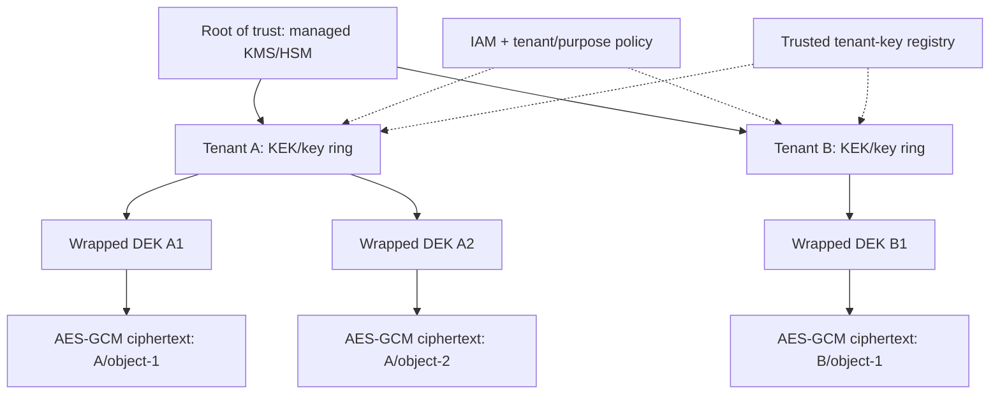
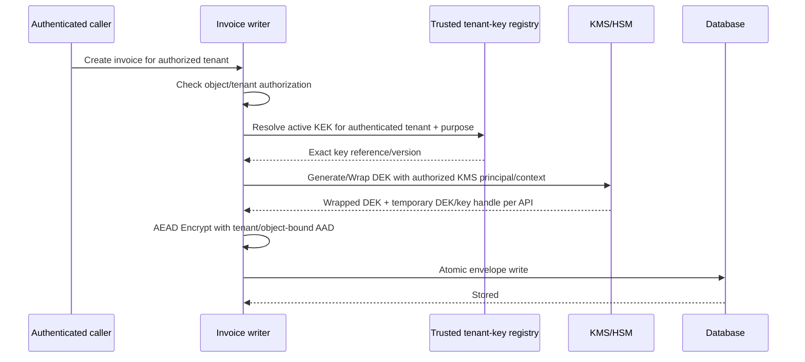
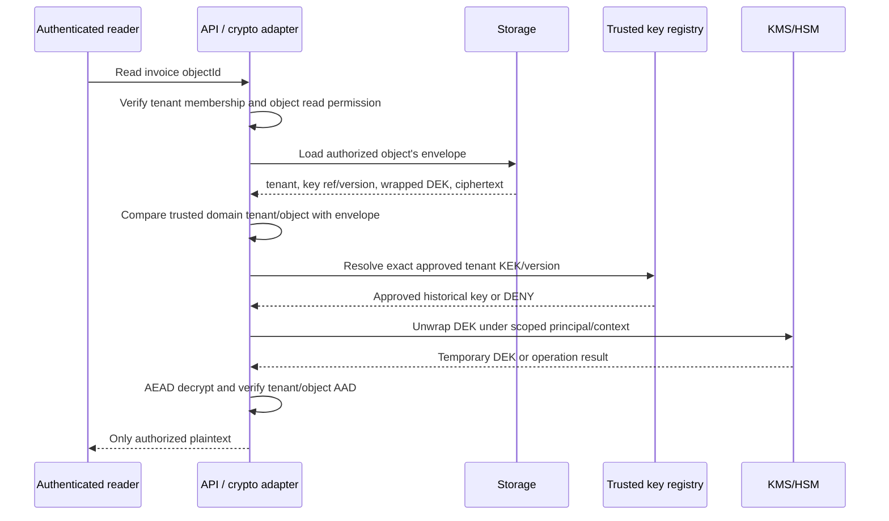
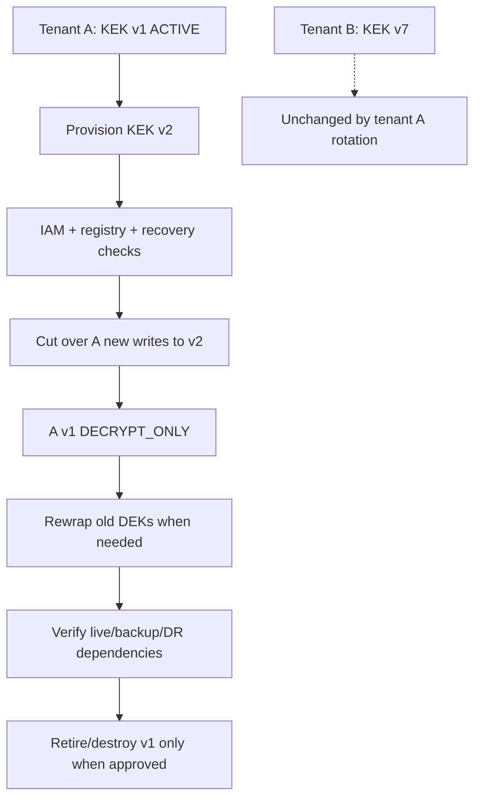

# Tách key theo tenant

## 1. Tách key theo tenant là gì?

**Tách key theo tenant (tenant-aware key isolation)** là thiết kế quản lý **vật liệu khóa, quyền dùng khóa và dữ liệu phụ thuộc khóa** theo từng tổ chức/khách hàng/không gian thuê (*tenant*) của một hệ thống nhiều người thuê (*multi-tenant*). Mục tiêu là để quyền, lỗi vận hành hoặc sự cố ảnh hưởng tới tenant A **không mặc nhiên** cho phép đọc, sửa, ký hoặc giải mã dữ liệu của tenant B.

Ví dụ, một nền tảng SaaS quản lý hóa đơn phục vụ `tenant-A` và `tenant-B`. Nếu tất cả hóa đơn được mã hóa bằng **một DEK tĩnh dùng chung**, việc lộ DEK đó có thể ảnh hưởng dữ liệu của cả hai tenant. Khi dùng **DEK riêng từng object** và **KEK riêng từng tenant** trong KMS, việc truy cập trái phép một DEK hoặc một KEK *có thể được khoanh vùng hơn*, với điều kiện **IAM, service authorization, registry, AAD và bản sao lưu cũng được phân tách đúng**.

Một lời khẳng định quan trọng: **“mỗi tenant có key riêng” không đồng nghĩa “mỗi tenant an toàn tuyệt đối trước tenant khác”**. Nếu một crypto broker có quyền `Decrypt/Unwrap` mọi tenant và tin tham số `tenantId` từ client, đối thủ vẫn có thể dùng chính broker làm *confused deputy* để mở khóa tenant khác. Cần kiểm soát **cả key material và khả năng sử dụng key**.

Bài thuộc chương **Key use** của module `SECURITY_KEY_MANAGEMENT_FUNDAMENTALS`. Module hướng đến hiểu **vòng đời khóa mật mã từ tạo, cấp phát, lưu trữ, sử dụng, xoay vòng, thu hồi tới hủy**, kết nối mật mã đối xứng/bất đối xứng, chữ ký số, KMS/HSM, **envelope encryption**, IAM và kiểm toán để thiết kế hệ thống bảo vệ khóa. Tách key theo tenant là một cách cụ thể hóa các nguyên tắc **least privilege, purpose separation, blast-radius reduction và lifecycle ownership**.

### Mục tiêu học tập

Sau bài, bạn có thể:

1. Phân biệt **cô lập dữ liệu, cô lập key material, cô lập cryptographic capability, cô lập identity và cô lập audit**.
2. So sánh **shared KEK**, shared KEK kèm encryption context, **KEK riêng từng tenant**, DEK riêng từng tenant/object, KMS resource/account/project/HSM partition riêng.
3. Xây dựng **key hierarchy**: root of trust → tenant KEK → per-object DEK → ciphertext, tránh lưu raw KEK/DEK trong code hay database.
4. Ràng buộc tenant/object/key ID/version bằng **trusted registry, KMS encryption context, AEAD AAD và domain authorization**.
5. Giải thích vì sao key ID do client gửi **không phải bằng chứng quyền**, và cách ngăn cross-tenant decrypt/confused deputy.
6. Thiết kế **cryptoperiod, rotation, rewrap/re-encrypt, offboarding, backup/DR, deletion và crypto-erasure** cho từng tenant.
7. Hiểu lựa chọn **BYOK, HYOK/external key, tenant-managed key, KMS/HSM non-exportable** và giới hạn của chúng.
8. Đánh giá **chi phí, latency, quota, cache, region residency, compliance và khả năng vận hành** khi tăng số lượng keys.
9. Thực hành Java 17 mô phỏng **KEK riêng từng tenant, DEK riêng mỗi object, AES-GCM hai lớp, AAD và negative tests**.
10. Áp dụng checklist, ma trận kiểm thử, audit và runbook khi một tenant key bị lộ hoặc bị dùng sai.

## 2. Trước hết phải định nghĩa “tenant”

Một tenant có thể là doanh nghiệp khách hàng, tổ chức, workspace hoặc một đơn vị được tách theo chính sách. Không được đồng nhất tenant với **user đăng nhập**, **hostname**, **subdomain** hay **một tham số HTTP** mà không có mapping tin cậy.

Ví dụ:

- Công ty `Acme` có tenant ID bất biến là `t-4f7a...`.
- Một user có thể thuộc **nhiều tenant** và có role khác nhau ở mỗi tenant.
- Workspace có thể chuyển chủ sở hữu, đổi tên hoặc đổi domain.
- Dữ liệu backup/archive phải giữ đúng **tenant identity lịch sử** để giải mã.
- Một service backend có thể xử lý nhiều tenant, nhưng cần business authorization tương ứng với mỗi request.

**Tenant ID dùng cho key policy nên ổn định, không được tái sử dụng tùy tiện.** Không dùng tên hiển thị như `acme-corp` làm key identity duy nhất nếu tên có thể đổi hoặc bị cấp lại cho khách hàng khác.

### 2.1. Những lớp cô lập cần quan tâm

| Lớp | Câu hỏi | Kiểm soát điển hình |
| --- | --- | --- |
| **Dữ liệu nghiệp vụ** | Caller có được đọc object của tenant này? | Row-level authorization, object ownership, tenant filter đáng tin |
| **Key material** | Một key bị lộ sẽ ảnh hưởng dữ liệu của ai? | Per-tenant KEK, per-object DEK, independent generation |
| **Khả năng sử dụng key** | Principal có thể gọi Decrypt/Sign với key nào? | IAM, key policy, grants, non-exportable KMS/HSM |
| **Định tuyến khóa** | Envelope chọn đúng key resource/version? | Trusted key registry, exact reference, allowlist |
| **Ràng buộc mật mã** | Có thể tráo ciphertext/wrapped DEK giữa tenants không? | AEAD AAD, wrapping context, authenticated metadata |
| **Vận hành/vòng đời** | Tenant A rotate/delete có làm tenant B hỏng? | Versioned inventory, independent cutover, DR |
| **Mạng/host** | Service hoặc broker có dùng chung quyền quá rộng không? | mTLS/workload identity, process/host isolation |
| **Kiểm toán** | Có truy vết key use của từng tenant? | KMS/broker audit, correlation IDs, reconciled logs |

**Không có một key-per-tenant schema nào tự bảo đảm tất cả các lớp**. Một tenant key có thể riêng về material nhưng nằm dưới cùng một admin principal có quyền hủy tất cả; blast radius vận hành vẫn lớn.

### 2.2. Phân biệt tenant isolation với key purpose separation

Cùng một tenant vẫn nên có **các key khác nhau cho từng mục đích** khi phù hợp:

```text
Tenant t-01
  ├── KEK: invoice DEK wrapping
  ├── Key: document signing
  ├── Secret: webhook HMAC
  └── Key: backup/archive hoặc app-specific domain

Tenant t-02
  ├── KEK: invoice DEK wrapping
  ├── Key: document signing
  ├── Secret: webhook HMAC
  └── Key: backup/archive hoặc app-specific domain
```

Một KEK dùng Wrap/Unwrap không nên tùy tiện được dùng như private signing key, HMAC secret hoặc AES-GCM DEK cho toàn dữ liệu. **Tenant separation và purpose separation là hai chiều độc lập của key policy**.

## 3. Threat model: vì sao cần cô lập khóa theo tenant?

Đặt giả định hệ thống SaaS lưu ciphertext của nhiều tenant trong cùng database/object storage.

### 3.1. Các sự cố cần khoanh vùng

1. **Raw DEK lộ:** kẻ tấn công có thể đọc object/batch được mã hóa bằng DEK tương ứng nếu có ciphertext.
2. **KEK tenant A lộ:** có thể mở các wrapped DEKs dưới KEK A; dữ liệu tenant B không nên tự bị mở bằng KEK A.
3. **KMS credential bị chiếm:** nếu principal có quyền `Decrypt` trên KEKs mọi tenant, sự tách vật liệu không ngăn abuse API.
4. **Broker thiếu authorization:** caller tenant A sửa `tenantId=B` hoặc `keyId=B` để nhờ broker unwrap.
5. **Storage metadata bị tráo:** ghép ciphertext tenant A với wrapped DEK hoặc AAD của tenant B.
6. **Rotation không đúng phạm vi:** đổi alias của A khiến mọi tenant trỏ cùng một key hoặc dùng key đã retired.
7. **Backup/export chứa plaintext key:** toàn bộ per-tenant key design bị vô hiệu nếu raw KEKs được backup cùng database.
8. **Key destruction nhầm:** xóa KEK tenant A có thể làm mất hóa đơn còn retention của A; nếu key dùng chung thì còn ảnh hưởng các tenants khác.
9. **Insider/administrator:** một operator có quyền vượt tenant boundary có thể tác động đồng thời nhiều keys.
10. **Region/data-residency mismatch:** dữ liệu tenant phải ở khu vực cụ thể nhưng KMS hoặc key backup nằm ngoài miền được duyệt.

### 3.2. Blast radius có nhiều loại

| Sự cố | Key-per-tenant giúp giới hạn gì? | Vẫn cần gì nữa? |
| --- | --- | --- |
| Lộ một **DEK per object** | Một object hoặc tập dữ liệu dùng DEK đó | AEAD, access control, rotation, forensic |
| Lộ **KEK tenant A** | Có thể giảm tác động trực tiếp tới wrapped DEK của B | Key independence, không có copied material, IAM |
| Lộ **workload credential** | Không nhất thiết giảm nếu credential gọi được mọi KEK | Per-tenant identity, broker policy, IAM scoping |
| Lộ **KMS admin** | Key material có thể non-exportable nhưng operations bị lạm dụng | Separation of duties, dual approval, audit |
| Lộ **root/master dẫn xuất keys** | Có thể ảnh hưởng **mọi derived tenant key** | Root isolation, derivation design, incident scope |
| Sai **tenant mapping** | Key-per-tenant vẫn có thể bị chọn nhầm qua broker | Authenticated tenant resolution, AAD/context |
| Mất **metadata/version** | Ciphertext không biết dùng key nào | Atomic envelope, backups, key inventory |

**Mục tiêu đúng không phải chỉ “tăng số lượng keys” mà là giảm khả năng lan truyền sự cố qua cả material, operation và quản trị.**

## 4. Các mô hình tách khóa và mức độ cô lập

| Mô hình | Cơ chế | Lợi ích | Đánh đổi/rủi ro |
| --- | --- | --- | --- |
| **Một DEK dùng chung mọi tenant** | Một khóa trực tiếp mã hóa toàn bộ dữ liệu | Đơn giản ban đầu | Blast radius lớn; nonce/rotation khó, thường không nên chọn cho dữ liệu nhạy cảm |
| **Một KEK dùng chung, DEK riêng object** | Mọi DEK được bọc bởi cùng KEK | Per-object DEK giảm phạm vi khi lộ một DEK | Lộ/abuse KEK ảnh hưởng nhiều tenant |
| **Shared KEK + authenticated context** | Một KEK, wrapping/AAD bind tenant/object | Chống một số dạng tráo ciphertext/context; đơn giản vận hành | **Không có material isolation** giữa tenants; IAM thường khó tách theo key |
| **KEK riêng mỗi tenant + DEK riêng object** | Mỗi tenant có KEK resource; từng object có DEK ngẫu nhiên | Phân tách blast radius và vòng đời; audit/cutover theo tenant | Nhiều key resources, quotas, cost, IAM/policy complexity |
| **KEK/key ring riêng tenant và data domain** | Invoice vs document vs logs dùng các KEKs riêng | Thêm purpose isolation | Quản trị keys/permissions tăng |
| **KMS project/account riêng tenant** | Tách IAM/admin/billing/resources mức account/project | Có thể giảm shared control-plane risk | Chi phí/automation/HA/DR/operations phức tạp |
| **HSM partition/tenant riêng** | Phân tách partition/slots/key policies | Boundary phần cứng/logic mạnh hơn theo product | License, throughput, ceremony, backup, HA |
| **BYOK/CMEK/HYOK** | Khách hàng quản lý hoặc giữ key material/quyền | Tăng quyền kiểm soát, có thể đáp ứng hợp đồng | Availability, key custody, support, recovery và blast radius theo model |

Không có thiết kế “mạnh nhất” chung cho mọi SaaS. Mục tiêu của chính sách là làm rõ **threat model** và **SLA/compliance** rồi chọn độ cô lập tương ứng.

### 4.1. Chia sẻ KEK nhưng bind tenant có phải tách key không?

Nếu tất cả tenants dùng **cùng một raw KEK**, việc thêm `tenantId` trong encryption context **không làm KEK trở thành nhiều keys độc lập**. Cơ chế context có thể ràng buộc wrapped DEK với tenant và hỗ trợ IAM conditions **nếu provider áp dụng**, nhưng một chủ thể có khả năng sử dụng/biết chính KEK ở phạm vi rộng vẫn có thể ảnh hưởng nhiều tenants.

Do đó, nên mô tả chính xác là **logical tenant separation qua context và policy**, không gọi là **cryptographic key-material isolation**.

### 4.2. KEK riêng theo tenant chưa phải cô lập hoàn toàn

Nếu tất cả KEKs do cùng một admin account tạo và account đó có quyền `Decrypt` mọi tenants, **rủi ro điều khiển tập trung** vẫn còn. Có thể bổ sung:

- Per-service/per-tenant IAM.
- Tách approval/admin và usage.
- Resource-level policy, tags/conditions khi provider hỗ trợ và được kiểm chứng.
- Crypto broker xác minh authenticated tenant/operation.
- Quota, monitoring, KMS audit và incident workflow.
- Account/project/region separation cho tenants có yêu cầu cao.

### 4.3. Không nhầm “tenant-specific key ID” với “tenant-specific key material”

Hai key references khác nhau có thể trỏ tới **cùng key material**, chẳng hạn do alias config sai hoặc imported material được tái sử dụng. Inventory phải biết **origin, version, material provenance và actual provider resource**; không chỉ dựa vào tên hiển thị.

## 5. Mô hình đề xuất: KEK riêng tenant, DEK riêng object

Một thiết kế thường cân bằng được tính an toàn và khả năng vận hành:

- Mỗi tenant có một **KEK** hoặc key ring trong KMS/HSM, scope theo purpose/environment.
- Mỗi object/batch có **DEK ngẫu nhiên độc lập** sinh bằng CSPRNG/KMS.
- Dữ liệu được mã hóa với **AES-GCM** hoặc AEAD được phê duyệt.
- DEK được **wrap/encrypt** bởi KEK của đúng tenant.
- Chỉ lưu **wrapped DEK**, ciphertext/tag, nonce, **key reference/version và AAD schema**.
- **Raw KEK** không nằm trong source code, database hoặc logs.
- Khi decrypt, application cần kiểm tra **business authorization** và key policy trước khi Unwrap.



**Mức cô lập phụ thuộc implementation:** nếu root trust/HSM admin có quyền quản lý cả A và B, rủi ro cấp quản trị vẫn có thể ảnh hưởng hai tenant. “Các KEK độc lập” là tuyên bố về **material**, không đồng nghĩa đã tách **quyền hệ thống**.

### 5.1. DEK per object hay per tenant?

| Chiến lược DEK | Cơ sở lựa chọn | Cần lưu ý |
| --- | --- | --- |
| **DEK mỗi object** | Cần khoanh vùng compromise, dễ crypto-erasure theo object | Số wrapped DEKs lớn; thiết kế throughput/quotas |
| **DEK mỗi batch** | Khối lượng lớn; cân bằng performance/operation count | Compromise ảnh hưởng cả batch |
| **DEK mỗi tenant** | Data set nhỏ hoặc protocol cụ thể, giảm số DEKs | Blast radius lớn trong tenant, nonce management phức tạp |
| **DEK chung mọi tenant** | Hiếm khi đáp ứng yêu cầu isolation của SaaS nhạy cảm | Cross-tenant blast radius; cần risk exception đặc biệt |

Việc sinh DEK riêng **không đòi mỗi DEK trở thành một KMS resource**. Nhiều KMS có data-key APIs hoặc một KEK dùng để bảo vệ rất nhiều DEKs dưới dạng wrapped blobs.

### 5.2. Key ID/version và alias

- **Key ID**: resource/identifier của KEK.
- **Key version**: thế hệ vật liệu theo cách ứng dụng/provider quản lý.
- **Alias current**: con trỏ cho ghi mới; có thể đổi.
- **Wrapped DEK**: bản mã của DEK; có thể chứa metadata nội bộ provider.
- **Envelope format version**: version của encoder/parser dữ liệu, **khác key version**.

Một số managed KMS giữ nguyên **logical key ID** khi tự rotate backing material và có opaque encrypted data-key blob tự chứa thông tin giải mã. Không tự bịa phiên bản backing key mà provider không expose. Nếu application quản lý nhiều **separate KEK resources**, lưu chính xác reference/version đã dùng.

## 6. Luồng mã hóa: tenant được xác thực trước khi chọn KEK



### 6.1. Các bước bắt buộc của writer

1. **Xác thực caller**, lấy principal từ identity layer; tenant được chọn phải thuộc tập tenants caller được phép thao tác.
2. **Authorize business write** cho object hoặc tenant, không tin một `tenantId` trong JSON là đủ.
3. Tra **trusted key registry** bằng tenant ID bất biến, environment, purpose và data classification.
4. Kiểm tra KEK state: chỉ key **ACTIVE_FOR_NEW_USE** được dùng cho Wrap/Encrypt mới.
5. Tạo DEK từ **CSPRNG/KMS**, đúng thuật toán/kích thước.
6. Wrap DEK bằng đúng KEK của tenant qua KMS/HSM/approved key-wrap scheme; ràng buộc **tenant/object/purpose** bằng context/AAD phù hợp.
7. Tạo nonce AES-GCM **không lặp dưới cùng DEK** theo chiến lược đã duyệt.
8. Mã hóa plaintext bằng DEK và **AAD canonical** ràng buộc ngữ cảnh dữ liệu.
9. Ghi **atomically** ciphertext/tag, nonce, wrapped DEK, tenant/object, key reference/version và schema.
10. Ghi audit metadata an toàn, không log plaintext, raw KEK/DEK hoặc credential.

Nếu alias trỏ sang key mới giữa hai lời gọi, writer phải lưu **resource/version thực sự sử dụng**, không đoán dựa trên alias sau cùng.

### 6.2. Không dùng tenant ID từ client làm tham số KMS độc lập

Thao tác sau là sai:

```text
client sends { tenantId: "tenant-B", keyId: "B-KEK" }
backend blindly invokes KMS.Unwrap(keyId)
```

Kể cả KMS yêu cầu IAM, một backend principal rộng có thể có đủ quyền làm việc đó. Đường đúng:

```text
authenticated principal + verified tenant membership
    -> business authorization for object
    -> trusted registry resolves exact KEK
    -> operation policy and KMS IAM
    -> wrap/encrypt
```

## 7. Luồng giải mã: chống cross-tenant decrypt từ nhiều lớp



### 7.1. Ba loại kiểm tra không được thay thế cho nhau

1. **Business authorization:** user/principal có được xem object này hay không?
2. **Key authorization:** principal/service có được dùng KEK của tenant để Unwrap không?
3. **Cryptographic authentication:** ciphertext/tag, wrapped DEK và AAD có đúng ngữ cảnh không?

Một AEAD tag hợp lệ **không xác nhận** user có quyền đọc object. Một IAM `Decrypt success` **không xác nhận** object thuộc tenant đã khai. Một query có `WHERE tenant_id = ?` cũng không thay thế ciphertext authentication.

### 7.2. Không lấy quyền từ chính envelope chưa được xác thực

Envelope lấy từ database, object storage hoặc message queue có thể bị sửa bởi attacker hoặc lỗi vận hành. Nó là **dữ liệu đầu vào**, không phải authority:

- Không lấy `tenantId` từ envelope rồi tự cấp quyền cho caller.
- Không cho phép `keyRef` trỏ tới KMS project/account tùy ý.
- Không tin `algorithm` tự khai để chạy một cipher khác policy.
- Không thử tất cả KEKs nếu Unwrap thất bại.
- Không in chi tiết “tenant B key exists” cho caller không được phép.

Dùng **trusted domain record** và principal identity để xác định expected tenant/object trước khi xử lý key reference.

### 7.3. Trường hợp tenant A đưa ciphertext hợp lệ của B

Nếu service không kiểm object authorization, attacker có thể gửi **envelope hợp lệ của B** và một key ID B. Khi backend có quyền Decrypt B, tag vẫn hợp lệ dưới key B; **mật mã không thể tự biết caller là tenant A**.

Vì thế, **key-per-tenant + AEAD** cần được ghép với **authorization của API/broker**; thiếu một trong ba lớp thì vẫn có khả năng cross-tenant data exposure.

## 8. Ràng buộc tenant/object bằng authenticated context và AAD

### 8.1. AAD là gì?

Với AES-GCM, **Additional Authenticated Data (AAD)** là bytes **không bị mã hóa** nhưng được **xác thực** cùng ciphertext và tag. AAD có thể chứa tenant ID bất biến, object ID, format version, purpose và domain separation.

Ví dụ:

```text
payload-AAD:
  domain       = "invoice/payload/v1"
  format       = 1
  tenantId     = "t-tenantA"
  objectId     = "INV-0042"
  algorithm    = "AES-256-GCM"

wrap-AAD:
  domain       = "invoice/dek-wrap/v1"
  format       = 1
  tenantId     = "t-tenantA"
  objectId     = "INV-0042"
  kekId        = "tenantA/invoice-kek"
  kekVersion   = "v3"
```

Nếu attacker đổi tenant/object mà không có key và không tạo lại đúng authentication tag, AEAD decrypt phải thất bại. **AAD không làm tenant ID bí mật**, và không chứng minh object-level authorization.

### 8.2. AAD của payload và AAD của wrapped DEK nên được thiết kế tách biệt

Có hai lựa chọn:

| Thiết kế | Payload AAD chứa gì? | Khi đổi KEK/re-wrap |
| --- | --- | --- |
| **Bind toàn bộ envelope header** | Tenant, object, **KEK ID/version**, algorithm, format | Đổi KEK metadata làm AAD payload đổi; phải cập nhật xác thực payload thích hợp, thường decrypt/re-encrypt với nonce mới |
| **Tách ngữ cảnh dữ liệu ổn định** | Tenant, object, content suite, immutable data context; **không chứa mutable KEK ref** | Có thể giữ nguyên payload ciphertext/tag và chỉ rewrap DEK, **nếu wrapping layer xác thực đúng header/key/tenant/object** |

Thiết kế thứ hai thường giúp rotate KEK quy mô lớn mà không phải decrypt mọi payload. Nhưng nếu bỏ KEK reference khỏi payload AAD rồi cũng **không authenticate wrap header**, attacker có thể thay metadata gây confusion hoặc DoS; phải ràng buộc nó tại **wrapping layer** và registry.

### 8.3. AAD phải canonical

Không dùng nối chuỗi mơ hồ như:

```text
tenant + "|" + objectId
```

nếu các giá trị có thể chứa dấu phân cách hoặc encoding không nhất quán. Nên dùng **binary length-prefix**, CBOR canonical được đặc tả hoặc JSON canonical với parser/serializer được kiểm chứng.

Hệ thống đa ngôn ngữ (Java, Go, Node.js) phải tạo **cùng byte sequence**. Thay đổi AAD schema cần versioning/migration, không bỏ kiểm tra AAD cho dữ liệu cũ.

### 8.4. KMS encryption context không phải bí mật

Một số provider có **encryption context** được cryptographically bound với encrypted data key và có thể được dùng trong IAM conditions. Nhưng:

- Không phải mọi KMS/algorithm/operation hỗ trợ context như nhau.
- Context có thể xuất hiện trong audit, **không đưa raw token/password/PII nhạy cảm** vào đó.
- Values cần được lấy từ authenticated domain, không từ user input tự khai.
- Tenant-specific context dưới **shared KEK không tạo key material độc lập**.
- Context giúp giảm misuse nếu provider kiểm tra; **không thay thế business authorization**.

## 9. Thiết kế envelope lưu kèm tenant và key reference

Một encrypted envelope có thể dùng schema:

```json
{
  "formatVersion": 1,
  "tenantId": "t-tenantA",
  "objectId": "INV-0042",
  "contentAlgorithm": "AES-256-GCM",
  "aadSchema": "invoice-payload-v1",
  "kekReference": "tenantA/invoice-kek",
  "kekVersion": "v3",
  "wrapAlgorithm": "PROVIDER-WRAP",
  "wrappedDek": "<opaque-encrypted-dek>",
  "dataNonce": "<base64url-96-bit-nonce>",
  "ciphertextAndTag": "<base64url-aead-output>"
}
```

Dấu `<...>` là placeholder; không phải format KMS chính thức. Nếu dùng AES-GCM để wrap DEK ở tầng ứng dụng, envelope còn cần **wrap nonce/tag**; nếu dùng AES-KW/KWP hoặc opaque provider ciphertext blob, cấu trúc khác.

### 9.1. Metadata cần có

| Trường | Lý do lưu | Quy tắc an toàn |
| --- | --- | --- |
| `tenantId` | Định tuyến và kiểm scope | ID bất biến, đối chiếu trusted domain owner |
| `objectId` | Liên kết data object | Có canonical representation, không tái sử dụng tùy tiện |
| `formatVersion` | Parser/migration | Không nhầm với key version |
| `contentAlgorithm` | Suite mã hóa | Server-side allowlist, không tin client chọn |
| `aadSchema` | Khôi phục AAD bytes | Khớp exact data format/version |
| `kekReference` | Tìm KEK tenant | Resolve từ trusted registry/allowlist |
| `kekVersion` | Giải mã lịch sử | Chỉ lưu app/provider version thật có thể định tuyến |
| `wrappedDek` | Khôi phục DEK qua KEK | Không thay bằng raw DEK |
| `dataNonce`, `ciphertextAndTag` | AEAD decrypt + integrity | Nonce strategy, tag length/schema |
| `recordVersion` | Optimistic concurrency/anti-rollback hỗ trợ | Không phải bằng chứng freshness nếu chỉ nằm trong record attacker sửa được |

**Key ID/version thường không cần bí mật**, nhưng có thể tiết lộ topology/tenant; nên bảo vệ quyền đọc inventory và audit.

### 9.2. SQL schema minh họa

```sql
CREATE TABLE encrypted_invoices (
    tenant_id          VARCHAR(128) NOT NULL,
    object_id          VARCHAR(128) NOT NULL,
    record_version     BIGINT NOT NULL,
    format_version     INTEGER NOT NULL,
    kek_reference      VARCHAR(512) NOT NULL,
    kek_version        VARCHAR(128),
    aad_schema         VARCHAR(80) NOT NULL,
    content_algorithm  VARCHAR(80) NOT NULL,
    wrapped_dek        BYTEA NOT NULL,
    wrap_nonce         BYTEA,
    data_nonce         BYTEA NOT NULL,
    ciphertext_tag     BYTEA NOT NULL,
    PRIMARY KEY (tenant_id, object_id)
);
```

Khi migration, phải cập nhật **metadata, wrapped DEK và những trường AEAD phụ thuộc một cách atomically**; không update `kekVersion` ở một transaction rồi wrapped DEK ở transaction khác.

### 9.3. Data model không phải enforcement

Một primary key có `(tenant_id, object_id)` giúp tổ chức dữ liệu, nhưng không có nghĩa DB tự thực thi mọi row-level permission. Cần tenant-scoped queries, row-level security khi có, domain authorization, policy tests và kiểm tra “đọc object bằng ID tenant khác” ở tầng API.

**DB tenant partitioning và cryptographic tenant isolation bổ trợ nhau**; không thay thế nhau.

### 9.4. Tenant ID đổi tên, merge hoặc split

Tenant **display name** có thể đổi nhưng **cryptographic tenant ID** nên ổn định. Nếu merge/split hai tenants, chỉ sửa cột tenant trong DB có thể làm AAD tag không khớp hoặc mất kiểm soát quyền.

Cần kế hoạch:

1. Xác minh quyền sở hữu và phê duyệt chuyển dữ liệu.
2. Xác định DEK/KEK/tenant AAD hiện tại.
3. Decrypt/verify bằng key cũ dưới quyền hợp lệ.
4. Mã hóa/re-wrap theo tenant/key ring mới với AAD và consent/retention tương ứng.
5. Ghi migration atomically, audit và kiểm restore/rollback.
6. Retire old grants và keys khi không còn dependencies.

## 10. Tenant-aware IAM và crypto broker

### 10.1. Hai mô hình identity

**Model A — Một workload identity riêng mỗi tenant:** caller có IAM trực tiếp tới KEK tenant. Giảm nguy cơ cross-tenant IAM nếu cấu hình đúng, nhưng có thể khó vận hành khi số tenant rất lớn.

**Model B — Một crypto broker chung:** broker có quyền tới nhiều KEKs; cần **authoritative mapping** từ authenticated caller → allowed tenant/object/purpose → exact key reference trước khi dùng quyền rộng.

Không có một lựa chọn đúng cho mọi quy mô; rủi ro lớn của model B là **confused deputy** và khó attribution.

### 10.2. Permission matrix

| Principal | Tenant A KEK | Tenant B KEK | Điều kiện |
| --- | --- | --- | --- |
| `invoice-writer-A` | Wrap/GenerateDataKey | DENY | Data write authorization tenant A |
| `invoice-reader-A` | Unwrap/DecryptKey | DENY | Object read authorization tenant A |
| `invoice-writer-B` | DENY | Wrap/GenerateDataKey | Tenant B |
| `invoice-reader-B` | DENY | Unwrap/DecryptKey | Tenant B |
| `crypto-broker` | Có thể ALLOW | Có thể ALLOW | **Phải enforce mapping caller/tenant/object tại broker** |
| `backup-restore` | Conditional | Conditional | DR ticket, approval, time-bound grant |
| `key-admin` | Key state/policy | Key state/policy | Không tự động được Decrypt mọi object |
| `security-auditor` | Describe/audit | Describe/audit | Không đọc raw key/DEK |

Tên operation là **mô tả nghiệp vụ**; một số providers dùng `Encrypt/Decrypt` hoặc `GenerateDataKey`, và key policy/grant semantics khác nhau. Cần mapping tới API thực và negative tests.

### 10.3. Key selection phải đến từ registry đáng tin

```text
Authenticated caller
     |
     v
Resolve permitted tenant(s) and object authorization
     |
     v
Trusted registry: (tenantId, purpose, environment)
     -> (exact KEK resource, version/state, allowed operations)
     |
     v
KMS/HSM IAM + encryption context
     |
     v
Cryptographic result
```

Không dùng URL, cloud account, KMS resource ID hoặc tenant key ID do client tự gửi để tạo một **arbitrary-key oracle**.

### 10.4. Non-exportable KEK vẫn có thể bị lạm dụng

Nếu broker có `Unwrap` trên tất cả KEKs và principal bị chiếm, attacker có thể yêu cầu Unwrap mà không cần export KEK. Vì vậy:

- Thu hẹp grant/routing theo tenant khi có thể.
- Rate limit và phát hiện truy cập bất thường.
- Audit upstream principal, broker principal, key ref/version và operation.
- Tách quyền quản trị key policy khỏi key usage.
- Kiểm tra object authorization và encryption context.
- Bảo vệ credentials, mTLS/workload identity và secret handling của broker.

## 11. Key generation: độc lập vật liệu hay dẫn xuất từ master?

### 11.1. KEK được sinh độc lập

Mỗi KEK được **tạo bởi CSPRNG/KMS/HSM theo key spec**. Khi một tenant KEK bị lộ, về mặt material nó không tự cho phép suy ra các KEKs khác, với điều kiện nguồn sinh, lưu trữ, import và policies đúng.

Đây là lợi thế của **independent keys**. Nhưng nếu attacker chiếm **admin/IAM principal chung** hoặc backup chứa toàn bộ keys, các tenant khác vẫn có nguy cơ.

### 11.2. Tenant-derived keys bằng HKDF

Một số hệ thống dùng master secret entropy cao và HKDF để dẫn xuất subkeys:

```text
                    High-entropy master secret
                               |
                 HKDF with approved context
                    /          |          \
        tenant=t-A     tenant=t-B     tenant=t-C
           |              |              |
        KEK-A          KEK-B           KEK-C
```

**Điều kiện bắt buộc:**

- Master secret mạnh và được bảo vệ chặt, có cryptoperiod/version.
- KDF được duyệt, **domain separation** theo tenant/purpose/version rõ ràng.
- Tenant ID canonical và không tái sử dụng sai ngữ nghĩa.
- Derived keys đúng algorithm/key length và không xuất bừa bãi.
- Policy rõ ràng khi rotate master: tất cả derived keys có thể phải migrate.
- Không tự thay HKDF bằng `SHA256(master || tenantId)` mà không có phân tích/giao thức chuẩn.

**Giới hạn lớn:** lộ master có thể làm nguy hiểm **mọi tenant-derived key**, nếu attacker có các tham số cần thiết. Dù subkeys có phân tách toán học, chúng **không có failure domain độc lập khỏi master**. Nếu chính sách yêu cầu mỗi tenant hoàn toàn độc lập về key custody, độc lập KEK resources có thể phù hợp hơn.

### 11.3. Không biến tenant ID thành key

Ví dụ sai:

```java
// SAI: Tenant ID và UUID không phải raw AES key được phép.
byte[] rawKey = java.security.MessageDigest
    .getInstance("SHA-256")
    .digest(tenantId.getBytes(java.nio.charset.StandardCharsets.UTF_8));
```

Kẻ tấn công biết hoặc đoán được tenant ID sẽ tính lại key. **Hash không tạo entropy từ một identifier công khai**.

### 11.4. Randomness và nonce trong multi-tenant

Nếu mỗi object có DEK riêng, nonce reuse risk trong cùng DEK có thể được giảm bằng việc sử dụng đúng chiến lược. Nhưng không được bỏ qua:

- AES-GCM **cấm reuse nonce dưới cùng key**.
- Multiple writers/regions/restore cần chiến lược thống nhất.
- Một KEK AES-GCM dùng wrap nhiều DEKs cũng có **nonce limits** riêng nếu provider/wrapping scheme yêu cầu.
- Key rotation/cryptoperiod cần xem xét số lần mã hóa.
- CSPRNG có tính khó đoán **không tự bảo đảm mọi random nonce đều duy nhất**.

## 12. Java 17: ví dụ KEK riêng mỗi tenant + DEK riêng mỗi object

Ví dụ sau minh họa **đúng một service nhiều tenant** sử dụng:

1. **Trusted registry** chứa KEK riêng theo tenant/version.
2. **DEK AES-256 mới cho mỗi object** sinh bằng `KeyGenerator`/`SecureRandom`.
3. **Wrap DEK bằng AES-GCM** dưới KEK tenant với AAD riêng (chỉ cho demo).
4. Mã hóa payload bằng **AES-GCM** dưới DEK với AAD ổn định.
5. Lưu envelope chứa `tenantId`, `objectId`, `kekId/version`, hai nonce, wrapped DEK và ciphertext/tag.
6. Kiểm tra authenticated tenant/object, exact KEK registry mapping và AEAD authentication.
7. Negative tests: caller tenant khác, đổi tenant/key reference, tráo wrapped DEK, sửa payload.

**Quan trọng:** Đây là **demo local để hiểu boundary**, không phải một KMS/HSM tích hợp thật. KEKs nằm trong JVM; ai kiểm soát process có thể bypass `TenantKeyRegistry`. Production nên dùng **KMS/HSM non-exportable KEKs**, wrapping API chuẩn như AES-KW/KWP hoặc provider-native scheme, IAM và object authorization do backend thực thi.

### 12.1. Source: `TenantKeyIsolationDemo.java`

```java
import java.io.ByteArrayOutputStream;
import java.io.DataOutputStream;
import java.io.IOException;
import java.nio.charset.StandardCharsets;
import java.security.GeneralSecurityException;
import java.security.MessageDigest;
import java.security.SecureRandom;
import java.util.Arrays;
import java.util.HashMap;
import java.util.Map;
import java.util.Objects;
import java.util.Set;
import javax.crypto.AEADBadTagException;
import javax.crypto.Cipher;
import javax.crypto.KeyGenerator;
import javax.crypto.SecretKey;
import javax.crypto.spec.GCMParameterSpec;
import javax.crypto.spec.SecretKeySpec;

public final class TenantKeyIsolationDemo {
    private static final SecureRandom RNG = new SecureRandom();
    private static final int FORMAT_VERSION = 1;
    private static final int NONCE_BYTES = 12;
    private static final int TAG_BITS = 128;
    private static final String DATA_ALG = "AES-256-GCM";
    private static final String WRAP_ALG = "AES-256-GCM-DEMO-WRAP";

    record KeyRef(String tenantId, String kekId, String version) {}

    record Principal(
        String principalId, String tenantId, Set<String> roles
    ) {}

    // byte[] mutable: production DTO phải defensive-copy.
    record Envelope(
        int formatVersion,
        String tenantId,
        String objectId,
        String contentAlgorithm,
        String wrappingAlgorithm,
        String kekId,
        String kekVersion,
        byte[] wrapNonce,
        byte[] wrappedDek,
        byte[] dataNonce,
        byte[] ciphertextAndTag
    ) {}

    static final class TenantKeyRegistry {
        private final Map<KeyRef, SecretKey> keys = new HashMap<>();
        private final Map<String, KeyRef> activeKeys = new HashMap<>();

        void registerActive(KeyRef ref, SecretKey kek) {
            keys.put(ref, kek);
            activeKeys.put(ref.tenantId(), ref);
        }

        KeyRef currentKeyFor(String tenant) {
            KeyRef result = activeKeys.get(tenant);
            if (result == null) {
                throw new SecurityException("No approved tenant key");
            }
            return result;
        }

        SecretKey requireExact(KeyRef ref) {
            SecretKey result = keys.get(ref);
            if (result == null) {
                throw new SecurityException("Unapproved key reference");
            }
            return result;
        }
    }

    static SecretKey newAes256() throws GeneralSecurityException {
        KeyGenerator gen = KeyGenerator.getInstance("AES");
        gen.init(256, RNG);
        return gen.generateKey();
    }

    static byte[] randomNonce() {
        byte[] nonce = new byte[NONCE_BYTES];
        RNG.nextBytes(nonce);
        return nonce;
    }

    static void add(DataOutputStream out, String value)
            throws IOException {
        byte[] bytes = value.getBytes(StandardCharsets.UTF_8);
        out.writeInt(bytes.length);
        out.write(bytes);
    }

    // Payload AAD không chứa mutable KEK ref/version.
    static byte[] payloadAad(Envelope e) throws IOException {
        ByteArrayOutputStream bytes = new ByteArrayOutputStream();
        try (DataOutputStream out = new DataOutputStream(bytes)) {
            add(out, "invoice/payload/v1");
            out.writeInt(e.formatVersion());
            add(out, e.contentAlgorithm());
            add(out, e.tenantId());
            add(out, e.objectId());
        }
        return bytes.toByteArray();
    }

    // Wrapping AAD chứa cả tenant/object và exact KEK reference.
    static byte[] wrapAad(Envelope e) throws IOException {
        ByteArrayOutputStream bytes = new ByteArrayOutputStream();
        try (DataOutputStream out = new DataOutputStream(bytes)) {
            add(out, "invoice/wrap/v1");
            out.writeInt(e.formatVersion());
            add(out, e.wrappingAlgorithm());
            add(out, e.tenantId());
            add(out, e.objectId());
            add(out, e.kekId());
            add(out, e.kekVersion());
        }
        return bytes.toByteArray();
    }

    static byte[] aesGcm(
        int mode, SecretKey key, byte[] nonce,
        byte[] input, byte[] aad
    ) throws GeneralSecurityException {
        Cipher cipher = Cipher.getInstance("AES/GCM/NoPadding");
        cipher.init(mode, key, new GCMParameterSpec(TAG_BITS, nonce));
        cipher.updateAAD(aad);
        return cipher.doFinal(input);
    }

    static void requireTenantRole(
        Principal caller, String expectedTenant, String role
    ) {
        // Caller must come from an authenticated identity layer.
        if (caller == null || caller.principalId() == null
                || caller.principalId().isBlank()
                || caller.roles() == null
                || !Objects.equals(caller.tenantId(), expectedTenant)
                || !caller.roles().contains(role)) {
            throw new SecurityException("Tenant or role not authorized");
        }
    }

    static Envelope encrypt(
        TenantKeyRegistry registry,
        Principal writer,
        String trustedTenantId,
        String trustedObjectId,
        byte[] plaintext
    ) throws Exception {
        requireTenantRole(writer, trustedTenantId, "invoice-writer");
        if (trustedObjectId == null || trustedObjectId.isBlank()
                || plaintext == null) {
            throw new SecurityException("Invalid object");
        }

        KeyRef ref = registry.currentKeyFor(trustedTenantId);
        SecretKey kek = registry.requireExact(ref);
        SecretKey dek = newAes256();
        byte[] dekBytes = dek.getEncoded();
        if (dekBytes == null || dekBytes.length != 32) {
            throw new GeneralSecurityException("Invalid demo DEK");
        }

        byte[] wrapNonce = randomNonce();
        byte[] dataNonce = randomNonce();
        Envelope header = new Envelope(
            FORMAT_VERSION, trustedTenantId, trustedObjectId,
            DATA_ALG, WRAP_ALG, ref.kekId(), ref.version(),
            wrapNonce, null, dataNonce, null
        );

        try {
            byte[] wrappedDek = aesGcm(
                Cipher.ENCRYPT_MODE, kek, wrapNonce,
                dekBytes, wrapAad(header)
            );
            byte[] ciphertextAndTag = aesGcm(
                Cipher.ENCRYPT_MODE, dek, dataNonce,
                plaintext, payloadAad(header)
            );
            return new Envelope(
                FORMAT_VERSION, trustedTenantId, trustedObjectId,
                DATA_ALG, WRAP_ALG, ref.kekId(), ref.version(),
                wrapNonce, wrappedDek, dataNonce, ciphertextAndTag
            );
        } finally {
            Arrays.fill(dekBytes, (byte) 0);
        }
    }

    static byte[] decrypt(
        TenantKeyRegistry registry,
        Principal reader,
        Envelope e,
        String expectedTenantFromDomain,
        String expectedObjectFromDomain
    ) throws Exception {
        // Production: domain auth must resolve object ownership first.
        requireTenantRole(
            reader, expectedTenantFromDomain, "invoice-reader"
        );
        if (e == null || e.formatVersion() != FORMAT_VERSION
                || !DATA_ALG.equals(e.contentAlgorithm())
                || !WRAP_ALG.equals(e.wrappingAlgorithm())
                || !Objects.equals(
                    e.tenantId(), expectedTenantFromDomain)
                || !Objects.equals(
                    e.objectId(), expectedObjectFromDomain)
                || e.kekId() == null || e.kekVersion() == null
                || e.wrapNonce() == null
                || e.wrapNonce().length != NONCE_BYTES
                || e.dataNonce() == null
                || e.dataNonce().length != NONCE_BYTES
                || e.wrappedDek() == null
                || e.wrappedDek().length < 16
                || e.ciphertextAndTag() == null
                || e.ciphertextAndTag().length < 16) {
            throw new SecurityException("Invalid envelope/context");
        }

        KeyRef ref = new KeyRef(
            e.tenantId(), e.kekId(), e.kekVersion()
        );
        SecretKey kek = registry.requireExact(ref);

        byte[] dekBytes = aesGcm(
            Cipher.DECRYPT_MODE, kek, e.wrapNonce(),
            e.wrappedDek(), wrapAad(e)
        );
        try {
            if (dekBytes.length != 32) {
                throw new GeneralSecurityException("Invalid DEK size");
            }
            SecretKey dek = new SecretKeySpec(dekBytes, "AES");
            return aesGcm(
                Cipher.DECRYPT_MODE, dek, e.dataNonce(),
                e.ciphertextAndTag(), payloadAad(e)
            );
        } finally {
            Arrays.fill(dekBytes, (byte) 0);
        }
    }

    static Envelope withHeader(
        Envelope e, String newTenant, String newKekId
    ) {
        return new Envelope(
            e.formatVersion(), newTenant, e.objectId(),
            e.contentAlgorithm(), e.wrappingAlgorithm(),
            newKekId, e.kekVersion(), e.wrapNonce(),
            e.wrappedDek(), e.dataNonce(), e.ciphertextAndTag()
        );
    }

    public static void main(String[] args) throws Exception {
        TenantKeyRegistry registry = new TenantKeyRegistry();
        String kekIdA = "billing/t-A/invoice-kek";
        String kekIdB = "billing/t-B/invoice-kek";
        registry.registerActive(
            new KeyRef("t-A", kekIdA, "v1"), newAes256()
        );
        registry.registerActive(
            new KeyRef("t-B", kekIdB, "v1"), newAes256()
        );

        Principal writerA = new Principal(
            "service://writer-A", "t-A", Set.of("invoice-writer")
        );
        Principal readerA = new Principal(
            "service://reader-A", "t-A", Set.of("invoice-reader")
        );
        Principal readerB = new Principal(
            "service://reader-B", "t-B", Set.of("invoice-reader")
        );

        byte[] invoice = "invoice=INV-42;total=1000"
            .getBytes(StandardCharsets.UTF_8);

        Envelope a = encrypt(
            registry, writerA, "t-A", "INV-42", invoice
        );
        byte[] recovered = decrypt(
            registry, readerA, a, "t-A", "INV-42"
        );
        System.out.println(
            "Tenant A decrypt valid: "
            + MessageDigest.isEqual(invoice, recovered)
        ); // true

        // Tenant B không được mở object tenant A.
        boolean crossTenantDenied = false;
        try {
            decrypt(registry, readerB, a, "t-A", "INV-42");
        } catch (SecurityException expected) {
            crossTenantDenied = true;
        }
        System.out.println(
            "Cross-tenant request denied: " + crossTenantDenied
        ); // true

        // Tráo header sang tenant B + key B:
        // policy/registry có thể trỏ được B, nhưng wrapping tag
        // của A không thể được mở bằng KEK B.
        Envelope tamperedTenant = withHeader(
            a, "t-B", kekIdB
        );
        boolean wrongKekRejected = false;
        try {
            decrypt(
                registry, readerB, tamperedTenant,
                "t-B", "INV-42"
            );
        } catch (AEADBadTagException expected) {
            wrongKekRejected = true;
        }
        System.out.println(
            "Swapped tenant/KEK rejected: " + wrongKekRejected
        ); // true

        // Sửa một byte ciphertext phải bị AEAD từ chối.
        byte[] modified = a.ciphertextAndTag().clone();
        modified[0] ^= 1;
        Envelope altered = new Envelope(
            a.formatVersion(), a.tenantId(), a.objectId(),
            a.contentAlgorithm(), a.wrappingAlgorithm(),
            a.kekId(), a.kekVersion(), a.wrapNonce(),
            a.wrappedDek(), a.dataNonce(), modified
        );
        boolean tamperRejected = false;
        try {
            decrypt(registry, readerA, altered, "t-A", "INV-42");
        } catch (AEADBadTagException expected) {
            tamperRejected = true;
        }
        System.out.println(
            "Tampered ciphertext rejected: " + tamperRejected
        ); // true

        Arrays.fill(invoice, (byte) 0);
        Arrays.fill(recovered, (byte) 0);
        Arrays.fill(modified, (byte) 0);
    }
}
```

### 12.2. Chạy với JDK 17+

```bash
javac TenantKeyIsolationDemo.java
java TenantKeyIsolationDemo
```

Kết quả dự kiến:

```text
Tenant A decrypt valid: true
Cross-tenant request denied: true
Swapped tenant/KEK rejected: true
Tampered ciphertext rejected: true
```

### 12.3. Bài học từ ví dụ

- Hai KEKs có **key material độc lập**, không đơn thuần là hai strings tên key.
- Mỗi lời gọi Encrypt tạo một **DEK mới** cho object.
- Writer dùng **current KEK của tenant đã xác thực**, reader dùng exact reference ghi trong envelope.
- **Payload AAD** ràng buộc immutable tenant/object/data format, không chứa KEK version mutable.
- **Wrap AAD** ràng buộc tenant/object/KEK ID/version; thay tenant/header không mở được DEK nếu không có key/tag hợp lệ.
- Reader tenant B **không có quyền** xem tenant A, kể cả khi B gửi một bản ciphertext đúng mật mã.
- Sửa ciphertext bị AES-GCM authentication từ chối.
- Không in raw AES keys, chỉ in kết quả pass/fail.

### 12.4. Giới hạn cần hiểu để không copy nguyên vào production

1. **Key registry nằm trong JVM:** không enforce quyền HSM/IAM; người có process access có thể bypass.
2. **Key resource không durable:** restart tạo KEKs khác, vì vậy dữ liệu mã hóa trong demo **không thể phục hồi sau restart**. Production cần KMS/HSM và key ring/backup.
3. **AES-GCM wrapping demo:** có nonce random cho mỗi Wrap; production phải xem wrapping scheme/provider, usage bounds và có thể chọn **AES-KW/KWP/KMS-native**.
4. **Object authorization mới ở dạng giả định:** `expectedTenant/Object` phải được giải từ authenticated domain/DB, không được do caller tự gán.
5. **Record chứa `byte[]` mutable:** production phải defensive-copy và chống TOCTOU/aliasing.
6. **Không có parser/serialization:** production cần kiểm limits, canonical encoding và atomic persistence.
7. **Không có tenant isolation ở OS/HSM:** nhiều keys trong một process không ngăn memory exfiltration.
8. **Không có rotation/migration/DR:** demo chỉ có KEK v1, không xử lý legacy data.
9. **Không có anti-rollback/freshness:** AEAD tag không chứng minh record là version mới nhất nếu attacker phát lại toàn bộ envelope cũ hợp lệ.
10. **Không có rate limit/audit thực:** KMS broker phải log caller, key/version, operation, object, outcome.
11. **Java zeroization không tuyệt đối:** `Arrays.fill` chỉ giảm lifetime mảng được ghi đè; provider/JVM có thể giữ bản copy.
12. **Không chạy compliance validation:** “AES-256” và “JCA” không tự chứng minh module được phê duyệt/FIPS.

## 13. KMS/HSM, BYOK, CMEK và tenant-managed keys

### 13.1. KMS resource riêng mỗi tenant

Một thiết kế cloud có thể provision **KMS key resource riêng theo tenant**, có:

- Owner, environment, tenant ID bất biến và key purpose.
- Algorithm/spec, origin/provider, key state, rotation policy.
- IAM resource policy/grants theo tenant/workload.
- Key ID/logical resource reference.
- Backup/replica/region strategy.
- Audit policy và reference tới data dependency inventory.

Tuy nhiên **không giả định mọi cloud KMS đều hỗ trợ phân quyền theo từng material version**. Một số quản lý backing material nội bộ và chỉ expose logical key ID + opaque ciphertext.

### 13.2. Customer-managed keys và BYOK

Một khách hàng có thể yêu cầu tự quản lý key hoặc cung cấp key material:

| Mô hình | Ai kiểm soát gì? | Cần đánh giá |
| --- | --- | --- |
| **Provider-managed key** | SaaS/provider thiết lập key và IAM | Quyền của SaaS admin, tenant scope, provider SLA |
| **Customer-managed key / CMEK** | Khách có thể quản lý resource/policy trong phạm vi tích hợp | Ai có quyền `Decrypt`, khả năng thu hồi, uptime và offboarding |
| **BYOK** | Key material được sinh bên ngoài rồi import theo cơ chế được hỗ trợ | Bản gốc/copies, import channel, origin, deletion scope |
| **External key / HYOK-like model** | Khách giữ key/capability ngoài miền provider tùy kiến trúc | Network dependency, latency, outage, audit, recovery, vendor contract |

**Các tên này không có một ý nghĩa kỹ thuật giống hệt trên mọi sản phẩm.** Phải xem **ai giữ raw material, ai có quyền gọi crypto operations, ai có thể hủy và provider xử lý outage thế nào**.

### 13.3. Khi khách thu hồi key

Nếu khách disable hoặc revoke quyền KMS:

- SaaS có thể mất khả năng decrypt data của tenant đó.
- Key có thể vẫn tồn tại; revoke capability **không đồng nghĩa destruction**.
- Plaintext hoặc DEK đã được cache/backup trước đó có thể còn.
- Phải xác định SLA, notification, retention và cách support/restore khi khách kích hoạt lại.
- Không tự bypass bằng cách dùng KEK global hardcoded.

Nếu hợp đồng yêu cầu khách có **quyền cắt truy cập**, hệ thống phải chứng minh **mọi đường decrypt** đều được quản lý theo mô hình đó, bao gồm caches, exports, backup và các services nền.

### 13.4. HSM partition không chỉ là một tên namespace

Nếu cần hardware-backed isolation, xác minh partition/token/slot, key attributes (non-extractable/allowed operations), operator roles, backup, HA và khả năng audit của sản phẩm. Một key ID có prefix tenant **không chứng minh** đã tạo partition phần cứng độc lập.

## 14. Policy-as-code cho tenant key usage

Ví dụ YAML mô tả một chính sách nghiệp vụ **không phải cấu hình hợp lệ của mọi KMS**:

```yaml
policyId: tenant-key-isolation-v3
environment: production
tenantIsolation: per-tenant-kek
defaultDecision: DENY
keyPurpose: invoice-dek-wrapping
tenantKeyRegistry: trusted://crypto/tenant-kek-registry
allowedContentAlgorithm: AES-256-GCM
rules:
  - id: TENANT_WRITER
    callerRole: invoice-writer
    operation: Wrap
    when:
      authenticatedTenantMatchesObject: true
      keyTenantMatchesAuthenticatedTenant: true
      keyState: ACTIVE_FOR_NEW_USE
      encryptionContextVerified: true
    decision: ALLOW

  - id: TENANT_READER
    callerRole: invoice-reader
    operation: Unwrap
    when:
      objectReadAuthorizationVerified: true
      keyTenantMatchesAuthenticatedTenant: true
      keyState: [ACTIVE_FOR_NEW_USE, DECRYPT_ONLY]
      encryptionContextVerified: true
    decision: ALLOW

  - id: TENANT_DR_RESTORE
    callerRole: backup-restore
    operation: Unwrap
    when:
      recoveryTicketApproved: true
      grantTimeBound: true
      tenantRecoveryScopeVerified: true
    decision: ALLOW_CONDITIONAL
auditing:
  include:
    - tenantRef
    - keyRef
    - keyVersion
    - principal
    - operation
    - requestId
    - decision
  exclude:
    - rawKek
    - rawDek
    - plaintext
    - bearerToken
```

**Điểm mấu chốt:** các điều kiện `objectReadAuthorizationVerified` và `authenticatedTenantMatchesObject` phải được **tính bởi backend đáng tin**. Đừng chuyển một field boolean do client gửi thành bằng chứng authorization.

### 14.1. “Policy được khai báo” khác “policy được thực thi”

Audit nên so ba trạng thái:

- **Declared:** Tenant A thuộc KEK A, reader-A chỉ Unwrap-A.
- **Configured:** IAM/provider/grants thực tế có enforce như vậy?
- **Observed:** KMS/broker logs có operation nào chéo tenant không?

Nếu khai báo đúng nhưng configured IAM cho `crypto-broker` quyền mọi keys mà không kiểm scope, **threat model vẫn chưa đạt mục tiêu isolation**.

## 15. Rotation theo tenant mà không gián đoạn tenant khác

Rotation thường xảy ra vì cryptoperiod, policy migration, compromise, thay provider hoặc customer request.

### 15.1. Key states

| Trạng thái logic | Wrap/Encrypt mới | Unwrap/Decrypt lịch sử | Ý nghĩa |
| --- | --- | --- | --- |
| **CREATED/PENDING_APPROVAL** | Không | Không | Key vừa được provision |
| **ACTIVE_FOR_NEW_USE** | Có theo policy | Có theo policy | Key hiện tại của tenant |
| **DECRYPT_ONLY** | **Không** | Có nếu còn retention | Legacy key sau cutover |
| **DISABLED/SUSPENDED** | Không | Thường không qua provider | Cô lập tạm |
| **PENDING_DESTRUCTION** | Không | Theo provider policy, thường bị chặn | Chờ destructive workflow |
| **DESTROYED** | Không | Không nếu material thật sự đã hủy | Không thể enable lại cùng material |

Các trạng thái trên là **business policy**, không nhất thiết có API state trực tiếp của provider. Nếu KMS không hỗ trợ `DECRYPT_ONLY` natively, thực thi tại IAM/broker và kiểm tra trong production.

### 15.2. Rotation độc lập tenant A



Các tenant khác không nên phải rotate chỉ vì A đổi KEK. Tuy nhiên, shared root/credential/admin compromise có thể yêu cầu phản ứng phạm vi rộng hơn.

### 15.3. Rewrap khác re-encrypt

- **Rotate KEK:** tạo/chọn version KEK mới cho dữ liệu mới.
- **Rewrap DEK:** cùng DEK được bọc lại dưới KEK mới; payload ciphertext có thể giữ nếu **payload AAD không bind mutable KEK metadata** và wrapping header được xác thực.
- **Re-encrypt với DEK mới:** đổi vật liệu mã hóa payload, cần khi DEK bị lộ/yếu hoặc đổi thuật toán.
- **Move tenant:** có thể cần chuyển KEK/DEK, cập nhật tenant AAD và data owner, không chỉ sửa metadata DB.
- **Revoke IAM:** chặn key API use nhưng không xóa raw keys đã có ở memory/export.

Nếu **DEK đã bị lộ**, chỉ rewrap DEK bằng KEK mới **không lấy lại confidentiality** đối với ciphertext cũ attacker đã có.

### 15.4. Khi thiết kế payload AAD chứa KEK version

Nếu content AAD có `kekVersion=v1`, khi thay thành v2, content tag không còn khớp. Một quy trình migration hợp lệ phải giải mã và xác thực payload rồi encrypt/tag lại với AAD mới (sử dụng nonce mới nếu cùng DEK), hoặc chọn từ đầu **stable payload AAD và separately authenticated wrapping header**.

Đây là trade-off cần quyết định **trước khi** mã hóa hàng tỷ records.

## 16. Tenant offboarding, deletion và cryptographic erasure

### 16.1. Xóa tenant không đơn thuần là xóa một KEK

Một tenant offboarding có thể có:

- Live database rows.
- Backups/snapshots/archives.
- Wrapped DEKs, encrypted indexes và search caches.
- Message queues, export files, data warehouse, analytics copies.
- Customer-operated clients hoặc external processors.
- Local key caches và imported/exported KEK copies.
- Legal hold hoặc retention obligations.

Nếu hủy tenant KEK trước khi giải quyết mọi obligations, dữ liệu bắt buộc giữ có thể **không khôi phục được**. Nếu vẫn còn plaintext/raw DEK ở nơi khác, hủy KEK **không chứng minh** dữ liệu đã bị xóa mật mã.

### 16.2. Crypto-erasure theo tenant

**Cryptographic erasure** có thể được xem là khả năng làm ciphertext không còn giải mã khả thi vì khóa cần thiết đã bị hủy trong **tất cả đường phục hồi được tính trong phạm vi**.

Điều kiện thường cần:

1. Tenant data được mã hóa bằng sơ đồ an toàn và khóa có entropy phù hợp.
2. Không còn **raw DEK/KEK** hoặc key material copies có thể mở dữ liệu.
3. Backup/replicas/escrow/imported copies được xử lý theo policy.
4. Không còn plaintext ở logs/exports/index ngoài scope.
5. Provider xác nhận final key destruction theo contract.
6. Retention/legal hold, backup/DR và data ownership được giải quyết.
7. Có audit evidence về phạm vi và thời gian.

**Xóa alias/key reference không tự hủy material.** `Disabled` khác `Destroyed`. Một bản BYOK gốc ở HSM của khách hàng vẫn có thể dùng lại nếu chưa hủy.

### 16.3. Offboarding một tenant không được hủy key của tenant khác

Đây là một lợi ích quan trọng của per-tenant KEKs. Tuy nhiên, phải bảo đảm:

- Key ID/owner/tenant không bị map nhầm.
- Shared parent key/HSM partition không bị xóa thay vì tenant child.
- Đường restore hoặc tenant merge không còn phụ thuộc key cần hủy.
- Destruction phải có explicit target resource, approvals và negative tests trên các tenants lân cận.
- Audit records giữ metadata phù hợp, không giữ raw secret vô thời hạn.

## 17. Backup, disaster recovery và cross-region

Một backup chứa ciphertext nhưng thiếu đúng KEK/key version **có thể không phục hồi được**.

### 17.1. Mỗi tenant cần một dependency inventory

```yaml
tenantId: t-A
keyPurpose: invoice-dek-wrapping
keyRef: billing/t-A/invoice-kek
activeVersion: v2
historicalVersions: [v1]
liveEncryptedObjects:
  - storageRef: invoices/t-A
    keyVersions: [v1, v2]
backupDependencies:
  - backupRef: monthly-archive-2026-10
    requiredVersion: v1
  - backupRef: nightly-2026-11
    requiredVersion: v2
recoveryPolicyRef: tenant-dr-v3
lastRestoreTest: "2026-11-28"
```

Schema minh họa; không lưu raw keys. Thông tin tenant/object references có thể nhạy cảm, cần phân quyền và retention.

### 17.2. Restore drill cần đi hết vòng

1. Chọn backup đúng tenant và thời kỳ retention.
2. Phục hồi ciphertext, wrapped DEK, tenant/object IDs, schema/version metadata.
3. Xác minh trusted tenant-key registry còn exact keys/refs cần thiết.
4. Kiểm IAM/principal được cấp quyền restore theo DR ticket.
5. Unwrap đúng KEK version, verify AES-GCM tag/AAD.
6. Kiểm số lượng, toàn vẹn và ownership của dữ liệu được khôi phục.
7. Ghi evidence theo tenant, không in plaintext/raw DEK.
8. Thu hồi DR grant khi hoàn tất.

Nếu chỉ thử rằng “file backup tải về được”, chưa chứng minh tenant data **decrypt/restore thành công**.

### 17.3. Region, replication và key references

Cloud KMS resource IDs có thể chứa project/account/region. Khi tenant yêu cầu data residency:

- Xác định nơi **raw key material, encrypted blobs, KMS operation và backup** tồn tại theo provider contract.
- Chọn region/replica theo policy và legal/compliance review.
- Không tự sửa chuỗi key ID trong ciphertext khi cross-region restore.
- Dùng cơ chế replica/import/re-wrap/migration chính thức.
- Kiểm tra failover cùng permissions và wrapping context.
- Không mở rộng IAM sang mọi region chỉ để “DR dễ hơn”.

### 17.4. Rủi ro outage của customer-managed key

Một tenant có thể tự disable key hoặc hết hợp đồng KMS. Hệ thống phải xác định response:

- Tạm ngừng read/write với dữ liệu bị ảnh hưởng hay có degraded mode?
- Có thông báo cho tenant owner, support và SRE?
- Có giữ được ciphertext và audit mà không giải mã?
- Có quyền khôi phục hợp lệ theo hợp đồng/retention không?
- Không fallback sang một global plaintext key trái kỳ vọng của khách.

## 18. Caching, quota, hiệu năng và chi phí

**Per-tenant KEK** tăng isolation nhưng cũng tăng chi phí vận hành. Với hàng chục nghìn tenants, cần tính key count, KMS API quotas, IAM grants, inventory, billing và latency.

### 18.1. Chọn điểm cache

| Cache | Lợi ích | Rủi ro/kiểm soát |
| --- | --- | --- |
| **Key ID/metadata registry** | Ít KMS Describe, nhanh resolve | TTL/invalidations, không tin stale state sau revoke |
| **Wrapped DEK** | Có thể lưu lâu cạnh ciphertext | Chỉ là ciphertext; vẫn cần integrity/tenant binding |
| **Plaintext DEK** | Giảm KMS unwrap latency | Memory exfiltration, cross-tenant cache key collision, stale grants |
| **Key handle/session** | Giảm khởi tạo provider connection | Session timeout, authorization context, identity rotation |
| **Public signing key/JWKS** | Nhanh verify | TTL, issuer trust, revocation/rotation |

Nếu cache raw DEK, cache key phải gồm **authenticated tenant, object, key ID/version, encryption context và relevant purpose** theo kiến trúc; không dùng chỉ `objectId` nếu IDs có thể trùng giữa tenants.

**Thu hồi quyền KMS không thu hồi ngay raw DEKs đang nằm trong cache.** Nếu hợp đồng yêu cầu immediate tenant revocation, cần policy eviction/invalidation, process security và giới hạn thời gian tồn tại của plaintext keys.

### 18.2. Quota và API rate

Các câu hỏi cần đo:

- Bao nhiêu object được encrypt/decrypt mỗi giây?
- Một KMS call cho mỗi object hay mỗi batch?
- Một tenant traffic spike có làm tenant khác bị throttled?
- Có quota theo account/project/key/region?
- Restore DR đồng thời hàng triệu objects có vượt limits?
- Có thể sử dụng local AEAD với DEK tạm rồi wrap bằng KMS phù hợp không?

Quotas không chỉ là chi phí: một tenant có khả năng gây **noisy-neighbor** và làm giảm khả năng sử dụng khóa của tenant khác. Cần admission controls, per-tenant budgeting, backoff và capacity planning.

### 18.3. Không bỏ isolation chỉ để tối ưu latency

Một anti-pattern là cache một **global plaintext KEK** hoặc copy key bytes vào shared singleton để “tránh gọi KMS”. Tối ưu có thể biến một sự cố process thành cross-tenant compromise.

Trước khi quyết định, phân biệt **latency KMS Wrap/Unwrap**, **local AES-GCM throughput**, cache metadata và mức chấp nhận của threat model.

## 19. Kiểm toán: truy vết key use theo tenant

### 19.1. Event schema minh họa

```yaml
event: crypto.tenant-key.use
eventTime: "2026-11-28T09:00:00Z"
requestId: "req-tenant-047"
authenticatedPrincipal: "principal://prod/billing/invoice-reader"
tenantId: t-A
objectRef: INV-0042
keyReference: billing/t-A/invoice-kek
keyVersion: v2
keyPurpose: invoice-dek-wrapping
operation: Unwrap
policyVersion: tenant-key-isolation-v3
businessAuthorization: ALLOW
kmsOperationRef: kms-op-047
result: success
rawKeyMaterialLogged: false
```

Chỉ là schema học thuật. Không ghi raw DEK/KEK/private key, plaintext, bearer token, salt nhạy cảm nếu có, seed hoặc HSM session secrets. **Key IDs/tenant IDs cũng có thể nhạy cảm**; phải giới hạn người xem audit, retention và export.

### 19.2. Metrics và cảnh báo

| Tín hiệu | Điều có thể chỉ ra |
| --- | --- |
| Unwrap tenant B do principal thông thường của tenant A | Cross-tenant IAM/broker bug hoặc abuse |
| KMS resource của tenant A được dùng từ staging | Environment separation failure |
| Key ref mismatch giữa envelope và registry | Metadata tampering, migration bug |
| Decrypt volume bất thường trên một tenant | Data exfiltration/compromised workload |
| KEK retired vẫn dùng Wrap mới | Rotation cutover chưa hoàn chỉnh |
| Mất key ref/version của encrypted object | Khả năng restore bị đe dọa |
| Một tenant tạo key quá nhiều | Key sprawl, quota abuse hoặc lỗi loop |
| Unwrap/Decrypt denied tăng đột biến | IAM drift, attack probing hoặc provider outage |
| Không có audit correlation broker→KMS | Thiếu traceability hoặc logging gap |
| Tenant offboarding vẫn có Unwrap sau ngày thu hồi | Grant/cache/recovery path chưa được xử lý |

### 19.3. Độ phủ của audit

KMS audit thường thấy **principal trực tiếp gọi provider**. Nếu crypto broker đại diện nhiều users/tenants, phải có **correlation ID** và log kiểm định ở broker để biết upstream authenticated caller, object và tenant.

Nếu raw KEK/DEK được export và dùng cục bộ, KMS **không thể quan sát mọi lần dùng key**; đây là một lý do bổ sung để hạn chế export và dùng key handles/operations khi phù hợp.

### 19.4. Tránh high-cardinality metrics và lộ metadata

Không nhúng tenant ID/object ID vào nhãn metrics với cardinality vô hạn trên mọi metric. Có thể tổng hợp theo nhóm, region, status, operation và dùng **secured logs/traces** cho drill-down tenant. Dữ liệu kiểm toán phải đáp ứng chính sách bảo mật của chính nó.

## 20. Case study: SaaS hóa đơn dùng một KEK chung

### 20.1. Tình huống ban đầu

Một SaaS có 500 tenants:

- Mỗi hóa đơn có DEK riêng.
- Mọi DEK được bọc dưới **một KEK `invoice-global-kek`** trong KMS.
- `invoice-reader` dùng một service account có quyền `Decrypt` trên KEK này.
- Tenant ID chỉ nằm trong cột DB, không có AAD/context.
- Khi mất một tenant, đội vận hành không biết làm sao xóa cryptographically chỉ data tenant đó mà vẫn giữ các tenants khác.

### 20.2. Rủi ro

1. Lộ raw global KEK có thể mở wrapped DEKs của **mọi tenants** nếu attacker có ciphertext và context cần thiết.
2. Broker có quyền trên global KEK có thể giải mã các đối tượng của tenants khác nếu business auth sai.
3. Tráo metadata/ciphertext giữa tenants có thể không được AEAD phát hiện nếu tenant/object không bind.
4. Rotation theo yêu cầu một khách hàng phải ảnh hưởng shared KEK hoặc thiết kế migration riêng.
5. Muốn crypto-erasure tenant A chỉ bằng hủy KEK là không khả thi khi KEK còn bảo vệ các tenants khác.
6. Audit chỉ biết key global, không rõ tenant nếu broker không ghi context.

### 20.3. Cải thiện theo giai đoạn

**Giai đoạn 1 — Chặn lỗ hổng authorization:**

- Fix row/object permission và authenticated tenant resolution.
- Không tin tenant/key reference do client chọn.
- Ràng buộc tenant/object trong AAD/wrapping context khi tạo ciphertext mới.
- Tách IAM writer/reader và monitoring theo tenant.

**Giai đoạn 2 — Provision per-tenant KEKs:**

- Tạo KEKs A/B/C... trong KMS theo approved scheme.
- Trusted registry map tenant ID bất biến → KEK resource/version.
- IAM/broker policy hạn chế đúng purpose và scope.
- Writer dùng KEK riêng tenant cho **wrapped DEKs mới**.

**Giai đoạn 3 — Migrate lịch sử:**

- Inventory dữ liệu và backups còn dưới global KEK.
- Với wrapped DEK cũ, **authenticate/decrypt đúng context trước migration**.
- Rewrap sang KEK tenant mới; nếu payload AAD đổi, cần re-encrypt/tag theo schema.
- Dùng optimistic locking/atomic envelope update, audit và restore tests.
- Giữ global KEK ở trạng thái legacy theo retention, chỉ destroy khi dependencies cleared.

**Giai đoạn 4 — Harden control plane:**

- Phân quyền per-tenant resources và operation, cân nhắc segregated accounts/partitions cho khách nhạy cảm.
- Monitor tenant-key usage, grant drift, rotations và unusual unwrap.
- Chạy negative tests cross-tenant và DR restore.
- Đánh giá imported copies/secret caches và key compromise runbook.

### 20.4. Kết quả được mong đợi, không được khẳng định trước

Một thiết kế hoàn chỉnh **có thể giảm blast radius** của một KEK và cho phép rotation/offboarding theo tenant. Nhưng phải xác minh **KMS grants, broker policy, key material independence, AAD integrity, backup dependencies và cache behavior** mới được công bố đã đạt cô lập mong muốn.

## 21. Case study: khách hàng yêu cầu tự quản lý key

Một khách hàng doanh nghiệp yêu cầu:

> “Dữ liệu của chúng tôi phải dùng khóa mà chúng tôi có thể disable hoặc rotate mà không ảnh hưởng khách hàng khác.”

### 21.1. Những câu hỏi phải thống nhất

- Khách kiểm soát **KMS resource/policy**, raw material hay chỉ một alias?
- Khi khách disable key, dịch vụ phải **ngừng trả plaintext** trong bao lâu?
- App có cache DEK không, TTL bao lâu, có purge khi revoke không?
- Backup/DR còn giữ KEK/imported copy ở đâu?
- Có yêu cầu data residency, FIPS/validation hoặc audit riêng?
- Rotation có phải **do khách chủ động** hay do SaaS thực hiện theo SLA?
- Khi KMS khách unavailable, hệ thống trả lỗi, queue requests hay có DR được phê duyệt?
- Ai chịu trách nhiệm mất dữ liệu khi khách hủy material trước retention?

### 21.2. Thiết kế điều kiện

Một phương án là mỗi tenant có **CMEK/KMS resource** do khách hoặc SaaS quản trị theo hợp đồng. SaaS gọi Wrap/Unwrap qua IAM/credential liên kết hợp lệ. Data keys được bọc bằng key thuộc tenant, metadata/version lưu cùng ciphertext, audit có thể được chia sẻ theo phạm vi cho phép.

Tuy nhiên, nếu khách mong rằng disable key **ngay lập tức làm mọi plaintext không thể truy cập**, hệ thống phải chứng minh **không có raw key/plaintext cache hoặc export path còn dùng được**. Những lời hứa này phải kiểm chứng, không chỉ dựa trên màn hình trạng thái KMS.

### 21.3. Lựa chọn không phù hợp

Không copy raw customer KEK vào application config rồi gọi đó là “customer-controlled encryption”. Khi SaaS giữ một bản raw KEK riêng mà khách không thể revoke, quyền thu hồi của khách có thể không còn ý nghĩa theo thiết kế.

## 22. Incident response: lộ key tenant A

### 22.1. Phân biệt material exfiltration và capability abuse

| Sự cố | Phạm vi có thể | Quyết định cần dựa trên |
| --- | --- | --- |
| Raw DEK object A bị lộ | Object/batch dùng DEK | Ciphertext có bị truy cập? DEK còn dùng tiếp không? |
| Raw KEK tenant A bị lộ | Wrapped DEKs của A | Backup, exports, key copies, data dependencies |
| Principal reader-A bị chiếm | Những operations mà IAM/broker cho phép | Scope grant, logs, caches, tenant binding |
| Global broker principal bị chiếm | Nhiều tenant nếu quyền rộng | Key policies, business auth, KMS logs |
| Master-derived key root bị lộ | Tất cả tenants phụ thuộc root | KDF inputs, derivation metadata, rotation strategy |
| Key registry bị sửa | Misdirection/cross-tenant hoặc DoS | Registry integrity, changes, authoritative mappings |
| KMS outage một region | Availability của tenants ở region đó | DR key continuity, IAM, failover |

### 22.2. Runbook

1. **Phát hiện và xác minh:** key ref/version, tenant, type, principal, operation, time window.
2. **Giới hạn tác động:** revoke grants, cô lập credential/broker instance hoặc disable key theo runbook.
3. **Bảo toàn evidence:** KMS/HSM operation logs, broker/data access, change history, backup references.
4. **Khoanh vùng dữ liệu:** wrapped DEKs, ciphertext, exports, queues, snapshots thuộc key version.
5. **Kiểm tra quyền chéo tenant:** attacker có thể gọi KEKs khác qua admin/broker không?
6. **Sinh KEK/DEK sạch** từ CSPRNG/KMS/HSM theo mức ảnh hưởng.
7. **Migrate đúng lớp:** rewrap DEK nếu key wrapping compromise nhưng DEK còn bảo vệ; re-encrypt bằng DEK mới khi raw DEK/dữ liệu bị lộ hoặc policy yêu cầu.
8. **Cập nhật IAM/registry/cache**, không bỏ qua authenticated tenant mapping.
9. **Chạy read/restore tests** cho tenant A và **regression tenant B**.
10. **Retire/destroy theo retention/legal hold**, bảo đảm bản ngoài KMS cũng được xem xét.
11. **Thông báo, audit, postmortem** theo nghĩa vụ và hợp đồng.

**Không tuyên bố tenant B an toàn chỉ vì KEK riêng** nếu cùng credentials, master/root key hoặc HSM admin đã bị compromise.

### 22.3. Rewrap không xóa DEK đã lộ

Nếu attacker đã có **raw DEK**, rewrap DEK bằng KEK mới không làm ciphertext cũ không thể giải mã. Phải cân nhắc **re-encrypt payload với DEK mới**, đánh giá đã có plaintext bị truy cập và xử lý bản sao/exports.

### 22.4. Key destroy không thu hồi bản copy

Xóa KEK tenant A trong KMS **không xóa raw KEK đã export/import ở nơi khác**. KMS `Disabled` cũng không chứng minh material đã hủy. Bằng chứng destruction cần provider state và copy inventory tương ứng.

## 23. Những hiểu nhầm phổ biến

| Hiểu nhầm | Thực tế |
| --- | --- |
| “Có trường `tenant_id` trong database là đã tách key.” | Metadata không chứng minh có key material độc lập hay IAM đúng. |
| “Shared KEK + tenant context nghĩa là mỗi tenant có key riêng.” | Context ràng buộc dữ liệu, không tạo nhiều key vật liệu độc lập. |
| “Per-tenant KEK làm cross-tenant decrypt không thể xảy ra.” | Broker/IAM/tenant auth sai vẫn có thể chọn KEK B. |
| “Key ID của tenant là credential bí mật.” | Key ID thường là reference, IAM và business auth mới cấp quyền. |
| “Non-exportable KEK không thể bị lạm dụng.” | `Unwrap/Decrypt` có thể bị abuse qua API. |
| “Một DEK per tenant luôn là lựa chọn tốt nhất.” | Blast radius trong tenant có thể lớn; per-object/batch DEK phù hợp hơn. |
| “Tenant ID có thể làm AES key vì là UUID.” | Tenant ID là identifier; không bảo đảm entropy bí mật. |
| “Hash tenant ID tạo khóa 256-bit an toàn.” | Hash không tạo entropy từ input công khai. |
| “HKDF derived tenant keys độc lập hoàn toàn khỏi master.” | Lộ master có thể ảnh hưởng mọi derived keys. |
| “KMS encryption context luôn có sẵn cho mọi operation.” | Hỗ trợ/semantics tùy provider và loại key. |
| “AAD đúng thì không cần business authorization.” | AAD xác thực bytes, không chứng minh caller có quyền đọc. |
| “mTLS giữa services đủ để xác thực tenant.” | Workload identity khác object/tenant authorization. |
| “Đổi alias/current là dữ liệu lịch sử tự dùng key mới.” | Wrapped DEK/ciphertext cũ cần đúng version hoặc migration. |
| “Rotate KEK nghĩa là đã rotate DEK của mọi object.” | DEK vẫn có thể giữ nguyên sau rewrap. |
| “Rewrap raw DEK đã lộ làm dữ liệu an toàn trở lại.” | Attacker còn DEK có thể đọc ciphertext đã thu. |
| “GCM nonce random đảm bảo không bao giờ collision.” | Random nonce vẫn có birthday risk; cần usage bounds/strategy. |
| “Mỗi tenant có account KMS riêng thì admin compromise không ảnh hưởng ai khác.” | Trust/shared admin/automation vẫn có thể vượt nhiều accounts. |
| “Hủy KEK tenant A là đủ để xóa data A.” | Backups, raw DEKs, plaintext exports, copies có thể còn. |
| “Disable customer key luôn lập tức cắt mọi quyền đọc.” | App có thể cache plaintext/DEK hoặc có recovery path. |
| “Một key backup dùng chung không ảnh hưởng isolation.” | Shared recovery material/permissions có thể tạo common failure domain. |
| “Cache DEK theo object ID là đủ.” | Object IDs có thể trùng cross-tenant; cần tenant/context/version scope. |
| “KMS audit chỉ ghi service broker là đủ truy vết tenant.” | Cần upstream authenticated caller và object/tenant correlation. |
| “Trong cùng database thì không thể đạt cryptographic isolation.” | Có thể dùng per-tenant KEKs/per-object DEKs, nhưng phải đánh giá cả controls. |
| “Lưu tenant name trong AAD là tốt nhất.” | Tên hiển thị đổi; nên dùng immutable ID và versioned context. |

## 24. Ma trận kiểm thử tenant key isolation

| Nhóm | Tình huống | Kỳ vọng |
| --- | --- | --- |
| **Tenant membership** | User A gọi API trên tenant B | Từ chối trước crypto operation. |
| **Object ownership** | Reader A dùng object ID của B | Từ chối dù reader có IAM Decrypt-A. |
| **Key registry** | Tenant A chọn keyRef của B | Từ chối exact mapping/purpose. |
| **Principal IAM** | Writer-A gọi Unwrap-B | Provider/broker từ chối. |
| **Shared broker** | Broker nhận header `X-Tenant=B` từ A | Không coi header là authorization. |
| **Per-tenant KEK** | Raw KEK A được dùng mở wrapped DEK B | Authenticated unwrap thất bại với keys độc lập. |
| **Payload AAD** | Ciphertext của A bị gán `tenant=B` | AEAD tag hoặc trusted context từ chối. |
| **Wrap AAD** | Wrapped DEK A bị gán keyRef/tenant B | Authentication/registry từ chối. |
| **Wrong object** | Gán ciphertext A-001 sang A-002 | AEAD hoặc domain authorization từ chối. |
| **Tampered nonce/tag** | Sửa một byte GCM ciphertext/tag/nonce | AEAD decrypt thất bại. |
| **Algorithm downgrade** | Header yêu cầu `AES/ECB` | Reject allowlist, không fallback. |
| **Key version** | KEK v1 đã retire nhưng writer còn dùng | Chặn new Wrap, cảnh báo producer. |
| **Legacy decrypt** | Backup còn wrapped DEK dưới v1 | Reader/DR có quyền Unwrap khi retention còn. |
| **Rotation isolation** | Rotate KEK A v1→v2 | B vẫn Encrypt/Decrypt bình thường. |
| **Migration atomicity** | Wrapped DEK đổi nhưng keyRef chưa đổi | Không commit partial update. |
| **Concurrent migration** | Hai jobs rewrap cùng object | Optimistic lock/transaction ngăn mâu thuẫn. |
| **KMS encryption context** | Unwrap bằng context tenant khác | Fail theo provider contract khi có hỗ trợ. |
| **Cross-region DR** | Restore tenant A ở region phụ | Trusted mapping/provider recovery đúng; không sửa key ID tùy tiện. |
| **BYOK revoke** | Khách disable key | Hành vi theo SLA, không dùng global fallback secret. |
| **Cache revocation** | Raw DEK A vẫn cache sau revoke | Policy eviction/invalidation có hiệu lực theo thiết kế. |
| **Admin compromise** | Một admin có quyền mọi tenant keys | Finding/SoD review; không kết luận cô lập hoàn toàn. |
| **Master compromise** | Root-derived key lộ | Đánh giá mọi tenants/phụ thuộc root. |
| **Backup isolation** | Backup A chứa raw KEK B | Vi phạm, cô lập và điều tra. |
| **Tenant merge/split** | Chuyển object từ A sang B | Migrate AAD/key material/auth, không chỉ sửa `tenant_id`. |
| **Tenant offboarding** | Xóa tenant A nhưng B vẫn active | B không bị ảnh hưởng, destruction target đúng. |
| **Restore after deletion** | Restore backup A khi KEK đã Destroyed | Không giả định decrypt được; phải giải quyết trước destruction. |
| **Monitoring** | Unwrap tăng đột biến từ A | Cảnh báo, correlation object/identity/key. |
| **Audit logging** | Event chứa raw DEK/KEK | Reject/redact, xử lý secret exposure. |
| **Quota/noisy neighbor** | Tenant A gây KMS throttling | Tenant B vẫn đạt SLA theo capacity/isolation plan. |
| **Parser limits** | keyRef/tenant header cực dài | Từ chối trước allocate/KMS call. |

## 25. Checklist production: tách key theo tenant

1. **Tenant model:** có tenant ID bất biến, rõ owner/membership/role và không dùng display name thay identity?
2. **Threat model:** muốn hạn chế raw DEK, raw KEK, KMS API abuse hay shared admin failure?
3. **Isolation level:** shared KEK/context, per-tenant KEK, per-purpose key hoặc account/HSM partition được chọn có căn cứ?
4. **Key material:** KEKs thực sự độc lập khi chính sách yêu cầu, không chỉ là aliases trỏ cùng material?
5. **Key purpose:** invoice, HMAC, signing, KEM, backup có tách usage restriction theo tenant?
6. **DEK granularity:** per object/batch/tenant phù hợp blast radius và throughput?
7. **Key generation:** CSPRNG/KMS/HSM đúng algorithm/strength, không hash tenant ID thành key?
8. **Root of trust:** master/derived-key compromise có làm ảnh hưởng các tenant khác không?
9. **KMS custody:** KEK/private key có non-exportable khi cần, biết rõ copy/import/BYOK origin?
10. **Authentication:** caller/workload identity được xác thực, không dựa vào `tenantId` do client tự khai?
11. **Business authorization:** kiểm quyền đối với tenant/object trước Unwrap/Decrypt/trả plaintext?
12. **Trusted registry:** exact mapping `(tenant, purpose, environment) → (key resource, version/state)` có owner/audit?
13. **IAM:** reader-A không có Unwrap-B, writer-A không có Decrypt-B; negative tests được chạy?
14. **Crypto broker:** nếu shared principal có quyền rộng, đã kiểm upstream identity và tenant/object scope tránh confused deputy?
15. **Encryption context:** context/AAD tenant/object được bind cryptographically đúng provider/suite, không coi context là secret?
16. **AAD schema:** canonical, versioned và có domain separation payload vs wrapping?
17. **Algorithm policy:** chỉ dùng approved AEAD/wrapping suites, không cho client tự chọn cipher sai?
18. **Nonce strategy:** AES-GCM không reuse nonce dưới cùng key, có usage bounds và multi-instance plan?
19. **Envelope:** lưu tenant/object, key ID/version, wrapped DEK, nonce/tag và format atomically?
20. **No raw secret:** không lưu raw DEK/KEK/pepper/private key trong Git, DB, logs, CI, image hoặc backup cạnh ciphertext?
21. **State:** ACTIVE_FOR_NEW_USE, DECRYPT_ONLY, DISABLED, DESTROYED được map/enforce đúng provider?
22. **Rotation:** tenant A có thể rotate mà không ảnh hưởng B; legacy decrypt/backup vẫn hoạt động?
23. **Rewrap trade-off:** payload AAD có bind KEK version không; đã định nghĩa rewrap vs re-encrypt?
24. **Tenant move:** merger/split/rename có quy trình migrate keys/AAD/authorization/metadata?
25. **Customer-managed key:** disable/revoke/expiry của khách tác động gì tới availability, caches, DR và SLA?
26. **Caching:** cache key có tenant+object+key ref/version/context; raw DEK lifetime và revocation được quản lý?
27. **Quotas:** key count, API rate, KMS costs, noisy-neighbor risk, DR bursts đã được tính?
28. **Region:** data residency và key/replica/storage locations khớp policy/compliance?
29. **Backup/DR:** từng tenant có dependency inventory và restore test dùng đúng legacy KEK/version?
30. **Offboarding:** retention/legal hold, backups, exports, caches và imported copies đã được đánh giá trước destroy?
31. **Crypto-erasure:** chỉ tuyên bố sau khi mọi đường khôi phục material trong scope đã được xử lý và có evidence?
32. **Auditing:** log tenant, principal, operation, key/version và provider ref mà không ghi secret, có correlation broker→KMS?
33. **Monitoring:** có alert cross-tenant Unwrap, unknown key ref, key state drift, quota abuse, decryption spikes?
34. **Incident response:** có thể phân biệt DEK-A lộ, KEK-A lộ, broker credential lộ và master/root compromise?
35. **Negative tests:** wrong tenant/object/key, tampered AAD/ciphertext, retired key, failed restore, KMS outage và rollback?
36. **Ownership:** đội nào chịu trách nhiệm provision, rotate, grants, customer support, offboarding và final destruction?

**Ghi nhớ:** **Tách key theo tenant** giúp giới hạn phạm vi ảnh hưởng của sự cố, nhưng hiệu quả phụ thuộc vào **cả vật liệu khóa lẫn quyền sử dụng nó**. Một thiết kế thường hữu ích là **KEK riêng mỗi tenant + DEK riêng mỗi object**, lưu wrapped DEK và key reference/version cùng ciphertext, xác thực tenant/object bằng AAD và wrapping context, đồng thời kiểm IAM và business authorization trước mọi thao tác. Không nhầm **shared KEK với tenant context** thành material isolation, không biến key ID thành credential, không dùng tenant ID công khai như secret và không cho crypto broker trở thành confused deputy. Hoạt động an toàn xuyên suốt vòng đời còn đòi hỏi **rotation theo tenant, khả năng đọc backup lịch sử, monitoring, incident response, offboarding và destruction có bằng chứng**; chỉ khi đó tách key mới thực sự bảo vệ dữ liệu của tenant này trước sự cố ở tenant khác.
