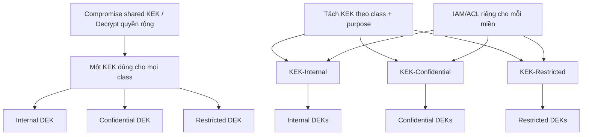
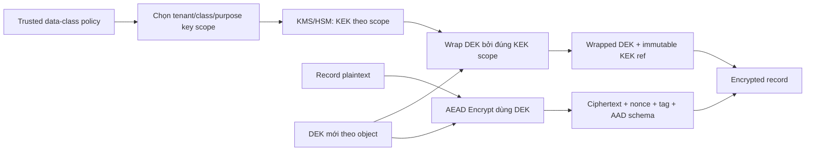
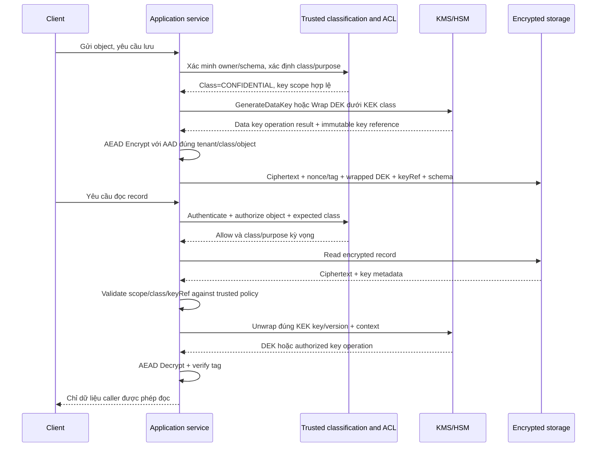
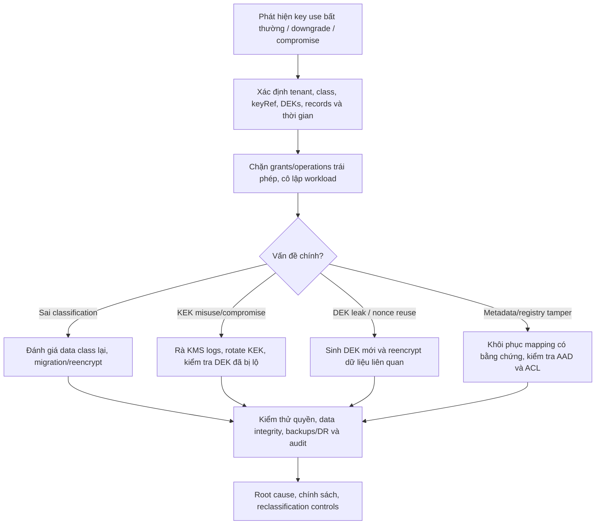

# Tách key theo data class: phân vùng phạm vi sử dụng khóa theo độ nhạy của dữ liệu

> **Chương:** Key use  
> **Module:** SECURITY_KEY_MANAGEMENT_FUNDAMENTALS

Một nền tảng thương mại điện tử có thể lưu cùng lúc danh mục sản phẩm công khai, báo cáo hoạt động nội bộ, thông tin liên hệ khách hàng, tài liệu định danh và dữ liệu thanh toán đặc biệt nhạy cảm. Nếu mọi record đều được mã hóa bằng **một khóa AES duy nhất**, hoặc mọi DEK đều được bọc bởi **một KEK với quyền Decrypt cấp cho mọi service**, sự cố lộ key hoặc lạm dụng KMS có thể lan sang dữ liệu hoàn toàn khác mục đích. Ngược lại, tạo một khóa gốc riêng cho **từng cột, từng record và từng nhãn** mà không có quản trị dễ gây bùng nổ số lượng key, làm khó rotation, recovery và vận hành.

**Tách key theo data class** là thiết kế trong đó **phân loại dữ liệu** trở thành một trong các yếu tố quyết định **khóa nào được sử dụng, principal nào được phép gọi phép toán mật mã, cryptoperiod nào áp dụng, và giới hạn ảnh hưởng khi một key hoặc quyền sử dụng key bị xâm phạm**. Đó là một phần của **key usage policy** và data governance, không chỉ là cách đặt tên khóa.

Ví dụ, application logs có thể thuộc lớp *Internal*, hồ sơ khách hàng thuộc *Confidential* và bản sao giấy tờ định danh có thể thuộc *Restricted*. Thiết kế có thể chọn **KEK riêng cho từng lớp hoặc nhóm dữ liệu**, sinh **DEK riêng theo object**, và tách tiếp theo tenant, region hay mục đích khi threat model đòi hỏi. Tuy nhiên, **một nhãn Confidential trong JSON không tự tạo quyền bảo vệ**: hệ thống phải dựa vào phân loại đáng tin, IAM/KMS/HSM grants, object authorization và audit.

Trong phạm vi **SECURITY_KEY_MANAGEMENT_FUNDAMENTALS**, bài học kết nối chủ đề này với vòng đời khóa **tạo → cấp phát → lưu trữ → sử dụng → xoay vòng → thu hồi → hủy**, mã hóa đối xứng/bất đối xứng, chữ ký số, KMS/HSM, envelope encryption, least privilege và kiểm toán.

Sau khi học, bạn có thể:

- Phân biệt **data class**, *tenant/security domain*, *key purpose* và *key material version*; không trộn chúng vào một trường `keyType`.
- Xây **policy matrix** từ các lớp dữ liệu tới key scope, thuật toán, quyền truy cập, rotation, retention và các biện pháp bổ sung.
- Chọn giữa **một KEK theo class**, KEK theo **tenant + class + purpose**, và **DEK riêng per-object** tùy blast radius và vận hành.
- Thiết kế record dùng **AES-GCM + wrapped DEK + immutable key reference**, ràng buộc data class vào metadata/AAD và ngăn **classification downgrade**.
- Phân biệt **chuyển class** với **rotation KEK**, **rewrap DEK**, **thay DEK và reencrypt**.
- Giải thích vì sao tách key không thay thế **IAM, object authorization, data minimization, tokenization, DLP hoặc access review**.
- Đọc ví dụ Java 17 về **policy-aware encryption/decryption**, nhận biết giới hạn của key registry giả lập so với KMS/HSM.
- Lập runbook, negative tests, inventory, checklist và quy trình xử lý khi sai lớp dữ liệu hoặc key bị compromise.

## 1. Data class là gì và vì sao liên quan tới key use?

**Data classification** là quá trình gán một mức hoặc nhóm bảo vệ cho dữ liệu dựa trên **độ nhạy, tác động nếu tiết lộ, yêu cầu toàn vẹn, nghĩa vụ lưu giữ và quyền truy cập**. Một sơ đồ phân lớp minh họa:

| Lớp dữ liệu | Ví dụ | Mức tác động minh họa | Hướng bảo vệ điển hình |
|---|---|---|---|
| **PUBLIC** | Danh mục sản phẩm đã công bố, tài liệu hướng dẫn công khai | Thấp về confidentiality; integrity vẫn quan trọng | HTTPS, integrity/access control, bảo vệ khóa ký nếu có |
| **INTERNAL** | Báo cáo nội bộ, cấu hình không công khai | Rò rỉ ảnh hưởng vận hành | IAM nhóm nội bộ, encrypt at rest/in transit, audit |
| **CONFIDENTIAL** | Hồ sơ người dùng, thông tin hợp đồng, email/điện thoại | Rủi ro riêng tư, thương mại, trách nhiệm pháp lý | Data-owner ACL, KEK/DEK scope hẹp, retention, masking |
| **RESTRICTED** | Định danh nhạy cảm, bí mật kinh doanh cấp cao, tài liệu đặc biệt | Ảnh hưởng lớn nếu lộ hoặc bị sửa | Isolation mạnh hơn, quyền JIT/approval, KMS/HSM, giám sát chuyên biệt |

**Đây chỉ là taxonomy ví dụ**, không phải một chuẩn pháp lý hay phân loại bắt buộc. Một tổ chức có thể dùng *Public / Internal / Confidential / Highly Confidential*, nhãn theo loại dữ liệu hoặc nhiều chiều khác nhau. Mức *Restricted* có thể mang nghĩa riêng theo chính sách công ty; những yêu cầu như PCI DSS, bảo vệ dữ liệu cá nhân hoặc bí mật nhà nước phải được xác định **theo đúng phạm vi và văn bản áp dụng**, không tự suy từ nhãn.

### 1.1. “Nhạy cảm” không chỉ là cần bí mật

Một public root certificate thường không cần giữ bí mật, nhưng **tính xác thực** rất quan trọng. Một bảng số dư có thể cần cả **integrity** lẫn confidentiality. Một private signing key có thể cần non-exportability dù không trực tiếp dùng Encrypt.

Do đó class chỉ là **một đầu vào** của key policy; còn phải xem:

- **Mục đích khóa:** Encrypt/Decrypt, Wrap/Unwrap, MAC, Sign/Verify, Derive.
- **Dữ liệu và sự kiện sử dụng:** lưu trữ, truyền tải, chia sẻ, phân tích, backup.
- **Security domain:** tenant, account/project, region, workload, environment.
- **Retention và thời gian giải mã lịch sử:** ciphertext sống bao lâu?
- **Blast radius:** nếu key hoặc quyền KMS bị lạm dụng thì phạm vi ảnh hưởng là gì?

### 1.2. Đừng gọi “một loại dữ liệu” là “một thuật toán”

Tên lớp `CONFIDENTIAL` không tự chỉ định AES-GCM, SHA-256, RSA-OAEP hay Ed25519. **Algorithm/suite** phải được chọn theo phép toán và threat model. Ví dụ, dữ liệu *Restricted* không nhất thiết cần “AES-512” (không phải kích thước khóa AES tiêu chuẩn); nó có thể dùng **AES-256-GCM được cấu hình đúng**, nhưng với quyền, phân vùng, audit và lifecycle chặt hơn.

## 2. Mục tiêu của việc tách key theo class

Thiết kế tốt hướng tới sáu kết quả:

1. **Giới hạn blast radius:** compromise khóa dùng cho dữ liệu *Internal* không tự mở được *Restricted*.
2. **Giảm quyền thừa:** service báo cáo nội bộ không được tự gọi Unwrap/Decrypt trên KEK của thông tin định danh.
3. **Tách cryptoperiod và retention:** các lớp có thời gian sử dụng/giải mã khác nhau có thể áp dụng lịch rotation/retirement tương ứng.
4. **Phân rõ owner và accountability:** các nhóm sở hữu dữ liệu chấp thuận key policy và trường hợp ngoại lệ.
5. **Tăng kiểm chứng và kiểm toán:** biết một key bảo vệ nhóm record nào, principal nào sử dụng, lớp nào có bất thường.
6. **Hỗ trợ migration:** khi dữ liệu được nâng/giảm class, biết phải thay metadata, quyền, DEK/KEK và bản mã thế nào.

Tách key **không tự đạt** những mục tiêu trên nếu một principal vẫn có `Decrypt` trên **tất cả** key, hoặc nếu DEK của lớp nhạy cảm được cache và chia sẻ với cùng process kém tin cậy.

### 2.1. Hình dung về blast radius



Sơ đồ thể hiện **một khả năng phân vùng rủi ro**, không phải bảo đảm tuyệt đối. Nếu service có quyền trên cả ba KEKs, hoặc attacker chiếm KMS administrator có quyền vượt mọi policy, phạm vi ảnh hưởng có thể vẫn bao trùm tất cả.

## 3. Threat model: khi không tách key hoặc tách sai

| Mối đe dọa | Diễn biến | Biện pháp |
|---|---|---|
| **Shared-key compromise** | Một KEK mở được mọi DEK của nhiều lớp | Phân vùng KEK theo data class và các chiều rủi ro |
| **IAM wildcard** | Workload *Internal* gọi KMS Decrypt trên *Restricted* | Least privilege, resource policy, effective permission tests |
| **Classification downgrade** | Client đổi nhãn *Restricted* thành *Internal* trước Encrypt | Class server-side, policy gate, không chấp nhận self-declared class |
| **Metadata tampering** | Attacker đổi `dataClass` hoặc `keyRef` trong encrypted record | Authenticated context/AAD, canonical encoding, trusted registry |
| **Cross-tenant oracle** | Service có KEK theo class toàn hệ thống bị dùng mở dữ liệu tenant khác | Object authorization + tenant-bound key references/contexts |
| **DEK reuse sai phạm vi** | Cùng raw DEK mã hóa *Internal* lẫn *Restricted* | DEK riêng theo object/class hoặc scope đã được duyệt |
| **Key alias confusion** | Rotation đổi alias, records cũ không còn đúng key version | Immutable wrapping key reference, read resolver |
| **Mixed-content records** | Một row vừa public vừa restricted, nhưng toàn row gắn class thấp | Class từ trường nhạy cảm nhất hoặc tách bảo vệ theo field |
| **Backup bỏ quên class** | Archives của *Restricted* được lưu dưới KEK *Internal* | Class-preserving backup policy, restore tests |
| **Log/cache leak** | Plaintext hoặc raw DEK nằm ở logs của service quyền thấp | Runtime hardening, redaction, DEK lifetime controls |
| **Key deletion sớm** | Retire KEK lớp Confidential trong khi dữ liệu cũ còn cần | Inventory dependencies, retention & restore drills |
| **Insider có quyền admin** | Một operator vừa đổi class policy vừa cấp grant | SoD, JIT/dual control, audit độc lập |

### 3.1. Data classification là một control-plane quyết định

Một record có trường `dataClass=INTERNAL` không đủ để quyết định Encrypt nếu client được tự khai. Cần biết:

- **Ai phân loại?** Schema/data catalog, rule engine, owner đã được xác thực hay policy service?
- **Ai có quyền đổi class?** Data owner, security approver hoặc workflow đã duyệt?
- **Khi nào gán class?** Ingestion, transformation, export, backup và chia sẻ?
- **Class được duy trì thế nào?** Khi join, aggregate, replicate hoặc restore?

Nếu classification metadata có thể bị hạ cấp mà không kiểm soát, phân vùng key có thể bị **vượt qua trước cả khi gọi KMS**.

## 4. Lựa chọn hạt độ phân vùng key

**Hạt độ (granularity)** quyết định một key bảo vệ bao nhiêu dữ liệu và việc quản lý có thể mở rộng đến đâu.

| Mô hình | Ví dụ | Điểm mạnh | Trade-off |
|---|---|---|---|
| **Một KEK toàn hệ thống** | `global-kek` | Đơn giản, ít key resources | Blast radius lớn, khó tách quyền/lifecycle |
| **KEK theo data class** | `kek-confidential` | Chính sách theo độ nhạy rõ ràng | Tenant khác vẫn có thể chung key |
| **KEK theo tenant + class** | `tenant-A/restricted/kek` | Tenant isolation và class isolation tốt hơn | Nhiều key, quota, IAM/policy phức tạp |
| **KEK theo tenant + class + purpose** | `tenant-A/restricted/at-rest/kek` | Tách key usage và blast radius | Quản trị lifecycle và registry đòi hỏi tự động hóa |
| **KEK thêm region/domain** | `region-X/tenant-A/...` | Đáp ứng residency/security boundary riêng | DR và data movement khó hơn |
| **DEK riêng per-object/field** | `DEK-order-123` | Blast radius nhỏ cho raw DEK, linh hoạt rewrap | Rất nhiều wrapped DEKs, nonce/key metadata |

Một kiến trúc thường dùng là **KMS KEK ở cấp phù hợp** (ví dụ tenant + class + purpose) và **DEK tạm thời riêng cho mỗi object hoặc nhóm data được phép**. Đó là sự cân bằng giữa cô lập rủi ro và số lượng resource KMS.

### 4.1. Không bắt buộc “mỗi class đúng một key”

Lớp *Restricted* có thể cần **nhiều KEKs** khi có tenant khác nhau, key purposes khác nhau hoặc boundary khác nhau. Ngược lại, lớp *Internal* có thể dùng cùng một KEK cho một security domain nếu policy/threat model cho phép. **Phân loại là input để quyết định scope, không phải công thức cố định**.

### 4.2. Không dùng chung key giữa Sign, HMAC và Encrypt

Key của dữ liệu Confidential có thể là **DEK AES**. Một signing key Ed25519 phục vụ chứng từ Confidential có mục đích hoàn toàn khác. Không gắn `class=CONFIDENTIAL` rồi cho phép dùng cùng raw bytes để AES Encrypt, HMAC và Sign. Phải tách theo **cryptographic usage/purpose** và giới hạn key attributes/KMS operations.

## 5. Key hierarchy: DEK/KEK theo class

Với dữ liệu lưu trữ cần confidentiality, một mô hình envelope encryption:



### 5.1. Hai mức key không đồng nghĩa hai lần mã hóa toàn bộ dữ liệu

DEK trực tiếp mã hóa dữ liệu một lần; KEK **chỉ bảo vệ DEK**, không cần KMS Encrypt từng MB/GB dữ liệu qua key root. Với nhiều object, cách này:

- Giảm số key resources cấp cao.
- Tăng khả năng dùng **DEK riêng cho object**, giảm blast radius khi raw DEK lộ.
- Hỗ trợ **rewrap DEK** khi thay KEK mà không nhất thiết phải reencrypt toàn bộ dữ liệu.
- Cho phép KMS/HSM giữ KEK **non-exportable** trong khi workload chỉ xử lý raw DEK tạm thời nếu thiết kế yêu cầu.

### 5.2. Key scope nên là một tuple rõ ràng

Ví dụ:

```text
KeyScope = {
  environment: "prod",
  region: "vn-south",
  tenantId: "tenant-A",
  dataClass: "RESTRICTED",
  purpose: "DATA_KEY_WRAP"
}

activeWrappingKeyRef = "kms://prod/vn-south/tenant-A/restricted/wrap-v3"
```

Đây là **định danh minh họa**, không phải URI/cú pháp của provider. Metadata thực cần ánh xạ đến **immutable key object/material version**, có owner, createdAt/provenance, allowed operations, retention và audit.

### 5.3. Key reference không phải secret, nhưng không phải quyền

Biết key ID không đồng nghĩa được phép `Unwrap`. Key reference có thể lưu cùng ciphertext, nhưng phải được **đối chiếu với scope/registry tin cậy**. Không coi key ID do client cung cấp là authorization token.

## 6. Xác định class từ nguồn đáng tin: không để client tự hạ cấp

Đối với dữ liệu có cấu trúc, chính sách có thể quy định:

- Trường `productName` thuộc *Public*.
- Trường `employeeWorkEmail` thuộc *Internal* hoặc *Confidential* tùy chính sách.
- Trường `customerAddress` thuộc *Confidential*.
- Trường `identityDocumentImage` thuộc *Restricted*.

Những quyết định này phải đến từ **schema/catalog và data-owner policy**, hoặc một quy trình phân loại đáng tin. Ví dụ HTTP request chứa `dataClass=PUBLIC` không được phép làm hạ cấp ảnh giấy tờ định danh vốn thuộc *Restricted*.

### 6.1. Class được gắn ở đâu?

| Cấp phân loại | Ưu điểm | Nguy cơ/đánh đổi |
|---|---|---|
| **Dataset/table** | Dễ quản trị theo schema | Có thể bảo vệ thiếu nếu xuất hiện field mới nhạy cảm |
| **Record/object** | Hợp với envelope per-object, document storage | Mixed-content record thường dùng class cao nhất |
| **Field/column** | Phân quyền và encryption granular | Query/indexing/rotation phức tạp, nhiều DEKs |
| **Blob/attachment** | Phù hợp ảnh định danh, tài liệu riêng | Phải kế thừa scope của owner và metadata |
| **Derived dataset** | Tách bản gốc và bản tổng hợp | Dễ **launder data class** sau JOIN, export hay aggregation |

Ví dụ một document chứa cả mô tả public và số định danh nhạy cảm: nếu mã hóa nguyên document bằng **một DEK**, DEK phải nhận **class đủ bảo vệ phần nhạy cảm nhất**, trừ khi đã phân tách field theo một kiến trúc có kiểm soát.

### 6.2. Chính sách cho derived data và bản sao

Một báo cáo tổng hợp từ nhiều record Confidential không mặc nhiên trở thành Public; nó có thể tiết lộ thông tin cá nhân qua nhóm nhỏ hoặc liên kết dữ liệu. Cần định nghĩa rõ quy tắc:

1. **Class propagation:** tạo bản dẫn xuất kế thừa hoặc được đánh giá lại mức bảo vệ.
2. **Declassification:** chỉ chủ thể có thẩm quyền mới hạ class sau kiểm tra (ví dụ thực sự anonymized).
3. **Export boundary:** bản CSV, PDF, backup, cache, log và analytics mart không bỏ qua class.
4. **Reclassification evidence:** ghi ai quyết định, policy version, lý do và object revision.

**Mã hóa tốt không tự ngăn data exfiltration qua một bản báo cáo đã bị gắn nhãn quá thấp.**

### 6.3. Mã hóa metadata không phải nguồn chân lý của classification

Một record lưu `dataClass=RESTRICTED` có thể được AEAD bảo vệ bằng AAD, nhưng quy trình tạo record phải **gắn class đúng ngay từ đầu**. Nếu caller có quyền Encrypt với class PUBLIC và tự chọn dữ liệu Restricted, GCM tag vẫn có thể hợp lệ. Cần **server-side trusted classification gate trước Encrypt**, không chỉ xác thực tag sau Decrypt.

## 7. Policy matrix: class ảnh hưởng quyền và vòng đời ra sao?

Mẫu tham khảo dưới đây thể hiện **ý tưởng phân quyền**, không phải lịch rotation hay yêu cầu chứng nhận bắt buộc cho một chuẩn cụ thể.

| Kiểm soát | PUBLIC | INTERNAL | CONFIDENTIAL | RESTRICTED |
|---|---|---|---|---|
| Confidentiality khi lưu trữ | Theo threat model/hệ thống | At-rest encryption và IAM | DEK/KEK tách scope, ACL object | KEK tách security domain, kiểm soát mạnh hơn |
| New-use key selection | Policy theo purpose | Scope theo service/tenant | Tenant + class + purpose khi phù hợp | Có thể thêm region/workload/security boundary |
| Raw KEK | Không cần phát tán | Không export theo thiết kế | Giữ trong KMS/HSM | Ưu tiên non-exportable HSM/KMS-backed |
| Workload Decrypt | Chỉ khi dữ liệu cần decrypt | Internal roles tối thiểu | Identity + resource ACL | Quản lý JIT/approval khi rủi ro yêu cầu |
| Operations audit | Theo hạ tầng/purpose | Access và policy changes | KMS calls + object access | Enhanced audit, anomaly detection, tamper resistance |
| Rotation/retention | Theo mục đích/cryptoperiod | Policy theo rủi ro | Theo sensitivity/dependencies | Có thể có cửa sổ ngắn hơn cho new-use và review thường xuyên hơn |
| Backup/DR | Bảo đảm integrity/availability | Encryption theo policy | Giữ mapping KEK versions | Restore drills, custodians/SoD nếu yêu cầu |
| Chuyển class | Kiểm chứng nguồn | Chuyển lên lớp cao hơn khi cần | Có migration plan | Hạ class đòi approval, kiểm tra bản sao/exports |

### 7.1. “Class cao hơn” không nhất thiết có key size dài hơn

AES có các key sizes phổ biến **128, 192 và 256 bit**. Trong nhiều hệ thống, cả Internal và Restricted có thể dùng **AES-256-GCM**; khác biệt thực tế là **key scope, IAM, authz, key-use restrictions, cryptoperiod, logging và recovery**. Không nên tuyên bố tăng key size tự sửa lỗ hổng phân quyền.

### 7.2. Quyền Decrypt và new Encrypt nên tách khi có thể

Sau rotation, KEK v1 của lớp Confidential có thể ngừng **wrap DEK mới**, nhưng vẫn cần **unwrap DEK cũ** cho các bản ghi chưa di chuyển. Mô hình logic:

```text
scope: tenant-A / CONFIDENTIAL / DATA_KEY_WRAP
  kek-v1: NEW_WRAP_DENIED, LEGACY_UNWRAP_ALLOWED (theo policy)
  kek-v2: NEW_WRAP_ALLOWED, UNWRAP_ALLOWED

scope: tenant-A / RESTRICTED / DATA_KEY_WRAP
  kek-v1: hoàn toàn khác key material và policy
```

**Lưu ý:** một số cloud KMS `DisableKey` sẽ ngăn **cả** Encrypt/Decrypt; trạng thái “legacy unwrap-only” có thể phải cưỡng chế bằng **IAM/grant separation, ứng dụng, broker service** hoặc tính năng riêng của provider, không chỉ sửa một nhãn trong registry.

## 8. Data class và cryptographic purpose là hai chiều độc lập

Không nên dùng cùng một key chỉ vì các tài nguyên có cùng nhãn:

| Đối tượng | Class ví dụ | Mục đích mật mã | Key phù hợp |
|---|---|---|---|
| Customer profile | CONFIDENTIAL | Encrypt/Decrypt | DEK AES-GCM, KEK wrapping |
| Payroll report | RESTRICTED | Encrypt/Decrypt | DEK riêng, KEK scope riêng |
| Signed financial report | RESTRICTED | Digital Sign/Verify | Private signing key / trusted public key |
| Webhook payload | INTERNAL | HMAC Generate/Verify | HMAC key theo service/partner/purpose |
| Offline backup | RESTRICTED | Encrypt/Wrapping | Backup KEK/key hierarchy có recovery policy |
| JWT claims | Có thể chứa CONFIDENTIAL | Sign/Verify token | Key ký riêng; tránh đưa data nhạy cảm vào payload không mã hóa |
| Public software artifact | PUBLIC | Code Sign | Private code-signing key vẫn cần kiểm soát rất cao |

### 8.1. Vì sao Public vẫn cần key được bảo vệ?

Một ứng dụng phát hành public update package bằng private signing key. Artifact là Public nhưng **private signing key không phải public**; nếu lộ key, attacker có thể giả mạo bản phát hành. **Data class của payload không định nghĩa độ nhạy của key material**, vì key sử dụng cho mục đích Sign có hệ quả riêng.

### 8.2. MAC không tương đương chữ ký số

HMAC dùng shared secret; ai nắm raw key có thể tạo MAC. Nếu nhiều dịch vụ cùng được cấp HMAC key, việc xác định ai thực sự tạo một MAC trở nên khó hơn. Một KMS/HSM có thể hỗ trợ GenerateMac/VerifyMac dưới policy cụ thể, nhưng cần **tách quyền API**, tránh xem “Verify access” là an toàn nếu verifier đã nhận raw HMAC key.

### 8.3. Key reuse giữa lớp và mục đích

Một DEK dùng cho dữ liệu Internal không nên được tái sử dụng làm HMAC key hay wrapping key cho Restricted. Đó là rủi ro về **key separation**, không chỉ đặt nhầm tên. Nên tách vật liệu độc lập hoặc dẫn xuất đúng bằng **KDF có domain separation** theo giao thức đã được đánh giá khi thực sự cần key derivation.

## 9. Record format: data class, wrapped DEK, key version và AAD

Một encrypted record cho một lớp dữ liệu nên giữ **mọi thông tin cần thiết để Decrypt sau rotation**:

```json
{
  "formatVersion": 1,
  "recordId": "customer-87310",
  "tenantId": "tenant-A",
  "dataClass": "CONFIDENTIAL",
  "classPolicyVersion": "customer-classification-v4",
  "purpose": "CUSTOMER_PROFILE_STORAGE",
  "dataEncryption": {
    "scheme": "AES-256-GCM",
    "nonceB64": "<base64-nonce>",
    "ciphertextAndTagB64": "<base64-ciphertext-and-tag>",
    "aadSchemaVersion": 1
  },
  "dataKey": {
    "wrappedDekB64": "<base64-wrapped-dek>",
    "wrappingKeyRef": "kms://prod/tenant-A/confidential/wrap-v3",
    "wrapFormatVersion": 1
  }
}
```

Các chuỗi trong dấu nhọn chỉ là placeholder, **không phải ciphertext hợp lệ**. Nếu provider-managed encrypted data-key blob đã đủ để tự xác định material version, một số metadata có thể chỉ phục vụ registry/audit. Luôn xác định **provider API contract**; không tự sửa ciphertext blob opaque.

### 9.1. Không tin `dataClass` như authority

Attacker có thể sửa JSON từ `RESTRICTED` thành `INTERNAL` hoặc thay keyRef bằng một KEK khác. Decrypt path phải:

1. Authenticate caller; authorize truy cập **object cụ thể**.
2. Lấy class policy/owner mapping từ **trusted registry hoặc schema**.
3. Kiểm tra record metadata khớp class kỳ vọng và allowed key scope.
4. Unwrap bằng **đúng key ID/version** theo inventory/KMS.
5. AEAD decrypt bằng nonce/tag/AAD gốc.

Nếu class metadata không hợp lệ, **dừng có kiểm soát**; không thử key các lớp thấp hơn để “cứu” Decrypt.

### 9.2. Data AAD và wrapping AAD

Với AES-GCM, AAD nên ràng buộc các trường **ổn định**:

```text
DATA_AAD_V1 = canonical(
    domain = "customer:data:v1",
    tenantId,
    recordId,
    dataClass,
    purpose,
    contentRevision
)

WRAP_AAD_V1 = canonical(
    domain = "customer:dek-wrap:v1",
    tenantId,
    recordId,
    dataClass,
    purpose,
    wrappingKeyRef
)
```

Data AAD và wrap AAD dùng **domain separation** khác nhau. Khi chỉ rotate KEK và **rewrap cùng DEK**, data AAD có thể giữ nguyên. Nếu data class của record thay đổi và data AAD chứa class cũ, **không thể chỉ sửa metadata** mà giữ authentication tag data; phải thực hiện migration cryptographic phù hợp.

### 9.3. Canonical encoding không được nhập nhằng

Đừng đơn giản nối `tenant + class + recordId`. Hai bộ chuỗi `("ab","c")` và `("a","bc")` có thể tạo cùng bytes. Dùng **length-prefix** hoặc canonical serialization chuẩn với thứ tự/trường được xác định; giữ schema cũ để Decrypt dữ liệu lịch sử.

### 9.4. Nonce và giới hạn DEK

- AES-GCM yêu cầu **nonce không trùng dưới cùng DEK** cho các lần Encrypt; Decrypt phải dùng nonce cũ chính xác.
- Một cách thiết kế phổ biến là **DEK mới cho mỗi object**, nonce 96 bit lấy từ CSPRNG; vẫn phải quản lý nếu cùng DEK Encrypt nhiều revisions.
- Rotation KEK **không reset** lịch sử nonce của DEK cũ.
- Nonce có thể lưu công khai, nhưng phải có integrity thông qua kiểm tra tag/format.
- Nếu nonce reuse xảy ra, thay KEK là không đủ; phải đánh giá nguy cơ và có thể **thay DEK/reencrypt**.

## 10. IAM, KMS/HSM và kiểm soát quyền theo class

Một sơ đồ policy tham khảo:

```text
Workload: profile-reader
  allow: ReadObject tenant-A / CONFIDENTIAL / customer-profile
  allow: KMS Unwrap via key scope tenant-A/CONFIDENTIAL/DATA_KEY_WRAP
  deny : KMS Unwrap tenant-A/RESTRICTED/*
  deny : KMS key export, policy change, destroy

Workload: id-document-processor
  allow: authorized object records with class RESTRICTED
  allow: scoped KMS Unwrap on tenant-A/RESTRICTED/DATA_KEY_WRAP
  deny : KMS key admin unless explicitly separated
```

Các chuỗi trên là **policy logic**, không phải cú pháp AWS/Azure/GCP. KMS providers có mô hình **key policies, grants, encryption contexts, versions và auditing** khác nhau.

### 10.1. Kiểm soát theo principal, operation, key scope

Một principal nên được cấp:

- **Những key resources cụ thể** thuộc tenant/class/purpose cần thiết.
- **Những operations cụ thể** như `Encrypt`, `Decrypt`, `Wrap`, `Unwrap`, `Sign` theo purpose.
- **Điều kiện context** nếu provider hỗ trợ và ràng buộc được với trusted workload/tenant.
- **Giới hạn thời gian và nơi gọi** nếu risk policy yêu cầu.
- Không tự có quyền `CreateGrant`, `PutKeyPolicy`, `ScheduleKeyDeletion` chỉ vì được Decrypt.

### 10.2. SoD: người sửa class policy không tự có quyền đọc data

Một platform operator có thể triển khai schema, nhưng không nhất thiết được quyền **thay Restricted thành Internal, cấp Decrypt cho chính mình và export toàn bộ dữ liệu**. Dùng **Separation of Duties (SoD)**:

| Vai trò | Trách nhiệm | Không nên tự có |
|---|---|---|
| **Data owner/steward** | Class policy, purpose, retention, approved access | Raw KMS KEK |
| **Security approver** | Duyệt exceptions, class downgrade và quyền nhạy cảm | Quyền Decrypt mọi object không giới hạn |
| **KMS/HSM operator** | Key creation/rotation/storage/recovery theo plan | Tự cấp quyền đọc mọi customer record |
| **Application workload** | Encrypt/Decrypt đúng class và object | Key admin hoặc unrestricted key grants |
| **Auditor** | Đọc metadata/evidence về key use | Đọc plaintext hoặc raw DEK để kiểm tra log |
| **Incident responder** | Containment, xác định blast radius, rotation | Xóa keys chưa inventory dependencies |

### 10.3. Không coi KMS non-exportable là non-abusable

Nếu KEK thuộc HSM và không export raw bytes, attacker vẫn có thể lạm dụng một principal được phép **Decrypt/Unwrap** để lấy DEKs. Vì vậy class isolation cần cả **effective permissions** và **business-level authorization**. Một role có thể dùng KMS cho Restricted dù không đọc được key material, và gây rủi ro nếu ứng dụng bỏ qua object ACL.

### 10.4. Kiểm thử quyền thực tế

Với `profile-reader`:

- Decrypt **Confidential** trên object được phép phải thành công.
- Decrypt **Restricted** phải thất bại **trước hoặc tại KMS**.
- Đổi `dataClass` trong record không được làm mở thêm quyền.
- Đọc object của tenant khác phải bị từ chối **trước phép Unwrap**.
- Thử gọi trực tiếp KMS với role thật phải chứng minh **không bypass** được application gate ngoài intended scope.

## 11. Luồng Encrypt/Decrypt: chọn đúng class và key scope

Thiết kế phải coi classification là **quyết định chính sách trước KeyGen/Encrypt**, không phải một tag dùng sau cùng để trang trí.



### 11.1. Thứ tự kiểm tra khi ghi

1. **Authenticate writer** và kiểm tra quyền tạo/sửa record.
2. **Derive class** từ schema, data catalog/owner policy; không tin class self-declared.
3. Chọn **tenant, class, purpose, region và active KEK** theo registry.
4. Sinh DEK từ nguồn ngẫu nhiên mật mã, hoặc dùng API GenerateDataKey/provider tương đương.
5. Tạo nonce và AAD, mã hóa dữ liệu qua AEAD.
6. Wrap DEK bằng **đúng KEK scope**, không lưu raw KEK trong ứng dụng.
7. Lưu **ciphertext + tag + nonce + wrapped DEK + actual immutable keyRef + AAD schema + class provenance** trong một transaction logic.
8. Audit quyết định key use và kiểm tra response không chứa plaintext/secret.

### 11.2. Thứ tự kiểm tra khi đọc

1. Xác thực caller và **authorize object/tenant/purpose**.
2. Lấy class kỳ vọng từ **nguồn policy đáng tin**.
3. Đọc record, validate schema/class/keyRef/size và mapping.
4. Resolve đúng KEK **đã wrap** DEK, không luôn dùng alias current.
5. Unwrap và kiểm tra context/permission; không thử lần lượt mọi key.
6. Decrypt dữ liệu bằng đúng DEK/nonce/AAD/tag; nếu tag sai, **không trả plaintext**.
7. Log metadata không bí mật và xóa các buffer DEK do mình quản lý khi có thể.

### 11.3. Classification mới không thể “sửa lại lịch sử” bằng alias

Nếu một record *Restricted* bị mã hóa nhầm dưới KEK *Internal*, việc cập nhật registry để alias trỏ tới KEK Restricted **không chuyển raw DEK hoặc ciphertext** sang lớp bảo vệ mới. Phải xử lý theo tình huống: có thể **rewrap** cùng DEK nếu chỉ thay lớp bọc và DEK chưa bị lộ; nhưng nếu raw DEK đã có mặt trong workload Internal hoặc đòi phân tách material theo class, thường cần **DEK mới và reencrypt**.

## 12. Chuyển data class: nâng cấp, hạ cấp và dữ liệu lịch sử

Data class có thể thay đổi vì luật mới, đánh giá lại rủi ro, nội dung của record thay đổi hoặc một bản dẫn xuất thực sự đã được khử định danh. Cần coi **reclassification là một migration có chính sách**, không phải sửa text trong cơ sở dữ liệu.

### 12.1. Nâng class từ Internal lên Restricted

Giả sử tập hồ sơ ban đầu được lưu trong class Internal, sau kiểm tra phát hiện có giấy tờ định danh và phải nâng lên Restricted.

Các bước:

1. Xác nhận policy, owner và object set; **chặn các thao tác tiếp tục ghi dưới Internal**.
2. Kiểm kê ciphertext, wrapped DEK, cache, backups, data exports và quyền hiện hành.
3. Đánh giá **ai đã được quyền đọc raw DEK/plaintext** khi dữ liệu còn thuộc Internal.
4. Tạo **key scope Restricted** với IAM và KMS/HSM phù hợp.
5. Quyết định **rewrap** hay **reencrypt bằng DEK mới** theo nguy cơ của DEK cũ và yêu cầu class separation.
6. Áp dụng **new data AAD** ràng buộc class Restricted; nếu class là thành phần của data AAD, thay class **phải tính lại tag/data ciphertext qua phép mã hóa thích hợp**.
7. Ghi atomically các trường `ciphertext/tag/nonce`, `wrappedDEK/keyRef`, class, policy version và record revision tương ứng.
8. Kiểm tra readback với **Restricted principal**, và negative test **Internal principal phải bị từ chối**.
9. Thu hồi các quyền/bản sao/cache của lớp thấp theo phạm vi hệ thống kiểm soát được, điều tra exposure nếu trước đó đã rộng quyền.

Nếu Internal workload đã sao chép DEK hoặc plaintext, nâng class và đổi KEK **không làm dữ liệu quá khứ tự bí mật trở lại**. Cần xử lý khả năng compromise và nghĩa vụ dữ liệu theo policy.

### 12.2. Hạ class từ Restricted xuống Internal

Không hạ class chỉ để giảm KMS quota hay khắc phục AccessDenied. Hạ class hợp lệ có thể xảy ra sau khi:

- Dữ liệu được **anonymize thực sự** hoặc một phần nhạy cảm được loại bỏ.
- Owner/security approver đã đánh giá lại disclosure risk.
- Schema/derived dataset mới có bằng chứng giảm độ nhạy.
- Chấp nhận được quyền rộng hơn của class thấp và ảnh hưởng tới bản sao tương lai.

Một record chứa plaintext Restricted không nên được đưa sang class Internal chỉ nhờ thay nhãn. Nếu phát hành **bản dữ liệu đã khử định danh**, nên coi đó là **new derived artifact** có DEK và access controls riêng, giữ bản gốc Restricted theo retention.

### 12.3. Rewrap hay reencrypt khi đổi class?

| Trường hợp | Rewrap cùng DEK | Reencrypt DEK mới | Lý do |
|---|---|---|---|
| Rotate KEK trong cùng class, DEK chưa nghi lộ, AAD data ổn định | Có thể phù hợp | Không luôn cần | Chỉ đổi lớp bọc |
| Nâng class nhưng raw DEK từng có mặt ở service quyền thấp | **Không đủ** để thu hẹp exposure cũ | Thường cần nếu muốn material mới cách ly | DEK cũ có thể đã bị copy |
| Chuyển từ Internal sang Restricted và data AAD chứa class | Không thể chỉ đổi class metadata | Cần thực hiện AEAD Encrypt/tag mới | AAD thay đổi làm tag cũ không hợp lệ |
| Data DEK bị compromise | Không giải quyết triệt để | Cần đánh giá và thường phải thay DEK | Rewrap giữ raw DEK đã lộ |
| Chỉ thay key wrapping scope nhưng data class/business classification không đổi | Có thể phù hợp | Theo threat model | Phân biệt key migration và data reclassification |
| Xuất bản bản đã anonymize từ Restricted thành Internal | Không phải chỉ rewrap | Nên tạo bản dẫn xuất/mã hóa độc lập | Nội dung và quyền sử dụng đã khác |

**Không có quy tắc “mọi lần đổi class luôn phải reencrypt”** nếu hệ thống thiết kế class mapping và data AAD khác nhau; tuy nhiên khi mục tiêu là **cách ly vật liệu giữa hai security domains**, chỉ rewrap cùng DEK thường không tạo được sự cách ly mong muốn. Phải quyết định theo **threat model, key exposure và AAD**.

### 12.4. Giao dịch và concurrency khi reclassification

```text
Worker A:
  Read revision 15: INTERNAL / KEK-Internal-v2
  Prepare new ciphertext under Restricted DEK/KEK
  Commit if revision==15 and policyEpoch==expected
  Success -> revision 16, RESTRICTED

Worker B:
  Đã đọc revision 15 để update nội dung
  Commit expected revision 15 -> CONFLICT
  Re-read revision 16, phân loại và mã hóa theo Restricted.
```

Không để worker B ghi lại ciphertext lớp Internal sau khi A đã nâng class. Cần **transaction/CAS**, expected revision, class policy epoch và idempotency; khi thất bại phải đọc lại **trạng thái mới** thay vì retry với key cũ.

## 13. Rotation, cryptoperiod và data class

Key rotation không tự đồng nghĩa data reclassification. Có ít nhất ba thay đổi:

- **KEK rotation:** thay material/version bọc DEK, có thể rewrap DEKs mà không đổi data ciphertext nếu AAD/format cho phép.
- **DEK rotation:** sinh DEK mới và thường **reencrypt dữ liệu**.
- **Class transition:** chuyển policy/security boundary, có thể yêu cầu đổi DEK và ciphertext tùy thiết kế.

### 13.1. Tách new-use period và legacy-decrypt period

Một key có thể ngừng bọc DEK mới nhưng còn cần mở DEK cũ:

| Thời kỳ | Ý nghĩa | Tác động |
|---|---|---|
| **Pre-active** | Key mới tạo nhưng chưa được phép dùng | Không tự nhận writes từ class |
| **Originator-use** | Cho phép tạo wrapped DEK/ciphertext mới | Chịu key policy và quota/nonce budget |
| **Recipient-use / legacy-decrypt** | Còn cần mở data lịch sử | Không xóa chỉ vì alias chuyển |
| **Suspended/compromised** | Đã có rủi ro hoặc cần tạm dừng | Có thể cấm cả new-use và legacy theo incident plan |
| **Destroy pending/destroyed** | Chuẩn bị hủy/hủy material | Có thể mất khả năng Decrypt dữ liệu chưa migrate |

Lưu ý trạng thái trên là **khái niệm vòng đời**, không nhất thiết là enums của KMS; `DisableKey` của provider có thể chặn mọi operations.

### 13.2. Cryptoperiod không chỉ là một con số ngày

Các class khác nhau có thể có lịch review/rotation khác nhau, nhưng **không nên tự áp “Restricted 30 ngày, Internal 365 ngày” như chân lý phổ quát**. Quyết định cần xem:

- Algorithm/scheme và giới hạn số lần dùng DEK/nonce.
- Thời gian dữ liệu cần Decrypt/Verify lịch sử.
- Khả năng lộ material hoặc lạm dụng quyền.
- Thời gian khôi phục/rewrap/reencrypt và chi phí vận hành.
- Độ dài phiên và data volume trong mỗi cryptoperiod.
- Yêu cầu pháp lý/hợp đồng/chuẩn áp dụng thực tế.

### 13.3. Key versions và alias

Giả sử `tenant-A/CONFIDENTIAL/current` hôm nay trỏ KEK-v3; ciphertext tuần trước được wrap dưới KEK-v1. Khi Decrypt:

- Lấy **actual immutable keyRef/version từ record** hoặc provider blob có thông tin tự mô tả theo hợp đồng API.
- Duy trì mapping v1 và quyền legacy Unwrap cho đến khi dependencies kết thúc.
- Không tự thử v3→v2→v1 cho tới khi tag hợp lệ.
- Không đặt `keyRef=current` trong encrypted record lịch sử nếu không có cơ chế resolve đáng tin.

### 13.4. Đừng hủy KEK của lớp cũ quá sớm

Một lớp dữ liệu có thể đã bị xóa khỏi policy active nhưng backups/snapshots, object storage, queues hoặc hồ sơ lưu trữ vẫn dùng **wrapped DEKs cũ**. Phải có **key inventory + dependency scan + restore test** trước khi destroy. Xóa key material trước khi hết retention có thể làm dữ liệu không thể phục hồi dù ciphertext còn nguyên.

## 14. Multi-tenant và region: class là một chiều, không phải mọi chiều

Hai record cùng class CONFIDENTIAL nhưng thuộc tenant A và B có thể có chính sách và quyền đọc hoàn toàn khác nhau. Nếu dùng một KEK chung toàn hệ thống:

- Một principal có quyền Unwrap KEK có thể được dùng mở wrapped DEKs của cả hai tenants khi tìm được blob.
- Revoke/rotation ở A có thể ảnh hưởng B.
- Compromise của shared KEK làm blast radius rộng.

Nếu threat model cho phép, vẫn có thể dùng một KMS key chung với **authorization ở ứng dụng và context-based KMS conditions**; nhưng phải đánh giá sự bất khả phân giữa tenants ở cấp cryptographic material.

### 14.1. Tenant + class + purpose

```text
Scope(A, RESTRICTED, DATA_KEY_WRAP) -> KEK A-R
Scope(B, RESTRICTED, DATA_KEY_WRAP) -> KEK B-R
Scope(A, INTERNAL, DATA_KEY_WRAP)   -> KEK A-I
Scope(A, RESTRICTED, SIGN_DOCUMENT)-> Signing key A-R-SIGN
```

Đây là cách thể hiện **security partition** theo nhiều chiều. Một class cao có thể vẫn cần key tách theo business department hoặc legal entity. Không đặt lớp dữ liệu thay cho tenant authorization.

### 14.2. Region/data residency

Nếu dữ liệu class Restricted phải nằm tại một khu vực nhất định theo policy, cả **data ciphertext, plaintext, key material, wrapped DEK, backups và log metadata** có thể chịu quy tắc về địa điểm khác nhau. Không giả định “encrypted blob có thể chuyển mọi region” chỉ vì raw KEK không rời KMS.

Key IDs giống nhau ở hai regions **không tự chứng minh key material giống nhau**. DR/cross-region phải dùng cơ chế provider hỗ trợ hoặc migration có kiểm soát.

### 14.3. Tránh key explosion

Nếu có \(T\) tenants, \(C\) data classes, \(P\) key purposes, \(R\) regions và \(V\) active/legacy versions, số key resources có thể gần:

\[
N_{\text{keys}} \approx T \times C \times P \times R \times V
\]

Đây là **ước lượng mô hình**, không phải công thức bắt buộc. Tạo 100.000 KEK resources có thể gặp quota, chi phí, policy review và rotation load. Vì thế:

- Đặt **ranh giới cô lập cần thiết** trước rồi mới tính số key.
- Dùng **per-object DEKs + wrapped blobs** để tránh tạo KMS root key cho từng record.
- Gom nhóm lớp dữ liệu khi threat model cho phép và có owner/phê duyệt.
- Tự động hóa inventory, IAM/ACL, rotation, backup và drift detection.

Số lượng khóa ít không phải bằng chứng an toàn; số lượng khóa nhiều cũng không tự an toàn nếu tất cả dùng chung service principal quyền rộng.

## 15. Policy-as-code: ánh xạ data class sang key scope

Ví dụ YAML mô tả **ý định kiểm soát**, không phải policy syntax cho một KMS cụ thể:

```yaml
schemaVersion: 1
policyId: "customer-data-key-use-v4"
environment: "production"
sourceOfClassification: "trusted-data-catalog"

scopes:
  - tenant: "tenant-A"
    dataClass: "INTERNAL"
    purpose: "CUSTOMER_PROFILE_STORAGE"
    keyScope: "tenant-A/internal/data-wrap"
    allowedOperations: ["WRAP_FOR_NEW", "UNWRAP_FOR_AUTHORIZED_READ"]
    readerPrincipals: ["service/reporting-internal"]
    allowClientDeclaredClass: false

  - tenant: "tenant-A"
    dataClass: "CONFIDENTIAL"
    purpose: "CUSTOMER_PROFILE_STORAGE"
    keyScope: "tenant-A/confidential/data-wrap"
    allowedOperations: ["WRAP_FOR_NEW", "UNWRAP_FOR_AUTHORIZED_READ"]
    readerPrincipals: ["service/customer-profile-api"]
    allowClientDeclaredClass: false
    requireObjectAuthorization: true

  - tenant: "tenant-A"
    dataClass: "RESTRICTED"
    purpose: "IDENTITY_DOCUMENT_STORAGE"
    keyScope: "tenant-A/restricted/data-wrap"
    allowedOperations: ["WRAP_FOR_NEW", "UNWRAP_FOR_AUTHORIZED_READ"]
    readerPrincipals: ["service/verified-id-processor"]
    allowClientDeclaredClass: false
    requireObjectAuthorization: true
    requirePrivilegedAccessApproval: true

dataEncryption:
  algorithm: "AES-256-GCM"
  dekScope: "PER_OBJECT"
  aadFields:
    - "domain"
    - "tenantId"
    - "recordId"
    - "dataClass"
    - "purpose"
    - "contentRevision"
  recordActualWrappingKeyVersion: true
  logRawKeyMaterial: false

changeControl:
  classDowngradeRequiresOwnerApproval: true
  classPolicyChangeRequiresSecurityReview: true
  rejectUnknownClass: true
  rejectUnknownKeyRef: true
  rejectClientSelectedKek: true
  keyDestructionRequiresDependencyClearance: true
```

### 15.1. YAML chưa phải security boundary

Trường `requireObjectAuthorization: true` không tự chặn lỗi code. Hệ thống phải cưỡng chế:

1. **Class source đáng tin** và rule engine tại request path.
2. **KMS/HSM IAM/key policies** với principal và resources thực.
3. **Application authorization** cho từng record/tenant.
4. **Effective negative tests** với identities thật.
5. **Audit và drift detection** giữa declared policy và effective grants.

### 15.2. Cấu hình class không được đổi âm thầm giữa request

Nếu policy class đổi trong lúc một batch đang Encrypt, ghi rõ **policy revision/epoch** đã dùng. Đối với quy trình yêu cầu cutover chính xác, dùng expected epoch hoặc CAS để ngăn writes mới vào class cũ; nếu không cần hard cutover, chấp nhận overlap có kiểm soát và ghi **actual keyRef/class** trên mỗi record.

### 15.3. Không đưa class cao vào service log lớp thấp

Một service dùng KEK Restricted nhưng log raw record về một logging backend được xếp lớp Internal sẽ làm vô hiệu biện pháp phân vùng. Data class phải được **kế thừa qua caches, metrics labels, exports, logs, ETL và backups**; không chỉ tồn tại ở database encryption.

## 16. Java 17: policy-aware envelope encryption theo data class

Để thấy rõ class ảnh hưởng tới key use, ví dụ này mô phỏng:

1. **Trusted data catalog** quy định object nào thuộc class nào; caller không được tự chọn class.
2. **KMS giả lập** quản lý các AES KEK khác nhau theo `tenant + class + purpose`.
3. Mỗi object được mã hóa bằng **DEK AES-256 riêng**, còn DEK được wrap bằng KEK đúng scope.
4. Data AAD ràng buộc **tenant, class, purpose, object ID và record revision**.
5. Decrypt kiểm tra **caller authorization**, trusted class và **immutable wrapping keyRef** trước khi unwrap.
6. Sau rotation KEK-v1→v2, record đã tạo với v1 vẫn được đọc bằng **v1**, không tự đổi sang key current.
7. Record bị sửa nhãn class hoặc caller không có quyền Restricted sẽ bị từ chối.

**Ranh giới của demo:** `FakeKms` giữ raw KEKs trong Java process chỉ để tự chạy, không cung cấp HSM non-exportability, IAM hoặc audit thật. **Production nên dùng KMS/HSM APIs/handles** và phân loại/ủy quyền từ nguồn đã xác thực; không sao chép mẫu fake registry này vào hệ thống xử lý dữ liệu nhạy cảm.

```java
import javax.crypto.Cipher;
import javax.crypto.KeyGenerator;
import javax.crypto.SecretKey;
import javax.crypto.spec.GCMParameterSpec;
import javax.crypto.spec.SecretKeySpec;
import java.nio.ByteBuffer;
import java.nio.charset.StandardCharsets;
import java.security.SecureRandom;
import java.util.Arrays;
import java.util.HashMap;
import java.util.Map;
import java.util.Set;

public final class DataClassKeyUseDemo {
    private static final SecureRandom RNG = new SecureRandom();
    private static final String AES_GCM = "AES/GCM/NoPadding";
    private static final String PURPOSE = "IDENTITY_DOCUMENT_STORAGE";

    enum DataClass {
        INTERNAL, CONFIDENTIAL, RESTRICTED
    }

    record KeyScope(
            String tenantId, DataClass dataClass, String purpose) {}

    record CatalogEntry(
            String tenantId, DataClass dataClass,
            String purpose, int revision) {}

    record Caller(
            String principalId, String tenantId,
            Set<DataClass> readableClasses) {}

    record EncryptedRecord(
            String tenantId, String objectId,
            DataClass dataClass, String purpose, int revision,
            String wrappingKeyRef,
            byte[] dataNonce, byte[] ciphertextWithTag,
            byte[] wrapNonce, byte[] wrappedDekWithTag) {}

    // Giả lập CATALOG đã được quản trị. Production phải có
    // owner approval, identity, transaction và policy epochs.
    static final class TrustedCatalog {
        private final Map<String, CatalogEntry> entries =
                new HashMap<>();

        void register(String objectId, CatalogEntry entry) {
            if (entries.putIfAbsent(objectId, entry) != null) {
                throw new IllegalArgumentException("Duplicate object ID");
            }
        }

        CatalogEntry require(String objectId) {
            CatalogEntry entry = entries.get(objectId);
            if (entry == null) {
                throw new SecurityException("Unknown object");
            }
            return entry;
        }
    }

    // Giả lập KMS. KHÔNG lưu raw KEK trong ứng dụng production.
    static final class FakeKms {
        record KeyObject(KeyScope scope, SecretKey material) {}

        private final Map<String, KeyObject> keys = new HashMap<>();
        private final Map<KeyScope, String> activeRefs =
                new HashMap<>();

        void create(String immutableRef, KeyScope scope)
                throws Exception {
            if (keys.containsKey(immutableRef)) {
                throw new IllegalArgumentException("Key ref exists");
            }
            KeyGenerator generator = KeyGenerator.getInstance("AES");
            generator.init(256, RNG);
            keys.put(immutableRef,
                    new KeyObject(scope, generator.generateKey()));
        }

        void setActive(String immutableRef, KeyScope scope) {
            requireExact(immutableRef, scope);
            activeRefs.put(scope, immutableRef);
        }

        String activeFor(KeyScope scope) {
            String ref = activeRefs.get(scope);
            if (ref == null) {
                throw new IllegalStateException("No active KEK");
            }
            return ref;
        }

        SecretKey requireExact(String immutableRef, KeyScope scope) {
            KeyObject found = keys.get(immutableRef);
            if (found == null || !found.scope().equals(scope)) {
                throw new SecurityException("Wrong key scope/version");
            }
            return found.material();
        }
    }

    private static byte[] lengthPrefixed(String... fields) {
        byte[][] values = new byte[fields.length][];
        int size = 0;
        for (int i = 0; i < fields.length; i++) {
            values[i] = fields[i].getBytes(StandardCharsets.UTF_8);
            size += Integer.BYTES + values[i].length;
        }
        ByteBuffer b = ByteBuffer.allocate(size);
        for (byte[] value : values) {
            b.putInt(value.length);
            b.put(value);
        }
        return b.array();
    }

    private static byte[] aad(
            String domain, String tenant, String objectId,
            DataClass dataClass, String purpose, int revision,
            String extra) {
        return lengthPrefixed(
                domain, tenant, objectId, dataClass.name(),
                purpose, Integer.toString(revision), extra);
    }

    private static byte[] nonce() {
        byte[] value = new byte[12];
        RNG.nextBytes(value);
        return value;
    }

    private static Cipher gcm(
            int mode, SecretKey key, byte[] nonce) throws Exception {
        Cipher cipher = Cipher.getInstance(AES_GCM);
        cipher.init(mode, key, new GCMParameterSpec(128, nonce));
        return cipher;
    }

    private static KeyScope scope(CatalogEntry entry) {
        return new KeyScope(
                entry.tenantId(), entry.dataClass(), entry.purpose());
    }

    // Class được lấy từ catalog, không phải từ request của caller.
    static EncryptedRecord encrypt(
            TrustedCatalog catalog, FakeKms kms,
            String objectId, byte[] plaintext) throws Exception {
        CatalogEntry entry = catalog.require(objectId);
        KeyScope keyScope = scope(entry);
        String keyRef = kms.activeFor(keyScope);

        byte[] dek = new byte[32]; // DEK mới cho mỗi object.
        RNG.nextBytes(dek);
        try {
            byte[] dataNonce = nonce();
            Cipher data = gcm(
                    Cipher.ENCRYPT_MODE,
                    new SecretKeySpec(dek, "AES"), dataNonce);
            data.updateAAD(aad(
                    "class:data:v1", entry.tenantId(), objectId,
                    entry.dataClass(), entry.purpose(),
                    entry.revision(), "cipher-format-v1"));
            byte[] ciphertext = data.doFinal(plaintext);

            byte[] wrapNonce = nonce();
            Cipher wrap = gcm(
                    Cipher.ENCRYPT_MODE,
                    kms.requireExact(keyRef, keyScope), wrapNonce);
            wrap.updateAAD(aad(
                    "class:wrap:v1", entry.tenantId(), objectId,
                    entry.dataClass(), entry.purpose(),
                    entry.revision(), keyRef));
            byte[] wrappedDek = wrap.doFinal(dek);

            return new EncryptedRecord(
                    entry.tenantId(), objectId,
                    entry.dataClass(), entry.purpose(),
                    entry.revision(), keyRef,
                    dataNonce, ciphertext, wrapNonce, wrappedDek);
        } finally {
            Arrays.fill(dek, (byte) 0);
        }
    }

    static byte[] decrypt(
            TrustedCatalog catalog, FakeKms kms,
            Caller caller, EncryptedRecord record) throws Exception {
        // Caller ở production phải là identity đã xác thực;
        // không lấy Caller từ request JSON do client tự dựng.
        CatalogEntry trusted = catalog.require(record.objectId());
        if (!caller.tenantId().equals(trusted.tenantId())
                || !caller.readableClasses().contains(
                        trusted.dataClass())) {
            throw new SecurityException("Object access denied");
        }

        // Reject class/keyRef/metadata tampering trước KMS.
        if (!record.tenantId().equals(trusted.tenantId())
                || record.dataClass() != trusted.dataClass()
                || !record.purpose().equals(trusted.purpose())
                || record.revision() != trusted.revision()) {
            throw new SecurityException("Record metadata mismatch");
        }

        KeyScope trustedScope = scope(trusted);
        SecretKey exactKek =
                kms.requireExact(record.wrappingKeyRef(), trustedScope);
        Cipher unwrap = gcm(
                Cipher.DECRYPT_MODE, exactKek, record.wrapNonce());
        unwrap.updateAAD(aad(
                "class:wrap:v1", record.tenantId(), record.objectId(),
                record.dataClass(), record.purpose(),
                record.revision(), record.wrappingKeyRef()));

        byte[] dek = unwrap.doFinal(record.wrappedDekWithTag());
        if (dek.length != 32) {
            Arrays.fill(dek, (byte) 0);
            throw new SecurityException("Invalid DEK length");
        }
        try {
            Cipher data = gcm(
                    Cipher.DECRYPT_MODE,
                    new SecretKeySpec(dek, "AES"),
                    record.dataNonce());
            data.updateAAD(aad(
                    "class:data:v1", record.tenantId(),
                    record.objectId(), record.dataClass(),
                    record.purpose(), record.revision(),
                    "cipher-format-v1"));
            return data.doFinal(record.ciphertextWithTag());
        } finally {
            Arrays.fill(dek, (byte) 0);
        }
    }

    public static void main(String[] args) throws Exception {
        TrustedCatalog catalog = new TrustedCatalog();
        catalog.register(
                "doc-17",
                new CatalogEntry(
                        "tenant-A", DataClass.RESTRICTED,
                        PURPOSE, 1));

        KeyScope restrictedScope =
                new KeyScope("tenant-A", DataClass.RESTRICTED, PURPOSE);
        KeyScope internalScope =
                new KeyScope("tenant-A", DataClass.INTERNAL, PURPOSE);
        FakeKms kms = new FakeKms();
        kms.create("tenant-A/restricted/kek-v1", restrictedScope);
        kms.create("tenant-A/internal/kek-v1", internalScope);
        kms.setActive("tenant-A/restricted/kek-v1", restrictedScope);
        kms.setActive("tenant-A/internal/kek-v1", internalScope);

        Caller internalOnly = new Caller(
                "reporting-service", "tenant-A",
                Set.of(DataClass.INTERNAL));
        Caller restrictedReader = new Caller(
                "identity-processor", "tenant-A",
                Set.of(DataClass.RESTRICTED));

        byte[] plain = "Tai lieu kiem thu nhay cam"
                .getBytes(StandardCharsets.UTF_8);
        EncryptedRecord record = encrypt(catalog, kms, "doc-17", plain);
        System.out.println("Encrypted class: " + record.dataClass());
        System.out.println("Actual wrap key: "
                + record.wrappingKeyRef());

        try {
            decrypt(catalog, kms, internalOnly, record);
            throw new AssertionError("Internal principal accepted");
        } catch (SecurityException expected) {
            System.out.println("Internal principal denied");
        }

        byte[] opened = decrypt(
                catalog, kms, restrictedReader, record);
        System.out.println("Restricted decrypt matches: "
                + Arrays.equals(plain, opened));
        Arrays.fill(opened, (byte) 0);

        // Rotation thay active key cho writes mới,
        // nhưng record cũ vẫn cần KEK-v1.
        kms.create("tenant-A/restricted/kek-v2", restrictedScope);
        kms.setActive("tenant-A/restricted/kek-v2", restrictedScope);
        byte[] oldOpened = decrypt(
                catalog, kms, restrictedReader, record);
        System.out.println("Legacy v1 decrypt after rotation: "
                + Arrays.equals(plain, oldOpened));
        Arrays.fill(oldOpened, (byte) 0);

        // Sửa class của ciphertext không tạo grant mới.
        EncryptedRecord downgraded = new EncryptedRecord(
                record.tenantId(), record.objectId(),
                DataClass.INTERNAL, record.purpose(),
                record.revision(), record.wrappingKeyRef(),
                record.dataNonce(), record.ciphertextWithTag(),
                record.wrapNonce(), record.wrappedDekWithTag());
        try {
            decrypt(catalog, kms, internalOnly, downgraded);
            throw new AssertionError("Downgrade accepted");
        } catch (SecurityException expected) {
            System.out.println("Class downgrade rejected");
        }

        // Demo không in plaintext hoặc raw DEK/KEK.
        Arrays.fill(plain, (byte) 0);
    }
}
```

### 16.1. Kết quả mong đợi

```text
Encrypted class: RESTRICTED
Actual wrap key: tenant-A/restricted/kek-v1
Internal principal denied
Restricted decrypt matches: true
Legacy v1 decrypt after rotation: true
Class downgrade rejected
```

### 16.2. Bài học rút ra

- **Key selection** dựa trên `TrustedCatalog`; caller không chọn class/KEK.
- **Authorization** được kiểm tra trước KMS.
- **Actual keyRef** được lưu ở record; rotation chỉ đổi key cho writes mới, không tự chuyển ciphertext cũ.
- **Class tampering/downgrade** bị từ chối bởi kiểm tra metadata đáng tin trước khi unwrap; AAD còn cung cấp lớp integrity khi dữ liệu được mở.
- Dùng **DEK mới theo object** giảm phạm vi raw DEK so với chia một DEK toàn hệ thống.

### 16.3. Giới hạn của ví dụ — không sử dụng cho production

| Thành phần demo | Điều cần làm trong hệ thống thật |
|---|---|
| `TrustedCatalog` trong memory | Data catalog/schema có approval, dữ liệu và phiên bản bền vững, concurrency control |
| `Caller` record | Identity đã được xác thực, object ACL và tenant binding |
| `FakeKms` giữ raw KEK | KMS/HSM key handles, non-exportability, IAM và audit thật |
| AES-GCM wrap DEK bằng KEK | Provider-approved wrapping/DataKey API; quản lý nonce budget ở quy mô lớn |
| `SecureRandom` | Nguồn ngẫu nhiên mật mã phù hợp triển khai; HSM/CSPRNG theo policy |
| Java record chứa `byte[]` | Defensive copies, serialization/length validation, untrusted input handling |
| `Arrays.fill` | Chỉ xóa một số buffers, không chứng minh mọi bản key biến mất khỏi JVM/GC/provider |
| Rotation bằng `setActive` | Epoch/CAS, grant rollout, durable registry, handling cache nhiều node |
| Không có storage/transactions | Atomic record write, policy version và migration/restore testing |
| Demo chỉ test class mismatch | Negative IAM/tenant tests, tampered tag/nonce, unknown key, outages |

**Đặc biệt:** trong demo `Caller` do code tạo chỉ là giả định rằng authentication đã hoàn thành. Không chấp nhận một Caller object do network client tự tạo rồi xem là bằng chứng quyền. Một lớp `FakeKms` trả raw KEK cho application cũng **không đại diện cho security boundary của HSM/KMS**.

## 17. Ma trận kiểm thử: bảo đảm tách key theo class thật sự có hiệu lực

Đừng chỉ test **“Decrypt thành công với đúng key”**. Cần chứng minh key scope và object authorization **ngăn được các cách truy cập ngoài chính sách**.

| Tình huống | Kết quả kỳ vọng |
|---|---|
| Trusted catalog gắn object R là RESTRICTED | Writer sử dụng đúng KEK scope Restricted |
| Client gửi `dataClass=PUBLIC` cho object R | Backend bỏ qua/từ chối class tự khai; không hạ cấp |
| Workload Internal đọc R | **DENY** dù có key ID và ciphertext |
| Restricted workload đọc R của đúng tenant, đúng ACL | Thành công nếu KMS key state/permissions cho phép |
| Restricted workload đọc R thuộc tenant khác | **DENY trước KMS** |
| Thay record `dataClass` từ RESTRICTED thành INTERNAL | Metadata/policy hoặc AEAD validation từ chối |
| Thay `wrappingKeyRef` sang KEK Internal | Reject key scope và/hoặc unwrap integrity fail |
| Thay data nonce/ciphertext/tag | AEAD bad tag; không trả partial plaintext |
| Sai AAD schema/record ID | Validation/AEAD fail |
| Rotate KEK Restricted v1→v2 rồi đọc record v1 | Success nếu legacy unwrap policy còn hiệu lực |
| Disable/hủy v1 khi vẫn còn wrapped DEKs v1 | Có thể mất Decrypt; test và cảnh báo dependencies |
| Nâng class Internal→Restricted với DEK mới | Record mới có AAD/class/KEK scope Restricted; Internal bị deny |
| Worker cũ ghi lại class Internal sau migration | Expected revision/CAS fail; không downgrade âm thầm |
| Rewrap giữ data ciphertext nhưng class/AAD đã đổi | Phải detect mismatch, không bypass tag |
| KMS admin không có business object access | Không tự lấy plaintext qua public API; kiểm tra direct grants riêng |
| Backup/restore bản ghi class Restricted | Key reference và metadata còn đúng; read test thành công |
| CI/CD hoặc log chứa raw DEK/KEK | Security scan/test phát hiện và incident process kích hoạt |
| Stale cache còn active KEK lớp cũ | Writer dừng/retry nếu hard cutover, không tự bỏ qua epoch |
| Class bị UNKNOWN/không tồn tại | Fail closed hoặc quarantine; không mặc định INTERNAL |
| Imported key version thiếu provenance | Governance review; không tự coi key vừa được tạo |

### 17.1. Test với effective IAM thay vì giả lập permissions

Một unit test kiểm tra `if (dataClass == RESTRICTED) deny` có thể PASS, nhưng một KMS principal vẫn có wildcard Decrypt trên tất cả KEKs. Cần chạy integration tests với **đúng role/service account**:

- Gọi KMS/HSM với key Internal: được phép theo scope.
- Gọi KMS/HSM với key Restricted: phải bị từ chối đối với principal chỉ được Internal.
- Kiểm tra policy inherited grants, role impersonation, resource-level grants và break-glass rights.
- Nếu provider hỗ trợ **encryption context conditions**, xác minh chúng được cưỡng chế với context thực tế, không chỉ xuất hiện trong YAML.

Không dùng production secrets/keys trong repository test; dùng **test fixtures** và key resources riêng, có provenance rõ.

### 17.2. Test tính toàn vẹn classification qua pipeline

Luồng thử:

```text
Ingestion -> Data catalog -> DB encrypted record
          -> Cache -> Event queue -> Analytics export
          -> Backup -> DR restore

Kỳ vọng:
  Class/owner/purpose được giữ hoặc đánh giá lại có thẩm quyền.
  Không có bước nào mặc nhiên chuyển RESTRICTED về INTERNAL.
  Key scope và IAM phù hợp từng bản dẫn xuất.
```

Một ETL job có thể làm lộ dữ liệu bằng cách chuyển record Restricted thành một bảng không có field `dataClass`, dù database nguồn đã mã hóa hoàn hảo. Vì vậy **data lineage và classification propagation** là một phần của kiểm soát key use.

### 17.3. Test interoperability lâu dài

Giữ encrypted fixtures cho:

- DEK/KEK versions cũ.
- Data AAD schema v1/v2.
- Format AES-GCM với nonce/tag hợp lệ.
- Record class trước/sau migration được tạo bằng **key test**.

Khi thay SDK, provider, serialization hay key registry, thử decrypt fixtures cũ trước khi deploy. Không xóa decoder hoặc key version cũ khi còn data dependencies.

## 18. Backup, DR và class-preserving recovery

Sự phân lớp thường bị phá vỡ trong **backups và disaster recovery**: live database có KEK Restricted riêng nhưng backup plaintext có thể được đẩy tới kho truy cập bởi đội vận hành Internal.

### 18.1. Mỗi đường lưu giữ phải giữ lớp bảo vệ

| Đường dữ liệu | Yêu cầu |
|---|---|
| **Live database/object storage** | AEAD ciphertext, wrapped DEK, class/keyRef và object ACL |
| **Snapshots/backups** | Encryption và IAM tương xứng class/tenant; key dependencies rõ |
| **DR region** | Khả năng dùng đúng KEK material/version và policy; residency phù hợp |
| **Event queue** | Payload/metadata class được giữ, không log plaintext tùy tiện |
| **Cache** | Giảm thời gian plaintext/DEK ở memory; scope process/tenant |
| **Analytics/export** | Reclassification có thẩm quyền, hạn chế content nhạy cảm và key scope riêng |
| **Support/debug artifacts** | Redaction, approval và retention; không copy Restricted data vào ticket Public |

### 18.2. Restore drill phải thử đủ các lớp và key versions

Một restore test nên kiểm tra:

1. Bản ghi Internal/Confidential/Restricted từ các thời kỳ cũ.
2. Wrapped DEK và keyRef vẫn trỏ đúng vật liệu KEK sau restore.
3. HSM/KMS ở region phục hồi có key/permission phù hợp; **copy key name không tạo cùng material**.
4. Data AAD/class/purpose/record ID không bị thay đổi khi serialize/restore.
5. **Internal principal vẫn không mở được Restricted record** tại môi trường DR.
6. Trạng thái **revoked grants, destroyed keys và policy epoch** không bị snapshot cũ làm đảo ngược.
7. Audit ghi restore và mọi exception; không mở rộng key IAM để “cho test chạy”.

Nếu **KEK material đã hủy** không có đường khôi phục được phép, ciphertext vẫn có thể còn nhưng **không thể giải mã**. Phải xét data retention và dependency scan trước destruction, chứ không chỉ lưu thêm backup ciphertext.

### 18.3. Backup KEK và crypto-erasure

Crypto-erasure bằng hủy key chỉ có hiệu lực khi **không còn key material/copies hoặc DEK/plaintext khác** có thể mở dữ liệu. Nếu một backup KEK hoặc cached DEK đã bị sao chép, xóa một KMS key object không bảo đảm mọi bản data trở nên không thể mở.

Ngược lại, hủy key quá sớm có thể gây **mất dữ liệu ngoài ý muốn**, nhất là record Restricted có nghĩa vụ lưu trữ nhiều năm. **Confidentiality và availability** cần được cân bằng qua recovery policy và owner approvals.

### 18.4. Backups không tự là một class thấp hơn

Một bản backup chứa cả Internal và Restricted thường cần **bảo vệ theo phần nhạy cảm nhất**, hoặc phải phân vùng backup stores/snapshots theo class. Chỉ ghi nhãn `backup-internal` không làm giảm độ nhạy nội dung.

## 19. Inventory, audit và monitoring theo data class

Không có key inventory, khó xác định một KEK thuộc lớp nào, ảnh hưởng bao nhiêu objects và có thể rotate/destroy khi nào.

### 19.1. Trường metadata trong key inventory

| Nhóm | Trường gợi ý |
|---|---|
| **Identity** | Immutable keyRef, logical key ID, provider key resource ID, material version |
| **Scope** | Environment, tenant, region, data class, purpose |
| **Protection** | Algorithm, key size, exportability, KMS/HSM boundary, allowed operations |
| **Ownership** | Key owner, data steward, security policy version, approvers |
| **Provenance** | GeneratedAt, importedAt, ceremony/KeyGen origin, attestation reference nếu áp dụng |
| **Lifecycle** | Active, stop-new-use, legacy-decrypt, suspend, destroy pending |
| **Dependencies** | Wrapped DEKs, data records, backups, snapshots, replicas, derived datasets |
| **Use evidence** | Principal, KMS operation/request ID, policy/authorization decision |
| **Recovery** | Backup mechanism, restore drill result, regional recoverability |

Đừng biến inventory thành **kho raw keys**. Một bảng liệt kê tất cả KEKs/DEKs plaintext sẽ làm tăng blast radius, trái với mục tiêu phân vùng.

### 19.2. Audit event minh họa

```json
{
  "eventType": "CLASS_SCOPED_KEY_USE",
  "timestamp": "2026-11-28T10:07:00Z",
  "requestId": "req-5504",
  "principal": "identity-document-processor-prod",
  "tenantId": "tenant-A",
  "recordRef": "doc-17",
  "dataClass": "RESTRICTED",
  "classPolicyVersion": "identity-catalog-v4",
  "operation": "UNWRAP_DEK_AND_AEAD_DECRYPT",
  "wrappingKeyRef": "tenant-A/restricted/kek-v2",
  "objectAuthorization": "ALLOW",
  "kmsRequestId": "kms-event-0922",
  "result": "SUCCESS",
  "rawDekLogged": false
}
```

Đây là **mẫu JSON**, không phải định dạng thực của một provider. Khi dùng production, `recordRef` hoặc tên tenant có thể là metadata nhạy cảm; phải đặt policy đọc/audit/retention. Giá trị `rawDekLogged: false` không tự chứng minh phần mềm không log DEK ở nơi khác.

### 19.3. Giám sát theo class

| Tín hiệu | Rủi ro có thể có |
|---|---|
| Workload Internal gọi KEK Restricted | IAM drift, probing hoặc ứng dụng bị chiếm |
| Số lần Unwrap Restricted đột ngột tăng | Data export bất thường hoặc job lỗi |
| New writes dùng KEK retired | Stale key cache, policy epoch drift |
| Record class=Restricted nhưng keyRef=Internal | Classification downgrade/migration bug |
| AEAD tag failures theo class | Sai key/AAD/codec hoặc dữ liệu bị sửa |
| Record UNKNOWN class tăng | Catalog/rule engine lỗi hoặc ingestion không được quản trị |
| Key sắp delete còn wrapped DEKs | Rủi ro mất dữ liệu |
| Class được hạ cấp hàng loạt | Policy override hoặc event bất thường |
| Raw DEK/secret xuất hiện trong logs | Runtime leakage, cần incident response |
| Backup restore làm class policy cũ active | State rollback hoặc drift |

### 19.4. KMS audit không nhìn thấy mọi lần dùng plaintext

Nếu service nhận raw DEK một lần và cache một giờ, trong giờ đó nó có thể Decrypt nhiều records ngoài KMS visibility. KMS logs chỉ thấy **những lời gọi tới KMS**, không bao quát toàn bộ use lifetime trong app. Giám sát phải kết hợp **application object access logs, workload telemetry, cache settings và key-use limits**.

## 20. Incident response khi dùng sai class hoặc lộ key

Sự cố có thể xuất phát từ **mất vật liệu khóa**, **lạm dụng KMS**, **classification sai**, hoặc **metadata bị sửa**. Cách khắc phục khác nhau.

### 20.1. Quy trình tổng quát



### 20.2. Trường hợp A — Restricted data bị mã hóa dưới Internal KEK

Không kết luận an toàn chỉ vì ciphertext có tag hợp lệ. Phải:

1. Xác định records, class thật và chính sách đã vi phạm.
2. Điều tra **Internal principals** nào đã có khả năng unwrap/read DEK.
3. Cắt đường writes sai, sửa trusted classification mapping.
4. Chuyển records theo chính sách mới. Nếu DEK từng lộ hoặc yêu cầu material separation, **thay DEK và reencrypt**, không chỉ rewrap.
5. Kiểm tra caches, exports, backups, logs và truy cập lịch sử.
6. Test Internal access bị từ chối và Restricted access đúng quyền sau migration.

### 20.3. Trường hợp B — KEK Restricted non-exportable nhưng principal bị lạm dụng

Attacker có thể gọi `Unwrap/Decrypt` hàng loạt qua KMS mà không export raw KEK. Cần:

- Rút IAM/grants/session đang bị chiếm.
- Đánh giá **DEKs/plaintext** đã có khả năng bị tiết lộ.
- Correlate KMS logs với application object authorization.
- Thay key/rewrap/reencrypt theo phạm vi compromise thực tế.

**Non-exportability không tự ngăn signing/decryption oracle.**

### 20.4. Trường hợp C — Raw DEK của Restricted bị lộ

Nếu raw DEK đã bị sao chép, **rotate KEK bao quanh nó không làm raw DEK cũ an toàn trở lại**. Cần dừng dùng DEK cho Encrypt mới, khoanh vùng ciphertext/nonce liên quan, sinh DEK mới và đánh giá reencrypt; đồng thời điều tra plaintext/ciphertext đã bị attacker truy cập.

### 20.5. Trường hợp D — Metadata bị đổi class hoặc keyRef

Không tự cập nhật keyRef sang `current` hoặc bỏ qua AAD để “sửa lỗi”. Giữ bằng chứng, xác minh trusted catalog/version và key registry, kiểm tra ciphertext, data AAD và wrap AAD. Nếu cần sửa record hỏng, phải có **authorized correction/migration** và readback.

### 20.6. Khi nào thu hồi hoàn tất?

Revoke key grant có thể chặn **lần dùng API mới**, nhưng không xóa được plaintext hoặc DEK đã ra khỏi KMS. Hủy một lớp KEK có thể ngăn Decrypt các ciphertext còn phụ thuộc, nhưng không thu hồi bản sao DEK đã bị export. Incident report phải nói rõ **điều đã chặn, điều còn rủi ro và điều không thể khẳng định**.

## 21. Case study A: tách khóa dữ liệu khách hàng khỏi giấy tờ định danh

Một nền tảng đăng ký tài khoản cần lưu:

- Họ tên, email và địa chỉ liên hệ ở class **CONFIDENTIAL**.
- Ảnh giấy tờ định danh và kết quả kiểm tra định danh ở class **RESTRICTED**.
- Cấu hình UI và thông báo chung ở class **INTERNAL/PUBLIC** tùy nội dung.

### 21.1. Thiết kế ban đầu

Ứng dụng có một table `customer` chứa tất cả các trường và dùng một `global-customer-kek` để wrap mọi DEK. Service gửi email và service kiểm tra định danh đều dùng cùng KMS principal `customer-data-access`.

**Vấn đề:** nếu email service bị chiếm, attacker có thể gọi KMS để mở các wrapped DEK của giấy tờ định danh nếu có ciphertext/metadata và không có lớp object authorization chặn. Việc tất cả record đều dùng AES-GCM không giải quyết sai phạm quyền.

### 21.2. Thiết kế cải thiện

```text
tenant-A / CONFIDENTIAL / CUSTOMER_PROFILE_STORAGE
  profile DEK per customer object
  KEK scope: customer-profile-confidential
  readers: profile API, customer support role có object ACL

tenant-A / RESTRICTED / ID_DOCUMENT_STORAGE
  document DEK per attachment
  KEK scope: identity-document-restricted
  readers: identity verification service với approval/scope hẹp

tenant-A / INTERNAL / REPORT_METADATA
  KEK scope riêng hoặc service policy tương đương
  readers: internal analytics theo data minimization
```

Flow:

1. Data catalog quy định ảnh định danh là Restricted bất kể client gửi field class nào.
2. Khi upload ảnh, ứng dụng dùng **DEK riêng**, wrap bởi KEK Restricted và lưu metadata/ACL.
3. Khi xác minh, identity service phải có **quyền trên object** và **KMS Unwrap scope Restricted**.
4. Email service không có quyền Restricted KMS key và không lấy được ảnh từ API.
5. Log không chứa ảnh, raw DEK hoặc dữ liệu cá nhân không cần thiết.
6. Có retention/delete workflow riêng cho ảnh định danh, không dùng lịch xóa dữ liệu email.

### 21.3. Khi customer profile chứa field mới nhạy cảm

Một lần deploy thêm field `identityDocumentNumber` vào profile JSON mà không cập nhật catalog. Data class có thể bị **lỗi propagation**, đưa thông tin Restricted vào KEK Confidential.

Khắc phục: schema review, classification tests ở ingestion, block unknown/high-risk fields, cập nhật migration. Để bảo vệ dữ liệu có class khác nhau, có thể **tách field/object** trước khi Encrypt thay vì gắn class thấp cho cả record.

### 21.4. Kết quả cần đo

| Kiểm soát | Chỉ báo |
|---|---|
| Key separation | KEK Confidential và Restricted là material/resources tách biệt theo plan |
| Effective IAM | Email service không thể Unwrap dưới KEK Restricted |
| Object authorization | Identity service không đọc mọi attachment nếu thiếu quyền object |
| Catalog correctness | Ảnh/field nhạy cảm không vào class thấp qua API/ETL |
| Audit | Biết principal, object, class, key version được dùng |
| Retention | Ảnh định danh được xóa/giữ theo policy riêng và key dependencies hợp lệ |

## 22. Case study B: reclassification trong kho dữ liệu phân tích

Một hệ thống BI nhận dữ liệu từ nhiều nguồn. Ban đầu, dataset `regional-sales-summary` được phân loại Internal; sau khi bổ sung dữ liệu theo **cá nhân và địa điểm cụ thể**, nhóm quản trị đánh giá dataset phải là Confidential.

### 22.1. Phản ứng sai

Đội vận hành sửa:

```sql
-- PHẢN VÍ DỤ: sửa nhãn không di chuyển bảo vệ mật mã.
UPDATE datasets
SET data_class = 'CONFIDENTIAL'
WHERE dataset_id = 'regional-sales-summary';
```

nhưng vẫn:

- Giữ raw DEK cũ dùng ở Internal analytics workers.
- Giữ ciphertext được bọc bằng KEK Internal.
- Để hàng trăm dashboards và exports cũ tiếp tục truy cập.
- Tin rằng nhãn mới tự chặn user Internal.

Kết quả là **classification đã đổi trên giấy**, trong khi material, IAM và các bản sao dữ liệu vẫn ở vùng quyền thấp.

### 22.2. Migration có kiểm soát

1. Phê duyệt quyết định phân loại Confidential và phạm vi records/derived datasets.
2. Đóng đường tạo exports theo class cũ; rà soát những bản copy Internal đã tồn tại.
3. Tạo/kiểm tra key scope Confidential và ứng dụng có IAM tối thiểu.
4. Vì raw DEK từng nằm trong analytics workers lớp Internal và dữ liệu/AAD phải đổi class, chọn **DEK mới + reencrypt** theo plan.
5. Tạo new ciphertext với AAD Confidential, wrapped DEK dưới KEK đúng scope.
6. Dùng **transaction/version** để chuyển dataset pointer sau khi kết quả được kiểm tra.
7. Test roles Internal bị deny; approved Confidential role đọc được.
8. Retire key/version cũ khi không còn valid data dependencies; xử lý backups/exports theo policy và retention.
9. Ghi rõ **quyền đã thu hồi nhưng không thể xóa tự động bản dữ liệu người dùng đã tải**.

### 22.3. Race khi ghi dữ liệu

Trong lúc reencrypt, một ETL job chạy từ image cũ và ghi lại row theo policy Internal. Nếu hệ thống không có **class policy epoch/cutover gate**, migration có thể “hoàn thành” nhưng job vẫn tái tạo dữ liệu sai lớp.

Biện pháp: writer đọc policy epoch đáng tin, commit bằng expected revision/CAS, reject stale writers khi hard cutover và giám sát new writes theo key scope.

### 22.4. Nếu bản tổng hợp thực sự đã anonymize?

Có thể tạo **bản dẫn xuất** ở Internal/Public theo quy trình declassification đã được đánh giá, nhưng không nên hạ class của toàn bộ raw dataset chỉ vì dashboard chỉ hiển thị một biểu đồ tổng hợp. Phải xác định khả năng **tái nhận dạng** và kiểm soát query/release, không chỉ thay KEK.

## 23. Runbook tách key theo data class

Một runbook triển khai cần bao trùm **classification → key policy → encrypt/decrypt → rotation → migration → retirement**.

### Phase A — Xây mô hình dữ liệu và rủi ro

1. Liệt kê loại dữ liệu, owner, tenant, môi trường, region, quyền nghiệp vụ và retention.
2. Chốt taxonomy data classes được tổ chức phê duyệt, trường hợp mixed-content và data derivation.
3. Xây threat model: lộ raw DEK, KEK compromise, KMS misuse, classification downgrade, backup/ETL leak.
4. Chọn **key isolation granularity** (tenant/class/purpose/region/per-object DEK) và chi phí vận hành.
5. Xác định **classify-at-ingest** từ nguồn đáng tin, thay vì tin client labels.

### Phase B — Thiết kế và provision keys

6. Định nghĩa KEK key scopes và algorithm/operations đúng purpose.
7. Tạo key material bằng KMS/HSM/CSPRNG theo policy và bảo vệ non-exportability khi cần.
8. Ghi registry key IDs, material versions, owner, class, purpose, cryptoperiod.
9. Cấp IAM/KMS grants theo principal và class; tách quyền key admin khỏi ứng dụng đọc dữ liệu.
10. Thiết kế envelope record với wrapped DEK, nonce/tag, **actual keyRef** và canonical AAD.
11. Chuẩn bị audit, backup/recovery/DR và key dependency inventory.

### Phase C — Đưa dữ liệu vào hệ thống

12. Authenticate writer, xác định class/tenant/purpose từ catalog/schema.
13. Verify key scope và quyền sử dụng ở lớp phù hợp.
14. Sinh DEK, Encrypt qua AEAD, Wrap DEK bằng KEK đúng class.
15. Persist record metadata và ciphertext atomically, không log plaintext/DEK.
16. Kiểm thử positive/negative của application API và direct KMS permissions.
17. Kiểm tra exports, caches, queues, support logs và backups có **kế thừa class**.

### Phase D — Đọc và vận hành

18. Authenticate caller, authorize **object cụ thể** và lấy expected class đáng tin.
19. Validate record class, purpose, keyRef, schema và version; không thử các key khác khi mismatch.
20. Unwrap đúng DEK và AEAD Decrypt với AAD/nonce/tag gốc; fail closed khi tag sai.
21. Theo dõi key usage theo class, principal, tenant, key versions và error rates.
22. Kiểm tra IAM drift, policy reviews, quota và runbooks khi KMS/registry unavailable.

### Phase E — Rotation, reclassification, destruction

23. Khi KEK rotate, new writes dùng key mới; reads cũ tiếp tục đúng key version theo policy.
24. Nếu rewrap DEK, kiểm tra **cùng DEK, đúng wrap/context, CAS**, không tự đổi data ciphertext khi không cần.
25. Khi data class thay đổi, đánh giá exposure và AAD; chọn **DEK mới/reencrypt** nếu yêu cầu material separation.
26. Reconcile live records, object storage, queues, backups, snapshots và DR.
27. Chỉ retire/destroy key khi owner/security approver xác nhận dependencies và retention.
28. Trong sự cố lộ key hoặc downgrade, containment, điều tra phạm vi, rotate/reencrypt và báo cáo rủi ro còn lại.

### 23.1. Điều kiện hoàn tất một đợt tách key

Không đánh dấu xong chỉ vì đã tạo KEK mới. Cần chứng minh:

- **Trusted catalog** phân loại đúng records và derived data theo policy.
- Dữ liệu mới được mã hóa bởi **đúng DEK/KEK scope**.
- Dữ liệu đã migrate có ciphertext/AAD/version thực sự hợp lệ.
- Principal lớp thấp không đọc được dữ liệu lớp cao qua **mọi đường API/KMS được phép kiểm thử**.
- Có inventory cho wrapped DEKs/key versions và backup dependencies.
- Rotation/DR/incident runbooks đã định nghĩa, audit và alerts hoạt động.

### 23.2. Điều kiện dừng

Dừng/đánh dấu PENDING khi:

- Không phân loại được record hoặc nguồn class không đáng tin.
- Không thể xác minh key material/ID/scope/provider.
- IAM role có quyền trái class hoặc thiếu object authorization.
- Sai GCM tag, ciphertext/AAD không khớp hoặc record metadata bị sửa.
- Reclassification job gặp CAS conflict, stale writers hoặc mất atomic commit.
- Key bị nghi compromise; plan rotation bình thường không còn phù hợp.
- Chưa xác định được backups/data dependencies trước destruction.

## 24. Anti-pattern: tách key theo data class nhưng không tách quyền thật

| Anti-pattern | Hậu quả | Cách cải thiện |
|---|---|---|
| Mọi class dùng một KEK nhưng đặt tên khác ở ứng dụng | Không có cách ly vật liệu mật mã | KEKs/materials độc lập khi isolation yêu cầu |
| Có KEK theo class nhưng mọi workload có `kms:Decrypt` trên tất cả | KMS bị lạm dụng để mở mọi class | Principal/key-purpose grants hẹp, negative tests |
| Client gửi `dataClass=INTERNAL` cho tài liệu định danh | Classification downgrade | Server-side classification từ schema/catalog |
| Chỉ sửa field `data_class` khi nâng class | Ciphertext/DEK vẫn ở lớp cũ | Migration rewrap/reencrypt, cập nhật AAD, IAM |
| Đổi KEK cho một DEK đã lộ rồi tuyên bố dữ liệu an toàn | Raw DEK cũ vẫn bị attacker giữ | Đánh giá/replace DEK và reencrypt |
| Dùng cùng DEK cho Internal và Restricted | Lộ DEK một lớp ảnh hưởng cả hai | DEK separation theo class/object/domain |
| Dùng cùng raw bytes làm AES DEK và HMAC key | Key reuse không đúng purpose | Key separation hoặc KDF theo protocol được đánh giá |
| Xem Public data nghĩa private signing key có thể công khai | Có thể giả mạo chữ ký | Class dữ liệu khác key purpose/custody |
| Mọi record có nhãn Confidential nhưng chung key với mọi tenant | Blast radius xuyên tenant | Tenant-aware scope theo threat model |
| Gắn class vào metadata nhưng không ràng buộc AAD và policy | Dễ tráo nhãn/keyRef | Trusted registry + canonical AAD + authorization |
| Chỉ dùng AAD, bỏ object authorization | Attacker dùng ciphertext hợp lệ của object khác | Authorize caller/tenant/object trước KMS |
| Gộp class, KEK version và cipher format vào trường `version` | Không rõ version nào cần resolve/migrate | Version riêng theo từng thực thể |
| Dùng alias current để Decrypt dữ liệu cũ | Lỗi khi KEK rotate | Lưu actual immutable wrapping keyRef |
| Thử mọi KEK versions khi tag fail | Oracle, audit mờ, che metadata lỗi | Exact resolver và fail closed |
| Bỏ AES-GCM tag để cứu record cũ | Mất integrity, có thể trả plaintext giả | Khôi phục AAD/schema/key đúng hoặc điều tra |
| Rewrap DEK nhưng cập nhật keyRef không cùng transaction | Record không thể mở nếu crash giữa chừng | CAS/atomic commit của keyRef và wrappedDEK |
| Nâng class khi data AAD còn class cũ nhưng chỉ sửa nhãn | AEAD tag fail hoặc bị bypass | Reencrypt/tag update với trusted schema |
| Chỉ kiểm tra live database trước hủy key | Backup/archive còn wrapped DEK phụ thuộc | Dependency inventory, restore test |
| Backup của Restricted lưu plaintext ở nơi Internal | Mất isolation qua đường phụ | Backup class-preserving, IAM/KEK phù hợp |
| ETL export bảng nhạy cảm mà xóa trường dataClass | Downstream tự hạ mức bảo vệ | Data lineage, derived classification policy |
| Cache raw KEK ở mọi pod để giảm KMS latency | Phá non-exportability và tăng leak surface | KMS/HSM operations và controlled data-key caching |
| Tin AES-256 sẽ bù được IAM wildcard | Cryptography đúng, quyền sai | Least privilege, SoD, effective policy tests |
| Tự đặt rotation 30 ngày cho Restricted bất kể retention | Có thể mất khả năng decrypt hoặc tốn chi phí | Risk-based cryptoperiod với legacy-read plan |
| Đổi KEK rồi nghĩ nonce budget của DEK reset | Có thể reuse nonce under same DEK | Theo dõi DEK lifetime/nonce, new DEK nếu cần |
| Cho phép app tự thay key policy/grants | Bypass key separation | Tách admin/consumer roles và approval |
| Dựa chỉ vào KMS logs để biết ai đọc data | App có thể cache DEK và decrypt ngoài KMS | Correlate object access/telemetry với KMS events |
| Tái dùng KEK material của region khác bằng cách copy key ID | Material không giống nhau | Provider-supported replication/approved rewrap |
| Đổi class cho mọi derived dataset tự động về Public | Tái nhận dạng/leak sau aggregate | Data-owner review, declassification controls |
| “UNKNOWN class” mặc định INTERNAL | Unknown/high-risk data bị bảo vệ yếu | Quarantine/fail closed và policy escalation |
| Delete key cũ khi alias đổi thành v2 | Legacy records không mở được | Key inventory, recipient-use/retention review |

## 25. Checklist thiết kế và vận hành tách key theo data class

**A. Phân loại và governance**

- [ ] Có taxonomy data classes được owner/security duyệt, không phụ thuộc nhãn tự khai từ client.
- [ ] Đã xác định dữ liệu *Public/Internal/Confidential/Restricted* theo policy thực tế, không mặc định nhãn thay luật.
- [ ] Có quy tắc cho mixed-content record, field-level data và derived dataset.
- [ ] Có approval và evidence khi hạ class hoặc thay policy, không cho operator tự hạ cấp.
- [ ] Class được kế thừa qua queue, cache, ETL, exports, logs, snapshots và backup.
- [ ] Có ranh giới tenant, environment, region và mục đích mật mã độc lập với class.

**B. Kiến trúc key hierarchy**

- [ ] Đã chọn key granularity theo blast radius, không quá chung hoặc quá nhiều keys không quản trị nổi.
- [ ] KEK key resources/materials tách theo class/security domain khi threat model yêu cầu.
- [ ] DEK scope phù hợp object/dataset; không reuse DEK xuyên class không được phê duyệt.
- [ ] Thuật toán AEAD/KDF/Sign/HMAC được chọn theo purpose, không theo tên lớp đơn thuần.
- [ ] Nonce uniqueness và key-use budgets được quản lý theo DEK lifetime.
- [ ] Managed KEK/private key cần non-exportable được giữ trong KMS/HSM theo policy.
- [ ] Key inventory có actual immutable keyRefs, material versions, provenance và key lifecycle.

**C. IAM và runtime**

- [ ] Effective IAM/KMS grants chỉ cho phép operations đúng principal, class, purpose và tenant.
- [ ] Object authorization được kiểm tra **trước** KMS Decrypt/Unwrap.
- [ ] KMS operator không tự có quyền xem mọi object; policy changes qua SoD/approval.
- [ ] Service dùng class Internal không thể gọi Unwrap/Decrypt KEK Restricted bằng direct API.
- [ ] Không log raw DEK, KEK, plaintext, passwords hoặc tokens.
- [ ] Raw DEK lifetime được giới hạn; không cache plaintext KEK ngoài ranh giới được duyệt.
- [ ] Đã kiểm thử KMS key state/disable/retired có thể tác động legacy decrypt thế nào.

**D. Ciphertext và metadata**

- [ ] Record có format/algorithm version, nonce, ciphertext/tag, wrapped DEK và actual keyRef.
- [ ] Record có class policy version, tenant, owner, purpose, revision đủ để tái tạo AAD gốc.
- [ ] AAD được canonicalize không nhập nhằng, có domain separation giữa data và wrap.
- [ ] Decrypt so sánh class với trusted catalog trước KMS; từ chối mismatch.
- [ ] Unknown class/keyRef/format bị từ chối hoặc quarantine; không fallback lớp thấp.
- [ ] AEAD tag mismatch không tạo plaintext trả về.

**E. Lifecycle, reclassification và DR**

- [ ] KEK rotation không tự xóa legacy key versions; old decrypt policy có thời hạn rõ.
- [ ] Rewrap chỉ đổi wrapped DEK/KEK khi AAD/DEK security cho phép.
- [ ] Nâng class có đánh giá raw DEK exposure và yêu cầu DEK mới/reencrypt khi cần.
- [ ] Reclassification dùng transaction/CAS, expected policy epoch để tránh stale writers.
- [ ] Backups/archives/DR có class-preserving security và key dependencies.
- [ ] Restore drill đọc được encrypted fixtures từ nhiều lớp/key versions.
- [ ] Key destruction chỉ khi dependency scan, owner approval và retention clearance đạt.
- [ ] Compromise incident plan phân biệt KEK compromise, KMS misuse, DEK leak và sai class.

**F. Kiểm thử/monitoring**

- [ ] Positive test đúng role đúng class/tenant/object.
- [ ] Negative tests sai class, tenant, keyRef, AAD, nonce/tag, insufficient IAM.
- [ ] Rotation/reclassification tests có concurrent writers và partial-failure handling.
- [ ] Monitoring nhận diện Internal→Restricted KMS attempts, classification downgrade và key version drift.
- [ ] Logs/audit có identity, object reference, class, keyRef, result nhưng không chứa secrets.
- [ ] Reconciliation chứng minh key đang retire không còn data dependencies trái retention.

## 26. Câu hỏi tự kiểm tra

**1. Tách key theo data class là gì?**  
Là dùng phân loại dữ liệu như một yếu tố để **chọn key scope, key purpose, IAM grants, cryptoperiod và quyền vận hành**, nhằm giảm phạm vi ảnh hưởng khi một khóa/quyền sử dụng bị lộ hoặc lạm dụng.

**2. Có bắt buộc tạo một key cho mỗi data class không?**  
Không. Có thể cần nhiều keys theo **tenant, purpose, region** hoặc nhóm dữ liệu; ngược lại có những lớp ít nhạy cảm có thể dùng chung trong một security domain nếu threat model cho phép.

**3. Vì sao đặt tên `kek-restricted` chưa bảo đảm cách ly?**  
Vì tên không cưỡng chế quyền hay tạo vật liệu độc lập. Cần KMS/HSM key object/material phù hợp và effective IAM.

**4. DEK và KEK khác nhau gì?**  
DEK trực tiếp mã hóa data; KEK bọc/bảo vệ DEK. Per-object DEK giúp giảm blast radius của raw DEK, còn KEK scope giúp quản lý quyền và rotation.

**5. Data class có quyết định thuật toán AES-GCM, HMAC hay Ed25519 không?**  
Không. **Key purpose và protocol** quyết định primitive; data class tác động policy bảo vệ, không biến key mã hóa thành signing key.

**6. Một service được đọc Internal có tự được đọc Restricted không?**  
Không. Phải có object authorization và IAM/KMS key use grant tương ứng theo policy.

**7. Client gửi `dataClass=PUBLIC` cho ảnh định danh, server nên làm gì?**  
Không tin class tự khai; dùng trusted catalog/schema/owner policy, reject mismatch hoặc phân loại đúng theo workflow.

**8. Gắn class vào AAD có thay thế việc phân loại trước Encrypt không?**  
Không. AAD bảo vệ consistency/integrity của metadata với ciphertext **sau khi Encrypt đúng**, không quyết định class vốn bị khai sai từ đầu.

**9. Vì sao cần kiểm tra quyền object trước KMS?**  
Vì KMS thường chỉ biết quyền dùng key, không biết user có quyền xem record hay không. Bỏ qua lớp này tạo **decryption oracle**.

**10. Nếu dữ liệu Restricted bị mã hóa dưới KEK Internal, chỉ sửa metadata được không?**  
Không. Phải đánh giá DEK exposure, quyền cũ, AAD và thực hiện migration rewrap/reencrypt phù hợp, đồng thời bảo vệ bản sao ở cache/backup.

**11. Khi nào rewrap là đủ?**  
Khi cần đổi KEK layer mà **DEK vẫn phù hợp và chưa có nguy cơ lộ**, data ciphertext/AAD ổn định và policy cho phép giữ cùng DEK.

**12. Khi nào cần DEK mới và reencrypt?**  
Ví dụ raw DEK đã lộ, nonce reuse, cần cách ly material sang class cao hơn, hoặc data AAD/class/scheme thay đổi đòi data tag mới.

**13. Tại sao AES-GCM nonce uniqueness liên quan tới tách key?**  
Nonce phải duy nhất dưới **cùng DEK** khi Encrypt. Tách DEK per-object giảm phạm vi nonce, nhưng reuse key/nonce vẫn có thể gây lỗi nghiêm trọng.

**14. KEK rotation có reset nonce budget của DEK không?**  
Không. Nếu raw DEK vẫn giữ nguyên, lịch sử số lần Encrypt/nonce của DEK vẫn tồn tại.

**15. Nếu class tăng từ Internal sang Restricted và data AAD có class, có thể giữ nguyên tag không?**  
Không chỉ bằng cách sửa class. AAD thay đổi làm tag cũ không hợp lệ; cần tạo data ciphertext/tag mới theo scheme, thường bằng reencrypt.

**16. Decrypt record cũ sau KEK rotation nên dùng khóa nào?**  
Dùng **actual immutable KEK/material version đã wrap DEK**, hoặc để provider Decrypt blob tự mô tả theo hợp đồng API. Không mặc định dùng alias current.

**17. Có nên thử mọi KEK class khi Unwrap thất bại không?**  
Không. Điều đó che lỗi classification/metadata, mở rộng oracle và làm audit mơ hồ. Nên resolve exact keyRef và fail closed.

**18. Vì sao tách KEK theo class không ngăn mọi sự cố nếu KMS principal quyền rộng?**  
Vì principal có thể gọi Decrypt/Unwrap nhiều keys. Phải kiểm tra **effective IAM + object authorization**.

**19. Class Public có nghĩa private code-signing key được phép công khai không?**  
Không. Dữ liệu được ký có thể public nhưng private signing key vẫn rất nhạy cảm vì có thể bị dùng để giả mạo artifact.

**20. Khi hạ Restricted dataset thành Public, cần làm gì?**  
Cần **phê duyệt declassification**, xác minh dữ liệu thật sự không còn nhạy cảm (ví dụ anonymized), tạo bản dẫn xuất/kiểm soát mới và không tự hạ class raw data.

**21. Một key ID ở region B giống key ID ở region A có nghĩa material giống nhau không?**  
Không. Cần provider-supported multi-region mechanism hoặc approved migration/rewrap, đúng policy/data residency.

**22. Tại sao backup phải giữ data class?**  
Vì bản backup có thể chứa dữ liệu nhạy cảm tương đương live data; nếu lưu plaintext/key trong vùng quyền thấp thì phân vùng production bị vượt qua.

**23. Khi nào được destroy KEK cũ của lớp Confidential?**  
Sau inventory chứng minh không còn wrapped DEK/data/backups/DR phụ thuộc hoặc retention cho phép mất khả năng giải mã, có owner approval và restore tests phù hợp.

**24. KMS audit có thấy mọi lần app dùng raw DEK đã cache không?**  
Không. KMS thấy các API operations của nó, còn app có thể dùng DEK trong memory ngoài KMS; cần application/resource logs và telemetry.

**25. Nếu raw DEK Restricted đã lộ, rewrap bằng KEK mới có loại bỏ nguy cơ không?**  
Không. DEK cũ vẫn có thể bị attacker sử dụng. Cần đánh giá phạm vi compromise, tạo DEK mới/reencrypt và xử lý dữ liệu đã lộ.

**26. Reclassification chạy song song với writer cũ nên kiểm soát gì?**  
Dùng **transaction/CAS, expected record revision và policy epoch**, tránh stale writer ghi lại ciphertext class thấp sau cutover.

**27. Vì sao không lưu toàn bộ raw keys trong inventory?**  
Vì inventory biến thành một kho secret tập trung có blast radius lớn. Chỉ lưu key IDs, metadata, provenance, lifecycle, dependency và audit references.

**28. Một hệ thống dùng 1.000 keys thay vì 10 keys có tự an toàn hơn không?**  
Không. Nếu tất cả dùng chung quyền admin rộng, hoặc không quản lý rotation/recovery, thêm keys chỉ tăng phức tạp. Cần **granularity có lý do và enforcement thực**.

**29. KMS key đã non-exportable thì có cần class-aware object authorization nữa không?**  
Có. Một principal vẫn có thể lạm dụng Decrypt/Unwrap mà không export key bytes; mỗi request cần authorization đúng scope.

**30. Điều cần nhớ nhất khi tách key theo data class?**  
**Phân loại đáng tin phải dẫn đến key material/scope và quyền sử dụng thật sự khác nhau nơi cần thiết; không chỉ là một nhãn trong record hay tên của KMS key.**

## 27. Thuật ngữ và kết luận

| Thuật ngữ | Ý nghĩa |
|---|---|
| **Data class/classification** | Phân loại mức bảo vệ dữ liệu theo tác động và chính sách |
| **Key use** | Phép toán key được phép thực hiện trong purpose/cryptoperiod cụ thể |
| **Key separation** | Tách key material hoặc phạm vi quyền theo security domain/purpose |
| **Tenant/security domain** | Miền quản trị/danh tính dữ liệu và quyền độc lập |
| **DEK** | Data Encryption Key, khóa mã hóa trực tiếp plaintext |
| **KEK** | Key Encryption Key, khóa bọc/bảo vệ DEK |
| **Envelope encryption** | Dùng DEK mã hóa data, dùng KEK hoặc recipient key để bảo vệ DEK |
| **Key scope** | Tập thuộc tính như tenant/class/purpose/region/environment định nghĩa quyền và material |
| **Immutable keyRef** | Định danh key resource/version không tự thay theo alias current |
| **AES-GCM/AEAD** | Mã hóa xác thực; dùng nonce, authentication tag và AAD |
| **AAD** | Metadata xác thực bổ sung được gắn với ciphertext |
| **Key purpose** | Encrypt/Decrypt, Wrap/Unwrap, Sign/Verify, HMAC, Derive... |
| **KMS/HSM** | Dịch vụ/thiết bị quản lý khóa và thực hiện phép toán trong ranh giới được thiết kế |
| **IAM/ACL** | Kiểm soát quyền principal đối với key và object |
| **Data provenance/lineage** | Nguồn gốc và luồng tạo/chuyển đổi bản dữ liệu |
| **Classification downgrade** | Giảm nhãn bảo vệ trái thẩm quyền hoặc sai đánh giá |
| **Reclassification** | Thay class theo policy, có thể cần key/data migration |
| **Rewrap** | Thay wrapped DEK dưới KEK mới, có thể giữ raw DEK/data ciphertext |
| **Reencrypt** | Mã hóa lại data, thường với DEK/nonce/tag mới |
| **Cryptoperiod** | Khoảng thời gian key được dùng cho những mục đích được quy định |
| **Legacy decrypt** | Mở dữ liệu cũ với key/version đã ngừng new-use |
| **CAS/policy epoch** | Ghi có điều kiện và phiên bản policy chống race/stale writers |
| **Blast radius** | Phạm vi ảnh hưởng của key/permission compromise |
| **Decryption oracle** | Service bị lợi dụng để giải mã ngoài quyền |
| **SoD** | Separation of Duties, tách quyền để giảm xung đột và lạm dụng |
| **Key inventory** | Sổ key metadata, owner, versions, dependencies và trạng thái |
| **Crypto-erasure** | Hủy khả năng giải mã bằng hủy key, chỉ hiệu lực khi không còn bản sao/đường thay thế |

**Tách key theo data class là cách biến quyết định bảo vệ dữ liệu thành giới hạn sử dụng khóa có thể kiểm chứng.** Hệ thống không chỉ đặt nhãn Internal, Confidential hay Restricted, mà phải dùng **trusted classification, key scopes, IAM/KMS/HSM permissions, DEK/KEK separation, object authorization và audit** để bảo đảm workload chỉ mở dữ liệu đúng thẩm quyền.

Trong vòng đời quản lý khóa, phân loại ảnh hưởng cả **tạo key, nơi lưu, người dùng key, cryptoperiod, rotation, khả năng giải mã lịch sử, backup/DR và hủy**. Khi data class thay đổi, cần đánh giá **DEK đã lộ cho ai, data AAD còn khớp không, có cần sinh DEK mới và reencrypt không**; không bao giờ chỉ sửa một trường class hoặc alias rồi kết luận đã nâng bảo mật.

Một thiết kế tốt không tối đa hóa số lượng key mà **tối ưu hóa ranh giới tin cậy và phạm vi ảnh hưởng có thể quản lý được**. Hãy chọn granularity theo tenant + data class + purpose khi phù hợp, dùng DEK per-object để kiểm soát blast radius, giữ key references/version để đọc dữ liệu cũ, và dùng negative tests chứng minh service lớp thấp không thể mở key lớp cao. **Điểm quyết định là key separation phải tồn tại cả ở vật liệu mật mã, quyền thực tế và dữ liệu được phân loại đúng từ nguồn.**
