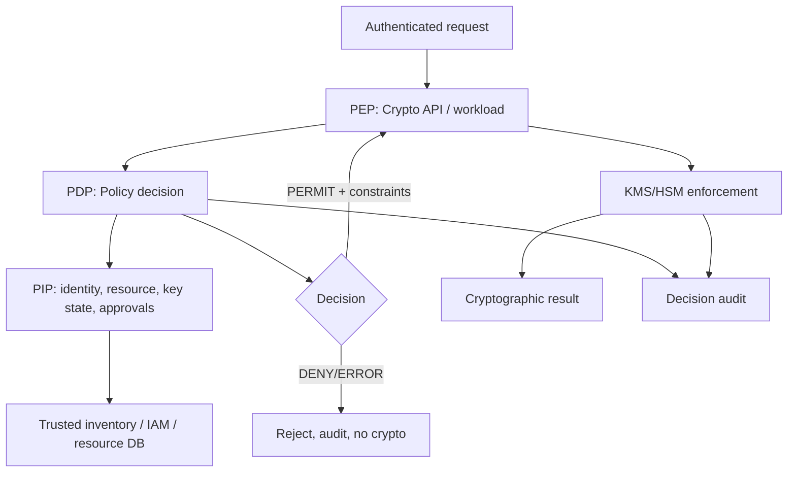
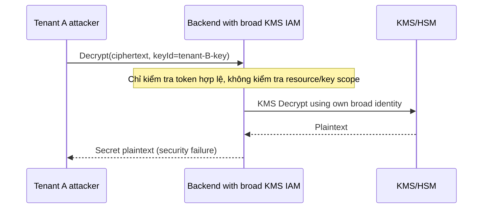
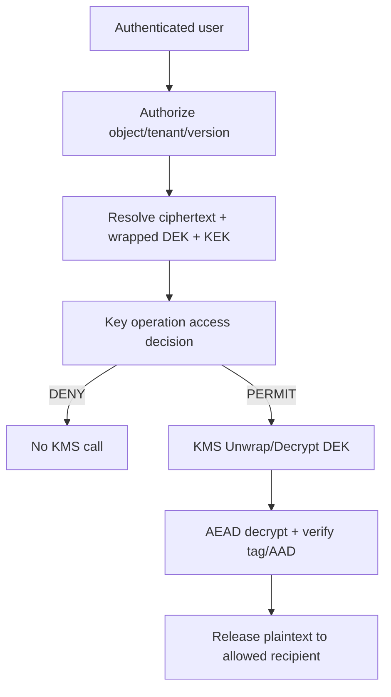
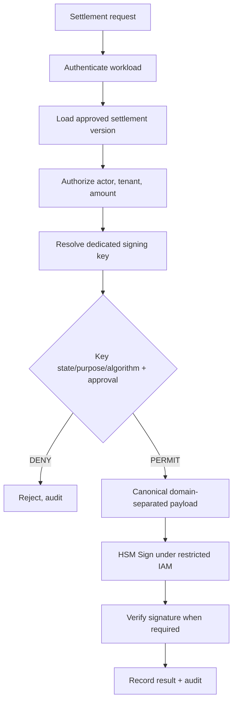
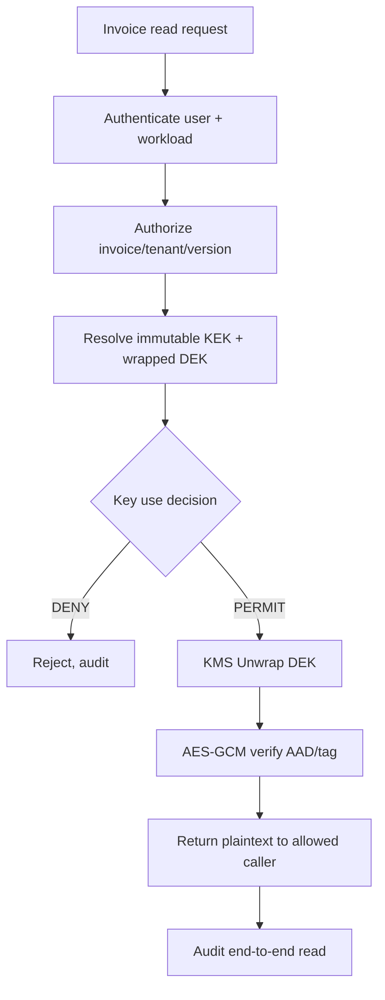

# Access decision trước crypto operation: Kiểm tra quyền trước khi sử dụng khóa mật mã

> **Chương:** Key use  
> **Bài học:** Access decision trước crypto operation  
> **Module:** `SECURITY_KEY_MANAGEMENT_FUNDAMENTALS` — hiểu vòng đời khóa mật mã từ tạo, cấp phát, lưu trữ, sử dụng, xoay vòng đến thu hồi và hủy; liên hệ mật mã đối xứng/bất đối xứng, chữ ký số, KMS/HSM, envelope encryption, IAM và kiểm toán trong hệ thống bảo vệ khóa an toàn.

## 1. Bài toán: Có key trong HSM chưa có nghĩa được phép Sign

Một nền tảng thanh toán có private signing key trong HSM và KEK trong KMS. Đội phát triển tạo API:

```text
POST /crypto/sign
{
  "keyId": "payment-signing-key",
  "message": "..."
}
```

API nhận `keyId` và `message` từ client, dùng một service account có quyền `Sign` rộng trên HSM rồi trả chữ ký. Private key không bao giờ rời module. Nhìn qua, thiết kế có vẻ an toàn vì khóa **non-exportable**.

Nhưng người gọi không được phép có thể yêu cầu service ký:

- Chứng từ giả mạo với số tiền bất kỳ.
- Token có claim `role=admin`.
- Dữ liệu của tenant khác.
- Thông điệp mang ngữ nghĩa khác với mục đích cấp key.
- Payload chưa được phê duyệt hoặc đã hết hiệu lực.

Attacker không cần trích xuất private key; họ có thể biến API thành **signing oracle**. Tương tự, một backend có quyền `Decrypt` quá rộng có thể trở thành **decryption oracle** nếu nhận ciphertext/key reference bất kỳ từ caller.

Bài học chính:

> **Mỗi crypto operation phải có access decision dựa trên một principal đã xác thực, một khóa được resolve đáng tin, một thao tác cụ thể và resource/context hợp lệ — trước khi đi vào KMS/HSM hoặc crypto provider.**

Chỉ có quyền sử dụng khóa ở tầng KMS/HSM là **cần nhưng chưa chắc đủ**: hệ thống còn phải quyết định **ai được phép thao tác lên dữ liệu gì, với mục đích nào, vào thời điểm nào**, sau đó để module thực thi ràng buộc key usage và IAM.

### Mục tiêu học tập

Sau bài này, bạn có thể:

1. Phân biệt authentication, authorization, access decision, policy enforcement và cryptographic operation.
2. Mô hình hóa quyết định **subject–action–key–resource–environment–context** và quy tắc **deny by default**.
3. Thiết kế **Policy Enforcement Point (PEP)**, **Policy Decision Point (PDP)**, Policy Information Point (PIP) và nguồn dữ liệu đáng tin.
4. Kiểm tra key state, key purpose, usage permissions, algorithm/mode, cryptoperiod, tenant boundary, grants, approval và quota trước khi thao tác.
5. Hiểu khác biệt giữa quyền **Sign/Verify, Encrypt/Decrypt, Wrap/Unwrap, GenerateDataKey, Derive**.
6. Chống confused deputy, signing/decryption oracles và lạm dụng credential KMS của backend.
7. Quản lý time-of-check/time-of-use (TOCTOU), policy revocation, cache, timeout và race giữa authorize với crypto operation.
8. Đọc ví dụ **Java 17** xây policy gate và audit decision mà không chứa raw key.
9. Thiết kế negative tests, audit correlation, key inventory và incident response.
10. Kết nối access decision với envelope encryption, chữ ký số, HSM/KMS và vòng đời khóa.

---

## 2. Access decision là gì?

**Access decision** là kết quả đánh giá một yêu cầu sử dụng khóa theo chính sách:

```text
Subject S
  requests Action A
  on Key K
  for Resource R
  in Context C
  at Time T
          |
          v
     Policy evaluation
          |
          +--> PERMIT (có điều kiện)
          +--> DENY
          +--> INDETERMINATE / ERROR
```

Một yêu cầu permit **không tự thực thi** phép mật mã. Sau khi được cho phép, service có thể gọi KMS/HSM; provider lại có thể từ chối do key state, IAM, usage attributes hoặc lỗi kỹ thuật.

### 2.1. Authentication trả lời “ai?”

Ví dụ:

```text
mTLS workload identity  = spiffe://corp/ns/payments/sa/settlement
OIDC subject             = user-opaque-421
tenant authenticated     = tenant-42
environment              = prod
```

Danh tính phải xuất phát từ **kênh xác thực và verifier đáng tin**. Trường `tenantId` hoặc `role` do client tự ghi trong JSON không đủ làm bằng chứng.

### 2.2. Authorization trả lời “được làm gì trên cái gì?”

```text
subject = payment-settlement-service
action  = SIGN
resource= approved-settlement-batch-7841
key     = settlement-signing-key-v4
scope   = tenant-42/prod
```

Authorization không chỉ kiểm tra `subject có role crypto-user`. Nó còn phải kiểm tra **resource scope**, mục đích và trạng thái approval.

### 2.3. Access decision trước operation là một chốt chặn

Một call flow tốt:

```text
Authenticate caller
    -> Authorize business resource
    -> Resolve key from trusted registry
    -> Validate key policy/state/attributes
    -> Verify operation-specific conditions
    -> Permit/Deny with audit
    -> Execute via KMS/HSM with restricted IAM
    -> Verify response/record outcome
```

Điều quan trọng là **không gọi phép ký/giải mã trước rồi mới kiểm tra quyền**. Nếu plaintext hoặc signature đã được tạo và tiết lộ, quyết định DENY sau đó có thể quá muộn.

### 2.4. “Trước” không phải chỉ kiểm tra một lần lúc khởi động

Một service được phép `Sign` lúc 09:00 có thể bị thu hồi grant lúc 09:10. Nếu nó dùng flag `authorized=true` từ startup cho mọi request sau đó, policy revocation có thể không có hiệu lực.

Cần thiết kế **decision per request hoặc capability có scope/thời hạn được cưỡng chế phù hợp**, với cơ chế xử lý thay đổi quyền và key state.

---

## 3. Các thành phần của quyết định: Ai, làm gì, với khóa nào, cho dữ liệu nào?

### 3.1. Subject

Subject có thể là:

- Người dùng cuối đã xác thực.
- Workload/service principal.
- Batch job hoặc scheduler identity.
- Operator có approval.
- Delegated principal: backend thực hiện thay một user.

Một API có thể có **hai danh tính**:

```text
Caller user           = user-opaque-11
Executing workload    = billing-api-prod
```

KMS thường nhìn thấy **workload principal**. Ứng dụng phải tự kiểm tra **user có quyền đọc hóa đơn**, không vì workload có quyền `Decrypt` mà tự động cho mọi user dùng quyền đó.

### 3.2. Action

Không gom mọi thao tác thành `USE_KEY`:

| Action | Kết quả có thể tạo ra | Rủi ro điển hình |
|---|---|---|
| `ENCRYPT` | Ciphertext mới. | Mã hóa sai tenant/alg/mode, phá key usage policy. |
| `DECRYPT` | Plaintext hoặc DEK. | Decryption oracle, lộ dữ liệu trái quyền. |
| `SIGN` | Chữ ký có thể được bên thứ ba tin. | Signing oracle, giả mạo giao dịch. |
| `VERIFY` | Kết quả kiểm chữ ký. | Dùng key/issuer không tin cậy, algorithm downgrade. |
| `MAC_GENERATE` | MAC cho thông điệp. | Authentication oracle, tạo thông điệp giả hợp lệ. |
| `MAC_VERIFY` | Kết quả kiểm MAC. | Timing/oracle nếu xử lý sai. |
| `WRAP_KEY` | Wrapped key material. | Phân phối key cho recipient không phép. |
| `UNWRAP_KEY` | Key material hoặc key handle. | Lộ DEK/secret, bypass tenant. |
| `DERIVE_KEY` | Keying material mới. | Cross-protocol reuse hoặc export derived secret. |
| `GENERATE_DATA_KEY` | DEK mới, có thể cả plaintext DEK. | App giữ raw key, quota/recipient misuse. |
| `CREATE_GRANT` | Capability sử dụng key. | Persistence of privilege, mở rộng IAM. |
| `DISABLE/DELETE` | Thay lifecycle/availability. | Làm mất dữ liệu, phá retention/DR. |

**`VERIFY` thường ít nhạy cảm hơn `SIGN` về key secret**, nhưng vẫn phải bảo đảm trust mapping, issuer/key version và policy algorithm. Không mặc định tất cả verify cần cùng mức phê duyệt như ký.

### 3.3. Key

Key identity phải được resolve từ **server-side trusted registry**:

```text
logicalName       = tenant-42/orders-signing
immutableKeyId    = hsm/partition-a/key-object-018
materialVersion   = v3
purpose           = DIGITAL_SIGNATURE
algorithm         = Ed25519
ownerTenant       = tenant-42
environment       = prod
lifecycleState    = ACTIVE
```

Alias động không đủ để truy vết key material thực tế. Người gọi không nên được cung cấp arbitrary HSM key handle hoặc KMS ARN rồi yêu cầu backend dùng với quyền rộng.

### 3.4. Resource

Resource là đối tượng nghiệp vụ gắn với operation:

```text
invoiceId       = invoice-7821
settlementId    = settlement-2026-11-28-a
objectGeneration= opaque-object-v7
tokenAudience   = approved-service-a
```

Một key có thể dùng cho nhiều resources trong cùng tenant, nhưng người gọi **không mặc nhiên** có quyền với mọi resource chỉ vì có quyền dùng key.

### 3.5. Environment và context

Các thuộc tính có thể gồm:

- Tenant, project/account/region.
- `prod`, `staging`, `dev`.
- Purpose và protocol domain.
- Mức phân loại dữ liệu.
- Approved algorithm, key strength/mode.
- User session assurance level.
- Device/workload attestation khi yêu cầu.
- Change window, approval hoặc quorum.
- Risk score từ policy engine đáng tin.
- Key usage count/limits và cryptoperiod.

**Context phải có nguồn gốc rõ**, không biến mọi HTTP header thành trusted attribute.

---

## 4. PEP, PDP, PIP và Policy Administration

### 4.1. Kiến trúc tham chiếu



- **PEP — Policy Enforcement Point:** điểm chặn, không để bypass.
- **PDP — Policy Decision Point:** đánh giá policy và trả decision.
- **PIP — Policy Information Point:** cung cấp thuộc tính đáng tin.
- **PAP — Policy Administration Point:** nơi chính sách được tạo/review/phê duyệt, có version, change control.

Các thuật ngữ này mô tả kiến trúc, không ép phải dùng một framework cụ thể.

### 4.2. PEP phải được đặt nơi không thể bỏ qua

Một sai lầm:

```text
App API -> PDP authorize
             |
             +-----> KMS
Other job -------------------> KMS  (direct access, không qua PDP)
```

Nếu job khác có quyền `Decrypt *` và có thể gọi KMS trực tiếp, ứng dụng có PEP đẹp nhưng **đường bypass** vẫn tồn tại.

Cần thực thi lớp thứ hai:

- IAM/resource policy trên key.
- Key usage attributes của HSM.
- Network/service boundary và workload identity.
- Key-specific permissions.
- Conditional grants/context khi provider hỗ trợ.
- Audit phát hiện calls ngoài approved workflow.

### 4.3. PDP không tự “bảo vệ” key

PDP `PERMIT` chỉ nói request phù hợp policy đã kiểm tra. KMS/HSM vẫn phải independently enforce quyền sử dụng key. Ngược lại, KMS `Decrypt=SUCCESS` không nói operation đã được nghiệp vụ chấp thuận nếu key policy quá rộng.

**Defense in depth:** business authorization ở application + key authorization ở KMS/HSM.

### 4.4. Policy decisions có điều kiện

Không chỉ `ALLOW`/`DENY`, một decision có thể đi kèm **obligations**:

```text
PERMIT only if:
  use immutable key v4
  approved audience = financial-ledger
  plaintext must not be returned to client
  operation expires at 10:30 UTC
  require second approval
  audit decision and KMS response
```

PEP phải hiểu và thực thi obligations trước operation. Nếu PEP không hỗ trợ một obligation quan trọng, **DENY**, không âm thầm bỏ qua.

---

## 5. Authentication trước khi quyết định sử dụng key

### 5.1. Identity của workload

Các lựa chọn phổ biến:

- mTLS với certificate/workload identity được xác thực.
- OIDC/OAuth access token với issuer/audience/signature/expiry kiểm tra.
- Cloud workload identity hoặc instance/service account identity.
- HSM token/session credentials với key slot permissions.
- Human SSO và step-up approval cho thao tác quản trị.

Không dùng một header:

```text
X-User: admin
X-Tenant: tenant-42
```

làm nguồn danh tính nếu client tùy ý gửi và gateway/backend chưa thiết lập trust contract.

### 5.2. Token validation và key access

Một access token hợp lệ cần kiểm tra:

```text
issuer
audience
signature / accepted algorithm
exp / nbf
subject/client identity
tenant and scopes
delegation context
```

`role=crypto-user` nằm trong token do chính ứng dụng ký có thể chỉ có ý nghĩa nếu issuer và claims được tin cậy. Một JWT tự tạo hoặc token có audience khác không thể dùng thay thế.

### 5.3. Delegation: Ai gọi KMS thay ai?

Ví dụ:

```text
End user  -> Invoice API -> KMS Decrypt
```

KMS thấy `Invoice API` workload principal; nó không nhất thiết thấy end-user. Access decision phải ghi:

```text
authenticatedUser
executingWorkload
delegationScope
businessResource
resolvedKey
```

Không gửi mọi claim cá nhân tới KMS encryption context để bù; context có thể xuất hiện trong audit và không tự tạo per-user IAM.

### 5.4. Human approval và separation of duties

Một operator có quyền tạo key không nhất thiết có quyền tự xuất/bọc/revoke key sản xuất. Với root KEK, private CA key hoặc disaster-recovery key, có thể yêu cầu:

- Two-person approval.
- Change ticket và maintenance window.
- Hardware-backed strong authentication.
- Approval ràng buộc key ID, action, resource scope và expiry.
- Audit độc lập và hậu kiểm.

**Approval dùng lại** cho action/key khác là lỗi policy. Phê duyệt phải có scope rõ.

---

## 6. Trước crypto operation phải kiểm tra những thuộc tính nào?

### 6.1. Decision checklist ở dạng quy tắc

Một decision permit có thể yêu cầu **tất cả điều kiện sau đúng**:

```text
Authenticated principal?                YES
Principal active, not revoked?           YES
Business resource access allowed?        YES
Key ID resolved from trusted mapping?    YES
Tenant + environment match?              YES
Key lifecycle permits this action?       YES
Key usage/purpose permits action?         YES
Algorithm/mode/size approved?            YES
Context/AAD/message domain valid?        YES
Any required approval still valid?       YES
Quotas/anti-abuse constraints satisfied?  YES
KMS/HSM grant available and scoped?       YES
Audit policy requirements satisfied?     YES
                                             -> PERMIT
```

**Một điều kiện bắt buộc thất bại → DENY.** Nếu nguồn quyết định bắt buộc không truy vấn được → `INDETERMINATE` và fail closed đối với thao tác đang xét.

### 6.2. Điều kiện phụ thuộc loại thao tác

| Operation | Quyết định nghiệp vụ trước call | Ràng buộc module |
|---|---|---|
| `SIGN` | Người ký, loại tài liệu, trạng thái approval, message domain. | Private key `SIGN`, algorithm/padding, IAM. |
| `DECRYPT` | User được phép đọc object/version/tenant nào. | KEK permission, ciphertext/context, lifecycle. |
| `ENCRYPT` | Được phép tạo dữ liệu nào, data classification. | Approved DEK/algorithm/mode, key state, nonce. |
| `WRAP_KEY` | Recipient được phép nhận keying material. | `WRAP` usage, destination/wrapping mechanism. |
| `UNWRAP_KEY` | Ai được nhận plaintext DEK/handle, object ID. | `UNWRAP` usage và KMS decrypt permission. |
| `MAC_GENERATE` | Payload/protocol/tenant được phép xác thực. | HMAC key purpose, usage, replay controls. |
| `DERIVE_KEY` | Context/domain, intended derived-key purpose. | KDF/algorithm approved, key usage constraints. |
| `VERIFY` | Trusted issuer/key binding, accepted algorithm. | Verify operation đúng key/version và input format. |

**Không dùng một hàm `isAdmin()` thay cho toàn bộ bảng này.**

### 6.3. Key state không chỉ ACTIVE/INACTIVE

Một mô hình key lifecycle:

```text
CREATED -> APPROVED -> ACTIVE -> RETIRED_FOR_NEW_USE
                           \-> SUSPENDED/REVOKED
RETIRED_FOR_NEW_USE -> DECRYPT_ONLY -> DESTROY_PENDING -> DESTROYED
```

Tên state là khái niệm; provider có state machine riêng.

Khi key ở `DECRYPT_ONLY`:

- Có thể vẫn cho phép decrypt dữ liệu lịch sử theo policy.
- Không cho tạo ciphertext/chữ ký mới.
- Không có quyền tùy tiện chuyển sang state ACTIVE.

Nếu key nghi compromised, thông lệ xử lý có thể chặt hơn: **không tự cho phép decrypt** chỉ vì old ciphertext cần khôi phục; quyết định dựa vào risk/incident policy.

### 6.4. Cryptoperiod và key usage

Cryptoperiod không chỉ là một `expiresAt`. Một key có thể có:

- **Originator-usage period:** khoảng thời gian được phép tạo protections mới.
- **Recipient-usage period:** khoảng thời gian còn được phép xử lý/giải mã dữ liệu cũ theo policy.
- **Suspension/revocation state:** chặn hoặc giới hạn operation.
- **Operation count/usage limits:** đặc biệt với nonce-sensitive AEAD hoặc protocol/key type cụ thể.

Không dùng ngày hết hạn của certificate làm duy nhất điều kiện cho mọi loại key. Phân biệt lifecycle của material, chứng chỉ, ciphertext và key grants.

---

## 7. Default-deny và tránh fail-open

### 7.1. Quy tắc đơn giản nhưng quan trọng

```text
if authentication missing         -> DENY
if authorization cannot be proven -> DENY
if tenant mismatch                -> DENY
if key metadata unknown           -> DENY
if action not in key usage policy  -> DENY
if crypto module denies            -> DENY
```

Không làm:

```java
try {
    return policyService.isAllowed(request);
} catch (Exception e) {
    return true; // sai: fail open
}
```

### 7.2. `INDETERMINATE` không phải `DENY` về mặt điều tra

Nếu PDP timeout, operation bị chặn nhưng audit nên ghi:

```text
decision = INDETERMINATE
reason   = PDP_UNAVAILABLE
enforcement = DENIED
```

Nó khác với:

```text
decision = DENY
reason   = USER_NOT_AUTHORIZED
```

Phân biệt giúp giám sát availability và incident, không che policy outage thành người dùng vi phạm.

### 7.3. Không hạ cấp sang raw local key khi KMS lỗi

Một anti-pattern:

```text
KMS Decrypt unavailable
   -> use hardcoded fallbackKey
   -> continue decrypt
```

Điều này phá key custody, IAM và audit. Nếu cần degraded mode, phải được thiết kế, phê duyệt và kiểm thử trước, không tùy tiện fallback trong exception handler.

### 7.4. Không tự động thử nhiều keys cho tới khi decrypt được

Sai:

```text
decrypt using keyA
if error, try keyB
if error, try keyC ...
```

nếu key selection không từ registry đáng tin. Nó có thể tạo oracle, cross-tenant boundary bypass và đánh tráo key. Hãy **resolve immutable key reference** qua object metadata được xác thực/registry, rồi dùng đúng key theo policy.

---

## 8. Chặn confused deputy trong KMS/HSM

### 8.1. Confused deputy là gì?

Một service có đặc quyền KMS rộng bị client lợi dụng để thực hiện thao tác thay mặt người không có quyền.



KMS thấy **backend được phép**, nhưng backend không được phép **dùng quyền đó cho yêu cầu cụ thể của tenant A**.

### 8.2. Cách phòng vệ

1. Xác định subject/tenant từ authentication.
2. Authorization đối với **business resource**.
3. Resolve key từ mapping resource đã xác minh.
4. Validate `key.tenant == resource.tenant == authenticatedTenant`.
5. Kiểm tra action/purpose/state.
6. Gọi KMS với **key ID cụ thể**, encryption context/constraints khi hỗ trợ.
7. Trả plaintext chỉ tới authorized recipient.
8. Audit correlation tới KMS call.

### 8.3. KMS encryption context hữu ích nhưng không thay IAM

Một số KMS dùng encryption context như AAD khi encrypt/decrypt:

```json
{
  "tenantRef": "tenant-42",
  "objectRef": "invoice-7821-v3",
  "purpose": "OBJECT_DEK"
}
```

Khi context sai, cryptographic verification có thể fail theo API. Nhưng:

- Context thường **không bí mật**, có thể xuất hiện trong logs.
- Không đặt raw keys/PII không cần thiết.
- Caller có thể tự khai context nếu backend không kiểm chứng.
- IAM/key policies quyết định operation thực sự có được phép.
- Context phải ràng buộc đúng key/ciphertext theo provider contract.

### 8.4. Client không nên tự chọn arbitrary KMS URI

Thay vì:

```text
POST /decrypt { "keyArn": "...", "ciphertext": "..." }
```

nên là:

```text
GET /invoices/{invoiceId}
  -> authorize user/tenant for invoiceId
  -> server-side registry resolves ciphertext and immutable KEK ref
  -> scoped KMS Decrypt
```

Không có quy tắc buộc mọi API decrypt đều không nhận key ID; điểm quan trọng là **key selection phải được xác thực, ràng buộc với resource và IAM**, không chỉ tin user input.

---

## 9. Sign operation: “Được ký” phải gắn với nội dung và ngữ nghĩa

### 9.1. Signing oracle

Một HSM có thể bảo vệ private key non-exportable, nhưng nếu endpoint ký bất kỳ bytes:

```text
SIGN(key=payment-key, message=attacker-input)
```

thì attacker có thể tạo các chữ ký hợp lệ dưới danh tính payment service.

**Access decision phải xét nội dung và mục đích**, không chỉ xét caller có quyền `SIGN`.

### 9.2. Ví dụ chính sách ký settlement

```text
subject = authorized-settlement-service
tenant = tenant-42
resource = settlement-batch-2026-11-28
status = APPROVED_BY_FINANCE
amount = approved record amount
audience = settlement-clearing-network
keyPurpose = SETTLEMENT_SIGNATURE
keyState = ACTIVE
```

Nếu tất cả điều kiện đúng, service tạo một **canonical signing payload** từ trusted records, rồi gọi HSM Sign.

Không cho caller gửi một chuỗi đã băm tùy ý và yêu cầu ký nếu key có tác động pháp lý/nghiệp vụ lớn.

### 9.3. Domain separation

Cùng một signing key không nên tùy ý ký các protocol messages khác nhau nếu có nguy cơ semantic confusion. Ví dụ:

```text
"settlement-v1" || canonicalSettlementRecord
```

và:

```text
"jwt-access-token-v1" || canonicalClaims
```

phải được phân biệt bằng policy và key separation phù hợp. Trường hợp nghiêm ngặt nên dùng **khóa khác nhau theo purpose/protocol**, không chỉ prefix.

### 9.4. Algorithm/padding restrictions

RSA-PSS và RSA PKCS#1 v1.5 signatures có semantics khác; Ed25519 khác với ECDSA. Policy cần lựa chọn algorithm/parameter được phê duyệt, và HSM/provider phải enforce.

Không cho client tự chỉ định:

```text
algorithm = "none"
padding   = arbitrary
digest    = weak
```

rồi bypass allowlist. Cấu hình verify cũng cần chống algorithm confusion.

### 9.5. Chữ ký đúng toán học không chứng minh người gọi được phép

Một signature hợp lệ chỉ xác nhận tính toán theo key. Nó không tự nói:

- Giao dịch được phê duyệt.
- Ký đúng tenant.
- Người ký có quyền trong hệ nghiệp vụ.
- Dữ liệu chưa bị thay đổi trước khi đưa vào API Sign.
- Key chưa bị lạm dụng qua một signing oracle.

Các bằng chứng nghiệp vụ cần được lưu riêng, liên kết bằng audit refs và message digest của **canonical non-secret payload** theo policy.

---

## 10. Decrypt operation: Bảo vệ plaintext và data boundaries

### 10.1. Hai quyền phải cùng đúng

```text
Business permission:
  user may read invoice-7821 for tenant-42

Key permission:
  billing-backend may KMS Decrypt under authorized KEK
```

Nếu chỉ có quyền thứ hai, backend có thể giải mã dữ liệu của nhiều tenant. Nếu chỉ có quyền thứ nhất nhưng KMS deny, request phải thất bại an toàn; không bypass key policy.

### 10.2. Envelope encryption



Một object có thể chứa wrapped DEK và key reference, nhưng việc giải mã phải sử dụng **trusted object/version mapping**, không chỉ metadata không được xác thực.

### 10.3. AAD là security binding, không phải thay quyền

Với AES-GCM:

```text
AAD = canonical(tenantId, applicationObjectId, formatVersion)
```

giúp phát hiện việc đổi ciphertext giữa các context khi decrypt dùng expected AAD. Nhưng nếu backend dùng **tenant ID của attacker tự khai** làm expected AAD và không có business authorization, lớp này có thể không bảo vệ đúng.

### 10.4. Key usage và historical decrypt

Sau rotation:

```text
KEK-v3: no new wrapping; historical unwrap allowed by policy
KEK-v4: current wrapping and unwrap
```

Việc `KEK-v3` đã retire không nhất thiết là được decrypt mọi thứ vô hạn. Quyền vẫn phải xét caller, object, version, retention và key compromise state.

### 10.5. Không release plaintext trước khi integrity check

Với AEAD, phải kiểm tag thành công rồi mới xem plaintext là đáng tin. Khi stream, cần thiết kế chunked authentication/manifest hoặc buffering phù hợp; không gửi plaintext chưa xác minh cho client trong trường hợp yêu cầu full-message integrity.

---

## 11. Encrypt operation: “Mã hóa” cũng cần policy

### 11.1. Encrypt không hoàn toàn vô hại

Một service có quyền Encrypt có thể:

- Mã hóa dữ liệu dưới key của sai tenant.
- Dùng KEK đã retire để tạo thêm data dependencies.
- Tạo ciphertext với algorithm/mode yếu.
- Vi phạm nonce uniqueness AES-GCM.
- Dùng key dành cho wrap để encrypt payload trái mục đích.
- Tăng chi phí và quota qua massive key operations.

### 11.2. Policy cho dữ liệu mới

Ví dụ:

```text
only approved DEK source
AEAD algorithm = AES-256-GCM
nonce handling policy = unique per key
key purpose = DATA_ENCRYPTION
key state = ACTIVE_FOR_NEW_USE
tenant from verified resource
AAD binds immutable object identity
```

**Policy approval không tự đảm bảo nonce uniqueness.** Đó là một invariant kỹ thuật phải được thực thi bởi crypto code/library và key/nonce management.

### 11.3. Key generation và access decision

Một API `GenerateDataKey` có thể trả plaintext DEK và wrapped DEK. Quyền gọi API cần kiểm:

- Workload thực sự cần nhận plaintext DEK hay có thể để KMS/HSM thực hiện operation nội bộ?
- KEK nào được phép dùng?
- Có quota và purpose phù hợp?
- Có audit/cleanup/memory handling?
- DEK được gắn với đúng object/version/tenant?

Không biến `GenerateDataKey` thành public endpoint trả key raw cho bất kỳ caller nào.

---

## 12. Wrap/Unwrap: Key distribution cũng phải có quyết định truy cập

### 12.1. Wrap cho ai?

`WRAP_KEY` thường tạo ra một artifact có thể được người giữ recipient key hoặc KEK unwrap. Vì thế policy phải quan tâm:

```text
sourceKeyId
recipientIdentity
destinationWrappingKeyId
algorithm/mode
allowedPurpose
exportPolicy
tenant/environment/region
approval
```

Nếu source key là non-exportable và provider không cho wrap, không được đổi attributes để “lách” policy.

### 12.2. Unwrap có thể tạo secret trong memory

Một API unwrap có thể trả:

- Raw keying material tới process.
- Key object handle bên trong HSM.
- Protected key blob theo provider format.

Mức độ rủi ro khác nhau. Access decision phải xác định **recipient thực sự nhận dạng dữ liệu gì**.

### 12.3. Rewrap và key migration

Rewrap cùng DEK dưới KEK mới không phải generate DEK mới:

```text
wrappedDEK_old --(authorized unwrap + rewrap)--> wrappedDEK_new
```

Nên cho phép bằng một workflow riêng, có dependency inventory, source/destination key verification, approval khi cần và audit.

### 12.4. Chặn export bằng policy và module

Một flag `nonExportable=true` trong database không đủ. Module phải enforce HSM object attributes như `CKA_EXTRACTABLE`/`CKA_SENSITIVE` theo semantics PKCS#11 hoặc provider equivalent. Nhưng non-exportable vẫn không chặn attacker **dùng** key qua Sign/Decrypt oracle nếu quyền bị cấp sai.

---

## 13. KMS/HSM: Ba tầng kiểm soát song song

### 13.1. Authorization của ứng dụng

Biết user/business context:

```text
User được đọc tài liệu nào?
Service được ký chứng từ nào?
Tenant nào sở hữu ciphertext?
Giao dịch đã được duyệt?
```

### 13.2. IAM/key policy của KMS

Có thể kiểm soát:

```text
principal được gọi API nào?
key resource nào?
encryption context hoặc condition nào?
account/region/network boundaries nào?
grant restrictions/expiry nào?
```

Cơ chế thực tế khác theo cloud provider. Không áp ngữ nghĩa của một sản phẩm KMS lên mọi nhà cung cấp.

### 13.3. Key attributes của cryptographic module

Với HSM/PKCS#11, object có thể có attributes:

| Thuộc tính | Vai trò |
|---|---|
| `CKA_SIGN` | Cho phép operation Sign khi các điều kiện khác phù hợp. |
| `CKA_VERIFY` | Operation Verify. |
| `CKA_ENCRYPT` / `CKA_DECRYPT` | Encrypt/Decrypt. |
| `CKA_WRAP` / `CKA_UNWRAP` | Key wrapping/unwrapping. |
| `CKA_DERIVE` | Key derivation. |
| `CKA_SENSITIVE` / `CKA_EXTRACTABLE` | Hạn chế lộ/export vật liệu theo semantics. |
| Key state/vendor policy | Tình trạng và hạn chế provider-specific. |

Một key có `CKA_SIGN=true` **không có nghĩa mọi service đều được ký**; nó là một phần của object capability, ngoài authentication/authorization session.

### 13.4. Effective permission là giao của các policy

Một cách hình dung:

```text
EffectiveAllowed =
    BusinessAuthorization
    AND TrustedKeyMapping
    AND KeyLifecyclePolicy
    AND KMS/HSM IAM
    AND KeyUsageAttributes
    AND OperationInputConstraints
```

Mô hình này hữu ích để suy nghĩ; một số provider có các quy tắc deny/allow/conditions phức tạp và không thể chỉ tính bằng boolean đơn giản.

### 13.5. Không dựa vào allow ở tầng cao để bỏ provider deny

Nếu PDP `PERMIT` nhưng KMS trả access denied, **không retry bằng admin credential**. Chọn đúng credential/policy hoặc điều tra mismatch. Bypass provider deny là phá defense in depth.

---

## 14. Thiết kế policy theo RBAC và ABAC

### 14.1. RBAC là điểm bắt đầu

Ví dụ role:

```text
KEY_SIGNER
KEY_DECRYPTOR
KEY_WRAPPER
KEY_ROTATION_OPERATOR
KEY_AUDITOR
```

RBAC giúp quản trị quyền ở mức vai trò, nhưng `KEY_DECRYPTOR` không đủ phân biệt dữ liệu tenant A hay B.

### 14.2. ABAC ràng buộc resource và context

Một policy ABAC có thể là:

```text
PERMIT DECRYPT
IF subject.tenant == resource.tenant
AND subject.environment == key.environment
AND key.purpose == OBJECT_DEK_WRAP
AND key.lifecycle permits DECRYPT
AND resource.owner approved read
AND request.objectVersion == registry.currentOrAuthorizedVersion
```

### 14.3. Phân biệt rule authentication và rule business

Không nên gộp:

```text
scope=kms:decrypt
```

thành:

```text
user may read any invoice
```

Scope KMS chỉ nói quyền với key operation; business authorization còn cần row/object ACL, workflow state, record owner, consent/retention nếu áp dụng.

### 14.4. Deny overrides và exception

Một policy có thể có:

```text
allow: app role can decrypt invoice of same tenant
deny: key compromised
deny: legal/incident hold forbids access
deny: actor suspended
```

Khi có conflict, cần quy tắc ưu tiên rõ, thường **explicit deny** không được override bởi allow thông thường. Một ngoại lệ phải có approval, scope, expiry và audit, không chỉ một cờ `bypass=true` do caller truyền.

---

## 15. Key lifecycle: Quyền thay đổi theo thời gian

### 15.1. State matrix minh họa

| Key state | ENCRYPT mới | DECRYPT lịch sử | SIGN mới | VERIFY lịch sử | Ghi chú |
|---|---|---|---|---|---|
| `CREATED_NOT_ACTIVE` | DENY | DENY | DENY | Theo policy, thường chưa dùng | Chưa được phê duyệt kích hoạt. |
| `ACTIVE` | Có thể PERMIT | Có thể PERMIT | Có thể PERMIT | Có thể PERMIT | Vẫn cần principal/resource authz. |
| `RETIRED_FOR_NEW_USE` | DENY | Có thể PERMIT | DENY | Có thể PERMIT | Ngừng tạo dữ liệu/chữ ký mới. |
| `SUSPENDED` | DENY | Tùy incident policy, thường DENY | DENY | Verify public key tùy trust status | Cần điều tra/approval. |
| `COMPROMISED` | DENY | Chỉ theo ứng cứu có kiểm soát | DENY | Đánh giá trust/historical signatures | Không coi cryptographic validity là trust. |
| `DESTROYED` | Không thể dùng | Không thể dùng nếu không có bản sao/recovery path hợp lệ | Không thể dùng | Public verification key có thể còn | Hủy sai có thể gây mất dữ liệu. |

**Bảng là khái niệm**, không phải quy tắc của mọi KMS. `VERIFY` có thể chỉ cần public key và không phụ thuộc private key còn tồn tại.

### 15.2. Cryptoperiod khác certificate expiration

Một certificate có thể hết hạn nhưng private key material vẫn tồn tại. Có thể cấm ký mới bằng key đó nhưng vẫn cần verify chữ ký trong lưu trữ lịch sử theo trust policy.

Không xóa key chỉ vì một ngày hết hạn đã đến; cần kiểm data dependencies, retention và backup.

### 15.3. Key revocation phải đi qua nơi thực thi

Nếu chỉ đổi row:

```text
inventory.keyState = REVOKED
```

nhưng workloads vẫn có HSM grant hoặc cache token cho key đó, quyền thực tế có thể còn.

Cần synchronize:
- PDP/PEP.
- KMS key state và grants.
- HSM sessions/usage policy.
- Workload cached capabilities.
- Alias/registry.
- Audit/monitoring.

### 15.4. Permission to use vs permission to administer

`Decrypt` không nên mặc nhiên được quyền `DisableKey` hoặc `ScheduleKeyDeletion`. Các thao tác quản trị cần role/approval khác vì ảnh hưởng availability/retention lớn.

---

## 16. Java 17: Policy gate trước operation — ví dụ hoàn chỉnh

Đoạn code sau minh họa **tách access decision khỏi crypto executor**. Đây là demo tự chứa, không kết nối KMS/HSM thật, không chứa raw key và không thực hiện ký/giải mã dữ liệu production.

Điểm học tập:

1. `AuthenticatedPrincipal` đại diện danh tính đã được authentication layer kiểm tra.
2. `ResourceRecord` được load từ registry server-side đáng tin.
3. `KeyRecord` chứa immutable key ID, tenant, environment, purpose, state, algorithm và allowed operations.
4. Decision `PERMIT/DENY/INDETERMINATE` kèm reason code.
5. PEP từ chối **trước khi gọi CryptoExecutor**.
6. Không để client chỉ định arbitrary `keyId`.
7. Audit chỉ ghi metadata, không in secret.
8. Executor mô phỏng key operation; KMS/HSM thật phải enforce IAM độc lập.

```java
import java.time.Instant;
import java.util.EnumSet;
import java.util.Map;
import java.util.Objects;
import java.util.Set;

public final class CryptoAccessDecisionDemo {

    enum Action {
        ENCRYPT, DECRYPT, SIGN, VERIFY, WRAP, UNWRAP
    }

    enum Purpose {
        DATA_ENCRYPTION, KEY_WRAP, BUSINESS_SIGNATURE
    }

    enum KeyState {
        ACTIVE, DECRYPT_ONLY, SUSPENDED, DESTROYED
    }

    enum Outcome {
        PERMIT, DENY, INDETERMINATE
    }

    // Auth layer đã xác thực được workload/tenant.
    record AuthenticatedPrincipal(
            String workloadId,
            String tenantId,
            String environment,
            Set<Action> grantedActions) {
        AuthenticatedPrincipal {
            grantedActions = Set.copyOf(grantedActions);
        }
    }

    // Nguồn resource record là server-side registry đã bảo vệ.
    record ResourceRecord(
            String objectId,
            String ownerTenant,
            String environment,
            String immutableKeyId,
            Purpose purpose,
            boolean approvedForUse) {}

    record KeyRecord(
            String immutableKeyId,
            String ownerTenant,
            String environment,
            Purpose purpose,
            String algorithm,
            KeyState state,
            Set<Action> allowedOperations,
            Instant originatorUsageEndsAt) {
        KeyRecord {
            allowedOperations = Set.copyOf(allowedOperations);
        }
    }

    record Decision(Outcome outcome, String reasonCode) {
        static Decision permit() {
            return new Decision(Outcome.PERMIT, "POLICY_ALLOW");
        }
        static Decision deny(String reason) {
            return new Decision(Outcome.DENY, reason);
        }
        static Decision unknown(String reason) {
            return new Decision(Outcome.INDETERMINATE, reason);
        }
    }

    interface CryptoExecutor {
        // Must enforce KMS/HSM IAM independently in production.
        void execute(
                Action action,
                String immutableKeyId,
                String trustedResourceId) throws Exception;
    }

    static final class MockKmsExecutor implements CryptoExecutor {
        @Override
        public void execute(
                Action action,
                String immutableKeyId,
                String trustedResourceId) {
            // This is NOT a cryptographic operation.
            System.out.println("Mock KMS invoked: " + action
                    + " for " + trustedResourceId);
        }
    }

    static final class PolicyEngine {
        Decision decide(
                AuthenticatedPrincipal principal,
                ResourceRecord resource,
                KeyRecord key,
                Action action,
                Instant now) {

            if (principal == null || resource == null
                    || key == null || action == null || now == null) {
                return Decision.unknown("MISSING_TRUSTED_INPUT");
            }

            if (!principal.grantedActions().contains(action)) {
                return Decision.deny("ACTION_NOT_GRANTED");
            }

            if (!principal.tenantId().equals(resource.ownerTenant())
                    || !resource.ownerTenant().equals(key.ownerTenant())) {
                return Decision.deny("TENANT_MISMATCH");
            }

            if (!principal.environment().equals(resource.environment())
                    || !resource.environment().equals(key.environment())) {
                return Decision.deny("ENVIRONMENT_MISMATCH");
            }

            if (!resource.immutableKeyId().equals(
                    key.immutableKeyId())) {
                return Decision.deny("RESOURCE_KEY_MISMATCH");
            }

            if (!resource.approvedForUse()) {
                return Decision.deny("RESOURCE_NOT_APPROVED");
            }

            if (resource.purpose() != key.purpose()
                    || !key.allowedOperations().contains(action)) {
                return Decision.deny("KEY_USAGE_MISMATCH");
            }

            if (!algorithmAllowed(key, action)) {
                return Decision.deny("ALGORITHM_POLICY");
            }

            if (key.state() == KeyState.DESTROYED
                    || key.state() == KeyState.SUSPENDED) {
                return Decision.deny("KEY_NOT_USABLE");
            }

            if (key.state() == KeyState.DECRYPT_ONLY
                    && action != Action.DECRYPT) {
                return Decision.deny("KEY_RETIRED_FOR_NEW_USE");
            }

            // Minimized example: production should distinguish
            // originator/recipient usage periods per key type.
            if (action == Action.ENCRYPT
                    || action == Action.SIGN
                    || action == Action.WRAP) {
                if (!now.isBefore(key.originatorUsageEndsAt())) {
                    return Decision.deny("ORIGINATOR_PERIOD_EXPIRED");
                }
            }

            return Decision.permit();
        }

        private boolean algorithmAllowed(
                KeyRecord key, Action action) {

            if (key.purpose() == Purpose.DATA_ENCRYPTION) {
                return key.algorithm().equals("AES-256-GCM")
                        && (action == Action.ENCRYPT
                            || action == Action.DECRYPT);
            }

            if (key.purpose() == Purpose.KEY_WRAP) {
                return key.algorithm().equals("AES-KW")
                        && (action == Action.WRAP
                            || action == Action.UNWRAP);
            }

            if (key.purpose() == Purpose.BUSINESS_SIGNATURE) {
                return key.algorithm().equals("Ed25519")
                        && (action == Action.SIGN
                            || action == Action.VERIFY);
            }

            return false;
        }
    }

    // Trusted registry: user input is only an application resource ID.
    static final Map<String, ResourceRecord> RESOURCES = Map.of(
            "invoice-7821",
            new ResourceRecord(
                    "invoice-7821", "tenant-42", "prod",
                    "kms-object-key-01", Purpose.DATA_ENCRYPTION, true)
    );

    static final Map<String, KeyRecord> KEYS = Map.of(
            "kms-object-key-01",
            new KeyRecord(
                    "kms-object-key-01", "tenant-42", "prod",
                    Purpose.DATA_ENCRYPTION, "AES-256-GCM",
                    KeyState.ACTIVE,
                    EnumSet.of(Action.ENCRYPT, Action.DECRYPT),
                    Instant.parse("2030-01-01T00:00:00Z"))
    );

    static Decision authorizeAndRun(
            AuthenticatedPrincipal principal,
            String requestedObjectId,
            Action action,
            CryptoExecutor kmsExecutor,
            PolicyEngine policy,
            Instant now) throws Exception {

        Objects.requireNonNull(principal);
        Objects.requireNonNull(requestedObjectId);

        ResourceRecord resource = RESOURCES.get(requestedObjectId);

        if (resource == null) {
            // Don't reveal existence of resources in other tenants.
            return auditAndReturn(
                    principal, requestedObjectId, action, null,
                    Decision.deny("RESOURCE_NOT_AVAILABLE"));
        }

        KeyRecord key = KEYS.get(resource.immutableKeyId());

        Decision decision = policy.decide(
                principal, resource, key, action, now);

        auditDecision(
                principal, requestedObjectId, action,
                key == null ? null : key.immutableKeyId(),
                decision);

        if (decision.outcome() != Outcome.PERMIT) {
            return decision; // Fail closed: no KMS invocation.
        }

        // Production: use restrictive IAM and provider-side enforcement;
        // revalidate mutable state or carry a short-lived scoped capability.
        kmsExecutor.execute(
                action, key.immutableKeyId(), resource.objectId());

        return decision;
    }

    static Decision auditAndReturn(
            AuthenticatedPrincipal principal,
            String objectId,
            Action action,
            String immutableKeyId,
            Decision decision) {

        auditDecision(
                principal, objectId, action, immutableKeyId, decision);
        return decision;
    }

    static void auditDecision(
            AuthenticatedPrincipal principal,
            String objectId,
            Action action,
            String keyId,
            Decision decision) {

        // Demo only. This prints identifiers, never raw key material.
        // Production should use structured audit, escaping and retention.
        System.out.println("AUDIT action=" + action
                + " objectId=" + objectId
                + " keyId=" + (keyId == null ? "n/a" : keyId)
                + " workload=" + principal.workloadId()
                + " decision=" + decision.outcome()
                + " reason=" + decision.reasonCode());
    }

    public static void main(String[] args) throws Exception {
        AuthenticatedPrincipal allowed =
                new AuthenticatedPrincipal(
                        "billing-reader", "tenant-42", "prod",
                        EnumSet.of(Action.DECRYPT));

        AuthenticatedPrincipal crossTenant =
                new AuthenticatedPrincipal(
                        "foreign-reader", "tenant-19", "prod",
                        EnumSet.of(Action.DECRYPT));

        CryptoExecutor mock = new MockKmsExecutor();
        PolicyEngine policy = new PolicyEngine();
        Instant now = Instant.parse("2026-11-28T00:00:00Z");

        Decision first = authorizeAndRun(
                allowed, "invoice-7821", Action.DECRYPT,
                mock, policy, now);

        Decision second = authorizeAndRun(
                crossTenant, "invoice-7821", Action.DECRYPT,
                mock, policy, now);

        Decision third = authorizeAndRun(
                allowed, "invoice-7821", Action.SIGN,
                mock, policy, now);

        System.out.println("Expected decisions: "
                + first.outcome() + ", "
                + second.outcome() + ", "
                + third.outcome());
    }
}
```

### 16.1. Kết quả dự kiến

```text
AUDIT ... decision=PERMIT reason=POLICY_ALLOW
Mock KMS invoked: DECRYPT for invoice-7821
AUDIT ... decision=DENY reason=TENANT_MISMATCH
AUDIT ... decision=DENY reason=ACTION_NOT_GRANTED
Expected decisions: PERMIT, DENY, DENY
```

Đây là **kết quả dự kiến theo logic**, không phải khẳng định đã compile hay chạy trên KMS/HSM thật.

### 16.2. Những điều ví dụ chứng minh

- Yêu cầu chỉ chứa `objectId`; key ID lấy từ resource registry.
- Principal có action DECRYPT và đúng tenant được permit.
- Principal tenant khác bị deny **trước khi mock executor được gọi**.
- Người có role DECRYPT không được SIGN.
- Key state, purpose/algorithm và originator cryptoperiod có kiểm tra minh họa.
- Audit decision không log raw DEK/private key.

### 16.3. Những điều demo không chứng minh

- `AuthenticatedPrincipal` đã được thực sự xác thực ở gateway.
- Caller có quyền đọc từng invoice theo ACL nghiệp vụ tinh vi.
- Registry/map được bảo vệ, nhất quán và không bị sửa.
- Policy engine hỗ trợ all required contextual constraints.
- HSM/KMS thực sự kiểm IAM, usage attributes, context và key state.
- Không có TOCTOU/revocation race giữa `decide` và `execute`.
- Mock executor thật sự encrypt/decrypt hoặc bảo vệ raw key.
- Audit `System.out` có tính toàn vẹn, confidentiality, durability.
- Không có khả năng bypass qua endpoint/job khác.
- Một operation `DECRYPT` thực sự được allowed chỉ từ resource identity.

**Production phải bổ sung resource ACL, capability binding, quota, approval, error handling, hardening và provider-enforced controls.**

### 16.4. Tại sao code không nhận raw key?

Trong một thiết kế KMS/HSM, service có thể giữ **key reference/handle** và gọi operation. Một ứng dụng dùng JCA `SecretKeySpec` để tạo raw AES key trong JVM có trust boundary khác. Đối với key bắt buộc non-exportable, không tạo raw key từ config rồi gọi đó là HSM-backed.

---

## 17. Quyết định với phiên bản policy, inventory và attribute freshness

### 17.1. Key metadata có thể thay giữa hai thời điểm

Ví dụ:

```text
10:00:00 key ACTIVE
10:00:01 PDP permits SIGN
10:00:02 security operator revokes key
10:00:03 app calls HSM Sign
```

Nếu HSM đã enforce revoke trước lúc call, operation bị deny. Nếu provider còn grant/cache stale, thao tác có thể thành công theo mức consistency của hệ.

### 17.2. Nguồn sự thật của từng field

| Field | Nguồn tin cậy điển hình |
|---|---|
| Authenticated identity | Gateway verifier/workload identity. |
| Tenant/resource ownership | Business DB/registry có authorization. |
| Key origin/purpose/version | Key inventory + KMS/HSM readback. |
| Key state | Provider state và approved lifecycle registry. |
| Policy version | Controlled PDP/PAP deployment. |
| Approval | Approved workflow record, không phải user-provided flag. |
| Quota/risk | Trusted rate limiter/risk engine với consistency phù hợp. |
| KMS permission | IAM/grants provider. |
| Recipient identity | Authenticated target/workload mapping. |

### 17.3. Freshness contract

Không phải field nào cũng cần strong consistency như nhau. Nhưng key state/privilege revoke thường nhạy cảm.

Có thể đặt:

```text
policyCacheTtl <= approved limit
keyStateFreshness <= approved limit
revocationPropagationSla <= objective
```

Các con số phải được threat model/service SLO phê duyệt; không tự invent một TTL “an toàn” chung.

### 17.4. Không tin cached permit vô hạn

Một kết quả `PERMIT` có thể phải gắn:

```text
principal
action
immutableKeyId
resourceId
context hash/conditions
policyVersion
expiry
```

Nếu resource version hoặc key state thay, kết quả cũ không tự còn hợp lệ. Cache được giới hạn phải invalidated theo policy và không bypass provider-side deny.

---

## 18. TOCTOU: Khoảng thời gian giữa kiểm quyền và thực hiện crypto

### 18.1. Mô hình tấn công

```text
Step 1: authorize tenant A access to object X
Step 2: object X alias gets remapped to object Y / tenant B
Step 3: decrypt based on mutable alias
```

Dù bước 1 đúng, bước 3 có thể dùng sai resource. Đây là **time-of-check/time-of-use**.

### 18.2. Không chỉ kiểm ID rồi đọc lại dữ liệu mutable

Ví dụ yếu:

```text
authorize(invoiceId)
loadInvoice(invoiceId)       // có thể đổi owner/version sau authorize
decrypt(loadInvoice.keyId)
```

Tốt hơn:

1. Load consistent resource record/version.
2. Authorize **đúng record/version**.
3. Resolve immutable key reference từ record đó.
4. Dùng dữ liệu và key reference không bị thay trong request context.
5. Provider enforce key IAM/state.
6. Dùng optimistic version check/conditional read khi yêu cầu.
7. Nếu thấy version drift, từ chối hoặc authorize lại.

### 18.3. Policy decision token

Trong hệ phân tán, PDP có thể cấp một capability có chữ ký hoặc MAC với scope rõ:

```text
subject=service-A
action=DECRYPT
resourceVersion=invoice-v7
keyId=kms-key-v3
expiresAt=...
policyVersion=...
```

Nhưng chỉ có giá trị nếu PEP/crypto service **xác thực token, binding, issuer, expiry, audience và replay constraints**, đồng thời đảm bảo provider IAM. Một chuỗi token mà caller tự viết không phải authorization.

### 18.4. Atomic decision vs remote KMS call

Không thể mặc định tạo một transaction ACID bao trùm database nghiệp vụ, PDP và KMS. Cần thiết kế:

- Strongly consistent authoritative state khi cần.
- Scoped short-lived grants/capabilities.
- Conditional mutation on resource version.
- Provider-side deny/revoke.
- Idempotency + audit + reconciliation.
- Threat model chấp nhận được về revocation latency.

### 18.5. KMS provider state vẫn là chốt cuối

Ngay cả khi PDP permit, KMS có thể deny vì key disabled hoặc principal không có quyền. **Đây là một kết quả đúng**, không phải lỗi cần bypass.

---

## 19. Policy evaluation cho dữ liệu bất biến và streaming

### 19.1. Chính sách phải bind payload

Với `Sign`, cùng resource ID có thể có nhiều content versions. Nếu approve digest A nhưng đến lúc ký lại đưa digest B, chữ ký được tạo cho dữ liệu không được duyệt.

Một workflow an toàn:

```text
Approved resource version
    -> canonical payload digest
    -> policy decision binds digest/version
    -> Sign exactly that canonical payload
```

Nếu API chỉ hỗ trợ `SignDigest`, cần bảo đảm digest đã được tính từ dữ liệu đúng domain/trust boundary, không do caller tự khai.

### 19.2. Decrypt streaming và release

Đối với một object lớn:

```text
authorize object version
unwrap DEK
stream ciphertext
AEAD verify
release plaintext
```

Nếu algorithm/mode cần verify tag ở cuối, không nên phát plaintext chưa được xác thực ra bên ngoài khi yêu cầu full-message integrity. Với chunked AEAD, xác thực per-chunk và manifest integrity theo protocol.

### 19.3. Hủy request giữa operation

Nếu client disconnect khi service đã unwrap DEK:

- Không log raw DEK.
- Dọn buffers best effort.
- Ghi outcome (`ABORTED`/`PARTIAL` nếu schema định nghĩa).
- Không mặc định ciphertext/operation chưa từng được xử lý.
- Không tự retry ký hoặc tạo grant mù quáng.

### 19.4. Authorized resource không đồng nghĩa authorized output destination

Ví dụ nhân viên được phép đọc một hóa đơn trong hệ nhưng không được export plaintext sang URL bất kỳ do attacker chỉ định.

Với thao tác nhạy cảm, decision có thể phải xem:

```text
destination principal
output channel
data classification
export policy
```

Điều này đặc biệt quan trọng khi giải mã dữ liệu và chuyển cho bên nhận khác.

---

## 20. Caching, performance và hiệu lực thu hồi

### 20.1. Tại sao người ta cache policy?

Một service có thể cần hàng chục nghìn quyết định/s. Caching làm giảm latency PDP/IAM. Nhưng cache sai có thể giữ quyền sau revoke.

Các yếu tố trong cache key nên gồm:

```text
principal identity
tenant
action
resource ID/version
immutable key ID
policy version
relevant context
```

### 20.2. Không cache theo action đơn lẻ

Sai:

```text
cache["DECRYPT"] = true
```

hoặc:

```text
cache[userId] = canDecryptAnyKey
```

Tốt hơn là scope hẹp, TTL đã duyệt, invalidation và provider-side check.

### 20.3. Cache plaintext DEK khác cache decision

- **Decision cache** giữ kết quả authorization, không chứa secret.
- **Plaintext DEK cache** giữ raw key material trong memory và tạo rủi ro riêng.
- **KMS cache** có semantics provider-specific về key availability và audit.
- **HSM session cache** có grant/session lifetime và revocation behavior riêng.

Không coi một policy cache an toàn là lý do cho plaintext DEK tồn tại vô hạn.

### 20.4. KMS audit không luôn tương đương mỗi lần sử dụng

Một app có thể decrypt wrapped DEK một lần, cache plaintext DEK rồi decrypt nhiều objects. KMS audit sẽ không necessarily ghi từng object decrypt.

Vì vậy cần **application-level access audit** với resource ID, actor và outcome, ngoài audit KMS/provider.

---

## 21. Rate limiting, quota và anti-abuse trước operation

### 21.1. Signing oracle có thể bị lạm dụng theo khối lượng

Ngay cả caller được phép Sign cũng có thể bị chiếm quyền hoặc lỗi app khiến hàng triệu chữ ký được tạo.

Các ràng buộc bổ sung:

- Per-key/per-principal rate limits.
- Max batch size.
- Risk-based transaction limits.
- Step-up approval cho high-value signatures.
- Anomaly detection theo audience/resource.
- Quota/usage policy tại KMS/HSM nếu hỗ trợ.

### 21.2. Không dùng quota thay authorization

Quota giới hạn số lần gọi, nhưng không ngăn **một** thao tác trái quyền có ảnh hưởng lớn. Resource/tenant authorization vẫn phải được kiểm trước.

### 21.3. Atomic quota consumption

Nếu 10 worker chạy đồng thời và cùng xem `remaining=1`, cả 10 có thể permit nếu chỉ read counter rồi update sau. Với quota là security invariant, cần cơ chế atomic reservation/commit hoặc provider rate limit đáng tin.

### 21.4. Từ chối thao tác quá lớn hoặc sai format

Một API `Decrypt` nhận ciphertext hàng gigabyte khi policy chỉ cho DEK blob có thể gây DoS. Kiểm tra kích thước, format, algorithm/key parameter và limits **trước khi gọi provider**.

---

## 22. Audit quyết định và kết quả crypto

### 22.1. Hai event riêng

```text
AUTHZ_DECISION:
  principal=...
  action=DECRYPT
  resource=invoice-v7
  keyId=kms-key-01
  outcome=PERMIT
  policyVersion=v8

CRYPTO_OPERATION:
  providerRequestId=...
  action=DECRYPT
  keyId=kms-key-01
  result=SUCCEEDED / FAILED / UNKNOWN
```

Một `PERMIT` không tự chứng minh operation thành công. Ngược lại, một KMS `SUCCESS` không chứng minh quyết định nghiệp vụ được đánh giá đúng.

### 22.2. Trường audit khuyến nghị

| Field | Mục đích |
|---|---|
| `eventId`, `operationId`, `attemptId` | Cấu trúc chuỗi yêu cầu. |
| `timeUtc`, `ingestedAt` | Thời điểm sinh/thu thập. |
| `authenticatedPrincipal`, `executingWorkload` | Danh tính và delegation. |
| `tenantRef`, `resourceId/version` | Scope nghiệp vụ. |
| `immutableKeyId`, `keyVersion`, `keyPurpose` | Key material thực tế. |
| `action`, `algorithm` | Operation và mode. |
| `policyId/version`, `decision`, `reasonCode` | Lý do permit/deny. |
| `providerRequestId`, `providerOutcome` | Đối soát KMS/HSM. |
| `recipientRef` | Người/đích nhận plaintext/signature khi cần. |
| `correlationId`, `traceId` | Liên kết app–provider–audit. |

Không log raw DEK, KEK, private key, signing input nhạy cảm, decrypted plaintext, passphrase, bearer token hoặc full KMS response chứa secret.

### 22.3. Audit denial cũng quan trọng

Các lần từ chối cross-tenant, wrong key purpose, key disabled hoặc algorithm downgrade có thể chỉ ra probing hoặc lỗi cấu hình.

Audit phải bảo vệ integrity/retention và giới hạn quyền đọc; metadata về key topology/tenant cũng có thể nhạy cảm.

### 22.4. KMS caching và audit completeness

Một provider có thể cache data keys. Số KMS Decrypt events không nhất thiết bằng số lần app trả plaintext.

Dùng audit ứng dụng kết hợp KMS logs, object access logs và SIEM reconciliation. Không chỉ dựa vào một nguồn.

---

## 23. Quyền cấp phát trước Sign/Decrypt và key inventory

### 23.1. Inventory là nền cho access decision

Một key record nên lưu:

```yaml
keyId: kms-immutable-key-24
materialVersion: v4
keyPurpose: BUSINESS_SIGNATURE
algorithm: Ed25519
ownerTenant: tenant-42
environment: prod
allowedOperations:
  - SIGN
  - VERIFY
lifecycleState: ACTIVE
originatorUsageEndsAt: "2027-01-01T00:00:00Z"
owner: payment-security
policyVersion: crypto-key-use-v8
providerRef: hsm-partition-a
```

Ví dụ chỉ là schema khái niệm, không phải KMS API format.

### 23.2. Inventory không thay provider readback

Một database ghi `lifecycleState=ACTIVE` có thể đã stale khi HSM key bị disabled. Access decision cần có cơ chế đối soát với provider, đặc biệt khi state thay đổi nhanh hoặc có incident.

### 23.3. Không lưu raw key để “đánh giá policy”

Policy thường chỉ cần metadata và key reference; không có lý do xuất private key khỏi HSM để kiểm tra role/tenant/purpose.

### 23.4. Key dependency graph

Một KEK có thể bọc hàng triệu DEKs:

```text
KEK-v4
   -> DEK-A -> object X version 1
   -> DEK-B -> object Y version 2
   -> DEK-C -> backup Z
```

Quyền `UNWRAP` một KEK có blast radius lớn. Dựa vào inventory để scope recipient/resource và phát hiện lạm dụng.

---

## 24. Policy-as-code: Một ví dụ có thể review

Đây là **pseudo-policy**, không phải cú pháp của một engine cụ thể:

```yaml
policyId: crypto-operation-access
version: 8
defaultEffect: DENY

rules:
  - id: SIGN-SETTLEMENT
    effect: PERMIT
    action: SIGN
    when:
      subject.workloadRole: settlement-service
      subject.environment: prod
      resource.type: approved-settlement
      resource.status: APPROVED
      subject.tenantEqualsResourceTenant: true
      key.purpose: BUSINESS_SIGNATURE
      key.state: ACTIVE
      key.algorithm: Ed25519
      key.tenantEqualsResourceTenant: true
      message.canonicalDigestApproved: true
    obligations:
      - use-immutable-key-id
      - audit-decision-and-provider-result
      - require-domain-separated-payload

  - id: DECRYPT-INVOICE
    effect: PERMIT
    action: DECRYPT
    when:
      subject.actionGrant: INVOICE_READ
      resource.type: invoice
      subject.tenantEqualsResourceTenant: true
      resource.versionIsAuthorized: true
      key.purpose: KEY_WRAP
      key.lifecycleAllowsDecrypt: true
      key.tenantEqualsResourceTenant: true
    obligations:
      - verify-aead-tag-and-aad
      - release-plaintext-to-authorized-recipient-only
      - audit-decision-and-provider-result

  - id: REVOKED-KEY
    effect: DENY
    when:
      key.lifecycleStateAnyOf:
        - DESTROYED
        - REVOKED
        - COMPROMISED
```

### 24.1. Những kiểm tra còn thiếu trong pseudo-policy

Policy production phải xem:

- Authentication and delegated identity.
- Resource ownership/access control.
- Tenant environment and region restrictions.
- Key ID/algorithm/usage state from provider.
- Operation input validation.
- Approval, quota, anti-replay conditions.
- Timeout/unknown handling.
- Versioning, revocation propagation.
- Audit and retention.

### 24.2. Từ policy đến enforcement

```text
CI policy lint/test
    -> controlled review/approval
    -> versioned deployment
    -> PDP evaluation
    -> PEP enforcement
    -> provider-side KMS/HSM IAM
    -> audit/reconciliation
```

Một YAML được commit vào repo không chứng minh API đã thực thi đúng. Cần **negative tests và runtime evidence**.

### 24.3. Break-glass policy

Một exception khẩn cấp nên có:

```text
who approved
scope of key/resource/action
start time/expiry
reason
independent audit
revoke/cleanup
post-incident review
```

Không dùng `skipAuthorization=true` trong request như một cơ chế break-glass.

---

## 25. Khi nào đánh giá quyền lại?

### 25.1. Per request

Với `Sign` hoặc `Decrypt` nhạy cảm, quyết định theo từng request là cách thiết kế phổ biến; khi phải optimize cần risk analysis.

### 25.2. Per batch

Nếu một batch hàng nghìn objects cùng tenant, không nên kiểm một object rồi mặc nhiên cho phép toàn batch.

Có thể authorize batch với **danh sách immutable resource IDs/versions cụ thể** hoặc policy scope được chứng minh, và quota/expiration rõ ràng. Nếu một object thay owner/version trong lúc chạy, phải có chiến lược revalidate.

### 25.3. Per stream/session

Một stream dài có thể kéo dài sau khi key hoặc user bị revoke. Hệ cần quyết định:

- Có kết thúc stream ngay khi revoke?
- Có kiểm tra quyền lại ở chunk boundary?
- Có cho phép hoàn tất operation đã bắt đầu?
- Có giới hạn maximum duration?
- Có provider-side revoke enforcement được không?

Không có câu trả lời chung; ghi rõ **revocation semantics** theo risk tier và test.

### 25.4. Per cryptographic session

HSM sessions có thể duy trì login/grants. **Session đã được xác thực** không có nghĩa mọi key object/action trong session được phép. Provider object attributes và application decision vẫn phải áp dụng cho từng operation.

---

## 26. Case study: Ký thông điệp thanh toán và giải mã hóa đơn đa tenant

### 26.1. Bối cảnh

Một SaaS có:

- `Payment Service` sử dụng private key Ed25519 trong HSM để ký settlement.
- `Invoice API` dùng KMS unwrap DEK, AES-GCM decrypt object hóa đơn.
- `Identity Gateway` xác thực workload và user.
- `Policy Service` quyết định nghiệp vụ.
- `Key Inventory` lưu immutable key IDs, purpose và state.
- `Audit/SIEM` giám sát quyết định và KMS operations.

### 26.2. Luồng ký settlement



**Không nhận arbitrary bytes và ký trực tiếp**. Service dựng signing payload từ approved business record.

### 26.3. Luồng decrypt hóa đơn



### 26.4. Một cách khai thác nếu thiếu resource authz

Attacker có tài khoản tenant A, gửi:

```text
GET /invoices/invoice-of-tenant-B
```

Nếu backend chỉ kiểm `authenticated=true` rồi dùng service role KMS decrypt toàn hệ thống, attacker có thể được trả dữ liệu B. **KMS cryptography không sửa được authorization sai**.

Phòng vệ phải chặn từ `AuthZ` và nếu possible IAM/KMS scope theo tenant.

### 26.5. Một cách khai thác nếu signing key chỉ có usage `SIGN`

Một workload bị compromise nhận được quyền gọi:

```text
HSM Sign(messageChosenByAttacker)
```

HSM kiểm `CKA_SIGN=true` và ký. Điều này không chứng minh thông điệp đã được Finance approve.

Cần policy ràng buộc resource version, canonical payload, business approval, rate limits và audit.

### 26.6. Khi key bị suspend giữa request

Giả sử PDP đọc `ACTIVE`, sau đó Security vô hiệu key trước HSM call. Kết quả mong muốn:

- HSM/provider enforce suspended/disabled state và từ chối.
- Application ghi crypto outcome `DENIED_BY_PROVIDER`.
- Không retry bằng credential quản trị khác.
- Nếu operation đã thành công trước revoke, audit ghi outcome thực, không viết lại lịch sử.
- Incident response xem revocation latency và requests in-flight.

### 26.7. RACI minh họa

| Vai trò | Trách nhiệm |
|---|---|
| Application owner | Business resource authz, input binding, PEP placement. |
| Identity team | Workload/user authentication, delegation, session lifecycle. |
| Crypto policy owner | Allowed actions, algorithms, cryptoperiod, approvals. |
| KMS/HSM custodian | Key state/attributes, IAM/grants, provider audit. |
| SRE/platform | Availability, policy cache/revocation, failover, runtime controls. |
| Security operations | Detection/incident/forensic evidence. |
| Auditor | Kiểm control coverage, approve exceptions; không cần raw private key. |

---

## 27. Negative tests: Chứng minh deny xảy ra trước crypto call

### 27.1. Ma trận kiểm thử

| Test | Tình huống | Expected |
|---|---|---|
| `T-AUTH-01` | Không có authenticated principal. | DENY, **không gọi KMS**. |
| `T-AUTH-02` | Token hết hạn hoặc audience sai. | AuthN reject trước PDP/KMS. |
| `T-TEN-01` | Tenant A xin Decrypt object B. | DENY, không trả plaintext. |
| `T-RES-01` | User đúng tenant nhưng không có quyền object. | DENY resource access. |
| `T-KEY-01` | Client sửa arbitrary KMS key ID. | Backend ignore/reject, dùng trusted registry. |
| `T-KEY-02` | Resource key mapping và key owner tenant khác nhau. | DENY. |
| `T-ACT-01` | Workload chỉ `VERIFY` cố gọi `SIGN`. | DENY trước provider. |
| `T-PUR-01` | Dùng key `HMAC` cho AES Decrypt. | DENY usage/algorithm. |
| `T-STATE-01` | Key disabled/compromised. | DENY ở PDP/provider. |
| `T-TIME-01` | Originator period hết hạn, gọi SIGN mới. | DENY. |
| `T-APP-01` | Settlement chưa được Finance approve. | DENY signing. |
| `T-APP-02` | Caller đổi payload sau approval. | Reject digest/version mismatch. |
| `T-CTX-01` | AAD context tenant/object sai. | AEAD/KMS deny, không release plaintext. |
| `T-ALG-01` | Client yêu cầu algorithm/mode ngoài allowlist. | DENY. |
| `T-PDP-01` | Policy engine timeout. | INDETERMINATE + fail closed. |
| `T-IAM-01` | PDP permit nhưng KMS IAM deny. | Stop, audit provider deny; không bypass. |
| `T-TOCTOU-01` | Key/object version thay sau decision. | Revalidate/conditional reject hoặc provider deny. |
| `T-CACHE-01` | Grant bị thu hồi nhưng cached permit còn. | Bounded revocation behavior, no unauthorized call. |
| `T-QUOTA-01` | Concurrent requests vượt operation limit. | Atomic quota enforcement hoặc deny. |
| `T-AUD-01` | Denied operation. | Audit reason code, **không raw key**. |
| `T-DIRECT-01` | Workload thử bypass API để gọi KMS trực tiếp. | KMS IAM deny/alert nếu trái scope. |
| `T-ROT-01` | Old key decrypt historical object hợp lệ. | Permit chỉ theo riêng recipient-use policy. |
| `T-ROT-02` | Old key dùng Encrypt/Sign mới. | DENY. |

### 27.2. Test với mock đếm số lần gọi

Trong unit test, nên dùng executor mock ghi số lần invocation:

```text
Deny case:
  policyOutcome = DENY
  kmsInvocationCount = 0
```

Đây là kiểm chứng PEP chặn thao tác, không chỉ kiểm API trả HTTP 403 sau khi đã gọi KMS.

### 27.3. Integration test cần provider thực thi

Một mock test pass không chứng minh IAM key policy production đúng. Cần kiểm tra với test KMS/HSM resources và principal scope tương đương, không dùng private key production để thử export.

### 27.4. Failover và negative cases

Test:

- Policy service unavailable.
- Registry stale.
- KMS key disabled trong lúc request.
- Network retry sau timeout.
- Audit sink down.
- Cached grants quá hạn.
- Object moved giữa tenant.
- Signing batch approved version đổi.
- Partial decrypt/tag verification failure.
- Emergency approval hết hiệu lực.

Mục tiêu là **không lộ plaintext/chữ ký trái phép** khi bất kỳ lớp quyết định gặp lỗi.

---

## 28. Monitoring, incident response và audit sau quyết định

### 28.1. Alert có giá trị

- `DENY` cross-tenant tăng bất thường.
- KMS success nhưng thiếu corresponding application authz.
- Workload `Decrypt` key không thuộc allowlist.
- `Sign` tăng vọt ngoài business settlement workflow.
- KMS grants wildcard scope hoặc lifespan quá dài.
- Policy cache stale sau revoke.
- Key state ACTIVE trong inventory nhưng provider DISABLED.
- App fallback sang software crypto trái policy.
- Algorithm downgrade hoặc wrong-purpose key use.
- Audit ingestion/missing events.

### 28.2. Phân biệt extraction và misuse

Nếu một key non-exportable trong HSM bị gọi Sign trái phép, **không tự kết luận raw private key đã bị trích xuất**. Đây có thể là unauthorized key use, có thể vẫn rất nghiêm trọng.

Khi điều tra, phân biệt:

```text
key material compromise
unauthorized cryptographic operation
authorization policy bypass
provider/IAM misconfiguration
audit/reporting gap
```

Mỗi loại dẫn tới rotation/revoke/data remediation khác nhau.

### 28.3. Khi phát hiện decryption oracle

1. Chặn/bảo vệ endpoint có lỗi authz, thu hồi credentials bị lạm dụng.
2. Bảo toàn application, KMS và object access audit.
3. Xác định scope ciphertext/resources đã bị giải mã.
4. Kiểm tra plaintext có bị phát tán và các bản sao bị tạo.
5. Siết principal-key-resource policy và provider IAM.
6. Xem xét rotate key khi raw material có khả năng bị lộ; không tự cho rằng đổi KEK khôi phục confidentiality cho plaintext đã tiết lộ.
7. Thêm negative tests và SIEM correlation.

### 28.4. Khi phát hiện signing oracle

1. Ngừng trái phép Sign, thu hồi grant và session.
2. Thu thập signed message IDs, key version, caller identities.
3. Xác định forged signatures/tokens và downstream consumers.
4. Điều chỉnh verify/trust policy và revoke/replace key nếu cần.
5. Reconcile business approvals với HSM Sign audit.
6. Thiết kế canonical payload/domain separation, thêm rate/approval controls.

---

## 29. Những sai lầm phổ biến

| Sai lầm | Vì sao nguy hiểm? | Cách xử lý |
|---|---|---|
| KMS IAM `Decrypt` thành công nên coi user được quyền đọc | KMS không biết toàn bộ business context. | App resource authz + provider IAM. |
| Chỉ kiểm `authenticated=true` | User hợp lệ vẫn có thể đọc tài nguyên người khác. | Subject–resource–action decision. |
| Nhận arbitrary key ARN từ client | Confused deputy/cross-tenant decrypt. | Trusted registry/key mapping. |
| Dùng một service IAM role `kms:*` cho mọi workload | Blast radius lớn. | Least-privilege roles, scoped grants. |
| Đặt tất cả operations thành `USE_KEY` | Không phân biệt Sign, Verify, Wrap, Decrypt. | Key-purpose/action allowlist. |
| Chỉ kiểm `CKA_SIGN=true` | Không kiểm nội dung được phép ký. | Business approval và canonical payload. |
| Ký digest tùy ý do caller đưa | Không ràng buộc ngữ nghĩa. | Server-side canonicalization/input binding. |
| Đổi alias rồi nghĩ old key không dùng được | Grants và old references vẫn có thể tồn tại. | Immutable key ID/version và revoke workflow. |
| Chỉ đổi inventory state, không revoke provider grant | Quyền thực tế có thể vẫn còn. | Actual-state synchronization/readback. |
| PDP timeout trả `true` | Fail-open khi policy unavailable. | INDETERMINATE, fail closed. |
| App retry bằng admin credential khi KMS deny | Bypass lớp bảo vệ cuối. | Reject và điều tra IAM mismatch. |
| Cache permit vô hạn | Revocation không có hiệu lực. | TTL/invalidation + provider enforcement. |
| Check resource A nhưng crypto trên version B | TOCTOU. | Immutable version/conditional binding. |
| Dùng encryption context do client tự khai | Không kiểm trusted tenant/resource. | Server-computed context. |
| Coi AEAD tag thay business authz | Integrity không quyết định caller rights. | Authorization trước unwrap/decrypt. |
| Trả plaintext trước khi GCM tag verify | Unauthenticated data leak. | Verify before release. |
| Rewrap DEK bị lộ rồi báo an toàn | Raw DEK vẫn compromised. | DEK rotation + re-encrypt. |
| Không giới hạn Sign/Decrypt rate | Abuse và oracle. | Quota/monitoring/step-up. |
| Gộp policy PERMIT và KMS SUCCESS | Không biết layer nào đúng/sai. | Audit decision + operation riêng. |
| Chỉ có unit tests mock, không thử KMS IAM | Provider bypass chưa được phát hiện. | Integration/negative tests. |
| Chạy backend root/admin để “đọc được mọi key” | Tăng đặc quyền. | Key-specific workload identities. |
| Dùng raw secret trong audit | Rò rỉ key qua SIEM. | Opaque references và allowlist schema. |
| Policy-as-code đã merge nên coi kiểm soát hoạt động | PEP có thể bypass hoặc config drift. | Runtime enforcement và audit evidence. |
| Xóa KEK đang bảo vệ ciphertext lịch sử | Mất dữ liệu không thể khôi phục. | Dependency gate + DR restore test. |

---

## 30. Checklist production: Access decision trước crypto operation

### Authentication và authorization

- [ ] Caller/workload identity được xác thực bằng cơ chế tin cậy.
- [ ] Delegated user và executing workload được phân biệt.
- [ ] Mọi key operation đi qua PEP không bypass.
- [ ] Quyền nghiệp vụ đối với resource/tenant/version được kiểm trước crypto.
- [ ] Action cụ thể (`SIGN`, `DECRYPT`, `WRAP`, ...) được allowlist.
- [ ] Key ID lấy từ trusted mapping, không arbitrary client input.
- [ ] Environment, region, key owner/tenant scope được đối chiếu.
- [ ] Policy default-deny; timeout trả INDETERMINATE và fail closed.
- [ ] Approval/quorum bắt buộc còn hiệu lực, scope đúng.

### Key policy và module

- [ ] Key purpose và allowed operations khớp action.
- [ ] Algorithm/mode/key parameters được crypto policy phê duyệt.
- [ ] Key state, cryptoperiod, grants/expiry và key version được kiểm.
- [ ] HSM/KMS enforce IAM và key usage độc lập với PDP của app.
- [ ] Non-exportability ở module, không chỉ metadata tự khai.
- [ ] Không fallback sang hardcoded/software key khi KMS deny/unavailable.
- [ ] Grant duration và revocation propagation được định nghĩa/test.
- [ ] Có quota/rate limiting phù hợp với key risk.

### Context và data binding

- [ ] Resource version dùng khi authorize là version dùng khi crypto.
- [ ] KMS encryption context/AAD được tính từ trusted data.
- [ ] Sign payload canonical, có domain separation và business approval.
- [ ] Decrypt không release plaintext trước AEAD integrity check.
- [ ] Không chọn key bằng vòng thử nhiều keys khi decrypt fail.
- [ ] Output recipient/channel có quyền nhận plaintext/signature.
- [ ] Batch/stream/session có revocation semantics rõ.
- [ ] Caching policy/decision/DEK có giới hạn và audit.

### Audit và lifecycle

- [ ] Audit riêng decision, provider operation và release outcome.
- [ ] Audit ghi actor, resource, key ID/version, action, policyVersion.
- [ ] Không log raw DEK/KEK/private key/plaintext/bearer token.
- [ ] Có inventory liên kết resource với immutable key version.
- [ ] Rotation/revoke cập nhật PEP/PDP, KMS/HSM grants và cached capabilities.
- [ ] Old key historical-use được phân biệt new encryption/signing.
- [ ] Có SIEM alert cho KMS use ngoài app authz, cross-tenant và unusual Sign.
- [ ] Có incident playbook cho signing/decryption oracles.
- [ ] Key deletion chỉ sau dependency/retention/DR checks.

### Kiểm thử và bằng chứng

- [ ] Deny test xác minh **KMS invocation count bằng 0**.
- [ ] Cross-tenant, wrong-purpose, expired state và input change đều bị từ chối.
- [ ] PDP outage, KMS deny và state-race được test.
- [ ] Direct KMS bypass được chặn bằng IAM/network controls.
- [ ] Test policy cache revocation/TTL và multi-instance consistency.
- [ ] Test quota concurrency và retry/idempotency.
- [ ] Có provider integration tests bằng test keys, không trích xuất production key.
- [ ] Mọi UNKNOWN được reconcile, không tự báo PASS.
- [ ] Code/policy review xác nhận enforcement không chỉ có trong tài liệu.

---

## 31. Câu hỏi tự kiểm tra

**Câu 1.** Tại sao backend có quyền KMS `Decrypt` không đồng nghĩa mọi user gọi backend được xem plaintext?

**Gợi ý:** KMS biết quyền của workload, không biết đủ ACL/ownership của object và quyền người dùng cuối.

**Câu 2.** Policy decision nên dựa trên những thành phần nào?

**Gợi ý:** subject, action, immutable key ID/version, resource, tenant, environment, purpose, key state, context và approval.

**Câu 3.** Phân biệt PEP và PDP?

**Gợi ý:** PDP đánh giá; PEP chặn/enforce, không cho request bị deny đi vào crypto operation.

**Câu 4.** Nếu PDP timeout, vì sao không được mặc định permit?

**Gợi ý:** không có bằng chứng quyền phù hợp; phải fail closed theo policy.

**Câu 5.** Key non-exportable có còn signing oracle risk không?

**Gợi ý:** có. Raw key không rời HSM nhưng service có quyền Sign có thể ký thông điệp do attacker chọn.

**Câu 6.** `CKA_SIGN=true` có đủ chứng minh chứng từ đã được phê duyệt không?

**Gợi ý:** không. Key usage attribute khác với business authorization.

**Câu 7.** Tại sao API decrypt không nên chấp nhận arbitrary KMS key ID do client gửi?

**Gợi ý:** confused deputy, key/tenant mismatch và quyền service quá rộng.

**Câu 8.** KMS encryption context có thay authorization được không?

**Gợi ý:** không. Nó giúp cryptographic binding và policy conditions theo provider; giá trị cần lấy từ nguồn tin cậy.

**Câu 9.** Vì sao `VERIFY` khác `SIGN` về quyền và rủi ro?

**Gợi ý:** Verify dùng public material/trust mapping; Sign tạo chứng cứ dưới private key, cần kiểm nội dung và người ký.

**Câu 10.** Một key bị retire nhưng còn ciphertext lịch sử. Có nên cho Encrypt mới không?

**Gợi ý:** thường không; historical Decrypt có thể được cho phép riêng theo lifecycle policy.

**Câu 11.** Khi key state đổi giữa authorize và KMS call, rủi ro gì?

**Gợi ý:** TOCTOU và revocation latency; dùng immutable binding/provider enforcement/revalidation.

**Câu 12.** Có nên cache `canDecrypt=true` theo user ID vô hạn không?

**Gợi ý:** không. Permission phụ thuộc resource/key/action/tenant/policy/version/time.

**Câu 13.** Vì sao AEAD tag hợp lệ không thay business authorization?

**Gợi ý:** tag chứng minh ciphertext/AAD đúng dưới key, không chứng minh caller có quyền đọc.

**Câu 14.** Khi HSM trả AccessDenied sau PDP permit, có nên retry với admin role không?

**Gợi ý:** không. Provider-side deny là lớp bảo vệ; điều tra mismatch.

**Câu 15.** Vì sao quota phải atomic khi nhiều worker ký đồng thời?

**Gợi ý:** read-then-write không atomic cho phép vượt limit khi concurrency.

**Câu 16.** Khi signing approval ràng buộc digest A, có được Sign digest B nếu resource ID giống nhau không?

**Gợi ý:** không; policy phải bind đúng canonical payload/version.

**Câu 17.** KMS audit có đủ đếm mỗi lần app decrypt object nếu DEK được cache không?

**Gợi ý:** không. Cần app/object-level audit bổ sung.

**Câu 18.** Rewrap cùng DEK bằng KEK mới có phục hồi confidentiality của DEK đã lộ không?

**Gợi ý:** không. DEK cũ vẫn bị lộ; phải tạo DEK mới/re-encrypt nếu rủi ro yêu cầu.

**Câu 19.** Một người có quyền dùng `Sign` có nên được quyền `ScheduleKeyDeletion` không?

**Gợi ý:** không mặc nhiên; key administration thuộc role/approval khác.

**Câu 20.** Làm sao kiểm chứng deny xảy ra *trước* crypto operation?

**Gợi ý:** mock/provider negative test đo số lần invocation bằng 0, không chỉ kiểm HTTP status.

**Câu 21.** Một old public key sau rotation có cần xóa ngay không?

**Gợi ý:** không nhất thiết, vì vẫn có thể cần verify chữ ký lịch sử theo trust/retention; ngừng ký mới khác ngừng verify.

**Câu 22.** Policy-as-code đã được merge nghĩa là hệ đã an toàn chưa?

**Gợi ý:** chưa. Cần enforcement không bypass, integration tests và runtime audit evidence.

---

## 32. Tổng kết

**Access decision trước crypto operation** là chốt kiểm soát ngăn một hệ có khóa mật mã mạnh nhưng sử dụng khóa **sai người, sai mục đích, sai tài nguyên hoặc sai thời điểm**.

Các điểm cần nhớ:

1. **Authentication và authorization khác nhau:** biết caller là ai chưa đủ để xác định được phép làm gì.
2. **Quyết định phải ràng buộc subject–action–key–resource–context**, không chỉ kiểm vai trò chung.
3. **Default deny**, từ chối khi thiếu trusted inputs/PDP failure; không fail-open.
4. **PEP phải không bypass**, kể cả qua background job hoặc direct KMS API.
5. **App business authz và KMS/HSM IAM/key attributes bổ sung nhau**; không tầng nào thay hoàn toàn tầng kia.
6. **Non-exportable key vẫn có thể bị lạm dụng qua Sign/Decrypt** nếu cấp quyền hoặc kiểm input sai.
7. **Key purpose, lifecycle, cryptoperiod, algorithm và immutable version** phải được xét cho từng action.
8. **AAD/encryption context giúp ràng buộc dữ liệu**, nhưng không tự biết user có quyền sử dụng resource.
9. **TOCTOU, cache, retry, quota và revoke propagation** là các thách thức runtime thực tế.
10. **Audit decision và kết quả crypto phải riêng biệt**, không ghi raw secrets.
11. **Rotation/revoke phải tới nơi enforce thật**, bao gồm KMS/HSM grants và cached capabilities.
12. **Negative tests phải chứng minh không có crypto call khi DENY**, chứ không chỉ API trả lỗi.

Kiến trúc an toàn không dừng ở câu **“khóa có được lưu trong HSM không?”** mà phải chứng minh:

> **Tại thời điểm thao tác, một principal đã xác thực được phép sử dụng đúng key version, đúng operation, đúng resource và context; nếu bất kỳ điều kiện bắt buộc nào không đạt, phép mật mã không diễn ra.**

### Tài liệu nền

- **NIST SP 800-57 Part 1**, *Recommendation for Key Management* — key usage, lifecycle, cryptoperiod, key protection và phân quyền.
- **NIST SP 800-130**, *A Framework for Designing Key Management Systems* — quản trị, key usage policy và cấu trúc KMS.
- **NIST SP 800-53 Rev. 5**, *Security and Privacy Controls for Information Systems and Organizations* — Access Control, Identification & Authentication, Audit và System Integrity.
- **NIST SP 800-162**, *Guide to Attribute Based Access Control (ABAC) Definition and Considerations* — mô hình subject–resource–action–environment attributes.
- **FIPS 140-3**, *Security Requirements for Cryptographic Modules* — roles, services, security boundary và key protection.
- **PKCS #11 (Cryptoki) specification** — key object usage attributes, session permissions, Sign/Decrypt/Wrap/Unwrap.
- **RFC 8446**, *The Transport Layer Security (TLS) Protocol Version 1.3* — authenticated key establishment và key usage.
- **Java SE 17 Security/JCA/JCE documentation** — API và provider behavior khi dùng key trong Java.
- **OWASP Authorization Cheat Sheet** — least privilege, deny by default và kiểm quyền per request.
- **OWASP Key Management Cheat Sheet** — key usage, IAM, rotation, access controls và audit.
- **OWASP Cryptographic Storage Cheat Sheet** — authenticated encryption, DEK/KEK và secret handling.
- **OWASP Logging Cheat Sheet** — security events, dữ liệu cấm ghi và bảo vệ audit.
