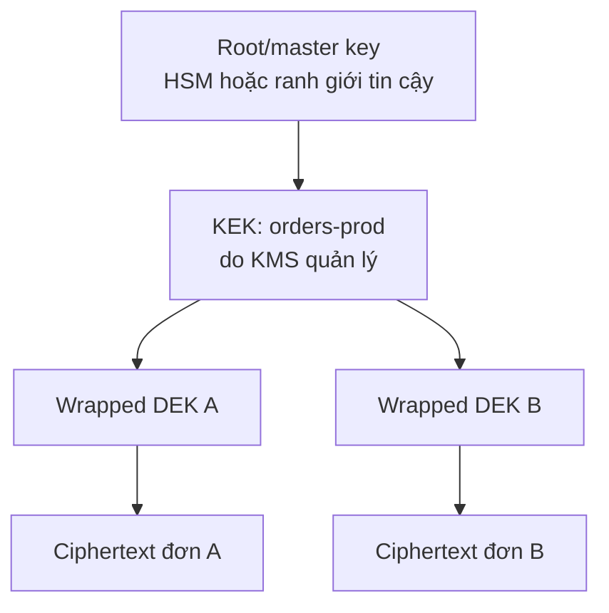

# Keying material: Vật liệu khóa mật mã và cách bảo vệ

> **Chương:** Thuật ngữ cốt lõi  
> **Bài:** Keying material  
> **Phạm vi module:** SECURITY_KEY_MANAGEMENT_FUNDAMENTALS — quản lý khóa từ tạo, cấp phát, lưu trữ, sử dụng, xoay vòng đến thu hồi và hủy; kết nối mật mã đối xứng, bất đối xứng, chữ ký số, KMS/HSM, envelope encryption, kiểm soát truy cập và kiểm toán.

## 1. Keying material là gì?

**Keying material** (vật liệu khóa mật mã) là tập hợp những giá trị, dữ liệu hoặc thông tin mật mã cần thiết để thiết lập, vận hành hoặc duy trì quan hệ sử dụng khóa trong một hệ thống. Trong nhiều ngữ cảnh, thuật ngữ này bao gồm **các khóa mật mã** và một số giá trị liên quan trực tiếp đến việc tạo, trao đổi, dẫn xuất hoặc sử dụng khóa. Phạm vi chính xác thay đổi theo tiêu chuẩn, giao thức và API.

Ví dụ: ứng dụng mã hóa một đơn hàng bằng AES-GCM sử dụng khóa AES 256 bit (**Data Encryption Key – DEK**), IV/nonce và dữ liệu liên kết AAD. Khóa AES là **vật liệu khóa bí mật**; IV/nonce là tham số bắt buộc để phép mã hóa diễn ra chính xác nhưng thông thường **không cần bí mật**; AAD là dữ liệu được xác thực, **không phải khóa**. Một KMS có thể bảo vệ DEK bằng **Key Encryption Key – KEK** và lưu thêm mã nhận diện khóa, phiên bản, chính sách.

Điều cần nhớ: **không phải mọi thứ liên quan đến khóa đều phải giữ kín, nhưng mỗi thứ phải được bảo vệ đúng thuộc tính của nó**.

### Kết quả học tập

Sau bài này, bạn có thể:

- Giải thích khác biệt giữa *key*, *keying material*, *key material*, *secret*, *public key*, *wrapped key* và *key identifier*.
- Nhận diện vật liệu khóa bí mật ở dạng rõ, vật liệu đã được bảo vệ và dữ liệu công khai trong một luồng mật mã.
- Phân biệt entropy, độ dài khóa, IV/nonce, salt, AAD, seed và đầu vào/đầu ra của KDF.
- Thiết kế cách tạo, sử dụng, xoay vòng, kiểm toán và hủy vật liệu khóa với KMS/HSM.
- Chỉ ra các rủi ro khi lưu khóa trong mã nguồn, log, database hoặc cache lâu dài.

## 2. Phân biệt những thuật ngữ dễ nhầm

| Thuật ngữ | Ý nghĩa | Có phải giữ bí mật? |
|---|---|---|
| **Cryptographic key (khóa mật mã)** | Giá trị điều khiển phép toán mã hóa, giải mã, ký, xác minh, MAC hoặc một thao tác mật mã khác. | Tùy loại: khóa đối xứng và khóa riêng phải bí mật; khóa công khai có thể phổ biến rộng rãi. |
| **Key material (vật liệu của một khóa)** | Trong nhiều tài liệu KMS, là các byte/đối tượng cấu thành khóa thực tế, phân biệt với tên, alias và cấu hình. | Tùy loại khóa; không mặc nhiên đồng nghĩa khóa bí mật. |
| **Keying material (vật liệu khóa theo nghĩa rộng)** | Khóa và dữ liệu mật mã liên quan đến việc thiết lập, dẫn xuất, trao đổi, bảo vệ và dùng khóa. | Tùy thành phần và tiêu chuẩn đang áp dụng. |
| **Secret** | Bất kỳ giá trị nào cần giữ kín: mật khẩu, token, khóa riêng, khóa đối xứng, shared secret... | Có. Nhưng không phải mọi secret đều là khóa mật mã. |
| **Plaintext key / raw key bytes** | Khóa bí mật ở dạng có thể trực tiếp sử dụng, chưa được bảo vệ bằng cơ chế wrap của tầng lưu trữ. | Có, phải kiểm soát chặt. |
| **Wrapped / encrypted key** | Vật liệu khóa được mã hóa dưới một khóa bảo vệ khác (thường là KEK). | Có thể lưu cạnh bản mã nếu cơ chế wrap an toàn, nhưng vẫn phải bảo vệ tính toàn vẹn, chính sách và metadata. |
| **Key ID / alias / key reference** | Định danh logic của khóa do KMS quản lý. | Thường không bí mật; biết ID **không đồng nghĩa** được quyền sử dụng khóa. |
| **Key metadata** | Thuật toán, mục đích, chủ sở hữu, ngày tạo, phiên bản, trạng thái, chính sách. | Thường không phải vật liệu khóa; vẫn cần bảo vệ tính toàn vẹn và quyền sửa. |

Có hai cách sử dụng từ ngữ thường gặp:

1. Trong thảo luận học thuật, *keying material* có thể là thuật ngữ rộng cho khóa và thông tin cần để thiết lập quan hệ mật mã.
2. Trong tài liệu về KMS/HSM, *key material* thường chỉ **giá trị khóa được lưu trong dịch vụ**, còn *key ID*, *alias* hoặc policy là thông tin quản lý riêng biệt.

Vì vậy, khi thiết kế API hoặc đọc tài liệu nhà cung cấp, phải hỏi: "**Key material** ở đây là byte khóa có thể xuất ra, một đối tượng khóa không cho xuất, hay chỉ là tham chiếu đến khóa?"

### Ví dụ ngắn

```text
kmsKeyId       = "orders-prod"             # tham chiếu/metadata
kekMaterial    = [khóa bí mật trong KMS]   # key material, không xuất
dekPlaintext   = [32 byte AES]             # secret keying material
dekWrapped     = [DEK đã được wrap]        # keying material đã bảo vệ
iv             = [12 byte cho AES-GCM]     # nonce/IV, thường công khai
ciphertext     = [bản mã + GCM tag]        # đầu ra mật mã
tenantId       = "tenant-42"               # metadata/AAD, không phải khóa
```

Dù một IV hay salt có thể được xem là thông tin hỗ trợ *keying* trong một tiêu chuẩn cụ thể, **không nên đối xử với chúng như khóa bí mật**. Từng trường cần quy định rõ vai trò, yêu cầu duy nhất/ngẫu nhiên, quyền truy cập và thời hạn lưu trữ.

## 3. Những loại vật liệu khóa trong thực tế

### 3.1. Khóa đối xứng

**Khóa đối xứng** dùng chung một giá trị bí mật cho những thao tác tương ứng, ví dụ AES-GCM để mã hóa/giải mã hoặc HMAC để tạo/xác minh MAC.

| Loại | Ví dụ | Vai trò |
|---|---|---|
| **DEK – Data Encryption Key** | AES-256 cho một bản ghi/file/nhóm dữ liệu | Mã hóa dữ liệu ứng dụng. |
| **KEK – Key Encryption Key** | Khóa trong KMS để wrap DEK | Bảo vệ khóa khác; không nhất thiết trực tiếp mã hóa toàn bộ dữ liệu. |
| **MAC key** | Khóa cho HMAC-SHA-256 | Xác thực tính toàn vẹn và nguồn gốc của thông điệp trong mô hình khóa chung. |
| **Session/traffic key** | Khóa phiên của giao thức truyền tải | Bảo vệ một phiên hoặc một chiều truyền dữ liệu. |
| **KDK – Key Derivation Key** | Bí mật đầu vào cho một cơ chế dẫn xuất | Tạo các khóa con cho các mục đích được phân tách. |

**AES-256** nghĩa là khóa có 256 bit = 32 byte. Độ dài 32 byte **không tự bảo đảm** 256 bit entropy: 32 byte lặp từ một chuỗi dự đoán được vẫn có thể là khóa yếu.

Một hệ thống cần ghi rõ mục đích của từng khóa. Không nên dùng cùng một bộ byte cho AES, HMAC, ký token và mã hóa backup. Nếu cần nhiều khóa liên quan, dùng KDF chuẩn với **domain separation** (giá trị ngữ cảnh khác nhau cho từng mục đích) thay vì tái sử dụng nguyên khóa.

### 3.2. Cặp khóa bất đối xứng

Mật mã bất đối xứng sử dụng cặp **public key** và **private key** có quan hệ toán học:

- **Private key (khóa riêng):** vật liệu bí mật, có thể dùng để ký số hoặc giải mã/thiết lập bí mật tùy thuật toán.
- **Public key (khóa công khai):** có thể phân phối; dùng để xác minh chữ ký hoặc thực hiện chức năng công khai tương ứng.
- **Chứng thư số (certificate):** giúp liên kết khóa công khai với một danh tính theo cơ chế tin cậy, chứ không chứa khóa riêng.

Ví dụ với chữ ký số: dịch vụ ký hóa đơn sử dụng khóa riêng nằm trong HSM/KMS để ký. Bên nhận dùng khóa công khai phù hợp để xác minh. Khóa riêng là vật liệu cần bảo mật tuyệt đối; khóa công khai không cần giữ kín nhưng phải **chống tráo đổi** và được xác thực đúng nguồn.

**Chữ ký số không mã hóa nội dung:** tài liệu có chữ ký vẫn có thể ở dạng đọc được. Cần mã hóa riêng nếu muốn bảo mật nội dung.

Không dùng một cặp khóa cho mọi chức năng: khóa dùng ký và khóa dùng trao đổi bí mật nên được chọn thuật toán, quyền và vòng đời thích hợp.

### 3.3. Shared secret và vật liệu dẫn xuất

Trong giao thức trao đổi khóa như (EC)DH, các bên sử dụng khóa riêng và khóa công khai để tính ra **shared secret**. Shared secret thường là đầu vào cho một **Key Derivation Function (KDF)**, từ đó sinh khóa phiên hoặc khóa dùng cho từng chiều truyền.

```text
Private key A + Public key B
              |
              v
          Shared secret  ------> KDF + salt + context
                                      |
                       +--------------+--------------+
                       v                             v
                  Client key                    Server key
```

Shared secret là vật liệu bí mật và cần xử lý theo vòng đời ngắn. **Chỉ có ECDH không tự xác thực danh tính bên đối diện**: giao thức phải có cơ chế chống người ở giữa, ví dụ chữ ký/chứng thư và kiểm tra khóa công khai đúng bên.

### 3.4. Seed và vật liệu gốc

Một **seed** có thể khởi tạo bộ sinh số giả ngẫu nhiên mật mã (CSPRNG/DRBG) hoặc là đầu vào cho quá trình dẫn xuất khóa. Mức độ nhạy cảm phụ thuộc khả năng từ seed tái tạo được khóa, trạng thái bộ sinh hoặc các giá trị bí mật.

- Seed có khả năng tái tạo private key/mnemonic/khóa dẫn xuất → **bí mật cực kỳ nhạy cảm**, cần bảo vệ và sao lưu có kiểm soát.
- Salt công khai dùng với KDF → **không phải seed bí mật** theo nghĩa trên, dù cũng có thể là đầu vào của hàm dẫn xuất.
- Chuỗi số ngẫu nhiên bất kỳ → chưa chắc là khóa; **vai trò trong giao thức** mới quyết định cách quản lý.

Không sử dụng timestamp, UUID ngẫu nhiên thông thường, `Math.random()` hoặc thông tin người dùng để thay thế bộ sinh khóa mật mã được thiết kế đúng.

## 4. Thành phần liên quan đến khóa: bí mật, công khai hay chỉ cần toàn vẹn?

Một số giá trị xuất hiện cùng khóa nhưng có yêu cầu bảo vệ khác nhau.

| Thành phần | Cần bí mật? | Yêu cầu quan trọng khác | Ví dụ |
|---|---|---|---|
| Khóa AES/HMAC | **Có** | Chất lượng ngẫu nhiên, đúng mục đích, thời hạn dùng. | DEK, MAC key. |
| Khóa riêng bất đối xứng | **Có** | Chống xuất khóa trái phép, kiểm soát thao tác ký/giải mã. | RSA/EC private key. |
| Shared secret/secret seed | **Có** | Không log, không tái sử dụng ngoài phạm vi, hủy khi hết hạn. | ECDH secret, root seed. |
| Khóa công khai | Không | **Tính xác thực** của khóa và liên kết danh tính. | Public key và chứng thư. |
| IV/nonce của AES-GCM | Thường không | **Không được trùng với cùng khóa**, và đúng kích thước/định dạng. | Nonce 96 bit. |
| Salt của KDF | Thường không | Phù hợp thuật toán, tính độc lập/duy nhất khi cần. | Salt của PBKDF2/Argon2id. |
| AAD/encryption context | Thường không | Toàn vẹn ngữ nghĩa, ràng buộc với đúng dữ liệu/tenant. | `tenantId`, `objectId`. |
| Key ID/alias | Thường không | Quyền sửa/đổi trỏ, tính nhất quán khi rotation. | `orders-prod`. |
| Wrapped DEK | Không nhất thiết phải bí mật như DEK rõ | Tính toàn vẹn của wrapper, thuật toán wrap, khóa gốc còn sẵn dùng. | DEK dưới KEK. |
| Ciphertext/tag | Không mặc nhiên là keying material | Bảo toàn, xác thực, chống phát lại nếu nghiệp vụ yêu cầu. | AES-GCM ciphertext/tag. |

### IV/nonce có phải bí mật?

**Không.** IV/nonce của AES-GCM thường được lưu bên cạnh bản mã. Điều phải bảo đảm là **không tái sử dụng nonce với cùng một khóa**. Nếu nonce bị dùng lại trong GCM, tính bí mật và toàn vẹn có thể bị phá vỡ nghiêm trọng.

Nonce 96 bit ngẫu nhiên được dùng phổ biến với GCM, nhưng hệ thống mã hóa với tần suất rất lớn hoặc tái sử dụng DEK lâu dài phải phân tích xác suất va chạm và giới hạn số bản mã theo khóa. Có thể cần cơ chế cấp nonce theo bộ đếm duy nhất, cấp phát tập trung hoặc sinh DEK mới thường xuyên.

### Salt có phải bí mật?

**Không.** Salt thường được lưu công khai cùng thông tin dẫn xuất. Ví dụ một mật khẩu dùng PBKDF2/Argon2id có salt riêng để hạn chế tấn công tra cứu và ngăn hai đầu vào giống nhau luôn tạo cùng đầu ra. Salt không bù đắp được cho mật khẩu yếu hoặc KDF có chi phí quá thấp.

### AAD/encryption context có phải khóa không?

**Không.** AAD (*Additional Authenticated Data*) được ràng buộc vào bản mã của AEAD và được kiểm tra toàn vẹn nhưng không được mã hóa. Một số KMS cung cấp **encryption context** giúp ràng buộc lời gọi KMS với các cặp thông tin không bí mật.

Không đưa mật khẩu, token, dữ liệu cá nhân hoặc DEK rõ vào encryption context: dữ liệu này có thể xuất hiện trong log hoặc metadata. Cũng không để tenant ID trong bản ghi tự quyết định quyền truy cập; phân quyền nghiệp vụ phải được kiểm tra từ danh tính đã xác thực.

## 5. Vật liệu khóa được tạo và dẫn xuất như thế nào?

### 5.1. Sinh khóa mới bằng nguồn ngẫu nhiên an toàn

Một khóa đối xứng mới nên đến từ nguồn số ngẫu nhiên có chất lượng mật mã. Với Java, dùng `KeyGenerator` và cơ chế cung cấp của JVM/thiết bị cho thuật toán được hỗ trợ; với KEK cấp cao, ưu tiên KMS/HSM theo chính sách.

```java
import javax.crypto.KeyGenerator;
import javax.crypto.SecretKey;

KeyGenerator generator = KeyGenerator.getInstance("AES");
generator.init(256);
SecretKey dek = generator.generateKey(); // khóa AES 256 bit
```

Lưu ý:

- `SecretKey` là đối tượng biểu diễn khóa; khả năng trích xuất byte qua `getEncoded()` **phụ thuộc vào provider và loại khóa**.
- Khóa không cho xuất trong KMS/HSM có thể chỉ được truy cập qua **handle/ID** và API thực hiện phép toán.
- **Độ dài khóa khác entropy thực tế**: khóa 256 bit nhưng được suy ra từ một mật khẩu ngắn có thể yếu hơn nhiều so với khóa được tạo bằng CSPRNG.

Không tự tạo khóa bằng cách chuyển chuỗi mật khẩu thành UTF-8 rồi dùng trực tiếp làm byte AES; cũng không mặc định `SHA-256(password)` là cơ chế dẫn xuất phù hợp.

### 5.2. Dẫn xuất khóa từ bí mật có entropy cao: HKDF

**HKDF** (HMAC-based Key Derivation Function) là một KDF chuẩn để trích xuất và mở rộng vật liệu khóa từ đầu vào có entropy phù hợp, chẳng hạn một shared secret của giao thức trao đổi khóa.

Mô hình khái niệm:

```text
IKM (Input Keying Material) + salt
                 |
          HKDF-Extract
                 |
                PRK
                 |
        HKDF-Expand(info, L)
                 |
          Các khóa dẫn xuất
```

- **IKM:** vật liệu khóa đầu vào; phải có mức bí mật/entropy thích hợp đối với mục tiêu sử dụng.
- **Salt:** giá trị công khai để hỗ trợ bước trích xuất theo đặc tả HKDF; không phải mật khẩu và không cần giấu.
- **PRK:** *Pseudorandom Key* trung gian, **cần bảo vệ** như vật liệu khóa bí mật.
- **Info:** ngữ cảnh dẫn xuất, ví dụ `orders/encryption/v1` hoặc `orders/mac/v1`, giúp phân tách mục đích (*domain separation*).
- **L:** độ dài khóa đầu ra, phụ thuộc thuật toán dự kiến.

Ví dụ tạo hai khóa riêng mục đích:

```text
k_enc = HKDF(ikm, salt, info="orders/aes-gcm/v1", L=32)
k_mac = HKDF(ikm, salt, info="orders/hmac/v1",    L=32)
```

Hai khóa được dẫn xuất với `info` khác nhau **không nên được dùng thay thế nhau**. Ví dụ trên là ký pháp khái niệm; triển khai thực tế cần tuân thủ RFC 5869 hoặc API KDF tiêu chuẩn.

**HKDF không biến mật khẩu yếu thành vật liệu có entropy cao.** Nếu đầu vào là mật khẩu do người dùng nhớ, cần dùng cơ chế xử lý mật khẩu thích hợp.

### 5.3. Từ mật khẩu đến khóa: không nhầm với HKDF

Mật khẩu thường có entropy thấp và dễ bị đoán ngoại tuyến. Nếu cần tạo khóa mã hóa từ một mật khẩu, chọn **password-based KDF** phù hợp như Argon2id, scrypt hoặc PBKDF2 với tham số được cập nhật theo môi trường, chính sách và ràng buộc tương thích. Sử dụng salt ngẫu nhiên riêng cho từng trường hợp; cân nhắc chi phí CPU/bộ nhớ và bảo vệ khả năng phục hồi.

Tách hai mục tiêu khác nhau:

- **Lưu mật khẩu để đăng nhập:** dùng cơ chế băm mật khẩu có salt và chi phí thích hợp; ứng dụng không cần giải mã mật khẩu gốc.
- **Dùng mật khẩu để mở khóa dữ liệu:** KDF tạo khóa mã hóa, nhưng nếu quên mật khẩu và không có cơ chế phục hồi được thiết kế, dữ liệu có thể không thể giải mã. Đánh giá chống đoán mật khẩu ngoại tuyến đặc biệt quan trọng.

Với hệ thống backend tự động, thường tốt hơn nếu khóa dữ liệu đến từ KMS/CSPRNG và ứng dụng được cấp quyền qua danh tính workload, thay vì gắn bảo mật dữ liệu vào một mật khẩu do con người đặt.

### 5.4. Tạo bí mật qua thỏa thuận khóa

Giao thức bắt tay có thể sử dụng khóa bất đối xứng tạm thời để tạo shared secret, rồi dẫn xuất các traffic key độc lập. Những thông số như public ephemeral key có thể truyền công khai; private ephemeral key và shared secret phải giữ kín và loại bỏ khi không cần nữa.

**Forward secrecy** có thể đạt được nếu giao thức dùng trao đổi khóa tạm thời đúng cách và không giữ những bí mật phiên cho phép khôi phục quá khứ. Việc chỉ có một cặp RSA/EC lâu dài hoặc chỉ "dùng TLS" không đủ để tự suy ra thuộc tính này; phụ thuộc phiên bản/cấu hình và quá trình bắt tay thực tế.

## 6. Key hierarchy: vì sao thường có nhiều tầng khóa?

Hệ thống nghiêm túc thường không lấy một khóa gốc rồi dùng để mã hóa tất cả bản ghi. Thay vào đó, chúng tổ chức các tầng khóa theo trách nhiệm và phạm vi.



- **Root/master key:** phần tử cấp cao; có thể do HSM giữ, dùng bảo vệ hoặc thiết lập các khóa cấp thấp hơn theo kiến trúc. Nhà cung cấp KMS có thể thiết kế tầng gốc khác nhau.
- **KEK:** khóa dùng wrap/unwrap DEK theo chính sách KMS.
- **DEK:** khóa mã hóa nội dung của một đối tượng hoặc phạm vi dữ liệu nhỏ.
- **Wrapped DEK:** bản DEK được bảo vệ bằng KEK và có thể lưu bên cạnh ciphertext.

Lợi ích là phân tách quyền và giới hạn phạm vi lộ khóa. Nếu lộ một DEK, dữ liệu do DEK đó bảo vệ chịu rủi ro; nếu lộ quyền sử dụng một KEK có thể mở hàng triệu DEK, phạm vi ảnh hưởng rộng hơn nhiều. Cần quản lý quyền KMS theo mức rủi ro tương ứng.

**Lưu ý:** cây trên là ví dụ logic; không khẳng định mọi KMS đều có cùng cấu trúc nội bộ hay cho phép xuất vật liệu khóa gốc.

## 7. Keying material trong envelope encryption

**Envelope encryption** mã hóa nội dung bằng DEK đối xứng và bảo vệ DEK bằng KEK do KMS quản lý. KMS có thể tạo DEK và trả về bản rõ/bản đã wrap qua một API chuyên biệt, hoặc hỗ trợ một cơ chế unwrap tương đương. Dữ liệu lớn được mã hóa tại ứng dụng, tránh gửi toàn bộ plaintext lên KMS.

### 7.1. Khi ghi dữ liệu

```mermaid
sequenceDiagram
    participant App as Orders API
    participant KMS
    participant Store as Storage
    App->>KMS: Xin tạo DEK với KEK + context
    KMS-->>App: DEK dạng rõ + wrapped DEK
    Note over App: Sinh nonce mới; AES-GCM với AAD
    App->>Store: Lưu ciphertext, nonce, tag, wrapped DEK, metadata
    Note over App: Hạn chế tối đa thời gian giữ DEK rõ
```

**Những gì xuất hiện ở mỗi nơi:**

| Nơi | Vật liệu hiện diện | Yêu cầu |
|---|---|---|
| KMS/HSM | KEK, quyền, chính sách, trạng thái khóa | Không xuất KEK khi mô hình không cho phép; kiểm soát IAM và audit. |
| Bộ nhớ ứng dụng | DEK rõ, plaintext đang xử lý, nonce, AAD | Chỉ giữ trong thời gian cần thiết; hạn chế dump/log/cache. |
| Database/object storage | Ciphertext, tag, nonce, wrapped DEK, ID/phiên bản khóa | Bảo đảm độ bền, tính toàn vẹn metadata và khả năng khôi phục. |
| Audit log | Principal, hành động, ID khóa, thời gian, kết quả | Không log raw DEK, plaintext hoặc secret context. |

### 7.2. Khi đọc dữ liệu

1. Ứng dụng xác thực người dùng và **kiểm tra quyền xem bản ghi** ở tầng nghiệp vụ.
2. Ứng dụng đọc ciphertext, nonce, wrapped DEK, định danh khóa và metadata cần thiết.
3. Ứng dụng gọi KMS để unwrap DEK theo danh tính workload được cấp quyền và đúng ngữ cảnh.
4. KMS kiểm tra chính sách rồi trả DEK rõ (nếu API/mô hình cho phép).
5. Ứng dụng dùng DEK, nonce, AAD để giải mã AES-GCM; chỉ chấp nhận plaintext nếu tag xác thực hợp lệ.
6. Ứng dụng giảm thời gian tồn tại của DEK và plaintext trong bộ nhớ, không ghi chúng vào log.

Trong luồng này, một **key reference** có thể công khai nhưng **không có quyền gọi `Decrypt` thì không thể dùng nó để lấy DEK rõ**. Ngược lại, kẻ tấn công chiếm được danh tính workload có quyền `Decrypt` có thể lạm dụng API dù KEK không hề rời KMS.

### 7.3. Định dạng lưu trữ minh họa

```json
{
  "formatVersion": 1,
  "algorithm": "AES-256-GCM",
  "kmsKeyId": "orders-prod",
  "wrappedDek": "<base64-wrapped-dek>",
  "nonce": "<base64-12-byte-nonce>",
  "ciphertextAndTag": "<base64-encrypted-payload>",
  "tenantId": "tenant-42",
  "objectId": "order-1001"
}
```

Đây là cấu trúc minh họa, không phải bản mã hợp lệ. `wrappedDek` khác hoàn toàn với `dekPlaintext`. Lưu định danh khóa và metadata giúp hệ thống giải mã dữ liệu cũ sau rotation; cần ràng buộc các trường nhận dạng với AAD hoặc cơ chế xác thực phù hợp để chống tráo dữ liệu giữa các tenant.

## 8. Java: ví dụ nhận diện và dùng keying material

Ví dụ Java 17 dưới đây minh họa cách tạo DEK AES-256 ngẫu nhiên, sinh nonce riêng, dùng AAD và AES-GCM. Chương trình **chỉ minh họa một lần mã hóa/giải mã trong cùng tiến trình**; chưa có KMS, wrap DEK, lưu trữ hoặc authorization.

```java
import java.nio.charset.StandardCharsets;
import java.security.SecureRandom;
import java.util.Arrays;
import java.util.Base64;

import javax.crypto.Cipher;
import javax.crypto.KeyGenerator;
import javax.crypto.SecretKey;
import javax.crypto.spec.GCMParameterSpec;

public class KeyingMaterialDemo {
    public static void main(String[] args) throws Exception {
        KeyGenerator keyGenerator = KeyGenerator.getInstance("AES");
        keyGenerator.init(256);
        SecretKey dek = keyGenerator.generateKey(); // keying material bí mật

        byte[] nonce = new byte[12]; // AES-GCM: thường dùng nonce 96 bit
        new SecureRandom().nextBytes(nonce); // không lặp với cùng DEK

        byte[] aad = "tenant=42;object=order-1001"
                .getBytes(StandardCharsets.UTF_8); // công khai nhưng được xác thực
        byte[] plaintext = "Dia chi giao hang"
                .getBytes(StandardCharsets.UTF_8);

        Cipher encoder = Cipher.getInstance("AES/GCM/NoPadding");
        encoder.init(
                Cipher.ENCRYPT_MODE,
                dek,
                new GCMParameterSpec(128, nonce)
        );
        encoder.updateAAD(aad);
        byte[] ciphertextAndTag = encoder.doFinal(plaintext);

        // Chỉ minh họa nonce và ciphertext có thể lưu/chuyển đi.
        System.out.println("nonce = "
                + Base64.getEncoder().encodeToString(nonce));
        System.out.println("ciphertextAndTag = "
                + Base64.getEncoder().encodeToString(ciphertextAndTag));

        Cipher decoder = Cipher.getInstance("AES/GCM/NoPadding");
        decoder.init(
                Cipher.DECRYPT_MODE,
                dek,
                new GCMParameterSpec(128, nonce)
        );
        decoder.updateAAD(aad);
        byte[] recovered = decoder.doFinal(ciphertextAndTag);
        System.out.println("Verified = "
                + Arrays.equals(plaintext, recovered));

        Arrays.fill(plaintext, (byte) 0);
        Arrays.fill(recovered, (byte) 0);
    }
}
```

### Giải thích những gì là keying material

- `dek`: **khóa AES thực sự**; phải giữ kín. Đối tượng `SecretKey` có thể giữ dữ liệu bí mật bên trong provider/JVM.
- `nonce`: tham số dùng cho AES-GCM; được công bố cùng ciphertext nhưng **không được dùng trùng với cùng DEK**. Trong chương trình này chỉ mã hóa một lần với DEK.
- `aad`: ngữ cảnh xác thực, ở đây liên kết với tenant và object; không được mã hóa.
- `ciphertextAndTag`: dữ liệu đã mã hóa và tag xác thực do Java AES-GCM trả về; không chứa DEK rõ.
- `getEncoded()`: nếu dùng với khóa xuất được, có thể trả byte bí mật; **không in, ghi log hoặc lưu tùy tiện**.
- `Arrays.fill`: giảm thời gian tồn tại của một số mảng dữ liệu rõ, **không bảo đảm xóa mọi bản sao trong heap, provider, log hoặc dump**; JVM không cung cấp cam kết zeroization tuyệt đối.

Nếu muốn lưu/đọc sau khi tiến trình kết thúc, phải có cơ chế bảo vệ DEK, ví dụ wrapped DEK từ KMS. Nếu tạo DEK mới ở mỗi lần chạy như ví dụ mà không lưu khóa an toàn, ciphertext cũ sẽ không thể giải mã.

### Không làm những điều sau

```java
// Sai: nguồn sinh khóa không an toàn và thời gian dự đoán được.
String key = Long.toString(System.currentTimeMillis());

// Sai: đưa byte bí mật vào log (nếu provider cho xuất).
// System.out.println(Arrays.toString(dek.getEncoded()));

// Sai: dùng lại cùng nonce và cùng DEK cho nhiều bản mã AES-GCM.
// encrypt(dek, sameNonce, messageA);
// encrypt(dek, sameNonce, messageB);
```

Trong ứng dụng thật, KMS/HSM sẽ thực hiện phần quản trị khóa gốc, còn Java chỉ dùng vật liệu được cấp theo đúng quyền và phạm vi. Thư viện/provider mật mã vẫn phải được cấu hình đúng cách.

## 9. Trạng thái và vòng đời của keying material

Để hiểu vì sao "quản lý khóa" không chỉ là "lưu khóa", hãy theo dõi một DEK/KEK qua những trạng thái quan trọng:

| Giai đoạn | Vật liệu khóa xuất hiện ở đâu? | Kiểm soát |
|---|---|---|
| **Tạo (generation)** | CSPRNG/KMS/HSM hoặc provider được phê duyệt | Entropy, thuật toán, độ dài, mục đích và chủ sở hữu. |
| **Cấp phát (provisioning)** | API KMS, kênh phân phối được xác thực | Danh tính workload, TLS/transport, quyền cấp hạn chế. |
| **Lưu trữ (storage)** | KMS/HSM, key store, wrapped DEK | Mã hóa, bảo vệ vùng lưu, quyền, tính toàn vẹn và backup. |
| **Sử dụng (use)** | HSM hoặc bộ nhớ tiến trình | Chỉ thao tác được phép; tránh copy, log, dump, cache lâu. |
| **Xoay vòng (rotation)** | Phiên bản khóa cũ và mới có thể cùng tồn tại | Đúng phiên bản khi decrypt; rewrap/re-encrypt theo kế hoạch. |
| **Vô hiệu hóa/thu hồi (disable/revoke)** | Vật liệu có thể vẫn tồn tại nhưng quyền dùng bị chặn | Rà soát cache DEK, phiên còn hoạt động và bản sao được cấp trước đó. |
| **Hủy (destroy)** | Xóa vật liệu theo cơ chế được xác nhận | Không thể khôi phục trái phép, đối chiếu backup và dữ liệu còn cần đọc. |

### 9.1. "Xoay vòng KEK" có xoay vòng DEK không?

**Không tự động.** Giả sử DEK-A mã hóa một file, còn KEK-v1 wrap DEK-A.

```text
Trước rotation:
File ciphertext = AES-GCM(DEK-A, file)
Wrapped DEK-A  = Wrap(KEK-v1, DEK-A)

Sau khi đổi sang KEK-v2 và rewrap:
File ciphertext = vẫn như cũ
Wrapped DEK-A  = Wrap(KEK-v2, DEK-A)

Nếu DEK-A đã bị lộ:
Cần sinh DEK-B, mã hóa lại file với DEK-B và nonce mới.
```

Rewrap chỉ thay đổi **lớp bảo vệ DEK**, không thay thế DEK hoặc bản mã dữ liệu. Nếu DEK cũ đã bị lộ, cần **mã hóa lại dữ liệu** sau khi có DEK mới. Nếu KEK cũ bị xóa trước khi rewrap hoặc trước khi KMS có thể dùng phiên bản cũ để giải mã, dữ liệu có thể mất khả năng phục hồi.

### 9.2. Thu hồi quyền và xóa khóa khác nhau

- **Revoke access:** từ chối các thao tác KMS mới đối với một danh tính; không lấy lại được DEK rõ đã được cấp trước đó.
- **Disable key:** khiến dịch vụ ngừng chấp nhận thao tác theo trạng thái khóa; DEK còn trong bộ nhớ ứng dụng có thể vẫn dùng được.
- **Destroy key:** hủy vật liệu khóa theo quy trình; nếu không còn bản sao phục hồi thì dữ liệu phụ thuộc có thể không đọc được nữa.
- **Cryptographic erasure:** chỉ có tác dụng khi **mọi bản sao của vật liệu cần giải mã** thực sự không còn khả dụng. Xóa key ID hoặc đổi alias không đủ.

Trước khi hủy, phải rà dữ liệu đang giữ, các bản backup, hệ thống DR, khóa nhập từ ngoài (BYOK) và nghĩa vụ lưu giữ.

## 10. KMS và HSM bảo vệ keying material ở những tầng nào?

### KMS – hệ thống quản lý khóa

KMS thường cung cấp API cho tạo/khai báo khóa, sử dụng khóa, sinh DEK, wrap/unwrap, chính sách, trạng thái, rotation và audit. Tên API và loại khóa được hỗ trợ khác nhau giữa các nền tảng. Một số API trả về plaintext DEK có chủ đích; API đó cần quyền rất nhạy cảm, dù KEK vẫn ở trong KMS.

### HSM – mô-đun bảo mật phần cứng

HSM bảo vệ và thực hiện thao tác với các khóa trong ranh giới an toàn của thiết bị theo khả năng/cấu hình cụ thể. Một khóa riêng dành cho ký có thể là **non-exportable**: ứng dụng chỉ gửi thông điệp/digest phù hợp và nhận chữ ký, không lấy raw private key. KMS có thể dựa vào HSM để bảo vệ khóa gốc.

### Secrets manager và PKI

- **Secrets manager** thích hợp quản lý mật khẩu ứng dụng, API token, chuỗi kết nối và đôi khi khóa nhạy cảm. Tuy nhiên, không mặc nhiên thay thế chức năng quản lý vòng đời vật liệu mật mã của KMS/HSM.
- **PKI/CA** quản lý chứng thư và quan hệ tin cậy của khóa công khai. Chứng thư số là metadata/đối tượng công khai, còn khóa riêng tương ứng phải được bảo vệ trong KMS/HSM hoặc vùng tin cậy phù hợp.

**Phân biệt "cất khóa" với "được phép dùng khóa":** một dịch vụ không có raw KEK nhưng vẫn có quyền gọi KMS `Decrypt` trên mọi DEK có thể gây sự cố nghiêm trọng. Phân quyền sử dụng chính là một phần của bảo vệ vật liệu khóa.

## 11. Kiểm soát truy cập và kiểm toán keying material

### 11.1. Quyền tối thiểu cho từng vai trò

| Vai trò | Quyền cần thiết | Không nên mặc định cấp |
|---|---|---|
| Dịch vụ ghi đơn hàng | Sinh DEK/mã hóa dưới KEK của đơn hàng | Sửa policy, xóa khóa, decrypt dữ liệu miền khác. |
| Dịch vụ đọc đơn hàng | Unwrap/decrypt DEK trong phạm vi đơn được phép | Quyền quản trị khóa và quyền đọc mọi tenant. |
| Người quản trị khóa | Tạo, điều chỉnh chính sách, rotate theo quy trình | Quyền đọc plaintext nghiệp vụ nếu không cần. |
| Người kiểm toán | Xem metadata, policy, audit log | Quyền decrypt, xuất khóa hoặc sửa log. |
| Tài khoản ứng cứu khẩn cấp | Quyền có hạn, được phê duyệt và theo dõi | Quyền lâu dài không kiểm soát. |

Cơ chế phân quyền có thể gồm IAM role, resource policy, grant, điều kiện theo encryption context, môi trường và khu vực triển khai. **Kiểm tra tenant tại tầng ứng dụng vẫn là bắt buộc**, ngay cả khi KMS cũng hỗ trợ ràng buộc ngữ cảnh.

### 11.2. Audit nhưng không làm lộ keying material

Nên ghi nhận `who`, `when`, `keyId`, `operation`, kết quả, môi trường và request/correlation ID. Ví dụ đáng giám sát:

- Nhiều lệnh `Decrypt` từ workload lạ hoặc ngoài giờ bình thường.
- Thay đổi policy/grant bất ngờ.
- Khóa bị disable hoặc lên lịch xóa.
- Thất bại liên tiếp vì sai ngữ cảnh hoặc quyền.
- Lượng `GenerateDataKey` hoặc `Sign` tăng đột biến.

**Không ghi DEK rõ, private key, shared secret, seed, token, plaintext hoặc dữ liệu nhạy cảm chứa trong encryption context**. Audit log phải có chính sách bảo vệ trước sửa/xóa trái phép và chính sách lưu giữ.

## 12. Những lỗi điển hình khi quản lý keying material

| Sai lầm | Hệ quả | Cách tránh |
|---|---|---|
| Commit raw DEK/private key vào Git hoặc image container. | Lộ khóa lâu dài, khó xác định mọi bản sao. | KMS/HSM, identity runtime, rotate nếu đã lộ. |
| Nghĩ Base64 là mã hóa. | Byte khóa được khôi phục dễ dàng. | Base64 chỉ là biểu diễn; dùng wrap/encryption thật. |
| Dẫn xuất AES key bằng `SHA-256(password)` tùy tiện. | Dễ bị tấn công đoán mật khẩu ngoại tuyến. | Password KDF phù hợp, salt và tham số có chi phí thích hợp. |
| Tái sử dụng AES-GCM nonce với cùng DEK. | Có thể phá vỡ bảo mật và tính toàn vẹn. | Quy tắc nonce duy nhất và giới hạn phạm vi dùng DEK. |
| Cho mọi ứng dụng quyền `Decrypt` mọi KEK. | Một danh tính bị chiếm quyền ảnh hưởng nhiều miền dữ liệu. | Least privilege và phân tách môi trường/dữ liệu. |
| Cho rằng public key phải giữ bí mật, nhưng không xác thực nguồn. | Tập trung sai thuộc tính; dễ bị tráo khóa công khai. | Bảo vệ tính xác thực và chuỗi tin cậy của public key. |
| Lưu wrapped DEK nhưng làm mất key ID/phiên bản. | Khó chọn đúng KEK/phiên bản để giải mã dữ liệu cũ. | Định dạng bản mã có metadata nhất quán và xác thực. |
| Xóa KEK cũ ngay khi rotate alias. | Dữ liệu cũ không được unwrap. | Rewrap theo lộ trình, kiểm thử trước khi hủy. |
| Disable KEK rồi tin rằng không ai đọc được dữ liệu cũ. | DEK rõ có thể vẫn ở cache/memory. | Quản lý cache, TTL, revoke session và kiểm soát runtime. |
| Sao lưu ciphertext mà không bảo đảm đường khôi phục khóa. | Backup tồn tại nhưng không giải mã được. | Khôi phục end-to-end có cả khóa/phiên bản và quyền. |
| Log mọi tham số debug, kể cả byte khóa. | Bản log trở thành nguồn rò rỉ dữ liệu. | Redact, phân quyền log và audit metadata tối thiểu. |

## 13. Ví dụ phân loại vật liệu trong một hệ thống ký và mã hóa

Một nền tảng phát hành hóa đơn điện tử thực hiện hai chức năng:

1. Mã hóa địa chỉ/số điện thoại khách hàng bằng AES-GCM và envelope encryption.
2. Ký tài liệu bằng khóa riêng của tổ chức nằm trong HSM.

Bảng phân loại:

| Giá trị | Vai trò | Hệ thống giữ | Chính sách |
|---|---|---|---|
| KEK `invoice-prod` | Khóa bảo vệ DEK | KMS | Chỉ role được cấp quyền wrap/unwrap. |
| DEK của hóa đơn #123 | Khóa AES riêng cho bản ghi | RAM ứng dụng khi xử lý, wrapped DEK trong DB | Không log, giảm thời gian ở dạng rõ. |
| AES-GCM nonce | Tham số mã hóa | Database cạnh ciphertext | Không trùng với cùng DEK. |
| Wrapped DEK | DEK đã bảo vệ | Database | Gắn đúng key ID/metadata và kiểm soát toàn vẹn. |
| HSM signing private key | Khóa riêng ký hóa đơn | HSM | Không xuất; chỉ dịch vụ ký được gọi `Sign`. |
| Public signing key/certificate | Xác minh chữ ký | Người nhận và kho công khai | Xác thực nguồn/chứng thư, theo dõi hạn và thu hồi. |
| Hash/digest tài liệu | Dữ liệu đầu vào/phụ trợ của chữ ký | Dịch vụ ký | Thuật toán phù hợp; đảm bảo chính xác nội dung được ký. |
| IAM role và KMS key ID | Danh tính/quyền và tham chiếu | Hạ tầng/ứng dụng | Quyền tối thiểu; tránh sửa policy trái phép. |

Nếu database bị lộ nhưng quyền KMS/HSM và bản rõ vẫn an toàn, người tấn công không tự động có DEK hoặc signing private key. Nếu máy chủ ký bị chiếm quyền, kẻ tấn công có thể yêu cầu **ký hợp lệ** trong phạm vi role được cấp; HSM không tự đánh giá nội dung kinh doanh có được ký hay không. Do đó cần xác thực nghiệp vụ, giới hạn tác vụ, giám sát ký bất thường và cơ chế phê duyệt khi rủi ro cao.

## 14. Checklist thiết kế và câu hỏi tự kiểm tra

### Checklist trước production

- [ ] Liệt kê từng loại keying material và phân loại: bí mật ở dạng rõ, đã wrap/bảo vệ, công khai, hay metadata.
- [ ] Xác định mục đích/thuật toán/độ dài/nguồn entropy của từng khóa.
- [ ] Không sử dụng chung cùng vật liệu khóa cho các mục đích khác nhau.
- [ ] Sinh nonce/IV đúng đặc tả thuật toán và bảo đảm tính duy nhất nếu cần.
- [ ] Sử dụng KDF phù hợp: HKDF cho nguồn bí mật có entropy thích hợp; password KDF cho mật khẩu.
- [ ] Lưu vật liệu bí mật ở KMS/HSM hoặc dưới cơ chế bảo vệ được kiểm chứng, hạn chế xuất khóa.
- [ ] Xác định quyền theo workload, khóa, thao tác, môi trường; kiểm tra cả authorization nghiệp vụ.
- [ ] Thiết kế envelope encryption có wrapped DEK, key ID, thuật toán, IV và tag.
- [ ] Có phương án rotation, rewrap/re-encrypt, disable/revoke và xử lý cache.
- [ ] Kiểm toán thao tác với khóa nhưng không log raw keying material bí mật.
- [ ] Kiểm thử backup/DR có khả năng giải mã dữ liệu cũ bằng đúng phiên bản khóa.
- [ ] Có quy trình ứng cứu khi lộ DEK, lộ danh tính decrypt hoặc sử dụng khóa ký trái phép.

### Tự kiểm tra

**Câu 1.** Database chứa `ciphertext`, `nonce`, `wrappedDek` và `kmsKeyId`. Vì sao vẫn có thể an toàn khi database bị đọc trái phép?

**Gợi ý:** vì chưa có **DEK dạng rõ** hoặc quyền unwrap qua KMS; nhưng còn phụ thuộc thuật toán, policy, tính toàn vẹn metadata và bảo vệ hệ thống xử lý bản rõ.

**Câu 2.** Tại sao một public key không cần giữ kín nhưng vẫn phải quản lý chặt?

**Gợi ý:** cần xác thực khóa thuộc đúng chủ thể; khóa công khai giả có thể khiến xác minh chữ ký/mã hóa hoặc trao đổi khóa bị chuyển sang đối tượng tấn công.

**Câu 3.** Đã rotate KEK thành công, có cần re-encrypt toàn bộ file bằng DEK mới không?

**Gợi ý:** không mặc nhiên; nếu DEK còn an toàn, có thể chỉ cần **rewrap DEK** và giữ bản mã. Nếu DEK bị lộ thì cần mã hóa lại dữ liệu dưới DEK mới.

**Câu 4.** Salt, nonce và AAD đều có thể công khai; chúng có thể dùng thay thế nhau không?

**Gợi ý:** không. Salt hỗ trợ KDF, nonce đáp ứng yêu cầu riêng của phép mã hóa, AAD là ngữ cảnh được xác thực. Mỗi giá trị có quy tắc và mục đích khác nhau.

## 15. Ghi nhớ

**Keying material** là khái niệm trung tâm giúp hiểu cái gì thật sự phải bảo vệ trong hệ thống mật mã: raw secret key, private key, seed và shared secret cần bí mật; wrapped DEK cần gắn với đúng cơ chế bảo vệ; public key cần xác thực nguồn; nonce/IV/salt/AAD có yêu cầu kỹ thuật riêng và thường không cần bí mật.

Thiết kế KMS/HSM an toàn bắt đầu từ **phân loại chính xác vật liệu**, rồi gắn từng loại với quyền sử dụng, phạm vi, nơi lưu, thời hạn, rotation, kiểm toán và khả năng khôi phục. Mã hóa mạnh chỉ có ý nghĩa khi vật liệu khóa được tạo và quản lý đúng cách trong suốt vòng đời.

### Tài liệu tham khảo chuyên môn

- **NIST SP 800-57 Part 1**, *Recommendation for Key Management*: vai trò, vòng đời và bảo vệ khóa.
- **NIST SP 800-133 Rev. 2**, *Recommendation for Cryptographic Key Generation*: nguyên tắc tạo khóa mật mã.
- **NIST SP 800-56C Rev. 2**, *Recommendation for Key-Derivation Methods in Key-Establishment Schemes*: dẫn xuất khóa trong cơ chế thiết lập khóa.
- **NIST SP 800-38D**, *Recommendation for Block Cipher Modes of Operation: Galois/Counter Mode (GCM) and GMAC*: IV, tính duy nhất và xác thực GCM.
- **RFC 5869**, *HMAC-based Extract-and-Expand Key Derivation Function (HKDF)*: IKM, salt, PRK và info.
- **OWASP Key Management Cheat Sheet**: các nguyên tắc quản lý và bảo vệ khóa trong ứng dụng.
