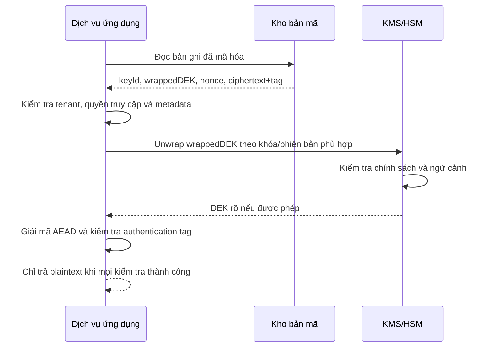
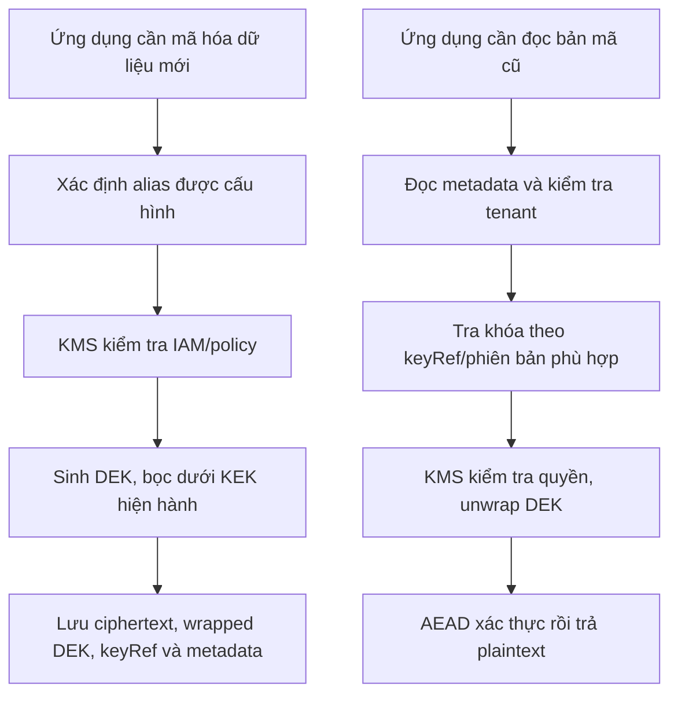

# Key identifier (định danh khóa)

Trong chương **Thuật ngữ cốt lõi** của module **SECURITY_KEY_MANAGEMENT_FUNDAMENTALS**, *key identifier* (thường viết tắt là **key ID**, đôi khi là **`kid`**) là một giá trị dùng để **nhận diện và tham chiếu một khóa mật mã** trong phạm vi mà hệ thống quản lý khóa quy định. Định danh giúp ứng dụng tìm đúng khóa để mã hóa, giải mã, ký, xác minh chữ ký, xoay vòng và kiểm toán. Nó kết nối hoạt động mật mã đối xứng, bất đối xứng với KMS/HSM, envelope encryption và kiểm soát truy cập.

Điểm nền tảng: **key ID không phải khóa, không chứa quyền sử dụng khóa và tự nó không chứng minh một khóa đáng tin cậy**. Biết `keyId` không có nghĩa được phép giải mã; với chữ ký số, biết `kid` cũng không chứng minh chữ ký hoặc người phát hành là hợp lệ.

## 1. Mục tiêu học tập

Sau bài này, bạn có thể:

- Giải thích key ID là gì, phân biệt nó với **key material**, **alias**, **key version**, **key handle** và **key fingerprint**.
- Xác định vai trò của key ID trong **KMS/HSM**, mã hóa dữ liệu với DEK/KEK và **JWT/JWS/JWKS** dùng chữ ký số.
- Thiết kế cách lưu và tra cứu định danh khóa để dữ liệu vẫn đọc/xác minh được sau khi xoay vòng.
- Nhận diện các lỗi bảo mật như dùng `kid` không kiểm soát để tra khóa, nhầm không gian định danh giữa các tenant hoặc tin tưởng khóa công khai chưa được xác thực.

## 2. Key identifier thực chất là gì?

Xét một khóa dùng để mã hóa hồ sơ của ứng dụng thanh toán. Một hệ thống có thể gọi khóa ấy bằng định danh minh họa:

```text
keyId = "payments-prod-records-01"
```

Chuỗi trên chỉ là **nhãn nhận diện** trong một vùng quản lý đã xác định. Nó không phải bản thân 256 bit của khóa AES và không đủ để suy ra khóa AES đó. Kho bí mật, KMS hoặc HSM ánh xạ định danh tới đối tượng khóa và áp dụng quyền riêng cho từng hành động.

Nói chính xác hơn, một key ID có ý nghĩa trong **phạm vi định danh** (*namespace*) cụ thể:

```text
(provider/account, region/cluster, environment, tenant, keyId)
                                -> đối tượng khóa được quản lý
```

Các thành phần của phạm vi là ví dụ kiến trúc; từng sản phẩm có cách định danh và tính duy nhất khác nhau. Một tên như `signing-key` có thể xuất hiện ở cả môi trường test và production, thậm chí ở hai tenant, nhưng **không được** vì thế mà trỏ nhầm tới cùng một khóa.

Định danh có thể là chuỗi UUID, URI, tên logic, mã do KMS cấp hoặc thuộc tính của một khóa công khai. Không tồn tại một định dạng key ID phổ quát bắt buộc cho mọi giao thức.

### Key ID không bảo đảm điều gì?

| Điều key ID giúp làm | Điều key ID **không** tự bảo đảm |
| --- | --- |
| Chọn một khóa/đối tượng khóa phù hợp trong tập được phép tra cứu. | Chứng minh người gọi có quyền dùng khóa. |
| Liên kết ciphertext hoặc chữ ký với thông tin khóa liên quan. | Chứng minh dữ liệu chưa bị sửa; điều này cần AEAD/MAC hoặc chữ ký hợp lệ. |
| Hỗ trợ định tuyến tới phiên bản hoặc nhóm khóa lịch sử. | Chứng minh khóa được tạo an toàn hoặc chưa bị lộ. |
| Gắn log kiểm toán, sự kiện xoay vòng và lịch sử sử dụng. | Chứng minh một khóa công khai thuộc về một người phát hành cụ thể. |

Vì vậy, key ID thường **không cần bí mật**, nhưng vẫn có thể làm lộ metadata như tên dự án, môi trường, tenant hoặc cấu trúc hệ thống. Nên tránh đưa dữ liệu nhạy cảm vào tên khóa.

## 3. Phân biệt các thuật ngữ gần nhau

| Thuật ngữ | Ý nghĩa | Ví dụ minh họa | Khác biệt quan trọng |
| --- | --- | --- | --- |
| **Key material** | Byte hoặc đối tượng toán học cấu thành khóa, ví dụ khóa AES hay private key RSA/ECC. | 32 byte bí mật cho AES-256. | Cần bảo vệ bí mật đối với khóa đối xứng và khóa riêng. |
| **Key ID** | Định danh để tham chiếu đối tượng khóa. | `payments-prod-records-01`. | Không phải vật liệu khóa; phạm vi duy nhất phụ thuộc hệ thống. |
| **Key alias** | Tên dễ nhớ hoặc con trỏ logic đến khóa hiện tại. | `alias/payments/current`. | Có thể được đổi để trỏ sang khóa mới; một số sản phẩm coi alias là định danh hợp lệ trong API. |
| **Key version** | Phiên bản vật liệu khóa trong một đối tượng/nhóm khóa khi nền tảng hỗ trợ. | `version=7`. | Đôi khi một key ID có nhiều phiên bản; đôi khi xoay tạo key ID mới hoàn toàn. |
| **Key handle** | Tham chiếu nội bộ dùng khi giao tiếp với token/HSM hoặc thư viện. | Handle của đối tượng PKCS#11. | Có thể chỉ có hiệu lực trong một phiên/token; không mặc định là ID lưu lâu dài. |
| **Key fingerprint / thumbprint** | Giá trị băm của dạng biểu diễn khóa công khai hoặc chứng chỉ được chuẩn hóa. | SHA-256 của SubjectPublicKeyInfo DER. | Dùng để so khớp/nhận diện; không thay thế kiểm tra chuỗi tin cậy. |
| **Key URI / resource name** | Tên tài nguyên có cấu trúc do nhà cung cấp quy định. | `kms://project/prod/keys/k-42` (giả định). | Có thể chứa phạm vi account/project/region/phiên bản theo quy ước riêng. |

**Lưu ý về `kid`:** Trong JSON Web Key (JWK) và JOSE (JWS/JWE), `kid` là một tham số định danh khóa dưới dạng chuỗi, dùng để gợi ý chọn khóa. Nó **không được bảo đảm duy nhất trên toàn Internet**. Cần kết hợp với nguồn khóa đáng tin cậy, người phát hành và phạm vi ứng dụng. Trong bài này, `keyId` là tên khái quát, còn `kid` chỉ rõ cách gọi hay gặp trong giao thức JOSE.

### Hai mô hình xoay vòng thường gặp

**Mô hình A: một key ID, nhiều phiên bản vật liệu khóa.**

```text
keyId = "k-accounts-01"
  version 1 -> vật liệu khóa v1 (cũ)
  version 2 -> vật liệu khóa v2 (cũ)
  version 3 -> vật liệu khóa v3 (đang dùng cho thao tác mới)
```

**Mô hình B: mỗi khóa mới có key ID riêng, alias trỏ đến khóa đang hoạt động.**

```text
alias/payments/current -> keyId = "k-2026-11"
                         keyId = "k-2026-06" (giữ để đọc dữ liệu cũ)
```

Tùy KMS, một hay cả hai mô hình có thể được hỗ trợ. Thiết kế không nên mặc định rằng `keyId` luôn có nghĩa là một **phiên bản**; và cũng không nên giả định một alias luôn trỏ đến một đối tượng khóa bất biến.

## 4. Key ID xuất hiện ở đâu trong hệ thống?

### 4.1. Trong KMS và HSM

Một KMS thường quản lý bản ghi khóa gồm định danh, metadata và chính sách quyền. Ứng dụng thực hiện các thao tác như `Encrypt`, `Decrypt`, `GenerateDataKey`, `Sign`, `Verify` bằng cách tham chiếu khóa được cấp phép. Khi mã hóa dữ liệu mới, ứng dụng có thể sử dụng **alias hiện hành**; khi cần giải mã lịch sử, nên dựa vào **tham chiếu khóa/phiên bản thực tế gắn với bản mã** hoặc định dạng bản mã tự chứa thông tin định tuyến mà KMS hỗ trợ.

```text
Ứng dụng -> KMS: "Tôi muốn mã hóa bằng alias/payments/current"
KMS      -> IAM/policy: "Workload này được dùng khóa đích không?"
KMS      -> Ứng dụng: "Kết quả + định danh khóa thực tế (nếu API trả về)"
```

Trong HSM, `keyId`, nhãn và handle có thể là những thuộc tính hoàn toàn khác nhau. Chẳng hạn trong PKCS#11, `CKA_ID` là thuộc tính byte-array do ứng dụng/token sử dụng để liên kết hoặc tìm đối tượng; object handle được cấp khi truy cập đối tượng và không nên tùy tiện lưu làm định danh lâu dài. `CKA_ID` hay `CKA_LABEL` không mặc nhiên duy nhất: cần giới hạn thêm token, loại đối tượng và các thuộc tính nhận diện khác.

### 4.2. Trong envelope encryption

Mã hóa phong bì (*envelope encryption*) dùng:

- **DEK** (*Data Encryption Key*) mã hóa dữ liệu thật, thường bằng AES-GCM.
- **KEK** (*Key Encryption Key*) bọc DEK; KEK thường do KMS/HSM quản lý.
- **Key ID** gắn với đối tượng KEK (và phiên bản nếu cần) để biết cách yêu cầu mở bọc DEK về sau.

Một bản ghi mã hóa có thể lưu metadata minh họa sau:

```json
{
  "formatVersion": 1,
  "kekKeyId": "k-payments-prod-42",
  "kekVersion": "7",
  "wrappedDek": "<base64-ciphertext-of-DEK>",
  "algorithm": "AES-256-GCM",
  "nonce": "<base64-nonce>",
  "ciphertextAndTag": "<base64-ciphertext-and-tag>"
}
```

Các trường và định dạng trên là **ví dụ thiết kế**, không phải cấu trúc trả về bắt buộc của một nhà cung cấp. Một số wrapped DEK đã chứa metadata cần thiết để KMS tự chọn KEK, hoặc API không đưa số phiên bản ra ngoài. Khi đó ứng dụng phải tuân theo hợp đồng API thay vì tự gán `kekVersion`.

Khi đọc dữ liệu cũ, thành phần giải mã dùng định danh để **chọn khóa ứng viên**, nhưng vẫn phải qua quyền KMS, kiểm tra ngữ cảnh (*encryption context*) và **kiểm tra tag xác thực** của AEAD. Nếu bất kỳ phép kiểm tra mật mã nào thất bại, không trả plaintext.



### 4.3. Trong JWT, JWS và JWKS

Với chữ ký số bất đối xứng, một bên ký token bằng **private key**; bên nhận kiểm tra bằng **public key** tương ứng. Header JWS/JWT có thể chứa `kid` để bên kiểm tra chọn đúng public key từ một **JWKS** (*JSON Web Key Set*) đáng tin cậy.

Header minh họa:

```json
{
  "alg": "RS256",
  "typ": "JWT",
  "kid": "auth-signing-2026-11"
}
```

JWKS tương ứng có thể công bố nhiều khóa công khai:

```json
{
  "keys": [
    {
      "kty": "RSA",
      "use": "sig",
      "alg": "RS256",
      "kid": "auth-signing-2026-11",
      "n": "<public-modulus-base64url>",
      "e": "AQAB"
    }
  ]
}
```

Đoạn JSON chỉ minh họa các trường; `n` ở đây là placeholder, **không phải RSA key hợp lệ** để chạy thử. JWKS công khai nên chỉ chứa phần khóa có thể công bố, không chứa `d` hay tham số khóa riêng.

Luồng xác minh an toàn:

1. Ứng dụng đã cấu hình **issuer đáng tin** và địa chỉ JWKS được phép lấy từ issuer đó. Trường `kid` trong token là **dữ liệu chưa tin cậy**.
2. Ứng dụng lấy danh sách khóa từ nguồn đã tin cậy và chọn khóa phù hợp với `kid` **trong đúng namespace của issuer**.
3. Ứng dụng ràng buộc thuật toán được chấp nhận trong cấu hình, không dựa duy nhất vào `alg` do token tự khai; kiểm tra loại khóa và mục đích.
4. Xác minh chữ ký thành công; sau đó kiểm tra các claim liên quan như `iss`, `aud`, `exp`, `nbf` theo chính sách. Nếu không tìm thấy khóa hoặc có nhiều ứng viên mơ hồ, xử lý an toàn bằng từ chối thay vì chọn đại.

**Không dùng `kid` từ JWT làm URL hoặc tên tệp để mở trực tiếp.** Cũng không tự động theo `jku`/`x5u` do token cung cấp đến máy chủ bất kỳ: làm như vậy có thể dẫn đến chọn khóa do kẻ tấn công điều khiển, SSRF hoặc đọc tài nguyên ngoài phạm vi mong muốn.

### 4.4. Trong chứng chỉ số và khóa công khai

Một chứng chỉ X.509 có số sê-ri, chủ thể, issuer, thời hạn, public key và nhiều extension. **Số sê-ri chứng chỉ** là định danh chứng chỉ trong phạm vi issuer; nó không tương đương với key ID của private key. **Subject Key Identifier (SKI)** thường giúp tham chiếu khóa công khai của chủ thể, còn **Authority Key Identifier (AKI)** có thể giúp xác định khóa của bên cấp chứng chỉ trong quá trình xây chuỗi chứng chỉ. Các trường này hỗ trợ **chọn đối tượng liên quan**, nhưng quá trình xác thực còn cần kiểm tra chữ ký chứng chỉ, chuỗi tin cậy, thời hạn, mục đích sử dụng và tình trạng thu hồi phù hợp.

Một **fingerprint** (ví dụ SHA-256 trên biểu diễn công khai chuẩn hóa) cũng chỉ là cách nhận diện nội dung. Fingerprint trùng với giá trị đã lưu trong một nguồn tin cậy có thể hỗ trợ xác nhận đúng khóa; một fingerprint xuất hiện tự do trong thông điệp không tự chứng minh khóa hợp lệ.

## 5. Thiết kế định danh khóa và không gian tên

Thiết kế key ID tốt giúp hệ thống đổi khóa dễ dàng mà vẫn tránh nhầm quyền:

| Tiêu chí | Câu hỏi cần trả lời | Khuyến nghị |
| --- | --- | --- |
| Phạm vi duy nhất | ID duy nhất toàn hệ thống hay chỉ trong một KMS/account/tenant? | Lưu đủ phạm vi để phân biệt; quy định chính sách chống trùng trong không gian tra cứu thực tế. |
| Độ ổn định | ID có giữ nguyên khi đổi alias hoặc xoay phiên bản? | Phân biệt *định danh khóa thực tế* với *con trỏ đến khóa đang hoạt động*. |
| Khả năng truy xuất lịch sử | Còn tìm được khóa dùng cho bản mã/chữ ký cũ? | Lưu tham chiếu đủ cụ thể hoặc dữ liệu tự mô tả theo API đã chọn; có chính sách retention. |
| Tính công khai | ID chứa những thông tin gì? | Không đưa secret, thông tin cá nhân hoặc đường dẫn nội bộ nhạy cảm vào ID. |
| Khả năng kiểm tra | ID được đọc từ kho dữ liệu nội bộ hay từ input bên ngoài? | Ràng buộc với issuer/tenant/environment và danh sách khóa được phép. |
| Tính tương thích | Hệ thống khác có hiểu định dạng ID không? | Định nghĩa schema/encoding, giới hạn độ dài, quy tắc so sánh, version metadata và lỗi tra cứu. |
| Xoay vòng | Nếu alias đổi đích, dữ liệu cũ có bị ảnh hưởng không? | Tránh lưu chỉ alias động làm thông tin duy nhất để giải mã quá khứ. |

### Cấu trúc ví dụ

```text
Namespace: (environment="prod", tenant="t-102", purpose="payment-data")
Alias:     "payment-data/current"      // có thể chuyển đích
Key ID:    "k-7f6e2c"                  // tham chiếu khóa thực tế
Version:   "v3"                        // nếu KMS có phiên bản
```

Nếu tên khóa và alias được đưa vào URL, SQL hoặc đường dẫn file, phải dùng **API tham số hóa** và kiểm tra đầu vào theo định dạng được phép. Key ID là dữ liệu nhận diện, không phải mã lệnh, đường dẫn tùy ý hoặc một quyền được phép dùng để truy cập tài nguyên.

Không nên xây định danh bằng cách băm trực tiếp **khóa bí mật** rồi công bố tràn lan: hàm băm không tự bảo vệ khóa có entropy thấp, và quy trình có thể gây lộ tín hiệu không cần thiết. Nếu muốn fingerprint công khai, dùng định dạng public key thích hợp hoặc định danh ngẫu nhiên do hệ thống sinh, tùy mục đích.

## 6. Tra cứu khóa khi mã hóa và giải mã

Một thiết kế envelope encryption thường cho phép alias được dùng khi **mã hóa mới**, nhưng giữ tham chiếu **phiên bản khóa thực tế** cho việc giải mã về sau.



Giả mã sau nhằm minh họa **cách xử lý key ID**, không mô phỏng nguyên xi SDK của một KMS cụ thể:

```text
encryptRecord(record, tenant):
    assert authorizer.canWrite(record, tenant)
    alias = config.kekAliasFor(tenant, "records")  // cấu hình được kiểm soát
    context = {"tenant": tenant.id, "purpose": "records"}
    (plainDek, wrappedDek, concreteKeyRef) =
        kms.generateDataKey(alias, context)
    try:
        nonce = secureRandom(12)                    // Ví dụ IV 96-bit cho GCM
        aad = canonicalEncode(tenant.id, record.id, concreteKeyRef, 1)
        cipher = aesGcmEncrypt(plainDek, nonce, record.data, aad)
        save({
            recordId: record.id, tenantId: tenant.id,
            keyRef: concreteKeyRef, wrappedDek: wrappedDek,
            nonce: nonce, cipherAndTag: cipher, aadFormat: 1
        })
    finally:
        bestEffortWipe(plainDek)

decryptRecord(recordId, tenant):
    envelope = load(recordId)
    assert authorizer.canRead(recordId, tenant)
    assert envelope.tenantId == tenant.id
    keyRef = keyRegistry.resolveAllowedRef(
        tenant.id, "records", envelope.keyRef
    )
    assert keyRef != null
    context = {"tenant": tenant.id, "purpose": "records"}
    plainDek = kms.unwrap(envelope.wrappedDek, keyRef, context)
    try:
        aad = canonicalEncode(
            tenant.id, recordId, envelope.keyRef, envelope.aadFormat
        )
        return aesGcmDecryptAndVerify(
            plainDek, envelope.nonce, envelope.cipherAndTag, aad
        )
    finally:
        bestEffortWipe(plainDek)
```

Đây là giả mã, không phải ví dụ Java chạy được ngay. Trong hiện thực thực tế cần thống nhất định dạng AAD lúc ghi và đọc, bao gồm phiên bản schema tương ứng; `canonicalEncode` phải tạo ra đúng cùng chuỗi byte ở cả hai chiều. Tùy API, thao tác unwrap có thể tự suy ra key ID từ wrapped DEK hoặc yêu cầu truyền tham chiếu khóa.

Key ID còn giúp kiểm toán khi log:

```text
2026-11-28T08:35:00Z action=Decrypt
actor=payment-api.prod keyRef=k-7f6e2c
tenant=t-102 outcome=Allowed requestId=req-3042
```

Log mẫu chỉ ghi **tham chiếu và sự kiện**, không ghi plain DEK, private key, token đầy đủ, plaintext hay wrapped DEK nếu không cần thiết.

## 7. Key ID có thể sai theo những cách nào?

### 7.1. Tra nhầm khóa giữa tenant hoặc môi trường

Hai namespace đều có ID `orders-key`. Nếu ứng dụng truy vấn chỉ theo chuỗi này, nó có thể chọn nhầm khóa hoặc áp dụng sai quyền. Cách xử lý là tra cứu theo **khóa ghép có phạm vi** như `(account, environment, tenant, purpose, keyId)`, kết hợp kiểm soát IAM và encryption context.

### 7.2. Lưu alias động làm tham chiếu duy nhất

Ngày đầu, `alias/current` trỏ tới `key-A`; sau rotation nó trỏ tới `key-B`. Nếu bản mã cũ chỉ biết alias, việc giải mã có thể đi tới khóa sai. Cần lưu khóa thực tế hoặc định dạng bản mã mà KMS có thể dùng để tìm phiên bản tương ứng. Không giả định nhà cung cấp nào cũng có cách khôi phục giống nhau.

### 7.3. Nhầm `kid` từ token với một danh tính đã được tin cậy

Kẻ tấn công có thể tự viết header `{"kid":"attacker-key"}`. Nếu bên xác minh lấy khóa tùy ý theo ID này, chữ ký có thể được kiểm tra bằng một khóa do kẻ tấn công kiểm soát. Bên xác minh phải chỉ sử dụng khóa thuộc **issuer đã cấu hình và được xác thực**, thuật toán được phép và chính sách claim rõ ràng.

### 7.4. Key ID không thống nhất giữa hai hệ thống

Hệ thống A hiểu `kid` là tên khóa, hệ thống B hiểu đó là số phiên bản. Kết quả là lỗi tìm khóa hoặc, tệ hơn, xác minh bằng khóa không đúng phạm vi. Hợp đồng tích hợp phải nêu rõ format, namespace, encoding, case sensitivity, quy tắc hết hạn và cách xử lý unknown ID.

### 7.5. Xóa khóa vì tưởng không còn dùng

Một khóa `k-2025` không còn dùng để mã hóa mới nhưng vẫn đang bảo vệ bản backup chưa hết thời hạn lưu trữ. Hủy nó có thể làm bản backup không thể đọc. Trước khi xóa, phải biết key ID xuất hiện trong metadata của bản mã, backup, hồ sơ ký, log kiểm toán và luồng khôi phục nào.

### 7.6. Suy rằng đổi ID là đã xoay khóa

Chỉ đổi tên hoặc tạo alias mới **không tạo ra vật liệu khóa mới**. Muốn xoay mật mã phải thực sự thay key material hoặc phiên bản theo cơ chế được hỗ trợ, chuyển thao tác mới và xử lý dữ liệu lịch sử phù hợp. Cũng cần phân biệt việc **rewrap DEK** dưới KEK khác với **re-encrypt dữ liệu** bằng DEK mới; nếu DEK đã lộ, rewrap không đủ loại bỏ rủi ro.

## 8. Quan hệ giữa key ID, trạng thái khóa và vòng đời

Key identifier là cầu nối để **theo dõi một đối tượng khóa** xuyên suốt vòng đời. Nó không thay cho trạng thái hoạt động:

| Giai đoạn | Cách dùng key ID | Điều cần bảo đảm |
| --- | --- | --- |
| **Tạo** | Cấp ID không trùng trong phạm vi của KMS hoặc đăng ký ID của đối tượng khóa. | Truy vết được owner, thuật toán, purpose và ngày tạo mà không lộ key material. |
| **Kích hoạt/cấp phát** | Workload chỉ được tra và sử dụng ID được cấp quyền. | IAM/KMS policy giới hạn hành động, tenant, môi trường và ngữ cảnh. |
| **Sử dụng** | Gắn ID/phiên bản phù hợp vào metadata bản mã hoặc chữ ký. | Định dạng bền vững và giải mã/xác minh đúng thuật toán. |
| **Xoay vòng** | Alias mới trỏ khóa hiện hành, hoặc tăng phiên bản theo mô hình KMS. | Tác vụ mới sử dụng khóa mới; lịch sử vẫn giải mã hoặc xác minh được. |
| **Đình chỉ/thu hồi** | Dựa vào ID để xác định phạm vi khóa và đối tượng chịu tác động. | Chặn dùng sai mục đích; riêng chứng chỉ còn cần cơ chế thu hồi tin cậy. |
| **Hủy** | Từ danh mục ID xác định bản sao, ciphertext và backup còn phụ thuộc. | Chỉ hủy khi đã đáp ứng chính sách lưu trữ, khôi phục và ứng phó sự cố. |

Ví dụ với chữ ký số: khi dịch vụ tạo khóa ký mới có `kid=sign-2026-11`, nó bắt đầu ký token mới bằng private key mới và công bố public key tương ứng trong JWKS. Trong thời gian chuyển đổi, JWKS có thể cần giữ public key cũ để xác minh token chưa hết hạn. Khi đã qua thời gian hợp lệ, có thể ngừng công bố khóa công khai cũ theo chính sách. Việc tiếp tục dùng public key để **xác minh** không có nghĩa private key cũ còn được phép **ký mới**. Nếu private key bị lộ, quy trình ứng phó và thu hồi phải xử lý riêng, không chờ hết hạn thông thường.

## 9. Checklist áp dụng trong hệ thống thật

Trước khi đưa key ID vào schema, API hoặc protocol, hãy xác nhận:

1. **Phạm vi:** Đã nêu key ID duy nhất ở cấp nào (provider/account/tenant/issuer/environment)?
2. **Nguồn:** Định danh do KMS tạo, nhóm bảo mật đăng ký hay do dữ liệu bên ngoài cung cấp? Mỗi nguồn được tin đến đâu?
3. **Bền vững:** Sau rotation, đổi alias và khôi phục backup, hệ thống có thể tìm đúng khóa/phiên bản cũ không?
4. **Phân quyền:** Biết key ID có bị nhầm thành quyền dùng khóa không? IAM/policy có kiểm tra chính xác cả chủ thể và hành động?
5. **Thông tin mật mã:** Có lưu đủ `algorithm`, nonce/IV, tag, key reference, wrapper metadata và định dạng AAD để giải mã có xác thực không?
6. **Chữ ký số:** Với JWS/JWT, có ràng buộc `kid` với issuer/JWKS đáng tin cậy, thuật toán, claim và chính sách chấp nhận khóa không?
7. **Kiểm toán:** Log sự kiện chứa key ID/phiên bản và kết quả nhưng tránh secret, plaintext hoặc dữ liệu cá nhân không cần thiết?
8. **Thu hồi/hủy:** Có thống kê được những bản mã, bản backup và đối tượng xác minh vẫn phụ thuộc vào khóa này?

## 10. Câu hỏi tự kiểm tra

1. Tại sao chỉ có `keyId` thì không thể giải mã dữ liệu? Điều gì bảo đảm người gọi được phép dùng khóa?
2. Nếu alias `current` đổi từ khóa A sang B, metadata của bản mã tạo bằng A cần chứa gì để còn giải mã được?
3. Trong JWT, `kid` giúp làm gì? Vì sao một token có `kid` khớp trong JWKS vẫn chưa tự động hợp lệ?
4. Sự khác nhau giữa `CKA_ID` hoặc handle của HSM với key ID của KMS là gì?
5. Vì sao một khóa đã ngừng mã hóa mới vẫn có thể cần được giữ lại? Định danh giúp tìm những phụ thuộc nào trước khi hủy?

**Ghi nhớ:** **Key ID là công cụ định tuyến và truy vết khóa, không phải bằng chứng xác thực hay quyền truy cập.** Thiết kế tốt phải gắn key ID với phạm vi tin cậy, chính sách sử dụng, metadata phiên bản và vòng đời của dữ liệu mà khóa bảo vệ.
