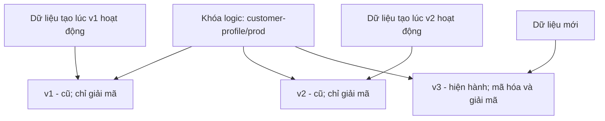
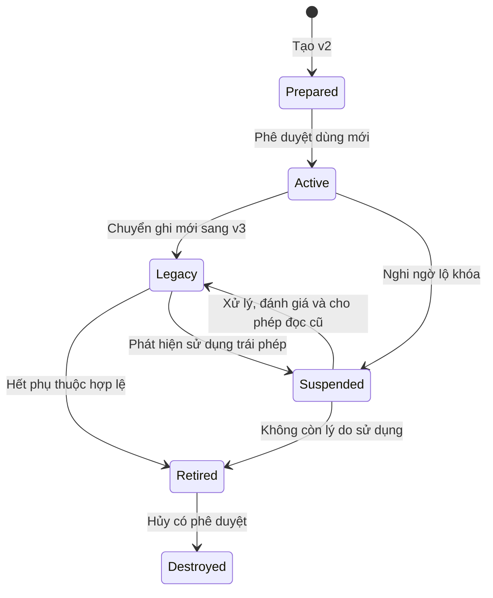
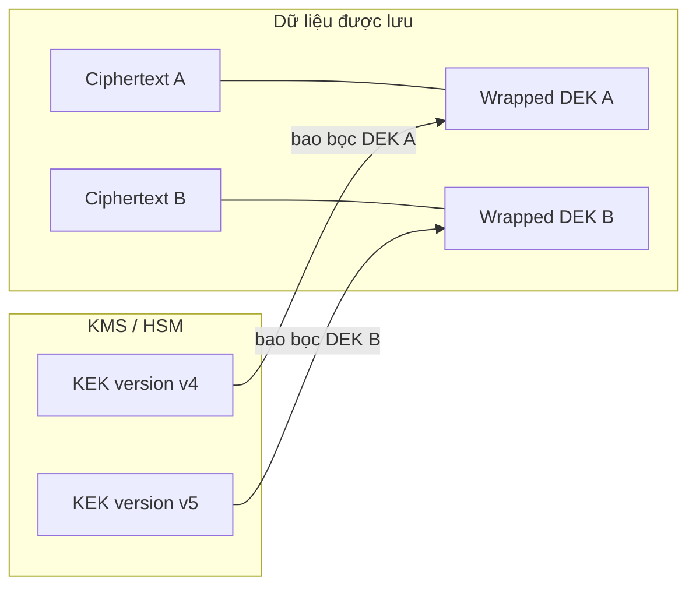

# Key version

## 1. Key version là gì?

**Key version (phiên bản khóa mật mã)** là một định danh dùng để phân biệt các thế hệ **vật liệu khóa** được quản lý trong cùng một phạm vi khóa logic. Khi khóa được xoay vòng (*key rotation*), hệ thống có thể tạo phiên bản mới để mã hóa hoặc ký dữ liệu phát sinh từ thời điểm đó, đồng thời giữ các phiên bản cũ nhằm giải mã hoặc xác minh dữ liệu trước đây.

Ví dụ: dịch vụ lưu hồ sơ khách hàng sử dụng một khóa logic mang tên `customer-profile/prod`. Ban đầu khóa có vật liệu `v1`; sau khi xoay vòng có `v2`; rồi `v3`. Bản ghi mã hóa bằng `v1` vẫn cần cách giải mã hợp lệ trong thời gian lưu giữ, ngay cả khi `v3` là phiên bản mặc định để mã hóa mới.

Bài này thuộc chương **Thuật ngữ cốt lõi** của module `SECURITY_KEY_MANAGEMENT_FUNDAMENTALS`. Khái niệm *key version* liên kết trực tiếp với vòng đời tạo, cấp phát, lưu trữ, sử dụng, xoay vòng, thu hồi và hủy khóa; đồng thời xuất hiện trong mật mã đối xứng, bất đối xứng, chữ ký số, KMS/HSM, envelope encryption, phân quyền và kiểm toán.

Sau bài học, bạn có thể:

- Phân biệt **key ID**, **key version**, **key alias**, **key material** và **cryptoperiod**.
- Giải thích vì sao đổi phiên bản dùng cho thao tác mới chưa khiến dữ liệu cũ tự động được mã hóa lại.
- Thiết kế metadata và luồng đọc/ghi hỗ trợ nhiều phiên bản mà không làm mất khả năng giải mã.
- Lập kế hoạch xoay, ngừng dùng, thu hồi và hủy phiên bản khóa có xét đến bản sao lưu, chữ ký và sự cố.
- Nhận diện những giới hạn của các mô hình quản lý phiên bản trong KMS/HSM thực tế.

## 2. Phân biệt các thuật ngữ dễ nhầm lẫn

| Thuật ngữ | Ý nghĩa | Ví dụ minh họa |
| --- | --- | --- |
| **Logical key (khóa logic)** | Tài nguyên hoặc nhóm khóa có danh tính ổn định theo nghiệp vụ, có thể được triển khai bằng nhiều thế hệ vật liệu khóa. | `customer-profile/prod` |
| **Key ID** | Định danh của tài nguyên khóa mà ứng dụng hoặc KMS quản lý. Độ ổn định và cấu trúc do hệ thống quyết định. | `keys/customer-profile-prod` |
| **Key material (vật liệu khóa)** | Các bit bí mật/cặp khóa thực sự tham gia phép toán mật mã. | Một khóa AES 256-bit hoặc khóa riêng dùng ký số. |
| **Key version** | Định danh một thế hệ vật liệu khóa dưới mô hình quản lý phiên bản. | `v1`, `v2`, `v3` |
| **Active/current version** | Phiên bản đang được chọn cho **mã hóa/ký mới** theo quy tắc của ứng dụng hoặc nhà cung cấp. | `v3` |
| **Key alias** | Tên tham chiếu gián tiếp giúp ứng dụng trỏ đến khóa hoặc đích hiện hành. Alias có thể trỏ tới **khóa** hoặc **phiên bản**, tùy nền tảng. | `alias/customer-data` |
| **Key rotation** | Quá trình thay thế khóa/phiên bản cho các thao tác mới và quản lý chuyển tiếp từ khóa cũ. | Chuyển ghi mới từ `v2` sang `v3`. |
| **Cryptoperiod** | Khoảng thời gian vật liệu khóa được cho phép sử dụng cho một hoặc nhiều mục đích mật mã cụ thể. | Thời hạn được phép mã hóa mới. |
| **Key lifecycle state** | Trạng thái vận hành hoặc chính sách của khóa/phiên bản. | `ENABLED`, `DISABLED`, `PENDING_DELETION`. |
| **`kid` (key identifier)** | Trường nhận diện khóa thường gặp trong phần header của định dạng như JWS/JWT, hỗ trợ bộ xác minh chọn khóa phù hợp. | `"kid": "signing-v2"` |

**Điểm mấu chốt:** `key ID` không nhất thiết thay đổi khi *key material* được xoay. Một số dịch vụ KMS giữ nguyên định danh khóa và tự nhận diện thế hệ vật liệu cần dùng từ ciphertext; một số dịch vụ khác công khai `keyVersionId` và cho phép chọn phiên bản cụ thể. Vì thế, không được mặc định `keyId + version` luôn là API chung cho mọi KMS.

Cũng cần phân biệt **phiên bản cấu hình** với **phiên bản vật liệu khóa**. Thay đổi nhãn, IAM policy, metadata hoặc cấu hình giám sát không mặc nhiên tạo ra vật liệu mật mã mới. Ngược lại, nhập lại chính xác cùng một vật liệu với nhãn phiên bản mới không tạo ra lợi ích bảo mật tương đương sinh khóa mới độc lập.

### 2.1. Minh họa một khóa logic có ba phiên bản



Đường nối trong sơ đồ thể hiện **sự phụ thuộc để giải mã**, không có nghĩa ứng dụng luôn được tải vật liệu khóa về bộ nhớ. Khi dùng KMS/HSM, thao tác có thể thực hiện trong dịch vụ quản lý khóa hoặc qua cơ chế mở bọc khóa dữ liệu với kiểm soát truy cập.

### 2.2. Key version có phải là khóa con?

Không nhất thiết. Về mô hình, `v1` và `v2` thường biểu thị các thế hệ vật liệu khóa khác nhau trong cùng một tài nguyên hoặc nhóm khóa. Chúng có thể là các khóa đối xứng độc lập, các cặp khóa bất đối xứng độc lập hoặc vật liệu mà nhà cung cấp KMS quản lý nội bộ.

*Derived key* (khóa được dẫn xuất bằng KDF) là khái niệm riêng. Phiên bản có thể được dùng làm thông tin đầu vào cho sơ đồ dẫn xuất khóa **nếu thiết kế được phê duyệt**, nhưng tự tăng số phiên bản không tự tạo ra một khóa bí mật an toàn. Đặc biệt, nếu tất cả phiên bản đều được dẫn xuất từ một master secret đã lộ thì việc tăng phiên bản không giải quyết được việc mất bí mật gốc.

## 3. Vì sao ứng dụng phải biết về phiên bản khóa?

Giả sử một dịch vụ mã hóa dữ liệu khách hàng trong nhiều năm. Nếu sau mỗi lần xoay khóa, ứng dụng chỉ giữ được khóa mới nhất, các bản ghi cũ có thể không còn giải mã được. Ngược lại, nếu dùng mãi khóa cũ để ghi mới, rủi ro bị lộ khóa sẽ tích lũy và việc thay đổi chính sách mật mã trở nên khó khăn.

Phiên bản khóa giải quyết một phần bài toán **chuyển tiếp có kiểm soát**:

1. **Ghi mới:** luôn chọn khóa/phiên bản hiện được cho phép tạo ciphertext hoặc chữ ký mới.
2. **Đọc dữ liệu cũ:** chọn đúng khóa/phiên bản theo metadata đáng tin cậy hoặc để dịch vụ KMS tự giải quyết từ ciphertext.
3. **Kiểm toán:** truy ra bản ghi, dịch vụ hoặc chữ ký nào còn phụ thuộc vào khóa cũ.
4. **Di chuyển:** thay thế từng lô dữ liệu và kiểm tra kết quả trước khi vô hiệu hóa hoặc hủy phiên bản cũ.
5. **Ứng phó sự cố:** nhận diện phạm vi ảnh hưởng nếu một thế hệ khóa bị lộ hoặc mất khả năng sử dụng.

Có phiên bản **không đồng nghĩa** có thể vô hạn giữ tất cả khóa cũ. Số lượng phiên bản tăng theo thời gian cũng làm tăng phạm vi quyền truy cập, lượng metadata, chi phí quản lý, diện tấn công và độ phức tạp khi phục hồi. Cần có chính sách lưu giữ và hủy rõ ràng.

## 4. Vòng đời của từng key version

Tên trạng thái là ví dụ khái niệm; tên và các chuyển trạng thái được nhà cung cấp KMS/HSM quy định khác nhau.

| Trạng thái khái niệm | Mã hóa/ký mới | Giải mã/xác minh cũ | Ý nghĩa |
| --- | --- | --- | --- |
| **CREATED / PREPARED** | Chưa | Tùy kiểm thử | Phiên bản đã tạo, kiểm tra cấu hình và phân quyền trước khi chuyển sử dụng. |
| **PRIMARY / ACTIVE_FOR_WRITE** | Có | Có, nếu được phép | Phiên bản mặc định cho hoạt động mới. |
| **DECRYPT_ONLY / VERIFY_ONLY** | Không | Có | Giữ khả năng truy cập dữ liệu/chữ ký tồn tại trước khi xoay. |
| **DISABLED / SUSPENDED** | Không | Thường không được KMS thực hiện | Tạm chặn thao tác, cần đánh giá tác động đến dữ liệu. |
| **PENDING_DESTROY / RETIRED** | Không | Phụ thuộc hệ thống | Đang chờ hủy sau khi xác minh điều kiện và thời gian lưu giữ. |
| **DESTROYED** | Không | Không thể dùng vật liệu bí mật đã hủy | Không thể khôi phục bằng chính vật liệu đó nếu mọi bản sao đã bị loại bỏ. |

Không phải mọi sản phẩm đều hỗ trợ trạng thái *decrypt-only* như một công tắc có sẵn. Đôi khi phải thực thi bằng cách ứng dụng không chọn khóa cũ để ghi, IAM chỉ cho phép thao tác đọc thích hợp, hoặc quy trình quản lý dữ liệu tách riêng quyền theo phiên bản.



**Cryptoperiod cho phép tạo dữ liệu mới** khác với **thời gian cần giữ khóa để giải mã hoặc xác minh**. Một phiên bản hết thời hạn mã hóa mới có thể vẫn cần tồn tại nhiều năm để đọc bản sao lưu hoặc chứng minh tính hợp lệ của chữ ký cũ.

Với **khóa ký bất đối xứng**, cần tách vòng đời *private key* khỏi việc phân phối *public key* hoặc chứng chỉ. Sau khi khóa riêng ngừng ký và được hủy theo chính sách, khóa công khai cùng bằng chứng tin cậy vẫn có thể cần được lưu để xác minh chữ ký trước đó.

## 5. Key version khi xoay khóa: điều gì đổi và điều gì giữ nguyên?

Giả sử ngày 01/01, `v1` được dùng để mã hóa; ngày 01/07, `v2` được kích hoạt.

| Khoảng thời gian / đối tượng | Khóa dùng cho ghi mới | Khóa cần để đọc dữ liệu đã tạo |
| --- | --- | --- |
| Trước ngày 01/07 | `v1` | `v1` |
| Từ ngày 01/07, dữ liệu mới | `v2` | `v2` |
| Từ ngày 01/07, dữ liệu cũ chưa di chuyển | `v2` | Vẫn cần `v1` |
| Sau khi hoàn tất tái mã hóa dữ liệu cũ | `v2` | Có thể chỉ cần `v2`, nếu không còn backup/phụ thuộc khác vào `v1` |

Như vậy, **xoay khóa không tự động tái mã hóa toàn bộ ciphertext cũ**. Một số dịch vụ cung cấp công cụ hỗ trợ migration hoặc xoay vật liệu nội bộ, nhưng ý nghĩa chính xác phải kiểm tra theo sản phẩm và chế độ mã hóa.

### 5.1. Kế hoạch thay phiên bản an toàn

1. **Kiểm kê phụ thuộc:** dữ liệu, bản sao lưu, queue, object storage, ứng dụng, tenant, token và chữ ký còn cần phiên bản nào.
2. **Tạo phiên bản mới:** dùng CSPRNG hoặc API sinh khóa của KMS/HSM; cấu hình IAM, chính sách sử dụng và giám sát.
3. **Kiểm thử khả năng chuyển tiếp:** xác nhận phiên bản mới mã hóa/ký được; hệ thống vẫn giải mã/xác minh các hiện vật cũ.
4. **Chuyển ghi mới:** cập nhật con trỏ/alias/phiên bản hiện hành. Nếu có nhiều tiến trình, quản lý cache, triển khai phân kỳ và khả năng rollback.
5. **Theo dõi phiên bản cũ:** đo lượng dữ liệu chưa di chuyển, số yêu cầu đọc cũ, lỗi `unknown key version` và tính sẵn sàng của khóa.
6. **Di chuyển khi cần:** rewrap DEK hoặc tái mã hóa dữ liệu tùy mục tiêu bảo mật; xác minh toàn vẹn và phục hồi được sau mỗi lô.
7. **Ngừng quyền sử dụng cũ:** chỉ sau khi đã thỏa yêu cầu lưu giữ, xác minh, khôi phục và có phê duyệt thích hợp.
8. **Hủy có kiểm soát:** bảo đảm đã tính đến bản sao, bản xuất, replica, bản sao lưu và thời gian chờ xóa của nhà cung cấp.

Việc thay đổi **default version** nên có khả năng triển khai một cách nhất quán. Nếu hai instance đồng thời dùng `v1` và `v2` để tạo ciphertext trong thời gian ngắn, hệ thống vẫn có thể hoạt động chính xác nếu từng ciphertext có metadata nhận diện đúng phiên bản và cả hai phiên bản vẫn được hỗ trợ.

### 5.2. Rotation theo lịch và rotation vì nghi ngờ lộ khóa

- **Theo lịch:** xoay theo yêu cầu chính sách hoặc đánh giá cryptoperiod; khóa cũ có thể tiếp tục được bảo vệ để giải mã dữ liệu hợp lệ.
- **Do nghi ngờ bị lộ:** cần khoanh vùng ngay quyền sử dụng và dữ liệu bị ảnh hưởng. Chỉ thay *current version* không khắc phục được ciphertext mà kẻ tấn công đã giải mã hoặc khóa cũ mà kẻ tấn công đã sao chép.

Khi một phiên bản bị lộ, cần xác định kẻ tấn công có lấy được **vật liệu khóa dạng rõ**, có quyền gọi KMS/HSM, có bản sao ciphertext hay đã tạo chữ ký giả mạo hay không. Từ đó mới quyết định vô hiệu hóa phiên bản, thu hồi danh tính, re-encrypt dữ liệu, phát hành lại token/chứng chỉ hoặc thông báo sự cố.

## 6. Key version trong envelope encryption

Trong *envelope encryption*, thường có ít nhất hai tầng khóa:

- **DEK (Data Encryption Key):** khóa đối xứng trực tiếp mã hóa một bản ghi, tệp hoặc nhóm dữ liệu.
- **KEK (Key Encryption Key):** khóa dùng để bao bọc DEK; có thể được quản lý trong KMS/HSM và có nhiều thế hệ vật liệu khóa.

Khi đó phải trả lời rõ câu hỏi **“đang nói đến phiên bản của DEK hay KEK?”**. Một bản ghi có thể có DEK riêng, nhưng DEK được bao bọc bằng `KEK-v4`; bản ghi khác lại có DEK khác được bao bọc bằng `KEK-v5`.



### 6.1. Metadata đi kèm ciphertext

Một định dạng lưu trữ **minh họa**:

```json
{
  "formatVersion": 1,
  "algorithm": "AES-256-GCM",
  "ciphertext": "<base64-ciphertext-and-tag>",
  "nonce": "<base64-random-nonce>",
  "wrappedDek": "<base64-encrypted-DEK>",
  "kekReference": "customer-profile/prod",
  "kekVersion": "v4",
  "aadContext": {
    "tenantId": "tenant-123",
    "recordId": "record-987"
  }
}
```

Các trường và cú pháp trên **không phải** contract của KMS cụ thể. Một số KMS mã hóa sẵn thông tin cần thiết bên trong `wrappedDek` hoặc blob ciphertext và tự chọn vật liệu khóa tương ứng khi giải mã; trường `kekVersion` riêng có thể không cần hoặc không được expose. Cần lưu thông tin đủ cho đúng backend **mà không giả định** mọi dịch vụ đều cho phép chỉ định version khi giải mã.

Định danh khóa và phiên bản thường không phải bí mật, nhưng phải được **bảo vệ tính toàn vẹn** cùng ngữ cảnh giải mã. Không để giá trị `keyId` hoặc `version` do người dùng gửi vào làm hệ thống tự do truy cập bất kỳ khóa nào trong KMS. Ứng dụng cần danh sách khóa được phép, phạm vi tenant, xác thực quyền và ràng buộc dữ liệu bổ sung (*AAD* hoặc *encryption context*) tùy API.

**Nonce/IV** của chế độ như AES-GCM không phải key version. Với cùng DEK, việc tái sử dụng nonce có thể phá vỡ bảo mật; tạo phiên bản mới của KEK không tự sửa lỗi nonce hoặc rủi ro DEK cũ.

### 6.2. Rewrap và re-encrypt khác nhau ra sao?

**Rewrap DEK:** mở bọc DEK hiện tại bằng KEK cũ rồi bao bọc lại bằng KEK mới. Ciphertext dữ liệu thường giữ nguyên vì DEK không đổi.

**Re-encrypt data:** giải mã ciphertext dữ liệu bằng DEK cũ, sinh DEK mới phù hợp và mã hóa lại plaintext; sau đó lưu metadata và wrapped DEK mới. Đây là thao tác khác về phạm vi, chi phí và rủi ro vận hành.

| Tình huống | Hành động cân nhắc | Vì sao |
| --- | --- | --- |
| Đổi KEK theo lịch, DEK vẫn được tin cậy | Rewrap DEK khi yêu cầu hoặc theo khả năng KMS | Thay lớp bao bọc mà không phải viết lại tất cả ciphertext dữ liệu. |
| DEK nghi bị lộ | Re-encrypt bằng DEK mới | Rewrap DEK cũ không làm DEK đã bị lộ trở nên bí mật lại. |
| Thuật toán mã hóa dữ liệu không còn phù hợp | Re-encrypt với thuật toán/chế độ được phê duyệt | Thay KEK không giải quyết vấn đề của thuật toán dữ liệu. |
| Chỉ đổi phiên bản mặc định của KEK | Dùng version mới cho các thao tác mới, lập kế hoạch cho dữ liệu cũ | Dữ liệu cũ không tự thay đổi chỉ bởi việc đổi con trỏ. |

Ngay cả khi chỉ rewrap, cần xác minh thao tác có hỗ trợ **atomic update**, cơ chế khôi phục và việc đọc xen kẽ trong lúc migration. Không được xóa metadata version cũ trước khi bản wrapped DEK mới được lưu thành công.

## 7. Key version đối với khóa bất đối xứng và chữ ký số

Đối với cặp khóa ký số, mỗi phiên bản thường tương ứng với một cặp **private key/public key** khác nhau. Hệ thống ký chọn private key hiện hành, còn hệ thống xác minh cần tìm được public key tương ứng với chữ ký đã tạo.

Ví dụ một phần header của JWT/JWS:

```json
{
  "alg": "RS256",
  "typ": "JWT",
  "kid": "signing-v3"
}
```

`kid` giúp bộ xác minh tìm khóa đúng từ **tập khóa tin cậy đã cấu hình**. Tuy nhiên, header của JWT là dữ liệu chưa được xác thực **trước khi** chữ ký được xác minh. Không dùng `kid` làm đường dẫn tệp, câu truy vấn hay URL tùy ý; không tự động tải khóa từ endpoint do token yêu cầu; không chấp nhận thuật toán ký chỉ vì token tự khai báo. Bộ xác minh phải ràng buộc thuật toán được phép, nguồn khóa đáng tin cậy, issuer, audience, thời hạn và các điều kiện nghiệp vụ liên quan.

Luồng xoay khóa ký JWT thông thường:

1. Tạo `signing-v4` và phân phối **public key** mới tới bộ xác minh qua kênh đáng tin cậy.
2. Đảm bảo bộ xác minh chấp nhận cả `signing-v3` và `signing-v4` trong giai đoạn chuyển tiếp.
3. Chuyển hệ thống ký mới sang private key `signing-v4`, đưa `kid=signing-v4` vào header.
4. Đợi token ký bởi `signing-v3` hết hạn theo policy (hoặc thu hồi token nếu có sự cố).
5. Ngừng chấp nhận `signing-v3` khi không còn token hợp lệ phụ thuộc vào phiên bản đó.

Đối với chữ ký tài liệu có yêu cầu kiểm chứng lâu dài, cần giữ các thông tin xác minh, chứng chỉ và bằng chứng thời gian theo chính sách. Việc hủy private key sau khi hết thời hạn ký mới không có nghĩa phải xóa public key hoặc mọi bằng chứng xác minh chữ ký cũ.

## 8. Thiết kế luồng dùng key version trong ứng dụng Java

Ví dụ sau tập trung vào **cách điều phối phiên bản** trong ứng dụng, không phụ thuộc API cụ thể của một KMS. `CryptoBackend` là abstraction: triển khai thực tế chịu trách nhiệm thực thi mã hóa có xác thực, lấy khóa từ KMS/HSM, sinh nonce hợp lệ, bảo vệ DEK trong bộ nhớ, kiểm tra tag và xử lý lỗi. Ứng dụng không được tự thay thế backend bằng cách hardcode vật liệu khóa.

```java
import java.nio.ByteBuffer;
import java.nio.charset.StandardCharsets;

record CipherEnvelope(
    String keyId,
    String keyVersion,
    String algorithm,
    byte[] nonce,
    byte[] ciphertext
) {}

interface CryptoBackend {
    // Phiên bản được phê duyệt để MÃ HÓA MỚI.
    String activeVersionForEncrypt(String keyId);

    // Adapter phải dùng thuật toán, nonce và AAD đúng chuẩn.
    CipherEnvelope encrypt(
        String keyId,
        String version,
        byte[] plaintext,
        byte[] aad
    );

    // Adapter phải tra cứu phiên bản an toàn và xác thực ciphertext/AAD.
    byte[] decrypt(CipherEnvelope envelope, byte[] aad);
}

final class CustomerProfileCrypto {
    private static final String KEY_ID = "customer-profile/prod";
    private static final String ALGORITHM = "AES-256-GCM";
    private final CryptoBackend backend;

    CustomerProfileCrypto(CryptoBackend backend) {
        this.backend = backend;
    }

    CipherEnvelope encryptNew(
        String tenantId, String recordId, byte[] plaintext
    ) {
        String version = backend.activeVersionForEncrypt(KEY_ID);
        if (version == null || version.isBlank()) {
            throw new IllegalStateException("No active key version");
        }
        return backend.encrypt(
            KEY_ID, version, plaintext, aad(tenantId, recordId)
        );
    }

    byte[] decryptExisting(
        String tenantId, String recordId, CipherEnvelope envelope
    ) {
        // Chặn việc metadata chưa tin cậy định tuyến sang khóa khác.
        if (!KEY_ID.equals(envelope.keyId())
                || !ALGORITHM.equals(envelope.algorithm())
                || envelope.keyVersion() == null
                || envelope.keyVersion().isBlank()) {
            throw new SecurityException("Unsupported key reference");
        }

        // Không dùng activeVersionForEncrypt() ở đây:
        // ciphertext cũ có thể cần v1 dù phiên bản ghi mới là v3.
        return backend.decrypt(
            envelope, aad(tenantId, recordId)
        );
    }

    // Biểu diễn có độ dài rõ ràng để tránh va chạm do dấu phân cách.
    private static byte[] aad(String tenantId, String recordId) {
        byte[] tenant = tenantId.getBytes(StandardCharsets.UTF_8);
        byte[] record = recordId.getBytes(StandardCharsets.UTF_8);
        return ByteBuffer.allocate(8 + tenant.length + record.length)
                .putInt(tenant.length).put(tenant)
                .putInt(record.length).put(record)
                .array();
    }
}
```

Điểm cần học từ ví dụ:

- **Đường ghi** hỏi phiên bản hiện hành tại thời điểm tạo ciphertext.
- **Đường đọc** sử dụng thông tin liên kết với ciphertext và backend có khả năng giải mã phiên bản cũ; không cố giải mã tất cả dữ liệu bằng version mới nhất.
- **AAD** gắn ciphertext với `tenantId` và `recordId`; đọc sai ngữ cảnh phải thất bại khi adapter dùng AEAD đúng cách. Các hệ thống khác ngôn ngữ cần thống nhất chính xác định dạng byte của AAD.
- Kiểm tra `keyId` và thuật toán trước khi định tuyến, đồng thời backend phải kiểm tra version thuộc registry được tin cậy và không cho phép khóa bị cấm. Riêng việc kiểm tra chuỗi trong ví dụ không thay thế IAM hay kiểm tra tính toàn vẹn metadata.
- `CipherEnvelope` mô phỏng trường hợp ứng dụng quản lý metadata version. Nếu KMS dùng ciphertext blob có metadata nội bộ và tự chọn key material, adapter sẽ thiết kế phù hợp contract đó.
- Ví dụ dùng API Java trừu tượng nhằm diễn giải mô hình; chưa có implementation KMS, serialization, retry, timeout, concurrency, xử lý dữ liệu lớn hoặc kiểm thử khả năng khôi phục nên không phải ứng dụng production hoàn chỉnh.

### 8.1. Không để cache làm sai version khi xoay

Giả sử ba instance đang phục vụ:

```text
09:00 - default = v2, tất cả instance tạo ciphertext bằng v2
09:10 - operator chuyển default sang v3
09:11 - instance A đã làm mới cache -> tạo bằng v3
09:11 - instance B chưa làm mới cache -> vẫn tạo bằng v2
09:15 - instance B cập nhật cache -> tạo bằng v3
```

Hai version cùng tạo ciphertext trong khoảng chuyển tiếp có thể **chấp nhận được nếu chính sách cho phép**, hệ thống lưu nhận diện version chính xác và chưa vô hiệu hóa v2. Nếu yêu cầu “sau 09:10 tuyệt đối không có bản ghi mới dùng v2”, phải có cơ chế đồng bộ cấu hình và từ chối thao tác ghi còn dùng phiên bản cũ; việc tăng alias ở một nơi tự nó chưa bảo đảm toàn bộ instance đã đồng bộ.

### 8.2. Mã phiên bản cũng là thành phần của định dạng dữ liệu

Nếu ứng dụng tự quản lý metadata, nên có **`formatVersion`** độc lập với **`keyVersion`**:

- `formatVersion` cho biết cấu trúc envelope, cách mã hóa trường và định dạng AAD.
- `keyVersion` cho biết thế hệ vật liệu mật mã hoặc tham chiếu cần thiết để giải mã.
- `algorithm` cho biết sơ đồ mật mã dùng để tạo ciphertext.

Khi nâng cấp từ một định dạng ciphertext sang định dạng khác, chỉ tăng `keyVersion` không thể thay thế quy trình migration định dạng. Ngược lại, thay đổi serialization không đòi hỏi thay đổi key material nếu chính sách và thiết kế mật mã cho phép.

## 9. KMS/HSM lưu và chọn key version như thế nào?

Cần phân biệt **khái niệm chung** với **hành vi cụ thể của sản phẩm**:

| Mô hình triển khai | Cách ứng dụng tham chiếu | Cách giải mã dữ liệu cũ |
| --- | --- | --- |
| **KMS có phiên bản công khai** | `logicalKeyId` và `versionId` cụ thể hoặc primary version. | Dựa vào version/metadata để chọn vật liệu tương ứng, theo API nhà cung cấp. |
| **KMS xoay vật liệu nội bộ** | Thường tiếp tục dùng cùng `keyId`. | Dịch vụ tự tìm vật liệu từ ciphertext/blob nếu được hỗ trợ; ứng dụng không nhất thiết thấy version. |
| **HSM với key object riêng** | Mỗi thế hệ có thể là key object/handle riêng. | Ứng dụng hoặc lớp quản lý khóa phải giữ mapping handle và chính sách phiên bản. |
| **Ứng dụng tự quản lý key ring** | Một `logicalKeyId` ánh xạ tới các version do ứng dụng quản lý. | Ứng dụng tự chọn version, nhưng cần bảo đảm bảo vệ vật liệu khóa và phân quyền tương xứng. |

**Không nên suy diễn** rằng mọi KMS đều có endpoint `decrypt(versionId)`, mọi khóa đều export được, hay mọi nền tảng đều hỗ trợ disable riêng từng version. Hãy kiểm tra SDK, API, cơ chế rotation, định dạng ciphertext và chính sách hủy của công nghệ đang sử dụng trước khi thiết kế migration.

Với HSM, *non-exportable key* giảm khả năng lộ trực tiếp vật liệu khóa, nhưng nếu một danh tính được cấp quyền `decrypt` hoặc `sign` quá rộng thì kẻ tấn công vẫn có thể lạm dụng phép toán. Do đó, chính sách quyền phải theo chủ thể, thao tác, mục đích, môi trường và khả năng kiểm toán — không chỉ theo số phiên bản.

## 10. Kiểm soát truy cập và kiểm toán theo phiên bản

Một bản key version nên gắn với thông tin quản trị đủ để trả lời **ai đã tạo, ai đang sử dụng, bản ghi nào còn phụ thuộc và khi nào có thể hủy**.

Các trường kiểm kê minh họa:

```yaml
logical_key_id: customer-profile/prod
version: v3
purpose: encrypt-customer-data
algorithm: AES-256-GCM
environment: production
owner: customer-data-team
created_at: "2026-07-01T08:00:00Z"
write_state: active
read_state: allowed
supersedes: v2
rotation_reason: scheduled-policy-review
retention_decision: pending-inventory
approval_reference: SEC-CHANGE-2026-042
```

Đây là **metadata ví dụ**, không phải bảng dữ liệu bí mật: tuyệt đối không đưa bản key material rõ vào kiểm kê. Các cờ `write_state`, `read_state` là mô hình chính sách; việc thực thi trên KMS cần ánh xạ sang IAM/API được hỗ trợ.

Nhật ký tối thiểu cho thay đổi phiên bản và hoạt động nhạy cảm nên gồm: **danh tính**, `keyId`/version nếu hệ thống expose, hành động, thời điểm, môi trường, mã yêu cầu và kết quả. Theo dõi riêng các sự kiện tạo phiên bản, đổi primary, grant quyền, disable, re-enable, lịch xóa và xóa thực tế. Không ghi plaintext, private key, DEK hay dữ liệu khách hàng vào log.

Chỉ số vận hành có ích:

- Số bản ghi/ciphertext còn tham chiếu từng phiên bản.
- Số tác vụ vẫn mã hóa/ký bằng version đã ngừng dùng cho hoạt động mới.
- Tỷ lệ lỗi `unknown version`, `disabled key`, `authentication failed` sau rotation.
- Số danh tính có quyền sử dụng hoặc quản trị phiên bản cũ.
- Số bản backup/chữ ký/token còn phụ thuộc version chờ hủy.
- Thời gian hoàn thành migration và kết quả diễn tập giải mã/khôi phục.

Một sai lệch thường gặp: biểu đồ “không còn truy vấn `v1` trong 30 ngày” **không chứng minh** `v1` đã hết phụ thuộc. Dữ liệu có thể chỉ được truy cập khi có sự cố, tác vụ định kỳ hiếm khi chạy hoặc trong bản sao lưu dài hạn.

## 11. Xử lý lỗi khi version không còn dùng được

| Triệu chứng | Nguyên nhân có thể | Cách tiếp cận |
| --- | --- | --- |
| `Unknown key version` | Thiếu metadata, mapping sai, cache chưa cập nhật hoặc phiên bản không được nhập ở môi trường mới. | Kiểm tra `keyId`, registry, bản sao lưu và quy trình chuyển môi trường; không tự thay bằng khóa mới để thử giải mã. |
| `Key disabled` | Phiên bản bị tạm khóa hoặc vô hiệu hóa do sự cố. | Kiểm tra phê duyệt, tình trạng sự cố và kế hoạch phục hồi; không bật lại tùy tiện. |
| `Authentication tag mismatch` | Sai DEK, nonce/AAD, dữ liệu bị sửa hoặc metadata không khớp. | Giữ nguyên mẫu để điều tra, xác minh toàn vẹn và mapping; không bỏ qua kiểm tra tag. |
| Sau rotation không xác minh được JWT cũ | Bộ xác minh xóa public key cũ quá sớm hoặc cache JWKS chưa cập nhật. | Duy trì cửa sổ chồng lấn thích hợp và kiểm tra thời hạn/token revocation. |
| Sau hủy khóa không đọc được backup | Bản sao lưu còn phụ thuộc vật liệu đã hủy. | Phục hồi từ bản sao/đường khóa hợp lệ nếu có; bổ sung kiểm tra phụ thuộc trước khi hủy lần sau. |
| Ciphertext mới thỉnh thoảng vẫn dùng version cũ | Triển khai phân kỳ, cache version hoặc queue retry. | Quan sát version ghi trên từng request và đặt quy tắc cutover; kiểm tra idempotency. |

Nếu bản ghi thiếu thông tin nhận diện khóa, **không nên thử hàng loạt tất cả khóa** trên dữ liệu thật như giải pháp mặc định. Cách làm đó có thể gây tải bất thường, mở rộng quyền giải mã, che giấu lỗi định dạng và khiến việc kiểm toán khó khăn. Ưu tiên phục hồi metadata từ nguồn đáng tin cậy hoặc migration có kiểm soát, với phạm vi và nhật ký rõ ràng.

### 11.1. Trường hợp hủy vĩnh viễn

Khi vật liệu khóa thực sự bị hủy, không còn bản sao hợp lệ và không có cách khôi phục được thiết kế trước, ciphertext còn phụ thuộc vào nó sẽ không thể giải mã bằng phương pháp thông thường. Điều này có thể được sử dụng có chủ đích cho *cryptographic erasure*, nhưng cũng có thể gây mất dữ liệu nghiêm trọng nếu kiểm kê sai.

Trước khi hủy phiên bản, xác nhận đồng thời: dữ liệu còn tồn tại, bản backup, snapshot, hàng đợi và archive đã được kiểm tra; các yêu cầu pháp lý/kiểm toán đã thỏa; chữ ký còn phải xác minh đã được xử lý; bài kiểm thử khôi phục thành công; và người có thẩm quyền đã duyệt xóa. Nếu nhà cung cấp có thời gian chờ xóa, cần ghi rõ hạn và trách nhiệm phê duyệt.

## 12. Kịch bản thực tế: từ v1 sang v3 mà không làm mất dữ liệu

Dịch vụ `orders-prod` đang lưu 2 triệu đơn hàng theo envelope encryption. Ban đầu DEK của các đơn hàng được bao bọc bằng `KEK-v1`. Sau một đợt rotation, dữ liệu mới sử dụng `KEK-v2`. Sáu tháng sau, nhóm bảo mật cần chuyển sang `KEK-v3`.

Một hướng triển khai an toàn:

1. **Chụp kiểm kê phụ thuộc:** đếm bản ghi có DEK bao bọc bởi `v1`, `v2`, `v3`; ghi cả vùng lưu trữ lịch sử, phiên bản object và backup.
2. **Chuẩn bị v3:** tạo khóa trong KMS/HSM, cấp đúng quyền cho danh tính `orders-prod`, kiểm tra giải mã mẫu dữ liệu v1/v2 và mã hóa mới bằng v3.
3. **Chuyển ghi mới:** mọi đơn hàng mới dùng v3; telemetry ghi nhận version thật để tìm instance còn dùng v2.
4. **Đọc song song:** API đọc vẫn truy cập các DEK được bao bọc bằng v1/v2/v3 theo định dạng và mapping hợp lệ.
5. **Migration:** nếu chính sách yêu cầu thay lớp KEK của bản ghi cũ, rewrap các DEK theo từng lô; lưu bản mới thành công rồi mới cập nhật con trỏ/metadata, có khả năng retry an toàn.
6. **Kiểm tra:** đối chiếu số bản ghi, kiểm tra ngẫu nhiên ciphertext, verify toàn vẹn và diễn tập phục hồi một bản sao lưu.
7. **Đánh giá ngừng sử dụng:** khi không còn phụ thuộc hợp lệ và thời hạn retention cho phép, đề xuất disable/hủy v1, v2 theo quy trình có phê duyệt.

Đối với trường hợp `KEK-v1` bị lộ, quy trình phải thay đổi theo đánh giá sự cố: có thể cần thay cả DEK/tái mã hóa dữ liệu, vì thao tác rewrap đơn thuần không phục hồi tính bí mật của DEK đã bị kẻ tấn công lấy được.

Điểm quyết định ở đây là **v3 trở thành phiên bản ghi mới không đồng nghĩa v1 và v2 có thể hủy ngay**. Khả năng đọc dữ liệu cũ và khả năng phục hồi là điều kiện của một lần rotation thành công.

## 13. Những hiểu nhầm thường gặp

| Hiểu nhầm | Điều đúng cần nhớ |
| --- | --- |
| “`version = v3` nghĩa là cả hệ thống đã dùng v3.” | Nó có thể chỉ là phiên bản mặc định cho ghi mới; dữ liệu cũ vẫn phụ thuộc phiên bản trước. |
| “Version cũ là không an toàn nên phải xóa ngay.” | Cần ngừng mục đích sử dụng không còn hợp lệ, nhưng giữ khả năng đọc/xác minh khi có nghĩa vụ hoặc phụ thuộc chính đáng. |
| “Chỉ cần ghi `keyId`, không cần metadata khác.” | Tùy KMS, ciphertext có thể cần version, thuật toán, nonce, AAD/encryption context và format version. |
| “Đổi KEK version là đổi DEK và mã hóa lại mọi dữ liệu.” | Rewrap và re-encrypt là hai thao tác khác nhau. |
| “Alias luôn trỏ thẳng tới phiên bản.” | Có KMS alias trỏ tài nguyên khóa, có nền tảng hỗ trợ version-level routing; phải xem contract thực tế. |
| “Có HSM thì không cần tách quyền sử dụng theo phiên bản.” | HSM vẫn có thể bị lạm dụng qua API bởi danh tính có quyền quá rộng. |
| “`kid` trong JWT là bằng chứng token hợp lệ.” | `kid` chỉ là gợi ý chọn khóa, phải xác minh chữ ký và các claim theo tập tin cậy. |
| “Không thấy traffic đọc v1 nghĩa là có thể hủy v1.” | Backup/archive, tác vụ hiếm và chữ ký dài hạn vẫn có thể cần v1. |

## 14. Khung thiết kế key version cho hệ thống thực

Khi thiết kế một tính năng mã hóa, hãy trả lời bằng được các câu hỏi sau trước khi đưa vào vận hành:

1. **Định danh:** Key ID và version được định nghĩa ở đâu? KMS trả metadata cụ thể hay chỉ cung cấp ciphertext blob có khả năng tự giải mã?
2. **Phạm vi:** Phiên bản có tách riêng theo ứng dụng, môi trường, tenant và mục đích mật mã không?
3. **Ghi/đọc:** Ghi mới lấy phiên bản được phép theo cách nào? Đọc cũ tìm được đúng vật liệu và kiểm tra quyền bằng cách nào?
4. **Tính toàn vẹn:** Metadata phiên bản, ngữ cảnh tenant và thuật toán có được xác thực hoặc ràng buộc an toàn vào ciphertext không?
5. **Xoay:** Có giai đoạn chạy song song, cache, cutover, cơ chế retry/idempotency và phương án rollback không?
6. **Migration:** Cần rewrap hay re-encrypt? Tiêu chí hoàn tất và kiểm tra phụ thuộc là gì?
7. **Kiểm soát:** Ai được tạo, dùng, chuyển primary, disable và destroy từng phiên bản? Có phân tách trách nhiệm không?
8. **Khôi phục:** Bản sao lưu có đủ dữ liệu và quyền khóa để khôi phục không? Đã diễn tập với bản ghi dùng version cũ chưa?
9. **Kiểm toán:** Có phát hiện app vẫn ghi bằng version cũ hoặc có thao tác version trái phép không?
10. **Hủy:** Có thể chứng minh không còn dữ liệu, chữ ký, token hoặc backup hợp lệ cần phiên bản đó không?

**Ghi nhớ:** *Key version* là cơ chế nhận diện thế hệ vật liệu khóa và hỗ trợ chuyển tiếp mật mã có kiểm soát. Thiết kế đúng cần cho phép **chuyển hoạt động mới sang phiên bản mới**, **giữ khả năng đọc/xác minh hợp lệ bằng phiên bản cũ** và **hủy phiên bản cũ đúng lúc, có bằng chứng**. Đây là nền tảng quan trọng để kết hợp KMS/HSM, envelope encryption, IAM và kiểm toán thành một hệ thống quản lý khóa an toàn.
