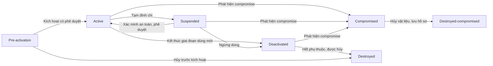

# Key state — Trạng thái của khóa mật mã

## 1. Key state là gì và vì sao quan trọng?

**Key state** (trạng thái khóa) mô tả **khóa mật mã đang ở giai đoạn nào trong vòng đời và những loại thao tác nào còn được phép thực hiện với khóa đó**. Trong một hệ thống quản lý khóa an toàn, trạng thái giúp trả lời các câu hỏi:

- Khóa vừa được tạo nhưng đã được phép dùng để mã hóa hoặc ký dữ liệu chưa?
- Khóa còn được dùng để **bảo vệ dữ liệu mới** hay chỉ được giữ để **đọc dữ liệu cũ**?
- Khi nghi khóa bị lộ, hệ thống phải ngừng thao tác nào và cần xử lý dữ liệu đã bảo vệ ra sao?
- Một khóa đang bị tạm khóa có thể kích hoạt lại không? Một khóa đã hủy có thể phục hồi không?
- Khi KMS/HSM báo trạng thái khác nhau, ứng dụng phải hiểu và xử lý chúng như thế nào?

Hãy hình dung dịch vụ thanh toán dùng khóa AES trong KMS để bảo vệ hàng triệu bản ghi. Sau một lần **rotation**, hệ thống tạo khóa hoặc phiên bản mới để mã hóa các bản ghi tiếp theo. Khóa cũ **không còn được dùng để mã hóa mới**, nhưng vẫn cần thiết để giải mã dữ liệu chưa được chuyển đổi. Nếu gắn nhãn khóa cũ là “hết hạn” rồi hủy ngay, dữ liệu có thể mất khả năng truy cập vĩnh viễn.

Vì vậy, **key state không đơn thuần là một cờ `enabled/disabled`**. Nó biểu diễn chính sách sử dụng, khả năng phục hồi và rủi ro của khóa ở một thời điểm. Trạng thái cần được kết hợp với **quyền truy cập, mục đích khóa, thời gian hiệu lực, quản lý phiên bản, KMS/HSM và kiểm toán**.

> **Ghi nhớ:** Key state trả lời *khóa đang ở tình trạng nào*; chính sách và quyền truy cập trả lời *ai được làm gì*; mục đích mật mã trả lời *được dùng khóa cho việc gì*. Một thao tác chỉ hợp lệ khi **tất cả** các điều kiện liên quan đều thỏa mãn.

## 2. Các khái niệm liên quan cần phân biệt

| Thuật ngữ | Ý nghĩa | Điều dễ nhầm |
| --- | --- | --- |
| **Key state** | Trạng thái vòng đời và điều kiện sử dụng của một khóa/phiên bản khóa | Đồng nhất với quyền của người dùng hoặc cờ bật/tắt từ nhà cung cấp |
| **Key material** | Giá trị bí mật thực tế của khóa, chẳng hạn bit khóa đối xứng hoặc private key | Metadata `Destroyed` vẫn còn không có nghĩa key material còn tồn tại |
| **Key ID / alias** | Định danh khóa, hoặc tên logic trỏ đến một khóa | Đổi alias chưa chắc đã đổi vật liệu khóa |
| **Key version** | Một phiên bản vật liệu khóa được quản lý trong nhóm khóa logic | Mỗi phiên bản có thể có thời gian sử dụng và điều kiện xử lý dữ liệu cũ khác nhau |
| **Cryptoperiod** | Khoảng thời gian một khóa được phép dùng cho các hoạt động mật mã đã quy định | Không phải cứ hết kỳ tạo bản mã mới là không thể giải mã bản mã cũ |
| **Key usage** | Mục đích/hoạt động được cho phép, như encrypt, decrypt, sign, verify, wrap, unwrap | Trạng thái `Active` không cho phép mọi thao tác |
| **Key policy / IAM** | Quy định danh tính, hành động, tài nguyên và điều kiện truy cập | Khóa ở `Active` vẫn phải từ chối danh tính không có quyền |
| **Compromise** | Khóa có bằng chứng hoặc nghi ngờ hợp lý đã bị lộ, bị sử dụng trái phép hoặc mất tính tin cậy | Không chỉ là sự cố dịch vụ tạm thời |

Một hệ thống có thể quản lý trạng thái ở **mức khóa logic**, **mức phiên bản vật liệu khóa**, hoặc cả hai. Tài liệu thiết kế phải chỉ rõ đối tượng nào đổi trạng thái. Chẳng hạn, khóa logic `orders-data-key` vẫn hoạt động, nhưng phiên bản `v1` chỉ được giải mã dữ liệu cũ còn `v2` được chọn để mã hóa mới.

## 3. Các trạng thái thường gặp trong mô hình vòng đời khóa

Các mô hình quản lý vòng đời khóa, tiêu biểu như cách phân loại trong họ hướng dẫn NIST SP 800-57, mô tả các trạng thái dưới đây. **Không phải mọi KMS đều dùng đúng các tên này**; đây là cách hiểu khái niệm để thiết kế chính sách và ánh xạ sang API cụ thể.

### 3.1. Pre-activation — Chưa kích hoạt

Khóa đã được **tạo hoặc nhập vào hệ thống** nhưng chưa sẵn sàng cho sử dụng nghiệp vụ. Có thể cần kiểm tra nguồn tạo khóa, xác nhận chủ sở hữu, cấu hình chính sách, phân phối public key, hoặc chờ ngày bắt đầu hiệu lực.

- **Nên làm:** Gán owner/custodian, xác minh loại thuật toán và mục đích, thiết lập quyền tối thiểu, thử nghiệm luồng tích hợp trong phạm vi được phép.
- **Không nên làm:** Dùng khóa để mã hóa hoặc ký dữ liệu production trước khi được phê duyệt kích hoạt.
- **Ví dụ:** Private key dùng để ký bản phát hành đã sinh trong HSM nhưng chỉ được phép ký sau khi chứng thư liên quan được cấp và quy trình phát hành được phê duyệt.

### 3.2. Active — Đang hoạt động

Khóa đã được kích hoạt và đang trong khoảng thời gian được phép dùng cho **mục đích mật mã đã xác định**, ví dụ bảo vệ dữ liệu mới, giải mã dữ liệu cũ hoặc ký thông điệp. `Active` không đồng nghĩa “ai cũng có thể dùng”: từng yêu cầu vẫn phải qua IAM/key policy, ràng buộc ngữ cảnh, thuật toán và mục đích sử dụng.

- Khóa mã hóa đối xứng có thể được cấp quyền `Encrypt` và `Decrypt` theo nghiệp vụ.
- Private key ký số có thể được cấp quyền `Sign`; public key tương ứng thường được dùng để `Verify`.
- Khóa bọc khóa (KEK) có thể được dùng để `Wrap/Unwrap` DEK theo chính sách envelope encryption.

### 3.3. Suspended — Tạm đình chỉ

Khóa **tạm thời không được dùng** cho một số hoặc toàn bộ thao tác trong khi chờ kiểm tra hay xử lý sự cố. Ý nghĩa chính là **có khả năng khôi phục hoạt động** nếu được xác minh an toàn và có phê duyệt.

Ví dụ, hệ thống phát hiện nhiều yêu cầu giải mã bất thường nên tạm đình chỉ quyền sử dụng khóa và điều tra. Nếu nguyên nhân chỉ là một lỗi cấu hình không gây lộ khóa, tổ chức có thể đưa khóa về `Active` sau kiểm chứng. Nếu có bằng chứng hoặc nghi ngờ hợp lý khóa bị lộ, cần xử lý theo diện `Compromised`; không tự động kích hoạt lại.

Trong sản phẩm KMS, thao tác `Disable` thường có tác dụng chặn sử dụng khóa và có thể bật lại, nhưng **`Disabled` của API không phải lúc nào cũng tương đương chính xác với `Suspended` của mô hình vòng đời**. Cần kiểm tra ngữ nghĩa sản phẩm.

### 3.4. Deactivated — Ngừng dùng cho hoạt động mới

Khóa đã kết thúc giai đoạn được phép **tạo bảo vệ mật mã mới** (chẳng hạn không còn mã hóa mới hoặc ký mới). Tùy mục đích và chính sách, khóa vẫn có thể được giữ để **xử lý thông tin đã được bảo vệ trước đó**: giải mã bản mã cũ, mở gói khóa dữ liệu cũ hoặc xác minh dữ liệu/chữ ký lịch sử.

Ví dụ, sau khi chuyển khóa mã hóa từ `v1` sang `v2`, `v1` trở thành phiên bản chỉ phục vụ dữ liệu cũ. Nếu hệ thống còn một bản sao lưu được mã hóa bằng `v1`, phải duy trì khả năng giải mã theo quy định lưu giữ cho đến khi không còn phụ thuộc.

**Không nên hiểu rằng mọi KMS đều cho `Decrypt` khi khóa đang ở trạng thái `Disabled`.** Một số nhà cung cấp chặn toàn bộ API mật mã nếu khóa bị disable. Trạng thái vòng đời `Deactivated` có thể phải được triển khai bằng **quyền sử dụng giới hạn trên một phiên bản vẫn được giữ khả dụng**, hoặc bằng cơ chế tương đương của nền tảng.

### 3.5. Compromised — Đã hoặc nghi bị xâm phạm

Tính bí mật hoặc tính tin cậy của khóa **không còn được bảo đảm**. Điều này có thể xảy ra khi private key bị lấy cắp, khóa đối xứng lộ qua log, danh tính có quyền ký bị chiếm quyền điều khiển, hoặc có bằng chứng cho thấy khóa được dùng ngoài phạm vi cho phép.

- **Ngừng tin cậy vào khóa** để bảo vệ dữ liệu mới; cô lập các quyền và luồng có nguy cơ bị lạm dụng.
- **Đánh giá dữ liệu, bản mã, chữ ký và các khóa con** bị ảnh hưởng; tạo và phân phối khóa thay thế.
- **Bảo toàn bằng chứng kiểm toán**, điều tra phạm vi và thời điểm rủi ro; cân nhắc rewrap hoặc re-encrypt dữ liệu cần thiết.
- Với private key gắn chứng thư, xem xét **thu hồi chứng thư** và cập nhật cơ chế kiểm tra trạng thái chứng thư theo chính sách PKI.

`Compromised` mang ý nghĩa an ninh nghiêm trọng hơn `Suspended` và `Deactivated`. Không coi việc kiểm tra xong sự cố hệ thống hoặc bật lại một cờ KMS là đủ để “chứng minh” khóa đã lộ trở nên an toàn. Quy trình phục hồi thường tập trung vào khóa mới và xử lý phạm vi ảnh hưởng.

### 3.6. Destroyed — Vật liệu khóa đã bị hủy

Vật liệu khóa đã bị tiêu hủy theo cơ chế áp dụng, thường để ngăn việc sử dụng hoặc khôi phục khóa. Có thể vẫn giữ **metadata, định danh, lịch sử phê duyệt và audit log** để kiểm toán, nhưng không nên suy ra rằng khóa còn dùng được.

Với khóa đối xứng dùng mã hóa dữ liệu, nếu tất cả bản sao vật liệu khóa và đường khôi phục đều thực sự bị hủy, dữ liệu chỉ giải mã được nhờ khóa đó sẽ **mất khả năng giải mã bằng khóa ấy**. Đây là lý do phải kiểm tra bản sao lưu, dữ liệu lưu trữ và yêu cầu pháp lý trước khi tiêu hủy.

Khóa bất đối xứng có điểm khác: **hủy private key không xóa public key**. Người nhận vẫn có thể kiểm tra chữ ký lịch sử bằng public key và bằng chứng liên quan, nhưng kết quả xác minh phải xét thêm trạng thái chứng thư, thời điểm ký và chính sách tin cậy.

### 3.7. Destroyed-compromised — Khóa đã bị xâm phạm rồi bị hủy

Một số mô hình theo dõi riêng trạng thái **đã hủy nhưng từng bị xâm phạm** để bảo toàn lịch sử rủi ro. Không còn vật liệu khóa để sử dụng, nhưng việc hủy khóa **không xóa hậu quả** của việc lộ khóa trước đó: dữ liệu đã bị giải mã trái phép hoặc chữ ký giả mạo có thể vẫn tồn tại.

Đây là trạng thái có ích cho đánh giá phạm vi ảnh hưởng và kiểm toán sau sự cố; các nền tảng KMS có thể chỉ lưu trạng thái hủy kèm **cờ/biên bản compromise** thay vì cung cấp tên trạng thái riêng.

### Bảng tổng hợp các trạng thái

| Trạng thái khái niệm | Tạo bản mã/chữ ký mới | Xử lý dữ liệu đã bảo vệ | Có thể quay lại `Active`? | Ý nghĩa vận hành |
| --- | --- | --- | --- | --- |
| **Pre-activation** | Chưa | Chưa theo nghiệp vụ | Có, sau phê duyệt kích hoạt | Chuẩn bị khóa |
| **Active** | Có, nếu chính sách cho phép | Có, nếu chính sách cho phép | Đang hoạt động | Sử dụng đúng mục đích |
| **Suspended** | Tạm dừng | Tạm dừng hoặc hạn chế | Có điều kiện, sau xác minh | Điều tra hoặc tạm khóa |
| **Deactivated** | Không | Có thể được phép với dữ liệu cũ | Thông thường không trở lại để bảo vệ mới nếu đã kết thúc cryptoperiod; phụ thuộc chính sách | Nghỉ sử dụng, duy trì khả năng đọc cũ |
| **Compromised** | Không | Chỉ xử lý theo quy trình ứng cứu, không mặc nhiên tin cậy | Không nên tái kích hoạt | Thay thế và xử lý ảnh hưởng |
| **Destroyed** | Không | Không thể dùng vật liệu đã hủy | Không | Hủy vật liệu khóa |
| **Destroyed-compromised** | Không | Không thể dùng vật liệu đã hủy | Không | Hủy và giữ hồ sơ sự cố |

*Bảng diễn giải ở mức nguyên tắc.* API của KMS, việc còn bản sao khóa, trạng thái chứng thư, quyền thực tế và quy định nội bộ quyết định chính xác thao tác nào còn thực hiện được. Với dữ liệu cũ, đừng đồng nhất thao tác **giải mã** với **xác minh chữ ký bằng public key**.

## 4. Sơ đồ chuyển trạng thái

Sơ đồ sau thể hiện **một mô hình vòng đời khái niệm**; không phải tập lệnh chuyển trạng thái bắt buộc của một KMS cụ thể:



Ba lưu ý khi đọc sơ đồ:

1. **Không phải mọi đường đi đều đảo ngược.** `Suspended → Active` có thể thực hiện khi xử lý xong lỗi không gây lộ khóa. `Destroyed → Active` là bất khả thi nếu vật liệu đã bị hủy thực sự.
2. **Compromise là thông tin an ninh.** Nhà cung cấp có thể biểu diễn bằng cảnh báo, nhãn điều tra và trạng thái disable cùng lúc; không nhất thiết có một giá trị API tên `Compromised`.
3. **Chuyển trạng thái không được làm mất phụ thuộc.** Trước khi `Deactivated → Destroyed`, phải rà soát bản mã, DEK đã bọc, backup, dữ liệu archive, chứng thư và khả năng phục hồi.

## 5. Trạng thái ảnh hưởng đến thao tác mật mã như thế nào?

Các thao tác có vòng đời không hoàn toàn giống nhau:

| Hoạt động | Khi khóa dùng để tạo bảo vệ mới | Khi khóa không còn dùng cho dữ liệu mới |
| --- | --- | --- |
| `Encrypt` | Tạo bản mã mới với khóa/phiên bản đang được phép | Chuyển sang khóa mới; không tiếp tục mã hóa bằng khóa đã deactivated |
| `Decrypt` | Giải mã dữ liệu theo quyền được cấp | Có thể cần tiếp tục giải mã bản mã cũ bằng phiên bản cũ, nếu vẫn được giữ dùng trong chính sách |
| `Sign` | Tạo chữ ký mới bằng private key đang hợp lệ | Ngừng ký mới với private key đã nghỉ sử dụng hoặc nghi lộ |
| `Verify` | Kiểm tra chữ ký bằng public key tương ứng | Có thể cần xác minh chữ ký lịch sử; còn phụ thuộc chứng thư, thời điểm ký và mức tin cậy |
| `Wrap` | Dùng KEK bao bọc DEK mới | Dùng KEK mới để bọc DEK mới hoặc chuyển bọc |
| `Unwrap` | Giải bọc DEK theo quyền | Có thể cần KEK/phiên bản cũ để đọc DEK của dữ liệu đã lưu |

Một phép kiểm tra quyền sử dụng khóa nên theo **nguyên tắc giao của các điều kiện**:

```text
CHO_PHÉP =
    danh_tính_được_xác_thực
    AND quyền_IAM_và_key_policy_cho_phép
    AND mục_đích_khóa_hợp_lệ
    AND trạng_thái_cho_phép_thao_tác
    AND thời_gian_hiệu_lực_hợp_lệ
    AND ngữ_cảnh_tài_nguyên/phạm_vi_hợp_lệ
```

Đây là **mô hình logic để thiết kế**, không phải cú pháp chính sách của một nhà cung cấp. Đặc biệt, đừng xây dựng ứng dụng theo quy tắc đơn giản `if key.state == ACTIVE then allowAll()`: nếu khóa là khóa ký, quyền `Decrypt` không có ý nghĩa; nếu khóa ở `Active` nhưng người gọi không được cấp quyền, hệ thống phải từ chối.

## 6. Key state khác gì `Enabled`, `Disabled`, `Pending deletion`, `Revoked`?

Các nhà cung cấp KMS/HSM và hệ thống PKI có **tên trạng thái vận hành riêng**. Chúng hữu ích nhưng không thể thay thế máy móc cho trạng thái vòng đời khái niệm.

| Nhãn thường thấy | Ý nghĩa thường gặp | Điểm cần kiểm tra khi tích hợp |
| --- | --- | --- |
| **Enabled** | Khóa có thể được dịch vụ xử lý yêu cầu khi quyền và chính sách hợp lệ | Không có nghĩa khóa được phép dùng cho mọi nghiệp vụ hoặc mọi version |
| **Disabled** | Tạm chặn một hoặc nhiều thao tác dùng khóa | Có thể chặn **cả giải mã dữ liệu cũ**, khác với nhu cầu của `Deactivated` |
| **Pending deletion / Scheduled destruction** | Khóa được lên lịch hủy sau một thời gian chờ | Thường có các giới hạn sử dụng và cửa sổ hủy/có thể hủy lịch; phải xác minh hành vi của sản phẩm |
| **Destroyed / Deleted** | Key material đã bị hủy hoặc đối tượng không còn tồn tại | Phân biệt xóa metadata, xóa bản sao vật liệu và xóa alias; các khả năng phục hồi có thể khác nhau |
| **Revoked** | Một quyền cấp, chứng thư hoặc khả năng tin cậy đã bị thu hồi | Thu hồi chứng thư không tự xóa private key; gỡ grant không tự hủy khóa |
| **Expired** | Một thời hạn đã qua: chứng thư, khóa nhập, quyền hoặc cryptoperiod | Phải biết **thời hạn của đối tượng nào** và thao tác nào bị ảnh hưởng |

**Ví dụ:** Một ứng dụng mất quyền `Decrypt` vì IAM policy bị sửa trong khi khóa vẫn `Enabled`. Đây là **thay đổi quyền** chứ chưa chắc là **đổi key state**. Ngược lại, một khóa bị `Disabled` trong KMS có thể chặn tất cả danh tính, kể cả danh tính vốn được cấp `Decrypt`. Trong hệ thống PKI, một chứng thư bị thu hồi làm thay đổi đánh giá tin cậy đối với chữ ký liên quan mà không nhất thiết thay đổi khả năng thực thi thuật toán bằng public key.

Khi kết nối nền tảng thật, nhóm kỹ thuật phải viết bảng ánh xạ từ **business key state** sang **trạng thái API**, quyền được cấp và hành động cần làm. Không suy ra ngữ nghĩa chỉ từ tên trường `state` hoặc `status`.

## 7. Key state trong xoay vòng khóa và envelope encryption

### 7.1. Xoay vòng không đồng nghĩa hủy ngay khóa cũ

Giả sử một ứng dụng dùng DEK để mã hóa bản ghi bằng AES-GCM, rồi dùng KEK trong KMS để **bọc DEK** trước khi lưu. Năm nay hệ thống chuyển từ phiên bản KEK `v1` sang `v2`.

| Thời điểm | `v1` | `v2` | Hệ quả |
| --- | --- | --- | --- |
| Trước rotation | Active, bọc/mở DEK theo chính sách | Chưa tồn tại | Dữ liệu mới phụ thuộc `v1` |
| Sau khi đổi phiên bản dùng để bọc mới | Không còn được dùng bọc DEK mới; **vẫn cần khả năng mở DEK cũ** | Active, bọc DEK mới | Dữ liệu mới dùng `v2`; dữ liệu cũ còn phụ thuộc `v1` |
| Sau khi chuyển bọc/mã hóa lại dữ liệu cũ và kiểm thử backup | Có thể ngừng giữ chức năng mở DEK cũ nếu hết phụ thuộc | Active | Phải kiểm chứng toàn bộ đường khôi phục |
| Hết retention và không còn phụ thuộc được xác nhận | Có thể tiến tới Destroyed theo phê duyệt | Active | Hủy không đảo ngược nếu vật liệu thực sự bị tiêu hủy |

**Lưu ý:** Một số KMS thực hiện rotation nội bộ và tự chọn phiên bản thích hợp để giải mã bản mã cũ. Một số hệ thống lại yêu cầu ứng dụng quản lý key ID/version và chuyển bọc DEK. Không nên mặc định rằng `Decrypt` sẽ luôn hoạt động với mọi khóa cũ khi bật rotation.

### 7.2. Phân biệt rotation với rewrap và re-encryption

- **Rotation:** Đổi khóa hoặc vật liệu khóa dùng cho các thao tác tiếp theo; khóa cũ có thể còn cần để đọc dữ liệu cũ.
- **Rewrap:** Giải bọc DEK được bảo vệ bởi KEK cũ và bọc lại bằng KEK mới (theo quy trình an toàn); **không nhất thiết mã hóa lại toàn bộ bản mã dữ liệu**.
- **Re-encryption:** Giải mã rồi mã hóa lại dữ liệu bằng DEK/khóa mới khi cần; phạm vi tác động và chi phí có thể lớn hơn.

Nếu KEK cũ **bị lộ**, chỉ đổi alias sang KEK mới chưa bảo đảm dữ liệu cũ được bảo vệ. Cần đánh giá KEK cũ có thể mở những DEK nào, ai đã truy cập bản DEK bọc và bản mã, rồi quyết định phạm vi rewrap/re-encrypt, thay đổi danh tính và xử lý sự cố.

### 7.3. Khóa ký số cũng có dữ liệu lịch sử

Một private key `signing-v1` được dùng ký bản phát hành. Khi chuyển sang `signing-v2`, **ngừng tạo chữ ký mới** với `v1` nhưng người dùng vẫn cần xác minh chữ ký cũ. Vật liệu public key, chứng thư, chuỗi chứng thực và thông tin thời gian liên quan phải được giữ theo yêu cầu nghiệp vụ. Nếu private key `v1` bị xâm phạm, đánh giá độ tin cậy của chữ ký lịch sử trở nên phức tạp: cần cân nhắc thời điểm nghi ngờ lộ, bằng chứng thời gian và quy định kiểm tra thu hồi chứng thư.

## 8. Một quy trình chuyển trạng thái an toàn

Trạng thái không nên bị đổi bởi một thao tác thủ công thiếu phê duyệt, đặc biệt khi thay đổi đó làm mất khả năng đọc dữ liệu.

1. **Xác định yêu cầu:** Key owner nêu khóa/phiên bản, trạng thái hiện tại, trạng thái đích, lý do, hệ thống và dữ liệu phụ thuộc.
2. **Phân tích ảnh hưởng:** Key custodian cùng chủ hệ thống xác định các phép toán đang dùng, bản mã cũ, backup, dịch vụ và vùng dự phòng phụ thuộc; ước lượng nguy cơ gián đoạn.
3. **Kiểm tra chính sách:** Xem quyền IAM/key policy, thuật toán, lịch cryptoperiod, retention, yêu cầu nhiều người phê duyệt hoặc điều kiện pháp lý.
4. **Phê duyệt và lập kế hoạch:** Chọn lịch chuyển, cách giám sát, bước kiểm tra và hướng quay lui nếu còn có thể. Những thao tác không đảo ngược cần mức kiểm soát cao hơn.
5. **Thực thi bằng danh tính quản trị phù hợp:** Custodian áp dụng thay đổi trong KMS/HSM, cập nhật quyền hoặc định tuyến đến phiên bản mới theo runbook; tránh cho danh tính ứng dụng quyền tự đổi trạng thái.
6. **Kiểm chứng thực tế:** Xác minh phép toán được phép vẫn hoạt động, phép toán phải từ chối bị chặn, dữ liệu cũ và bản sao lưu còn giải mã được khi dự kiến, và mọi thay đổi được ghi log.
7. **Cập nhật inventory và hậu kiểm:** Lưu trạng thái cuối cùng, thời điểm, người phê duyệt, người thực hiện, nguyên nhân, bằng chứng thử nghiệm và lịch rà soát/hủy tiếp theo.

**Ngoại lệ khẩn cấp:** Khi nghi khóa bị lộ, custodian hoặc nhóm ứng cứu có thể cần quyền **cô lập tức thời** để chặn lạm dụng theo quy trình đã được phê duyệt trước. Sau đó báo owner, lưu bằng chứng và lập kế hoạch thay khóa. Đợi đủ vòng phê duyệt thông thường mới chặn truy cập nguy hiểm có thể làm tăng thiệt hại.

### Sổ theo dõi trạng thái khóa nên lưu gì?

Một bản ghi metadata (không chứa vật liệu khóa bí mật) có thể biểu diễn như sau:

```yaml
keyId: payment-kek
version: v1
purpose: wrap-and-unwrap-data-keys
environment: production
lifecycleState: deactivated
providerOperationalState: enabled
allowedUse: unwrap-existing-data-keys-only
newEncryptionVersion: v2
owner: payment-platform-owner
custodian: security-platform-team
stateChangedAt: "2026-11-28T02:00:00Z"
changeReference: CHG-EXAMPLE-001
dependenciesReviewed: true
retentionReviewDue: "2027-06-01"
```

Đây là **ví dụ mô hình dữ liệu nội bộ**, không phải cấu hình KMS có thể áp dụng trực tiếp. Trạng thái khái niệm `deactivated` có thể cùng tồn tại với cờ vận hành `enabled` **nếu** quyền thực tế đã ngăn bọc dữ liệu mới mà vẫn cho mở DEK cũ. Chỉ ghi `allowedUse` trong inventory sẽ không tự tạo rào chắn; phải cưỡng chế điều kiện bằng chính sách, cấu hình và kiểm thử.

## 9. Ai chịu trách nhiệm với key state?

| Vai trò | Trách nhiệm điển hình |
| --- | --- |
| **Key owner** | Quyết định mục đích, cryptoperiod, yêu cầu duy trì giải mã/chữ ký cũ; phê duyệt chuyển trạng thái theo chính sách; chấp nhận và báo cáo rủi ro nghiệp vụ |
| **Key custodian** | Thực thi chuyển trạng thái trong KMS/HSM, quản lý quyền và phiên bản, lưu audit log, kiểm tra tính sẵn sàng và khả năng phục hồi |
| **Key user (ứng dụng)** | Chỉ gọi thao tác mật mã đã được cấp phép; xử lý lỗi khóa chưa sẵn sàng/đã bị chặn; chuyển sang phiên bản mới theo quy trình |
| **Security/incident responder** | Đánh giá nghi compromise, điều phối cô lập, điều tra phạm vi sử dụng trái phép và yêu cầu thay khóa |
| **Auditor** | Kiểm tra chuỗi phê duyệt, lịch sử trạng thái, phân tách nhiệm vụ và bằng chứng không dùng khóa ngoài chính sách |

Tách quyền **quyết định trạng thái**, **thực thi thay đổi**, **sử dụng khóa** và **kiểm tra** giúp giảm rủi ro một cá nhân vừa tự cấp phép, tự mở quyền và dùng khóa trái mục đích. Trong các tình huống nhạy cảm như hủy khóa gốc, thay policy cấp quyền rộng hoặc nhập/xuất vật liệu khóa đặc biệt, có thể yêu cầu hai người tham gia (**dual control**).

## 10. Những sai lầm phổ biến và tác động

| Sai lầm | Điều có thể xảy ra | Cách phòng tránh |
| --- | --- | --- |
| Coi `Active` là đủ để cho mọi thao tác | Ứng dụng hoặc người dùng có quyền quá mức, ví dụ tự `Sign` hay `Decrypt` | Kiểm tra thêm identity, IAM/key policy, mục đích, ngữ cảnh, thời gian |
| Coi `Deactivated` giống `Disabled` của KMS | Khóa cũ bị chặn toàn bộ, ứng dụng không giải mã dữ liệu còn lưu | Thiết kế quyền giải mã cũ phù hợp sản phẩm; thử nghiệm trước khi đổi trạng thái |
| Xoay vòng rồi hủy phiên bản cũ ngay | Không đọc được bản ghi, archive hoặc backup vẫn phụ thuộc phiên bản cũ | Lập inventory phụ thuộc, thử restore/rewrap, kiểm tra retention |
| Cho `Suspended → Active` mà không điều tra | Kích hoạt lại khóa bị lộ hoặc quyền truy cập đã bị chiếm | Có tiêu chí và phê duyệt mở lại; coi compromise là sự kiện riêng |
| Chỉ đổi alias và tưởng đã thay khóa | Vật liệu cũ vẫn tồn tại và có thể tiếp tục bảo vệ/giải mã dữ liệu | Theo dõi key ID, version, cryptoperiod và quyền thực tế |
| Nhầm `Revoked` của chứng thư với hủy private key | Private key vẫn có thể bị lạm dụng để ký, trong khi hành vi của bên xác minh không đồng nhất | Xử lý cả vật liệu khóa, cơ chế tin cậy chứng thư và quyền ký |
| Tin trạng thái `Destroyed` mà không kiểm tra phạm vi bản sao | Bản sao vật liệu khóa ở nơi khác vẫn tồn tại; hoặc dữ liệu bị mất không thể phục hồi | Kiểm soát bản sao, chứng cứ hủy, thử phục hồi trước hủy và rà soát backup |
| Không lưu lịch sử trạng thái | Khó chứng minh ai kích hoạt, tạm khóa, thay phiên bản hoặc hủy khóa | Log quản trị, phê duyệt, timestamp, lý do và kiểm tra độc lập |

## 11. Checklist thiết kế và vận hành

Trước khi vận hành một khóa dùng trong production, nhóm kỹ thuật nên xác nhận:

1. Đã định nghĩa **key state ở mức khóa hay mức phiên bản**, cùng sơ đồ chuyển trạng thái và các trường hợp không cho phép quay lui chưa?
2. Đã tách **trạng thái vòng đời** khỏi **cờ trạng thái của KMS/HSM**, quyền IAM, alias và trạng thái chứng thư chưa?
3. Có quy định rõ khi nào khóa được **mã hóa/ký mới**, khi nào chỉ được **giải mã hoặc xác minh dữ liệu cũ** chưa?
4. Khi khóa chuyển từ `Active` sang `Suspended` hoặc `Compromised`, hệ thống có chặn đúng luồng sử dụng, báo động và lưu bằng chứng không?
5. Rotation có bảo toàn khả năng xử lý dữ liệu được bảo vệ bởi **các phiên bản cũ** và đã kiểm thử khôi phục backup chưa?
6. Trước `Destroyed`, owner đã xác nhận hết phụ thuộc, retention, legal hold và custodian đã kiểm tra khả năng phục hồi chưa?
7. Có đủ audit log để xác định **ai yêu cầu, ai phê duyệt, ai thực hiện, đã đổi trạng thái gì, lúc nào và vì sao** không?

### Ghi nhớ

**Key state là ngôn ngữ mô tả vòng đời và mức tin cậy của khóa.** `Pre-activation` chuẩn bị cho sử dụng, `Active` phục vụ thao tác được cho phép, `Suspended` tạm đình chỉ, `Deactivated` kết thúc việc bảo vệ dữ liệu mới nhưng có thể còn phục vụ dữ liệu cũ, `Compromised` kích hoạt xử lý rủi ro, và `Destroyed` thể hiện vật liệu khóa đã bị hủy. Khi triển khai, phải ánh xạ mô hình này sang hành vi thực tế của **KMS/HSM**, quyền truy cập, phiên bản khóa và yêu cầu **kiểm toán**; đặc biệt bảo vệ khả năng giải mã dữ liệu hợp lệ trong quá trình **xoay vòng, thu hồi và hủy khóa**.
