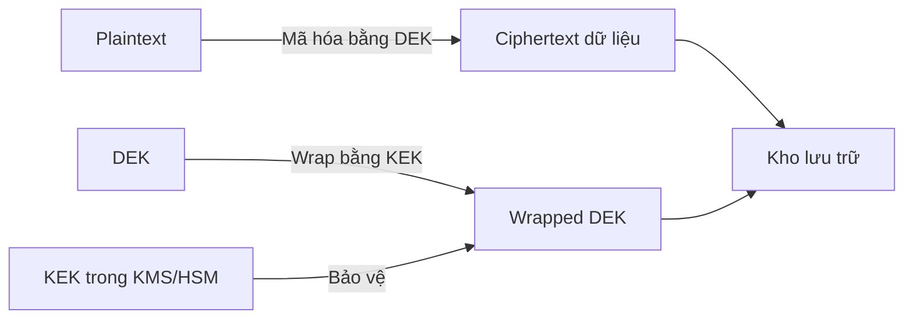
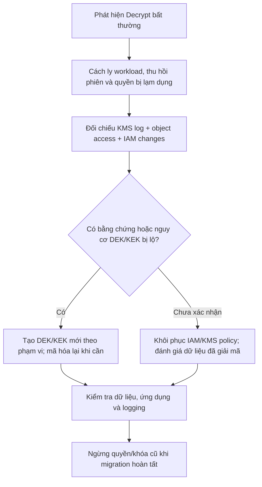

# Key compromise: khi khóa mật mã bị xâm phạm

> **Chương:** Thuật ngữ cốt lõi  
> **Module:** SECURITY_KEY_MANAGEMENT_FUNDAMENTALS — Nền tảng quản lý khóa mật mã

**Key compromise** là tình huống tính bảo mật, tính toàn vẹn hoặc quyền kiểm soát **khóa mật mã** bị xâm phạm, hoặc có căn cứ hợp lý để nghi ngờ bị xâm phạm. Đây là một sự kiện an ninh nghiêm trọng vì khóa quyết định ai có thể **giải mã dữ liệu**, **tạo chữ ký**, **tạo mã xác thực** hoặc **thực hiện phép toán mật mã**. Sự cố có thể ảnh hưởng đến dữ liệu đã lưu từ trước, dữ liệu mới và niềm tin của hệ thống khác vào kết quả mật mã.

Điều quan trọng là **key compromise không đồng nghĩa duy nhất với việc hacker đọc được byte khóa gốc**. Nếu kẻ tấn công không xuất được private key nhưng chiếm được danh tính có quyền gọi `Sign` trong KMS, họ vẫn có khả năng tạo chữ ký trái phép. Tương tự, nếu có quyền gọi `Decrypt` trên một tập ciphertext lớn, họ có thể lấy plaintext dù vật liệu khóa được giữ trong HSM.

Sau bài này, người học có thể:

- Nhận diện các hình thức và dấu hiệu **key compromise** trong vòng đời tạo, cấp phát, lưu trữ, sử dụng, xoay vòng, thu hồi và hủy khóa.
- Phân biệt **lộ vật liệu khóa**, **lạm dụng quyền sử dụng khóa**, **mất tính xác thực của ánh xạ khóa** và các sự cố liên quan nhưng không tương đương.
- Ước lượng phạm vi ảnh hưởng theo loại khóa: **DEK**, **KEK**, khóa đối xứng, private key ký số, khóa HMAC và khóa của giao thức kết nối.
- Lập thứ tự xử lý sự cố: ngăn lạm dụng, đánh giá dữ liệu bị ảnh hưởng, thay khóa, di chuyển dữ liệu/niềm tin, kiểm chứng và loại bỏ khóa cũ.
- Thiết kế kiểm soát truy cập và kiểm toán trên KMS/HSM để giảm khả năng và hậu quả của việc khóa bị xâm phạm.

## 1. Hiểu chính xác “compromise”

Một hệ thống dùng khóa mật mã dựa vào nhiều giả định an toàn:

1. Vật liệu **khóa bí mật** chỉ hiện diện ở những nơi đã được phê duyệt.
2. Chỉ đúng chủ thể được phép dùng khóa, cho đúng **mục đích** và **phép toán**.
3. Người dùng và hệ thống xác minh đang tin vào **đúng public key/đúng định danh khóa**, không phải khóa của kẻ tấn công.
4. Khóa còn trong thời hạn sử dụng và có thể được vô hiệu hóa, thay thế, hủy theo chính sách.

Khi một trong các giả định quan trọng này không còn đáng tin, phải đánh giá key compromise. Tùy hệ thống, “compromised” có thể là **đã xác nhận** hoặc **bị nghi ngờ có căn cứ**; không nên đợi có bằng chứng trích xuất khóa rồi mới ngăn lạm dụng.

### 1.1. Bốn tình huống cần phân biệt

| Tình huống | Ví dụ | Ý nghĩa bảo mật |
|---|---|---|
| **Material exposure** — lộ vật liệu khóa | Private key nằm trong repository công khai; bản sao KEK xuất hiện trong crash dump | Người có bản sao có thể sử dụng khóa **ngoài** vùng kiểm soát của KMS/HSM |
| **Unauthorized key use** — sử dụng khóa trái phép | Danh tính workload bị chiếm quyền và gọi KMS `Decrypt` hoặc `Sign` | Không cần thấy byte khóa vẫn có thể giải mã hoặc ký trái phép |
| **Key control/policy compromise** — mất quyền quản trị khóa | Kẻ tấn công sửa key policy, thêm grant, thay alias hoặc lịch xóa | Có thể mở quyền dùng khóa, chuyển hướng sử dụng hoặc gây gián đoạn |
| **Key authenticity substitution** — thay thế niềm tin vào khóa | Public key/JWKS bị tráo; trust store bị chèn khóa giả | Bên xác minh có thể tin nhầm chữ ký hoặc khóa của kẻ tấn công |

Đối với **public key**, việc một người khác biết giá trị khóa công khai là bình thường, **không phải compromise**. Rủi ro nằm ở private key tương ứng hoặc ở việc public key bị tráo, gắn nhầm danh tính, hay tin cậy sai. Một public key có thể công khai nhưng cần được bảo vệ **tính toàn vẹn và tính xác thực**.

### 1.2. Những khái niệm gần nhau nhưng không giống nhau

- **Key exposure:** vật liệu khóa bị hiển thị, sao chép hoặc có khả năng lọt khỏi ranh giới an toàn; có thể là bằng chứng trực tiếp của compromise hoặc lý do nghi ngờ compromise.
- **Key misuse:** khóa bị dùng sai phép toán, sai chủ thể hoặc sai mục đích; có thể là hậu quả của việc lộ khóa, chiếm quyền IAM hoặc lỗi thiết kế.
- **Key loss:** mất khả năng truy cập/khôi phục khóa, ví dụ xóa khóa hoặc mất bản backup duy nhất. Đây là vấn đề **tính sẵn sàng**; có thể xảy ra mà không có dấu hiệu kẻ khác biết khóa.
- **Key expiration/rotation:** khóa đến hạn, hết cryptoperiod hoặc được thay phiên bản theo kế hoạch. Rotation định kỳ **không chứng minh** khóa cũ đã bị xâm phạm.
- **Algorithm/protocol compromise:** thuật toán hoặc cách triển khai không còn đủ an toàn, ví dụ nonce bị dùng lại trong một cơ chế mã hóa không cho phép. Có thể phải thay khóa và mã hóa lại dữ liệu dù chưa quan sát thấy việc khóa bị sao chép.
- **Credential compromise:** lộ mật khẩu, API token hay API key dùng để xác thực. Tên có chữ “key” không biến API key thành khóa mật mã. Tuy nhiên, nếu credential đó cho phép dùng KMS, sự cố credential có thể kéo theo **unauthorized key use**.

## 2. Vì sao lộ khóa lại nguy hiểm?

Mức độ nguy hiểm phụ thuộc vào **vai trò**, **phạm vi bao phủ**, **quyền sử dụng**, **thời gian hiệu lực** và **dữ liệu mà kẻ tấn công có thể tiếp cận**.

### 2.1. Với mã hóa đối xứng

Nếu khóa AES bí mật bị lộ, người giữ khóa có thể giải mã ciphertext **khi có đủ dữ liệu đầu vào cần thiết**, như ciphertext, nonce/IV và authentication tag (tùy chế độ). Việc thay khóa cho dữ liệu mới **không tự xóa khả năng giải mã ciphertext cũ** mà kẻ tấn công đã sao chép cùng với khóa cũ.

Nếu dùng cùng một khóa cho quá nhiều tenant, bảng hoặc giai đoạn, phạm vi ảnh hưởng sẽ lớn. Ngược lại, thiết kế DEK riêng theo đối tượng hoặc tập dữ liệu làm giảm phạm vi bị ảnh hưởng nếu chỉ một DEK bị lộ.

Đối với các cơ chế mã hóa có xác thực như AES-GCM, việc quản lý nonce, tag và AAD đúng quy tắc vẫn bắt buộc. Không thể coi rotation là cách sửa hoàn toàn cho một lỗi triển khai mật mã đã làm lộ dữ liệu hoặc phá vỡ tính toàn vẹn.

### 2.2. Với private key của mật mã bất đối xứng

Private key dùng để **ký** bị lộ có thể cho phép tạo chữ ký giả giống chủ sở hữu; đây là rủi ro về **tính xác thực và tính toàn vẹn**. Trong hệ thống JWT hoặc chứng từ điện tử, bên xác minh phải biết **khi nào nên ngừng tin khóa cũ**. Không phải mọi chữ ký từng tạo bằng khóa đó đều chắc chắn là giả, nhưng việc phân biệt chữ ký hợp lệ với chữ ký giả sau thời điểm lộ khóa có thể rất khó nếu thiếu dữ liệu kiểm chứng đáng tin.

Private key dùng để **giải mã/thiết lập bí mật** bị lộ có thể ảnh hưởng đến thông điệp hoặc phiên liên quan tùy thuật toán, giao thức và cách sinh khóa phiên. Ví dụ, **forward secrecy** trong một giao thức được triển khai đúng có thể hạn chế khả năng giải mã các phiên đã kết thúc chỉ từ việc lộ private key chứng thư sau này; không được suy luận rằng mọi kết nối TLS cũ hoặc mới đều chắc chắn đã bị giải mã.

### 2.3. Với khóa HMAC

Khi khóa HMAC bí mật bị lộ, kẻ tấn công có thể tạo **MAC hợp lệ** cho thông điệp tùy ý, ví dụ giả mạo webhook khi có đủ bối cảnh giao thức. Vì khóa HMAC thường được chia sẻ giữa bên tạo và bên kiểm tra, phạm vi phân phối khóa càng rộng thì số điểm có thể bị lộ càng nhiều. Nếu có thể, nên cấp khóa theo từng đối tác/workload và quản lý phiên bản để thay riêng từng phạm vi.

### 2.4. Với khóa gốc trong envelope encryption

Trong **envelope encryption**, một **data-encryption key (DEK)** mã hóa dữ liệu; **key-encryption key (KEK)** wrap/bảo vệ DEK. KEK có thể được giữ trong KMS/HSM.



Nếu **một DEK** bị lộ, phạm vi thường là dữ liệu được mã hóa bằng DEK đó. Nếu **KEK** bị lộ dưới dạng vật liệu khóa và kẻ tấn công có các wrapped DEK tương ứng, phạm vi có thể lan ra **nhiều tập dữ liệu**. Nếu kẻ tấn công chỉ có quyền **gọi KMS Decrypt/Unwrap** mà không có vật liệu KEK, phạm vi phụ thuộc vào ciphertext/wrapped DEK họ tiếp cận được, giới hạn quyền, điều kiện gọi và thời gian quyền bị lạm dụng.

**Rewrap** DEK bằng KEK mới bảo vệ phần wrapped DEK trong tương lai, nhưng **không thu hồi** bản DEK plaintext hay ciphertext mà kẻ tấn công đã lấy trước đó. Nếu DEK từng bị lộ, cần đánh giá khả năng phải **sinh DEK mới và mã hóa lại dữ liệu**. Còn nếu chỉ thay KEK, rewrap có thể đủ cho việc chuyển sang bảo vệ bằng khóa mới **khi DEK chưa bị lộ và mô hình đe dọa cho phép**.

## 3. Key compromise xảy ra ở những giai đoạn nào của vòng đời khóa?

| Giai đoạn | Cách compromise có thể xuất hiện | Biện pháp phòng ngừa liên quan |
|---|---|---|
| **Tạo khóa** | Nguồn ngẫu nhiên yếu, seed lộ, tạo khóa trên máy build bị xâm nhập | Dùng CSPRNG/KMS/HSM phù hợp, kiểm soát môi trường và nguồn entropy |
| **Cấp phát/phân phối** | Gửi private key qua chat, email, artifact hoặc kênh không an toàn | Ưu tiên cấp quyền dùng khóa thay vì sao chép khóa; kênh truyền bảo vệ và định danh workload |
| **Lưu trữ** | Khóa trong repository, file cấu hình, biến môi trường bị dump, backup công khai | Kho khóa chuyên dụng, mã hóa at rest, kiểm soát backup, tối thiểu hóa bản sao |
| **Sử dụng** | Quyền `Sign` hoặc `Decrypt` bị lạm dụng; ứng dụng bị remote code execution | Least privilege, tách role, hạn chế mục đích dùng khóa, giám sát thao tác |
| **Xoay vòng** | Duy trì khóa cũ quá lâu; khóa cũ vẫn được chấp nhận vô thời hạn | Quản lý phiên bản, cryptoperiod, thời điểm ngừng dùng và kế hoạch di chuyển |
| **Thu hồi/vô hiệu hóa** | IAM policy/grant không được rút; ứng dụng vẫn dùng cache hoặc key bản sao | Thu hồi quyền ở đúng lớp; xử lý key material bên ngoài KMS; kiểm chứng đóng quyền |
| **Hủy** | Bản sao khóa còn trong backup/log; hoặc hủy khóa khi dữ liệu còn cần giải mã | Kiểm kê bản sao, lịch hủy, chứng cứ xóa phù hợp và kiểm tra khả năng khôi phục |

**Cryptoperiod** là khoảng thời gian mà một khóa được cho phép sử dụng cho một mục đích xác định, chẳng hạn thời gian tạo ciphertext mới. Thời gian sử dụng để **giải mã dữ liệu cũ** có thể dài hơn thời gian dùng để **mã hóa dữ liệu mới**. Vì thế, khóa “đã retire khỏi mã hóa mới” chưa chắc đã có thể hủy ngay.

## 4. Dấu hiệu nào cho thấy cần điều tra compromise?

Key compromise không phải lúc nào cũng phát ra cảnh báo rõ ràng. Các nhóm tín hiệu nên được kết hợp với ngữ cảnh hệ thống:

### 4.1. Bằng chứng về lộ vật liệu khóa

- Phát hiện private key, symmetric key hoặc file chứa key material trong repository, build artifact, log, crash dump, file backup hoặc kênh chia sẻ không được phép.
- Có bằng chứng một tiến trình hoặc tài khoản trái phép đã đọc file key store, export khóa hoặc tải bản backup chứa khóa.
- Kết quả secret scanning, DLP hoặc điều tra endpoint cho thấy giá trị khóa xuất hiện ngoài khu vực được kiểm soát.

### 4.2. Dấu hiệu lạm dụng KMS/HSM

- Số lần gọi `Decrypt`, `UnwrapKey`, `Sign` hoặc `GenerateDataKey` tăng đột ngột, ngoài giờ hoặc từ danh tính chưa từng dùng khóa.
- Có thay đổi bất thường đối với key policy, IAM role, grant, alias, trạng thái disable/delete hoặc quyền export khi sản phẩm hỗ trợ.
- Khóa của môi trường production được gọi từ workload, tài khoản hoặc vùng chạy không nằm trong kiến trúc đã phê duyệt.
- Phép toán ký được thực hiện ngoài luồng phát hành tài liệu/token thông thường; số lượng signature không tương ứng với nghiệp vụ.

### 4.3. Dấu hiệu ở hệ thống phụ thuộc

- Token có chữ ký hợp lệ nhưng được phát hành ngoài hệ thống định danh hoặc có các claim bất thường.
- Webhook với MAC hợp lệ xuất hiện từ nguồn hoặc trạng thái nghiệp vụ không phù hợp.
- Chứng thư bị thay thế, public key/JWKS thay đổi ngoài lịch phát hành, hoặc một dịch vụ tin nhầm khóa không thuộc chủ sở hữu.

**Giới hạn của audit:** Một bản sao khóa đã bị export có thể dùng ở nơi khác mà **không tạo thêm log KMS**. Ngược lại, log KMS chỉ ghi nhận yêu cầu gọi phép toán có thể chưa đủ để kết luận plaintext đã bị lấy đi: cần đối chiếu quyền đọc ciphertext, ứng dụng, mạng, dữ liệu truy cập và kết quả lệnh. Không có log bất thường **không chứng minh khóa chưa bị lộ**.

## 5. Ước lượng phạm vi ảnh hưởng (blast radius)

Trước khi quyết định thay khóa theo cách nào, hãy dựng một bản đồ phụ thuộc:

| Loại khóa bị ảnh hưởng | Khả năng bị khai thác | Những gì cần kiểm kê |
|---|---|---|
| **DEK** | Giải mã dữ liệu nằm dưới DEK đó, nếu có ciphertext tương ứng | Record/object/tenant, bản backup, phiên bản DEK, đường phân phối plaintext |
| **KEK/KMS key** | Unwrap nhiều DEK hoặc thực hiện phép toán trên tập ciphertext rộng hơn | Danh sách wrapped DEK, grants/IAM, dịch vụ phụ thuộc, backup và lịch sử key version |
| **Private key ký JWT** | Giả mạo token được hệ thống xác minh còn tin | Public key/JWKS, `kid`, audience, token TTL, issuer, validator và key cache |
| **Private key chứng thư TLS** | Mạo danh endpoint hoặc tác động bảo mật kết nối tùy giao thức | Chứng thư, domain, client trust store, revocation, phiên/protocol liên quan |
| **Khóa HMAC/webhook** | Tạo MAC giả mạo hợp lệ | Đối tác, endpoint, định dạng thông điệp, replay protection và version |
| **Khóa ký dữ liệu/chứng từ** | Tạo chữ ký giả, làm suy giảm độ tin cậy của chữ ký | Người xác minh, tài liệu, timestamp, quy trình ký, chain of trust |

Để không đánh giá thiếu hoặc thổi phồng hậu quả, cần trả lời ít nhất bảy câu hỏi:

1. **Khóa nào** bị ảnh hưởng (ID, loại, phiên bản, alias, owner và môi trường)?
2. **Hình thức compromise** là lộ vật liệu khóa, chiếm quyền gọi phép toán, thay key policy hay tráo trust key?
3. **Từ thời điểm nào** khóa có thể không còn đáng tin? Có bằng chứng về thời điểm bắt đầu hay chỉ có khoảng nghi vấn?
4. **Ai có thể sử dụng** khóa đó, từ nơi nào và trên loại dữ liệu/thông điệp nào?
5. **Đối tượng nào** có thể đã bị lấy: ciphertext, wrapped DEK, plaintext, token, chữ ký, file backup hoặc public key metadata?
6. **Khóa khác** có phụ thuộc vào khóa này không, ví dụ KEK wrap hàng nghìn DEK?
7. **Nếu vô hiệu hóa ngay**, dịch vụ nào sẽ ngừng hoạt động hoặc dữ liệu nào không còn giải mã được? Có thể chặn lạm dụng tại IAM/ứng dụng trước khi thay đổi trạng thái khóa không?

Cần phân biệt **phạm vi có thể bị ảnh hưởng** với **phạm vi đã xác nhận bị khai thác**. Ví dụ, một KEK bị lộ làm nhiều wrapped DEK có nguy cơ, nhưng không đủ cơ sở kết luận kẻ tấn công đã tải tất cả ciphertext nếu chưa có chứng cứ.

## 6. Ứng phó sự cố key compromise theo đúng thứ tự

### Bước 1 — Kích hoạt xử lý sự cố và bảo toàn bằng chứng

Ghi nhận key ID/version, owner, môi trường, mục đích sử dụng, tình huống phát hiện, dấu thời gian và danh tính nghi vấn. Bảo toàn audit log KMS/HSM, IAM, secrets manager, ứng dụng, kho dữ liệu và log truy cập mạng trong phạm vi quyền/quy trình ứng phó của tổ chức. Lưu bằng chứng theo quy định nhưng **không sao chép private key hoặc plaintext nhạy cảm sang ticket/log** chỉ để chứng minh sự cố.

Tách rõ **điều đã quan sát**, **giả thuyết** và **những gì chưa biết**. Không mặc định một lần đọc khóa đồng nghĩa đã giải mã mọi dữ liệu, cũng không chờ xác minh mọi giả thuyết mới chặn tài khoản đang lạm dụng.

### Bước 2 — Ngăn lạm dụng tiếp diễn

Tùy tình huống có thể:

- Vô hiệu hóa phiên/credential của workload bị chiếm quyền, rút IAM permission, key grant, quyền ký/giải mã hoặc khóa đường truy cập trái phép.
- Tắt luồng ký hoặc phát hành token đang bị lạm dụng, cách ly máy/runner bị nhiễm, ngừng công bố artifact chứa khóa.
- Nếu khóa đã xuất/lộ vật liệu, coi khóa đó là **không thể lấy lại độ bí mật** chỉ bằng việc rút quyền gọi KMS. Phải thay khóa và xử lý bản sao đã phát tán.
- Với HSM/KMS còn đang phục vụ giải mã dữ liệu quan trọng, lựa chọn disable phải có đánh giá tác động: có thể cần trước tiên khóa **đường truy cập trái phép**, duy trì đường khôi phục được kiểm soát và thực hiện chuyển đổi.

Không hủy vĩnh viễn khóa ngay khi phát hiện sự cố nếu hệ thống còn cần khóa để di chuyển dữ liệu, xác minh bản ghi cũ hoặc khôi phục backup. **Containment** và **destruction** là hai quyết định khác nhau.

### Bước 3 — Điều tra, khoanh vùng và ưu tiên

Đối chiếu log phép toán với quyền truy cập vào ciphertext/đối tượng dữ liệu, chính sách, grant, phiên bản khóa và các thay đổi gần thời điểm nghi vấn. Xác định liệu attacker có **byte khóa**, chỉ có **quyền gọi API khóa**, hay chỉ **thay được ánh xạ khóa**. Kiểm tra phụ thuộc với hệ thống xác minh chữ ký và hệ thống lưu trữ bản backup.

Xếp ưu tiên theo khả năng giả mạo đang diễn ra, mức nhạy cảm dữ liệu, số tenant/hệ thống bị ảnh hưởng, lượng dữ liệu còn cần giải mã và yêu cầu lưu giữ. Thiếu bằng chứng không nên biến thành kết luận an toàn; ghi rõ mức độ không chắc chắn.

### Bước 4 — Tạo khóa thay thế và di chuyển an toàn

Tạo key mới bằng cơ chế sinh khóa phù hợp, sử dụng quyền và môi trường đã được làm sạch. Không sinh khóa mới trên host hoặc pipeline đang bị chiếm quyền. Lập kế hoạch chuyển đổi theo loại khóa:

| Trường hợp | Hành động khôi phục chính |
|---|---|
| **Private key ký số** | Tạo cặp khóa mới, chuyển bên phát hành sang khóa mới, cập nhật trust/JWKS/chứng thư và chính sách ngừng tin khóa cũ |
| **TLS private key** | Tạo key và certificate mới, triển khai, yêu cầu thu hồi certificate cũ khi thích hợp; kiểm tra cơ chế trust và hành vi client |
| **Khóa HMAC** | Sinh khóa mới, trao đổi an toàn với các bên dùng, chuyển phiên bản MAC và ngừng chấp nhận khóa nghi vấn |
| **DEK lộ** | Sinh DEK mới, mã hóa lại dữ liệu liên quan, cập nhật metadata và wrapped DEK; xử lý bản sao và backup theo chính sách |
| **KEK lộ** | Thay KEK và xử lý các wrapped DEK chịu ảnh hưởng; nếu attacker có thể đã unwrap/lấy DEK, cân nhắc thay DEK và mã hóa lại dữ liệu |
| **KMS permission bị chiếm** | Thu hồi/quy hoạch lại IAM role, grant và phiên bị lạm dụng; đánh giá phép toán đã xảy ra, đổi khóa khi nguy cơ thực tế yêu cầu |
| **Public key/JWKS bị tráo** | Khôi phục kênh phân phối/ánh xạ khóa đúng, cập nhật trust, xác minh tính toàn vẹn và xem xét thông điệp đã bị chấp nhận sai |

Đừng nhầm **KMS key rotation** với **reencryption**. Với nhiều KMS, rotation tạo vật liệu/phiên bản mới cho phép mã hóa mới mà vẫn giữ cơ chế giải mã dữ liệu cũ; điều này hỗ trợ tính sẵn sàng, nhưng **không làm dữ liệu cũ trở nên bí mật trở lại** nếu attacker đã lấy được key và ciphertext.

### Bước 5 — Vô hiệu hóa khóa cũ ở những nơi còn được chấp nhận

Đây là bước thường khó nhất: các service vẫn có thể giữ key trong memory cache, trust store, JWKS cache, cấu hình hoặc backup. Phải thay đổi **nơi kiểm tra/tiêu thụ khóa**, không chỉ đổi giá trị tại một kho.

Với chữ ký số, cần quyết định rõ cách xử lý những thông điệp/token được ký trước thời điểm nghi vấn, trong khoảng thời gian nghi vấn và sau khi phát hiện. Với JWT, chỉ thay `kid` ở issuer mà verifier vẫn chấp nhận khóa cũ có thể khiến token giả ký bằng khóa cũ tiếp tục được chấp nhận. Cần thu hẹp hoặc ngừng tin khóa cũ theo rủi ro, và quản lý token/session đã cấp.

Với chứng thư số, quy trình thu hồi trong PKI, CRL/OCSP hoặc các cơ chế tin cậy khác phụ thuộc hệ thống client; không nên khẳng định mọi client sẽ lập tức kiểm tra và từ chối chứng thư vừa bị thu hồi. Với tài liệu ký số dài hạn, việc đánh giá chữ ký lịch sử có thể cần timestamp đáng tin cậy và chính sách xác minh riêng.

### Bước 6 — Kiểm chứng, giám sát và đóng sự cố

Kiểm tra rằng dịch vụ mới dùng khóa đúng, dữ liệu cần bảo toàn vẫn giải mã được, mọi nơi xác minh đã cập nhật, quyền cũ thực sự bị rút và không còn các bản sao khóa chưa được quản lý. Quan sát log `Decrypt`/`Sign` bất thường, lỗi xác minh/chuyển khóa, tỷ lệ giải mã thành công và lưu lượng từ danh tính đã bị thu hồi.

Chỉ hủy khóa cũ khi đã xác nhận hết nhu cầu sử dụng hợp lệ, hoàn thành migration và đáp ứng chính sách lưu giữ/khôi phục. Sau đó cập nhật nguyên nhân gốc: làm sao khóa/đường dùng khóa bị lộ, vì sao kiểm soát không chặn được, mất bao lâu để phát hiện và khắc phục.

## 7. Ví dụ thực tế: danh tính ứng dụng có quyền KMS Decrypt bị chiếm

Giả sử `orders-service` lưu dữ liệu đơn hàng bằng envelope encryption. Một KEK trong KMS wrap nhiều DEK, mỗi DEK bảo vệ một nhóm record. Ứng dụng được cấp quyền `kms:Decrypt` đối với KEK để giải mã các DEK phục vụ đọc đơn hàng.

Kẻ tấn công khai thác lỗ hổng ứng dụng và lấy được phiên làm việc của workload. Họ gửi hàng loạt yêu cầu đọc dữ liệu, sau đó gọi `Decrypt` để unwrap các DEK có quyền tiếp cận. Trong tình huống này:

- **Chưa chắc KEK đã bị xuất**: KEK có thể vẫn ở trong KMS/HSM.
- **Vẫn là sự cố sử dụng khóa trái phép**: quyền gọi `Decrypt` đang bị lạm dụng.
- **Dữ liệu có thể bị lộ**: attacker đã có ciphertext, wrapped DEK và kết quả unwrap/giải mã trong phạm vi họ gọi được.
- **Chỉ xoay KEK là chưa đủ**: dữ liệu đã lấy thành plaintext không thể “thu hồi”; nếu plaintext DEK đã bị sao chép, wrapped DEK mới cũng không giúp bảo vệ ciphertext cũ khỏi người nắm DEK.

Luồng xử lý hợp lý:



Trong báo cáo sự cố, nên tách ba con số:

1. **Số đối tượng có nguy cơ:** những dữ liệu mà credential bị chiếm *có thể* truy cập theo IAM, chính sách và kiến trúc.
2. **Số đối tượng được quan sát là đã truy cập/giải mã:** căn cứ vào log đáng tin và bằng chứng khác.
3. **Số đối tượng cần chuyển đổi mật mã:** những dữ liệu/DEK/KEK phải thay và mã hóa lại theo phân tích rủi ro, có thể khác hai nhóm trên.

Không gộp ba phạm vi này thành một kết luận “toàn bộ dữ liệu đã bị giải mã” hoặc “không có log nên không có rò rỉ”.

## 8. Quy trình kỹ thuật minh họa khi cần thay khóa

Đoạn sau là **mã giả**, dùng để minh họa orchestration. Nó không phải SDK KMS hoặc chương trình Java chạy trực tiếp:

```text
incident = incidentRegistry.open(
    affectedKeyId, suspectedWindow, evidenceReferences
)

// Ngăn quyền trái phép nhưng vẫn xét đường giải mã phục vụ khôi phục.
identity.revokeCompromisedSession()
kms.revokeUnexpectedGrants(affectedKeyId)
audit.snapshotRelevantEvents(incident.id)  // Chỉ ghi metadata, không ghi key/DEK

newKEK = kms.createKey(restrictedPolicy)

for record in inventory.recordsProtectedBy(affectedKeyId):
    oldPlainDEK = controlledRecovery.unwrap(
        record.wrappedDEK, record.keyId
    )

    if incident.dekMayBeCompromised(record):
        plaintext = aead.decrypt(
            oldPlainDEK, record.ciphertext, record.nonce,
            record.tag, record.aad
        )
        newPlainDEK = secureRandom.generateDataKey()
        (newCiphertext, newNonce, newTag) = aead.encrypt(
            newPlainDEK, plaintext, record.aad
        )
        newWrappedDEK = kms.wrap(newKEK, newPlainDEK)
        atomicStore.replaceRecordAndKeyMetadata(
            record, newCiphertext, newNonce, newTag,
            record.aad, newWrappedDEK, newKEK.id
        )
        clearSensitiveBuffersAsPossible()
    else:
        // Chỉ hợp lệ nếu phân tích rủi ro kết luận DEK vẫn đáng tin.
        newWrappedDEK = kms.wrap(newKEK, oldPlainDEK)
        atomicStore.replaceWrappedDEKAndKeyId(
            record, newWrappedDEK, newKEK.id
        )

verifyMigrationCoverage()
verifyDecryptAndRecovery()
retireOldKeyOnlyAfterDependenciesAreResolved()
```

**Ràng buộc quan trọng khi triển khai thật:**

- Phải nhận diện chính xác những record, backup, bản sao đồng bộ và phiên bản dữ liệu phụ thuộc khóa cũ; vòng lặp ở trên giả định có inventory đáng tin.
- Ghi dữ liệu mới phải **atomic hoặc có cơ chế checkpoint/retry/idempotency** để tránh ciphertext và metadata trỏ tới hai bộ khóa khác nhau; triển khai migration cần xử lý cập nhật đồng thời.
- Phải dùng API AEAD đúng chuẩn, tạo nonce không bị tái sử dụng với cùng DEK và kiểm tra tag/AAD trước khi chấp nhận plaintext. Không tự phát minh thuật toán mã hóa.
- Plaintext DEK và plaintext dữ liệu đi qua bộ nhớ trong quá trình phục hồi; cần cô lập workload, phân quyền, giới hạn lifetime và tránh log. Trong JVM, không thể cam kết xóa mọi bản sao nhạy cảm khỏi bộ nhớ.
- Thu hồi quyền bên ngoài và di chuyển toàn bộ dữ liệu có thể là công việc dài. Hệ thống phải quản lý trạng thái khóa **new / active / decrypt-only / disabled / scheduled-for-destruction** phù hợp với dịch vụ, đồng thời xác định rõ khi nào chính sách có thể ngừng tin khóa cũ.
- Quá trình đổi khóa không thể xóa các bản plaintext/ciphertext/DEK mà attacker đã sao chép. Cần song song xử lý nghĩa vụ điều tra và ứng phó rò rỉ dữ liệu khi có căn cứ.

## 9. Kiểm soát phòng ngừa và giảm thiểu hậu quả

### 9.1. Thu hẹp nơi khóa xuất hiện

Ưu tiên giữ private key hoặc KEK dài hạn trong **KMS/HSM**, cho ứng dụng gọi phép toán theo định danh và chính sách thay vì tải vật liệu khóa nếu kiến trúc hỗ trợ. Hạn chế xuất khóa, copy qua CI/CD, ghi vào biến môi trường, tệp tạm hoặc log. Đối với các trường hợp buộc phải phân phối key material (chẳng hạn HMAC chia sẻ), mã hóa khi truyền/lưu và theo dõi nơi nhận, phiên bản, tuổi khóa.

### 9.2. Least privilege và tách vai trò

Phân biệt quyền **Encrypt**, **Decrypt**, **Sign**, **Verify**, **GenerateDataKey**, **CreateKey**, **UpdateKeyPolicy**, **DisableKey** và **ScheduleKeyDeletion**. Dịch vụ chỉ ký không cần quyền Decrypt; tài khoản vận hành không nên tự có quyền ký mọi chứng từ. Kiểm soát ai có thể sửa **IAM policy/grant** quan trọng ngang với việc kiểm soát ai gọi phép toán.

Áp dụng workload identity, token ngắn hạn, điều kiện theo môi trường/vùng chạy khi phù hợp, tách duty giữa quản trị khóa và ứng dụng, phê duyệt nhiều bên cho thao tác hủy nghiêm trọng nếu hệ thống hỗ trợ.

### 9.3. Giới hạn phạm vi khóa và thời gian sử dụng

Dùng key hierarchy rõ ràng: KEK tách DEK, DEK có phạm vi vừa đủ (theo object, tenant hoặc nhóm dữ liệu). Không tái sử dụng cùng một khóa cho nhiều thuật toán/mục đích nếu thiết kế mật mã không cho phép. Đặt cryptoperiod, rotation policy và retention theo loại dữ liệu. Thời gian chờ xóa và quy trình khôi phục khóa phải xét đến backup/lưu trữ dài hạn.

### 9.4. Kiểm toán và phát hiện bất thường

Thu thập metadata về key ID, identity, loại phép toán, thời gian, thành công/thất bại, thay đổi policy/grant và truy cập dữ liệu liên quan. Cảnh báo các hành vi trái baseline như Sign/Decrypt đột biến hoặc workload lạ. Bảo vệ bản thân log kiểm toán khỏi sửa/xóa trái phép; tuyệt đối không ghi byte khóa, token, plaintext DEK hoặc dữ liệu khách hàng vào log.

### 9.5. Chuẩn bị sẵn kế hoạch phản ứng

Duy trì inventory key ID → owner → mục đích → hệ thống phụ thuộc → vị trí ciphertext/backup → chính sách phục hồi. Diễn tập revoke IAM/grant, chuyển key version, rewrap, reencrypt, cập nhật certificate/JWKS và xử lý client cache. Kiểm tra cả hai mặt: **không tiếp tục tin khóa đã compromise** và **không làm mất dữ liệu hợp lệ vì hủy khóa quá sớm**.

## 10. Những hiểu lầm cần tránh

| Khẳng định sai | Cách hiểu đúng |
|---|---|
| “KMS key không export được, vì thế không thể bị compromise.” | Key material có thể không xuất được, nhưng **quyền dùng khóa** hoặc **chính sách khóa** vẫn có thể bị chiếm/lạm dụng. |
| “Chỉ cần xoay KEK là mọi dữ liệu cũ an toàn trở lại.” | Rotation không thu hồi plaintext/DEK/ciphertext đã bị lấy; cần đánh giá rewrap, thay DEK, reencrypt và phạm vi rò rỉ. |
| “Lộ public key nghĩa là lộ bí mật.” | Public key được phép công khai; cần bảo vệ tính xác thực của ánh xạ public key và private key tương ứng. |
| “Disable key tương đương xóa key.” | Disable thường chặn dùng theo cơ chế dịch vụ; destroy vật liệu khóa có thể không thể đảo ngược và làm mất khả năng giải mã. |
| “Không thấy lệnh KMS bất thường thì khóa chắc chắn an toàn.” | Một bản key đã bị xuất có thể được sử dụng ngoài hệ thống và không xuất hiện trong KMS audit. |
| “Đổi private key ký JWT là đủ để chặn token giả.” | Bên xác minh phải cập nhật trust/key cache và ngừng chấp nhận khóa cũ theo rủi ro; token giả ký bằng khóa cũ có thể vẫn được tin nếu verifier chưa đổi. |
| “Bất kỳ API key bị lộ đều là cryptographic key compromise.” | API key thường là credential; cần phân biệt loại tài sản. Nếu API key/credential cho phép gọi KMS thì nó còn tạo ra rủi ro **sử dụng khóa trái phép**. |

## 11. Câu hỏi tự kiểm tra

**1. Nếu kẻ tấn công có quyền `kms:Sign` nhưng không export được private key, đã có key compromise chưa?**  
Có thể đã có **unauthorized key use** nếu quyền đó bị chiếm hoặc sử dụng trái phép. Phải điều tra chữ ký được tạo, thu hồi quyền, thay key/trust khi phù hợp; sự kiện không nhất thiết chứng minh private key đã bị sao chép.

**2. Khi lộ một DEK, có đủ chỉ đổi KEK và rewrap DEK đó không?**  
Không. Kẻ tấn công biết DEK cũ vẫn có thể giải mã ciphertext cũ trong phạm vi DEK. Cần đánh giá thay DEK và mã hóa lại dữ liệu có nguy cơ; đồng thời xử lý những bản sao attacker đã thu thập được.

**3. Một public key được đăng trên website công khai có phải bị compromise?**  
Không, nếu chỉ là hành động công bố public key đúng mục đích. Compromise liên quan đến private key, thay đổi/tráo public key trái phép hoặc mất tính xác thực của gắn kết giữa khóa và chủ thể.

**4. Khi phát hiện KEK nghi bị lộ, có nên lập tức xóa vĩnh viễn không?**  
Không nên hủy mù quáng. Cần ngăn lạm dụng ngay, bảo toàn bằng chứng, xác định dữ liệu phụ thuộc, tổ chức migration/khôi phục rồi mới hủy theo chính sách. Xóa trước khi di chuyển có thể khiến dữ liệu hợp lệ không thể giải mã.

**5. Làm thế nào phân biệt lộ vật liệu KEK và lạm dụng API KMS?**  
Kiểm tra khả năng export/file chứa key, lịch sử grant/IAM và log gọi phép toán, truy cập wrapped DEK/ciphertext. Nếu có bản sao byte khóa gốc, kẻ tấn công có thể dùng ngoài KMS; nếu chỉ lạm dụng API, phạm vi quyền/đường truy cập/ghi log của dịch vụ có thể giúp khoanh vùng, nhưng phải xác minh bằng chứng.

## 12. Ghi nhớ

**Key compromise là việc mất hoặc nghi mất sự kiểm soát an toàn đối với vật liệu khóa, quyền sử dụng khóa hoặc niềm tin vào khóa.** Tác động khác nhau theo khóa đối xứng, private key ký/giải mã, HMAC, DEK và KEK; vì vậy không có một thao tác “rotate key” nào tự động giải quyết mọi sự cố.

Trong mô hình quản lý khóa an toàn, **KMS/HSM** giúp giữ vật liệu khóa và kiểm soát phép toán, **envelope encryption** giới hạn và tổ chức phạm vi DEK/KEK, **IAM** giới hạn danh tính được sử dụng khóa, còn **audit** cung cấp chứng cứ điều tra. Các cơ chế này phải gắn với vòng đời **tạo → cấp phát → lưu trữ → sử dụng → xoay vòng → thu hồi → hủy**. Khi nghi có compromise, cần **ngăn lạm dụng sớm, đo phạm vi ảnh hưởng, khôi phục độ tin cậy và tính sẵn sàng một cách có kiểm chứng**, sau đó mới loại bỏ khóa cũ an toàn.
