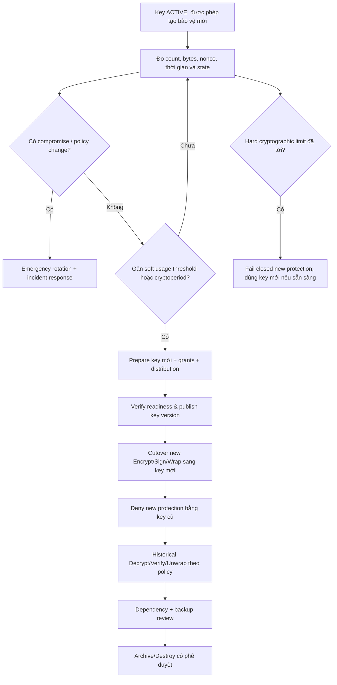
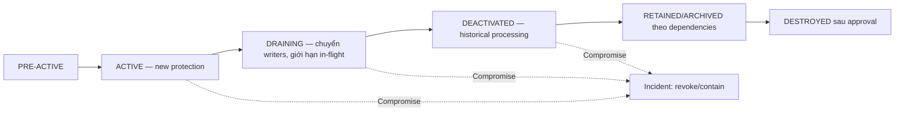
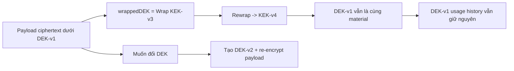
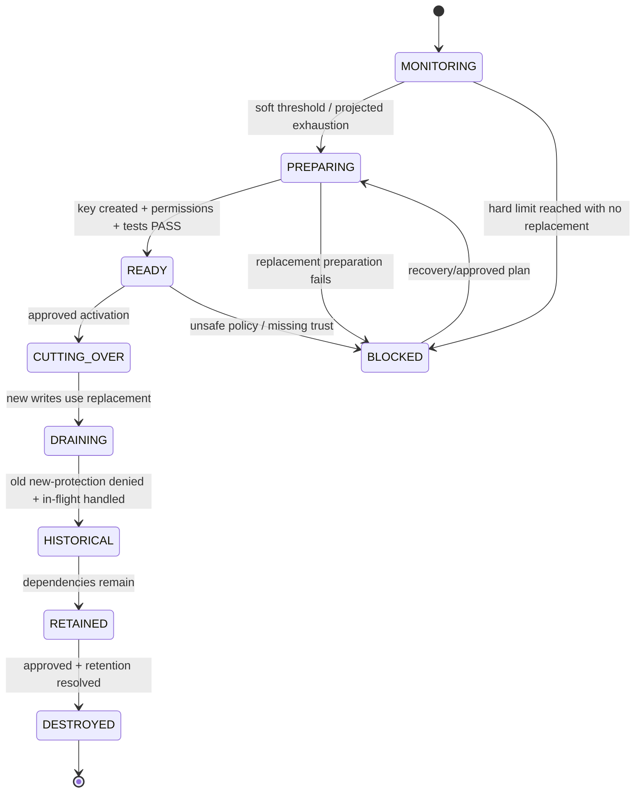
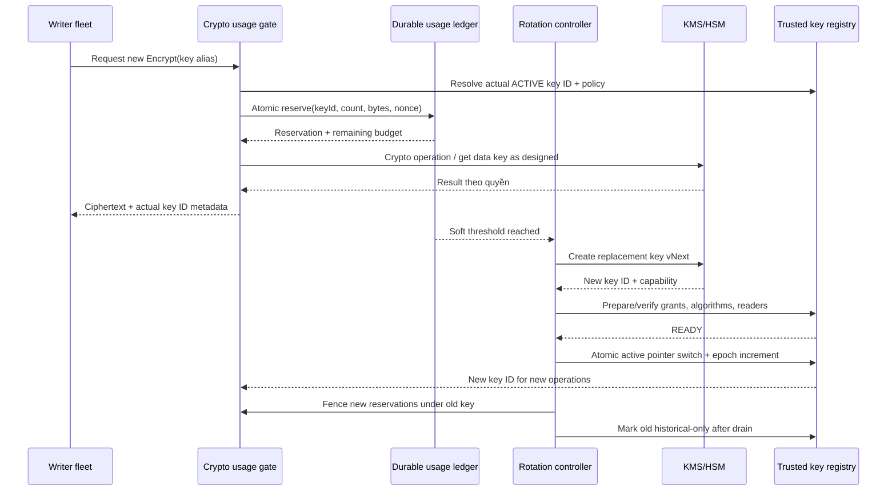

# Rotation theo số lần sử dụng — Xoay vòng khóa dựa trên mức tiêu thụ thực tế

Trong chương **Cryptoperiod và rotation** của module **SECURITY_KEY_MANAGEMENT_FUNDAMENTALS**, **rotation theo số lần sử dụng** (*usage-based / invocation-count-based key rotation*) là chiến lược **chuyển các phép toán mật mã mới sang một khóa khác khi mức sử dụng của khóa hiện tại tiến gần hoặc đạt ngưỡng đã được phê duyệt**. Ngưỡng đó có thể tính theo **số phép mã hóa, số chữ ký, số lần bọc khóa, tổng lượng dữ liệu, số nonce đã cấp hoặc tổ hợp các đại lượng này**.

Ví dụ: một dịch vụ dùng **AES-GCM** để mã hóa dữ liệu, có nhiều worker xử lý đồng thời. Việc đặt lịch “đổi DEK mỗi tháng” không đủ nếu lưu lượng bất ngờ tăng mạnh và khóa bị dùng nhiều hơn ngân sách trước khi hết tháng. Ngược lại, một khóa ít được dùng vẫn có thể cần rotate vì **cryptoperiod**, thay đổi người quản lý, thu hồi quyền hoặc sự cố lộ khóa. Bởi vậy, **rotation theo số lần sử dụng bổ sung cho rotation theo thời gian, không thay thế nó**.

Mục tiêu của bài không phải đưa ra một con số chung áp dụng cho mọi thuật toán. **Giới hạn thực tế phụ thuộc thuật toán/mode, nonce construction, kích thước thông điệp, key scope, security strength, phân tích bảo mật, provider và chính sách tổ chức.** Trọng tâm là **thiết kế trigger, ledger, orchestration và quy trình chuyển khóa không vượt hard limit**, kể cả khi có retry, cache DEK, nhiều region, failover và backup.

Bài kết nối rotation theo mức sử dụng với toàn bộ vòng đời khóa từ **tạo, cấp phát, lưu trữ, sử dụng, xoay vòng, thu hồi đến hủy**, cùng mật mã đối xứng, bất đối xứng, chữ ký số, KMS/HSM, envelope encryption, IAM, key inventory và kiểm toán.

## 1. Mục tiêu học tập

Sau khi hoàn thành bài học, bạn có thể:

1. Phân biệt **usage-based rotation**, **time-based rotation**, **event-driven rotation** và **compromise-driven rotation**.
2. Xác định **đối tượng đang được đếm**: actual key material/version, operation, bytes/blocks, nonce allocation, signing attempts và unwrap calls.
3. Giải thích **soft threshold, hard limit, headroom, warning, reservation và cutover** trong một kế hoạch rotation.
4. Hiểu vai trò của **AES-GCM nonce uniqueness** và tại sao tổng số invocation phải tính qua mọi writer cùng dùng một DEK.
5. Thiết kế usage ledger bền vững với **atomic reservation, idempotency, fencing epoch, key ID bất biến và chống rollback**.
6. Triển khai luồng **prepare → activate → cutover → drain → deactivate → retain historical-use → destroy**.
7. Phân biệt **rotate DEK**, **rotate KEK/rewrap**, **rotate signing key** và **rotate HMAC secret** trong thực tế.
8. Phát hiện sai lầm khi cache DEK, khi KMS quota được nhầm là cryptographic budget hoặc khi nhiều region đếm riêng.
9. Đọc một ví dụ **Java 17** mô phỏng switch khóa theo ngưỡng sử dụng bằng **CAS atomic trong một JVM** và hiểu giới hạn production.
10. Thiết kế kiểm thử âm tính, audit, DR và runbook khi hạn mức bị vượt hoặc không xác định được mức sử dụng.

## 2. Tại sao cần xoay vòng theo số lần sử dụng?

### 2.1. Rotation theo lịch không phản ánh lưu lượng

Một khóa có thể được dùng:

- 100 lần trong một ngày ít tải;
- 1.000.000 lần trong ngày cao điểm;
- bởi nhiều container chạy sau một load balancer;
- bởi hai region active-active cùng lúc;
- bởi một ứng dụng sử dụng **DEK cache** nên không phải mỗi encrypt đều gọi KMS.

Nếu key policy chỉ ghi `rotateAt = 2026-12-31`, số lượt sử dụng có thể thay đổi nhiều bậc độ lớn trước mốc đó. Usage-based rotation cho phép phản ứng theo **mức tiêu thụ thực tế**, thay vì giả định tốc độ sử dụng cố định.

### 2.2. Có hai nhóm động cơ

| Động cơ | Mô tả | Ví dụ |
| --- | --- | --- |
| **Ràng buộc mật mã** | Giới hạn xuất phát từ bảo đảm an toàn của thuật toán/mode hoặc độ tin cậy của nonce/key usage. | Không dùng lại cặp key–nonce với AES-GCM; giới hạn tổng invocation/độ dài thông điệp theo profile. |
| **Ràng buộc rủi ro và vận hành** | Tổ chức chủ động hạn chế blast radius hoặc tác động của key compromise. | DEK cho mỗi object, hạn chế tổng dữ liệu mỗi key; signer bị giới hạn số giao dịch trong một kỳ. |

**Không được gọi một quota tùy chọn của sản phẩm là “giới hạn toán học của AES-GCM” nếu không có cơ sở.** Ngược lại, không được vượt một ràng buộc mật mã chỉ vì dashboard coi đó là mức cảnh báo linh hoạt.

### 2.3. Những trường hợp nên kích hoạt rotation



**Thứ tự ưu tiên:** nếu một hard limit là điều kiện bắt buộc, không thể chấp nhận thêm phép toán cũ chỉ vì khóa mới chưa sẵn sàng. Hệ thống cần tạo headroom để đạt cutover trước khi chạm trần, đồng thời có phương án fail-closed và DR đã được thiết kế.

## 3. Phân biệt rotation theo số lần sử dụng với các chiến lược khác

| Chiến lược | Trigger | Thích hợp khi | Điểm cần chú ý |
| --- | --- | --- | --- |
| **Time-based** | Đến ngày/tuổi khóa hoặc hết protection cryptoperiod. | Tốc độ dùng biến động nhỏ, chính sách định kỳ. | Không kiểm soát usage tăng đột biến. |
| **Count-based** | Tổng new operations đạt ngưỡng. | Khóa mã hóa, ký hoặc bọc được dùng rất nhiều. | Đếm qua mọi writer, xử lý retry/race. |
| **Volume-based** | Tổng byte/block hoặc dữ liệu mới vượt ngưỡng. | Kích thước bản tin biến động mạnh. | Đơn vị theo thuật toán, AAD, padding/chunking. |
| **Nonce-budget-based** | Không gian nonce/range hoặc usage budget gần cạn. | AES-GCM và mode yêu cầu nonce uniqueness. | Counter không tự thay thế nonce issuer. |
| **Risk/event-driven** | Compromise, IAM misconfiguration, algorithm deprecation, chuyển ownership. | Incident/security event. | Có thể phải rotate ngay dù usage thấp. |
| **Hybrid** | Mốc tới sớm nhất trong time/count/volume/nonce/event. | Hệ thống production có security requirement cao. | Nhiều signal và một enforcement model nhất quán. |

Ví dụ về **hybrid policy**:

```text
Rotate when the FIRST condition occurs:
  - protectionUntil is reached;
  - newEncryptCalls reaches the policy threshold;
  - protectedBytes reaches the policy threshold;
  - available nonce range is near exhaustion;
  - key is suspected compromised;
  - mandatory algorithm/policy change occurs.
```

**Không đưa số liệu minh họa ở bài này thành “chuẩn NIST” hay “ngưỡng mặc định mọi KMS”.** Giá trị phải được chọn dựa trên scheme và threat model cụ thể, có security review.

## 4. Cần đếm chính xác cái gì?

### 4.1. Invocation count khác request count

Một HTTP request có thể tạo nhiều crypto operations. Ngược lại, một KMS request có thể tạo DEK, rồi ứng dụng dùng DEK đó để mã hóa nhiều record ở RAM.

```text
Client request:
  Upload 1 file 10 GB

Ứng dụng:
  1 lần GenerateDataKey tại KMS
  N phép AEAD Encrypt cho N chunks

KMS calls = 1
Payload encrypt invocations = N
Protected bytes ≈ 10 GB
```

Nếu hard budget thuộc **DEK**, phải đếm các thao tác mã hóa thực sự dưới DEK, không chỉ `GenerateDataKey`, HTTP calls hoặc database writes.

### 4.2. Các đại lượng có thể cần theo dõi

| Đại lượng | Ví dụ dùng | Những gì dễ bỏ sót |
| --- | --- | --- |
| **newEncryptCalls** | AES-GCM DEK. | Cache hits, retries, background jobs, multiple workers. |
| **newWrapCalls** | KEK trong KMS/HSM. | Rewrap batch, regional migration, backup workflow. |
| **newSignCalls** | RSA-PSS, ECDSA, Ed25519 signer. | Batch signing, token service phụ, offline signer. |
| **newMacCalls** | HMAC secret. | Gửi webhook và retry ở nhiều đối tác. |
| **newDerivedKeys** | HKDF-based key derivation theo profile. | Domain separation, output scope, key hierarchy usage. |
| **protectedBytes/blocks** | Mã hóa file, stream hoặc hồ sơ lớn. | Chunking, AAD length, đơn vị block, giới hạn từng message. |
| **nonceReservations** | AES-GCM counter-based/nonces. | Reservation chưa commit, crash, VM snapshot, active-active. |
| **verification/decryptionAttempts** | Abuse/rate limit riêng. | Không phải lúc nào dùng chung budget new protection. |
| **keyAge** | Cryptoperiod. | Thời gian tạo, activate, deactivated khác nhau. |
| **providerCalls** | Quota và chi phí KMS/HSM. | Không phản ánh toàn bộ offline crypto usage. |

### 4.3. Đếm per-key material hay per-key ID?

Thông thường ledger cần gắn với **actual immutable key ID/version**, không chỉ alias `current`. Nếu một provider tạo **replica cùng key material** ở hai region, các ràng buộc thuật toán gắn với **vật liệu khóa toán học** có thể cần cộng tổng usage trên cả hai, dù hai object key có tên/ARN khác nhau.

Một bộ key material có thể có:

```text
materialIdentity = internal-key-lineage-42
actualKeyId-A    = KMS-A/key-v7
actualKeyId-B    = KMS-B/replica-v7
currentAlias-A   = billing/current
currentAlias-B   = billing/current
```

**Alias có thể thay đổi mà key material không thay đổi; ngược lại tên khóa khác nhau có thể trỏ cùng material.** Key inventory và usage ledger phải nắm được lineage/replica relationship khi chính sách yêu cầu global cryptographic budget.

### 4.4. Count theo operation khác nhau có thể phải tách

Một signing key có thể cần `Sign` budget, trong khi `Verify` chủ yếu dùng public key. Một KEK có thể đã hết thời gian cho `Wrap` mới nhưng vẫn phải `Unwrap` DEK lịch sử. Một DEK hết `Encrypt` budget có thể còn được phép `Decrypt` dữ liệu đã lưu.

**Không gộp mọi API call vào một counter** rồi hủy khóa khi counter chạm trần. Phải phân loại **new protection** và **historical use**, kèm ràng buộc riêng cho lỗi xác thực/rate limit.

## 5. Cryptoperiod: rotation dựa trên usage tương tác với thời gian thế nào?

### 5.1. Protection period và historical-use period

**Protection cryptoperiod** là khoảng khóa được phép **tạo bảo vệ mới**: encrypt, wrap, sign hoặc tạo MAC, tùy key purpose. Sau cutover, khóa cũ có thể vẫn cần:

- `Decrypt` ciphertext lịch sử;
- `Unwrap` DEK đã bọc;
- `Verify` chữ ký lịch sử bằng public key;
- phục hồi backup còn phụ thuộc;
- forensic investigation/retention theo approval.

Do đó **rotation không đồng nghĩa destroy**.



Tên trạng thái là **mô hình quản trị**, không nhất thiết trùng API thực tế của KMS. Đặc biệt, một thao tác `DisableKey` của provider có thể **chặn cả Encrypt và Decrypt/Unwrap**. Muốn chỉ cấm new wraps nhưng cho phép historical unwrap, cần thiết kế đúng **IAM grants, broker operation policy và provider semantics**.

### 5.2. Usage đạt ngưỡng trước ngày hết hạn

Giả sử:

```text
Key v3:
  protectionEnd = cuối tháng
  soft usage threshold đạt ngày 10
  hard usage threshold có thể đạt ngày 12
```

Controller nên tạo v4 và hoàn tất cutover **trước ngày 12**, thay vì đợi cuối tháng. **Time deadline vẫn còn**, nhưng chính sách hybrid lấy điều kiện đến sớm nhất.

### 5.3. Khóa ít sử dụng vẫn cần đổi theo thời gian

Một HMAC secret dùng rất ít có thể chưa đạt count threshold sau nhiều năm. Nhưng quyền nhân sự, chứng chỉ, thuật toán, sự cố hoặc chính sách tổ chức có thể yêu cầu rotation theo lịch. **Count-based strategy không biện minh giữ key vô thời hạn.**

### 5.4. Hết budget không đồng nghĩa có thể hủy ngay

Nếu DEK đã encrypt gần ngưỡng, **hết quyền encrypt mới** không ảnh hưởng yêu cầu giải mã những ciphertext đã tạo đúng cách. Tương tự, KEK đã hết budget wrap có thể còn cần unwrap backup. Phải giữ dependency map và historical-use policy.

## 6. Chọn soft threshold và hard limit

### 6.1. Ba lớp ngưỡng

Một thiết kế dễ vận hành có:

1. **Early-warning threshold:** phát hiện tốc độ sử dụng đang tiến gần budget, tạo ticket/alert.
2. **Preparation threshold:** tự động tạo key mới, cấp grants, kiểm thử và phân phối tới readers.
3. **Hard enforcement limit:** từ chối new protection nếu reservation vượt giới hạn cho phép.

Ví dụ minh họa **không phải con số chuẩn cho AES-GCM**:

```text
Hard limit = 1.000.000 new operations

Early warning:
  used >= 700.000

Start rotation:
  used >= 850.000

Critical warning:
  used >= 950.000

Hard reject:
  next reservation would make used > 1.000.000
```

**Giới hạn tuyệt đối của một hệ thống không được đặt chỉ vì “một triệu nghe tròn”.** Đây chỉ là ví dụ để dạy trigger và off-by-one; production phải có căn cứ mật mã và vận hành.

### 6.2. Headroom phải tính theo tốc độ sử dụng và thời gian rollout

Giả sử:

- \(L\): hard limit đã được phê duyệt.
- \(U\): mức đã **reserved/consumed**.
- \(\lambda\): tốc độ new operations tối đa dự kiến trong tình huống bất lợi.
- \(T\): thời gian cần để prepare, distribute, confirm và cutover key mới.
- \(M\): biên an toàn cho burst, lag, retries và failure.

Một điều kiện vận hành gần đúng:

\[
L-U > \lambda T + M
\]

Đây là **mô hình capacity planning**, không phải chứng minh an toàn mật mã. Tốc độ \(\lambda\) có thể tăng đột biến; soft trigger phải đủ sớm để chịu được độ trễ provisioning và các vùng chưa chuyển.

Ví dụ:

```text
Remaining budget            = 200.000 calls
Peak observed                = 2.000 calls/minute
Safe rollout estimate        = 60 minutes
Planned burst/safety margin  = 50.000 calls

Required headroom = 2.000 * 60 + 50.000 = 170.000 calls

200.000 > 170.000
=> Có headroom theo giả định này, nhưng phải tiếp tục giám sát.
```

Khi dự báo không còn đủ headroom, hệ thống có thể cần **chuyển ngay sang key đã chuẩn bị**, giảm traffic, tạo DEK mới per-object hoặc **dừng new protection** theo policy, chứ không nâng hard limit tùy tiện.

### 6.3. Dùng percent hay absolute count?

Percent dễ đọc trên dashboard, nhưng **hard enforcement phải dựa trên giá trị số nguyên chính xác**, cùng đơn vị và actual key ID. Tính ngưỡng soft theo % cần tránh làm tròn gây trigger quá trễ, đặc biệt khi hard limit nhỏ. Nên có threshold trong cùng policy version và audit lý do thay đổi.

## 7. AES-GCM: rotation theo invocation phải đi cùng nonce uniqueness

Trong AES-GCM thông thường, **tái sử dụng cùng cặp (key, nonce)** để mã hóa các thông điệp khác nhau có thể phá nghiêm trọng confidentiality và authentication. Một DEK được dùng trong thời gian dài, nhiều region hoặc nhiều worker cần chiến lược nonce rõ ràng.

### 7.1. Count chưa bảo đảm không trùng nonce

```text
DEK-X:
  Encrypt #1: nonce = N
  Encrypt #2: nonce = N     <-- nguy hiểm

Usage count = 2
Usage limit còn rất xa

Nhưng nonce uniqueness đã thất bại.
```

Một controller thấy `usedCalls < hardLimit` không thể suy hệ thống an toàn nếu nonce allocator sai.

### 7.2. Random 96-bit nonce và xác suất va chạm

Nếu nonce là 96 bit **ngẫu nhiên, độc lập và phân phối đều** và có \(q\) invocations dưới cùng key, xác suất va chạm xấp xỉ:

\[
P_{\text{collision}} \approx \frac{q(q-1)}{2^{97}}
\]

Đây chỉ là birthday approximation cho **collision của nonce lý tưởng**, không bao trùm mọi giới hạn xác thực của GCM. Nó **không** thay thế tiêu chuẩn áp dụng, phân tích dữ liệu/AAD/tag và thiết kế entropy. Tổng \(q\) phải tính **trên toàn bộ các encryptors dùng cùng material**, không phải riêng từng node.

### 7.3. Counter nonce: phân vùng và chống reuse

Một số thiết kế dùng counter hoặc namespace riêng theo writer. Khi đó:

- **Counter/range allocation** phải duy nhất theo actual key material.
- State phải **bền vững qua crash**, không reset khi khôi phục snapshot.
- Hai region active-active phải có miền nonce không giao nhau.
- Khi leader thay đổi, phải **fence** writer cũ trước khi writer mới dùng phần state có thể trùng.
- Nếu không biết nonce nào đã phát, **không tái cấp lại vùng nghi đã sử dụng**.
- Key mới bắt đầu một nonce domain mới theo protocol và key identity mới.

**Đổi KEK chỉ bọc DEK không làm cặp (DEK, nonce) của payload thay đổi.** Nếu budget/nonce của DEK hết, cần đổi **DEK** cho new encryption.

### 7.4. Giới hạn không chỉ là số lần gọi

GCM còn có những ràng buộc về **độ dài mỗi thông điệp, tổng độ dài xử lý và xác suất giả mạo** tùy IV construction/tag length/profile. Một hệ thống nên theo dõi **message count, bytes/blocks và nonce state**, không dựa hoàn toàn vào invocation count.

Không công bố một “max encrypt calls chung cho AES-GCM” khi chưa cố định **IV strategy, tag size, message lengths và yêu cầu bảo mật**. Ngưỡng phải được đặt **bảo thủ** và có thể thấp hơn giới hạn toán học áp dụng.

## 8. Rotation theo usage cho DEK và KEK

### 8.1. DEK: đổi khóa bảo vệ payload

Với **DEK — Data Encryption Key**:

- `Encrypt` payload tiêu thụ invocation/byte/nonce budget của **DEK đó**.
- `Decrypt` ciphertext cũ dùng cùng DEK nhưng thường có **historical-access policy riêng**.
- Nếu DEK được dùng một lần **per object**, vòng đời tạo bảo vệ mới rất hẹp và việc rotation đơn giản hơn.
- Nếu DEK được cache/reuse nhiều lần, phải theo dõi usage ở **nơi thực hiện crypto**, không chỉ KMS request count.

Ví dụ:

```text
invoice-1 -> DEK-1 -> một payload
invoice-2 -> DEK-2 -> một payload

Hoặc

batch-2026-11 -> DEK-BATCH
  -> nhiều payload/chunk
  -> cần invocation + bytes + nonce usage tracking
```

### 8.2. KEK: đổi khóa bọc DEK

Với **KEK — Key Encryption Key**:

- `Wrap` hoặc `Encrypt` key material dưới KEK tiêu thụ **usage policy của KEK**, theo wrapping scheme.
- Một số scheme là **AES Key Wrap (RFC 3394), AES-KWP (RFC 5649)**; giới hạn/nonce semantics khác AES-GCM.
- Nếu dùng AES-GCM để bảo vệ DEK, phải bảo đảm **nonce uniqueness dưới KEK**, không nhầm với data nonce của DEK.
- KEK hết protection period có thể dừng bọc **DEK mới** nhưng vẫn cần historical `Unwrap`.
- Với cloud KMS, **request quotas** không nhất thiết là **lifetime key-usage limit**.

### 8.3. Rewrap không reset usage của DEK



**Rewrap** bảo vệ lại **cùng DEK** dưới KEK khác, thường không cần mã hóa lại payload. **Re-encrypt** đổi DEK và data ciphertext/tag/nonce tương ứng. Nếu DEK-v1 đã đạt hard bound hoặc bị lộ, chỉ rewrap dưới KEK mới không làm DEK-v1 thích hợp cho new encryption trở lại.

### 8.4. Trường hợp cần giữ old KEK trong backup

Khi new wraps chuyển sang KEK-v4, các wrapped DEK trong backup có thể vẫn dưới KEK-v3. Chỉ hủy KEK-v3 khi **đã kiểm kê và xử lý tất cả dependencies**, kể cả cold storage, snapshots, multi-region copies và legal hold. Không suy rằng “không còn new wraps” nghĩa là “không còn cần unwrap”.

## 9. Rotation theo usage cho signing keys

Một private signing key có thể được dùng ký JWT, tài liệu, release artifact hoặc giao dịch tài chính.

### 9.1. Operation counts và độ nhạy nghiệp vụ

**Không có một ngưỡng số lần ký chung cho RSA-PSS, ECDSA và Ed25519**. Thiết kế cần xét:

- Scheme/parameter/profile và provider security requirements.
- Tổng số `Sign` operations và data/message scope.
- Lưu lượng tăng bất thường hoặc signer bị lạm dụng.
- Cryptoperiod, key size/security strength, provenance và khả năng bảo vệ private key.
- Business authorization, approvals, anti-replay và scope theo tenant/issuer.

Một usage threshold có thể được đặt để **giảm blast radius và chuẩn bị rotation kịp**, dù chưa phải một giới hạn toán học cố định của thuật toán chữ ký.

### 9.2. ECDSA nonce không được xử lý bằng quota chung

ECDSA sử dụng một giá trị nonce cho mỗi chữ ký theo scheme. **Reuse hoặc nonce generation không an toàn có thể làm lộ private key**. Việc đặt `maxSignCalls` thấp **không tự bảo đảm** nonce đúng. Phải sử dụng implementation chuẩn và provider được đánh giá.

Ed25519 có cơ chế tạo nonce nội bộ khác ECDSA, nhưng vẫn cần private key secrecy, message authorization, domain/protocol separation và rotation theo policy. **Không sao chép nguyên logic nonce AES-GCM sang thuật toán chữ ký.**

### 9.3. Publish-before-use và overlap verify

Khi signer đạt soft threshold:

1. Tạo key pair mới trong KMS/HSM hoặc provider được duyệt.
2. Công bố **public key/chứng chỉ** của version mới cho verifier (JWKS/trust registry).
3. Xác nhận caches/regions đã nhận đúng trust metadata.
4. Chuyển **new Sign** sang private key mới.
5. Cấm new Sign bằng key cũ sau cutoff.
6. Giữ **public verification key** của version cũ trong cửa sổ cần xác minh theo JWT TTL, certificate/trust policy hoặc archival requirements.

**Không giữ private signing key cũ chỉ vì còn cần verify chữ ký cũ.** Nếu key bị compromise, phải cập nhật trust/revocation và đánh giá giả mạo, không chỉ ngừng gọi API Sign tại một service.

### 9.4. Giới hạn Sign vẫn cần authorization

Một gateway được cấu hình cho 10.000 chữ ký/ngày vẫn có thể ký 10.000 yêu cầu độc hại nếu business authorization lỗi. Trước khi ký, phải xác nhận **caller, object, purpose, issuer, transaction amount, approval và anti-replay** tương ứng. Count-based rotation là **một kiểm soát bổ sung**, không thay thế phân quyền.

## 10. Rotation theo usage cho HMAC và secret dùng chung

Với HMAC, bất kỳ bên nào biết secret đều có thể tạo MAC hợp lệ. Do đó usage-based rotation thường kết hợp với:

- **Số lần tạo MAC** của một key version.
- **Thời gian sống của secret** và kỳ hạn partner rotation.
- **Tốc độ/số lần thử VerifyMac** để giảm online forgery khi tag bị cắt ngắn.
- Phân tách secret theo partner, direction, tenant hoặc API purpose.
- Replay defense bằng timestamp, nonce/request ID và các trường request được MAC xác thực.
- Monitoring cho bất thường `MAC_CREATE`/`MAC_VERIFY`.
- Cửa sổ **dual verify** có giới hạn khi hai bên đang chuyển sang secret mới.

Ví dụ:

```text
Webhook partner-A:
  HMAC key v3: new MAC generation allowed đến cutoff
  HMAC key v4: new MAC generation sau cutoff

Receiver:
  verify v4
  verify v3 tạm thời chỉ theo overlap policy
  chống replay dù MAC version nào được dùng
```

**Mọi bên có HMAC secret cũ đều có thể tạo MAC giả** nếu nó vẫn được receiver tin cậy. Khi có compromise, overlap phải được đánh giá lại ngay. Quota service của một bên không giới hạn attacker đã có bản sao secret tạo MAC offline.

## 11. Usage ledger: nguồn sự thật của count-based rotation

Để rotate đúng lúc, cần biết **đã sử dụng bao nhiêu**. Nếu ledger sai, rotation có thể diễn ra quá muộn hoặc quá sớm, thậm chí bị reset sau failover.

### 11.1. Các trường nên có

Ví dụ schema **logic**, không phải cấu trúc KMS chuẩn:

```json
{
  "materialIdentity": "key-material-lineage-42",
  "actualKeyId": "billing/dek-v7",
  "algorithmProfile": "AES-256-GCM-v1",
  "purpose": "encrypt-invoices",
  "keyState": "ACTIVE",
  "policyVersion": 17,
  "activationTime": "2026-11-01T00:00:00Z",
  "protectionUntil": "2026-12-31T00:00:00Z",
  "softNewEncryptCalls": 850000,
  "hardNewEncryptCalls": 1000000,
  "newEncryptReservations": 790000,
  "maxProtectedBytes": 10737418240,
  "reservedProtectedBytes": 8140000000,
  "nonceIssuerRef": "unique-nonce-service-v2",
  "currentEpoch": 9,
  "rotationState": "MONITORING",
  "replacementKeyId": null,
  "lastCommittedRevision": 3378
}
```

**Các số 850.000, 1.000.000 và dung lượng trên chỉ là ví dụ học thuật**, không phải ngưỡng an toàn được khuyến nghị cho AES-GCM. Ngưỡng thật cần được xác định bởi phân tích scheme và chính sách.

### 11.2. Phân biệt số lần đặt chỗ với số lần thành công

Nếu một crypto operation đã **reserve nonce/call budget** nhưng bị timeout, không phải lúc nào hệ thống cũng biết cipher đã thực sự chạy hay chưa.

| Tình huống | Cách đếm bảo thủ |
| --- | --- |
| Bị từ chối trước reservation | Không tiêu thụ budget. |
| Reservation thành công nhưng chưa chắc cipher đã chạy | Giữ reservation, không tự refund thiếu chứng cứ. |
| Cipher đã encrypt nhưng ghi object lỗi | Nonce đã có thể được sử dụng; không cấp lại. |
| Client retry với cùng idempotency key | Dùng kết quả đã commit hoặc trạng thái workflow đáng tin. |
| Decrypt sai tag | Không tiêu thụ `newEncryptCalls`, nhưng tính abuse/verification metrics. |
| Rewrap KEK | Tính usage của KEK mới, không reset DEK usage. |
| Rollback dữ liệu | Không rollback usage ledger/nonce lịch sử. |

**Số reservation có thể cao hơn số ciphertext cuối cùng được lưu**, và điều đó có thể là kết quả đúng của việc đếm bảo thủ.

### 11.3. Tính nguyên tử

Giả sử còn một lượt cuối:

```text
Worker A đọc remaining=1
Worker B đọc remaining=1

Nếu check -> encrypt -> update counter riêng:
  cả A và B đều nghĩ mình được phép.
  hard limit có thể bị vượt.
```

Cần **atomic reservation** bằng CAS/transaction ở **cùng enforcement domain** cho mọi writer. Nếu nhiều JVM/region cùng dùng key, `AtomicLong` tại từng process không đủ.

### 11.4. Idempotency và fencing

Một hệ thống phân tán nên có:

- **Idempotency key** gắn với operation, caller, object, key ID và request version.
- **Fencing epoch** hoặc lease token để old leader không tiếp tục cấp quota sau failover.
- **Transactional/linearizable reservation** hoặc leased sub-budgets không chồng lấn.
- **Durable state** để restart không quay counter về 0.
- **Policy revision** để một request cũ không dùng ngưỡng đã được thay thế.
- **Reconciliation** so sánh ledger với provider logs và actual writes.

**Không cố hoàn lại nonce range** sau timeout khi không chứng minh chắc chắn range đó chưa thể được dùng.

## 12. Controller rotation cần quản lý những trạng thái nào?

Một rotation controller không nên chỉ có lệnh “nếu count lớn thì tạo key mới”. Nó cần trạng thái và điều kiện chuyển bước rõ.



### 12.1. MONITORING

Controller thu thập **actual key usage** từ nguồn đáng tin, tính forecast và phát cảnh báo. Chưa nhất thiết tạo key mới.

### 12.2. PREPARING

Tạo **key material mới** bằng CSPRNG/KMS/HSM theo scheme; cấu hình key owner, purpose, algorithm, key policy, grants, audit và inventory. Với key ký, xuất bản public key đến verifier trước khi bắt đầu ký.

**Không cho key mới vào traffic chỉ vì API tạo key trả success.** Cần preflight: access policy, nonce strategy, data format/metadata, encryption context và restore/verify test.

### 12.3. READY

Replacement key đã sẵn sàng, nhưng writers vẫn có thể đang dùng key cũ. Controller nên so sánh **remaining usage headroom** với rollout time; nếu rủi ro hard cap, chuyển sang cutover ưu tiên hoặc fail-closed.

### 12.4. CUTTING_OVER

Một **authoritative active key pointer/version** được cập nhật. Writers nhận version mới và bắt đầu new protection bằng key mới. **Một alias không phải bằng chứng đã có mọi client chuyển đổi**: cần xác nhận actual key ID trong logs/envelope và số new operations trên key cũ.

### 12.5. DRAINING

Các request đã reserve hợp lệ trước cutoff có thể đang xử lý. Phải xác định:

- Reservation cấp trước cutoff có còn hiệu lực đến khi nào?
- Có cần recheck **key state / policy epoch** tại điểm crypto không?
- Writer cũ có thể tiếp tục sau khi active pointer đổi không?
- Có cần fence worker/cấp revoke token để dừng in-flight nguy hiểm?
- Nếu hard bound đã chạm, **không được cho thêm reservations**; grace period không được bỏ qua ràng buộc mật mã.

**Cutover và hard stop không giống nhau**. Chuyển new traffic sang key mới có thể hoàn thành trước, sau đó drain các reservation cũ đã được phép. Nhưng khi có compromise, quy trình emergency có thể cấm ngay cả các thao tác đã đặt chỗ.

### 12.6. HISTORICAL / RETAINED

Cấm tạo bảo vệ mới bằng old key, nhưng giữ chính sách `Decrypt`, `Verify` hoặc `Unwrap` cho dữ liệu/chữ ký lịch sử. Inventory liên kết ciphertext, backup, consumer, region, retention và legal hold.

### 12.7. DESTROYED

Chỉ thực hiện khi đã xác minh không còn dependencies, có approval và evidence. **Xóa key alias/file reference không tự hủy raw key material trong KMS/HSM/backup**.

## 13. Một quy trình chuẩn: từ cảnh báo đến hard stop



**Sơ đồ là kiến trúc khái niệm**, không khẳng định mọi API KMS hỗ trợ count reservation hoặc nonce allocator. Nếu DEK tồn tại rõ trong application memory, encryption có thể diễn ra **ngoài KMS**; khi đó phải đặt usage gate ở điểm mà writer không thể bypass.

### 13.1. Thứ tự nên kiểm soát

1. Xác thực principal và quyền nghiệp vụ.
2. Chọn actual key ID từ **trusted key registry**.
3. Kiểm tra key purpose, state, policy version, cryptoperiod và region scope.
4. Reserve budget/nonce atomically.
5. Thực hiện crypto operation bằng key ID đã reserve.
6. Ghi result/audit và publish ciphertext cùng key metadata.
7. Theo dõi hard/soft threshold và trigger rotation.
8. Sau cutover, xác minh **không còn new reservations** trên key cũ.
9. Bảo trì historical-use keys và restore tests.
10. Hủy key cũ khi đủ điều kiện.

Một API bypass có thể làm cả quy trình vô nghĩa: nếu service còn quyền gọi thẳng `KMS.Sign` mà không qua gate, giới hạn count chỉ là quy ước. Cần **IAM least privilege, private service boundary và provider policy**.

## 14. Java 17: mô phỏng rotation tự động theo invocation count

Đoạn code minh họa **điểm điều phối tại một JVM**, tập trung vào race condition và off-by-one. Nó **không thực hiện mã hóa hay ký số**; thay vào đó mô phỏng **reservation cho một phép bảo vệ mới**, gắn với **actual key ID**. Các phép toán mật mã thật cần KMS/HSM/crypto provider, nonce issuance và authorization bổ sung.

### 14.1. Thiết kế demo

- `KeyUsage` là trạng thái bất biến của một key version.
- `Snapshot` chứa **active key**, map key versions và **epoch**.
- `AtomicReference<Snapshot>` cập nhật **counter và active key pointer** bằng compare-and-set (CAS).
- `reserveNewProtection` luôn đọc current snapshot để cấp reservation cho key đang active; không vượt hard limit.
- `cutover` đánh dấu key cũ **không nhận reservation mới**, thêm key mới và đổi active pointer trong **một CAS**.
- Một reservation trước cutover mang `epoch` và `keyId` để backend kiểm tra/fence theo policy thực tế.
- **Soft threshold** phát tín hiệu cần prepare, nhưng demo không tự động tạo material hay publish JWKS.

**Giới hạn quan trọng:** `AtomicReference` chỉ đảm bảo tính nguyên tử **trong một JVM**. Nếu có nhiều instances, restart hoặc failover, counter và switch phải nằm ở **durable/shared authoritative storage hoặc cơ chế partitioned budget được chứng minh đúng**.

```java
import java.util.HashMap;
import java.util.Map;
import java.util.Objects;
import java.util.concurrent.atomic.AtomicReference;

public final class UsageBasedRotationDemo {

    record KeyUsage(
            String actualKeyId,
            long usedReservations,
            long softThreshold,
            long hardLimit,
            boolean allowNewProtection) {

        KeyUsage {
            Objects.requireNonNull(actualKeyId);
            if (actualKeyId.isBlank()
                    || usedReservations < 0
                    || softThreshold < 0
                    || hardLimit <= 0
                    || softThreshold >= hardLimit
                    || usedReservations > hardLimit) {
                throw new IllegalArgumentException("Invalid key usage");
            }
        }
    }

    record Snapshot(
            Map<String, KeyUsage> keys,
            String activeKeyId,
            long epoch) {

        Snapshot {
            keys = Map.copyOf(keys);
            if (!keys.containsKey(activeKeyId) || epoch < 0) {
                throw new IllegalArgumentException("Invalid snapshot");
            }
        }
    }

    record Reservation(
            String actualKeyId,
            long ordinal,
            long epoch,
            boolean warningTriggered) {}

    static final class RotationGate {
        private final AtomicReference<Snapshot> ref;

        RotationGate(KeyUsage initial) {
            if (!initial.allowNewProtection()) {
                throw new IllegalArgumentException("Initial key disabled");
            }
            ref = new AtomicReference<>(new Snapshot(
                    Map.of(initial.actualKeyId(), initial),
                    initial.actualKeyId(), 1));
        }

        Reservation reserveNewProtection() {
            for (;;) {
                Snapshot old = ref.get();
                KeyUsage current = old.keys().get(old.activeKeyId());

                if (!current.allowNewProtection()
                        || current.usedReservations() >= current.hardLimit()) {
                    throw new SecurityException("No budget for new protection");
                }

                KeyUsage updated = new KeyUsage(
                        current.actualKeyId(),
                        current.usedReservations() + 1,
                        current.softThreshold(),
                        current.hardLimit(),
                        true);

                Map<String, KeyUsage> keys = new HashMap<>(old.keys());
                keys.put(current.actualKeyId(), updated);

                Snapshot next = new Snapshot(
                        keys, old.activeKeyId(), old.epoch());

                if (ref.compareAndSet(old, next)) {
                    return new Reservation(
                            updated.actualKeyId(),
                            updated.usedReservations(),
                            next.epoch(),
                            updated.usedReservations()
                                    >= updated.softThreshold());
                }
            }
        }

        void cutover(KeyUsage replacement) {
            if (!replacement.allowNewProtection()
                    || replacement.usedReservations() != 0) {
                throw new IllegalArgumentException("Replacement not fresh");
            }

            for (;;) {
                Snapshot old = ref.get();
                if (old.keys().containsKey(replacement.actualKeyId())) {
                    throw new IllegalArgumentException("Key ID already exists");
                }

                KeyUsage previous = old.keys().get(old.activeKeyId());
                KeyUsage disabled = new KeyUsage(
                        previous.actualKeyId(),
                        previous.usedReservations(),
                        previous.softThreshold(),
                        previous.hardLimit(),
                        false);

                Map<String, KeyUsage> keys = new HashMap<>(old.keys());
                keys.put(previous.actualKeyId(), disabled);
                keys.put(replacement.actualKeyId(), replacement);

                Snapshot next = new Snapshot(
                        keys, replacement.actualKeyId(), old.epoch() + 1);

                if (ref.compareAndSet(old, next)) {
                    return;
                }
            }
        }

        Snapshot snapshot() {
            return ref.get();
        }
    }

    public static void main(String[] args) {
        // Chỉ là quota demo, KHÔNG phải giới hạn AES-GCM chuẩn.
        KeyUsage v1 = new KeyUsage(
                "billing/dek-v1", 0, 2, 3, true);

        RotationGate gate = new RotationGate(v1);
        Reservation first = gate.reserveNewProtection();
        Reservation second = gate.reserveNewProtection();

        System.out.println("First key: " + first.actualKeyId());
        System.out.println("Soft warning: " + second.warningTriggered());

        Reservation third = gate.reserveNewProtection();
        System.out.println("Third ordinal: " + third.ordinal());

        try {
            gate.reserveNewProtection();
            throw new AssertionError("Hard limit was bypassed");
        } catch (SecurityException expected) {
            System.out.println("Hard limit enforced: true");
        }

        // Ngoài demo: key v2 đã được tạo, grants/nonce/reader PASS.
        KeyUsage v2 = new KeyUsage(
                "billing/dek-v2", 0, 2, 3, true);
        gate.cutover(v2);

        Reservation next = gate.reserveNewProtection();
        System.out.println("New key: " + next.actualKeyId());
        System.out.println("New key ordinal: " + next.ordinal());

        KeyUsage old = gate.snapshot().keys().get("billing/dek-v1");
        System.out.println("Old key still accepts new: "
                + old.allowNewProtection());
        System.out.println("Epoch after cutover: "
                + gate.snapshot().epoch());
    }
}
```

Đầu ra dự kiến:

```text
First key: billing/dek-v1
Soft warning: true
Third ordinal: 3
Hard limit enforced: true
New key: billing/dek-v2
New key ordinal: 1
Old key still accepts new: false
Epoch after cutover: 2
```

### 14.2. Những điều demo minh họa chính xác

1. **Off-by-one:** reservation thứ ba được phép khi hard limit là 3; reservation thứ tư bị chặn.
2. **Soft warning không chặn**: tại ordinal 2 controller có thể prepare key mới, nhưng v1 vẫn có thể hoạt động tới hard cap nếu policy cho phép.
3. **Atomic pointer switch:** `cutover` đổi active key và cấm new reservations dưới old key trong cùng CAS của JVM.
4. **Counters theo actual key version:** `billing/dek-v1` giữ `usedReservations = 3` sau khi v2 thành active.
5. **Old key không tự bị destroy**: state trong map vẫn tồn tại để quản trị/historical read bên ngoài demo.
6. **Epoch là dấu phiên bản của snapshot**, có thể hỗ trợ fencing; demo chưa thực thi fencing tại crypto provider.
7. **Không refund reservation**: nếu downstream operation lỗi, code không hoàn lại lượt đã cấp, tránh tái sử dụng thiếu an toàn trong mô hình giản lược.

### 14.3. Những gì phải bổ sung trước production

| Thiếu trong demo | Yêu cầu thật |
| --- | --- |
| **Durability** | Ledger, active pointer và epochs lưu bền vững qua crash/restore. |
| **Multi-instance atomicity** | CAS/transaction hoặc sub-budget leases bảo đảm correctness toàn hệ thống. |
| **Nonce issuance** | Đảm bảo cặp (DEK, nonce) unique; count không thay nonce allocator. |
| **Business authorization** | Principal, tenant, object và purpose phải được kiểm tra tại crypto boundary. |
| **KMS/HSM** | Crypto operations và key lifecycle do provider phù hợp thực hiện; không để raw KEK tràn sang app. |
| **Key readiness** | v2 phải được sinh bằng RNG/KMS thích hợp, có grants, algorithm, metadata, readers và backup readiness. |
| **In-flight fencing** | Reservation cũ mang epoch phải được kiểm tra tại điểm execution/commit hoặc chấp nhận theo policy đã định. |
| **Policy revisions** | Hard limits, state, owner và cryptoperiod phải lấy từ authoritative policy có audit. |
| **Idempotency** | Retry sau timeout không tạo duplicate crypto operation hoặc cấp lại nonce. |
| **Per-key bytes budget** | Mẫu chỉ đếm invocations; production có thể cần bytes/blocks và per-message bounds. |
| **Soft-trigger idempotency** | Cảnh báo repeated không tạo vô hạn replacement keys/jobs. |
| **Historical access** | Decrypt/verify/unwrap cũ cần policy riêng, không tự ngừng vì count encrypt hết. |
| **Audit & recovery** | Key events, rollout progress, reconciliation, restore drills và incident handling. |

**Không đem class này vào production để bảo đảm global cryptographic usage bound.** Nó chỉ minh họa logic CAS và cutover, không chứng minh crypto primitive hoặc hệ thống phân tán an toàn.

## 15. Concurrency: race, in-flight operations và cắt traffic

### 15.1. Race giữa reservation và cutover

Giả sử worker A reserve với key v1; ngay sau đó controller chuyển active pointer sang v2. Worker A vẫn giữ một reservation của v1.

Có hai kiểu policy:

- **Graceful drain:** reservation v1 đã được cấp hợp lệ trước cutoff có thể hoàn thành trong cửa sổ ngắn, nếu vẫn trong hard cryptographic budget và không có compromise.
- **Strict fencing:** điểm thực thi kiểm tra epoch/key state và từ chối v1 nếu controller đã revoke, kể cả đã reserve.

**Chọn và tài liệu hóa một mô hình**, không để từng worker tự quyết. Với compromise hoặc khả năng nonce reuse, thường phải **strict deny** hoặc hành động incident phù hợp thay vì graceful drain.

### 15.2. Race khi cấp key mới

Controller A và B cùng thấy soft threshold, cả hai tạo v2/v3. Nếu không có leadership/CAS/idempotency:

- Có thể có hai replacement keys với grants khác nhau.
- Region A chuyển v2, region B chuyển v3.
- Data ciphertext/metadata trở nên khó kiểm soát.
- Old key có thể vẫn nhận new writes ở một số worker.

Nên dùng **rotation job ID, leader lease, conditional registry update và status machine**, cùng reconciliation cho các key đã tạo nhưng không được activate.

### 15.3. Giới hạn tại hard cap

Khi đã hết hard budget:

- Không cấp thêm reservation cho old key.
- New writes chỉ tiếp tục nếu replacement key **đã sẵn sàng và được phê duyệt**.
- Nếu replacement chưa sẵn sàng, thực hiện **fail closed** hoặc điều phối workload theo chính sách rủi ro.
- Không nâng giới hạn chỉ để tránh lỗi ứng dụng.
- Reader có thể tiếp tục historical decrypt bằng old key nếu còn hợp lệ và có quyền.
- Ghi audit sự kiện `HARD_LIMIT_REACHED` và phạm vi ảnh hưởng.

## 16. Multi-region và active-active: tổng count thuộc về toàn bộ key material

### 16.1. Vì sao mỗi region có local counter là không đủ?

```text
Global hard budget for material-X = 1.000.000 operations

Region A local counter = 700.000
Region B local counter = 700.000

A tự thấy < 1.000.000
B tự thấy < 1.000.000

Actual total = 1.400.000 -> vượt global budget
```

Đây là lỗi **mỗi node đúng cục bộ nhưng toàn hệ sai**. Với key material được replicate, global cryptographic usage phải được xác định theo material identity, scheme và phạm vi writers.

### 16.2. Một số mô hình cưỡng chế

| Mô hình | Ưu điểm | Đánh đổi/điều kiện |
| --- | --- | --- |
| **Strongly consistent global ledger** | Một nơi reserve/rotate theo global budget. | Latency, availability, network partitions. |
| **Pre-allocated sub-budgets** | Mỗi region dùng quota riêng từ tổng ngân sách. | Lease/range không được cấp lại hoặc chồng lấn; inventory theo epoch. |
| **Per-region DEK material** | Budget và nonce domain độc lập. | Cần metadata key scope, migration/cross-region decrypt được kiểm soát. |
| **Per-object DEK** | Ít reuse, blast radius nhỏ. | Tăng số DEK, wrapped objects và KMS work. |
| **Central crypto broker** | Cưỡng chế usage & nonce tại một điểm. | Có thể là bottleneck và failure domain. |

**Sub-budget không phải cơ chế cho phép vượt tổng**. Nếu global cap là 1.000.000, tổng mọi sub-budget đã cấp/có thể còn hiệu lực **không được vượt** hard cap. Một sub-budget hết hạn sau partition không được cấp lại phần có thể đã tiêu thụ mà chưa đối soát.

### 16.3. Split-brain và stale policies

Nếu A và B đều tin mình là leader, có thể:

- Cùng cấp một nonce range;
- Cùng cấp usage budget chưa được phân chia;
- Đồng thời activate hai key versions;
- Tiếp tục dùng key cũ sau khi revocation chỉ đến một region.

Cần **leader fencing epochs**, immutable key version, authoritative state và chính sách xử lý stale-policy. Khi không xác minh được tính đúng của reservation/nonce, **tạo key mới cho new protection thường an toàn hơn tái sử dụng state không chắc chắn**, nếu kiến trúc cho phép.

### 16.4. Quota của KMS khác global usage của cached DEK

KMS chỉ có thể thấy `GenerateDataKey` hay `Decrypt`, không thấy ứng dụng gọi AES-GCM `Cipher.doFinal` nhiều lần bằng DEK cached. Vì thế:

- **KMS API quota** không phải global AES-GCM invocation counter.
- **KMS logs** không thay thế ledger tại crypto service.
- Nếu có cached DEK ở nhiều regions, thiết kế usage/nonce có thể rất khó cưỡng chế; cân nhắc **DEK per-object** hoặc dùng key riêng theo writer.

## 17. Điều chỉnh rotation theo loại khóa

| Loại khóa | Trigger count phù hợp | Mẫu cutover | Historical needs |
| --- | --- | --- | --- |
| **AES-GCM DEK** | Encrypt calls/bytes/nonce budget. | New encrypt dùng DEK mới, AAD/key ID phù hợp. | Decrypt ciphertext cũ đúng DEK. |
| **AES/KEK wrap** | Wrap calls/bytes và scheme-specific constraints. | New wraps dùng KEK mới, có thể rewrap DEK cũ. | Unwrap old wrapped DEK/backup. |
| **RSA-PSS signer** | `Sign` count theo risk profile, cryptoperiod và workload. | Publish public key trước, Sign bằng private key mới. | Verify chữ ký cũ theo trust. |
| **ECDSA signer** | Sign count, nonce safety và policy. | Key pair mới, cập nhật verifier/trust. | Public key lịch sử; incident khi nonce reuse. |
| **Ed25519 signer** | Sign count/operational policy và protection period. | Key pair/`kid` mới, JWKS rollout. | Historical signature verify. |
| **HMAC secret** | MAC-create count/age/partner scope và verify abuse. | Phối hợp sender/receiver, overlap có hạn. | Verify messages trong cửa sổ đã duyệt. |
| **KEM/ECDH key** | Encapsulation/decapsulation/session budget theo protocol và risk. | Key exchange/key version mới, peer coordination. | Khôi phục ciphertext/session lịch sử nếu cần. |
| **Root/CA key** | Ceremony/protection profile, không chỉ một counter đơn giản. | HSM/key ceremony, certificate chain/trust migration. | Chứng chỉ/chữ ký/backup/trust lịch sử. |

Với **RSA, ECDSA, Ed25519, ML-DSA, X25519/ML-KEM**, không áp một con số “max calls” chung. Thuật toán, cấu trúc nonce/randomness và security analysis khác nhau. Một số giới hạn là **rủi ro vận hành theo policy**, không phải kết quả bắt buộc của một định lý chung.

## 18. Dữ liệu và metadata phải đi cùng rotation

### 18.1. Khi rotate DEK

Một envelope record có thể cần:

```json
{
  "tenantId": "tenant-17",
  "objectId": "invoice-00042",
  "dataKeyId": "billing/dek-v8",
  "dataAlgorithm": "AES-256-GCM",
  "dataNonce": "<base64url>",
  "dataCiphertextAndTag": "<base64url>",
  "wrappedDek": "<base64url>",
  "actualKekRef": "kms/billing/kek-v4",
  "contentVersion": 6,
  "policyVersion": 17
}
```

**Không lưu raw DEK/KEK trong JSON.** Metadata `dataKeyId` phải phản ánh actual DEK dùng mã hóa payload; `actualKekRef` phản ánh KEK bảo vệ wrapped DEK. Các trường nhạy cảm với ngữ cảnh cần được **ràng buộc qua AAD/MAC/signature/trusted mapping** thích hợp.

### 18.2. Data AAD và wrap AAD

Một thiết kế hỗ trợ rewrap có thể dùng:

```text
dataAAD = canonicalEncode(
  "invoice-data:v1",
  tenantId, objectId, contentVersion, dataKeyId
)

wrapAAD = canonicalEncode(
  "invoice-dek-wrap:v1",
  tenantId, objectId, dataKeyId, actualKekRef, wrapRevision
)
```

Nếu chỉ thay KEK, **không đổi data AAD khi payload/DEK không đổi**; rewrap tạo wrapped DEK mới và wrap metadata mới. Nếu **DEK thay**, có thể phải re-encrypt payload và cập nhật data key ID, nonce, tag, content/crypto version theo protocol.

**AEAD tag không tự chống rollback**: attacker có thể phát lại envelope cũ hợp lệ. Registry cần giữ **minimum/current version, key state và trust policy** ở một nguồn đáng tin.

### 18.3. Key version phải có trong dữ liệu để đọc lịch sử

Nếu record chỉ lưu `alias/current`, rotation làm alias trỏ sang v8 trong khi ciphertext lịch sử cần v7. Reader có thể thất bại hoặc thử sai key không đúng policy. Dùng actual key version ID và metadata bảo vệ toàn vẹn để truy xuất đúng khóa.

## 19. Runbook thực tế: usage-based rotation trong hệ thống hóa đơn

Giả sử một dịch vụ Java mã hóa hóa đơn, dùng AES-GCM DEK theo batch và KEK trong KMS. Chính sách đặt **soft threshold** và **hard budget** được Security duyệt dựa trên scheme/nonce/volume.

### 19.1. Trước khi soft threshold

**Key Owner** phê duyệt:

- Algorithm/profile, key scope, cryptoperiod và usage budget.
- Ngưỡng cảnh báo, thời gian rollout worst-case và hard stop.
- Nơi giữ authoritative usage ledger/nonce state.
- Cách giữ old DEK để decrypt, backup policy và retention.
- Separation of duties giữa KMS admin, data owner và app operator.

**Platform/SRE** thực hiện:

- Expose metrics theo actual key ID/version.
- Chaos test retry, race, restart, KMS outage, active-active.
- Kiểm tra key new version có thể được tạo trước khi chạm threshold.
- Kiểm tra mọi writer đi qua usage gate hoặc có independent partition budget đã duyệt.

### 19.2. Khi đến soft threshold

1. Usage ledger phát sự kiện `ROTATION_PREPARATION_TRIGGERED` **idempotently** cho actual key ID.
2. Controller tạo key version mới và đăng ký inventory.
3. KMS/HSM cấp key grants và policy cần thiết, tách quyền create/activate/use.
4. Writer/reader kiểm thử encrypt/decrypt mẫu bằng key mới.
5. Nếu dùng signer/HMAC, phối hợp public trust hoặc receiver configuration trước cutover.
6. Thông báo rollout window, có monitor remaining headroom.

### 19.3. Cutover an toàn

1. Atomic update active write key pointer + policy/epoch.
2. Bắt đầu new Encrypt/Sign/Wrap bằng vNext.
3. Ngăn new reservations dưới vOld tại mọi enforcement point.
4. Xử lý in-flight requests theo policy drain/fencing; không vượt hard budget.
5. Xác minh rate new operations dùng vOld giảm về 0.
6. Đối chiếu ciphertext/key metadata và record counts.
7. Nếu key vNext lỗi, **không tự fallback sang vOld đã hết hard budget**; rollback chỉ trong giới hạn còn hợp lệ và theo approval/incident policy.

### 19.4. Sau cutover

- Giữ old key cho historical decrypt/unwrap/verify đúng mục đích.
- Theo dõi wrong-key/tag failures do cache còn stale.
- Kiểm tra data/backup dependencies trước khi schedule destruction.
- Audit operator, key IDs, usage at cutoff, policy revisions và kết quả.
- Chạy restore drill khi KMS key state và grants đã thay đổi.

### 19.5. Điều gì nếu soft threshold quá muộn?

Nếu peak load cho thấy hard cap sẽ tới trước khi key mới ready:

- Ưu tiên việc activate một **replacement đã chuẩn bị trước**.
- Đưa writers sang DEK mới có policy hợp lệ, hoặc tạm hoãn workload new protection.
- Giới hạn admission control, batch/schedule hoặc fail-closed.
- Không reset count, không bỏ nonce issuer và không đổi alias trỏ vào cùng material rồi coi là đã rotate.
- Lập incident/problem report để điều chỉnh threshold, lead time và dự báo.

## 20. Audit, metrics và chứng cứ rotation

### 20.1. Sự kiện audit nên có

```text
KEY_USAGE_RESERVED
KEY_USAGE_SOFT_THRESHOLD_REACHED
KEY_ROTATION_PREPARATION_STARTED
NEW_KEY_CREATED
NEW_KEY_READY
ACTIVE_KEY_CUTOVER_COMMITTED
OLD_KEY_NEW_PROTECTION_BLOCKED
OLD_KEY_IN_FLIGHT_DRAINED
KEY_USAGE_HARD_LIMIT_REACHED
KEY_HISTORICAL_ACCESS_GRANTED
KEY_USAGE_LEDGER_RECONCILED
ROTATION_COMPLETED
ROTATION_FAILED
KEY_COMPROMISE_DECLARED
KEY_DESTRUCTION_APPROVED
```

Đây là **tên event tham khảo**, không phải chuẩn bắt buộc của KMS/provider.

### 20.2. Audit record cho mỗi lần rotate

| Trường | Vì sao quan trọng |
| --- | --- |
| `rotationJobId` và `changeId` | Tránh tạo hai rotation jobs cho cùng event. |
| `oldActualKeyId` / `newActualKeyId` | Truy vết đúng key material, không dựa alias. |
| `oldUsedOperationsAtCutover` | Kiểm tra hard budget có bị vượt không. |
| `oldProtectedBytesAtCutover` | Xác nhận volume/byte policy. |
| `oldNonceIssuerStateRef` | Xác minh không phát lại nonce range. |
| `policyVersion` | Giải thích threshold, cryptoperiod và exception. |
| `securityApprovals` | Kiểm tra thẩm quyền tạo/chuyển/hủy key. |
| `rolloutEpoch` / `registryRevision` | Xác minh cutover/fencing. |
| `providerOperationRefs` | Đối chiếu API KMS/HSM. |
| `remainingHistoricalDependencies` | Giải thích vì sao old key chưa hủy. |
| `actor/tenant/region` | Phạm vi ảnh hưởng và forensic tracing. |
| `startedAt/completedAt/result` | Thời gian, SLO và xử lý sự cố. |

**Không log raw DEK, KEK, private key, HMAC secret, entropy seed, plaintext hoặc bearer tokens.** Metadata key ID/tenant cũng cần giới hạn quyền xem theo chính sách riêng tư.

### 20.3. Metrics để biết controller có chạy đúng

- `new_protection_reservations_total{keyId,operation}`.
- `reserved_protected_bytes_total{keyId}`.
- `key_budget_remaining{keyId}`.
- `key_rotation_triggered_total{reason}`.
- `key_rotation_state{keyId,state}`.
- `old_key_new_protection_after_cutover_total` (mong muốn 0).
- `nonce_range_utilization{keyId}` và nonce-reuse alerts.
- `rotation_preparation_duration` và `rotation_cutover_duration`.
- `usage_ledger_reconciliation_lag`.
- `stale_active_key_pointer_detected_total`.
- `historical_decrypt_requests{oldKeyId}`.
- `KMS_quota_exceeded_total` **tách biệt** với `crypto_hard_budget_reached_total`.

**Bộ đếm metrics phát sinh bất đồng bộ chỉ dùng cho quan sát**, không thay được **atomic reservation ở enforcement point**. Một dashboard cập nhật sau vài giây có thể phát hiện vượt hard limit quá muộn.

## 21. Backup, disaster recovery và chống rollback counters

### 21.1. Restore snapshot cũ có thể “trẻ hóa” khóa

```text
Trước sự cố:
  DEK-v3 consumed = 900.000 reservations
  nonce range đã cấp = 0..899999

Snapshot cũ:
  consumed = 600.000
  nonce range còn nhớ = 0..599999

Nếu restore snapshot rồi tiếp tục encrypt bằng DEK-v3:
  có thể tái cấp nonce đã dùng
  và đánh giá sai remaining budget.
```

Không chỉ backup ciphertext; phải có **key usage history, nonce allocation state, active-key pointer và fencing epoch** ở miền bảo vệ phù hợp.

### 21.2. RPO và RTO cho usage state

- **RPO (Recovery Point Objective)** đối với ledger/nonce state phải đủ nghiêm ngặt để **không tái cấp giá trị đã có thể được sử dụng**.
- **RTO (Recovery Time Objective)** phải tính thời gian khôi phục coordinator, KMS grants, policy version, key readiness và writers.
- Nếu không thể chứng minh state restored đúng, **ngừng new protection dưới old key và tạo key version mới** khi được phép, thay vì đoán count.
- Không hủy old key nếu vẫn cần historical decrypt/unwrap từ backup chưa migrate.

### 21.3. Diễn tập DR nên chứng minh gì?

1. Primary bị cô lập hoàn toàn, backup region không thể gọi state primary.
2. Reader khôi phục được ciphertext lịch sử với đúng DEK/KEK và policy.
3. Writer mới có thể dùng **key version và nonce domain an toàn**, không reset old counters.
4. Active key pointer, policy revisions, grants và IAM được reconcile.
5. Truy cập key bị revoked hoặc đã vượt hard limit bị từ chối.
6. Audit ghi đúng reason, source snapshot và operator.
7. Failover quay lại primary không tạo hai active writers dùng cùng nonce range.

**Không coi “backup file tồn tại” là restore drill thành công.** Phải giải mã thật một mẫu có authentication tag hợp lệ và thử negative paths.

## 22. Khi đã vượt hạn hoặc có nghi vấn key compromise

### 22.1. Hard count vượt giới hạn

Điều tra ngay:

- Có **đếm thiếu** do caches, worker bỏ qua gate, stale policy hay retry?
- Có race/overshoot vì shared ledger không atomic?
- Có **data volume** hoặc nonce state vượt ngưỡng scheme?
- Key material có cùng bản sao ở region khác không?
- Những ciphertext/signatures nào được tạo trong khoảng nguy cơ?
- Cần re-encrypt, revoke hoặc thông báo gì theo threat model?

**Không thể bảo đảm sửa retroactively bằng cách đổi alias.** Rotation key mới chỉ giới hạn new operations; dữ liệu/quá khứ có thể vẫn bị ảnh hưởng.

### 22.2. Nonce reuse AES-GCM

Nếu phát hiện cùng (DEK, nonce) được sử dụng lại:

1. **Chặn new encryption** dưới DEK đó.
2. Xác định các ciphertext, writers, regions và thời điểm sử dụng cặp trùng.
3. Đánh giá bảo mật của plaintext/tag; điều tra khả năng forgery.
4. Tạo DEK mới cho new traffic và cân nhắc **re-encrypt dữ liệu liên quan**.
5. Sửa allocator/restore/failover/VM snapshot hoặc concurrency là nguyên nhân gốc.
6. Ghi evidence và theo dõi hậu kiểm.

**Chỉ rewrap DEK cũ dưới KEK mới không giải quyết nonce reuse của DEK cũ.**

### 22.3. Raw key bị lộ

Nếu attacker đã lấy được raw DEK/private signing key/HMAC secret, họ có thể thực hiện phép toán **ngoài gateway**, không chịu quota do hệ thống đang kiểm soát. Cần **compromise response**, thu hồi trust/quyền, đánh giá dữ liệu lịch sử và rotation/re-encrypt khi cần.

## 23. Ma trận kiểm thử rotation theo số lần sử dụng

| Kiểm thử | Kết quả mong muốn |
| --- | --- |
| Nhiều threads reserve khi key còn 1 lượt | Chỉ một reservation thành công. |
| Reservation đúng bằng hard limit | Được phép nếu còn trong giới hạn đã định, không overflow. |
| Reservation tiếp theo hard limit | Bị từ chối, có audit. |
| Đạt soft threshold | Tạo **một** rotation job idempotent, không chặn sai new operations. |
| Key mới chưa READY | Không cutover bừa; old key chỉ dùng khi còn an toàn, nếu không fail closed. |
| Hai controllers cùng trigger | Chỉ một active key pointer được commit theo registry revision. |
| New key có ID trùng old key | Từ chối, không reset usage. |
| Writer chưa nhận active pointer mới | Có cảnh báo/fencing, không new encrypt bằng old key sau cutoff. |
| In-flight reservation đúng trước cutoff | Xử lý theo drain/fencing policy; không vượt hard bound. |
| Client retry sau timeout | Không tái dùng nonce hoặc double reserve thiếu kiểm soát. |
| Batch lớn vượt byte budget nhưng call còn dư | Từ chối trước crypto. |
| Same DEK + same nonce từ hai writers | Phát hiện/ngăn bằng nonce issuance policy. |
| KMS `GenerateDataKey` chỉ gọi một lần, AES encrypt nhiều lần | Ledger phản ánh actual DEK encrypt calls, không đếm theo KMS calls. |
| KEK rewrap nhưng DEK không thay | DEK usage count không reset. |
| Key đạt new wrap budget còn old backup | Historical unwrap vẫn hoạt động nếu policy cho phép. |
| Signer chuyển trước verifier biết public key | Bị chặn bởi publish-before-use validation. |
| HMAC receiver giữ old secret quá lâu | Overlap expiry/monitoring phát hiện. |
| Region A/B cùng material, local quota riêng | Global budget/partition kiểm tra tổng không vượt. |
| Snapshot restore làm counter giảm | Reconciliation/anti-rollback fail, rotate key mới. |
| KMS outage ở bước chuẩn bị | Không bypass cryptographic hard limit. |
| Actor có IAM Sign direct ngoài gate | Security test phát hiện và chặn bypass. |
| Key compromised khi mới dùng ít | Emergency rotation vẫn được kích hoạt. |
| Old key đã cutover nhưng còn ciphertext lịch sử | Decrypt hợp lệ, new Encrypt bị deny. |
| Destroy old key khi backup còn phụ thuộc | Bị chặn bởi dependency/retention check. |

**Chỉ test happy path “sinh key mới thành công” là không đủ.** Đường lỗi khi vượt hard bound, restart, race, partition, stale alias, retry và incident mới quyết định độ an toàn của count-based rotation.

## 24. Những sai lầm thường gặp

| Sai lầm | Hậu quả | Cách làm đúng |
| --- | --- | --- |
| Chỉ rotate theo lịch, bỏ qua usage tăng đột biến. | Key có thể vượt budget trước ngày cutoff. | Hybrid time/count/bytes/nonce rotation. |
| Dùng cùng ngưỡng số lần cho mọi thuật toán. | Sai giả định scheme và mức rủi ro. | Chọn limit theo profile, threat model, provider. |
| Xem KMS request quota là AES-GCM DEK invocation budget. | Cache hits không được tính. | Đếm crypto operations thực tại gate. |
| Chỉ tính successful responses. | Timeout có thể đã dùng key/nonce. | Reserve trước, count bảo thủ. |
| Thấy soft threshold là đổi alias ngay. | Key mới chưa sẵn sàng hoặc readers chưa nhận. | Prepare/verify/publish trước cutover. |
| Đợi hard cap mới tạo key mới. | Downtime hoặc phải bypass policy. | Early warning, headroom và pre-provision. |
| Mỗi worker/region có local counter độc lập. | Tổng usage vượt hard bound. | Shared ledger hoặc leased budgets không chồng lấn. |
| Reset counter khi restart hoặc rotation alias. | Tái sử dụng nonce và count thiếu. | Durable ledger theo actual key/material identity. |
| Tái cấp nonce range sau client timeout. | Lặp (key, nonce). | Nonce issuer + idempotency + conservative burn. |
| Thay KEK rồi cho DEK encrypt thêm N lượt. | DEK chưa thay, budget không reset. | DEK phải có usage history riêng. |
| Cho old key tiếp tục new writes vô hạn trong drain. | Vượt hard limit/cryptoperiod. | Drain theo reserved budget hoặc strict fencing. |
| Dùng `DisableKey` tưởng chỉ cấm Wrap. | Có thể chặn cả historical Unwrap/Decrypt. | Provider-specific state/grant design. |
| Hủy signing private key muộn vì cần verify. | Tăng nguy cơ ký giả ngoài ý muốn. | Giữ public verification key, không giữ Sign capability không cần. |
| Không đồng bộ key version tới verifier. | JWT/signature mới bị từ chối. | Publish-before-use và overlap có hạn. |
| Quota Sign thay business authorization. | Ký giao dịch độc hại trong quota. | Kiểm tra giao dịch/tenant/caller trước ký. |
| Cho MAC verification vô hạn vì không “tạo bảo vệ mới”. | Tăng bề mặt giả mạo trực tuyến. | Rate limit và chống replay riêng. |
| Chỉ dựa vào dashboard async để chặn hard limit. | Đã vượt giới hạn trước khi thấy cảnh báo. | Atomic enforcement trước crypto. |
| Tăng hard cryptographic limit để tránh outage. | Có thể phá ràng buộc an toàn. | Key mới/traffic control/fail closed. |
| Không ghi old key ID vào ciphertext. | Không tìm được đúng khóa sau rotation. | Actual key metadata + integrity binding. |
| Rollback cả usage ledger khi restore database. | Counter/nonce bị tái sử dụng. | Anti-rollback và key mới khi state không chắc. |
| Đưa raw key vào logs để đối soát count. | Rò bí mật ra telemetry. | Key ID/version, reservation ID và provider operation refs. |
| Coi rotation là khắc phục mọi compromise quá khứ. | Dữ liệu/chữ ký cũ vẫn bị ảnh hưởng. | Incident scope, re-encrypt/revoke/trust update. |

## 25. Checklist thiết kế rotation theo số lần sử dụng

1. **Định danh khóa:** có actual immutable key ID/version và material lineage?
2. **Purpose:** key chỉ được dùng đúng operation/tenant/service/region?
3. **Cryptoperiod:** protection period khác historical decrypt/verify/unwrap?
4. **Scheme:** thuật toán/mode/tag/nonce/key length đã được review?
5. **Hard limits:** có căn cứ theo cryptographic bound hoặc policy risk, đúng đơn vị?
6. **Soft triggers:** có headroom cho peak load, rollout, replication lag và DR?
7. **Usage telemetry:** đếm actual crypto calls, không nhầm HTTP/KMS requests?
8. **Volume tracking:** đã kiểm soát byte/block và kích thước từng message?
9. **Nonce issuer:** AES-GCM nonce unique theo key material trên mọi writer?
10. **Ledger:** counters/reservations có durability, atomicity và chống rollback?
11. **Idempotency:** retry/timeout không cấp lại nonce hoặc double-spend budget?
12. **Multi-region:** global budget hoặc sub-budget leases không chồng lấn?
13. **Policy revision:** dùng key state/epoch và limit từ authoritative source?
14. **Unbypassable gate:** workload có direct KMS/HSM/raw-key path ngoài gate không?
15. **New key preparation:** KMS/HSM key, grants, metadata, readers và DR đã sẵn sàng?
16. **Activation:** có atomic active key pointer switch theo revision?
17. **Cutover verification:** new operations dưới old key sau cutoff = 0?
18. **In-flight:** drain/fencing policy không vi phạm hard bound?
19. **Signing:** public verification key đã publish trước new Sign?
20. **HMAC:** overlap/partner coordination và MAC verify rate limits rõ ràng?
21. **Envelope:** DEK/KEK refs, AAD, wrapped DEK/ciphertext không bị tráo sau rotation?
22. **Rewrap:** không reset DEK usage; re-encrypt khi đổi DEK hoặc data scheme?
23. **Historical data:** backup/cold storage còn cần old keys nào?
24. **Audit:** lưu usage at cutoff, old/new key IDs, approvals, actor và kết quả?
25. **Metrics:** phân biệt cryptographic budget exhaustion với KMS quota/availability?
26. **Failure behavior:** replacement chưa sẵn sàng mà old key hết hạn thì fail closed?
27. **DR:** counter/nonce state không rollback; biết xử lý key khi state không chắc?
28. **Compromise:** có emergency rotation và đánh giá dữ liệu/chữ ký quá khứ?
29. **Destruction:** dependency, legal hold, backup, key replicas và approval đã xử lý?
30. **Testing:** off-by-one, race, retry, active-active, stale writer, KMS outage và rollback?

## 26. Câu hỏi tự kiểm tra

1. **Rotation theo số lần sử dụng** khác rotation theo lịch ngày tháng như thế nào? Vì sao production thường kết hợp cả hai?
2. Phân biệt **soft threshold**, **preparation trigger** và **hard cryptographic limit**.
3. Tại sao cần tính **rollout headroom** theo peak usage rate và lead time?
4. Một KMS chỉ nhận một `GenerateDataKey` nhưng app mã hóa 10.000 lần bằng DEK cached. Counter nào cần kích hoạt DEK rotation?
5. Với AES-GCM, vì sao **nonce uniqueness** vẫn quan trọng ngay cả khi count chưa đạt hard cap?
6. Nếu dùng random 96-bit nonce, collision probability tăng như thế nào khi tổng số invocations tăng?
7. Vì sao byte budget và invocation budget nên được theo dõi riêng?
8. Khác nhau giữa DEK usage count và KEK wrap count trong envelope encryption?
9. Rewrap DEK dưới KEK mới có cho phép reset DEK's encrypt count không?
10. Khi nào cần re-encrypt payload thay vì chỉ rewrap DEK?
11. Một private signing key hết new Sign count có thể còn cần private key để Verify không?
12. ECDSA ký nhiều lần cần chú ý gì ngoài `maxSignCalls`?
13. Tại sao HMAC receiver cần chống replay và rate-limit VerifyMac ngoài giới hạn tạo MAC?
14. Nếu old key đã reserve đúng trước cutoff nhưng worker chạy sau cutover, bạn sẽ chọn drain hay strict fencing?
15. Tại sao một CAS trong JVM không đảm bảo global hard limit với nhiều nodes?
16. Dùng leased sub-budgets cho các region cần bảo đảm invariant nào?
17. Vì sao hard cap có thể bị vượt nếu hai region sử dụng cùng key material nhưng chỉ đếm trên local key IDs?
18. Khi khôi phục từ snapshot cũ, rủi ro đối với nonce allocator và usage ledger là gì?
19. Khi state usage sau DR không chắc chắn, vì sao tạo key mới cho new protection thường an toàn hơn?
20. Java demo dùng `AtomicReference<Snapshot>` để giải quyết race nào? Nó còn thiếu những điểm production nào?
21. Tại sao controller cần idempotency/leadership để tránh nhiều replacement keys?
22. Trong một rotation job, bạn sẽ xác minh các workload đã ngừng dùng old key bằng dữ liệu nào?
23. `DisableKey` ở KMS có luôn chỉ chặn Encrypt/Wrap mà vẫn cho Decrypt/Unwrap không?
24. Một key đã chạm hard new-encrypt limit có cần hủy ngay dù backup còn encrypted data không?
25. Nếu private signing key hoặc DEK đã bị attacker lấy, usage quota trong hệ thống có giới hạn được việc attacker dùng key bên ngoài không?
26. Một quy trình rotation phát public key trước khi Sign dùng key mới giúp giải quyết lỗi gì?
27. Hãy lập runbook count-based rotation cho hệ thống **AES-GCM batch DEK**, gồm soft warning, atomic reservation, nonce issuer, key switch và historical decrypt.
28. Hãy so sánh count-based rotation của **KEK bọc DEK**, **JWT signing key** và **HMAC webhook secret**.
29. Những metrics nào chứng minh rotation xảy ra **trước** hard limit mà không cần log raw key?
30. Vì sao key rotation theo số lần sử dụng là một phần của vòng đời khóa và quản trị rủi ro, không đơn thuần là hành động đổi alias?

**Ghi nhớ:** **Rotation theo số lần sử dụng** chuyển các phép toán bảo vệ mới sang **key material/version mới** khi usage sắp đạt ngưỡng đã phê duyệt. Để làm đúng cần **đếm actual crypto operations, bytes/blocks và nonce usage theo đúng key**, theo dõi soft threshold, **prepare key mới đủ sớm**, reserve/cutover atomically, cưỡng chế hard limit không có bypass, đồng bộ đa vùng và audit. **Rewrap KEK không reset DEK usage**, **rotation không đồng nghĩa destroy**, và **key hết quyền tạo bảo vệ mới vẫn có thể cần cho historical decrypt/verify/unwrap**. Nếu mức dùng/nonce state không chắc chắn hoặc key bị compromise, phải ưu tiên chính sách an toàn và điều tra, không “chữa” bằng reset counter hoặc đổi alias.
