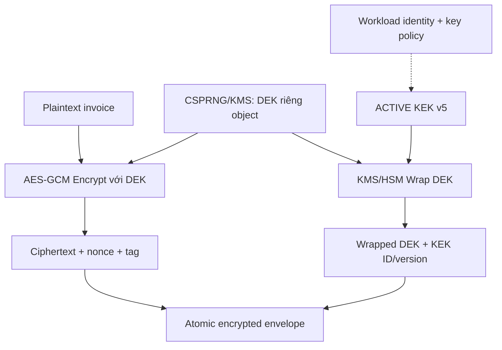
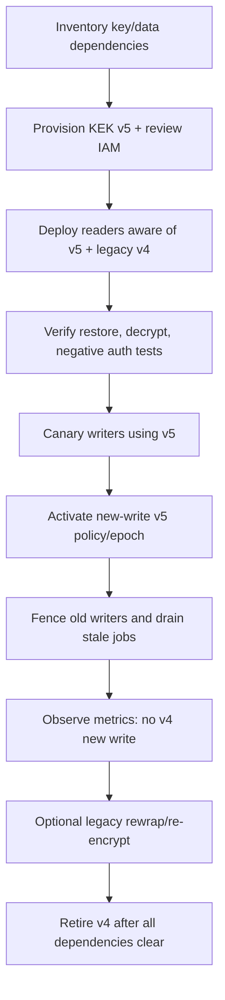
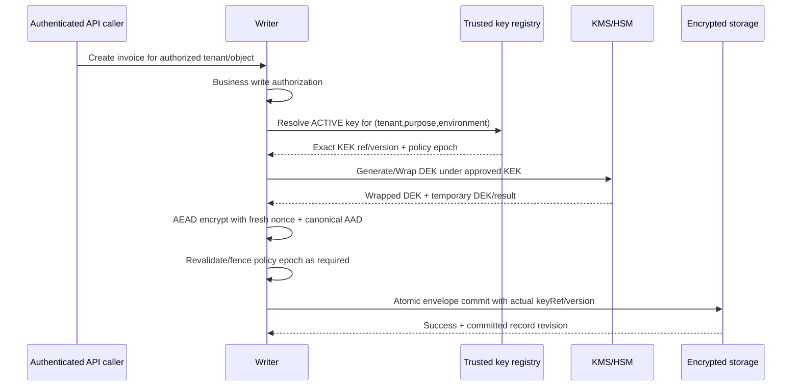
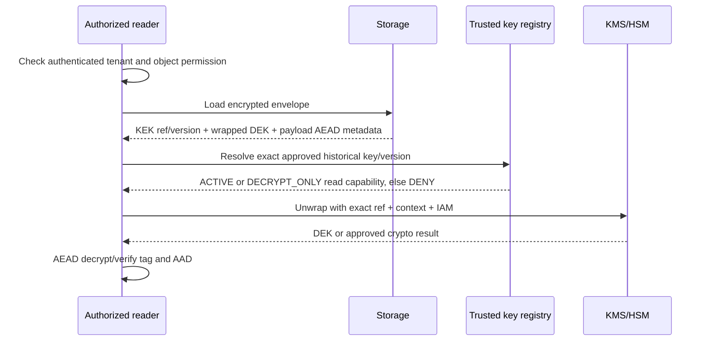
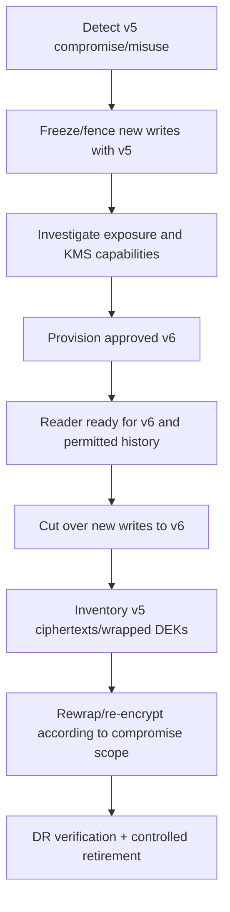

# Write với key mới

## 1. “Write với key mới” nghĩa là gì?

**Write với key mới** là quy tắc vận hành của **key rotation**: sau thời điểm chuyển đổi (*cutover*), các thao tác **tạo dữ liệu mật mã mới** phải dùng **khóa hoặc phiên bản khóa đã được phê duyệt cho originator use**, còn khóa cũ được giữ lại **chỉ cho mục đích đọc/xác minh dữ liệu lịch sử** khi chính sách yêu cầu.

Trong hệ thống mã hóa dữ liệu, `write` thường bao gồm:

- Mã hóa một bản ghi, object, file hoặc message mới.
- Mã hóa lại dữ liệu bằng **DEK mới** trong một chiến dịch migration.
- Tạo **wrapped DEK** dưới KEK mới, nếu chính sách đang rotate KEK.
- Phát hành một key-encrypted object mới vào queue/storage.
- Tạo chữ ký/MAC/token mới bằng signer/MAC key đang active — tương tự về quy tắc new-use nhưng khác phép toán và cách kiểm lịch sử.

Nếu ứng dụng đã chuyển từ `kek:v4` sang `kek:v5`, **mọi writer được phép hoạt động sau cutover phải ngừng Wrap/Encrypt mới dưới v4**. Tuy nhiên một backup, ciphertext hoặc wrapped DEK đã được tạo trước cutover có thể vẫn cần v4 để `Unwrap/Decrypt`. **Không tự động hủy v4**, cũng không tự đổi key ID trong envelope và xem như đã migrate.

Bài thuộc chương **Cryptoperiod và rotation** của module `SECURITY_KEY_MANAGEMENT_FUNDAMENTALS`. Mục tiêu module là hiểu vòng đời khóa từ **tạo, cấp phát, lưu trữ, sử dụng, xoay vòng đến thu hồi và hủy**, kết nối mật mã đối xứng, bất đối xứng, chữ ký số, KMS/HSM, envelope encryption, IAM và kiểm toán. Trong vòng đời đó, “write với key mới” nằm ở **ranh giới giữa quyền tạo dữ liệu mới và quyền đọc dữ liệu lịch sử**.

### 1.1. Tình huống mở đầu

Một nền tảng SaaS lưu hóa đơn dưới dạng envelope encryption:

```text
Trước cutover:
  Invoice A -> DEK_A -> wrapped under KEK v4
  Invoice B -> DEK_B -> wrapped under KEK v4

Tại cutover:
  New-use alias/policy: v4 -> v5
  KEK v4: DECRYPT_ONLY cho wrapped DEK lịch sử
  KEK v5: ACTIVE_FOR_NEW_USE

Sau cutover:
  Invoice C -> DEK_C -> wrapped under KEK v5
  Invoice D -> DEK_D -> wrapped under KEK v5

Reader:
  A, B -> v4 (nếu retention/policy cho phép)
  C, D -> v5
```

Đây là mô hình chuẩn **new writes use new key; historical reads use exact recorded key**. Một writer “quên cập nhật” và vẫn tạo Invoice E dưới v4 là **vi phạm rotation**, ngay cả khi dữ liệu vẫn giải mã được.

### 1.2. Mục tiêu học tập

Sau bài, bạn có thể:

1. Phân biệt **cryptoperiod**, **originator-usage period** và **recipient-usage period**.
2. Xác định “key mới” ở ba cấp: **DEK**, **KEK/application key resource** và **provider-managed internal key material**.
3. Thiết kế **write path chỉ dùng active key**, read path chọn đúng version trong envelope; không sử dụng `current` cho historical decrypt một cách mù quáng.
4. Thực hiện cutover theo các giai đoạn **provision → read readiness → activate new write → observe → migrate → retire**.
5. Xử lý **distributed writers**, cache, queue, delayed jobs, race conditions, config drift, multi-region và idempotent retries.
6. Dùng **trusted key registry, KMS/HSM, IAM và business authorization** để enforce new-write policy.
7. Hiểu khi nào **rewrap DEK** mà không re-encrypt payload, và khi nào cần **DEK mới + re-encrypt**.
8. Viết ví dụ **Java 17** minh họa KEK v1 đã retire, KEK v2 active, dữ liệu mới dùng v2, reader vẫn mở được v1.
9. Thiết lập **audit, metrics, alert, rollback/incident và DR tests** để chứng minh cutover đã thực sự xảy ra.
10. Dùng ma trận test/checklist để không destroy key cũ khi còn live/archive/backup dependencies.

## 2. Cryptoperiod: một khóa có thể “không được ghi mới” mà vẫn “được đọc cũ”

**Cryptoperiod** mô tả khoảng thời gian sử dụng một khóa theo một tập hoạt động và chính sách xác định. Không có một thời hạn ngày cố định phù hợp cho tất cả algorithms, tenants và data classes.

Cần tách ít nhất hai giai đoạn:

- **Originator-usage period:** khoảng được phép tạo đối tượng mật mã mới: `Encrypt`, `Wrap`, `Sign`, `GenerateMac`.
- **Recipient-usage period:** khoảng được phép xử lý đối tượng đã tồn tại: `Decrypt`, `Unwrap`, `Verify` theo trust/retention.

### 2.1. Ví dụ về thời kỳ sử dụng

```text
Thời gian --------->
                     CUTOVER
KEK v4:   [ NEW WRAP ]|[ LEGACY UNWRAP ONLY .......... ]
KEK v5:                |[ NEW WRAP + APPROVED UNWRAP... ]

               Quy tắc writer:
               t < cutover -> v4
               t >= cutover -> v5
```

Sơ đồ là chính sách logic, không nhất thiết là native state của mọi KMS. Một số KMS chỉ có `Enabled/Disabled/PendingDeletion`. Khi đó `DECRYPT_ONLY` cần được **enforce bằng IAM/grant, crypto broker hoặc các capability riêng**, không thể chỉ thêm một field YAML rồi tin provider sẽ chặn Encrypt.

### 2.2. Bảng quyết định theo operation

| Trạng thái chính sách | Encrypt/Wrap/Sign mới | Decrypt/Unwrap/Verify lịch sử | Ý nghĩa |
| --- | --- | --- | --- |
| `CREATED` / `PENDING_APPROVAL` | DENY | DENY, trừ test có phê duyệt | Chưa triển khai |
| `ACTIVE_FOR_NEW_USE` | ALLOW theo IAM/purpose | ALLOW theo IAM/data policy | Phiên bản active |
| `DECRYPT_ONLY` / `VERIFY_ONLY` | **DENY** | ALLOW có giới hạn retention/trust | Giữ dữ liệu/chữ ký cũ |
| `DISABLED` / `SUSPENDED` | DENY | Thường DENY ở provider | Cô lập tạm |
| `COMPROMISED` / `REVOKED_TRUST` | DENY | Quyết định riêng theo loại key và incident | Không mặc định chấp nhận |
| `PENDING_DESTRUCTION` | DENY | Theo contract; thường bị giới hạn/chặn | Chờ hủy |
| `DESTROYED` | DENY | DENY nếu material thật sự hủy | Không còn capability hợp lệ |

**Không đánh đồng `Decrypt only` với “chấp nhận mọi dữ liệu cũ”**: dữ liệu vẫn phải có authorization, đúng version, xác thực AEAD tag hoặc chữ ký/trust, và chưa vượt retention.

### 2.3. New write khác rotation tự động

Rotate key thường có nhiều hành động:

1. **Tạo hoặc kích hoạt material mới.**
2. **Chuyển producer mới sang material mới.**
3. **Cho reader giải mã cả data lịch sử và mới.**
4. **Migrate/rewrap/re-encrypt dữ liệu cũ** nếu policy yêu cầu.
5. **Retire/destroy** material cũ khi hết dependency.

**“Đã rotate key” không nhất thiết có nghĩa mọi ciphertext lịch sử đã được mã hóa lại**, và “KMS tự động rotate” không luôn đồng nghĩa application sẽ thấy `keyVersion=v5` trong API.

## 3. “Key mới” là DEK mới, KEK mới hay key resource mới?

Muốn triển khai đúng, trước tiên phải xác định **đúng tầng khóa đang được rotate**.

| Kịch bản | “Key mới” nghĩa là gì? | New write phải làm gì? | Old read cần gì? |
| --- | --- | --- | --- |
| **DEK per record** | DEK ngẫu nhiên mới cho mỗi record | Tạo DEK mới bằng CSPRNG/KMS mỗi lần | Unwrap DEK gốc của record |
| **DEK dùng theo epoch** | DEK v2 thay DEK v1 | Dữ liệu mới mã hóa bằng DEK v2; nonce đúng | Giữ v1 đọc historical records |
| **KEK rotation trong envelope** | KEK v5 mới bọc DEKs | DEK mới hoặc theo policy; **Wrap với KEK v5** | V4 Unwrap wrapped DEKs cũ |
| **Tạo KMS key resource mới** | Resource `billing-kek-new` | Resolve exact active resource cho Wrap/Encrypt | Resource cũ vẫn còn trong registry |
| **Managed KMS automatic material rotation** | Provider đổi backing material bên trong logical key | Gọi API trên logical KMS key theo contract | KMS dùng encrypted blob/metadata nội bộ |
| **Signing key rollover** | Private signer v5 mới | Ký token/artifact mới bằng v5 | Verify chữ ký cũ theo public trust policy |
| **HMAC secret rotation** | Shared MAC secret v5 mới | Generate MAC mới bằng v5 | Verify cũ trong cửa sổ overlap hạn chế |

### 3.1. DEK/KEK trong envelope encryption



Với kiến trúc này, nếu mỗi object đã có DEK mới, **write với key mới sau KEK rotation** chủ yếu nghĩa là **Wrap DEK của object mới dưới KEK active v5**. Không cần phải giải mã và mã hóa lại các object cũ chỉ để writer mới dùng v5.

### 3.2. Khi KMS tự quản lý material versions

Một số KMS làm **automatic key-material rotation** giữ **logical key ID** không đổi. Provider ciphertext/wrapped-key blob có thể mang metadata cần thiết để nó chọn backing material cũ.

Khi đó:

- Không bịa `v5` làm trường internal version nếu provider không expose.
- Tách **logical resource reference**, **ứng dụng tự tạo separate KEK resource version**, **envelope format version** và **managed material generation**.
- Tài liệu API/policy của provider quyết định liệu application có chọn được key version hay không.
- Nếu application dùng alias trỏ từ *resource A* sang *resource B*, đó là **key resource cutover** và phải lưu reference thực tế theo contract.

Sai lầm phổ biến là assume: “alias `current` vừa đổi nên KMS đã rewrap mọi DEK cũ.” **Không đúng.** Wrapped DEK lịch sử vẫn cần material/context tương thích.

## 4. Invariants của một quá trình chuyển sang key mới

Định nghĩa trước các bất biến để test và audit:

| ID | Bất biến | Hệ quả nếu vi phạm |
| --- | --- | --- |
| **I1** | Sau **effective cutover**, mọi successful new write dùng key được phê duyệt cho originator use | Dữ liệu mới tiếp tục phụ thuộc key retired |
| **I2** | Mỗi envelope lưu key ID/version hoặc provider blob đủ định tuyến lịch sử | Reader/DR có thể không giải mã được |
| **I3** | Writer không tự lấy key reference từ untrusted client header | Cross-tenant/purpose key misuse |
| **I4** | Key selection, wrapping và envelope metadata nhất quán theo **cùng actual key resource** | Key mismatch, mất dữ liệu |
| **I5** | Old ciphertext vẫn đọc được bằng exact key khi còn recipient-use/retention | Cutover làm outage |
| **I6** | Writer mới không cần raw KEK/private key export từ KMS/HSM | Mở rộng phạm vi secret |
| **I7** | Tenant, object, algorithm, AAD và wrapped DEK được xác thực theo một format rõ | Metadata substitution/cross-tenant confusion |
| **I8** | Retry/idempotency không tạo encrypted records có version mâu thuẫn | Duplicate/lost updates |
| **I9** | Không destroy old key khi live/archive/backup còn phụ thuộc | Không thể restore |
| **I10** | Có audit/metrics chứng minh writer thực tế đã chuyển | “Đã deploy” nhưng một số writer vẫn dùng v4 |

### 4.1. Phải xác định cutover boundary

Một hệ thống phân tán không có một nút nhấn “ngay lập tức” trên tất cả JVMs/regions nếu không thiết kế **distributed coordination/fencing**. Cần công bố rõ:

- Thời điểm policy `T_cutover` hoặc **generation/epoch** có hiệu lực.
- Những writer/queues/regions thuộc cohort nào.
- Request đã được **admit/bắt đầu** trước cutover xử lý ra sao.
- Khi nào một write được xem là **committed success**.
- Có grace interval cho in-flight requests cũ không, và nếu có thì policy thực tế là gì.
- Bằng chứng nào chứng minh **không còn write dưới old key** sau điểm kết thúc đã xác nhận.

Nếu policy là **hard cutover** (không được accept new write cũ sau T), backend phải dùng **fencing/check tại commit hoặc crypto capability enforcement**, không dựa vào cache TTL hay thông báo “hãy restart pod”.

## 5. Schema envelope: key ID/version phải nằm cùng ciphertext

Một record mã hóa có thể được lưu:

```json
{
  "formatVersion": 2,
  "tenantId": "tenant-01",
  "objectId": "INV-0042",
  "contentAlgorithm": "AES-256-GCM",
  "payloadAadSchema": "invoice-v2",
  "kekReference": "billing/prod/invoice-kek",
  "kekVersion": "v5",
  "wrappingAlgorithm": "KMS-NATIVE-WRAP",
  "encryptedDek": "<opaque-wrapped-data-key>",
  "nonce": "<base64url-96-bit-nonce>",
  "ciphertextAndTag": "<base64url-aead-output>",
  "recordVersion": 28,
  "keyPolicyEpoch": 1042
}
```

Các chuỗi `<...>` là placeholder, không phải định dạng của provider cụ thể.

**Không đặt plaintext DEK, raw KEK, signing private key hoặc keystore password cạnh ciphertext.** Trường `keyPolicyEpoch` có thể hữu ích cho giám sát/fencing nhưng **chỉ có giá trị bảo mật nếu được kiểm tra với nguồn state tin cậy**, không vì attacker ghi một số lớn vào JSON.

### 5.1. Phân biệt các loại version

| Trường | Ý nghĩa |
| --- | --- |
| `formatVersion` | Phiên bản encoder/parser envelope |
| `kekVersion` | Phiên bản theo registry ứng dụng, **khi có thật** |
| `recordVersion` | Concurrency/version của object data |
| `keyPolicyEpoch` | Generation của chính sách active key/cutover |
| `providerCiphertextVersion` | Nếu provider định nghĩa và expose; không tự suy ra |
| `dataSchemaVersion` | Version ngữ nghĩa của plaintext nghiệp vụ |

Đừng gộp tất cả vào một field `version` rồi dùng nó vừa chọn key, vừa kiểm optimistic lock.

### 5.2. Stable payload AAD và authenticated wrapping header

Nếu muốn **rewrap DEK nhanh** khi KEK rotate, payload AAD nên bind các dữ liệu *ổn định*:

```text
payload-AAD:
  domain         = "invoice/payload/v2"
  formatVersion  = 2
  tenantId       = "tenant-01"
  objectId       = "INV-0042"
  algorithm      = "AES-256-GCM"

wrap-AAD / KMS encryption context:
  domain         = "invoice/dek-wrap/v2"
  tenantId       = "tenant-01"
  objectId       = "INV-0042"
  kekReference   = "billing/prod/invoice-kek"
  kekVersion     = "v5"
```

Khi đó đổi KEK và wrapped DEK **có thể** giữ nguyên payload ciphertext/tag, *nếu*:

- DEK không đổi, vẫn đủ an toàn.
- Payload AAD **không chứa KEK reference mutable**.
- Wrapping layer **xác thực key ID/version/tenant/object và data context**.
- Record thay đổi **atomically**.
- Old DEK được Unwrap bởi workflow có quyền và audit.

Ngược lại, nếu payload AAD bind `kekVersion=v4`, thay field thành v5 làm GCM tag cũ không khớp; phải **tạo lại authentication hợp lệ** theo schema, thường decrypt/verify rồi encrypt lại payload với nonce mới. **Không sửa header rồi bỏ tag verification**.

### 5.3. AAD canonical và metadata integrity

AAD là **bytes không được mã hóa nhưng được xác thực**. Các hệ thống phải định nghĩa encoding chính xác: length-prefix, canonical CBOR/JSON được kiểm thử, domain separation và format version. Không nối `tenant + "|" + object` nếu giá trị có thể chứa dấu phân cách làm ambiguity.

Key ID là **metadata/hint**, không phải quyền. Reader vẫn phải xác thực principal, object ownership và trusted registry trước khi gọi KMS.

## 6. Chuẩn bị cutover: tiền đề để writer không bị mất dữ liệu

Trước khi chuyển một writer từ v4 sang v5 cần kiểm tra:

1. **Owner và purpose**: key v5 đúng tenant/environment/service/algorithm?
2. **Material/custody**: v5 sinh bởi CSPRNG/KMS/HSM đúng policy; non-exportable KEK khi cần?
3. **Key state**: v5 đã provision/enable và được phép originator use?
4. **IAM**: production writer có quyền `Wrap/GenerateDataKey/Encrypt` đúng resource; reader có quyền legacy `Unwrap`?
5. **Reader readiness**: các reader, batch jobs, DR paths đã biết format/reference v5 chưa?
6. **Key registry**: active pointer và exact historical references được quản lý nguồn tin cậy, có audit/rollout?
7. **Envelope schema**: lưu đúng actual key reference, wrapped DEK, nonce/tag và AAD?
8. **Rollback**: nếu writer fail sau cutover, có thể rollback **code** mà vẫn đọc được ciphertext v5 không?
9. **Backup**: restore test v4 pass; kế hoạch backup v5 và key continuity đã có?
10. **Consumers**: service phụ, asynchronous workers, cron, import tools và external integrations có nhận policy mới không?
11. **Multi-region**: những regions nào có replica/key mapping v5, quotas và IAM phù hợp?
12. **Metrics**: có khả năng đếm new writes theo key version và cohort không?
13. **Canary plan**: có thể thử ở tenant/test dataset với policy phê duyệt trước khi mở rộng không?
14. **Emergency response**: nếu v5 disabled/compromised sẽ dừng new-write thế nào mà không làm mất dữ liệu đã committed?

**Không kích hoạt new-write trước khi reader đã có thể đọc v5**, trừ khi có một protocol được thiết kế riêng và chấp nhận downtime có kiểm soát. Một writer thành công còn reader không hiểu key version là lỗi triển khai.

### 6.1. Thứ tự triển khai an toàn



### 6.2. “Reader biết v5” không đồng nghĩa được phép mở mọi dữ liệu

Cấp grant `Unwrap` trên v5 phải đúng service, tenant/purpose và object authorization. Không đơn giản cho mọi reader/v4 principal quyền `Decrypt` với toàn bộ KMS keys rồi gọi đó là “backward compatibility”.

## 7. Quy trình write path sau khi chuyển key



### 7.1. Những bước không được bỏ qua

1. **Authenticate** workload và caller; validate tenant/object ownership.
2. Resolve **current active key** theo domain/purpose tại trusted registry.
3. **Pin exact key ID/version** cho *một encryption attempt* để wrapping và metadata không lệch.
4. Enforce active-for-new-use policy; không fallback về old key nếu current bị lỗi.
5. Sinh DEK mới từ approved CSPRNG/KMS; không dùng timestamp, tenant ID, seed cố định.
6. Gọi KMS/HSM theo IAM/operation policy; nếu API trả plaintext DEK, giới hạn lifetime và không log.
7. AES-GCM encrypt bằng **nonce mới/đúng policy** và AAD chuẩn; kiểm byte limits.
8. **Ghi ciphertext, wrapped DEK, keyRef, nonce/tag và version atomically**.
9. Nếu có hard cutover, kiểm **generation/fencing token ở admission/commit** theo protocol.
10. Ghi audit metadata như writer instance, policy epoch, ref/version và outcome, không có secret bytes.

### 7.2. “Pin” ở bước 3 giải quyết race nào?

Sai:

```text
10:00:00 service requests key "current" -> points to v4
10:00:01 KMS Wrap(DEK) uses v4
10:00:02 administrator changes alias "current" -> v5
10:00:03 service reads alias "current" -> v5
10:00:04 service stores envelope.kekVersion = v5   // SAI
```

Hệ thống có thể không Unwrap được record vì wrapped DEK thực tế dùng v4 nhưng metadata nói v5. Writer phải **lưu exact key ID/operation result của Wrap thực tế**, không resolve alias lần nữa để điền envelope.

Một provider blob tự mô tả internal material có thể giúp KMS decrypt; **vẫn cần metadata/resource reference theo hợp đồng và policy**, không “đoán” phiên bản KMS.

### 7.3. Stale active key selection trước cutover

Nếu writer đã đọc `current=v4` trước khi policy cutover nhưng commit sau cutover, sẽ có “write cũ sau thời điểm mới”. Muốn đảm bảo bất biến **không có successful old-key commits sau barrier**, cần:

- **Writer admission barrier**: dừng nhận job mới trên old epoch.
- **Drain in-flight** hoặc hủy/retry requests cũ theo policy.
- **Central authorization** chặn new-use old key qua IAM/broker khi thực thi được.
- **Epoch/fencing check** tại điểm commit với source of truth mà writer không tự sửa.
- **Idempotent replay** dưới new key khi một operation bị reject.
- **Observability** theo committed timestamp, not just request start.

Một TTL cache thấp **giảm** thời gian stale, nhưng **không tạo hard correctness guarantee** trong hệ phân tán.

## 8. Read path: đọc key version từ envelope, không lấy `current`



### 8.1. Read old và read new cùng tồn tại

Khi v5 active cho writes:

- Bản ghi cũ dưới **v4** vẫn phải được đọc theo `kekRef=v4` nếu còn retention và quyền.
- Bản ghi mới dưới **v5** phải đọc theo `kekRef=v5`.
- Một reader có thể cần cả hai **recipient-use capabilities**, nhưng không tự có quyền xem object khác tenant.
- Chỉ giữ `v4 DECRYPT_ONLY` nếu policy/incident cho phép; key compromised có quy trình riêng.
- Không thử mọi keys trong registry nếu Unwrap v4 fail — có thể tạo key existence oracle, quota/cost và audit mơ hồ.

### 8.2. Không xóa key version khi traffic đọc ít

Một backup có thể chỉ được restore **mỗi quý hoặc mỗi năm**. Việc 30 ngày không thấy `Unwrap v4` không chứng minh dữ liệu không còn phụ thuộc v4.

Dependency inventory cần bao gồm live DB, archives, snapshots, object versions, message queues, exported files, third-party consumers, legal hold và DR runbooks.

## 9. Đồng bộ hóa writer khi chạy nhiều pods/regions

Rotation không hoàn thành khi chỉ đổi một biến môi trường của deployment mới. Phải xử lý mọi producer có thể tạo ciphertext:

- HTTP API writers.
- Batch import, cron và scheduled jobs.
- Queue consumers hoặc stream processors.
- Retry workers và dead-letter queue replayers.
- Data migration/backfill.
- Disaster recovery region và failover cluster.
- Mobile/desktop/offline clients nếu giao thức cho phép họ tạo ciphertext.
- External partners/services có quyền gửi wrapped keys.

### 9.1. Generation/epoch và fencing token

Giả sử registry có:

```yaml
tenantId: tenant-01
purpose: invoice-dek-wrapping
policyEpoch: 1042
activeKekRef: billing/prod/invoice-kek:v5
newWriteAllowed:
  - v5
legacyReadAllowed:
  - v4
  - v5
cutoverPolicy: reject-older-epoch-on-commit
```

Trong hard-cutover design, writer lấy **policyEpoch** từ nguồn tin cậy. Lúc commit, storage/broker/transaction gate kiểm token epoch còn hợp lệ; nếu không, hủy attempt và **re-encrypt/re-wrap bằng active key** theo idempotency logic.

**Lưu epoch trong envelope không tự có hiệu lực**: phải có nơi **verify against current authoritative state** và chặn commit cũ. Kiểm tra tại admission mà không chặn stale in-flight hoàn thành có thể không đủ.

### 9.2. Giao thức cutover có khả năng chứng minh

```text
Phase PREPARED:
  register v5, reader-ready, no v5 write yet

Phase DRAINING:
  stop granting v4 new-write leases
  wait/cancel in-flight v4 attempts
  old jobs may retry using v5

Phase ACTIVE_V5:
  authoritative write generation = v5/epoch 1042
  commit gateway/storage rejects epoch < 1042
  old-key Wrap new-use grants removed/denied where feasible

Phase VERIFIED:
  all regions/pods report v5
  successful committed new writes with v4 = 0 after barrier
```

Nếu KMS/provider không cho phân tách `Wrap v4` và `Unwrap v4` trong cùng resource, **application/broker policy + centralized commit fencing** cần thực thi originator restriction; đồng thời giới hạn principal có thể bypass broker.

### 9.3. Multi-region và KMS replication

- v5 phải tồn tại/được route đúng region/account trước cutover vùng đó.
- Resource ID, alias và wrapped DEK format **không nhất thiết portable** giữa providers/regions.
- Phải kiểm actual provider replica/multi-region features.
- Nếu regions cutover lệch, tài liệu phải ghi **điểm hoàn thành toàn cục** và cách đọc ciphertext v5 ở mọi vùng.
- Replication lag có thể tạo record v5 ở region A trước khi reader B có permission; giải quyết bằng **read readiness**.
- Đừng dùng plaintext master KEK global làm “fallback” khi failover.

## 10. Các job bất đồng bộ, queue và retry sau cutover

Một job được **enqueue** khi v4 active nhưng **execute** sau khi v5 active. Hệ thống phải có quy tắc rõ: “thời điểm job được tạo” không nhất thiết quyết định key dùng để mã hóa khi execute.

| Tình huống | Kết quả an toàn thường mong muốn |
| --- | --- |
| Job được tạo trước cutover, chưa mã hóa | Khi execute, resolve **v5 hiện tại** và write mới với v5 |
| Job đã mã hóa v4, chưa commit khi hard barrier bật | Reject stale attempt, retry bằng v5; không giữ stale ciphertext trong output |
| Retry network sau khi commit v5 thành công | Dùng **idempotency key** trả về record đã commit, không tạo duplicate |
| Queue item chứa wrapped DEK v4 | Đánh giá đó là **historical read** hay **new write/republish**; rule khác nhau |
| Backfill đọc v4 và ghi object mới sau cutover | New output phải theo v5/policy, trừ documented migration exception |
| DLQ replay nhiều tháng sau | Không dùng hardcoded key ref từ payload cũ để Wrap mới; lookup current |
| Restore snapshot cũ | Decrypt lịch sử bằng v4; khi tạo **record mới**, Wrap theo v5 |

### 10.1. Idempotency key không thay key ID/version

`idempotencyKey` xác định một **operation nghiệp vụ**, `keyVersion` xác định key dùng. Với retry sau network timeout:

- Nếu record đã committed dưới v5, trả lại kết quả đó.
- Nếu attempt chưa commit và policy đã đổi, tạo attempt mới dưới v5.
- Không dùng idempotency token như AES-GCM nonce; không suy DEK từ idempotency key.
- Không cho cùng idempotency token trỏ đến hai object/tenants khác nhau.
- Lưu trạng thái request/version theo transaction/consistency model.

### 10.2. Dual-write với v4 và v5 có phải cần thiết?

Thông thường **không cần và không nên tự động tạo hai ciphertext với hai KEKs** chỉ để “đề phòng”. Dual-write mở rộng surface, tạo bản sao khó thu hồi và có thể gây mismatch/tăng chi phí.

Nếu có giai đoạn tương thích cần lưu nhiều wrapped DEKs cho **cùng DEK**, phải thiết kế một envelope multi-recipient versioned, authenticated recipient metadata, access control, exact read priority và cleanup. Không sao chép plaintext DEK qua nhiều nơi tùy tiện.

## 11. Java 17: mô phỏng write bằng v2 và đọc dữ liệu v1

Ví dụ này tự chạy với **JDK 17+** có AES-256-GCM. Thiết kế:

- Tenant `tenant-01` ban đầu dùng **KEK v1**.
- Một record lịch sử được tạo với **DEK ngẫu nhiên** và Wrap dưới v1.
- Registry provision KEK v2, reader đã được phép đọc v2, rồi **cutover**.
- Writer sau cutover chọn **v2**, tuyệt đối không chọn `v1` cho new Wrap.
- Reader dùng **exact key ref từ envelope** để mở cả v1 và v2.
- AAD của payload **không chứa mutable KEK version**; wrapping AAD xác thực key ID/version, tenant/object.
- Test phủ **old-write denied**, old/new decrypt success, cross-tenant denied, metadata/ciphertext tampering.

**Lưu ý:** KEK v1/v2 trong demo được giữ trong Java heap, không phải KMS thật; một instance `synchronized` không điều phối được nhiều pods. Production dùng **KMS/HSM non-exportable KEK, trusted key registry và distributed fencing**.

### 11.1. Source: `WriteWithNewKeyDemo.java`

```java
import java.io.ByteArrayOutputStream;
import java.io.DataOutputStream;
import java.io.IOException;
import java.nio.charset.StandardCharsets;
import java.security.GeneralSecurityException;
import java.security.MessageDigest;
import java.security.SecureRandom;
import java.util.Arrays;
import java.util.HashMap;
import java.util.Map;
import java.util.Objects;
import java.util.Set;

import javax.crypto.AEADBadTagException;
import javax.crypto.Cipher;
import javax.crypto.KeyGenerator;
import javax.crypto.SecretKey;
import javax.crypto.spec.GCMParameterSpec;
import javax.crypto.spec.SecretKeySpec;

public final class WriteWithNewKeyDemo {
    private static final SecureRandom RNG = new SecureRandom();
    private static final int NONCE_LENGTH = 12;
    private static final int GCM_TAG_BITS = 128;
    private static final int FORMAT_VERSION = 1;
    private static final String CONTENT_ALG = "AES-256-GCM";
    private static final String WRAP_ALG = "AES-256-GCM-DEMO-WRAP";
    private static final String KEY_ID = "billing/prod/invoice-kek";

    enum KeyState { ACTIVE_FOR_NEW_USE, DECRYPT_ONLY, DISABLED }

    record KeyRef(String id, String version) {}

    // Từ identity layer đáng tin, KHÔNG từ request body tự khai.
    record Principal(String name, String tenant, Set<String> roles) {}

    // Production DTO phải defensive-copy byte[] trước/sau sử dụng.
    record Envelope(
        int formatVersion,
        String tenant,
        String objectId,
        String contentAlgorithm,
        String wrappingAlgorithm,
        KeyRef keyRef,
        byte[] wrapNonce,
        byte[] wrappedDek,
        byte[] dataNonce,
        byte[] ciphertextAndTag
    ) {}

    static final class KeySlot {
        final KeyRef ref;
        final SecretKey kek;
        KeyState state;

        KeySlot(KeyRef ref, SecretKey kek, KeyState state) {
            this.ref = ref;
            this.kek = kek;
            this.state = state;
        }
    }

    static final class TrustedRegistry {
        private final Map<KeyRef, KeySlot> keys = new HashMap<>();
        private KeyRef active;

        synchronized void add(KeyRef ref, SecretKey kek) {
            if (keys.containsKey(ref)) {
                throw new SecurityException("Duplicate key reference");
            }
            // New key is prepared for reads before activation.
            keys.put(ref, new KeySlot(ref, kek, KeyState.DECRYPT_ONLY));
        }

        synchronized void activate(KeyRef next) {
            KeySlot candidate = keys.get(next);
            if (candidate == null
                    || candidate.state == KeyState.DISABLED) {
                throw new SecurityException("New key not ready");
            }
            if (active != null) {
                keys.get(active).state = KeyState.DECRYPT_ONLY;
            }
            candidate.state = KeyState.ACTIVE_FOR_NEW_USE;
            active = next;
        }

        synchronized KeySlot forNewWrite() {
            KeySlot slot = keys.get(active);
            if (slot == null
                    || slot.state != KeyState.ACTIVE_FOR_NEW_USE) {
                throw new SecurityException("No approved write key");
            }
            return slot;
        }

        synchronized KeySlot forHistoricalRead(KeyRef ref) {
            KeySlot slot = keys.get(ref);
            if (slot == null || slot.state == KeyState.DISABLED) {
                throw new SecurityException("Key not approved for read");
            }
            return slot;
        }

        synchronized void requireNewUse(KeyRef ref) {
            KeySlot slot = forNewWrite();
            if (!slot.ref.equals(ref)) {
                throw new SecurityException("Old key not allowed for write");
            }
        }
    }

    static SecretKey newAesKey() throws GeneralSecurityException {
        KeyGenerator gen = KeyGenerator.getInstance("AES");
        gen.init(256, RNG);
        return gen.generateKey();
    }

    static byte[] nonce() {
        byte[] value = new byte[NONCE_LENGTH];
        RNG.nextBytes(value);
        return value;
    }

    static void authorize(
        Principal principal, String expectedTenant, String role
    ) {
        if (principal == null || principal.name() == null
                || principal.name().isBlank()
                || principal.roles() == null
                || !Objects.equals(principal.tenant(), expectedTenant)
                || !principal.roles().contains(role)) {
            throw new SecurityException("Principal/tenant/role denied");
        }
    }

    static void writeField(DataOutputStream out, String value)
            throws IOException {
        byte[] bytes = value.getBytes(StandardCharsets.UTF_8);
        out.writeInt(bytes.length);
        out.write(bytes);
    }

    static byte[] payloadAad(Envelope e) throws IOException {
        ByteArrayOutputStream buffer = new ByteArrayOutputStream();
        try (DataOutputStream out = new DataOutputStream(buffer)) {
            writeField(out, "invoice/payload/v1");
            out.writeInt(e.formatVersion());
            writeField(out, e.contentAlgorithm());
            writeField(out, e.tenant());
            writeField(out, e.objectId());
        }
        return buffer.toByteArray();
    }

    static byte[] wrapAad(Envelope e) throws IOException {
        ByteArrayOutputStream buffer = new ByteArrayOutputStream();
        try (DataOutputStream out = new DataOutputStream(buffer)) {
            writeField(out, "invoice/dek-wrap/v1");
            out.writeInt(e.formatVersion());
            writeField(out, e.wrappingAlgorithm());
            writeField(out, e.tenant());
            writeField(out, e.objectId());
            writeField(out, e.keyRef().id());
            writeField(out, e.keyRef().version());
        }
        return buffer.toByteArray();
    }

    static byte[] gcm(
        int mode, SecretKey key, byte[] nonce,
        byte[] input, byte[] aad
    ) throws GeneralSecurityException {
        Cipher cipher = Cipher.getInstance("AES/GCM/NoPadding");
        cipher.init(
            mode, key, new GCMParameterSpec(GCM_TAG_BITS, nonce)
        );
        cipher.updateAAD(aad);
        return cipher.doFinal(input);
    }

    static Envelope encrypt(
        TrustedRegistry registry, Principal writer,
        String tenant, String objectId, byte[] plaintext
    ) throws Exception {
        authorize(writer, tenant, "invoice-writer");
        if (objectId == null || objectId.isBlank()
                || plaintext == null) {
            throw new SecurityException("Invalid write object");
        }

        // DEMO single-node fence. Không giải quyết multi-pod race.
        synchronized (registry) {
            KeySlot selected = registry.forNewWrite();
            SecretKey dek = newAesKey();
            byte[] rawDek = dek.getEncoded();
            if (rawDek == null || rawDek.length != 32) {
                throw new GeneralSecurityException("Demo DEK invalid");
            }

            byte[] wrapNonce = nonce();
            byte[] dataNonce = nonce();
            Envelope header = new Envelope(
                FORMAT_VERSION, tenant, objectId,
                CONTENT_ALG, WRAP_ALG, selected.ref,
                wrapNonce, null, dataNonce, null
            );

            try {
                byte[] wrappedDek = gcm(
                    Cipher.ENCRYPT_MODE, selected.kek,
                    wrapNonce, rawDek, wrapAad(header)
                );
                byte[] ciphertext = gcm(
                    Cipher.ENCRYPT_MODE, dek, dataNonce,
                    plaintext, payloadAad(header)
                );
                return new Envelope(
                    FORMAT_VERSION, tenant, objectId,
                    CONTENT_ALG, WRAP_ALG, selected.ref,
                    wrapNonce, wrappedDek, dataNonce, ciphertext
                );
            } finally {
                Arrays.fill(rawDek, (byte) 0);
            }
        }
    }

    static byte[] decrypt(
        TrustedRegistry registry, Principal reader,
        Envelope e, String expectedTenant,
        String expectedObjectId
    ) throws Exception {
        authorize(reader, expectedTenant, "invoice-reader");
        if (e == null || e.keyRef() == null
                || e.formatVersion() != FORMAT_VERSION
                || !CONTENT_ALG.equals(e.contentAlgorithm())
                || !WRAP_ALG.equals(e.wrappingAlgorithm())
                || !KEY_ID.equals(e.keyRef().id())
                || !Objects.equals(expectedTenant, e.tenant())
                || !Objects.equals(expectedObjectId, e.objectId())
                || e.wrapNonce() == null
                || e.wrapNonce().length != NONCE_LENGTH
                || e.dataNonce() == null
                || e.dataNonce().length != NONCE_LENGTH
                || e.wrappedDek() == null
                || e.wrappedDek().length < 16
                || e.ciphertextAndTag() == null
                || e.ciphertextAndTag().length < 16) {
            throw new SecurityException("Invalid envelope/context");
        }

        KeySlot slot = registry.forHistoricalRead(e.keyRef());
        byte[] rawDek = gcm(
            Cipher.DECRYPT_MODE, slot.kek,
            e.wrapNonce(), e.wrappedDek(), wrapAad(e)
        );
        try {
            if (rawDek.length != 32) {
                throw new GeneralSecurityException("Invalid DEK");
            }
            SecretKey dek = new SecretKeySpec(rawDek, "AES");
            return gcm(
                Cipher.DECRYPT_MODE, dek,
                e.dataNonce(), e.ciphertextAndTag(), payloadAad(e)
            );
        } finally {
            Arrays.fill(rawDek, (byte) 0);
        }
    }

    static Envelope alteredVersion(Envelope e, String version) {
        return new Envelope(
            e.formatVersion(), e.tenant(), e.objectId(),
            e.contentAlgorithm(), e.wrappingAlgorithm(),
            new KeyRef(e.keyRef().id(), version),
            e.wrapNonce(), e.wrappedDek(),
            e.dataNonce(), e.ciphertextAndTag()
        );
    }

    public static void main(String[] args) throws Exception {
        TrustedRegistry registry = new TrustedRegistry();
        KeyRef v1 = new KeyRef(KEY_ID, "v1");
        KeyRef v2 = new KeyRef(KEY_ID, "v2");

        // Key material được sinh độc lập, không hardcode.
        registry.add(v1, newAesKey());
        registry.activate(v1);

        Principal writer = new Principal(
            "service://invoice-writer", "tenant-01",
            Set.of("invoice-writer")
        );
        Principal reader = new Principal(
            "service://invoice-reader", "tenant-01",
            Set.of("invoice-reader")
        );
        Principal otherTenantReader = new Principal(
            "service://other-reader", "tenant-02",
            Set.of("invoice-reader")
        );

        byte[] oldText = "invoice=OLD-42;amount=1000"
            .getBytes(StandardCharsets.UTF_8);
        Envelope old = encrypt(
            registry, writer, "tenant-01", "OLD-42", oldText
        );

        // Provision v2, cho reader sẵn sàng, rồi cutover.
        registry.add(v2, newAesKey());
        registry.activate(v2);

        byte[] newText = "invoice=NEW-43;amount=2000"
            .getBytes(StandardCharsets.UTF_8);
        Envelope fresh = encrypt(
            registry, writer, "tenant-01", "NEW-43", newText
        );

        System.out.println(
            "Old record uses v1: "
            + "v1".equals(old.keyRef().version())
        );
        System.out.println(
            "New record uses v2: "
            + "v2".equals(fresh.keyRef().version())
        );

        byte[] oldResult = decrypt(
            registry, reader, old, "tenant-01", "OLD-42"
        );
        byte[] newResult = decrypt(
            registry, reader, fresh, "tenant-01", "NEW-43"
        );
        System.out.println(
            "Legacy read succeeds: "
            + MessageDigest.isEqual(oldText, oldResult)
        );
        System.out.println(
            "New read succeeds: "
            + MessageDigest.isEqual(newText, newResult)
        );

        boolean oldWriteDenied = false;
        try {
            registry.requireNewUse(v1);
        } catch (SecurityException expected) {
            oldWriteDenied = true;
        }
        System.out.println("Old-key write denied: " + oldWriteDenied);

        boolean wrongTenantDenied = false;
        try {
            decrypt(
                registry, otherTenantReader, old,
                "tenant-01", "OLD-42"
            );
        } catch (SecurityException expected) {
            wrongTenantDenied = true;
        }
        System.out.println(
            "Cross-tenant denied: " + wrongTenantDenied
        );

        // Metadata nói v1 dù wrapped DEK do v2 tạo.
        boolean wrongVersionRejected = false;
        try {
            decrypt(
                registry, reader,
                alteredVersion(fresh, "v1"),
                "tenant-01", "NEW-43"
            );
        } catch (AEADBadTagException expected) {
            wrongVersionRejected = true;
        }
        System.out.println(
            "Wrong-version rejected: " + wrongVersionRejected
        );

        byte[] modified = fresh.ciphertextAndTag().clone();
        modified[0] ^= 1;
        Envelope tampered = new Envelope(
            fresh.formatVersion(), fresh.tenant(),
            fresh.objectId(), fresh.contentAlgorithm(),
            fresh.wrappingAlgorithm(), fresh.keyRef(),
            fresh.wrapNonce(), fresh.wrappedDek(),
            fresh.dataNonce(), modified
        );
        boolean tamperRejected = false;
        try {
            decrypt(
                registry, reader, tampered,
                "tenant-01", "NEW-43"
            );
        } catch (AEADBadTagException expected) {
            tamperRejected = true;
        }
        System.out.println(
            "Tampered ciphertext rejected: " + tamperRejected
        );

        Arrays.fill(oldText, (byte) 0);
        Arrays.fill(newText, (byte) 0);
        Arrays.fill(oldResult, (byte) 0);
        Arrays.fill(newResult, (byte) 0);
        Arrays.fill(modified, (byte) 0);
    }
}
```

### 11.2. Chạy demo

Lưu source thành `WriteWithNewKeyDemo.java`. Với JDK 17+ có AES-256-GCM:

```bash
javac WriteWithNewKeyDemo.java
java WriteWithNewKeyDemo
```

Output dự kiến:

```text
Old record uses v1: true
New record uses v2: true
Legacy read succeeds: true
New read succeeds: true
Old-key write denied: true
Cross-tenant denied: true
Wrong-version rejected: true
Tampered ciphertext rejected: true
```

### 11.3. Những đặc điểm an toàn trong demo

- **v1 được giữ để đọc lịch sử**, nhưng không còn được phép tạo wrapped DEK mới sau `activate(v2)`.
- v2 và v1 là **hai AES KEKs khác vật liệu**, không chỉ hai tên alias.
- Mỗi encryption tạo một **DEK mới**, không reuse raw DEK giữa mọi object.
- Payload AAD có **tenant/object**, wrap AAD có thêm **key ID/version**.
- Thay `kekVersion` từ v2 thành v1 làm wrapping authentication thất bại.
- **Authenticated tenant** được kiểm trước Unwrap và không lấy quyền từ envelope.
- Code chỉ lưu `wrappedDek`, không persist raw DEK/KEK.
- Một lock trong registry giúp mô phỏng cutover có thứ tự trong một JVM.

### 11.4. Giới hạn của demo

1. **Không dùng KMS/HSM thật:** raw KEKs nằm trong process. Production cần provider key handles, non-exportability khi yêu cầu, IAM/grants và audit.
2. **Không giải quyết distributed race:** `synchronized` chỉ bảo vệ **một JVM**. Các pods/regions cần authoritative epoch, fencing và commit semantics.
3. **Không có persistence/serialization:** record `Envelope` là DTO minh họa, production cần schema, size limits, defensive copies, atomic writes và backups.
4. **Không có object-level ACL hoàn chỉnh:** `expectedTenant/Object` phải do authenticated domain layer xác minh, không phải input user tự điền.
5. **Random 96-bit GCM nonce:** cần usage bounds và nonce uniqueness strategy. Key v1/v2 Wrap nhiều DEKs dưới cùng KEK trong production có thể cần AES-KW/KWP hoặc KMS-native scheme.
6. **Không có read-only enforcement ở HSM:** state `DECRYPT_ONLY` trong local registry chỉ là application policy.
7. **Không có hard cutover across commit transactions:** lock không bảo vệ DB commit hoặc queue messages.
8. **Không có retry/HA/circuit breaker/quotas:** thêm theo provider semantics, tránh retry non-idempotent mutations một cách mù quáng.
9. **Không có tenant-per-key ring:** chỉ demo tenant-01; production cần tenant-aware trusted registry/IAM.
10. **Không có timestamp/cryptoperiod enforcement:** ví dụ dùng lifecycle state đơn giản, cần clock/approvals/trust.
11. **DEK bytes tạm hiện diện trong heap:** `Arrays.fill` một mảng không chứng minh tất cả bản copy trong JVM/provider được zeroize.
12. **Không có migration/DR tests tự động:** phần dưới hướng dẫn cách bổ sung.

Ví dụ dùng AES-GCM để Wrap chỉ nhằm làm rõ hai lớp. Trong hệ thống thực, chọn **KMS-native data-key wrap hoặc AES-KW/KWP/AEAD wrapping đã được duyệt**, với key context và nonces theo contract.

## 12. Triển khai KMS/HSM production: phân biệt alias, state và policy

### 12.1. Pseudocode new-write theo trusted key registry

```text
function createEncryptedInvoice(authenticatedCaller, invoice, idempotencyKey):
    tenant = authorizeWriteAndResolveTenant(
        authenticatedCaller, invoice.objectId
    )

    prior = committedResultForIdempotencyKey(
        tenant, invoice.objectId, idempotencyKey
    )
    if prior exists:
        return prior

    selection = trustedKeyRegistry.resolveActiveForNewWrite(
        tenant, purpose="invoice-dek-wrapping", environment="prod"
    )
    requireApprovedKeyPurposeAlgorithmAndState(selection)

    // Provider API có thể trả raw plaintext DEK tạm thời.
    dekResult = kms.generateDataKeyOrWrap(
        exactResource=selection.keyRef,
        authenticatedEncryptionContext=(tenant, invoice.objectId, purpose)
    )

    dek = dekResult.temporaryPlaintextDekOrHandle
    contentNonce = nonceAccordingToApprovedPolicy(dek)
    dataAad = canonicalPayloadAad(tenant, invoice.objectId, formatVersion)
    ciphertext = aeadEncrypt(dek, contentNonce, invoice.plaintext, dataAad)
    safeRelease(dek)

    envelope = {
        ciphertextAndTag: ciphertext,
        nonce: contentNonce,
        wrappedDek: dekResult.encryptedDek,
        keyRef: dekResult.actualKeyReferenceOrApprovedSelection,
        keyVersion: selection.appVersionIfDefined,
        aadSchema: formatVersion,
        policyEpoch: selection.epoch
    }

    commitAtomicallyIfEpochCurrentAndIdempotencyValid(
        tenant, invoice.objectId, idempotencyKey, envelope
    )

    auditWithoutRawSecrets(...)
    return committedRecordReference
```

**Pseudocode không phải SDK chung**. Nếu API/provider không expose actual material version, lưu logical key reference và opaque ciphertext theo contract, không tự chế `appVersion` thay cho internal backing version.

### 12.2. Không dựa vào một alias mutable để đọc lịch sử

Trình tự sai:

```text
encrypt:
  kms.encrypt(alias="current") -> actual key v4
  store keyRef="current"

later:
  alias "current" -> v5
  decrypt old ciphertext by choosing v5 from alias
```

Đúng hơn:

- Resolve **actual key identity** hoặc lưu **provider-native encrypted blob** theo contract.
- Lưu metadata/schema đủ để reader tìm đúng material lịch sử.
- Dùng `current` cho **new writes** ở thời điểm selection, **không làm bằng chứng rằng old data đã ở key mới**.
- Ghi audit key resource/version và operation result khi provider cho phép.

### 12.3. Nhà cung cấp KMS có thể không có “DECRYPT_ONLY” native

Một KMS logical key có thể cho `Encrypt` và `Decrypt` bằng IAM actions riêng, hoặc provider có chính sách chi tiết khác. Nhưng nếu **cùng action/resource** được dùng cho cả old và new internal material generations, application có thể **không chặn new write bằng version cũ thông qua provider API**.

Khi đó cần **trusted broker và writer-selection gate**, key/resource migration rõ ràng, hoặc thay đổi key hierarchy để tạo khả năng policy tách biệt. Không tuyên bố đã enforce `v4 decrypt-only` chỉ vì một field database nói vậy.

### 12.4. Giới hạn của non-exportability

Không export KEK giúp giảm khả năng mất raw material. Tuy nhiên, principal có quyền `Wrap/Unwrap/Decrypt` vẫn có thể lạm dụng API nếu business authorization yếu.

Bảo vệ còn cần:

- Workload identity riêng cho writer/reader.
- Least privilege theo key/purpose/tenant.
- Encryption context/AAD đúng.
- Rate limit, quotas, anomaly detection.
- Separation of duties cho policy change và key destruction.
    - Audit correlation giữa business service, broker và KMS.

## 13. Rewrap, re-encrypt và migration dữ liệu lịch sử

**Write với key mới** giải quyết **new data path**. Nó không tự làm dữ liệu cũ được bảo vệ bằng key mới. Nếu mục tiêu rotation còn bao gồm giảm phụ thuộc KEK cũ, cần một **migration program** riêng.

### 13.1. Ba hành động khác nhau

| Hành động | Điều thay đổi | Điều giữ nguyên | Khi nào dùng? |
| --- | --- | --- | --- |
| **New-write cutover** | Dữ liệu mới dùng KEK/DEK active | Old envelopes chưa đổi | Bắt đầu cryptoperiod mới |
| **Rewrap DEK** | Wrapped DEK, KEK ref/version, wrap context | DEK và payload ciphertext có thể giữ | Migrate KEK không làm lộ DEK |
| **Re-encrypt payload** | DEK mới, ciphertext/tag/nonce, wrapped DEK | Nội dung nghiệp vụ (trừ schema migration) | DEK lộ/yếu, đổi suite hoặc granularity |
| **Signature re-sign** | Chữ ký và signer key trên bản phát hành mới | Tính toàn vẹn nội dung gốc nếu không đổi | Khi muốn chữ ký mới theo policy |
| **Trust rollover** | Trusted verification keys/policy | Chữ ký cũ vẫn là kết quả toán học của khóa cũ | Khi rotate/revoke signing key |

**Rewrap KEK không làm một DEK đã lộ trở nên bí mật trở lại.** Nếu attacker có DEK và ciphertext, họ có thể tiếp tục giải mã dữ liệu lịch sử đã thu thập. Tùy incident, cần **re-encrypt với DEK mới**, điều tra dữ liệu đã truy cập và xử lý copies/backups.

### 13.2. Rewrap DEK an toàn khi payload AAD ổn định

Giả sử:

```text
Payload:
  AES-GCM(plaintext; DEK_A, nonce_A, AAD=(tenant, object, format))

Old wrapping:
  Wrap(DEK_A; KEK_v4, AAD=(tenant, object, kekRef=v4))

New wrapping:
  Wrap(DEK_A; KEK_v5, AAD=(tenant, object, kekRef=v5))
```

Khi payload AAD không thay đổi, rewrap có thể giữ nguyên ciphertext/tag. Tuy nhiên phải **khôi phục DEK hợp lệ dưới v4**, bảo vệ DEK trong process, bọc lại bằng v5 và thay **wrapped DEK + exact key ref/version + wrapping metadata** trong một transaction.

### 13.3. Vì sao không thể chỉ sửa `kekVersion`?

Nếu wrapped DEK được xác thực dưới `KEK v4`, đổi metadata thành v5 **không tạo wrapping ciphertext hợp lệ dưới v5**. Nếu payload AAD lại chứa `kekVersion=v4`, đổi header sang v5 còn làm payload tag không khớp.

Vì vậy:

- **Rewrap** cần một cryptographic operation thật, không phải `UPDATE key_version='v5'`.
- **Re-encrypt** phải xác thực plaintext cũ trước khi mã hóa lại; không “bỏ qua tag để migrate”.
- **AAD schema** phải được versioned, canonical và nhất quán.
- **Data authorization** phải có trước migration, không dùng một principal mọi quyền không giám sát.

### 13.4. Migration job nên idempotent

Một record có `recordVersion=28` và `kekVersion=v4`. Job:

1. Load envelope và optimistic-lock version.
2. Check record vẫn thuộc source policy/tenant.
3. Unwrap v4, verify payload tag/AAD.
4. Rewrap DEK theo v5 và build authenticated header mới.
5. Atomic compare-and-swap `recordVersion=28` để ghi result và increment version.
6. Nếu compare-and-swap fail, reload và đánh giá object đã được xử lý hay bị user cập nhật đồng thời.
7. Audit operation với job ID, old→new key ref và result.
8. Không giữ raw DEK trong logs, queue, retry payload hoặc checkpoints.

```sql
-- Minh họa: mọi field cryptographic thay đổi trong cùng update.
UPDATE encrypted_invoices
SET kek_reference = :new_kek_ref,
    kek_version   = :new_version,
    wrapped_dek   = :new_wrapped_dek,
    wrap_nonce    = :new_wrap_nonce,
    record_version = record_version + 1
WHERE tenant_id      = :tenant_id
  AND object_id      = :object_id
  AND record_version = :expected_record_version
  AND kek_version    = :expected_old_version;
```

**Chú ý:** SQL này giả định **payload AAD ổn định và không cần cập nhật ciphertext/tag**. Nếu payload AAD phụ thuộc KEK metadata, phải tính toán lại authentication bằng một migration tương thích và cập nhật các field payload cần thiết **trong cùng transaction**.

### 13.5. Không gộp backfill vào hard cutover khi không cần

Có thể:

- **Tại T:** writer chuyển sang v5, reader biết cả v4/v5.
- **T+1…T+N:** background migration rewrap old records theo batch/throughput limit.
- **Sau migration:** xác minh remaining live dependencies và backup/DR.
- **T+retention:** xem xét retirement/destruction v4.

Việc tách cutover khỏi backfill giảm rủi ro làm một chiến dịch update hàng tỷ records trở thành điều kiện bắt buộc để duy trì write availability.

## 14. Rollout nhiều giai đoạn và rollback đúng mục tiêu

Không phải “rollback” nào cũng có nghĩa “ghi mới lại bằng key cũ”.

### 14.1. Rollout nên theo ba trục

1. **Read support:** tất cả readers hiểu envelope v5 và có quyền đúng mức.
2. **Write selection:** writers mới dùng v5, các writers cũ bị fence.
3. **Legacy migration:** v4 data được rewrap/re-encrypt theo lịch riêng.

Trong đa số hệ thống, trục (1) phải hoàn thành trước trục (2), còn trục (3) có thể kéo dài theo retention.

### 14.2. Rollback code mà không rollback key

Nếu v5 đã có ciphertext được ghi thành công:

- Rollback sang bản code **không hiểu v5** có thể làm reader outage.
- Rollback writer sang v4 vi phạm originator policy và làm dữ liệu mới tiếp tục phụ thuộc v4.
- Rollback cấu hình alias không khôi phục một key đã bị compromise.
- Rollback key policy về v4 có thể bị cấm bởi cryptoperiod hoặc incident controls.

**Ưu tiên:** rollback ứng dụng sang một bản **còn hỗ trợ đọc v5**, giữ new-write v5 nếu v5 vẫn an toàn, đồng thời sửa lỗi nghiệp vụ. Nếu v5 không thể sử dụng, cần **emergency key v6** hoặc cơ chế incident đã được phê duyệt.

### 14.3. Khi nào có thể tạm dùng lại key cũ?

Chỉ khi policy cho phép rõ, v4 **chưa compromise, chưa hết cryptoperiod cho originator use**, và người có thẩm quyền chấp nhận mở lại khoảng sử dụng sau khi đánh giá rủi ro. Đây là **exception và policy change có audit**, không phải fallback tự động.

Nếu v4 bị thu hồi vì lộ, **không cấp lại Encrypt/Wrap mới** chỉ để tránh downtime. Một exception phải ghi:

- Key resource/version và data scope.
- Thời hạn, mục đích và lý do.
- Người yêu cầu, người duyệt độc lập.
- Phạm vi quyền operation/IAM.
- Giới hạn, monitoring và điều kiện đóng exception.
- Kế hoạch re-encrypt/revoke sau đó nếu cần.

### 14.4. Emergency replacement khi v5 bị compromise ngay sau cutover



Dữ liệu ghi thành công dưới v5 trước sự cố cần được xử lý theo **mức lộ vật liệu/khả năng decrypt**, không bị bỏ mặc chỉ vì new writes đã chuyển v6.

## 15. Key rotation trong hệ thống đa tenant

Một SaaS có thể sử dụng **KEK riêng cho từng tenant** hoặc KEK chung với authenticated context. Cần tách **policy epoch theo tenant/purpose**, tránh một tenant rotate làm những tenant khác ngừng ghi.

### 15.1. Key registry theo tenant

```yaml
tenantId: tenant-01
purpose: invoice-dek-wrapping
environment: production
currentOriginatorKeyRef: billing/prod/tenant-01/invoice-kek:v5
legacyRecipientKeyRefs:
  - billing/prod/tenant-01/invoice-kek:v4
policyEpoch: 1042
keyState:
  v4: DECRYPT_ONLY
  v5: ACTIVE_FOR_NEW_USE
readiness:
  allReadersSupportV5: true
  kmsPermissionsChecked: true
  disasterRecoveryReady: true
```

**Schema minh họa**; các cờ readiness phải được xác nhận bằng tests/configuration evidence. Không tin vì YAML tự khai rằng mọi region đã sẵn sàng.

### 15.2. Shared KEK cần ràng buộc context

Nếu nhiều tenants cùng dùng **một KEK**, encryption context/AAD có thể bind tenant/object, nhưng **không tạo KEK material độc lập**. Một raw KEK compromise hoặc principal có rights rộng vẫn có thể ảnh hưởng nhiều tenants.

Nếu mục tiêu là giảm blast radius tenant-specific, cân nhắc **per-tenant KEK resources**, IAM tách tenant và DEKs riêng theo object/batch.

### 15.3. Tránh cross-tenant key selection ở cutover

Một writer không được:

```text
newKeyRef = request.get("kekId")
kms.wrap(newKeyRef, dek)
```

kể cả khi `newKeyRef` trỏ tới v5. Nó phải resolve từ **authenticated tenant + approved purpose + environment**. Khi một user thuộc nhiều tenants, quyền chọn tenant phải dựa trên membership/object ownership, không chỉ chuỗi `tenantId` do client gửi.

### 15.4. Tenant offboarding khác rotate

- **Rotation:** thay originator key, có thể giữ dữ liệu cũ đọc được.
- **Offboarding:** ngừng quyền và xử lý dữ liệu theo retention/delete obligations.
- **Crypto-erasure:** có thể làm ciphertext không giải mã khả thi nếu mọi đường lấy secret cần thiết trong scope được loại bỏ.

Không destroy tenant v4 chỉ vì v5 active; backup A có thể còn phụ thuộc v4.

## 16. Cache, session, identity và secret handling

### 16.1. Những thứ có thể stale

| Thành phần | Stale như thế nào? | Biện pháp |
| --- | --- | --- |
| **Active key cache** | Vẫn chọn v4 sau cutover | Epoch/fencing, invalidation, short TTL chỉ là hỗ trợ |
| **KMS key alias cache** | Alias current đã đổi mà client còn old mapping | Store exact actual key from Wrap, metadata consistency |
| **IAM credentials** | Principal cũ vẫn có quyền new-use | Revoke grants, session/lease handling, monitor |
| **HSM sessions/key handles** | Handle của v4 còn usable | Provider policy/session lifecycle, broker gate |
| **Plaintext DEK cache** | Raw DEK cũ vẫn được dùng cho new Encrypt | Key-purpose/cryptoperiod bounds, cache eviction |
| **Queue messages** | Chứa `keyVersion=v4` từ enqueue time | Resolve current at execution hoặc explicit migration policy |
| **Config in process** | Pod không reload registry sau deploy | Health/epoch reporting, restart/fence old writers |
| **DR images** | Failover khởi động software chỉ hiểu v4 | DR rollout/readiness verification |

### 16.2. Cẩn thận với raw DEK trong memory

Một số KMS `GenerateDataKey` APIs trả **plaintext DEK tạm** và wrapped DEK. Khi app sử dụng nó:

- Không log plaintext key, key arrays, heap dump, debug traces.
- Không persist raw DEK vào DB/cache/object storage nếu không có chính sách riêng.
- Hạn chế thời gian sống và số bản sao memory khi có thể.
- Dùng `byte[]`/key handles phù hợp, nhưng `Arrays.fill` không chứng minh mọi bản copy JVM/native đã zeroize.
- Khi v4 bị compromise, không cho raw DEK đã cache tiếp tục tạo new ciphertext nếu policy yêu cầu DEK mới.

### 16.3. Cert/TLS không tự enforce cryptoperiod

TLS/mTLS bảo vệ kết nối KMS/broker **trên đường truyền**. Một workload có certificate hợp lệ vẫn có thể dùng wrong key nếu registry/IAM sai. Ngược lại, key reference đúng không thay thế certificate validation và workload identity.

**Không hardcode KEK hoặc cloud credential** vào source/JAR chỉ để vượt lỗi KMS outage trong giai đoạn rotation.

## 17. Backup, disaster recovery và khả năng giải mã dài hạn

New writes under v5 có thể thành công trong production nhưng backup/DR fail nếu:

- Snapshot v5 không lưu wrapped DEK, key reference hoặc AAD version.
- KMS resource v5 không có ở DR region, hoặc policy/credential chưa sẵn sàng.
- Old key v4 bị hủy trước khi backup lịch sử hết retention.
- Tenant key alias được đổi nhưng data backup chỉ lưu `current`.
- Data schema mới bị rollback mà restore tool không biết parse.
- Imported/BYOK material không có approved recovery arrangement.
- Provider ciphertext blob bị sửa thủ công hoặc không portable giữa regions.

### 17.1. Restore phải test cả hai thế hệ

Một bài test DR đủ ý nghĩa gồm:

1. Khôi phục encrypted record dưới **v4** từ backup cũ, đúng tenant/object.
2. Khôi phục record dưới **v5** từ backup mới.
3. Đọc đúng **key reference/opaque blob + AAD/schema**.
4. Cho DR principal có time-bound `Unwrap` đủ scope qua approval.
5. Verify AEAD tag và business data integrity.
6. Kiểm IAM DENY với record ngoài tenant và wrong keys.
7. Reconcile số lượng object, failed decrypts và dependency inventory.
8. Thu hồi DR grants, lưu evidence mà không log raw keys/plaintext.

### 17.2. Key dependency inventory trước retirement/destruction

```yaml
keyRef: billing/prod/invoice-kek:v4
newWriteAllowed: false
recipientUseAllowed: true
consumers:
  - invoice-reader
  - archive-job
  - backup-restore
dependencies:
  liveRecords: 12000
  archivedObjects: 310000
  backupsWithRequiredKey:
    - backup-monthly-2026-09
    - backup-monthly-2026-10
lastRestoreTest: "2026-11-28"
nextReview: "2027-01-15"
destructionApproved: false
```

Các con số trên chỉ là **dữ liệu minh họa**, không phải thực trạng hệ thống. Inventory phải bao gồm downstream exports/partners/queue, không chỉ query DB hiện tại.

### 17.3. Key disabled không giống key destroyed

- **Disable**: provider chặn operations, vật liệu có thể vẫn tồn tại.
- **Revoke IAM**: principal không được dùng key, material còn nguyên.
- **Delete alias**: chỉ thay con trỏ, key material vẫn có thể còn.
- **Schedule destruction**: cần chờ/quy trình provider.
- **Destroyed/zeroized**: material bị hủy trong phạm vi được xác minh.
- **Crypto-erasure**: phụ thuộc khả năng không còn key copy/DEK/backup plaintext và giả định mật mã.

Không khẳng định “đã hủy v4” chỉ từ việc v5 active hoặc `COUNT(new_writes_v4)=0`.

## 18. Audit và monitoring chứng minh “mọi new write dùng key mới”

Điểm quan trọng nhất trong vận hành: **đã đổi cấu hình không phải đã cutover thành công**. Cần **evidence** từ record được commit và crypto operations.

### 18.1. Trường audit hữu ích

```yaml
event: crypto.new_write
eventTime: "2026-11-28T03:15:00Z"
requestId: req-04128
authenticatedPrincipal: principal://prod/billing/invoice-writer
tenantScope: tenant-01
objectRef: INV-0042
operation: WrapThenEncrypt
policyEpoch: 1042
activeKeyReference: billing/prod/invoice-kek:v5
actualWrappedByKey: billing/prod/invoice-kek:v5
envelopeFormatVersion: 2
commitRecordVersion: 28
originatorKeyPolicy: ALLOW
providerOperationRef: kms-op-04128
result: committed
rawSecretLogged: false
```

Schema **minh họa**, không thuộc KMS provider cụ thể. Audit phải được bảo vệ theo RBAC và retention; key IDs/object references cũng có thể nhạy cảm.

### 18.2. Chỉ số cần quan sát

| Metric/event | Mục tiêu/diễn giải |
| --- | --- |
| **Committed new writes by key ref/version** | Sau hard barrier: **0 success với v4**, v5/v6 đúng policy |
| **Rejected stale-key writes** | Cho thấy fencing đang hoạt động và có clients chưa cutover |
| **Active key selection epoch drift** | Pod/region nào còn old registry generation |
| **Reader decrypt success v4/v5** | Legacy và new data đều được hỗ trợ theo retention |
| **Unexpected Wrap/Sign on retired key** | Vi phạm cryptoperiod/originator restriction |
| **KMS denied / unavailable / throttle** | IAM mismatch, outage hoặc quota |
| **Key metadata mismatch** | Writer lưu keyRef không đúng actual Wrap key |
| **Envelope parse/tag failures** | Corrupt data, tampering hoặc AAD/schema migration bug |
| **Backfill migration counts** | Tiến độ giảm live dependencies v4 |
| **Backup dependencies by key ref** | Không destroy old material quá sớm |
| **Idempotency conflicts/double-write** | Retry race và consistency lỗi |
| **Noisy-neighbor tenant usage** | Một tenant ảnh hưởng latency/quota của tenant khác |

### 18.3. Đếm dữ liệu mới bằng SQL

```sql
-- Chỉ tính record nghiệp vụ được committed trong khoảng đo,
-- không lấy created_at từ client làm authoritative timestamp.
SELECT kek_reference, kek_version, COUNT(*) AS committed_new_records
FROM encrypted_invoices
WHERE committed_at >= :cutover_barrier_time
GROUP BY kek_reference, kek_version
ORDER BY kek_reference, kek_version;
```

Đây là query **minh họa**, chỉ đúng khi `committed_at` do database/backend đáng tin sinh và data model không ghi đè thời gian tạo khi migration. Nếu cập nhật envelope của bản ghi cũ, cần phân biệt **new business writes** với **rewrap/migration writes**.

### 18.4. Tính toàn diện của bằng chứng

Một báo cáo có “v4 new write = 0” không chứng minh tất cả nếu:

- Chỉ tính một table, bỏ object storage hoặc queue.
- Một vùng DR chưa gửi logs.
- Broker KMS thấy request nhưng không có correlation với DB commit.
- Timestamp đến từ client hoặc clock drift.
- Scanner/monitor không bao phủ các legacy scripts.
- Một service có raw key bytes và mã hóa local ngoài KMS audit.
- Key ID ghi trong envelope do writer điền sai so với actual wrapping operation.

Do đó cần đối chiếu **registry/config/allowlist, IAM, KMS audit, committed envelopes và deployment inventory**.

## 19. Canary rollout và readiness/acceptance gates

### 19.1. Canary trên dữ liệu ít rủi ro

Một kế hoạch thực tế:

1. Chọn **test tenant/tenant thử nghiệm được phê duyệt** và object không nhạy cảm.
2. Provision v5, key origin/usage đúng policy.
3. Reader v5 được triển khai trước.
4. Writer canary tạo ciphertext mới dưới v5.
5. Kiểm bằng **đọc lại đúng ciphertext**, không chỉ HTTP 200 của KMS.
6. Negative tests: IAM denied, wrong object AAD, key version mismatch, tampered tag, KMS unavailable.
7. Ghi verify evidence của metadata, wrapped DEK, active epoch, audit.
8. Mở rộng nhóm writers theo kế hoạch và chuẩn bị hard fence.

**Canary không được tự chọn key ngoài approved tenant/purpose**, kể cả là test. Nếu một HSM signer dùng production private key, canary Sign phải bị giới hạn nội dung và approval.

### 19.2. “Ready to activate” checklist

| Điều kiện | Cách xác minh |
| --- | --- |
| v5 provision đúng owner/purpose/algorithm | Provider Describe/registry review |
| v5 non-exportable theo requirement | Provider policy/attributes + negative test |
| Writer Wrap/Encrypt được v5 | Integration test có IAM thực |
| Writer không có unnecessary Unwrap/Destroy | Negative policy tests |
| Reader có v5 capability và v4 legacy capability phù hợp | Readback/restore tests |
| Envelope lưu actual version | Kiểm crypto operation response và DB |
| AAD/nonce/tag đúng | Tampering/wrong-context tests |
| Mọi region/worker sẵn sàng | Deployment inventory/health epoch |
| Barrier/idempotency có hiệu lực | Concurrency/retry tests |
| Audit/alerts hoạt động | Test events + ingestion |
| DR restore v4/v5 | Restore drill |
| Incident/rollback plan được phê duyệt | Runbook review |

### 19.3. Điều kiện “rotation completed”

Có thể công bố **write cutover completed** khi:

- Authoritative policy epoch đã active.
- Mọi new business writes **được commit** sau barrier dưới approved new key.
- Old-key new-use bị từ chối ở những đường ghi có thể thực thi.
- Read v4/v5 theo retention hoạt động.
- Có bằng chứng logs, envelopes, integration tests và coverage scope.

**Không dùng “v4 đã Destroyed” làm điều kiện bắt buộc để tuyên bố write cutover hoàn thành.** Destruction là giai đoạn lifecycle khác, có thể chậm hơn nhiều.

## 20. Case study: dịch vụ hóa đơn nhiều worker ghi nhầm v4 sau cutover

### 20.1. Bối cảnh

`invoice-platform` có:

- 20 API pods tạo invoices.
- 4 batch workers xử lý import.
- 2 queue replayers từ DLQ.
- 2 regions có DR failover.
- DEK per invoice, KEK v4/v5 trong KMS.
- Writer lưu wrapped DEK và `kekVersion` trong database.

Đội vận hành chuyển alias `current` sang v5 lúc 10:00. APIs mới dùng v5; một DLQ replayer giữ cache `current=v4` từ buổi sáng. Nhiều record sau 10:00 vẫn được Wrap dưới v4.

### 20.2. Lỗi vận hành

```text
09:00  DLQ replayer resolves current KEK -> v4
10:00  Config alias points to v5
10:05  API writer uses v5
10:09  DLQ replay commits new Invoice Q under v4  <-- violation
10:30  Ops sees all API pods healthy, assumes rotation complete
```

**Root cause:** chỉ đổi alias, không có barrier/fencing; chỉ kiểm health của APIs, bỏ các producers phụ; không có metric new writes by actual key version.

### 20.3. Thiết kế sửa lỗi

1. Inventory **mọi producer** và dynamic configuration path.
2. Provision v5 và reader-ready trước cutover.
3. Trusted registry có `activeKeyRef=v5` và epoch.
4. Writer phải resolve **active on execution**, không dùng queue payload `keyVersion=v4` cho new writes.
5. Central commit gate bác stale epoch hoặc broker chặn v4 Wrap new-use; in-flight operations reattempt theo idempotency policy.
6. Trên success, record giữ **actual KEK resource/version** used.
7. Deployment báo current epoch; missing/stale cohorts gây alert.
8. Scan committed new writes sau barrier để phát hiện v4 anomalies.
9. Những records lỡ tạo v4 được xác minh và migrate **rewrap/re-encrypt đúng policy**, không sửa chuỗi metadata.
10. DR failover test bảo đảm region phụ có v5 và chính sách chặn old writers.

### 20.4. Phân biệt “read old” với “new write cũ”

Một reader dùng `Unwrap(v4)` lúc 10:30 **không vi phạm** nếu đang mở Invoice A lịch sử có retention. Một writer dùng `Wrap(v4)` tạo Invoice Q mới lúc 10:30 **vi phạm** originator-use policy.

Audit phải phân loại **operation và data provenance**, không chỉ đếm mọi KMS call tới v4 rồi báo đỏ.

## 21. Case study: rotate KEK theo tenant và backup dài hạn

### 21.1. Bối cảnh

Tenant A yêu cầu rotate KEK từ v2 sang v3. Tenant B không có thay đổi. Live data của A có hàng triệu wrapped DEKs dưới v2; monthly backup 18 tháng còn retention.

### 21.2. Thực hiện

- Tạo KEK A-v3, KMS IAM scope A.
- Reader A có quyền legacy Unwrap A-v2 và new A-v3 theo authorization.
- Writer A mới Wrap v3, writer B tiếp tục key hiện hành của B.
- Envelope A lưu exact key ref/version; wrapped DEK không đổi tự động.
- Migration rewrap live records A theo batch, không làm mất AAD integrity.
- Backups cũ vẫn phụ thuộc A-v2; key owner quyết định giữ hay migrate/restamp backup theo policy và khả năng thực tế.
- Kiểm restore A từ snapshot cũ và B từ snapshot hiện hành.
- Trước khi hủy A-v2, kiểm đủ live/archive/backup/export dependencies.

### 21.3. Vì sao không destroy A-v2 ngay?

Bởi vì **originator-use kết thúc không có nghĩa recipient-use/retention kết thúc**. Hủy sớm có thể làm backup không thể decrypt hoặc tạo vi phạm lưu trữ.

### 21.4. Nếu customer-managed key bị disable

- Không fallback sang KEK dùng chung ngoài hợp đồng.
- Phân biệt **disable key** với **destroy material**.
- Xác định ciphertext/DEK cache đã tồn tại, consistency và SLA.
- Ghi audit/time, thông báo theo quy trình support.
- Không khẳng định khách đã chặn mọi plaintext access nếu app vẫn giữ raw DEK cache hoặc export.

## 22. Case study: signing key rollover và “new signatures use new key”

Nguyên tắc **new-write** cũng có phiên bản trong chữ ký số: **chữ ký mới dùng private signer mới**, nhưng **chữ ký cũ có thể vẫn được xác minh** bằng public verification key cũ theo policy.

### 22.1. Ví dụ JWT issuer

```text
Before rollover:
  issuer Sign JWT with privateKey:v3, header kid=v3
  verifier trusts issuer publicKey:v3

Readiness:
  publish and verify publicKey:v4 in trusted JWKS
  prepare issuer privateKey:v4 in KMS/HSM

Cutover:
  issuer signs NEW JWT with privateKey:v4
  verifier checks v4 AND permitted unexpired v3 tokens

After overlap:
  stop accepting v3 according to expiry/revocation policy
  retire/destroy private v3 when obligations allow
```

**Tránh hiểu nhầm:**

- Private `v3` bị xóa ở issuer **không làm chữ ký cũ tự sai** về toán học.
- `kid` là key-selection hint, không chứng minh token hợp lệ; verifier vẫn cần issuer, audience, expiry, algorithm allowlist, claims và trusted JWKS.
- Không dùng JWKS URL do token tùy ý chỉ định để chọn public key.
- Nếu v3 bị compromise, cần **distrust/revocation và incident handling** phù hợp, không đơn giản giữ v3 verify vì “old tokens vẫn còn hiệu lực”.
- Nếu issuer Sign v3 sau cutover, đó là **new-originator use violation** giống writer Wrap v4 sau cutover.

### 22.2. HMAC và MAC version overlap

Với HMAC, bên tạo MAC mới phải chuyển sang secret v4, trong khi verifier có thể chấp nhận v3/v4 **trong cửa sổ giới hạn** đã phê duyệt.

HMAC verifier biết raw secret có thể **tạo tag**, trừ khi dùng một KMS/HSM capability thực sự chỉ cho `VerifyMac` mà không xuất material. Một secret được đặt tên `verify-only` trong config không tạo ra enforcement.

### 22.3. Những protocol không thể áp dụng chính sách một cách cơ học

TLS session traffic keys, ephemeral ECDHE keys, KEM public/secret keys và password pepper có lifecycle khác nhau. Không dùng duy nhất một bảng “Encrypt v2 / Decrypt v1” cho mọi loại khóa.

- **TLS:** certificate/handshake/session key rotation có điều kiện của protocol và session resumption.
- **KEM:** public-key distribution phải authenticated, decapsulation private key có retention theo ciphertext/handshake archive.
- **Password pepper:** thay pepper có thể cần quá trình rehash/migration khi người dùng đăng nhập; không có ciphertext rewrap đơn giản như KEK.
- **Signing:** verification trust/PKI/revocation phức tạp hơn decrypt historical data.

Tuy vậy, triết lý chung vẫn là **định nghĩa originator vs recipient operations, cutover và dữ liệu phụ thuộc** theo từng primitive.

## 23. Sự cố: khi key mới bị lỗi hoặc old key bị compromise

### 23.1. Phân loại theo đúng mức độ

| Sự cố | Điều bị đe dọa | Hướng xử lý |
| --- | --- | --- |
| v5 tồn tại nhưng IAM writer chưa cấp | New-write availability | Sửa grant/policy đúng, không fallback v4 |
| Reader chưa hỗ trợ v5 | Read outage dữ liệu mới | Rollout reader support trước, kiểm schema/grants |
| Một writer vẫn dùng v4 sau hard cutover | Originator-use policy violation | Fence stale producer, điều tra affected records |
| v4 raw KEK bị lộ | Wrapped DEKs lịch sử v4 có nguy cơ | Cô lập, điều tra, migrate/re-encrypt theo exposure |
| v5 raw KEK bị lộ | New records v5 và DEKs có nguy cơ | Dừng new use, provision v6, scope impact |
| KMS client credential bị lộ | API capability abuse dù key non-exportable | Revoke principal/grants, audit operations |
| DEK đã lộ | Data encrypted dưới DEK đó có nguy cơ | Re-encrypt bằng DEK mới khi cần |
| Envelope metadata sai version | Records có thể không decrypt | Trusted recovery, không thử keys hàng loạt |
| KMS region bị outage | Read/write/DR availability | Fail closed, approved failover and key continuity |
| Key v4 bị destroy sớm | Mất khả năng restore old ciphertext | Khôi phục nếu provider/copies hợp lệ còn; không tự suy key từ ID |

### 23.2. Runbook rút gọn

1. Xác nhận **key ID/version, tenant/purpose, time window, operation và principal**.
2. Phân biệt **raw material exposure** với **unauthorized cryptographic API use** hoặc đơn thuần outage.
3. Cô lập quyền/kênh/producer tương ứng; không vô hiệu mọi keys nếu chưa đánh giá availability/retention.
4. Bảo toàn KMS/HSM audit, broker logs, committed envelopes, IAM change history, provider operation IDs.
5. Xác định affected records, wrapped DEKs, backups/exports, in-flight jobs và other tenants.
6. Provision material/credential sạch khi cần, kiểm reader readiness.
7. Cut over new writes đến approved key/epoch.
8. Rewrap/re-encrypt, trust rollover hoặc revoke theo loại khóa và mức exposure.
9. Kiểm tests cả read legacy, new write, DR restore và tenant isolation.
10. Chỉ destroy/close incident khi dependencies, legal hold, audit và approval đầy đủ.

**Không dùng quyền cấp key mới để tự động xóa bằng chứng về key cũ.** Incident investigation có thể đòi hỏi giữ các logs và snapshots theo quy trình bảo mật, kể cả khi quyền sử dụng raw material đã bị khóa.

## 24. Những sai lầm phổ biến

| Hiểu nhầm / anti-pattern | Hậu quả | Cách đúng |
| --- | --- | --- |
| “Đã đổi alias `current` thì mọi dữ liệu tự chuyển sang v5.” | Old ciphertext vẫn phụ thuộc old material | New-write cutover khác data migration |
| “Reader cũng phải luôn dùng `current`.” | Không đọc được historical ciphertext | Resolve exact recorded key/provider blob |
| “Xóa v4 ngay sau cutover.” | Mất backup/archive không thể decrypt | Giữ recipient-use đến khi dependencies cleared |
| “KMS tự rotate nghĩa API expose backing version.” | Ghi metadata giả, routing sai | Tuân provider contract |
| “Chỉ update `kekVersion` trong DB là rewrap.” | Wrapping/payload tag không hợp lệ | Crypto rewrap thật, atomic update |
| “Cứ dùng v4 nếu v5 unavailable.” | Vi phạm cryptoperiod, có thể dùng compromised key | Fail closed, incident/approved emergency key |
| “Writer chọn key ID từ request.” | Cross-tenant misuse/confused deputy | Trusted registry từ authenticated context |
| “TLS/mTLS đủ để chặn wrong key use.” | Peer auth khác IAM/key purpose | Enforce operation/resource/tenant policy |
| “KEK non-exportable thì không bị lạm dụng.” | `Unwrap/Decrypt` qua API vẫn có thể abuse | Least privilege, broker auth, audit |
| “Một lần reload config là hard cutover.” | Stale pods/queues có thể commit v4 | Epoch barrier/fencing/observability |
| “Cache TTL 30 giây bảo đảm không có old writes.” | In-flight request sau barrier vẫn commit | Commit-time policy gate hoặc drain |
| “Request đã enqueue trước cutover cứ dùng v4.” | New output sau T dùng retired key | Resolve current khi execute theo policy |
| “Retry đổi nonce là đủ để idempotent.” | Duplicate encrypted records/charges | Transactional idempotency by operation/object |
| “Dual-write v4+v5 luôn an toàn hơn.” | Tăng key copies, storage/mismatch risk | Chỉ khi protocol rõ ràng/được phê duyệt |
| “AES-GCM random nonce chắc chắn unique.” | Collision risk dưới cùng key | Usage bounds, nonce strategy, monitoring |
| “AAD chứa KEK version nhưng rewrap không chạm payload.” | Payload tag sai | Stable payload AAD hoặc re-encrypt/tag |
| “Rewrap DEK bị lộ là xong.” | Attacker vẫn biết DEK | Đánh giá re-encrypt DEK mới |
| “V4 Unwrap sau cutover là lỗi.” | Reader cần đọc data lịch sử | Phân biệt recipient vs originator operations |
| “Không thấy v4 calls là đã xóa hết dependencies.” | Offline backup/queue/external copies | Inventory + DR restore tests |
| “Thay code cũ là rollback an toàn.” | Old reader không hiểu v5; writer quay v4 | Preserve v5 read support, key policy |
| “Mỗi tenant rotate cùng một lúc sẽ đơn giản.” | Noisy-neighbor, quota và blast radius | Phân phase/cohort/tenant |
| “App chỉ cần log `keyVersion=v5` là đủ.” | Metadata có thể không phản ánh actual Wrap | Reconcile provider/committed envelope |
| “Một key ID đúng chứng minh caller được Decrypt.” | Auth bypass | Business IAM + trusted registry |
| “Nếu customer disable CMEK thì plaintext cache biến mất.” | Cache/export có thể còn | TTL, eviction, contractual controls |
| “KMS `Decrypt success` nghĩa dữ liệu thuộc caller.” | Cross-tenant disclosure | Object-level authorization |
| “Có 0 errors thì rotation xong.” | Có thể bỏ qua writers/regions không đo | Coverage audit và committed metrics |

## 25. Ma trận kiểm thử “Write với key mới”

| Nhóm | Tình huống | Kỳ vọng |
| --- | --- | --- |
| **Provision** | Key v5 chưa được duyệt/enable | Không kích hoạt new-write |
| **Reader readiness** | Reader chưa hiểu v5 format | Chặn cutover hoặc xử lý theo approved plan |
| **New write** | Writer tạo object sau cutover | Actual Wrap/Encrypt dưới v5 |
| **Old write denial** | Cố new Wrap dưới retired v4 | Deny/fence theo policy |
| **Legacy read** | Đọc record v4 còn retention | Success dưới exact v4 key |
| **New read** | Đọc record v5 | Success dưới exact v5 key |
| **Wrong version** | Envelope v5 bị sửa thành v4 | Authenticated Unwrap/tag fail |
| **Wrong tenant** | Tenant A gửi ciphertext/keyRef của B | Deny trước KMS/data |
| **Wrong object AAD** | Invoice A thay object ID thành B | AEAD tag/context fail |
| **Tampered payload** | Sửa ciphertext/tag | AEAD decrypt fail |
| **KMS unavailable** | v5 Wrap/GenerateDataKey fail | Fail closed; không fallback v4 |
| **Stale cache** | Pod giữ v4 sau hard barrier | Commit reject + retry v5 |
| **In-flight race** | v4 Wrap hoàn tất trước cutover, commit sau | Fencing/transaction policy đúng |
| **Alias race** | Alias đổi giữa Wrap và metadata fill | Envelope lưu actual wrapping key |
| **DLQ replay** | Job enqueue v4 được execute sau cutover | New output uses approved v5 |
| **Retry duplicate** | Network timeout sau v5 commit | Idempotent trả same record, không tạo bản thứ hai |
| **Concurrent update** | Rewrap job và normal writer cùng object | CAS/atomicity, không mất updated data |
| **Migration** | Stable payload AAD, rewrap v4→v5 | Payload tag vẫn hợp lệ, wrap context mới xác thực |
| **AAD with KEK ref** | Rewrap mà không update payload tag | Test fail; đòi migration đúng |
| **DEK compromised** | Chỉ rewrap dưới KEK mới | Finding: chưa giải quyết data compromise |
| **KMS managed rotation** | Logical ID không đổi sau internal rotation | Reader dùng opaque provider blob đúng |
| **Multi-region** | DR reader chưa có v5 grants | Readiness gate và failover drill phát hiện |
| **Multi-tenant** | Tenant A cutover, B không | Tenant B writes/reads không đổi |
| **IAM** | Writer có Unwrap vô cớ | Negative test denied/grant remediation |
| **Reader deny** | Reader không có object permission | Không trả plaintext dù KMS có thể Unwrap |
| **Cryptoperiod** | Key v4 ngoài new-use period | Chặn tạo ciphertext mới |
| **Audit** | Commit v4 sau barrier nhưng logs không ghi key ref | Finding về audit coverage |
| **Metrics** | Một cron writer không gửi epoch status | Alert; không tuyên bố toàn cục complete |
| **Backup** | Restore v4/v5 snapshots | Decrypt/verify thành công với approved DR access |
| **Destroy** | Live DB hết v4 nhưng archive còn v4 | Destruction preflight chặn |
| **Rollback** | Code cũ không parse v5 | Không rollout rollback thiếu read support |
| **Emergency key** | v5 compromise, provision v6 | New writes dùng v6, v5 data được đánh giá |
| **Raw DEK logging** | Middleware in GenerateDataKey response | Block/redact, incident handling |

## 26. Checklist production: chuyển sang ghi bằng key mới

1. **Định nghĩa scope:** rotate DEK, KEK resource hay provider-managed internal material?
2. **Purpose/algorithm:** key mới đúng tenant/environment/purpose, không dùng AES KEK để Sign JWT?
3. **Originator period:** xác định ngày/epoch kết thúc new use của v4 và bắt đầu v5?
4. **Recipient period:** reader có policy đọc v4 lịch sử, nhưng không Wrap mới bằng v4?
5. **KMS semantics:** alias, key ID, app version và internal material version được phân biệt?
6. **Key custody:** v5 được sinh bởi CSPRNG/KMS/HSM theo policy, KEK/private key không hardcode?
7. **IAM:** writer có đúng v5 Wrap/GenerateDataKey, reader có v4/v5 Unwrap theo scope?
8. **Business authorization:** kiểm tenant/object trước cryptographic operations?
9. **Trusted registry:** active key selection lấy từ nguồn đã được xác thực, không từ client input?
10. **Reader readiness:** mọi readers, restore tools, batch consumers, regions đã hiểu v5?
11. **Envelope schema:** lưu exact actual key resource/version hoặc provider-native blob tương thích?
12. **Wrapping:** DEK mới được bọc dưới v5 khi new-write, không dùng raw plaintext KEK ngoài KMS?
13. **AAD:** tenant/object/key context canonical, đúng scheme, không phá rewrap?
14. **Nonce:** GCM nonce không reuse dưới cùng DEK/KEK, usage bounds và multi-instance plan?
15. **Atomicity:** wrapped DEK, ciphertext, nonce/tag, keyRef và policy epoch được commit nhất quán?
16. **Concurrency:** có fencing/epoch/commit gate cho hard cutover, không chỉ TTL cache?
17. **All producers:** HTTP APIs, queue consumers, batch, DLQ, cron, backfill, partners và DR writers đã chuyển?
18. **Idempotency:** retry sau cutoff không tạo duplicate hoặc ghi ciphertext sai version?
19. **No insecure fallback:** v5 outage không làm app chọn v4, HTTP, local hardcoded KEK hay bỏ certificate validation?
20. **Rollback:** rollback code vẫn đọc v5; không mở lại v4 new-write nếu policy cấm?
21. **Migration:** rewrap/re-encrypt lịch sử được lên lịch riêng, có thể chạy lại an toàn và không mất dữ liệu?
22. **Key compromise:** quy trình phân biệt KEK lộ, DEK lộ, credential API bị chiếm và metadata lỗi?
23. **Key states:** ACTIVE, DECRYPT_ONLY, DISABLED, DESTROYED được map đúng tới provider/actual IAM?
24. **Multi-tenant:** tenant A rotate không làm tenant B mất quyền hoặc key?
25. **Multi-region:** v5 đã sẵn sàng trong region/replica tương ứng, DR permissions đúng?
26. **Cache/session:** stale ref, plaintext DEK cache, KMS/HSM handles và expired grants được xử lý?
27. **Audit:** log committed write theo actual ref/version, epoch, principal, key purpose và outcome mà không lộ secret?
28. **Metrics:** sau hard barrier v4 new-writes bằng 0 theo **scope và coverage đã kiểm**?
29. **Canary:** có end-to-end encrypt→commit→decrypt, wrong-version/tag/tenant negative tests?
30. **Backups:** live/archived/snapshot v4/v5 restore được với đúng key ring và AAD?
31. **Dependency inventory:** biết records/backups/exports còn phụ thuộc v4 trước retirement?
32. **Destruction:** legal hold, retention, copy inventory, approval, authoritative provider state được kiểm?
33. **SoD:** người tạo key, duyệt policy, đổi alias, mở break-glass, destroy key có phân vai?
34. **Capacity:** số KMS operations, cost, throttling, DR bursts và writer concurrency đã được tính?
35. **Monitoring:** cảnh báo stale writer, old-key new-use, decrypt errors, key mismatches, unexpected Sign/Wrap?
36. **Evidence:** có tài liệu chứng minh rollout, tests, logs, commit barrier và rollback/DR readiness?

## 27. Kết luận: new writes và legacy reads cần được điều phối riêng

Một key rotation thành công không chỉ là tạo **v5** và đổi `current`. **“Write với key mới”** đòi hệ thống chứng minh **mọi dữ liệu mới được commit sau thời điểm cutover đã được tạo bằng key/material được phép originator use**, trong khi reader vẫn có thể sử dụng **key lịch sử được phép recipient use** để đọc dữ liệu còn retention.

Để đạt điều đó, hãy xây **trusted key registry và exact key version mapping**, tách **writer/reader IAM**, lưu **wrapped DEK + key ID/version + nonce/tag + AAD** trong encrypted envelope, đồng bộ mọi producer bằng **epoch/fencing/idempotency**, rồi kiểm chứng bằng **KMS audit, committed records, negative tests và DR restore**. Khi cần xử lý dữ liệu lịch sử, **rewrap** là việc chuyển lớp bảo vệ DEK, còn **re-encrypt** là thay DEK/ciphertext; hai công việc đó **không tự xảy ra khi alias đổi**.

Cuối cùng, **đừng destroy old key chỉ vì nó đã hết quyền ghi mới**. Old material chỉ được hủy sau khi dependency inventory, retention, backup/DR, key copies, incident/legal hold và approvals đã được giải quyết. Khi phân biệt rõ **new write, historical read, migration và destruction**, hệ thống vừa bảo vệ dữ liệu mới theo chính sách mạnh hơn, vừa tránh tự làm mất khả năng giải mã dữ liệu lịch sử.


