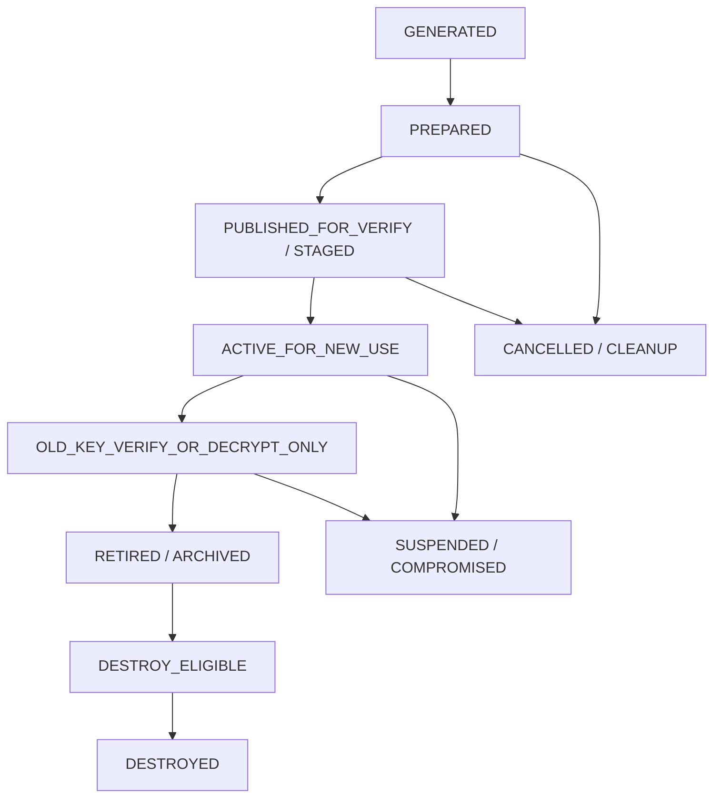
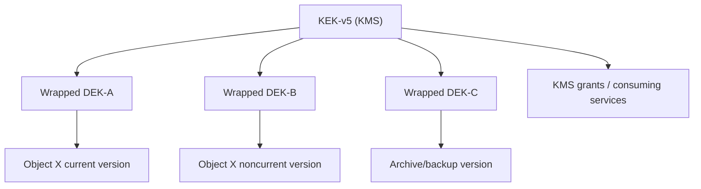
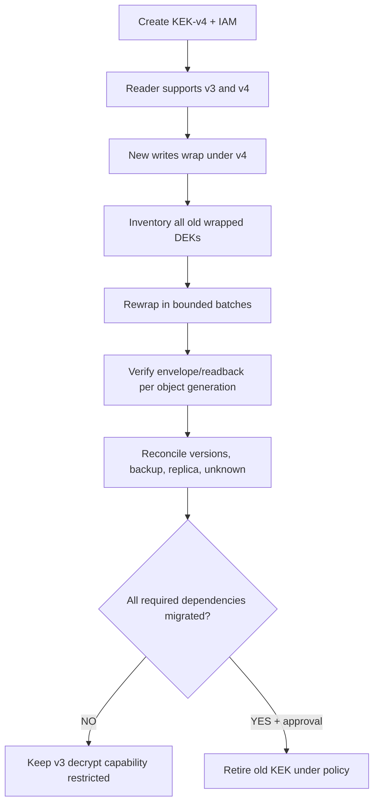

# Gradual rotation: Xoay vòng khóa mật mã theo giai đoạn, giữ dịch vụ liên tục và không đánh mất dữ liệu cũ

> **Chương:** Cryptoperiod và rotation  
> **Bài học:** Gradual rotation  
> **Module:** `SECURITY_KEY_MANAGEMENT_FUNDAMENTALS` — tìm hiểu vòng đời khóa mật mã từ tạo, cấp phát, lưu trữ, sử dụng, xoay vòng đến thu hồi và hủy; liên hệ mật mã đối xứng/bất đối xứng, chữ ký số, KMS/HSM, envelope encryption, IAM và kiểm toán để thiết kế hệ thống bảo vệ khóa an toàn.

## 1. Tình huống: Đổi khóa lúc nửa đêm làm hàng triệu token và object ngừng hoạt động

Giả sử hệ thống thanh toán sử dụng:

- Private key `sign-v3` trong HSM để ký access token và sự kiện.
- Public key `sign-v3` được các verifier tải qua JWKS, có cache.
- KEK `kek-v5` trong KMS bọc hàng triệu DEK của object storage.
- Các bản sao dịch vụ ở nhiều availability zones và vùng địa lý.
- Object versions, backup, job xử lý chậm và token có thời gian sống khác nhau.

Lúc 00:00, một operator đổi alias `sign-current` sang khóa `sign-v4` và ngay lập tức vô hiệu hóa `sign-v3`. Hậu quả:

1. Một số verifier chưa tải public key `sign-v4`, nên token mới bị từ chối.
2. Token cũ được ký bằng `sign-v3` vẫn còn hạn, nhưng bị từ chối nếu verifier không còn trust khóa cũ.
3. Worker ở region khác vẫn dùng cache alias cũ, tạo chữ ký với version v3.
4. Dữ liệu object mã hóa dưới DEK được bọc bởi `kek-v5` có thể không giải mã được nếu KEK cũ bị disable/delete không đúng.
5. Hệ thống không có số liệu để chứng minh bao nhiêu consumer đã chuyển sang version mới.

Lỗi ở đây không nằm ở thuật toán RSA, Ed25519 hay AES, mà ở **thiếu một kế hoạch chuyển tiếp trạng thái và tương thích**.

**Gradual rotation** là chiến lược xoay vòng khóa theo các pha có kiểm soát: chuẩn bị khóa mới, phân phối thông tin tin cậy cần thiết, cho phép *đọc/verify* cả khóa cũ và khóa mới trong thời gian chuyển tiếp, chuyển *tạo bảo vệ mới* sang khóa mới, di chuyển các dữ liệu/phụ thuộc cũ khi cần, sau đó ngừng dùng và thu hồi/hủy khóa cũ khi đã đủ điều kiện.

> **Nguyên tắc:** *New writes/signatures use the new key; old ciphertext/signatures may require the old key for a bounded, explicitly governed period.* Đây là mô hình chuyển tiếp phổ biến, không phải quy tắc áp dụng nguyên xi cho mọi key type hoặc khi khóa cũ đã bị compromise.

### Mục tiêu học tập

Sau bài này, bạn có thể:

1. Phân biệt **cryptoperiod**, rotation, rekey, rewrap, re-encrypt, certificate renewal, alias cutover, revoke và destroy.
2. Thiết kế gradual rotation với **prepare → publish trust → new-use cutover → overlap → migrate → retire**.
3. Hiểu **originator-usage period** và **recipient-usage period** cùng những hạn chế theo key purpose.
4. Xoay vòng signing key, HMAC secret, KEK/DEK, TLS/mTLS keys, API credentials và KMS/HSM key versions.
5. Thiết kế **dual-verify/dual-decrypt** mà không tạo đường downgrade, key confusion hoặc thử key vô tội vạ.
6. Quản lý cache, retry, rollout nhiều service/region, sự kiện không đồng bộ và rollback.
7. Xác định khi nào phải **rotation khẩn cấp** thay vì kéo dài overlap của khóa đã lộ.
8. Đọc ví dụ Java 17 mô phỏng **Ed25519 gradual rotation** an toàn về nguyên tắc.
9. Thiết kế audit, metrics, key inventory, negative tests và deletion gates.
10. Viết runbook rollout/rollback cho hệ thống mật mã không làm mất khả năng decrypt/verify lịch sử.

---

## 2. Gradual rotation thực sự giải quyết vấn đề gì?

### 2.1. Đổi khóa tức thời và đổi khóa theo giai đoạn

**Đổi tức thời (hard cutover):**

```text
T0: tất cả producer sử dụng K_old
T1: tất cả producer và consumer phải dùng K_new
T1: K_old lập tức bị loại
```

Đây có thể khả thi trong phạm vi nhỏ, có synchronization chặt và không có phụ thuộc dữ liệu cũ. Nhưng thường gây lỗi ở môi trường đa phiên bản, có cache, dữ liệu lưu trữ lâu dài hoặc replication trễ.

**Gradual rotation:**

```text
T0: Producer=K_old      Consumer trust/read={K_old}
T1: Chuẩn bị K_new     Consumer trust/read={K_old,K_new} nếu phù hợp
T2: Producer=K_new      Consumer trust/read={K_old,K_new}
T3: Di chuyển phụ thuộc cũ, chờ hết TTL/cryptoperiod
T4: Producer=K_new      Consumer trust/read={K_new}
T5: K_old bị retire/revoke/destroy theo policy và dependencies
```

**Hai hành động độc lập:** chuyển nơi **tạo dữ liệu/chữ ký mới** và ngừng **xử lý dữ liệu/chữ ký cũ**. Gradual rotation cố tình không gộp chúng.

### 2.2. Tại sao cần khoảng overlap?

- Các verifier cache JWKS/certificate/public key.
- Token/cookie/message được ký bằng khóa cũ chưa hết hạn.
- Một số job/message queue nhận dữ liệu muộn.
- Object versions và backups có ciphertext dưới khóa cũ.
- Deployment rolling/canary khiến nhiều application versions cùng chạy.
- KMS/HSM key state/grants có propagation delay theo provider.
- Các client bị offline hoặc mobile app chưa nâng cấp.

**Overlap là phương tiện đảm bảo tương thích**, không phải một lý do giữ khóa cũ vô thời hạn.

### 2.3. Lợi ích và chi phí

| Lợi ích | Chi phí/rủi ro |
|---|---|
| Giảm downtime và lỗi verification/decrypt. | Tạm thời có nhiều key versions có quyền dùng. |
| Có canary và đo lường trước cutover toàn hệ. | Quản lý key metadata, cache và metrics phức tạp hơn. |
| Cho phép migrate hàng triệu objects theo batch. | Cần lưu old KEK/decrypt path an toàn trong thời gian dài hơn. |
| Có kế hoạch rollback cho lỗi cấu hình. | Rollback có thể không an toàn nếu key cũ bị lộ/revoked. |
| Giữ historical signatures/data hợp lệ. | Phải hạn chế old key use đúng purpose, không cho tạo mới tùy tiện. |

### 2.4. Không phải lúc nào “gradual” cũng là lựa chọn tốt nhất

Khi một signing key hoặc KEK **đã bị compromise**, cố duy trì dual-sign hoặc chấp nhận token mới bằng khóa cũ quá lâu có thể kéo dài tấn công.

Khi đó cần kế hoạch **emergency containment**: ngừng tạo dữ liệu mới dưới khóa cũ, chặn các grants/credentials bị lộ, thu hồi trust theo mức độ ảnh hưởng, rotate nhanh, invalidate sessions và tái mã hóa khi cần. Việc hỗ trợ dữ liệu lịch sử phải được thiết kế có giới hạn và được phê duyệt.

---

## 3. Cryptoperiod và key lifecycle: Hai khoảng sử dụng khác nhau

### 3.1. Cryptoperiod là gì?

**Cryptoperiod** là khoảng thời gian một khóa được phép sử dụng cho những mục đích mật mã xác định theo policy. Nó phụ thuộc loại khóa, thuật toán, giá trị dữ liệu, quy mô sử dụng, cơ chế lưu, khả năng compromise, quy định và threat model.

**Không có một thời hạn “mọi khóa phải rotate mỗi 90 ngày” áp dụng tuyệt đối.** Các giá trị cụ thể phải dựa trên crypto policy, risk, provider constraints và yêu cầu ngành.

### 3.2. Originator-usage và recipient-usage period

Phân biệt:

- **Originator-usage period:** thời gian được phép **tạo sự bảo vệ mới** bằng key, ví dụ Encrypt, Sign, MAC generate.
- **Recipient-usage period:** thời gian được phép **xử lý dữ liệu đã được bảo vệ**, ví dụ Decrypt hoặc Verify chữ ký lịch sử.

Ví dụ:

```text
K_old:
  Sign new message:          allowed until 2026-12-01
  Verify historical message: allowed until 2026-12-03 (tokens hết hạn)
```

Với stored ciphertext:

```text
KEK_old:
  Wrap new DEKs:        stops at cutover
  Unwrap historic DEKs: continues until safe migration/deletion gate
```

**Không đồng nhất** recipient-usage period với “khóa luôn an toàn”. Nếu compromise xảy ra, incident policy có thể thu hẹp hoặc chấm dứt cả việc dùng lịch sử.

### 3.3. State machine khái niệm



Các trạng thái là **mô hình của hệ quản trị**, không nhất thiết trùng tên status của KMS/HSM.

### 3.4. Ba khái niệm “cũ” cần tách

| Khái niệm | Ví dụ | Điều không được suy ra |
|---|---|---|
| **Key đã hết originator period** | Không tạo chữ ký mới. | Không có nghĩa mọi ciphertext cũ đã migrate. |
| **Key đã retired khỏi active alias** | Alias chuyển sang v4. | Không có nghĩa old KMS grants bị thu hồi. |
| **Key đã destroyed** | Key material không còn dùng được. | Không có nghĩa dữ liệu phụ thuộc đã được xóa/migrate; có thể gây mất dữ liệu. |

### 3.5. Lựa chọn thời hạn overlap

Đặt thời hạn theo:

```text
max relevant token lifetime
+ clock skew allowance
+ verifier/public-key cache freshness
+ deployment propagation allowance
+ queue/retry/backlog window
+ offline consumer requirements
+ incident/data retention constraints
```

Đây là **các yếu tố**, không phải công thức cộng đơn giản áp dụng mọi hệ. Với dữ liệu mã hóa dài hạn, key recipient-use có thể cần nhiều năm hoặc được rewrap/re-encrypt trước khi retire.

---

## 4. Ma trận rotation theo loại khóa

| Key/material | Tạo mới dưới khóa mới | Còn dùng khóa cũ để làm gì? | Khi nào có thể retire? |
|---|---|---|---|
| **Private signing key** | Sign/JWS mới bằng key mới. | Public key cũ verify token/chữ ký lịch sử. | Khi không còn trust obligations hoặc theo retention/compromise policy. |
| **JWT HMAC secret** | Phát token mới dùng secret mới. | Verify token cũ đến expiry khi đủ an toàn. | Khi token cũ hết hạn/revoked; HMAC secret phải giữ bí mật. |
| **HSM signing handle** | Update key ID để gọi Sign mới. | HSM key cũ có thể không cần Sign, public verify key vẫn lưu. | Theo audit/signature retention, grants và key state. |
| **KEK của envelope** | Wrap DEKs mới bằng KEK mới. | Unwrap old wrapped DEKs hoặc rewrap. | Khi mọi version/backup dependencies đã được giải quyết. |
| **DEK mã hóa object** | Encrypt payload mới dưới DEK mới. | Decrypt ciphertext cũ. | Sau re-encrypt/retention hoặc cryptographic erasure có kiểm soát. |
| **TLS server private key/cert** | New handshakes dùng certificate/key mới. | Một số clients còn trust chain cũ; existing sessions theo giao thức. | Sau rollout, trust/cert overlap và incident policy. |
| **Root/intermediate CA key** | Ký certificate mới bằng key mới. | Xác minh chuỗi cũ theo PKI policy. | Rất phụ thuộc certificate hierarchy và thời gian hiệu lực. |
| **SSH host key** | Server quảng bá key mới. | Client vẫn tin host key cũ trong migration nếu được thiết kế. | Sau cập nhật known_hosts/trust, hoặc thu hồi khẩn cấp. |
| **API secret / service token** | Bên gửi dùng credential mới. | Bên nhận tạm chấp nhận old credential cho requests đang chuyển. | Khi consumers chuyển xong và old credential bị revoke. |
| **KDF master/input key** | Derive outputs mới từ master mới. | Re-derive/decrypt dữ liệu lịch sử theo scheme. | Khi toàn bộ dependencies và recovery path đã xử lý. |

### 4.1. Từ góc độ tiêu thụ: producer và consumer

Một ứng dụng vừa có thể là producer vừa là consumer:

- Producer JWT ký token.
- Verifier JWT kiểm token.
- Object writer encrypt/commit.
- Object reader decrypt.
- TLS server chọn certificate.
- TLS client kiểm trust anchor.

Vì thế cutover phải nhìn **hai phía**, không chỉ thay config của service sinh chữ ký.

### 4.2. Ký và mã hóa không đối xứng nhau hoàn toàn

Với chữ ký số, old **public key** thường đủ verify lịch sử; không nhất thiết giữ old **private key** hoạt động. Với symmetric encryption, old DEK/KEK hoặc khả năng decrypt tương ứng có thể vẫn cần để đọc dữ liệu cũ.

Đây là lý do **rotation policy phải theo key purpose**, không dùng một scheduler đổi mọi key theo cùng hành vi.

---

## 5. Kiến trúc gradual rotation chuẩn: Prepare, trust, cutover, drain, retire

```mermaid
sequenceDiagram
    participant Owner as Key custodian
    participant KMS as KMS/HSM
    participant Registry as Key inventory/registry
    participant Consumer as Verifier/reader fleet
    participant Producer as Signer/writer fleet
    participant Audit as Audit/SIEM
    Owner->>KMS: Create K_new with approved policy
    KMS-->>Registry: Immutable key ID/version
    Owner->>Registry: Publish trust/metadata for K_new
    Registry-->>Consumer: New verify/decrypt configuration
    Consumer-->>Audit: Readiness/version telemetry
    Owner->>Producer: Cutover new Sign/Encrypt to K_new
    Producer-->>Audit: Active key version and success rates
    Note over Producer,Consumer: K_new for new writes; K_old allowed only for legacy reads/verify
    Owner->>Registry: Rewrap/migrate/drain dependencies
    Registry-->>Audit: Residual old-key dependencies
    Owner->>KMS: Restrict/revoke/retire old use after gates
    KMS-->>Audit: Lifecycle state verified
```

### 5.1. Pha A — Inventory và thiết kế

Trước khi tạo key mới:

- Biết **immutable key ID/material version** cũ và scope.
- Liệt kê producers, consumers, verifiers, region, KMS grants.
- Xác định cryptoperiod, token TTL, cached-key TTL và backlog.
- Liệt kê wrapped DEKs, object versions, backups và archive dependencies.
- Xác định quyết định rollback và emergency thresholds.
- Ghi owner, approver, audit correlations, change window.

Nếu không biết old key đang dùng ở đâu, không thể chứng minh retire an toàn.

### 5.2. Pha B — Generate/prepare key mới

- Sinh key trong KMS/HSM hoặc CSPRNG được phê duyệt theo thiết kế.
- Chọn algorithm, key size, export policy và purpose đúng.
- Tạo immutable key reference; không phụ thuộc duy nhất vào alias.
- Kiểm quyền IAM/grants theo tenant/environment/operation.
- Gắn key owner, creation time, policy version, rotation reason.
- Kiểm thử Sign/Verify hoặc Encrypt/Decrypt bằng **test fixtures**, không dùng dữ liệu production nhạy cảm tùy tiện.
- KMS/HSM audit và approval có evidence.

Ở pha này, **không vội đổi producer**.

### 5.3. Pha C — Publish acceptance trước khi đổi producer

- Với JWT/signature: công bố **trusted public key mới** vào JWKS hoặc trust registry.
- Với HMAC: đưa verifier secret mới qua secret manager và audit, không công bố secret.
- Với encrypted objects: đảm bảo reader có thể chọn đúng KEK/DEK version từ authenticated metadata.
- Với TLS: chuẩn bị certificate/trust bundle/server config và client compatibility.
- Chờ readiness thật và cache TTL cần thiết; không chỉ xem CI deploy thành công.

Mục đích là tránh **producer mới tạo dữ liệu mà consumer chưa xử lý được**.

### 5.4. Pha D — Cutover originator use

- New Sign/Encrypt/Wrap dùng key mới.
- Old key bị hạn chế **không tạo mới** theo khả năng provider.
- Giữ đường Verify/Decrypt cũ trong khoảng chuyển tiếp đã duyệt.
- Đo lỗi theo key version, client version và region.
- Ghi audit thay đổi alias/grants, active key ID và policy version.

### 5.5. Pha E — Drain và migrate

- Chờ token cũ hết hạn/queue draining theo thời gian giới hạn.
- Hoặc rewrap/re-encrypt dữ liệu cũ theo dependency inventory.
- Di chuyển replicas/backups nếu policy yêu cầu.
- Xử lý offline consumers, long-lived sessions và lịch sử chữ ký.
- Xác minh residual old-key usage gần về 0 trong **scope có thể quan sát**.

Không coi “không có log Decrypt 24 giờ” là bằng chứng không còn bản dữ liệu cần key cũ.

### 5.6. Pha F — Restrict, retire và destroy có điều kiện

- Kiểm migration completion và coverage.
- Thu hồi quyền **originator operation** của old key.
- Giới hạn historical Verify/Decrypt theo policy.
- Chỉ schedule deletion khi có dependency gate, retention, legal hold và DR approval.
- Kiểm actual provider state và evidence sau thay đổi.

**Retire không đồng nghĩa Destroy**; có thể old key không được dùng tạo dữ liệu mới nhưng vẫn phải lưu an toàn để đọc dữ liệu cũ.

---

## 6. Các invariant cần giữ trong toàn bộ rollout

Một gradual rotation tốt nên xác định các invariant có thể test.

### 6.1. Invariant của producer

```text
At most one approved originator key version
for the same purpose + tenant + environment + logical generation,
except an explicitly designed multi-signing protocol.
```

Điều này giúp tránh các instance tự ý tạo mới dưới hai key khác nhau trong cùng cutover. Với canary, có thể chủ đích cho phép hai versions trong một khoảng ngắn; nhưng **phạm vi và thời gian phải được quản trị**.

### 6.2. Invariant của consumer

```text
Accept only a trusted, explicit key set.
Never fetch arbitrary key URL or import a new key from untrusted token metadata.
```

Trong JWT, `kid` chỉ là selector tới **trusted keyset**. Header `jku`, `x5u` hoặc URL khác không thể tự cấp quyền thay trust registry.

### 6.3. Invariant của lịch sử dữ liệu

```text
Every retained ciphertext/signature must have
an approved and verifiable recovery/verification path,
unless an explicit erasure/revocation decision says otherwise.
```

Không hủy KEK vì active object hiện tại đã migrate nếu archived/noncurrent object versions còn phụ thuộc.

### 6.4. Invariant của phân quyền

```text
Permitted operations under K_old shrink at cutover.
K_new grants are restricted to intended principals.
```

Một hệ không nên tăng wildcard grants `kms:Decrypt *` chỉ để “cho migration dễ chạy”.

### 6.5. Invariant của quan sát

```text
Every cutover stage has readiness metrics,
audit evidence, abort criteria and rollback/forward-fix plan.
```

Không dùng câu “đã deploy xanh” thay bằng chứng verifier thật đã nhận new key.

---

## 7. Planned rotation và compromised-key rotation là hai bài toán khác

### 7.1. Planned rotation

Ví dụ đến cuối originator cryptoperiod:

- Khóa cũ **chưa có bằng chứng bị lộ**.
- Có thể công bố trust/reader support trước.
- Có thể overlap và batch migration.
- Có thể rollback có điều kiện nếu new version có lỗi.
- Có thời gian DR rehearsal, canary và acceptance tests.

### 7.2. Emergency compromise

Ví dụ private JWT signing key bị lộ qua CI artifact:

- Attacker có thể ký token giả bằng old key.
- Duy trì dual verify old key quá lâu có thể tiếp tục chấp nhận token giả.
- Không nên “rollback về old compromised key”.
- Cần thu hồi old grants, rotate sang key sạch, invalidate sessions/token issuance, bảo vệ downstream verifiers.
- Có thể phải disable old key/trust nhanh hơn TTL thông thường và chấp nhận một mức gián đoạn có kiểm soát.
- Với DEK lộ, **rewrap bằng KEK mới không khôi phục confidentiality**; phải đánh giá DEK rotation và data re-encryption.

### 7.3. Ma trận quyết định

| Tình huống | Có overlap? | Rollback về old key? | Hành động chính |
|---|---|---|---|
| Hết cryptoperiod theo lịch, không có compromise | Thường có, có thời hạn. | Có thể, nếu old key còn an toàn và policy cho phép. | Prepare/publish/cutover/migrate. |
| Algorithm bị loại khỏi chuẩn | Có thể giới hạn hoặc không. | Chỉ khi được policy cho phép. | Migrate sang algorithm an toàn, hạn chế old use. |
| Private signing key bị lộ | Overlap trust thường phải rút ngắn mạnh. | **Không** dùng lại compromised private key. | Revoke trust, replace key, invalidate credentials. |
| Raw DEK bị lộ | Historical decrypt phải được kiểm soát; ưu tiên re-encrypt. | Không coi old DEK còn bí mật. | Generate new DEK/re-encrypt theo impact. |
| New key cấu hình sai, old key vẫn an toàn | Có thể giữ old Verify/Decrypt. | Có thể rollback qua change control. | Fix/canary/rollback producer. |
| KMS region outage | Phụ thuộc DR architecture. | Không dùng raw fallback key tùy tiện. | Approved failover/cross-region recovery. |

### 7.4. Một điều dễ nhầm

**Gradual rotation ≠ luôn chấp nhận old key tới khi “không còn traffic”.** Nếu old key bị compromised, mỗi phút chấp nhận nó có thể là một phút cho attacker giả mạo hoặc giải mã.

Security team và application owner phải cùng quyết định trade-off **availability vs containment**.

---

## 8. Key inventory: Bắt đầu từ dependency graph, không từ alias

### 8.1. Đồ thị phụ thuộc



Nếu `O3` chưa migrate và không có recovery path, KEK-v5 chưa đủ điều kiện destroy dù `O1` và `O2` đã rewrap.

### 8.2. Metadata nên lưu

| Field | Ví dụ | Ý nghĩa |
|---|---|---|
| `logicalKeyName` | `billing-encryption-current` | Tên logic có thể thay alias. |
| `immutableKeyId` | `kms-key-opaque-218` | Resource thực tế tại provider. |
| `materialVersion` | `v5` | Version vật liệu mã hóa/định danh. |
| `purpose` | `KEY_WRAP` | Không nhầm Sign với Decrypt. |
| `tenantScope` | `tenant-42` | Tách tenant. |
| `environment` | `prod` | Không reuse staging key. |
| `state` | `NEW_USE_STOPPED` | Trạng thái dùng key. |
| `originatorUseUntil` | UTC time | Khi nào ngừng tạo mới. |
| `recipientUseUntil` | UTC time hoặc retention policy | Đọc/verify lịch sử. |
| `algorithm` | AES-KW / Ed25519 | Crypto policy. |
| `keyOrigin` | HSM-generated / imported | Nguồn gốc và custody. |
| `provider` | KMS/HSM reference | Boundary kỹ thuật. |
| `consumerGroups` | readers, verifiers | Ai phụ thuộc. |
| `aliases` | current/legacy | Dynamic pointer. |
| `wrappedKeyRefs` | inventory links | Truy dấu DEKs. |
| `rollbackEligibility` | yes/no + reason | Chặn quay lại key lộ. |
| `rotationOperationId` | opaque ID | Audit correlation. |
| `policyVersion` | crypto-rotation-v4 | Quy tắc kiểm soát. |
| `lastVerifiedAt` | UTC time | Evidence không stale. |

### 8.3. Alias là con trỏ, không phải identity bất biến

Ví dụ:

```text
alias/billing-current -> KMS-key-2026-v6
```

Thay alias giúp producer chọn key mới cho thao tác sau, nhưng ciphertext/wrapped DEK cũ thường có **key reference/version lịch sử** và có thể vẫn cần old KEK.

Không chỉ lưu alias vào envelope metadata nếu sau rotation alias trỏ sang key khác làm mất khả năng giải mã hoặc truy vết.

### 8.4. Quản lý “unknown” một cách nghiêm túc

Nếu không quét được archive để xác nhận key version:

```text
migrationStatus=UNKNOWN
reason=archive-unavailable
```

Không đưa vào mẫu số “migrated PASS” hay xóa old key. Cần kế hoạch restore/scan sau.

---

## 9. Dual-verify cho JWT/JWS và chữ ký số

### 9.1. Luồng ký/kiểm trong overlap

```text
Phase A:
  issuer signs with signing-v3
  verifiers trust public {v3}

Phase B:
  issuer signs with signing-v3
  verifiers trust public {v3, v4}

Phase C:
  issuer signs with signing-v4
  verifiers trust public {v3, v4}

Phase D:
  issuer signs with signing-v4
  verifiers trust public {v4} for normal token processing
  historical verification policy may retain v3 separately
```

Đây là **dual-verify, single-current-sign**. Không cần phát **hai chữ ký** cho mọi token nếu giao thức không yêu cầu.

### 9.2. Vì sao publish JWKS trước khi sign mới?

Các verifier có thể cache JWKS trong nhiều phút/giờ. Nếu issuer ký với `kid=v4` trước khi verifier tải v4, token mới có thể bị reject.

Cần tính:

```text
JWKS cache max-age/effective TTL
+ delivery/CDN propagation
+ verification service reload/readiness
+ observed consumer lag
```

Có thể kiểm tra readiness bằng synthetic token ký bằng v4 trong môi trường đã định nghĩa, **không dùng một mẫu thử có đặc quyền admin**.

### 9.3. `kid` không cấp quyền

Một JWT có header:

```json
{
  "alg": "EdDSA",
  "kid": "sign-v4"
}
```

không tự chứng minh issuer đáng tin. Verifier phải kiểm:

1. Issuer/audience/expiry/nbf của token.
2. Algorithm được phép cho issuer đó.
3. `kid` tồn tại trong **trusted keyset** của đúng issuer.
4. Signature verify với public key tương ứng.
5. Claims/tenant/roles theo authorization policy.
6. Key status/verification window và clock skew policy.

**Không chấp nhận** một JWK hoặc key URL bất kỳ do token tự nhúng.

### 9.4. Old key Verify-only có nghĩa gì với public key?

Verifier có thể giữ old public key để kiểm token cũ. Với HSM private key, policy nên **ngừng Sign mới** bằng old private key; không nhất thiết hủy old public key.

Nếu old private key bị compromise, kẻ tấn công vẫn ký được token mới ngoài HSM. Chỉ dựa vào `issuedAt` do token khai **không chống được forgery**, vì attacker có thể đặt thời gian giả. Trong compromise case cần thêm revocation/trust controls và đánh giá hết hạn/issuer/session claims.

### 9.5. Token TTL và historical signatures

Một access token có TTL 15 phút khác một chứng từ ký cần được verify trong 10 năm. Đừng dùng cùng một chính sách “xóa public key sau 15 phút” cho cả hai.

Dữ liệu historical signatures có thể cần public key/certificate chain, trust evidence, timestamp và validation context phù hợp trong retention.

---

## 10. Gradual rotation cho HMAC và shared secrets

### 10.1. Vì sao phức tạp hơn public-key verification?

HMAC dùng cùng secret để tạo và kiểm MAC. Nếu verifier nhận old secret, verifier cũng có **khả năng tạo MAC** theo mô hình shared-key; không có tính tách public/private như chữ ký số.

Trong overlap:

```text
producers sign/MAC with HMAC-v4
consumers verify with {HMAC-v3, HMAC-v4}
```

Phải giới hạn quyền truy cập của consumers tới cả hai secrets, có TTL và môi trường riêng.

### 10.2. Tránh thử mọi secret không kiểm soát

Không triển khai:

```text
for every key in KMS:
    attempt HMAC verify until one works
```

Nên có authenticated/trusted metadata chọn key version hoặc kiểm trong **keyset nhỏ, cố định và được phép** khi protocol không có selector. Chú ý timing/response differences và key-selection oracle.

### 10.3. Shared secret compromise

Nếu secret cũ bị lộ, giữ dual-verify sẽ tiếp tục tạo cửa sổ cho forged messages.

Cần:

- Thu hồi old secret/trust nhanh theo incident policy.
- Chuyển producer/consumer sang key mới.
- Giới hạn replay window, message nonce/sequence và thời hạn.
- Đánh giá các messages đã được chấp nhận trong compromise window.
- Cân nhắc dùng asymmetric signature nếu cần tách quyền tạo/kiểm và accountability.

### 10.4. Không nhầm HMAC key rotation với password reset

Một HMAC key phải được sinh từ CSPRNG/KMS với entropy đủ; không chỉ đổi một chuỗi human-readable dễ đoán theo ngày.

---

## 11. TLS/mTLS: Rotate private key, certificate và trust có thể khác nhịp

### 11.1. Những thành phần độc lập

```text
TLS private key
TLS certificate
certificate chain/intermediate
trust anchors / client trust store
session resumption/ticket key material
deployment/configuration
```

Thay certificate **không luôn đồng nghĩa thay private key**. Ngược lại, một private key mới cần certificate phù hợp nếu dùng X.509 TLS.

### 11.2. Server certificate rollout

Các bước có thể:

1. Sinh private key mới trong HSM/OS keystore hoặc theo policy.
2. Phát hành certificate cho public key mới, kiểm SAN/EKU/issuer.
3. Xác minh client có trust chain phù hợp.
4. Deploy cert/key mới tới canary servers.
5. Quan sát handshake errors theo client version/region.
6. Rolling rollout toàn fleet.
7. Retire old certificate/private key theo policy.
8. Kiểm tra session resumption, key pinning, caches và client lạc hậu.

### 11.3. mTLS client certificate và server trust

Nếu server kiểm certificate của client, phải đảm bảo **server trust/allowlist đã sẵn sàng** trước khi client chuyển certificate mới.

Với certificate pinning, cần có kế hoạch cập nhật pins hoặc backup pins; pinning cứng một public key có thể khiến rotation gây outage trên mobile/offline clients.

### 11.4. TLS session keys khác identity key

TLS 1.3 sử dụng key schedule/traffic secrets cho phiên, không phải đơn giản “gửi TLS private key mới” tới mọi client. Thay server certificate/key ảnh hưởng authentication của new handshakes; existing session behavior phụ thuộc protocol, session resumption, ticket keys và cấu hình provider.

Không log traffic secrets để “kiểm rotation”.

### 11.5. Certificate revocation và lịch sử

CRL/OCSP và CA trust có semantics riêng. Không khẳng định hết hạn certificate khiến tất cả chữ ký lịch sử invalid hay mọi TLS session đang mở lập tức bị cắt; cần xem protocol và trust policy.

---

## 12. Rotation cho object encryption: DEK/KEK và envelope metadata

### 12.1. Cấu trúc envelope

```text
Object plaintext
   --AES-GCM under DEK-A--> Object ciphertext
DEK-A
   --Wrap under KEK-v5--> Wrapped DEK-A
```

Object record có thể gồm:

```json
{
  "applicationObjectId": "doc-7821-generation-3",
  "contentAlgorithm": "AES-256-GCM",
  "contentKeyId": "dek-opaque-113",
  "contentNonce": "base64url-nonce",
  "wrappedDekRef": "envelope-452",
  "wrappingKeyId": "kms-immutable-kek-v5",
  "envelopeVersion": 3
}
```

Đây là ví dụ client-side format, không phải API trả về của mọi object stores. **Không lưu raw DEK** trong metadata hoặc audit.

### 12.2. Writer cutover

Sau khi KEK-v6 sẵn sàng:

```text
new objects: new DEKs wrapped by KEK-v6
old objects: wrapped DEKs remain under KEK-v5
```

Reader phải chọn đúng KEK theo authenticated envelope/registry, không chỉ dùng alias `current`.

### 12.3. Rewrap DEK khác re-encrypt object

**Rewrap:**

```text
DEK-A (same bytes)
  wrapped under KEK-v5  ->  wrapped under KEK-v6
object ciphertext unchanged
```

**Re-encrypt:**

```text
Decrypt object with DEK-A
Generate DEK-B
Encrypt object with DEK-B
Wrap DEK-B with approved KEK
New object ciphertext + nonce + tag
```

Rewrap nhanh hơn vì không cần đọc toàn bộ object payload, nhưng **không bảo vệ lại dữ liệu nếu raw DEK-A đã lộ**.

### 12.4. AAD và khả năng rewrap

Nếu **content AAD** gồm immutable `wrappingKeyId=v5`, đổi wrappingKeyId thành v6 mà giữ ciphertext/tag cũ có thể khiến AES-GCM authentication fail.

Muốn rewrap độc lập với payload, thiết kế:

```text
contentAAD = canonical(
  domain="object-content-v1",
  tenant,
  immutableObjectGenerationId,
  contentAlgorithm,
  stableContentKeyId
)

wrapContext = canonical(
  domain="dek-wrap-v1",
  tenant,
  immutableObjectGenerationId,
  sourceOrTargetKekId,
  stableContentKeyId
)
```

Metadata mới phải được xác thực/cập nhật có kiểm soát. **Không âm thầm sửa AAD của body và tuyên bố rewrap không ảnh hưởng ciphertext** nếu format cũ đã bind key ref khác.

### 12.5. Metadata migration cần tính nguyên tử logic

Nếu ciphertext body và envelope nằm ở hai objects riêng:

```text
object.enc
object.envelope
```

sự cố ở giữa có thể tạo mismatch.

Dùng versioned manifest/conditional writes, commit marker và rollback state. Một provider hỗ trợ atomic object write không nhất thiết hỗ trợ transaction nguyên tử giữa hai objects.

---

## 13. KMS-managed rotation không phải luôn thay resource ID

### 13.1. Internal key material rotation

Một số KMS hỗ trợ tự xoay vòng key material bên dưới một **logical KMS key** mà vẫn cho giải mã ciphertext cũ. Khi đó provider có thể duy trì nội bộ các material versions để decrypt.

Nhưng không được suy ra:

- Tất cả KMS providers/key types hoạt động giống nhau.
- Rotation tự rewrite mọi object ciphertext.
- Alias cutover đồng nghĩa cryptographic material rotation.
- Imported/BYOK keys có lifecycle giống generated keys.
- Key deletion vẫn decrypt lịch sử được.

### 13.2. Tạo KMS key resource mới

Một migration khác:

```text
KMS key resource A -> KMS key resource B
```

Có thể đòi:

- Grant/IAM policy mới.
- Encryption context binding phù hợp.
- Rewrap hoặc re-encrypt old dependencies.
- Data/key inventory update.
- Policy-based migration và restore tests.
- Audit và Key ID/version record.

### 13.3. Envelope encrypt và provider SSE khác nhau

Trong server-side encryption của object storage, provider có thể quản lý DEK và metadata nội bộ. Việc đổi default bucket encryption/key setting thường áp dụng cho **new writes**, không mặc nhiên đã chuyển tất cả old versions; xem semantics đúng provider.

Trong client-side encryption, ứng dụng tự quản lý envelope; provider-side SSE rotation chỉ đổi **lớp mã hóa ngoài**, không tự rewrap wrapped DEK của ứng dụng.

### 13.4. KMS caching và số lượng log

Provider hoặc app có thể cache DEKs. Số event KMS `Decrypt` không nhất thiết bằng số object reads. Vì thế việc “24 giờ không có KMS Decrypt old key” chưa đủ chứng minh không còn old dependencies.

---

## 14. Migration batch theo object versions và dữ liệu lịch sử

### 14.1. Một object key có nhiều versions

```text
invoices/7821.pdf:
  version v1: DEK-A -> KEK-2025
  version v2: DEK-B -> KEK-2025
  version v3: DEK-C -> KEK-2026
```

Nếu chỉ kiểm current v3, việc retire KEK-2025 có thể làm v1/v2 hoặc backup không đọc được.

### 14.2. Quy trình migration có checkpoint

Một migration có thể có các state:

```text
DISCOVERED
MIGRATION_PLANNED
REWRAP_STARTED
REWRAP_COMPLETED
VERIFY_PASSED
COMMITTED
OLD_REFERENCE_RETIRED
```

Với mỗi object/version, cần key ID cũ/mới, owner tenant, result, retry count, digest/verification reference và last-verified timestamp; không lưu raw key.

### 14.3. Không bỏ qua retention và Object Lock

Một object bị retention lock có thể không được phép sửa nội dung/metadata theo provider. Rewrap sidecar có thể phải xử lý bằng cơ chế khác; re-encrypt object có thể tạo version mới thay vì xóa version cũ.

Do đó “rewrap toàn bộ trong đêm” không phải kế hoạch khả thi nếu storage tiers, archived objects hoặc compliance constraints chưa được kiểm.

### 14.4. Cost và throughput

Migration lớn gây tải:

- KMS rate limits/latency/quota.
- Object read/write/copy costs.
- Network egress và cross-region replication.
- Database/registry transactions.
- Audit events và SIEM ingestion.
- CPU cho crypto AEAD.
- S3-style request costs theo provider.

Đặt concurrency/batch size có giới hạn, backpressure, exponential retry với jitter khi thích hợp và dashboard progress. Không tắt integrity verification chỉ để đạt tốc độ.

### 14.5. Data read-after-write và kiểm tra

Với re-encrypt:

1. Encrypt dưới key mới.
2. Verify tag/data mapping trên bản mới.
3. Commit version/reference theo quy trình có kiểm soát.
4. Đối chiếu size/semantic checksum qua channel đáng tin.
5. Chỉ sau đó mới retire old dependency.

Không log plaintext file vào migration logs.

---

## 15. Rollout nhiều vùng, nhiều phiên bản app và consumers offline

### 15.1. Vấn đề distributed deployment

Một fleet có thể gồm:

```text
region-a: 80% new application version
region-b: 20% new version
mobile client: many offline
message consumer: backlog 2 days
```

Chỉ thấy producer đã chuyển new key không chứng minh tất cả verifiers/consumers đọc được.

### 15.2. “Expand and contract”

Một chiến lược:

```text
Expand:
  deploy support for K_new alongside K_old to all readers
  distribute trust/metadata/capabilities
  verify readiness

Switch:
  new writers/signers use K_new

Contract:
  remove K_old after all eligibility gates
```

Cách này tương tự database schema expand-contract: **reader compatibility trước writer cutover**.

### 15.3. Canary theo phạm vi an toàn

Có thể chuyển 1%, 10%, 50%, 100% producers theo guardrails. Nhưng với token issuer toàn cục, canary có thể phát token v4 tới **bất kỳ verifier nào**. Do đó trước canary phải đảm bảo verifier coverage, không chỉ “1% nên rủi ro nhỏ”.

### 15.4. Region failover

KMS key resource/replica ở region B có thể khác key reference, IAM và recovery mechanism. Khi rotate ở A, failover sang B phải test:

- B verify/decrypt được cả old/new versions theo policy.
- Key material/provenance được hỗ trợ sao chép đúng cách, không raw-export trái policy.
- Cross-region replication đã chuyển envelope metadata.
- Grants và aliases trỏ đúng resources.
- Audit có region context.
- RPO/RTO được đo bằng **end-to-end decrypt/verify success**.

### 15.5. Offline recipients

Nếu thiết bị offline nhiều tháng cần verify/Decrypt dữ liệu cũ, phải quyết định policy rõ:

- Có giữ old trusted key trong thiết bị?
- Có thể push keyset mới trước khi old key nghỉ?
- Có thể bắt yêu cầu cập nhật client để tiếp tục?
- Có recovery key/versioning hoặc user migration path không?

Không thể hứa mọi offline client đều chuyển an toàn nếu không có giao thức cập nhật đáng tin.

---

## 16. Cache và thời điểm có hiệu lực của key rotation

### 16.1. Những cache thường bị bỏ quên

- JWKS HTTP cache/CDN.
- Application config/feature flag cache.
- KMS alias/key metadata cache.
- Plaintext DEK cache trong process.
- Secret manager client cache.
- TLS certificate/key manager cache.
- HSM session/grant cache.
- JVM singleton/service dependency.
- Mobile client offline trust store.
- Object metadata cache/registry cache.

### 16.2. Quy tắc về cached keys

Một keyset cached cần metadata:

```text
issuer / tenant / purpose
key IDs and states
policy version
fetchedAt
expiresAt/freshness policy
source integrity
```

Không nhận một key mới chỉ vì cache miss rồi tải từ URL do token/caller cung cấp.

### 16.3. Thời gian overlap và cache TTL

Ví dụ:

```text
JWT max lifetime             = 15 phút
JWKS max cache freshness     = 30 phút
Queue max expected delay     = 10 phút
Clock skew allowance         = 2 phút
```

Không nên cộng máy móc thành 57 phút rồi cho phép old key. Phải đánh giá quan hệ thời gian: verifiers cần nhận new public key **trước** first new signature; old public key cần tồn tại cho **last old signature** đến expiry thực tế và consumer lag. Thiết lập **mốc thời gian bắt đầu/kết thúc** riêng cho hai ràng buộc.

### 16.4. Revocation khi key compromised

TTL cache dài có thể giữ old trust dù registry đã revoke. Với high-risk key, cần kiến trúc revoke propagation, short TTL hoặc push invalidation, policy chặn token phiên cũ hoặc server-side session state.

Không có cơ chế xóa ngay một cached public key ở thiết bị offline nếu thiết bị không kết nối. Đó là giới hạn thiết kế phải ghi nhận.

---

## 17. Concurrency, idempotency và cutover race

### 17.1. Hai requests có thể chọn hai keys

Trong rolling deployment:

```text
service instance A -> signs with K_old
service instance B -> signs with K_new
```

Điều này có thể được cho phép tạm thời trong một canary, nhưng phải có policy, key ID trong output và telemetry. Nếu không chủ đích, nó là drift.

### 17.2. Resolve key cho một operation

Nên có:

```text
operationId
tenant/environment/purpose
immutable key ID
key version/state snapshot
policy version
resource generation
```

Ghi key choice **một lần** cho operation, không resolve alias lần đầu lúc authorize và resolve lần hai lúc crypto theo alias đã đổi.

### 17.3. TOCTOU giữa prepare và sign

```text
authorize signing against K_old
alias switches to K_new
Sign uses alias/current
```

Nếu input/approval chỉ dành cho old version hoặc khác algorithm, kết quả không đáp ứng policy. Chọn immutable key reference gắn với quyết định, provider enforce state/IAM và re-evaluate nếu cần.

### 17.4. Idempotency khi retry

Ví dụ create grant hoặc generate DEK bị timeout sau provider success. Blind retry có thể tạo key/material/grant thứ hai.

Cần:

- Operation-level idempotency key.
- Provider request ID.
- Reconciliation actual state.
- Audit từng attempt.
- Không giả định exactly-once end-to-end.

### 17.5. Phân biệt rollback config và undo crypto

Khi đã ký token mới bằng v4, rollback producer sang v3 **không biến token v4 trở thành v3**. Verifier vẫn phải biết v4 cho tới khi token đã phát hết hạn hoặc có revoke path.

Khi object đã encrypt bằng DEK/KEK mới, rollback writer **không tự rewrite object mới**. Reader vẫn cần đọc được cả hai key versions.

---

## 18. Rollback: Khi nào được và khi nào không?

### 18.1. Điều kiện rollback an toàn trong planned rotation

Có thể rollback new-use sang old key nếu:

- Old key **chưa bị compromise** và không bị cấm dùng mới theo policy.
- Originator cryptoperiod/usage limits vẫn cho phép hoặc exception được duyệt.
- Old key provider/IAM grants còn hợp lệ và access decision đúng.
- Readers/verifiers vẫn hỗ trợ **new key** cho artifacts đã phát.
- Không làm mất metadata/committed data dưới key mới.
- Có audit, approval và một kế hoạch fix-forward.

Rollback có thể cần **forward-fix** hơn là lật alias về key cũ.

### 18.2. Các trường hợp không rollback

Không rollback khi:

- Old private key đã bị lộ.
- Old algorithm/mode bị cấm vì rủi ro mật mã.
- Old key đã destroyed.
- Old key usage limits/nonce constraints không còn an toàn.
- Security policy/incident command đã revoke.
- Old key ở region DR không còn recovery path.

### 18.3. Rollback runbook minh họa

```text
Trigger: new signing version v4 causes > approved failure threshold.
1. Freeze further rollout.
2. Identify failing verifiers/regions and classify reason.
3. Keep v4 trusted for already-issued artifacts.
4. Assess whether v3 is still safe and eligible for new Sign.
5. If permitted, temporarily route new Sign to v3.
6. Repair v4 trust/config and resume canary.
7. Audit decision, timing, owners and key state.
```

Không tự động “re-enable v3” chỉ vì một dashboard báo lỗi 5xx nếu còn nghi vấn compromise.

---

## 19. Quan sát và audit từng giai đoạn

### 19.1. Các sự kiện quan trọng

```text
ROTATION_PLANNED
NEW_KEY_GENERATED
NEW_KEY_ATTESTED / POLICY_VERIFIED
NEW_TRUST_PUBLISHED
CONSUMER_READINESS_CONFIRMED
NEW_ORIGINATOR_KEY_ENABLED
CUTOVER_STARTED
CUTOVER_COMPLETED
OLD_KEY_NEW_USE_DISABLED
DEPENDENCY_MIGRATION_STARTED
DEPENDENCY_MIGRATION_CHECKPOINT
DEPENDENCY_MIGRATION_COMPLETED
OLD_KEY_RECIPIENT_USE_RESTRICTED
OLD_KEY_RETIRE_APPROVED
OLD_KEY_DESTROYED (if appropriate)
ROTATION_ABORTED / ROLLBACK_APPROVED
```

Các event phải phản ánh **bằng chứng thực**, không ghi `CUTOVER_COMPLETED` trước khi hệ thống đo được active version.

### 19.2. Trường audit gợi ý

| Field | Ý nghĩa |
|---|---|
| `operationId`, `eventId`, `attemptId` | Nối toàn bộ rotation/các retry. |
| `actor/approver` | Trách nhiệm và SoD. |
| `logicalKeyName` | Mục đích key. |
| `oldImmutableKeyId`, `newImmutableKeyId` | Material/resource thực. |
| `keyPurpose`, `algorithm`, `tenant/environment` | Scope. |
| `phase`, `outcome`, `reasonCode` | Mốc và kết quả. |
| `policyVersion`, `approvalRef` | Quy tắc và phê duyệt. |
| `region`, `serviceVersion`, `producer/consumerRef` | Readiness. |
| `dependencyCount`, `migrationCheckpoint` | Tiến độ có chứng cứ. |
| `providerRequestId`, `inventorySnapshotRef` | Đối soát KMS/HSM. |
| `eventTimeUtc`, `ingestedAtUtc` | Time lineage. |

Không ghi raw DEK/KEK/private key, passphrase, plaintext object, full KMS response hoặc token signing secret.

### 19.3. Metrics phân tách originator và recipient

| Metric | Dùng để quyết định |
|---|---|
| `% new signatures by key version` | Producer đã chuyển hay chưa. |
| `% tokens rejected unknown kid` | Verifier chưa có new public key. |
| `verification errors by issuer/region/key version` | Rủi ro trust mismatch. |
| `% new DEKs wrapped under KEK_new` | New writer cutover. |
| `old wrapped DEK/object versions count` | Migration chưa xong. |
| `old key Decrypt/Sign calls by principal` | Usage drift, có thể chỉ là một phần. |
| `reader compatibility success by app version` | Readiness thật. |
| `key-cache staleness p95/p99` | Propagation risk. |
| `KMS latency/throttle/errors` | Tải do rotation. |
| `envelope mismatch/AEAD tag failures` | Data integrity issues. |
| `restore success of old+new test objects` | DR proof. |
| `UNKNOWN dependency count` | Chặn destroy. |

### 19.4. Không suy luận quá mức từ KMS logs

Một app có thể cache plaintext DEK hoặc old public key, nên thiếu KMS `Decrypt` không chứng minh không còn dữ liệu phụ thuộc key cũ. Cần **inventory + object scans + application-level evidence + restore tests**.

---

## 20. Java 17: Demo gradual rotation Ed25519 theo từng pha

Ví dụ sau xây một **trusted key registry trong bộ nhớ** mô phỏng:

1. Ban đầu `sign-v1` là key đang ký và verify.
2. Sinh `sign-v2`, chuẩn bị nhưng chưa cho sử dụng.
3. Publish public `sign-v2` để verifier nhận biết.
4. Cutover: mọi chữ ký mới dùng v2; v1 trở thành **verify-only**.
5. Trong overlap, chữ ký v1 và v2 đều verify được.
6. Sau khi những chữ ký v1 không còn cần trust, retire v1 trong registry.
7. Chữ ký v1 bị từ chối theo policy sau retire, dù toán học vẫn có thể đúng.

**Đây không phải JWT, không lưu production private key, không có IAM/HSM thật.** Cặp private key được tạo trong JVM chỉ để mô phỏng state transitions. Ví dụ không được dùng như thư viện rotation production.

~~~java
import java.nio.charset.StandardCharsets;
import java.security.GeneralSecurityException;
import java.security.KeyPair;
import java.security.KeyPairGenerator;
import java.security.Signature;
import java.util.Arrays;
import java.util.HashMap;
import java.util.Map;
import java.util.Objects;

public final class GradualEd25519RotationDemo {

    private static final byte[] DOMAIN =
            "PAYMENT_SETTLEMENT:v1:".getBytes(StandardCharsets.UTF_8);

    enum KeyState {
        PREPARED,
        VERIFY_ONLY,
        SIGN_AND_VERIFY,
        RETIRED
    }

    record KeyEntry(String immutableKeyId,
                    KeyPair demoKeyPair,
                    KeyState state) {
        KeyEntry withState(KeyState replacement) {
            return new KeyEntry(
                    immutableKeyId, demoKeyPair, replacement);
        }
    }

    // Demo record. A real API should enforce defensive copies
    // at serialization and object boundaries.
    record SignedMessage(
            String immutableKeyId,
            byte[] payload,
            byte[] signature) {}

    private final Map<String, KeyEntry> trustedRegistry =
            new HashMap<>();
    private String activeSignerKeyId;

    static KeyPair createDemoKeyPair()
            throws GeneralSecurityException {
        KeyPairGenerator g = KeyPairGenerator.getInstance("Ed25519");
        return g.generateKeyPair();
    }

    void prepare(String id, KeyPair pair) {
        Objects.requireNonNull(id);
        Objects.requireNonNull(pair);

        if (trustedRegistry.containsKey(id)) {
            throw new IllegalArgumentException("Duplicate key ID");
        }

        trustedRegistry.put(
                id, new KeyEntry(id, pair, KeyState.PREPARED));
    }

    void initializeFirstKey(String id) {
        if (activeSignerKeyId != null) {
            throw new IllegalStateException(
                    "Active signer already exists");
        }

        KeyEntry e = requireEntry(id);

        if (e.state() != KeyState.PREPARED) {
            throw new IllegalStateException("Wrong initial state");
        }

        trustedRegistry.put(
                id, e.withState(KeyState.SIGN_AND_VERIFY));
        activeSignerKeyId = id;
    }

    // Publish trust to verifiers BEFORE producer cutover.
    void publishForVerification(String id) {
        KeyEntry e = requireEntry(id);

        if (e.state() != KeyState.PREPARED) {
            throw new IllegalStateException(
                    "New key must start PREPARED");
        }

        trustedRegistry.put(
                id, e.withState(KeyState.VERIFY_ONLY));
    }

    // In a real distributed fleet, this requires readiness checks,
    // audit, policy, IAM and an atomic/controlled config update.
    void cutOver(String newId) {
        KeyEntry next = requireEntry(newId);

        if (next.state() != KeyState.VERIFY_ONLY) {
            throw new IllegalStateException(
                    "Publish verification trust first");
        }

        if (activeSignerKeyId == null) {
            throw new IllegalStateException("Missing current key");
        }

        KeyEntry old = requireEntry(activeSignerKeyId);
        if (old.state() != KeyState.SIGN_AND_VERIFY) {
            throw new IllegalStateException(
                    "Inconsistent active signer state");
        }

        trustedRegistry.put(
                old.immutableKeyId(),
                old.withState(KeyState.VERIFY_ONLY));
        trustedRegistry.put(
                newId, next.withState(KeyState.SIGN_AND_VERIFY));

        activeSignerKeyId = newId;
    }

    SignedMessage signBusinessRecord(String approvedRecord)
            throws GeneralSecurityException {

        // The argument is a SIMULATED approved business payload.
        // Production must perform actual authorization, canonicalization,
        // purpose checks and input binding before Sign.
        KeyEntry signer = requireEntry(activeSignerKeyId);

        if (signer.state() != KeyState.SIGN_AND_VERIFY) {
            throw new SecurityException("Signing not permitted");
        }

        byte[] body =
                approvedRecord.getBytes(StandardCharsets.UTF_8);

        byte[] message = new byte[DOMAIN.length + body.length];
        System.arraycopy(DOMAIN, 0, message, 0, DOMAIN.length);
        System.arraycopy(
                body, 0, message, DOMAIN.length, body.length);

        Signature s = Signature.getInstance("Ed25519");
        s.initSign(signer.demoKeyPair().getPrivate());
        s.update(message);
        byte[] sig = s.sign();

        return new SignedMessage(
                signer.immutableKeyId(), message, sig);
    }

    boolean verify(SignedMessage message)
            throws GeneralSecurityException {

        KeyEntry entry = trustedRegistry.get(
                message.immutableKeyId());

        if (entry == null || entry.state() == KeyState.PREPARED
                || entry.state() == KeyState.RETIRED) {
            return false;
        }

        // Bind messages to the expected protocol domain.
        byte[] payload = message.payload();
        if (payload.length < DOMAIN.length) {
            return false;
        }

        for (int i = 0; i < DOMAIN.length; i++) {
            if (payload[i] != DOMAIN[i]) {
                return false;
            }
        }

        Signature verifier = Signature.getInstance("Ed25519");
        verifier.initVerify(entry.demoKeyPair().getPublic());
        verifier.update(payload);
        return verifier.verify(message.signature());
    }

    void retireVerification(String oldId) {
        if (oldId.equals(activeSignerKeyId)) {
            throw new IllegalStateException(
                    "Cannot retire current signer");
        }

        KeyEntry old = requireEntry(oldId);
        if (old.state() != KeyState.VERIFY_ONLY) {
            throw new IllegalStateException(
                    "Old key must be VERIFY_ONLY");
        }

        // Production: allow only AFTER retention/token expiry gates,
        // inventory verification, approvals and incident review.
        trustedRegistry.put(
                oldId, old.withState(KeyState.RETIRED));
    }

    private KeyEntry requireEntry(String keyId) {
        KeyEntry entry = trustedRegistry.get(keyId);
        if (entry == null) {
            throw new IllegalArgumentException(
                    "Unknown trusted key ID");
        }
        return entry;
    }

    public static void main(String[] args)
            throws GeneralSecurityException {

        GradualEd25519RotationDemo demo =
                new GradualEd25519RotationDemo();

        demo.prepare("sign-v1", createDemoKeyPair());
        demo.initializeFirstKey("sign-v1");

        SignedMessage legacy =
                demo.signBusinessRecord("settlement-001");

        demo.prepare("sign-v2", createDemoKeyPair());
        demo.publishForVerification("sign-v2");

        // Consumers now know both public keys in this demo.
        demo.cutOver("sign-v2");

        SignedMessage recent =
                demo.signBusinessRecord("settlement-002");

        System.out.println(
                "Old verifies during overlap: "
                + demo.verify(legacy));
        System.out.println(
                "New verifies during overlap: "
                + demo.verify(recent));

        // Tamper with the approved message after signing.
        byte[] changed = recent.payload().clone();
        changed[changed.length - 1] ^= 1;
        SignedMessage tampered = new SignedMessage(
                recent.immutableKeyId(),
                changed, recent.signature());

        System.out.println(
                "Tampering rejected: "
                + !demo.verify(tampered));

        // The production retirement gate is NOT modeled here.
        demo.retireVerification("sign-v1");

        System.out.println(
                "Old rejected after retirement: "
                + !demo.verify(legacy));
        System.out.println(
                "New still verifies: "
                + demo.verify(recent));
    }
}
~~~

### 20.1. Kết quả dự kiến

~~~text
Old verifies during overlap: true
New verifies during overlap: true
Tampering rejected: true
Old rejected after retirement: true
New still verifies: true
~~~

Đây là kết quả **kỳ vọng từ logic Java 17**, không phải báo cáo đã compile/test trên mọi Java provider.

### 20.2. Những điểm demo dạy đúng

- Key ID là **immutable selector** trong trusted registry.
- Chữ ký mới chỉ do một active signer key tạo ra.
- Public verification trust cho key mới có thể được chuẩn bị **trước** cutover.
- Verify-only không được dùng Sign mới.
- Sau retire, verifier **từ chối theo policy** chữ ký cũ dù chữ ký có thể còn hợp lệ về toán học.
- Một chữ ký bị sửa payload không còn verify.
- Có domain prefix để minh họa protocol separation.

### 20.3. Giới hạn rất quan trọng

- **Demo có private key của cả hai versions trong memory**, kể cả khi state là VERIFY_ONLY. Production nên tách signer (private key trong HSM) khỏi verifier (chỉ public key), và ngăn use old private key ở module/IAM.
- `KeyEntry` chứa `KeyPair` chỉ để dễ mô phỏng; không phải chuẩn key custody.
- `SignedMessage` chứa các mảng byte có thể bị sửa; production cần immutable serialization/defensive copy.
- Một verify thành công **không tự chứng minh** settlement được duyệt; authorization/canonical payload validation phải là một bước riêng.
- Không có token TTL, issuer/audience, replay protection, key compromise revocation, trust root hoặc PKI.
- Không có HSM grants, KMS IAM, audit integrity, multi-region propagation hoặc cache TTL.
- `retireVerification` không tự kiểm lịch sử dữ liệu/retention; comment nêu rõ cần external gate.
- `HashMap` demo không thread-safe; rollout production cần atomic versioning/concurrency safety và consistency model.
- Không có signed JWKS/verified distribution transport hoặc anti-rollback keyset.
- Không xây production crypto service trực tiếp từ demo; dùng protocol/library đã được đánh giá.

### 20.4. Nếu thay bằng HSM/KMS thật

```text
Signing service:
  authorized Sign(keyId=sign-v2, canonicalPayload)
  HSM holds non-exportable private key

Verifier service:
  trusted public key set = {sign-v1, sign-v2}
  verify by allowed algorithm + issuer + kid

Rotation control plane:
  policy, state, readiness, audit, grants and deletion gates
```

Ở đây public key có thể được phân phối rộng; **private key không phải được chuyển tới mọi verifier**.

---

## 21. Java/KMS: Pseudocode cutover cho KEK rewrap

Ví dụ dưới đây là **pseudocode**, không phải một KMS SDK call hay Java chạy được trực tiếp; tên operation và context phải theo provider.

~~~text
rotateWrappingKey(oldKekId, newKekId):

  assert approvedRotationOperation(operationId)
  assert both keys belong to correct tenant/purpose/environment
  assert newKek allowed for WRAP and oldKek allowed for legacy UNWRAP

  for each immutable envelope generation using oldKekId:
      acquire/version-check migration lease
      read trusted envelope + object identity
      validate binding and lifecycle metadata

      dekHandleOrPlaintext = authorizedUnwrap(
          oldKekId, wrappedDek, oldWrapContext)

      newWrappedDek = authorizedWrap(
          newKekId, dekHandleOrPlaintext, newWrapContext)

      verify same underlying content DEK remains usable
      commit new envelope generation via conditional update
      audit key refs, source/destination, outcome, checkpoints

      destroy/clear plaintext buffers best effort if API exposed them

  reconcile all live, archive, replica and backup dependencies
  do not delete oldKek until dependency gate passes
~~~

### 21.1. Vì sao cần lease và conditional update?

Nhiều workers có thể rewrap cùng envelope, hoặc một writer có thể thay object version trong lúc migration. Không có version checks, old metadata có thể ghi đè new metadata và làm readers chọn sai key.

### 21.2. Vì sao phải quan tâm data-key plaintext?

Một số KMS APIs trả plaintext DEK cho application, làm material xuất hiện trong memory. HSM rewrap/key transfer APIs có thể giữ key trong module boundary. Chọn cơ chế theo risk và provider capabilities.

### 21.3. Cần phân biệt “đã rewrap” và “đã hoàn thành rotation”

Một job rewrap 99,9% objects vẫn có thể bỏ sót một backup cực kỳ quan trọng. Completion là **policy decision dựa trên inventory, verified references và unknown coverage**, không chỉ số jobs thành công.

---

## 22. Testing strategy: Xác minh tương thích và bảo mật cùng lúc

### 22.1. Functional matrix cho signing

| Test | Producer | Verifier | Kỳ vọng |
|---|---|---|---|
| Prepublish | old | old | Thành công. |
| Before cutover | old | {old,new} | Thành công. |
| First new signature | new | {old,new} | Thành công. |
| Delayed old token | old token | {old,new} | Thành công trong overlap được phép. |
| Old token after expiry | old token | {old,new} | **Bị từ chối theo TTL**, dù signature có thể đúng. |
| After old trust removal | old token | {new} | Bị từ chối. |
| Unknown `kid` | forged/untrusted | trusted set | Bị từ chối; không fetch arbitrary key URL. |
| Wrong issuer/audience | any | trusted set | Bị từ chối dù signature có thể verify. |
| Compromised old key | attacker old signature | incident policy | Thu hồi theo risk, không chấp nhận chỉ vì overlap. |

### 22.2. Functional matrix cho encryption

| Test | Object | KEK/DEK state | Kỳ vọng |
|---|---|---|---|
| New object | New DEK under new KEK | New key active | Decrypt/verify thành công. |
| Legacy object | Old wrapped DEK | Old decrypt allowed | Decrypt/verify thành công trong policy. |
| Rewrapped envelope | Same DEK, new KEK | Old/new wrapping metadata coherent | Payload không đổi, decrypt thành công. |
| Re-encrypted object | New DEK, ciphertext/tag mới | New key active | Decrypt mới thành công, old version theo retention. |
| Wrong AAD | Any | Valid key | AEAD tag fail. |
| Wrong tenant/resource | Any | Keys exist | Business authz deny trước unwrap. |
| Missing wrapped DEK | Legacy | Key exists | Không decrypt được; alert/restore metadata. |
| Old KEK destroyed too early | Legacy | No key | DR test fail; deletion gate phải chặn. |
| Partial object migration | Version mismatch | Both keys | Reader fail safely, no plaintext leak. |

### 22.3. Chaos/resilience tests

- KMS timeout/throttle giữa rewrap.
- Audit sink lag hoặc down.
- Canary signer bị rollback.
- JWKS CDN cache stale.
- Token issuer v4, verifier v3.
- Last old-sign token đến sát expiry.
- Region failover giữa cutover.
- Consumer offline quá overlap window.
- Duplicate migration messages/lease expiry.
- App restart mất cache/active key mapping.
- Provider key disabled giữa request.
- Legal hold cấm sửa/xóa old object.
- Restore backup từ trước key rotation.
- HSM grants còn cho old Sign sau cutover.

### 22.4. Negative tests phải chứng minh deny trước operation

Một policy có thể chặn old Sign nhưng backend vẫn gọi HSM rồi mới trả 403. Test nên đo:

```text
Decision = DENY
HSM Sign invocation count = 0
```

Provider-side deny vẫn phải hoạt động khi app PEP bị bypass.

### 22.5. Không test phá production key

Không disable/delete KEK production để “xem có mất dữ liệu không”. Dùng test keys/test objects, mô phỏng workflow deletion gate và DR isolated rehearsal theo approval.

---

## 23. Runbook production: Chuẩn bị, cutover, migration, retire

### 23.1. Pha 0 — Chuẩn bị và approval

- Chỉ định owner, approver, on-call và incident bridge.
- Xác định reason: scheduled/algorithm-change/incident.
- Đóng băng schema/algorithm policy và kế hoạch rollback.
- Inventory old key ID/version và dependencies.
- Xác định timeline, budgets, canary scope, success/error thresholds.
- Tập hợp provider/KMS constraints và DR paths.
- Chuẩn bị dashboards và audit correlation ID.

### 23.2. Pha 1 — Generate và kiểm key mới

- Generate trong approved boundary.
- Kiểm attestation/provenance khi cần, export policy, cryptographic strength.
- IAM key policy, grants, tenant/environment ràng buộc.
- Verify key pair/certificate pairing hoặc KMS Wrap/Unwrap test fixture.
- Ghi inventory và KMS audit.
- Chưa enable new use cho toàn fleet.

### 23.3. Pha 2 — Expand reader/verifier trust

- Cập nhật trusted keyset/reader path.
- Deploy readers tới tất cả planned regions.
- Kiểm CDN/JWKS cache và secret distribution.
- Verify synthetic new-key artifacts.
- Đánh giá long-lived/offline clients.
- Ghi readiness status có source evidence.

### 23.4. Pha 3 — Canary và cutover producer

- Bắt đầu canary có scope đã được duyệt.
- Dùng immutable new key ID, không alias thay đổi ngẫu nhiên giữa calls.
- Theo dõi success/error theo key version và consumer.
- Tăng traffic có kiểm soát.
- Ngừng originator use old key qua policy/IAM/HSM.
- Audit cutover, approvals, actual provider readback.

### 23.5. Pha 4 — Drain, migrate và verify

- Chờ hết token lifetime hoặc migrate stored data.
- Rewrap/re-encrypt có versioned checkpoints.
- Kiểm object versions, replicas, backup, archives.
- Thử restore/decrypt test samples theo đủ key generations.
- Phân loại unknown/unreachable dependencies.
- Không tiến tới destroy nếu gate chưa đạt.

### 23.6. Pha 5 — Retire, hạn chế quyền và hủy nếu đủ điều kiện

- Disable old Sign/Encrypt/Wrap.
- Giới hạn old Verify/Decrypt theo retention.
- Revoke old grants không còn cần.
- Hậu kiểm key usage/outcomes và incident alerts.
- Schedule deletion chỉ sau approval, dependency graph, legal hold và recovery test.
- Bảo toàn audit và key lineage.

### 23.7. Rollback/forward-fix triggers

Runbook cần ngưỡng định lượng, nhưng **không tự đưa ra con số mặc định** nếu chưa biết SLA.

Ví dụ:

```text
unknown-kid error rate > approved threshold
decrypt failure rate > approved threshold
KMS throttling threatens SLO
some region lacks trusted new key
```

Một trigger không có owner/chỉ thị hành động chỉ tạo alert vô hiệu.

---

## 24. Case study A: Gradual JWT signing rotation trong SaaS nhiều tenant

### 24.1. Bối cảnh

Một Identity Service phát JWT cho nhiều tenant, các API gateway và microservices tự verify; JWKS cache tối đa một khoảng được policy xác định. Mỗi issuer có keyset riêng.

### 24.2. Sai lầm ban đầu

```text
Deploy issuer v4 -> Immediately sign v4
Verifier v3 JWKS cache -> unknown kid -> 401
```

Khi tăng retries, traffic tăng nhưng lỗi vẫn tiếp diễn vì key chưa được phát tán.

### 24.3. Thiết kế cải tiến

1. Tạo `sign-v4` trong HSM.
2. Publish public v4 vào **JWKS của đúng issuer** khi issuer vẫn ký v3.
3. Kiểm verifiers đã biết v4 bằng test/telemetry.
4. Cho issuer dùng v4, gắn `kid=v4` và algorithm cố định.
5. Giữ public v3 cho tokens đã phát còn hạn.
6. Ngừng Sign bằng private v3, thu hồi HSM grant phù hợp.
7. Sau đủ TTL, clock skew, backlog và compliance gate, loại v3 khỏi normal verification keyset.
8. Giữ trust evidence phục vụ historic signatures nếu cần ở kho riêng.

### 24.4. Threat model khi private v3 bị lộ

Nếu v3 bị compromise, quy trình không thể tiếp tục chờ token hết hạn như planned rotation. Phải ưu tiên chặn forgery và có thể invalidate token cũ sớm, revoke sessions, update verifiers tức thời theo khả năng.

### 24.5. Evidence cần lưu

- Issuer ID, old/new immutable key refs.
- JWKS publish time và cache readiness.
- First new issuance, last old issuance.
- Token TTL, acceptable skew và consumer coverage.
- HSM Sign events theo key version.
- Unknown-kid/invalid-signature metrics.
- Approval retire old key.

---

## 25. Case study B: Migrate KEK cho kho chứng từ object storage

### 25.1. Bối cảnh

Một công ty có 25 triệu object versions và 4 region, mỗi document có DEK riêng; DEK được bọc bằng KMS KEK-v3. Kho có retention nhiều năm.

### 25.2. Mục tiêu

- Object mới dùng KEK-v4.
- Old objects tiếp tục decrypt được.
- Old DEKs được rewrap sang KEK-v4 theo batch khi policy yêu cầu.
- Không lộ raw KEK/DEK vào logs hoặc CI.
- Không delete KEK-v3 khi còn backup/archived versions.
- Giữ tenant isolation và IAM.

### 25.3. Luồng migration



### 25.4. Bốn lỗi cần phòng

- **Content AAD bind KEK ID v3:** đổi wrapping ID sang v4 mà không cập nhật content authentication sẽ fail.
- **Noncurrent object version:** current version success nhưng old version vẫn cần v3.
- **Retry rewrap:** hai workers ghi đè envelope versions; cần leases/conditional commits.
- **DR thiếu KEK:** replica đã copy ciphertext nhưng failover không unwrap được.

### 25.5. Nếu KEK-v3 bị lộ

Rewrap có thể không đủ nếu attacker đã có KEK-v3 và bản wrapped DEK. Incident response phải xem cả DEK plaintext có thể bị trích xuất và ciphertext copies; có thể phải re-encrypt dữ liệu dưới DEK mới. Đây là ranh giới giữa **rotation theo lịch** và **khắc phục compromise**.

---

## 26. Case study C: HSM signing key cho thanh toán và chứng từ dài hạn

### 26.1. Hai loại dữ liệu khác nhau

Một HSM private key dùng ký transaction tokens có TTL ngắn. Một key khác ký chứng từ cần verification nhiều năm. Không thể dùng cùng 1 ngày retire old public key cho cả hai.

### 26.2. Thiết kế

- `payment-token-sign-v5`: public trust v4/v5 overlap theo token TTL; private v4 ngừng Sign mới sau cutover.
- `document-sign-v7`: private v6 ngừng Sign mới, nhưng public v6, certificate chain, timestamp evidence và validation data được lưu cho historical verification theo policy.
- KMS/HSM grants chỉ cho authorized signing services, có business authorization trước Sign.
- Audit key ID/version, resource ID, algorithm và approval.
- Không share một signing private key cho JWT, document signatures và TLS nếu purpose separation yêu cầu.

### 26.3. Một cảnh báo quan trọng

Dù private key không exportable, một backend bị compromise có thể yêu cầu HSM Sign tùy ý nếu access decision thiếu resource checks. Rotation **không thay authorization**; phải chặn signing oracle.

---

## 27. Rủi ro bảo mật khi overlap hai key versions

### 27.1. Attack surface tạm thời lớn hơn

Trong overlap có thể tồn tại:

```text
old key still usable for legacy operations
new key prepared and active
multiple grants and cached trust entries
more complex key selection logic
```

Nếu hai keys có quyền rộng tương đương, tổng blast radius có thể tăng. Giới hạn old key usage cho **recipient operations** và kiểm grants/policies.

### 27.2. Key confusion và downgrade

Một client có thể cố:

```text
alg=legacy-weak
kid=old-key
```

để ép verifier dùng old algorithm. Phòng vệ:

- Key algorithm/purpose gắn cố định với trusted registry.
- Không cho token tự quyết định policy.
- Reject unsupported alg/kid.
- Không accept unsigned tokens.
- Issuer/audience/tenant binding.
- Không tự “try all keys until verification succeeds” với một tập khóa tùy ý.

### 27.3. Cross-tenant key substitution

Nếu hai tenant cùng có `kid=v4`, verifier phải resolve theo **issuer/tenant trust scope**, không chỉ global key ID trùng tên.

Các key identifiers nên đủ phân biệt và được gắn với trusted namespace.

### 27.4. Replay và rollback

Một ciphertext cũ có AEAD tag hợp lệ vẫn có thể là **old version bị replay**. Một old signed token có chữ ký hợp lệ vẫn có thể đã bị revoked.

Cần monotonic resource versions, token expiry/session revocation, server-side state hoặc anti-rollback controls theo threat model. Rotation không tự giải quyết replay.

### 27.5. Old key leakage trong log/artifacts

Đổi key mới không làm biến mất private key cũ đã nằm trong image layer/Git history/backup. Với incident, phải đánh giá các copies và kéo dài response theo thực tế.

---

## 28. Policy-as-code cho Gradual rotation

Đây là **pseudo-policy** minh họa, không phải cấu hình của một KMS hay policy engine cụ thể.

~~~yaml
policyId: gradual-key-rotation
version: 4
defaultEffect: DENY

keyClasses:
  - purpose: JWT_SIGNATURE
    strategy: PUBLISH_VERIFY_BEFORE_SWITCH
    oldKeyAfterCutover:
      allowNewSign: false
      allowVerify: until-validated-overlap-end
    controls:
      - immutable-key-id
      - trusted-issuer-keyset
      - token-expiry-and-revocation-check
      - consumer-readiness-evidence

  - purpose: ENVELOPE_KEK
    strategy: NEW_WRAP_OLD_UNWRAP_THEN_MIGRATE
    oldKeyAfterCutover:
      allowNewWrap: false
      allowLegacyUnwrap: dependency-and-policy-gated
    controls:
      - envelope-inventory
      - per-object-version-migration
      - restore-test
      - deletion-dependency-gate

  - purpose: HSM_BUSINESS_SIGNING
    strategy: NEW_SIGN_OLD_VERIFY_ONLY
    controls:
      - approved-signing-payload
      - restricted-sign-grant
      - historical-verification-retention
      - key-usage-audit

rotationGates:
  - id: G1
    check: new-key-security-policy-verified
  - id: G2
    check: consumer-readiness-verified
  - id: G3
    check: new-originator-operations-on-new-key
  - id: G4
    check: historical-dependencies-migrated-or-governed
  - id: G5
    check: old-key-removal-approval-and-dr-proof
~~~

### 28.1. Policy không thay implementation

Phải có enforcement tại:

```text
Key control plane/PAP
PDP/PEP for key operations
KMS/HSM IAM and key attributes
Producer/consumer key selection
Object and token verification paths
Inventory/deletion gate
Audit and monitoring
```

Một file YAML mô tả desired state nhưng không được deploy/test vẫn không phải control có hiệu lực.

### 28.2. Exception và break-glass

Với rollback emergency, yêu cầu:

- Lý do và scope.
- Owner/approval có thời hạn.
- Key được xác nhận không compromised.
- Giới hạn allowed operations và principal.
- Audit và hậu kiểm.
- Dừng exception sau khi khôi phục.

Không thêm `allowOldSignForever=true` như lối tắt.

---

## 29. Failure modes phổ biến

| Lỗi | Hậu quả | Khắc phục |
|---|---|---|
| New issuer ký trước khi JWKS v4 đến verifiers | Token mới bị reject. | Publish trust/readiness trước cutover. |
| Xóa public v3 ngay sau đổi signing alias | Token cũ còn hạn bị reject. | Overlap theo TTL và purpose. |
| Tiếp tục ký v3 khi đã hết originator period | Drift, tăng nguy cơ compromise. | Provider/IAM chặn Sign mới và audit. |
| Dùng key alias thay immutable ID cho stored ciphertext | Sau alias đổi không biết KEK cũ. | Lưu key version/ref bất biến. |
| Rewrap nhưng content AAD bind old KEK ref | AEAD tag fail. | Ổn định content binding, versioned rewrap design. |
| Rewrap DEK đã lộ và tuyên bố an toàn | Không khôi phục confidentiality. | DEK rotation/re-encrypt theo impact. |
| Xóa KEK khi còn object versions cũ | Mất dữ liệu không thể decrypt. | Dependency graph + restore gate. |
| KMS audit không có old Decrypt nên xóa key | Còn cache/archived dependencies. | Inventory và end-to-end restore. |
| Một region chưa có new key/trust | Failover/requests thất bại. | Cross-region readiness. |
| HSM grant old Sign chưa revoke | Old key vẫn tạo chữ ký mới. | IAM/grant/state readback. |
| Verifier nhận arbitrary JWK URL từ token | Key injection và signature bypass. | Trusted issuer/key registry. |
| Dùng một key cho nhiều tenants/protocols tùy tiện | Cross-tenant/protocol confusion. | Purpose/tenant/domain separation. |
| Overlap vô thời hạn | Tăng attack surface/cost. | Deadline có owner và deletion gates. |
| Không có emergency plan khi old key compromised | Attacker tiếp tục giả mạo. | Containment/revoke, hạn chế overlap. |
| Rollback về old compromised key | Kéo dài sự cố. | Forward-fix sang key sạch. |
| Chỉ thay config producer, quên verifier | Unknown-kid/decrypt errors. | Expand readers first. |
| Việc migrate 99% được coi 100% | Bỏ sót dữ liệu trọng yếu. | UNKNOWN/failed list và reconciliation. |
| Không ghi key ID/version vào audit | Không truy vết được thao tác. | Correlation+immutable refs. |
| Log plaintext DEK/private key để debug | Lộ key qua SIEM/CI. | Secret-safe logging. |
| Retry migration không có idempotency | Duplicate records/races. | Operation IDs, leases, conditional updates. |
| Đổi key trong signed payload giữa authorization và Sign | TOCTOU và business bypass. | Immutable request binding. |
| Không biết token TTL/caches | Gỡ old key quá sớm. | Timeline theo thực tế và telemetry. |
| Không kiểm các consumers offline | Người dùng không thể đăng nhập/đọc dữ liệu. | Offline trust update/recovery plan. |
| Không test backup/DR dưới new key | Failover không decrypt được. | Restore drill cả old/new generations. |
| Chỉ dựa vào hash/ETag thay AEAD tag | Integrity không bảo đảm đúng. | Cryptographic tag/manifest verification. |

---

## 30. Checklist production: Gradual rotation

### Trước khi bắt đầu

- [ ] Biết key purpose, tenant, environment và **immutable old key ID/material version**.
- [ ] Biết reason: scheduled, algorithm change, incident/compromise.
- [ ] Xác định cryptoperiod originator và recipient theo policy.
- [ ] Có dependency graph gồm consumers, object versions, backups, region, grants.
- [ ] Có approved key origin, algorithm, size, key usage và export policy.
- [ ] Có rollout owner, approver, rollback eligibility và incident on-call.
- [ ] Có dashboards và readiness metrics trước cutover.
- [ ] Không giả định cùng một TTL cho JWT, mTLS, KEK và DEK.

### Chuẩn bị khóa mới

- [ ] New key được sinh trong approved KMS/HSM/crypto boundary.
- [ ] Key ID/version và policy metadata được ghi inventory.
- [ ] IAM/usage attributes chỉ cho permitted operations.
- [ ] Test fixture Sign/Verify hoặc Encrypt/Decrypt pass.
- [ ] Public trust/wrapped-key reader support đến consumers **trước writer cutover**.
- [ ] Cache/CDN/secret projection behavior được kiểm thực tế.
- [ ] Cross-region và offline-client constraints được xem xét.

### Trong cutover/overlap

- [ ] New Sign/Encrypt/Wrap được gắn vào immutable new key ID.
- [ ] Old Sign/Encrypt/Wrap bị chặn theo policy ở app lẫn provider khi có thể.
- [ ] Old Verify/Decrypt được giữ **có giới hạn** khi cần và an toàn.
- [ ] Không nhận arbitrary `kid`/KMS URI từ caller.
- [ ] Tenant/issuer/purpose/AAD/context binding được giữ đúng.
- [ ] Canary metrics cho các verifiers/readers thực được theo dõi.
- [ ] Retry/idempotency và TOCTOU có controls.
- [ ] Audit không chứa raw DEK/private key/token secrets.

### Migration và retire

- [ ] Phân biệt KEK rewrap, DEK rotation và data re-encryption.
- [ ] Envelope AAD/metadata được thiết kế tương thích với rewrap.
- [ ] Rewrap/re-encrypt có versioned commits, checkpoint và integrity checks.
- [ ] Mọi noncurrent versions, archives, replicas và backups đã kiểm kê.
- [ ] Có test decrypt/verify lịch sử và DR failover.
- [ ] Unknown dependencies **không** tự tính là migrated.
- [ ] Old grants/session caches và IAM được xem xét trước retire.
- [ ] Deletion gate có approval, retention/legal hold và recovery evidence.
- [ ] Emergency compromise path không kéo dài old-key acceptance trái risk policy.

### Kiểm thử và theo dõi

- [ ] JWT old/new key verify tests và unknown-kid rejection.
- [ ] SSE/client-side envelope old/new decrypt tests.
- [ ] HSM Sign old key bị deny sau originator cutover.
- [ ] KMS timeout/throttling, alias drift và region failover tests.
- [ ] Canary rollback không làm hỏng artifacts đã phát bằng new key.
- [ ] Monitoring theo key version, region, actor, consumer và policy version.
- [ ] Có incident runbook cho compromised key, trust/cache mismatch và metadata loss.
- [ ] Report nêu rõ PASS/FAIL/UNKNOWN và scope kiểm tra.
- [ ] Chưa chạy destroy nếu bất kỳ dependency bắt buộc chưa giải quyết.

---

## 31. Câu hỏi tự kiểm tra

**Câu 1.** Gradual rotation khác hard cutover ở đâu?

**Gợi ý:** chuẩn bị consumer compatibility, chuyển new originator use, giữ recipient-use cũ có thời hạn, sau đó migrate/retire.

**Câu 2.** Vì sao phải publish public signing key mới trước khi issuer ký JWT mới?

**Gợi ý:** verifier cache JWKS có thể chưa biết `kid` mới.

**Câu 3.** Public key v3 còn được verify không có nghĩa private key v3 còn được phép Sign mới. Vì sao?

**Gợi ý:** originator-use và recipient-use periods khác nhau.

**Câu 4.** Một token ký bằng v3 hết hạn hay không phụ thuộc chỉ chữ ký không?

**Gợi ý:** không. Verifier còn phải kiểm exp/nbf, issuer/audience, trust và revocation.

**Câu 5.** Có nên tiếp tục dual-verify lâu khi private key v3 bị compromise?

**Gợi ý:** không mặc định; có thể tiếp tục chấp nhận token giả. Ưu tiên incident containment.

**Câu 6.** Vì sao không dùng alias `current` để decrypt mọi ciphertext cũ?

**Gợi ý:** alias có thể đổi; mỗi ciphertext cần immutable key reference/version.

**Câu 7.** Rewrap DEK có thay đổi object ciphertext không?

**Gợi ý:** không nếu giữ cùng DEK và content AAD phù hợp, chỉ thay lớp wrapping.

**Câu 8.** Rewrap có khôi phục bí mật của raw DEK đã lộ không?

**Gợi ý:** không. Cần DEK mới/re-encrypt khi risk yêu cầu.

**Câu 9.** Vì sao object current version dùng KEK mới chưa đủ xóa KEK cũ?

**Gợi ý:** noncurrent versions, backup, archives và replicas có thể còn dùng old KEK.

**Câu 10.** KMS native automatic rotation có luôn tạo một KMS resource ID mới không?

**Gợi ý:** không. Provider có thể rotate key material bên dưới logical key.

**Câu 11.** TLS certificate renewal luôn nghĩa private key rotation không?

**Gợi ý:** không. Certificate và key pair có lifecycle khác nhau.

**Câu 12.** Một secret HMAC cũ có thể được phân phối công khai cho verifier như public key không?

**Gợi ý:** không. HMAC verifier giữ secret, cũng có thể tạo MAC.

**Câu 13.** Vì sao phải kiểm new-key readiness cả trong region DR?

**Gợi ý:** replica có ciphertext nhưng thiếu KEK/trust/IAM sẽ không decrypt/verify được khi failover.

**Câu 14.** Rollback signer sang v3 có làm chữ ký đã phát bằng v4 biến mất không?

**Gợi ý:** không. Consumer vẫn cần hiểu artifacts v4.

**Câu 15.** Có thể rollback về v3 nếu v3 bị compromise không?

**Gợi ý:** không nên; chọn key sạch và forward-fix/containment.

**Câu 16.** Khi content AAD bind `kekId=v3`, sửa envelope thành v4 mà không thay payload có thể gặp gì?

**Gợi ý:** AEAD tag mismatch. Thiết kế content binding tách khỏi wrap context.

**Câu 17.** Thiếu KMS Decrypt log trong 30 ngày có chứng minh old KEK vô dụng không?

**Gợi ý:** không. Có app caching, archive, rare reads, offline backups và provider caching.

**Câu 18.** Vì sao `kid` trong JWT không tự xác thực issuer?

**Gợi ý:** chỉ selector; phải resolve qua trusted issuer keyset, kiểm signature và claims.

**Câu 19.** Một key HSM non-exportable không còn được Sign nhưng public key vẫn verify được. Điều đó tốt hay xấu?

**Gợi ý:** thường phù hợp planned rotation; bảo vệ new-originator use và hỗ trợ historical verification.

**Câu 20.** Nếu migration scan chỉ bao phủ 99%, có thể báo deletion gate PASS không?

**Gợi ý:** không khi phần còn lại là UNKNOWN/FAILED và có thể chứa dependencies bắt buộc.

**Câu 21.** Nên audit những mốc nào trong gradual rotation?

**Gợi ý:** key generated, trust published, readiness, cutover, old new-use disabled, migration, retire/approval, provider state.

**Câu 22.** Chỉ dựa vào dashboard green rollout có đủ chứng minh tất cả consumers đã chuyển không?

**Gợi ý:** không. Cần dữ liệu verify/decrypt thật, cache behavior, region/offline consumers, inventories.

**Câu 23.** Có nên cho production writer dùng key mới khi policy/IAM chưa tạo cho reader?

**Gợi ý:** không. Expand reader support trước để tránh ciphertext không decrypt được.

**Câu 24.** Vì sao những phiên bản dữ liệu lưu giữ lâu dài có thể cần recipient-use period dài hơn originator-use?

**Gợi ý:** ngừng tạo ciphertext mới sớm hơn thời hạn cần decrypt dữ liệu lịch sử.

---

## 32. Tổng kết: Gradual rotation là quản lý tương thích và quyền sử dụng, không chỉ tạo key mới

**Gradual rotation** cho phép đổi khóa một cách có kiểm soát trong hệ thống phân tán, nơi producer, verifier, reader, object versions, backup và KMS/HSM không thể chuyển đồng thời.

Mẫu chuyển tiếp điển hình:

```text
Inventory dependencies
    -> Generate/approve K_new
    -> Prepare consumers to recognize K_new
    -> Cut over Sign/Encrypt/Wrap NEW to K_new
    -> Retain old Verify/Decrypt only where authorized and safe
    -> Rewrap/re-encrypt/migrate historical dependencies
    -> Verify readiness, recovery and audit evidence
    -> Retire/destroy K_old only after dependency and risk gates
```

Những điểm cốt lõi:

1. **Tách originator-use khỏi recipient-use:** ngừng tạo mới bằng old key khác với bỏ khả năng xử lý lịch sử.
2. **Chuẩn bị reader/verifier trước producer cutover** để giảm downtime.
3. **Signing rotation và encryption rotation có semantics khác nhau:** public key verify có thể lưu lâu; old DEK/KEK có thể còn cần decrypt.
4. **Alias và internal KMS material rotation không đồng nghĩa toàn bộ dữ liệu cũ đã migrate.**
5. **Rewrap, rekey, re-encrypt là ba hành động khác nhau**, có trade-off chi phí và security impact.
6. **Overlap phải có giới hạn và evidence**, không biến thành cơ chế giữ key cũ vô thời hạn.
7. **Compromise cần emergency response**, không giữ dual-verify/decrypt theo lịch bình thường một cách máy móc.
8. **Immutable key IDs, AAD, context, tenant boundaries, IAM và module key usage** phải được giữ chính xác trong mọi pha.
9. **Caches, concurrency, retries, multi-region và offline consumers** quyết định thời gian và độ an toàn của chuyển tiếp.
10. **Không destroy old key khi chưa có dependency inventory, historical verification/decrypt tests và DR approval.**
11. **Rollback chỉ hợp lệ khi old key còn an toàn và được policy cho phép**; artifacts đã tạo dưới key mới vẫn cần được hỗ trợ.
12. **Audit và negative tests** phải chứng minh thao tác mới dùng đúng version, thao tác cũ bị hạn chế và data vẫn phục hồi được.

Một quy trình rotation tốt không chỉ trả lời **“đã đổi sang khóa mới chưa?”**, mà còn trả lời được **“ai còn dùng khóa cũ để làm gì, các dữ liệu nào còn phụ thuộc vào nó, khi nào có thể thu hồi và bằng chứng nào chứng minh hệ thống vẫn an toàn?”**

### Tài liệu nền

- **NIST SP 800-57 Part 1**, *Recommendation for Key Management* — cryptoperiods, originator-/recipient-usage periods, key lifecycle và protection.
- **NIST SP 800-130**, *A Framework for Designing Key Management Systems* — tổ chức policy, key custody, rotation và trách nhiệm.
- **NIST SP 800-53 Rev. 5**, *Security and Privacy Controls for Information Systems and Organizations* — access control, configuration management, audit và system integrity.
- **NIST SP 800-38D**, *Recommendation for Block Cipher Modes of Operation: GCM and GMAC* — AEAD, nonce và giới hạn an toàn.
- **NIST SP 800-38F**, *Recommendation for Block Cipher Modes of Operation: Methods for Key Wrapping* — key wrap/KWP và bảo vệ DEKs.
- **FIPS 140-3**, *Security Requirements for Cryptographic Modules* — module security boundary, key attributes và usage.
- **RFC 7515**, *JSON Web Signature (JWS)* — chữ ký, protected header và `kid` selector.
- **RFC 7517**, *JSON Web Key (JWK)* — JWKS, key IDs và trust mapping.
- **RFC 7519**, *JSON Web Token (JWT)* — token claims/exp/aud/iss và trách nhiệm verifier.
- **RFC 8446**, *The Transport Layer Security (TLS) Protocol Version 1.3* — TLS authentication/key schedule.
- **Java SE 17 JCA/JCE documentation**, `Signature`, `KeyPairGenerator`, provider APIs — Ed25519 và xử lý khóa.
- **OWASP Key Management Cheat Sheet** — lifecycle, rotations, DEK/KEK, grants và auditing.
- **OWASP Cryptographic Storage Cheat Sheet** — envelope encryption, authenticated encryption và key separation.
- **OWASP JSON Web Token Cheat Sheet** — token validation và những lỗi thường gặp.
- **OWASP Secrets Management Cheat Sheet** — credential rotation, secret delivery và key material handling.
