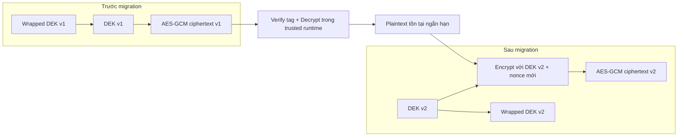
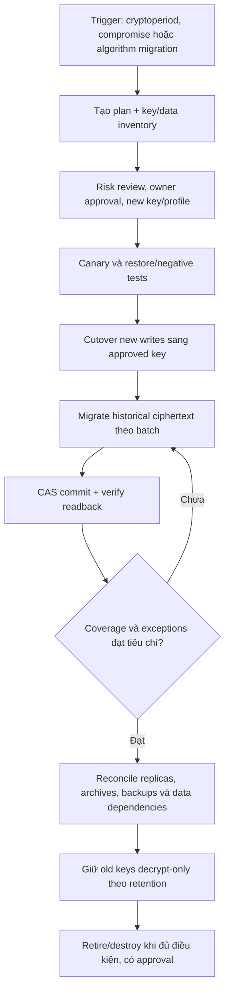
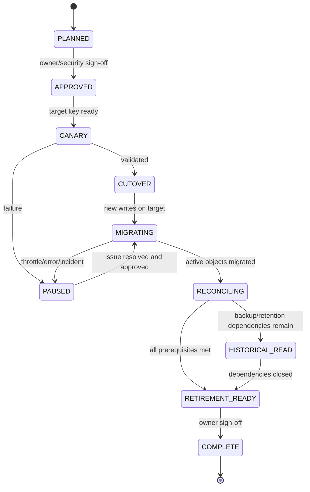
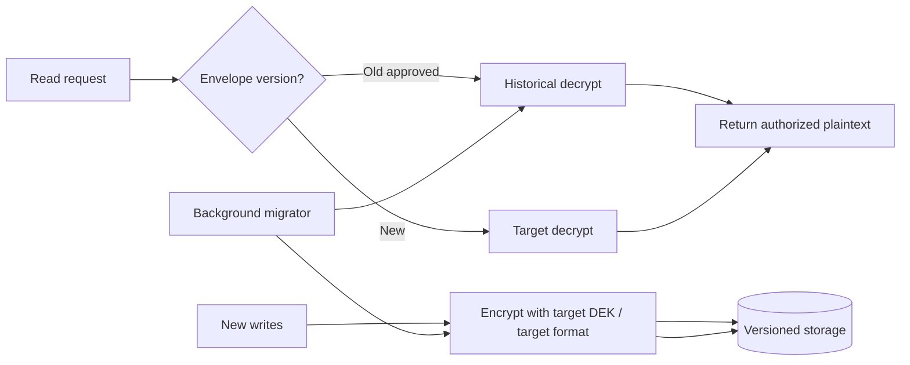
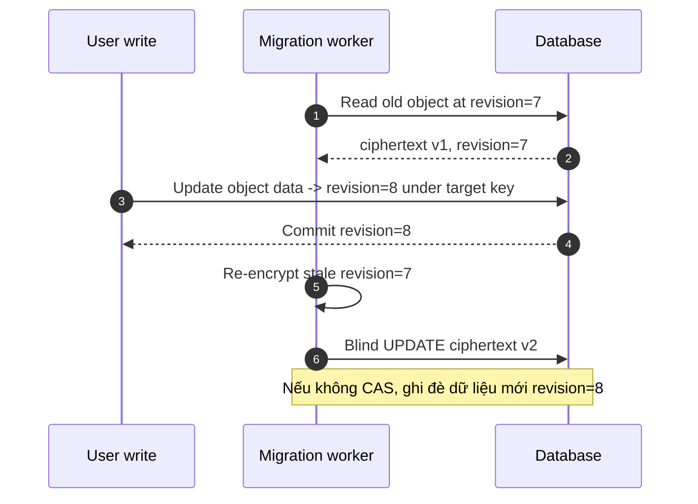
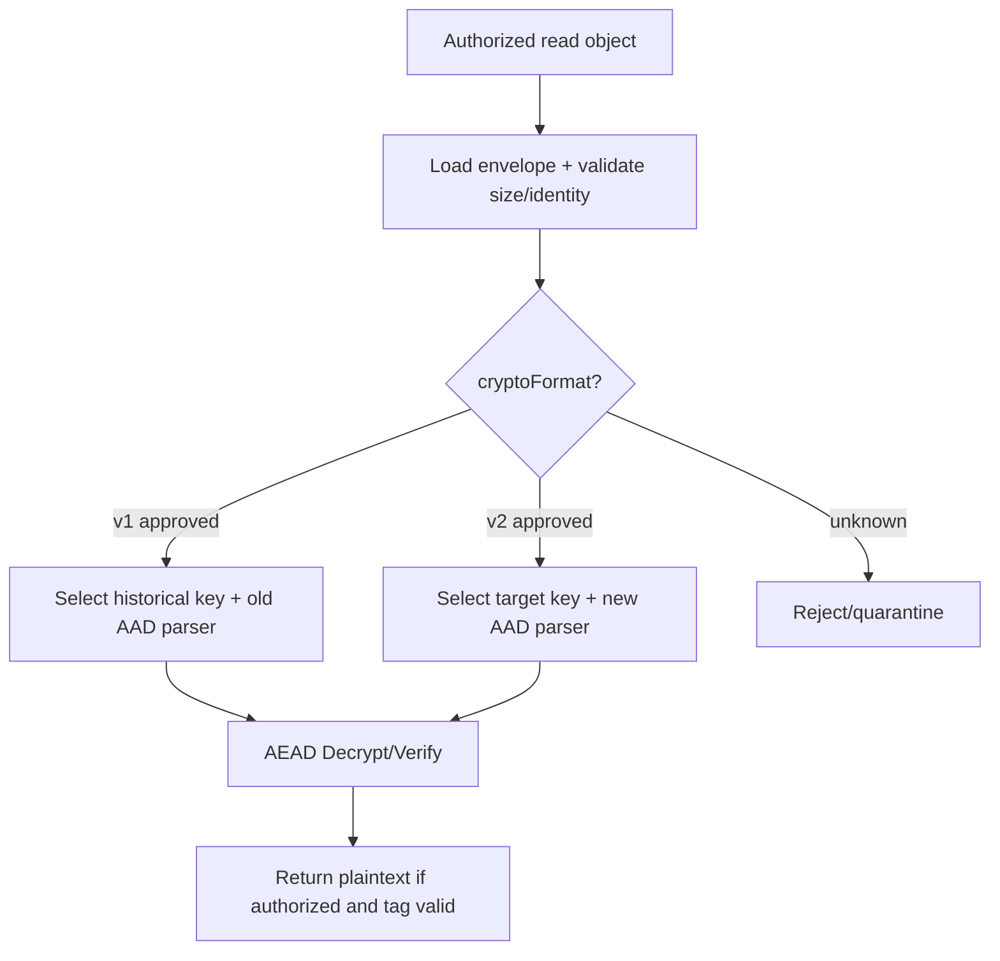
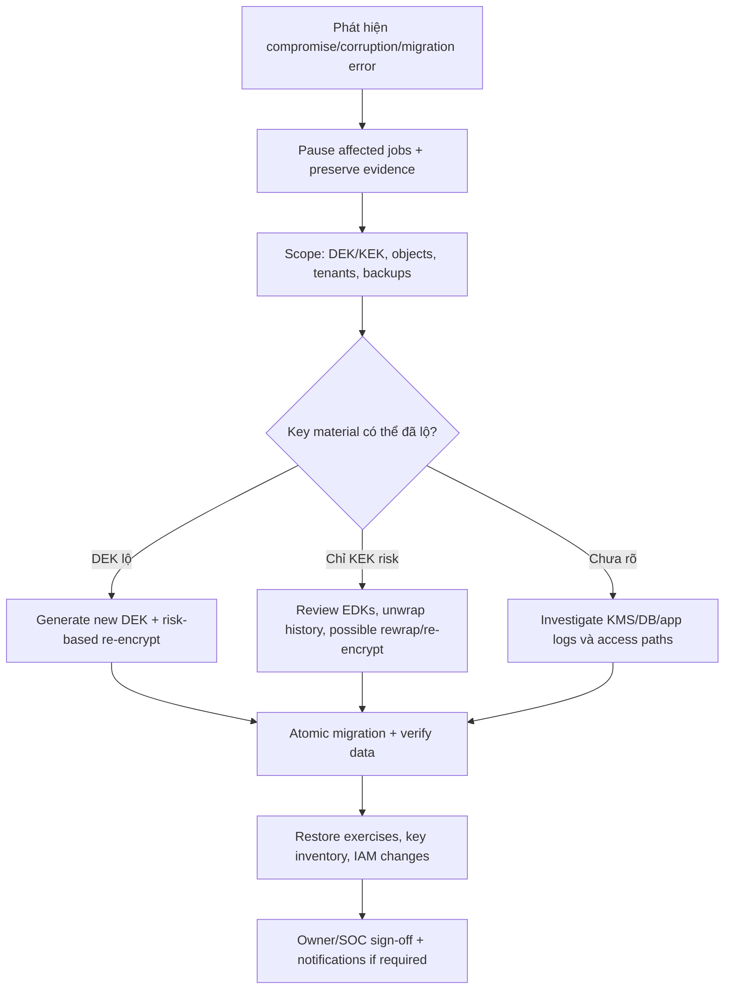
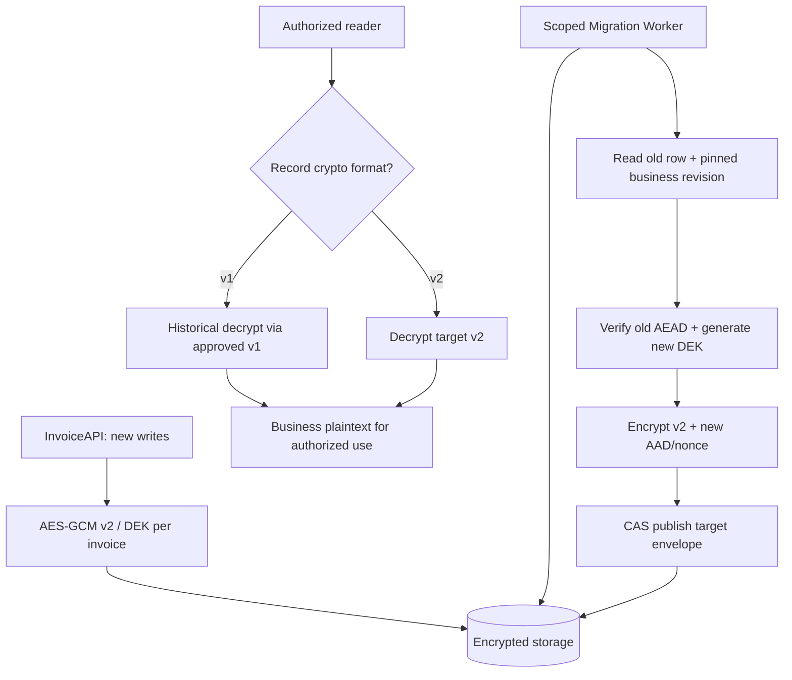

# Re-encryption — Mã hóa lại dữ liệu khi xoay vòng khóa

> **Chương:** Cryptoperiod và rotation  
> **Module:** SECURITY_KEY_MANAGEMENT_FUNDAMENTALS — hiểu vòng đời khóa mật mã từ tạo, cấp phát, lưu trữ, sử dụng, xoay vòng đến thu hồi và hủy; kết nối mật mã đối xứng, bất đối xứng, chữ ký số, KMS/HSM, envelope encryption, kiểm soát truy cập và kiểm toán để thiết kế hệ thống bảo vệ khóa an toàn.

## 1. Mục tiêu học tập

Sau bài học, bạn có thể:

1. Định nghĩa **re-encryption** và phân biệt với **key rotation**, **re-wrapping**, **key re-encryption API của KMS**, thay alias, thay metadata và xóa khóa.
2. Giải thích vì sao cần mã hóa lại khi **DEK lộ, cryptoperiod hết hạn, thuật toán/mode không còn phù hợp, data scope thay đổi** hoặc có yêu cầu chính sách.
3. Mô tả các phiên bản của ciphertext trong lúc chuyển đổi: **old DEK + old ciphertext** sang **new DEK + new ciphertext + new nonce/tag + envelope**.
4. Phân tích những rủi ro khi **đọc/ghi đồng thời**, bao gồm lost update, stale writers, key alias chuyển đích, retry, crash và rollback.
5. Thiết kế **state machine** cho re-encryption với bước chuẩn bị, kiểm kê, di trú, đối soát, chuyển tiếp, giữ khóa cũ để đọc, rồi hủy khi hết phụ thuộc.
6. Xây dựng schema versioned envelope, **CAS/optimistic locking**, idempotent migration jobs và recovery checkpoint.
7. Vận dụng **AES-GCM với nonce uniqueness, authentication tag và AAD** khi mã hóa lại, kể cả chuyển object/tenant/version.
8. Hiểu vai trò của **KMS/HSM**, KEK/DEK, plaintext exposure, IAM và audit trong công việc re-encrypt.
9. Lập kế hoạch **backup/DR, retention, multi-region, multi-tenant**, và đánh giá dữ liệu đã từng bị attacker sao chép.
10. Đọc ví dụ Java 17/SQL minh họa, lập checklist/negative tests và trả lời các tình huống thực tế.

## 2. Re-encryption là gì?

**Re-encryption** là quá trình tạo **bản mã mới cho dữ liệu** bằng cách giải mã một ciphertext hiện hữu trong môi trường được phép, sau đó **mã hóa lại dữ liệu** theo **khóa, thuật toán, tham số hoặc profile mới** đã được phê duyệt.

Trong bối cảnh quản lý khóa, trường hợp điển hình là:

```text
Trạng thái trước:
    Data plaintext P
      -> AES-GCM Encrypt(DEK-v1, nonce-v1, AAD-v1)
      -> ciphertext-v1, tag-v1

Di trú:
    AEAD Decrypt(DEK-v1, nonce-v1, AAD-v1, CT-v1)
      -> plaintext P (chỉ tồn tại trong môi trường tin cậy)
    AEAD Encrypt(DEK-v2, nonce-v2, AAD-v2, P)
      -> ciphertext-v2, tag-v2

Trạng thái sau:
    Data record tham chiếu DEK-v2 và giữ CT-v2 + nonce-v2/tag-v2
```

Đây là thao tác liên quan trực tiếp tới **dữ liệu nghiệp vụ**. Nó khác thao tác chỉ thay lớp bọc khóa bằng KEK.

### 2.1. Sơ đồ trước và sau



Một migration an toàn phải bảo đảm **không xuất plaintext P** ra log, queue hoặc file tạm trái policy, và **không để data ciphertext mới đi cùng wrong wrapped DEK/key reference**.

### 2.2. Re-encryption không nhất thiết chỉ thay key

Có các trường hợp:

- Thay **DEK** nhưng giữ AES-GCM profile.
- Thay mode/algorithm từ một profile cũ sang **AEAD được phê duyệt**.
- Thay data format/AAD schema trong một migration có bảo toàn chính xác semantics.
- Thay cryptographic boundary, chẳng hạn chuyển encryption từ ứng dụng cũ sang một service được quản lý tốt hơn.
- Chuyển owner/tenant/scope cần khóa mới và cập nhật đúng quyền.
- Chuyển từ encryption scheme thiếu authentication sang authenticated encryption với quy trình xác minh và giảm rủi ro.

**Không được gọi mọi metadata rewrite là re-encryption**. Nếu data ciphertext giữ nguyên và chỉ wrapped key thay đổi, đó thường là **rewrap**, không phải re-encrypt.

## 3. Phân biệt rotate, rewrap, re-encrypt và rekey

Bốn thuật ngữ thường bị trộn:

| Hoạt động | DEK có đổi không? | Data ciphertext đổi không? | Wrapped DEK / key reference đổi không? |
| --- | --- | --- | --- |
| **Chọn KEK mới cho new writes** | DEK mới của object mới | Chỉ object mới | New objects được wrap dưới KEK mới |
| **Rotate KEK** | Không nhất thiết | Không nhất thiết | Có thể cần rewrap EDK cũ |
| **Rewrap DEK** | **Không** | **Không** | **Có** — chuyển sang lớp bọc mới |
| **Re-encrypt bằng DEK mới** | **Có** | **Có** | **Có** nếu dùng envelope encryption |
| **Thay data algorithm/mode** | Thường cần key/profile mới theo policy | **Có** | Metadata/EDK có thể đổi |
| **Đổi alias KMS** | Không tự động | Không tự động | Có thể chỉ thay pointer cho future use |
| **Revoke KMS grant** | Không | Không | Không trực tiếp |
| **Disable/destroy key** | Không tự sinh khóa mới | Không | Có thể khiến dữ liệu không giải mã được |
| **Cryptographic erasure** | Mục tiêu loại khả năng khôi phục key | Ciphertext có thể còn | Đòi đối soát mọi key copies/wrappers |

### 3.1. KEK và DEK nằm ở hai cấp

- **Data Encryption Key (DEK):** khóa trực tiếp bảo vệ dữ liệu.
- **Key Encryption Key (KEK):** khóa bọc DEK, thường được KMS/HSM quản lý.
- **Encrypted Data Key (EDK):** wrapped DEK có thể lưu bên cạnh data ciphertext.

Ví dụ một file đã được mã hóa dưới `DEK-X`, và `DEK-X` được bọc dưới `KEK-A`. Rewrap `DEK-X` từ `KEK-A` sang `KEK-B` **không thay ciphertext của file**.

Ngược lại, sinh `DEK-Y` rồi dùng nó mã hóa lại file **thay data ciphertext**, và nếu dùng envelope encryption, `DEK-Y` cần được wrap dưới KEK phù hợp.

### 3.2. KMS `ReEncrypt` không nhất thiết là data re-encryption

Một số KMS cung cấp API tên **ReEncrypt/Rewrap**. Tùy provider, API đó có thể nhận **ciphertext của data key** rồi chuyển từ KEK nguồn sang KEK đích mà **không trả plaintext DEK cho app**.

Không suy ra từ tên API rằng **toàn bộ object ciphertext nhiều GB đã được giải mã và mã hóa lại bằng DEK mới**. Phải đọc contract provider và phân biệt:

```text
KMS ReEncrypt(wrapped DEK under KEK-A -> KEK-B)
    ≠
Application/Data Re-encrypt(ciphertext under DEK-X -> DEK-Y)
```

### 3.3. Rekey là từ có thể mơ hồ

Trong tài liệu và sản phẩm, `rekey` đôi khi có nghĩa thay master KEK, đôi khi thay session key hoặc data DEK, đôi khi là tạo một version key material mới. Khi viết runbook, luôn ghi **đối tượng chính xác**: `rotate KEK`, `rewrap EDK`, `replace DEK and re-encrypt data`, hay `rotate TLS traffic keys`.

## 4. Cryptoperiod và lý do re-encryption

**Cryptoperiod** là khoảng thời gian việc sử dụng khóa được cho phép theo policy và mục đích nhất định. Không có một **số ngày chung** cho mọi khóa và mọi workloads.

Cần phân biệt:

- **Origination usage period:** thời gian khóa được phép dùng để tạo ciphertext/chữ ký/MAC mới theo purpose.
- **Recipient/historical usage:** thời gian cần dùng khóa để decrypt/verify dữ liệu lịch sử theo policy.
- **Retention:** thời gian tổ chức cần giữ dữ liệu, backup hoặc bằng chứng.
- **Destruction eligibility:** thời điểm có thể hủy key khi không còn dependency và được phê duyệt.

### 4.1. Các trigger quan trọng

| Tác nhân kích hoạt | Tại sao cần re-encrypt? | Mức ưu tiên gợi ý |
| --- | --- | --- |
| **DEK plaintext có thể đã lộ** | Attacker có thể decrypt ciphertext cũ/còn dùng DEK đó | Điều tra khẩn cấp, đánh giá thay DEK và migrate |
| **AES-GCM nonce reuse dưới cùng DEK** | Mất giả định bảo mật confidentiality/integrity | Dừng new use, thay DEK và đánh giá impact |
| **Key vượt cryptoperiod/usage limit** | New-use policy không còn hợp lệ | Chuyển writes sang key mới; migrate historical data nếu policy yêu cầu |
| **Thuật toán/mode deprecated** | Profile hiện tại không đạt security requirements | Chọn thuật toán/format mới và migrate |
| **Data classification tăng** | Key scope/assurance không còn đủ | Re-encrypt theo boundary mới |
| **Thay tenant/key owner** | Cần cách ly/chuyển quyền dữ liệu | Đánh giá re-encrypt và authorization/retention |
| **Thay HSM/KMS/domain** | Key material/trust boundary đổi | Có thể chỉ rewrap, hoặc cần re-encrypt theo threat model |
| **Key material bị mất** | Không decrypt được ciphertext cũ | Không thể re-encrypt nếu không có authorized recovery |
| **Khách hàng revoke BYOK/CMEK** | Nghĩa vụ quyền/trust thay đổi | Không tự bypass; xử lý theo hợp đồng/policy |
| **Thay đổi format/AAD scheme** | Metadata/protocol mới | Migration có xác minh integrity và semantics |
| **Giảm phạm vi lộ khi một DEK quá rộng** | Shared DEK bảo vệ quá nhiều objects | Phân chia thành DEKs mới theo data scope |

### 4.2. Cryptoperiod hết không luôn đồng nghĩa phải re-encrypt ngay mọi dữ liệu

Một key có thể hết **thời hạn dùng để encrypt mới**, nhưng dữ liệu lịch sử vẫn phải được decrypt trong thời gian retention. Tùy policy và risk assessment, hệ thống có thể:

1. **Dừng dùng old key cho new encryption**.
2. Giữ old key cho **decrypt-only** đến hết dependency.
3. Re-encrypt old data dần hoặc theo deadline.
4. Hủy old key sau đối soát và approval.

Không nên hủy old DEK/KEK ngay khi alias chuyển sang key mới nếu backup hoặc old ciphertext vẫn cần nó.

### 4.3. Lộ key không được chữa bằng “rewrap”

Nếu attacker đã có **plaintext DEK-v1**, rewrap cùng DEK dưới KEK mới **không ngăn attacker decrypt ciphertext mã hóa bằng DEK-v1** mà họ có. Cần xem xét **DEK-v2 mới** và mã hóa lại dữ liệu còn trong tầm kiểm soát, đồng thời đánh giá disclosure lịch sử.

Re-encryption **không khiến những bản plaintext/ciphertext cũ attacker đã sao chép tự biến mất**.

## 5. Threat model cho dự án re-encryption

Một dự án re-encrypt là một thao tác **nhạy cảm cao** vì nó có thể làm xuất hiện plaintext trong quá trình xử lý, mở rộng quyền đọc cả key cũ/key mới, và chạm vào hàng triệu data objects.

### 5.1. Những đối thủ và failure modes

- **Database/object-store reader:** có ciphertext, wrapped DEK và metadata, nhưng không có quyền KMS tương ứng.
- **DB admin/writer:** có thể sửa/xóa/replay rows hoặc làm metadata lệch khi migration.
- **Compromised migration worker:** có thể đọc plaintext hoặc unwrap nhiều DEKs hơn application thông thường.
- **KMS credential compromise:** attacker có `Decrypt/Unwrap` trên key cũ hoặc có quyền tạo keys mới.
- **Insider/key custodian misuse:** key lifecycle/policy bị thay trái thẩm quyền.
- **Network/queue operator:** thấy event payloads hoặc lỗi logging chứa raw DEK.
- **Concurrency race:** migration ghi đè bản dữ liệu vừa được user cập nhật.
- **DR rollback:** snapshot metadata cũ tái xuất sau đã rotate.
- **Format downgrade:** app nhận legacy ciphertext không xác thực để “cứu” dữ liệu.
- **Data integrity attack:** blob cũ có AEAD tag hợp lệ được replay.

### 5.2. Bảo mật trong thời gian chuyển đổi có thể yếu hơn trạng thái bình thường

Một worker có thể cần đồng thời:

- Quyền decrypt bằng **old key**.
- Quyền encrypt/wrap bằng **new key**.
- Quyền đọc toàn bộ encrypted objects trong scope.
- Quyền cập nhật ciphertext, EDK và metadata.
- Quyền ghi audit/progress/checkpoint.

Đây là **tập quyền mạnh**, dễ trở thành điểm tập trung rủi ro. Hãy giới hạn theo tenant/batch/purpose, time-bound credentials, approvals, workload isolation, rate limits, strong audit và break-glass policies.

### 5.3. Đừng cho migration service tùy ý giải mã mọi tenant

Một flag `--migrate-all` với service role có quyền KMS `Decrypt` toàn công ty có blast radius lớn. Tốt hơn dùng các jobs scoped theo:

```text
tenant
data classification
source key identity/version
target key identity/version
object range
migration plan ID
approved schedule/window
checkpoint/progress
```

**Không tin bất kỳ `sourceKeyRef`/`targetKeyRef` trong DB row do attacker có thể sửa** nếu chưa đối chiếu trusted registry và IAM policy.

## 6. Kết quả thành công là gì?

Một dự án re-encryption thành công không chỉ có số “100% rows updated”. Cần đạt:

1. **Data correctness:** plaintext sau migration giống dữ liệu nghiệp vụ được phép trước migration, trừ khi có transformation dữ liệu được chỉ định.
2. **Cryptographic correctness:** new ciphertext được tạo bằng approved AEAD, new DEK/material, nonce unique, AAD và tag đúng.
3. **Authorization:** chỉ các jobs/users được phép mới decrypt/migrate; readers không bypass quyền tenant/object.
4. **Version consistency:** mỗi ciphertext đi cùng correct key ID/version, nonce/tag, algorithm/format/AAD schema và wrapped DEK.
5. **Concurrency safety:** migration không làm mất các updates đồng thời và không resurrect old versions trái policy.
6. **Recoverability:** có kế hoạch rollback/retry, backups/old-key availability và diễn tập restore.
7. **Key retirement readiness:** old key không còn dùng encrypt mới; những dependencies còn lại được kiểm kê.
8. **Observability:** metrics, audit, exceptions, retry counts và bằng chứng owner sign-off đầy đủ.
9. **Data minimization:** không tạo plaintext copies không cần thiết trong database/log/file tạm.
10. **Incident containment:** nếu trigger là compromise, phải đánh giá lịch sử/phạm vi lộ và không kết luận chỉ từ migration completion.

### 6.1. Coverage phải có mẫu số độc lập

Báo cáo:

```text
migratedRows / rowsCurrentlyVisibleInCurrentTable = 100%
```

có thể **bỏ sót** archived objects, backups, replicas, old schema, search indexes, orphan blobs, data xuất ra ngoài hệ thống hoặc ciphertext không được index.

Cần một **inventory theo data assets và key dependencies** từ các nguồn được tin cậy, nêu rõ coverage boundaries và exceptions chưa giải quyết.

### 6.2. Đích phải mô tả được và kiểm thử được

Ví dụ:

```text
Target:
- New invoice payloads: AES-256-GCM với DEK per object.
- New DEKs: generated via approved KMS/CSPRNG.
- New DEKs wrapped under tenant-approved KEK v2.
- New envelope version: 2, with trusted AAD binding.
- Old key v1: historical Decrypt-only until all dependencies closed.
- New writes cannot use v1 after cutover fence.
- Archives/DR: tested restore for v1 and v2 until retention expiry.
```

Không đủ để ghi “làm tất cả AES-256” mà không nêu **key scope, nonce, AAD, permission, rotation và dữ liệu lịch sử**.

## 7. Quy trình tổng thể: từ inventory đến retirement



### 7.1. Giai đoạn 0 — phê duyệt kế hoạch

Tài liệu kế hoạch phải ghi:

- Owner và người phê duyệt.
- Reason/trigger, key risk, cryptoperiod deadline.
- Source/target key resources và algorithms.
- Data assets/tenants/retention.
- Rights và lifetime của migration worker.
- Failure, retry, stop-the-world và incident decisions.
- Cutover semantics, change windows, canary và checkpoints.
- SLO/throughput/KMS quota/DB load budget.
- Các bộ phận cần phối hợp: app, DB, KMS/HSM, SOC, data owner, compliance.

### 7.2. Giai đoạn 1 — tạo và xác thực key đích

- Sinh DEK/KEK theo policy/entropy.
- Kiểm tra key usage, key strength, algorithm profile.
- Xác minh key material version/reference và key custody.
- Tạo IAM grants **tối thiểu** cho writers/migrators/readers.
- Kiểm tra permissions for historical decrypt vs new encrypt.
- Diễn tập encrypted envelope round-trip với synthetic data.
- Chặn log plaintext DEK/KMS response.
- Định nghĩa key rotation/backup/DR ở target ngay từ đầu.

### 7.3. Giai đoạn 2 — cutover luồng ghi mới

Khi target key/profile đã sẵn sàng:

- Chuyển **new writes** sang target key theo cutover policy.
- Lưu correct key ref/version cho từng ciphertext.
- Ngăn stale writers tiếp tục dùng key cũ trái policy.
- Đảm bảo nonce allocation không reuse trên target.
- Đo alert/error rate/latency.
- Giữ khả năng đọc old ciphertext trong thời gian migration.

### 7.4. Giai đoạn 3 — migrate dữ liệu lịch sử

- Lấy một **immutable source snapshot/row revision**.
- Authorize source key và target key theo trusted plan.
- Decrypt + verify old ciphertext; **fail closed** khi tag sai.
- Encrypt plaintext bằng new DEK/nonce/profile.
- Ghi new ciphertext+wrapped DEK+metadata trong **một logical transaction/version**.
- Dùng CAS để không overwrite concurrent writes.
- Audit progress, retry idempotently và phân loại errors.
- Không xóa old ciphertext/key khi chưa xác minh/đủ điều kiện.

### 7.5. Giai đoạn 4 — đối soát và kết thúc

- Kiểm tra coverage + unknown dependencies + exceptions.
- Test read/restore qua nhiều versions.
- Reconcile backups, archives, replicas, WAL và CDC.
- Phê duyệt giảm quyền migrator và đóng temporary access.
- Giữ old keys decrypt-only nếu còn dependency.
- Hủy old keys khi retention/legal hold/custody/DR đều đạt yêu cầu.

## 8. Migration state machine và status

Một state machine rõ ràng giúp migration dài ngày có thể resume, audit và ngăn những thao tác phá hủy quá sớm.



### 8.1. Không dùng một flag `rotated=true` cho mọi trạng thái

Một flag đơn có thể bị hiểu là:

- New writes đã dùng key mới.
- KEK alias đổi.
- Tất cả DEKs đã được rewrap.
- Mọi ciphertext đã re-encrypt.
- All backups đã migrate.
- Old key đủ điều kiện destroy.

Đây là **sáu kết luận khác nhau**. Hãy ghi rõ migration phase, đối tượng được migrate, source/target, coverage và evidence.

### 8.2. Trạng thái cấp object

| Object state | Ý nghĩa | Reader/writer behavior |
| --- | --- | --- |
| `SOURCE` | Ciphertext/key cũ | Reader dùng historical key nếu còn được phép |
| `CLAIMED` | Worker đã nhận xử lý, có lease/fencing | Concurrent writes phải có CAS |
| `PREPARED` | Target envelope được tạo nhưng chưa publish | Không để reader thấy partial data |
| `MIGRATED` | New envelope đã commit | Reader chọn đúng target key |
| `VERIFIED` | Readback/test integrity đạt | Có thể đánh dấu completed trong scope |
| `RETRYABLE_ERROR` | KMS/DB transient failure | Retry với backoff và idempotency |
| `QUARANTINED` | Corruption/policy mismatch/unknown key | Stop và điều tra, không fallback |
| `EXEMPTED` | Có ngoại lệ được duyệt, còn dependency | Không bị tính nhầm là migration hoàn tất |

Không nhất thiết phải lưu tất cả status trong cùng row; một immutable migration journal/checkpoint có thể phù hợp hơn. Quan trọng là **không đưa partial target envelope thành active record**.

## 9. Ba chiến lược migration phổ biến

### 9.1. Offline / maintenance window

- Ngừng writers.
- Chụp snapshot/backup nhất quán và xác minh key availability.
- Migrate toàn bộ dữ liệu.
- Verify, cutover, mở writers.
- Giữ old key theo policy/backup dependencies.

**Ưu điểm:** đơn giản hóa race, dễ kiểm soát consistency. **Nhược điểm:** downtime, khó dùng cho dữ liệu lớn hoặc SLA 24/7.

### 9.2. Online migration với dual-read, single-write

Một chiến lược thường dễ kiểm soát:

- **New writes:** chỉ tạo ciphertext target format/key.
- **Reads:** hiểu cả old và new formats theo allowlist.
- **Background migrator:** chuyển old objects sang target.
- **Updates:** luôn tạo ciphertext target, không viết lại old format.
- **Old key:** decrypt-only cho dữ liệu lịch sử.
- **Retirement:** sau khi hết dependencies.



**Không cần dual-write hai ciphertext** nếu một target-format write và old-format read đã đáp ứng yêu cầu; dual-write làm tăng complexity và nguy cơ lệch nội dung.

### 9.3. Read repair / lazy re-encryption

Khi reader mở một old ciphertext, app có thể quyết định **re-encrypt ngay hoặc enqueue migration job**.

Lợi ích: di trú dữ liệu thường xuyên truy cập sớm, giảm backfill dồn. Rủi ro:

- Độ trễ read tăng.
- Reader cần quyền write/migrate hoặc phải đẩy job sang worker có quyền.
- Hai readers có thể cùng migrate.
- User update có thể xảy ra giữa read và re-encrypt.
- Cold objects không bao giờ được truy cập nên **không tự đạt 100% coverage**.
- Không nên dùng key/new ciphertext nếu auth không đạt.

**Đường read repair vẫn cần CAS/version check và idempotency.**

### 9.4. Chọn chiến lược dựa trên dữ liệu

| Tiêu chí | Offline | Online background | Read repair |
| --- | --- | --- | --- |
| Downtime | Có thể cần | Thường giảm | Không nhất thiết |
| Race với writes | Thấp hơn khi freeze | Phải giải quyết | Phải giải quyết |
| Dữ liệu rất lớn | Có thể kéo dài | Batching phù hợp | Phụ thuộc access patterns |
| SLO đọc | Ít ảnh hưởng trong cửa sổ bảo trì | Tùy resource contention | Có thể tăng latency |
| Đảm bảo migrate dữ liệu lạnh | Có | Có nếu inventory đầy đủ | **Không** nếu chỉ dựa read |
| Complexity | Thấp hơn | Trung bình/cao | Trung bình/cao |
| KMS load control | Qua maintenance plan | Qua rate limit/batch | Gắn trực tiếp vào traffic |
| Rollback/DR | Snapshot + switch | Versioned formats + checkpoints | Checkpoint và mixed versions |

## 10. Đọc/ghi đồng thời: lost update và stale migration

### 10.1. Tình huống lost update



Worker không được chỉ dựa vào việc đã đọc row để chắc rằng row chưa thay.

### 10.2. Compare-and-swap

Một cách tiếp cận là dùng `record_revision`:

```text
read row at revision R
decrypt and encrypt in worker
UPDATE ... WHERE id=? AND record_revision=R
if updated=1:
    target envelope published
else:
    discard staged result and reload current row
```

Điều kiện CAS phải tính đến **tenant/object identity** và những fields quan trọng như existing envelope/key version theo thiết kế. Không được chuyển data ciphertext của một row sang row khác khi có migration key mismatch.

### 10.3. CAS thất bại không phải lý do reuse nonce

Nếu migration đã thực hiện AES-GCM Encrypt với `DEK-new + nonce=N` nhưng CAS không commit, **cặp key+nonce đã được sử dụng cho một invocation mã hóa**. Không trả `N` vào pool để dùng lại cho một plaintext/AAD khác.

Tạo target encryption khác cần **nonce mới** dưới cùng DEK, hoặc **DEK mới**, đúng mode/key scope và usage policy.

### 10.4. Stale writers khi cutover

Một writer đã cache DEK-v1 có thể tiếp tục encrypt mới sau khi alias đổi sang v2. Nếu policy đòi **strict cutoff**, cần:

- Authoritative new-write admission gate.
- Key version pinning và per-operation policy checks.
- Cache invalidation/expiry.
- Fencing stale workers hoặc dùng key operations được KMS/HSM kiểm soát.
- Theo dõi late writes, retry và rollbacks.
- Không chỉ đặt `alias=current -> v2` rồi tuyên bố v1 hết được dùng.

### 10.5. Migration và business revision khác nhau

Một **encryption revision** chỉ mô tả phiên bản envelope; một **business revision** mô tả nội dung nghiệp vụ. Có thể tách:

```text
businessRevision=20   # nội dung hóa đơn
encryptionRevision=5  # lớp bảo vệ hiện tại
```

Nhưng phải bảo đảm migration không overwrite khi businessRevision thay. Nếu chỉ CAS encryptionRevision mà application cập nhật business fields không đụng revision đó, có thể vẫn xảy ra lost update. Chọn một invariant **bao trùm mọi thay đổi có ảnh hưởng tới plaintext** hoặc thiết kế CAS hai revisions phù hợp.

## 11. AES-GCM khi re-encrypt: new key, nonce, AAD và tag

### 11.1. Luồng decrypt-then-encrypt

Quy tắc:

1. Load source envelope và kiểm tra format/key reference theo policy.
2. Load đúng **historical DEK** hoặc unwrap old wrapped DEK.
3. Dùng đúng **old nonce, old AAD và authentication tag** để decrypt.
4. Chỉ công bố plaintext **sau khi authentication thành công**.
5. Lấy/generate **new DEK** theo approved cryptoperiod/scope.
6. Cấp **new nonce/IV** hợp lệ theo target AEAD/key-use policy.
7. Tạo **new AAD** từ trusted data/identity/format.
8. Encrypt và tạo new ciphertext/tag.
9. Ghi **new key ID/EDK + nonce/tag + AAD schema + format** cùng transaction/version.

### 11.2. Old tag sai phải dừng

Nếu old ciphertext thuộc AES-GCM và tag không hợp lệ, có thể là:

- Dữ liệu bị sửa/hỏng.
- Wrong old DEK/KEK key version.
- Wrong old AAD/object ID.
- Wrong nonce/tag/serialization.
- Một lỗi migration/backup trước đây.

**Không bỏ qua tag** để chuyển dữ liệu sang key mới. Không có plaintext đáng tin để re-encrypt nếu source authentication không thành công. Hãy quarantine object, điều tra và dùng recovery path được phê duyệt nếu có.

### 11.3. Nonce reuse vẫn là vấn đề dù đang migration

- Re-encrypt dữ liệu bằng **DEK mới độc lập** có nonce domain mới.
- Nếu nhiều objects dùng **cùng DEK mới**, cần unique nonce cho mọi encryption invocation dưới DEK đó.
- Nếu dùng DEK per object **một lần**, nonce allocation đơn giản hơn, nhưng vẫn phải đúng profile.
- Retry một encryption dưới cùng DEK với **nonce cũ** cho input/AAD khác là nguy hiểm.
- Migration workers song song và multi-region phải chia sẻ/partition đúng nonce domain nếu key shared.

### 11.4. AAD mới có thể làm ciphertext cũ không decrypt được nếu dùng sai

Ví dụ data AAD v1:

```text
AAD-v1 = canonical(tenant, documentId)
```

Target AAD v2:

```text
AAD-v2 = canonical(tenant, documentId, businessRevision, formatVersion)
```

Khi giải mã source, phải dùng **AAD-v1**. Khi mã hóa target, dùng **AAD-v2** được xác định từ trusted data và version được công bố. Không tự dùng AAD-v2 để mở source v1; không sửa header AAD schema trong DB mà bỏ qua re-encrypt.

### 11.5. AEAD không tự ngăn rollback

Nếu attacker khôi phục cả old ciphertext+nonce+tag+metadata, một old envelope từng hợp lệ có thể vẫn decrypt. Re-encryption thành công không cung cấp anti-rollback nếu nguồn dữ liệu cho phép attacker ghi lại **valid old version**.

Nếu nghiệp vụ yêu cầu freshness, dùng **monotonic revision/trusted state**, append-only logs hoặc cơ chế integrity có nguồn tin cậy ngoài phạm vi attacker. Một `updatedAt` do attacker sửa được cũng có thể rollback cùng blob.

### 11.6. Dữ liệu nhạy cảm trong memory

Trong migration, plaintext đi qua:

- Key unwrap path.
- AEAD decrypt buffer.
- Transform code nếu có.
- AEAD encrypt buffer.
- Error-handling/logging path nếu bị cấu hình sai.

Cần giới hạn thời gian và nơi plaintext tồn tại, không copy sang `String` không cần thiết, không tạo plaintext staging tables, không log KMS response, không dùng general-purpose queue mang raw key/payload. Xóa buffer best-effort khi có thể, nhưng **JVM/provider có thể tạo bản sao không zeroize tuyệt đối được**.


## 12. Mô hình encrypted record có phiên bản

Một record nên chứa đủ metadata để giải mã độc lập với alias động hoặc trạng thái hiện tại của migration:

```json
{
  "tenantId": "tenant-42",
  "objectId": "invoice-2026-0018",
  "businessRevision": 15,
  "encryptionRevision": 4,
  "cryptoFormat": 2,
  "dataAlgorithm": "AES-256-GCM",
  "nonce": "<base64-target-nonce>",
  "ciphertextAndTag": "<base64-target-ciphertext>",
  "wrappedDek": "<base64-target-edk>",
  "wrappingKekRef": "kms://prod/keys/billing-kek-v2",
  "aadSchema": "invoice-aad-v2",
  "migrationPlanId": "plan-2026-rotation-04",
  "updatedAt": "2026-11-28T08:30:00Z"
}
```

Đây là **schema minh họa**, không phải API thật của KMS. Các `<base64-...>` là placeholders. Không bao giờ đưa plaintext DEK vào cùng bản ghi.

### 12.1. Những version không được trộn

| Version | Ý nghĩa | Có tự thay đổi khi re-encrypt? |
| --- | --- | --- |
| **Business revision** | Phiên bản nội dung nghiệp vụ | Thường **không**, nếu chỉ thay encryption |
| **Encryption revision** | Phiên bản envelope/protection tại storage | **Có** |
| **Crypto format version** | Schema, encoding, algorithm/AAD profile | Có nếu chuyển profile |
| **Actual DEK material identity** | Khóa trực tiếp mã hóa data | **Có** khi rotate DEK |
| **KEK material identity/version** | Key bọc DEK | Có thể có theo policy/provider |
| **KMS alias** | Tên trỏ tới key hiện hành | Không được dùng làm historical identity duy nhất |
| **Migration plan revision** | Phiên bản approved migration configuration | Theo change management |

### 12.2. Wrapped DEK có thể ở cùng ciphertext

Trong envelope encryption, storage có thể giữ:

```text
data ciphertext
AES-GCM nonce + tag
wrapped DEK
wrapping KEK reference
algorithm / AAD schema / format
object/tenant identity
```

Điều đó phù hợp nếu **KEK được bảo vệ trong KMS/HSM** và chỉ authorized services có quyền unwrap. Nhưng nếu lưu **plaintext DEK** cạnh ciphertext, DB dump có thể đủ để giải mã dữ liệu.

### 12.3. Đừng tin key reference trong DB để quyết định quyền

Khi migration worker đọc một `wrappingKekRef`, nó phải kiểm tra với trusted key registry/owner policy và scope của plan. Không cho row hoặc client input quyết định worker được gọi KMS Decrypt bằng bất kỳ key nào.

### 12.4. Header phải được validate trước decrypt

Các trường quan trọng:

- Tenant/object ID phải khớp authenticated source.
- Crypto format và algorithm nằm trong allowlist.
- Key reference nằm trong source key set được phê duyệt.
- Nonce/tag/wrapped key có kích thước hợp lý.
- AAD schema đúng nguồn được tin cậy.
- Business/encryption revisions hợp lệ.
- Migration plan target khớp owner/environment/region.

**Không tự fallback** qua AES-ECB, CBC không xác thực hoặc keys khác cho đến khi “mở được plaintext”.

## 13. PostgreSQL: schema giữ nguyên ciphertext và metadata khi migrate

Một schema khái niệm cho dữ liệu được mã hóa:

```sql
CREATE TABLE encrypted_invoice (
    tenant_id            TEXT NOT NULL,
    invoice_id           UUID NOT NULL,
    business_revision    BIGINT NOT NULL,
    encryption_revision  BIGINT NOT NULL,
    crypto_format        SMALLINT NOT NULL,
    data_algorithm       TEXT NOT NULL,
    nonce                BYTEA NOT NULL,
    ciphertext_and_tag   BYTEA NOT NULL,
    wrapped_dek          BYTEA NOT NULL,
    wrapping_kek_ref     TEXT NOT NULL,
    aad_schema           TEXT NOT NULL,
    updated_at           TIMESTAMPTZ NOT NULL DEFAULT CURRENT_TIMESTAMP,
    PRIMARY KEY (tenant_id, invoice_id),
    CHECK (business_revision >= 0),
    CHECK (encryption_revision > 0),
    CHECK (crypto_format IN (1, 2)),
    CHECK (data_algorithm IN ('AES-256-GCM')),
    CHECK (octet_length(nonce) = 12),
    CHECK (octet_length(ciphertext_and_tag) >= 16),
    CHECK (octet_length(wrapped_dek) > 0)
);
```

Đây là PostgreSQL minh họa với AES-GCM tag 128 bit được nối trong `ciphertext_and_tag`. **Constraints không chứng minh nonce uniqueness, key entropy, AEAD tag validity hoặc IAM authorization**.

### 13.1. Atomic compare-and-swap

Giả sử worker đã đọc và xác minh record:

```text
tenantId = T
invoiceId = I
businessRevision = 27
encryptionRevision = 6
cryptoFormat = 1
wrappingKekRef = KEK-v1
```

Sau khi tạo target envelope, worker thực hiện:

```sql
-- Các :parameters là binding của SQL client, không chạy trực tiếp trong psql.
UPDATE encrypted_invoice
SET crypto_format = 2,
    data_algorithm = 'AES-256-GCM',
    nonce = :new_nonce,
    ciphertext_and_tag = :new_ciphertext_and_tag,
    wrapped_dek = :new_wrapped_dek,
    wrapping_kek_ref = :new_kek_ref,
    aad_schema = 'invoice-aad-v2',
    encryption_revision = encryption_revision + 1,
    updated_at = CURRENT_TIMESTAMP
WHERE tenant_id = :tenant_id
  AND invoice_id = :invoice_id
  AND business_revision = :expected_business_revision
  AND encryption_revision = :expected_encryption_revision
  AND crypto_format = 1
  AND wrapping_kek_ref = :expected_old_kek_ref
RETURNING business_revision, encryption_revision;
```

**Kết quả 0 rows** nghĩa là row không còn khớp expected state hoặc không tồn tại. Worker phải **đọc lại** và phân loại: already migrated, concurrent business update, deleted, owner/policy change hoặc conflict khác. Không overwrite mù quáng.

### 13.2. Không giữ transaction mở xuyên KMS call

Một anti-pattern:

```text
BEGIN
SELECT ... FOR UPDATE (giữ row lock)
KMS Decrypt / network retries (có thể lâu)
AES Decrypt
KMS GenerateDataKey
AES Encrypt
UPDATE ...
COMMIT
```

Cách này giữ DB locks trong lúc thực hiện remote crypto, gây contention và deadlocks/thrashing dưới tải lớn.

Hướng thường phù hợp hơn:

```text
READ row snapshot + revision
VALIDATE & AUTHORIZE
DECRYPT/ENCRYPT ngoài DB transaction ngắn
BEGIN
  CAS UPDATE với expected revisions
COMMIT
on conflict: discard staged result and reload
```

Rủi ro race được xử lý bởi **CAS/published revision**. Nếu cần một cơ chế isolation khác, phải phân tích cụ thể transaction semantics, data consistency và KMS latency.

### 13.3. Bất biến quan trọng

Nếu update thành công, các trường:

```text
target nonce
target ciphertext+tag
target wrapped DEK
target KEK ref
target format + AAD schema
encryption revision
```

phải cùng thuộc **một lần tạo target envelope**. Không chia cập nhật `wrapped_dek` và `ciphertext_and_tag` thành hai commit có thể bị reader nhìn thấy xen kẽ.

### 13.4. Lưu tiến độ migration riêng

```sql
CREATE TABLE encryption_migration_task (
    plan_id              TEXT NOT NULL,
    tenant_id            TEXT NOT NULL,
    invoice_id           UUID NOT NULL,
    source_business_rev  BIGINT NOT NULL,
    source_encryption_rev BIGINT NOT NULL,
    task_state           TEXT NOT NULL DEFAULT 'PENDING',
    attempt_count        INTEGER NOT NULL DEFAULT 0,
    next_attempt_at      TIMESTAMPTZ,
    lease_owner          TEXT,
    lease_expires_at     TIMESTAMPTZ,
    last_error_code      TEXT,
    completed_at         TIMESTAMPTZ,
    PRIMARY KEY (plan_id, tenant_id, invoice_id),
    CHECK (task_state IN (
        'PENDING', 'RUNNING', 'RETRYABLE_ERROR',
        'COMPLETED', 'QUARANTINED', 'EXEMPTED'
    )),
    CHECK (attempt_count >= 0)
);
```

Job state phục vụ orchestration/audit, **không thay tính nguyên tử của encrypted invoice row**. Nếu task được đánh dấu completed nhưng encrypted row chưa commit, đây là một bug cần reconciliation.

### 13.5. Claim work không được đồng nghĩa độc quyền tuyệt đối

Có thể dùng queue/leases/`FOR UPDATE SKIP LOCKED` trong một transaction ngắn để nhận jobs, nhưng worker cũ có thể vẫn chạy sau lease expiry. **CAS lúc publish vẫn là lớp cuối bảo vệ**; nếu cần strict ownership, bổ sung fencing token monotonic và xác minh ở nơi lưu kết quả.

### 13.6. Chunked/large-object migration

Với file lớn ở object store, không thể đặt toàn bộ thao tác trong một DB transaction. Một phương án:

1. Đọc **immutable old object version**.
2. Stream verified decrypt theo protocol thích hợp.
3. Encrypt new object vào **temporary version không public**.
4. Verify object integrity/manifest.
5. Atomically đổi **active pointer/manifest** bằng CAS.
6. Chỉ cleanup staging/old object sau khi đủ retention/rollback conditions.

Không phát plaintext chunk chưa được xác thực tới consumer. Nếu sử dụng **per-chunk AEAD**, phải có authenticated chunk ordering/sequence/nonce scheme để chống reordering, truncation và mix-up.

## 14. Java 17: ví dụ re-encrypt một object AES-256-GCM

Ví dụ dưới đây mô tả **re-encryption từ format v1 sang v2 bằng DEK mới per object**. Giao diện KMS và repository là các **interfaces trừu tượng** cần triển khai theo provider/database và policy thực.

Không có một lớp Java duy nhất nào tự đảm bảo KMS IAM, tenant authorization, crypto key generation, DB atomicity và anti-rollback. Code minh họa **đường đi dữ liệu và nơi đặt kiểm soát**.

### 14.1. Data contracts và interfaces

```java
import java.util.UUID;

public interface MigrationKms {
    // Mở DEK cũ bằng đúng KEK/context; caller phải đã được authorize.
    byte[] unwrapOldDek(
        String authorizedKekRef,
        byte[] wrappedDek,
        String tenantId,
        UUID objectId) throws Exception;

    // Tạo DEK mới từ CSPRNG/KMS; kết quả có plaintext + EDK.
    // Reference là stable approved KEK identity, không chỉ alias động.
    DataKey generateNewDek(
        String authorizedKekRef,
        String tenantId,
        UUID objectId) throws Exception;

    record DataKey(
        byte[] plaintextDek,
        byte[] wrappedDek,
        String canonicalKekRef) {}
}

public interface MigrationRepository {
    StoredEnvelope load(String tenantId, UUID objectId) throws Exception;

    // Atomic compare-and-swap của TOÀN BỘ envelope.
    // Trả true khi commit target version thành công.
    boolean replaceIfUnchanged(
        StoredEnvelope source,
        StoredEnvelope target) throws Exception;

    record StoredEnvelope(
        String tenantId,
        UUID objectId,
        long businessRevision,
        long encryptionRevision,
        int cryptoFormat,
        String dataAlgorithm,
        byte[] nonce,
        byte[] ciphertextAndTag,
        byte[] wrappedDek,
        String wrappingKekRef,
        String aadSchema) {}
}

public interface MigrationAuthorization {
    // Ngầm định operator/workload identity đã được xác thực.
    void requireMigrate(String tenantId, UUID objectId, String planId);

    // Xác minh KEK hiện hành đúng tenant/plan/source policy.
    void requireApprovedSourceKey(
        String tenantId, String planId, String kekRef);

    // Lấy target KEK từ trusted plan, không từ row/client.
    String approvedTargetKek(String tenantId, String planId);
}
```

### 14.2. Service re-encrypt

```java
import java.nio.ByteBuffer;
import java.nio.charset.StandardCharsets;
import java.security.GeneralSecurityException;
import java.security.SecureRandom;
import java.util.Arrays;
import java.util.Objects;
import java.util.UUID;

import javax.crypto.Cipher;
import javax.crypto.spec.GCMParameterSpec;
import javax.crypto.spec.SecretKeySpec;

public final class ObjectReEncryptionService {
    private static final SecureRandom RNG = new SecureRandom();
    private static final int DEK_BYTES = 32;
    private static final int NONCE_BYTES = 12;
    private static final int TAG_BITS = 128;
    private static final String AES_GCM = "AES-256-GCM";
    private static final String AAD_V1 = "invoice-aad-v1";
    private static final String AAD_V2 = "invoice-aad-v2";

    private final MigrationKms kms;
    private final MigrationRepository repo;
    private final MigrationAuthorization auth;

    public ObjectReEncryptionService(
            MigrationKms kms,
            MigrationRepository repo,
            MigrationAuthorization auth) {
        this.kms = Objects.requireNonNull(kms);
        this.repo = Objects.requireNonNull(repo);
        this.auth = Objects.requireNonNull(auth);
    }

    // Gọi với tenantId được lấy từ identity đã xác thực / job policy.
    public boolean migrate(
            String tenantId, UUID objectId, String planId)
            throws Exception {

        Objects.requireNonNull(tenantId);
        Objects.requireNonNull(objectId);
        Objects.requireNonNull(planId);

        auth.requireMigrate(tenantId, objectId, planId);
        MigrationRepository.StoredEnvelope old = repo.load(
            tenantId, objectId);

        if (old == null) {
            throw new GeneralSecurityException("Object missing");
        }

        // Idempotency: bản mới đã hoàn tất không cần encrypt lại.
        if (old.cryptoFormat() == 2 && AAD_V2.equals(old.aadSchema())) {
            return true;
        }

        if (!tenantId.equals(old.tenantId())
                || !objectId.equals(old.objectId())
                || old.cryptoFormat() != 1
                || !AES_GCM.equals(old.dataAlgorithm())
                || !AAD_V1.equals(old.aadSchema())
                || old.nonce() == null
                || old.nonce().length != NONCE_BYTES
                || old.ciphertextAndTag() == null
                || old.ciphertextAndTag().length < TAG_BITS / 8
                || old.wrappedDek() == null
                || old.wrappedDek().length == 0) {
            throw new GeneralSecurityException(
                "Invalid source envelope");
        }

        auth.requireApprovedSourceKey(
            tenantId, planId, old.wrappingKekRef());

        // Target key ref lấy từ approved plan.
        String targetKekRef = auth.approvedTargetKek(
            tenantId, planId);

        byte[] oldDek = kms.unwrapOldDek(
            old.wrappingKekRef(), old.wrappedDek(),
            tenantId, objectId);
        byte[] plain = null;
        byte[] newDek = null;

        try {
            if (oldDek == null || oldDek.length != DEK_BYTES) {
                throw new GeneralSecurityException(
                    "Source DEK is not 256-bit AES");
            }

            // Mở ciphertext cũ và BẮT BUỘC verify tag.
            Cipher decrypt = Cipher.getInstance("AES/GCM/NoPadding");
            decrypt.init(
                Cipher.DECRYPT_MODE,
                new SecretKeySpec(oldDek, "AES"),
                new GCMParameterSpec(TAG_BITS, old.nonce()));
            decrypt.updateAAD(aad(1, tenantId, objectId,
                old.businessRevision()));

            plain = decrypt.doFinal(old.ciphertextAndTag());

            MigrationKms.DataKey generated =
                kms.generateNewDek(targetKekRef, tenantId, objectId);
            newDek = Objects.requireNonNull(generated.plaintextDek());

            if (newDek.length != DEK_BYTES
                    || generated.wrappedDek() == null
                    || generated.wrappedDek().length == 0
                    || !targetKekRef.equals(generated.canonicalKekRef())) {
                throw new GeneralSecurityException(
                    "Invalid target DEK/KEK binding");
            }

            // Một new DEK independent per object, một encryption.
            byte[] newNonce = new byte[NONCE_BYTES];
            RNG.nextBytes(newNonce);

            Cipher encrypt = Cipher.getInstance("AES/GCM/NoPadding");
            encrypt.init(
                Cipher.ENCRYPT_MODE,
                new SecretKeySpec(newDek, "AES"),
                new GCMParameterSpec(TAG_BITS, newNonce));
            encrypt.updateAAD(aad(2, tenantId, objectId,
                old.businessRevision()));

            byte[] newCiphertextAndTag = encrypt.doFinal(plain);

            MigrationRepository.StoredEnvelope target =
                new MigrationRepository.StoredEnvelope(
                    tenantId,
                    objectId,
                    old.businessRevision(),
                    old.encryptionRevision() + 1,
                    2,
                    AES_GCM,
                    newNonce,
                    newCiphertextAndTag,
                    generated.wrappedDek(),
                    generated.canonicalKekRef(),
                    AAD_V2);

            // Không giữ DB locks trong lúc gọi KMS/crypto.
            // CAS phải so business+encryption revision và old state.
            return repo.replaceIfUnchanged(old, target);

        } finally {
            if (oldDek != null) {
                Arrays.fill(oldDek, (byte) 0);
            }
            if (newDek != null) {
                Arrays.fill(newDek, (byte) 0);
            }
            if (plain != null) {
                Arrays.fill(plain, (byte) 0);
            }
        }
    }

    private static byte[] aad(
            int format, String tenantId, UUID id, long businessRev) {
        byte[] tenant = tenantId.getBytes(StandardCharsets.UTF_8);

        // Canonical byte encoding, có version + length prefix.
        ByteBuffer buffer = ByteBuffer.allocate(
            4 + 4 + tenant.length + 16 + 8);
        buffer.putInt(format);
        buffer.putInt(tenant.length);
        buffer.put(tenant);
        buffer.putLong(id.getMostSignificantBits());
        buffer.putLong(id.getLeastSignificantBits());
        buffer.putLong(businessRev);
        return buffer.array();
    }
}
```

### 14.3. Điều ví dụ thể hiện đúng

- **Source và target là hai envelopes khác nhau**, có old/new AAD format.
- **Decrypt old** xảy ra trước, xác minh AEAD tag ở `doFinal`.
- **DEK mới** được sinh từ KMS adapter, không reuse plaintext old DEK.
- Wrapped DEK và canonical target KEK reference đi cùng target ciphertext.
- **New nonce** được cấp dưới new DEK per object; không tùy tiện reuse cặp key+IV.
- **Business revision giữ nguyên** vì bài toán chỉ đổi lớp bảo vệ.
- **Encryption revision tăng** và repo phải CAS để tránh ghi đè business edits.
- Không log DEK, plaintext hoặc KMS response.
- Buffers được xóa best-effort trong `finally`.
- Nếu CAS fail, target envelope không được publish và migration có thể load lại.

### 14.4. Giới hạn và các điều chưa được triển khai

Đây là **ví dụ học tập**, không phải library production:

1. `MigrationKms`, `MigrationRepository`, `MigrationAuthorization` là interfaces, không có IAM/DB/KMS implementation.
2. `record` chứa `byte[]` mutable; cần defensive copy/ownership và tránh dữ liệu thay sau validation.
3. `DataKey` trong KMS abstraction phải thực sự tạo **DEK ngẫu nhiên độc lập**; code không chứng minh contract của provider.
4. KMS adapter phải verify canonical source/target key material identity và wrapping context; ciphertext key ref trong DB **không đủ** làm authorization.
5. `migrate` trả `true` khi thấy format 2, nhưng **chưa xác nhận target key/provenance/plan semantics**. Production cần kiểm tra target key/plan compliance và independent verification.
6. Không có max object/EDK size limits, stream/chunk protocol, backpressure hay memory budget.
7. Không có policy kiểm soát cryptoperiod, quotas, KMS outages, retry/throttle hoặc audit.
8. Không có backup/DR, anti-rollback, checkpoint/lease/fencing, quarantine workflow.
9. `Arrays.fill` không xóa mọi bản sao key/plaintext trong JVM/provider/caches/dumps; chỉ best-effort với mảng caller sở hữu.
10. `repo.replaceIfUnchanged` phải là **atomic CAS** bao phủ cả business revisions và encryption metadata; method stub chưa chứng minh điều này.
11. Không có chứng minh security về nonce generator nếu new DEKs bị reuse do KMS bug/DRBG state; platform/provider cần đảm bảo entropy/independence.
12. Read path cần cho phép historical v1 và target v2 theo policy trong migration, không được suy ra trực tiếp từ bài code này.

### 14.5. Vì sao không dùng `Cipher` chung giữa worker threads?

`Cipher` là đối tượng có state theo invocation. Nếu nhiều workers cùng `init`, `updateAAD` và `doFinal` trên **một instance mutable**, trạng thái có thể xen kẽ dẫn tới sai encryption/decryption. Mỗi thao tác nên dùng **instance riêng**, đúng key/nonce/AAD.

**Chia sẻ key material theo policy khác với chia sẻ state của crypto operation.**

### 14.6. Không giải quyết re-encryption bằng đổi keyRef trong DB

```sql
-- SAI nếu ciphertext cũ còn được mã hóa bằng old DEK:
UPDATE encrypted_invoice
SET wrapping_kek_ref = 'new-kek'
WHERE wrapping_kek_ref = 'old-kek';
```

Điều này chỉ **ghi sai metadata**, không tạo target ciphertext, không sinh DEK mới và không rewrap EDK. Có thể làm dữ liệu **không thể giải mã**.

## 15. Kiểm tra tính đúng đắn mà không giữ plaintext lâu

### 15.1. Verify encryption round-trip

Trong môi trường được phép, sau khi tạo target ciphertext có thể:

1. Decrypt target bằng new DEK và đúng target AAD/nonce.
2. So sánh bytes với plaintext source **trong memory**.
3. Nếu đúng, publish qua CAS/atomic pointer.
4. Zeroize best-effort buffers và xóa temporary plaintext/copies theo policy.
5. Ghi event kết quả **không chứa raw data/key**.

Trong production code, test này cần cân đối performance/memory; có thể áp dụng mức xác minh phù hợp với integrity assurances và business risk. **AEAD tag verification và storage consistency là bắt buộc**, không vì tối ưu mà bỏ qua.

### 15.2. Hash plaintext không phải bằng chứng bảo mật tuyệt đối

Một digest thường như SHA-256 có thể giúp **phát hiện biến đổi ngẫu nhiên** khi so data bytes nếu digest được bảo vệ và tính trong trusted runtime. Nhưng:

- Digest của plaintext có thể lộ pattern/khả năng dò từ điển nếu plaintext entropy thấp.
- Nếu attacker có thể sửa cả digest và ciphertext, một unkeyed hash trong cùng DB **không tạo authentication độc lập**.
- Hash không chứng minh key provenance/authorization.
- Không cần lưu digest plaintext lâu dài trong DB chỉ để “có checkpoint” nếu rủi ro dữ liệu tăng.

Nếu cần chứng minh integrity độc lập, xem xét **MAC/signature/append-only audit** theo threat model và key purpose riêng.

### 15.3. Không so ciphertext cũ và mới

Đối với AEAD, encryption với key/nonce khác thường cho ciphertext khác, ngay cả khi plaintext giống nhau. `oldCiphertext != newCiphertext` **không chứng minh** migration đúng; `oldCiphertext == newCiphertext` lại là tín hiệu cần điều tra nếu kỳ vọng new independent DEK/nonce.

### 15.4. Có thể xác minh bằng decrypt từ storage sau commit

Nếu cần kiểm tra disk/serialization/EDK correctness, hệ thống có thể đọc lại new envelope từ storage, unwrap đúng DEK và xác minh AEAD. Điều này giúp phát hiện lỗi commit/framing, nhưng cần:

- Giới hạn KMS calls/latency.
- Read authorization và environment đúng.
- Không log plaintext.
- Phân biệt data corrupted và provider key unavailable.
- Không làm mất object vì tự xóa source key quá sớm.

## 16. Khả năng phục hồi và idempotency

### 16.1. Hai loại retry

**Storage retry:** target ciphertext đã tạo, chỉ retry publish/commit theo idempotency key và revision đúng.

**Crypto retry:** cần decrypt/encrypt lại vì job thất bại. Nếu vẫn dùng cùng DEK phải cấp nonce hợp lệ mới; với **DEK mới per attempt**, mỗi lần cần key material độc lập và wrapped DEK mới theo policy.

Không đồng nhất một HTTP request idempotency token với AES-GCM nonce. Token giúp tránh tạo trùng transaction; nonce phục vụ cryptographic uniqueness.

### 16.2. KMS succeeded, DB failed

Giả sử KMS `GenerateDataKey` thành công nhưng DB commit thất bại:

- Plaintext DEK có thể đã dùng mã hóa target ciphertext trong RAM.
- Wrapped DEK đã được tạo nhưng chưa commit.
- Retry cần xác định **đã có target envelope được publish chưa**.
- Không bao giờ thay riêng wrapped DEK trong record đã lưu.
- Không log KMS response để debug.
- Có thể bỏ target envelope chưa publish và làm lại bằng DEK/nonce mới; đó là **cryptographic invocation mới**.

### 16.3. Batch job restart

Mỗi task nên có identity:

```text
(planId, tenantId, objectId, sourceBusinessRevision, sourceEncryptionRevision)
```

Khi restart:

1. Đọc status và **current actual row**.
2. Kiểm tra source/target key policy vẫn hợp lệ.
3. Nếu already migrated đúng target plan, ghi nhận completed theo evidence.
4. Nếu nguồn đã thay do update, re-evaluate current row.
5. Nếu retryable KMS/DB error, backoff và giữ attempt budget.
6. Nếu integrity/key provenance mismatch, chuyển **quarantine**, không retry vô hạn.
7. Không tự bỏ qua những objects bị orphan hoặc exceptions.

### 16.4. Checkpoint phải chịu được crash

Checkpoint chỉ nên chuyển `COMPLETED` khi target row đã được publish/verified theo contract. Nếu checkpoint commit trước data update rồi worker crash, hệ thống có thể **báo đã migrate trong khi data vẫn dùng old key**.

Dùng transaction/outbox/reconciliation workflow để giữ tính nhất quán giữa task journal và active envelope state. Không giả định một distributed transaction trên KMS, DB và object store tự xảy ra.

### 16.5. Không đếm conflict là failure cryptographic

Một CAS conflict có thể là **expected contention** khi ứng dụng cập nhật dữ liệu. Không coi mọi conflict là corruption hoặc alert khẩn cấp; cần theo dõi tỷ lệ và loop retry an toàn. Nhưng nếu conflict lặp vô hạn, phải có stop/owner triage để tránh migration starvation.

## 17. KMS/HSM và quyền trong quá trình mã hóa lại

### 17.1. Key operations

Một migration có thể dùng:

| Operation | Purpose | Quyền cần xem xét |
| --- | --- | --- |
| `Decrypt/Unwrap old DEK` | Phục hồi plaintext key cũ | Historical source key grants |
| `GenerateDataKey` | Sinh DEK mới | Target KEK/approved source RNG |
| `Wrap new DEK` | Bảo vệ target DEK | Target KEK `Wrap/Encrypt` |
| `ReEncrypt wrapped DEK` | Chỉ đổi lớp bọc khóa nếu dùng provider API | **Không đồng nghĩa** data re-encryption |
| `Encrypt/Decrypt data` | AEAD data operations trong application hoặc HSM | Key usage, nonce/AAD, session semantics |
| `Update key policy` | Điều chỉnh rights/cryptoperiod | Key custodian approval và audit |
| `Disable/destroy old key` | Retirement cuối vòng đời | Dependency/retention gate |

### 17.2. Đường đi plaintext DEK quan trọng

Một KEK **non-exportable trong HSM** không có nghĩa data migration không giữ DEK plaintext trong app. API `GenerateDataKey` có thể trả plaintext DEK và EDK cho caller. Kiến trúc cần xác nhận **key material nào rời HSM/KMS, tồn tại trong process nào và trong bao lâu**.

### 17.3. Giới hạn quyền migrator

Nên giới hạn:

- Source KEK identities và **Decrypt-only**.
- Target KEK identities và **Wrap/GenerateDataKey**.
- Tenant/data assets cho phép.
- Object/range/batch cho migration plan.
- Thời hạn credentials và concurrency/quotas.
- Logs không raw keys/plaintext.
- KMS network path và role boundary.
- Kết thúc migration phải **thu hồi quyền tạm thời**.

Không cấp vĩnh viễn **full KMS administration** cho một batch worker chỉ để re-encrypt.

### 17.4. KMS quotas và outage

Migration có thể tạo lượng lớn KMS requests:

- Throttle theo provider quotas.
- Batch sizing/backoff có jitter.
- Không retry vô hạn hoặc nhân đôi request khi timeout.
- Bounded queues, cancellation và circuit breaker.
- Phân loại permission denial, key disabled, wrong context, transient outage.
- Có DR được thiết kế/kiểm thử.
- **Không fallback sang KEK hardcoded hoặc key yếu** nếu KMS offline.

### 17.5. HSM session và key handles

Nếu dùng PKCS#11/HSM:

- Tuân provider session/thread safety.
- Không chia sẻ mutable session operation state trái contract.
- Pool sessions và giới hạn in-flight operations.
- Phân biệt key handle vs raw key bytes.
- Không export old private key/KEK chỉ vì migration code cần truy cập.
- Theo dõi key resource version và audit provenance.

## 18. Multi-tenant và thay đổi data scope

### 18.1. Re-encrypt theo tenant

Một SaaS có thể dùng **per-tenant KEK + per-object DEK**. Khi chỉ tenant A cần rotate:

- Chọn A từ authenticated trusted registry.
- Xác định mọi objects/backups/archives thuộc A.
- Scope KMS grants của worker theo A.
- Không nhầm `tenantId` do một row bị sửa thành quyền truy cập.
- Read/update chỉ các objects A với đúng CAS.
- Không chuyển AAD tenant A sang tenant B một cách mù quáng.
- Kiểm tra coverage của A độc lập với platform totals.

### 18.2. Chuyển quyền sở hữu từ tenant A sang B

Một object chuyển owner có thể cần re-encrypt để tách key scope. Nhưng phải giải quyết **business semantics**:

- Ai có quyền đọc object trong thời gian chuyển?
- Old copies/backups vẫn thuộc quyền ai?
- Có cần duy trì legal hold/retention?
- Data AAD chứa tenant/owner nào trước và sau?
- KMS key/KEK của B có cho phép import/decrypt?
- Access logs/authorization history có được giữ?
- Tenant A đã từng có plaintext; re-encrypt không làm A quên dữ liệu đã biết.

Đừng chỉ đổi `tenant_id=B` trong DB mà giữ old ciphertext/AAD/DEK và tuyên bố đã chuyển quyền an toàn.

### 18.3. BYOK/CMEK và external key

Nếu khách hàng kiểm soát KEK:

- Không tự override một key đã bị customer revoke.
- Quy trình migration cần thỏa **hợp đồng, owner approval và shared responsibility**.
- Nếu key đã bị disable khiến không thể unwrap, có thể **không có cách re-encrypt** nếu thiếu authorized recovery.
- Key migration tới provider khác cần kiểm tra import/export restrictions.
- Customer notification và availability commitments có thể bắt buộc.

### 18.4. Multi-region

Nếu region A và B cùng có encrypted data:

- Alias giống nhau không bảo đảm cùng key material.
- Re-encrypt tại region A không tự chuyển key ở region B.
- AAD/object identity cần nhất quán qua replicas.
- Migration traffic có thể gây KMS quota/latency khác nhau.
- Active-active writes cần CAS hoặc nguồn consistency đáng tin.
- DR restore phải hiểu **mixed ciphertext versions**.
- Không destroy old KEK/DEK khi backup/region khác vẫn dùng.

## 19. Backups, snapshots, WAL, CDC và DR

### 19.1. Re-encrypt active rows không xóa ciphertext cũ khỏi backups

Khi production row đã dùng DEK-v2, bản backup trước migration có thể vẫn có:

```text
ciphertext-v1
nonce-v1 / tag-v1
wrapped DEK-v1
old key references / AAD format
```

Nếu hủy old key sớm, backup **không thể giải mã** khi restore, trừ khi đã có một migration/recovery strategy được kiểm thử.

### 19.2. Hai câu hỏi DR khác nhau

1. **Có khôi phục được dữ liệu lịch sử không?** Cần old ciphertext, metadata, key versions, KMS permissions và đúng AAD/algorithm.
2. **Có tiếp tục mã hóa mới an toàn sau restore không?** Cần key/nonce generation state, active key policy/identity và tránh rollback counters/caches.

Không coi restore thành công của DB snapshot là chứng minh đầy đủ cả hai.

### 19.3. Các bản sao dễ bị bỏ sót

- Database snapshots và retained backups.
- Write-ahead logs/redo logs.
- Change Data Capture stream.
- Read replicas và cache.
- Object versions, archive cold storage và CDN.
- ETL export, search index và analytics lake.
- QA/test dataset sao chép từ production.
- Service logs, debugging artifacts, core/heap dumps.
- Offline archives và partner data transfers.

Nếu chỉ re-encrypt một cột trong database, không thể tự kết luận **mọi bản sao của plaintext/ciphertext** đều đã chuyển.

### 19.4. Chiến lược cho backups

Tùy retention, risk và khả năng hệ thống:

- **Giữ old key decrypt-only** cho đến khi backup cũ hết hạn theo policy.
- Re-encrypt backup content hoặc backup envelopes theo workflow có kiểm chứng.
- Tạo snapshot mới và cho bản cũ expire theo retention.
- Duy trì recovery key material trong KMS/HSM theo approved DR procedure.
- Chặn restore dữ liệu lịch sử vào môi trường thiếu đúng IAM/KEK.
- Kiểm tra legal hold và forensic preservation trước deletion.

Không xóa backup để che key dependency hoặc bỏ qua nghĩa vụ lưu trữ.

### 19.5. Key destruction cần dependency graph

Một key inventory nên nối:

```text
DEK / KEK resource + material version
  -> encrypted objects / object versions
  -> wrapped DEKs
  -> backups / archives / DR replicas
  -> tenant / data owner / retention / legal hold
```

Đếm `0 active rows` trong DB chính **không đủ** để kết luận old key có thể destroy.

### 19.6. Restore từ snapshot tiền migration

Nếu khôi phục một snapshot chứa only v1 data:

- Đảm bảo old DEK/KEK còn khả dụng theo retention.
- Application read path hỗ trợ v1 một cách **được phép và có kiểm soát**.
- Không phục hồi một worker v1 cũ rồi cho phép **encrypt-new** bằng retired key.
- Reconcile lại migration checkpoints với actual restored data.
- Tách v1 historical decrypt khỏi v2 new writes.
- Có owner/audit sign-off trước khi mở dịch vụ.

## 20. Multi-version read và compatibility strategy

### 20.1. Reader không nên chỉ dựa vào “system active version”

Khi mixed data còn tồn tại, reader phải dựa vào **authenticated validated envelope metadata** của object, rồi chọn đúng historical key/profile theo policy.



Không làm:

```java
// SAI: mọi ciphertext dùng alias 'current' mặc dù lịch sử có v1/v2.
String kekRef = kms.resolveAlias("current");
```

### 20.2. Version parser chỉ hỗ trợ approved legacy

Hỗ trợ old format **không đồng nghĩa chấp nhận mọi thuật toán cũ mãi mãi**. Cần:

- Allowlist cụ thể những legacy formats cần đọc.
- Scope/retention và telemetry xem version nào còn dùng.
- Không fallback từ AES-GCM sang AES-ECB/CBC không xác thực.
- Không nhận unknown algorithm/key reference do attacker thêm.
- Có kế hoạch tắt legacy parser sau khi hết dependencies.
- Nếu old format không có authentication, thiết kế recovery với controls bổ sung và risk approval, không tự coi plaintext giải mã được là đáng tin.

### 20.3. Read repair phải tách quyền

Một read API có thể **enqueue migration** khi thấy old data, nhưng không nhất thiết nên có KMS `GenerateDataKey` và DB write rights ngay trong read service. Có thể để migration worker độc lập xử lý, với audit và scoped role, giảm quyền của read path.

### 20.4. Xóa legacy code quá sớm có thể phá restore

Ngay cả khi active DB 100% v2, backup v1 vẫn còn. Nếu một deployment loại bỏ decoder v1 hoàn toàn, đội DR có thể không đọc được dữ liệu lịch sử dù old key còn trong KMS.

Tùy chính sách, có thể duy trì **recovery-only decoder/service được cô lập** thay vì để legacy decrypt trong luồng production thông thường.

## 21. Re-encryption của file lớn và streaming

Một object lớn không nên nhất thiết được đọc toàn bộ vào RAM. Nhưng AEAD streaming đòi thiết kế cẩn thận.

### 21.1. Nguy cơ plaintext chưa xác thực

Với một số streaming decrypt APIs, các chunk plaintext có thể được trả **trước khi authentication tag của toàn thông điệp được xác minh**.

Không được:

- Cho người dùng nhận các chunk chưa verified.
- Chuyển chúng sang irreversible downstream side effects.
- Ghi ra một public object làm dữ liệu chính thức.
- Dùng chúng để ra quyết định nghiệp vụ trước khi tag cuối được kiểm tra.

Có thể buffer vào **trusted temporary storage** có kiểm soát hoặc dùng authenticated chunking protocol được đánh giá. Sau tag verification mới publish.

### 21.2. Per-chunk AEAD

Nếu dùng mỗi chunk một AEAD invocation:

- Nonce phải unique theo actual DEK.
- Sequence/order phải được authenticated.
- Object ID và chunk index/total length cần được bind đúng.
- Phải chống truncation, duplication, reordering và cross-object mix-up.
- Nếu chunk layout thay, có thể cần new key/nonce schedule và manifest version.
- Retry chunk encryption không được reuse key+nonce với payload khác.

**Không chỉ lặp `Cipher.doFinal` với cùng GCM nonce cho tất cả chunks.**

### 21.3. Object version và atomic publication

Ví dụ:

```text
source: s3://bucket/invoice/123?versionId=old
staging target: s3://bucket/migration/plan-4/123?versionId=new
manifest:
  businessRevision=17
  encryptionRevision=2
  ciphertextHash/size (integrity metadata theo policy)
  wrappedDEK + keyRef + AAD schema
active pointer CAS: oldVersion -> newVersion
```

Tên đường dẫn có tính minh họa, không phải chỉ dẫn tạo bucket cụ thể. **Manifest và object mới phải được xác thực/đối soát** trước khi publish; staging/old object cleanup theo retention và fail-safe.

### 21.4. Cost/throughput

Re-encrypt file lớn có thể cần:

- Double read + write IO.
- KMS Decrypt/GenerateDataKey calls.
- CPU/GPU/crypto acceleration theo môi trường.
- Network bandwidth giữa regions.
- Temporary storage đủ dung lượng.
- Scheduling tránh ảnh hưởng production SLO.
- Checkpointing/idempotency và rate limiting.

Không giảm chi phí bằng **bỏ tag verification hoặc hardcode key**, vì đó phá yêu cầu bảo mật cốt lõi.

## 22. Hiệu năng, batching và kế hoạch capacity

### 22.1. Ước lượng throughput

Một mô hình đơn giản:

\[
T_{\mathrm{migration}}
\approx
\frac{\text{Tổng byte cần xử lý}}{\text{Throughput hiệu dụng}}
\]

Nhưng throughput hiệu dụng bị giới hạn bởi nhiều thành phần:

```text
KMS unwrap/generate rate
database read/write and locks
object store IOPS + bandwidth
AEAD CPU capacity
network regions
migration worker memory/queue
audit/log pipeline capacity
production traffic and SLO budget
```

Đừng ước lượng từ tốc độ AES trên CPU rồi bỏ qua KMS/API quotas và data storage.

### 22.2. Batch size

Batch quá lớn:

- Tăng thời gian sống của plaintext/key trong memory.
- Có nhiều locks/temporary objects.
- Khó retry một phần và khoanh vùng sự cố.
- Tăng risk khi một worker compromise.
- Có thể flood KMS/DB và gây incident.

Batch quá nhỏ:

- Tăng overhead orchestration.
- Tăng latency/chi phí per object.
- Tạo nhiều retry/checkpoints.
- Làm tiến độ quá chậm.

Chọn batch theo **data classification, KMS limits, SLO, load tests và blast radius**, không một con số cố định cho mọi hệ thống.

### 22.3. Concurrency và fairness

Có thể cần per-tenant quotas:

- Số migration workers tối đa.
- KMS `Decrypt`/`GenerateDataKey` rate.
- DB transactions/sec.
- Object store throughput.
- Thời gian chạy trong maintenance windows.
- Ưu tiên dữ liệu rủi ro cao hơn, không bỏ quên cold data.
- Backpressure khi production latency vượt ngưỡng.

Nếu một tenant làm quá tải KMS dùng chung, các tenants khác có thể không đọc được dữ liệu. Resource isolation/fairness là phần của kế hoạch.

### 22.4. Canaries

Trước khi chạy hàng triệu objects, migration một **tập đại diện**:

- Nhiều object sizes.
- Nhiều key versions và AAD formats.
- Data có Unicode/binary/empty payload.
- Nhiều tenants/regions.
- Concurrent writes/reads.
- Object dưới backup/legal hold.
- KMS failure/key disabled.
- Unknown/orphan key reference.
- Tampered ciphertext, bad tag.

Chỉ mở rộng khi có evidence bảo mật, tính đúng đắn, latency và restore đáp ứng điều kiện.

### 22.5. Cách tính completion

Các chỉ số nên tách:

```text
planned_objects
discovered_objects
eligible_objects
migrated_objects
verified_objects
conflict_retry_objects
quarantined_objects
exempted_objects
unknown_dependencies
legacy_key_use_after_cutover
backup_restore_tests_passed
```

Một con số `migrated_objects / eligible_objects` nên có **mẫu số giải thích rõ**, không che missing inventory/exceptions.


## 23. Audit, key inventory và bằng chứng kết thúc migration

### 23.1. Key inventory phải theo dõi dependency thực

Một key registry tối thiểu cần mô tả:

| Thuộc tính | Ví dụ | Ý nghĩa |
| --- | --- | --- |
| `keyRef` / provider key ID | `billing-kek-v1` | Canonical key reference |
| `keyKind` | DEK/KEK | Không trộn data key với wrapping key |
| `keyMaterialVersion` | `v1`/provider-defined | Phân biệt actual material |
| `purpose` | Encrypt, Decrypt, Wrap | Key usage allowlist |
| `ownerTeamId` | Billing Platform | Chịu trách nhiệm nghiệp vụ |
| `custodianTeamId` | Key Platform | Vận hành KMS/HSM |
| `cryptoperiod` | Policy-defined | Mốc new-use và historical-use |
| `keyState` | Encrypt-new, Decrypt-only, Disabled | Enforce theo operation |
| `dependentDataAssets` | Invoice table, archive | Cần kiểm kê |
| `dependentBackups` | Retention backup set | Không hủy quá sớm |
| `migrationPlanId` | `rotation-2026-04` | Truy vết thay đổi |
| `lastReviewAt` | Tùy policy | Review quyền/trạng thái |

### 23.2. Migration audit event

```json
{
  "eventType": "RE_ENCRYPT_OBJECT",
  "planId": "rotation-2026-04",
  "tenantRef": "tenant-42",
  "objectRef": "invoice-123",
  "sourceCryptoFormat": 1,
  "targetCryptoFormat": 2,
  "sourceKeyRef": "approved-old-key-ref",
  "targetKeyRef": "approved-target-key-ref",
  "expectedBusinessRevision": 27,
  "expectedEncryptionRevision": 6,
  "outcome": "COMMITTED_AND_VERIFIED",
  "attempt": 2,
  "actor": "migration-worker-prod",
  "correlationId": "migration-event-1829",
  "eventTime": "2026-11-28T08:30:00Z"
}
```

Đây là ví dụ metadata, không phải schema tiêu chuẩn. **Không ghi raw DEK/KEK, KMS plaintext response, plaintext object hoặc toàn bộ ciphertext** vào audit log.

### 23.3. Những metrics đáng theo dõi

- Số objects **đã xác minh** và số còn thuộc old key.
- Số object bị **quarantine** vì tag/format/key mismatch.
- CAS conflict/retry rate.
- KMS Throttle/AccessDenied/KeyDisabled/ContextMismatch.
- New writes dùng old key sau cutover.
- Latency và DB/object store throughput.
- KMS grants thay đổi ngoài approved plan.
- Dữ liệu chưa có owner/key reference hoặc không nằm trong inventory.
- Backups/DR restore test coverage.
- Số old key references trong active/cold storage.
- Migration worker plaintext memory/trace hygiene findings.

### 23.4. Progress dashboard không được làm lộ dữ liệu

Một dashboard có thể lưu canonical key references, tenant IDs theo data policy, event counts và error codes. Không cần hiển thị:

```text
raw DEK
plaintext KEK
KMS credentials
customer document contents
full data ciphertext
full KMS GenerateDataKey response
password/pepper
HSM PIN
```

### 23.5. Đối soát theo nhiều nguồn

Một hệ thống có thể đánh dấu:

```text
SQL active rows: 100% target
Object store historical versions: chưa kiểm kê
Backups: vẫn giữ 2 năm v1
CDC: một downstream consumer vẫn lưu v1
KMS: v1 có Decrypt calls bất thường
```

Vậy **overall retirement chưa hoàn tất**, dù online DB report 100%. Phải trình bày rõ **cái gì đã migrate, cái gì đang retention và cái gì chưa biết**.

## 24. Rollback plan: không đồng nghĩa phục hồi key cũ cho ghi mới

### 24.1. Rollback code và rollback ciphertext là hai việc khác

Một deployment có thể quay về application version trước, nhưng:

- Dữ liệu v2 đã được commit.
- Old application có thể không hiểu `cryptoFormat=2`.
- Key v1 đã chuyển decrypt-only.
- Target key v2 có thể có policy không thể đảo.
- Backup/counter state có thể không đồng bộ.
- Một phần users đã cập nhật data trong khi migration.

Không thể mặc định **rollback binary => database, keys và cipher state quay về trước migration**.

### 24.2. Chiến lược forward fix

Với online migration, nhiều khi **sửa tiếp về phía trước** an toàn hơn rollback ciphertext:

- Pause migration và ngăn corrupt outputs mới.
- Giữ readers hỗ trợ formats đã được xác minh.
- Sửa worker code/plan, deploy canary.
- Resume từ actual object state/known checkpoint.
- Tách quarantine cho objects có lỗi không tự khôi phục.
- Không bật old writes trừ khi được phê duyệt và không vi phạm policy.

### 24.3. Khi phải rollback business state

Nếu release migration có bug nghiêm trọng, cần một plan tường minh:

1. Xác định data revisions/objects bị ảnh hưởng.
2. Quyết định có thể phục hồi từ old immutable versions không.
3. Kiểm tra những business writes phát sinh sau migration.
4. Tạo new approved envelope/version nếu cần, **không chỉ copy old row đè new**.
5. Giữ key references đúng cho dữ liệu được restore.
6. Ghi audit/incident evidence.
7. Có approval của data owner/security.

Không replay old ciphertext hợp lệ rồi coi đó là “rollback an toàn” nếu nó làm mất dữ liệu nghiệp vụ mới.

### 24.4. Emergency stop

Một migration cần **stop switch**:

- Ngừng nhận jobs mới.
- Hủy/thoát các jobs chưa publish.
- Để jobs đã commit được ghi nhận chính xác.
- Không xóa temp objects khi chưa biết trạng thái publication.
- Tiếp tục readers theo approved mixed-version policy.
- Giảm/revoke temporary KMS grants nếu nghi compromise.
- Không tự hủy old/new keys để “dừng migration”.

## 25. Incident response liên quan re-encryption

### 25.1. Tình huống DEK-v1 bị lộ

Nếu có evidence DEK-v1 plaintext đã lộ:

- **Contain:** ngừng new encryption bằng DEK-v1, giới hạn quyền truy cập liên quan.
- **Scope:** xác định mọi data ciphertext, object versions, backups và recipients từng dùng DEK-v1.
- **Assess:** attacker có được ciphertext? Có khả năng exfiltration không? Key có nhiều copies?
- **Remediate:** sinh DEK mới và đánh giá re-encryption theo phạm vi rủi ro.
- **Protect:** không để migration service tiếp tục log raw DEK.
- **Validate:** readback/restore, key versioning, IAM.
- **Report:** owner, SOC và các notification obligations theo policy/hợp đồng/pháp luật.

**Không tuyên bố dữ liệu attacker đã lấy trước đó trở lại bí mật** khi new ciphertext được tạo.

### 25.2. Tình huống KEK-v1 bị lộ

Một KEK bị lộ có thể cho phép attacker unwrap **nhiều DEKs** từ EDKs đã bị sao chép. Cần xem:

- Key hierarchy và EDK dependencies.
- Lịch sử KMS Decrypt/Unwrap, grant policies và DB access.
- Những DEKs đã từng được phục hồi.
- Có cần **chỉ rewrap KEK** hay phải **thay DEK và re-encrypt data** theo mức độ compromise.
- Bản sao EDK/ciphertext ở backups/archives.

Nếu attacker đã biết plaintext DEK, chỉ rewrap **không đủ**.

### 25.3. Tag fail trong migration

Nếu source AEAD tag không đúng:

- **Quarantine object**, không tự chọn key khác bừa.
- Giữ evidence và correlation ID.
- Xác định wrong key/nonce/AAD hay corruption/tampering.
- Đối chiếu backup/immutable object versions nếu được phép.
- Không trả plaintext chưa authenticated.
- Không ghi một target ciphertext “đã migrate” từ dữ liệu không đáng tin.

### 25.4. New ciphertext bị ghi sai metadata

Nếu `ciphertext-v2` đi cùng `wrappedDEK-v1`:

- Dừng publish các objects bị ảnh hưởng.
- Xác định phạm vi của migration version/worker.
- Dùng source immutable versions/target staging nếu có để khôi phục theo policy.
- Sửa atomic commit/CAS và readback.
- Thử DR và reconciliation trước resume.
- Không tự đổi `keyRef` cho có vẻ khớp nếu key material không đúng.

### 25.5. Sơ đồ sự cố



### 25.6. Điều không nên làm khi incident

- Không dùng DEK hardcoded “cứu dữ liệu”.
- Không bypass AEAD tag hay AAD để chuyển hết batch.
- Không hủy key vội khi backup/legal hold chưa được xử lý.
- Không tạo plaintext staging table để “dễ debug”.
- Không bỏ qua tenant/object authorization của worker.
- Không ghi `migration_completed=true` cho những objects chưa xác minh.
- Không tự ép provider xuất private key/KEK trái policy.

## 26. Case study: re-encrypt 10 triệu hóa đơn đang phục vụ production

### 26.1. Bối cảnh

Một SaaS lưu hóa đơn cho nhiều tenant, có các thành phần:

- **InvoiceAPI:** tạo/cập nhật hóa đơn.
- **InvoiceReader:** đọc theo quyền tenant/object.
- **PostgreSQL:** lưu encrypted records và business revisions.
- **KMS:** quản lý KEK và cấp data keys.
- **ObjectArchive:** lưu lịch sử/backup theo retention.
- **MigrationWorkers:** batch jobs có KMS grants giới hạn.
- **SOC/KeyPlatform:** giám sát IAM, rotation và key inventory.

Phiên bản cũ dùng **một DEK chung quá rộng** cho nhiều hóa đơn. Sau security review, tổ chức quyết định dùng **DEK per invoice** và AES-256-GCM v2 với AAD ràng buộc tenant, invoice ID và businessRevision.

### 26.2. Mục tiêu

- New writes ngay sau cutover dùng target format/key scope.
- Existing 10 triệu objects được re-encrypt dần.
- Không có lost updates khi users tiếp tục sửa hóa đơn.
- Không xuất raw DEK/plaintext vào DB/logs.
- Mixed old/new read hoạt động trong transition.
- Mỗi object có new wrapped DEK phù hợp KEK/tenant policy.
- Old keys được giữ decrypt-only theo backup retention.
- Completion có bằng chứng độc lập, không chỉ đếm active rows.

### 26.3. Phương án



### 26.4. Tình huống race phát hiện khi canary

Worker đọc hóa đơn ở revision 14. User thay địa chỉ thanh toán, cập nhật revision 15 và mã hóa bằng target v2. Worker không có CAS và ghi đè một ciphertext v2 mới từ **plaintext revision 14**.

Kết quả: về mặt mật mã tag vẫn hợp lệ, nhưng **dữ liệu nghiệp vụ đã bị rollback**.

Khắc phục:

- Worker lưu `expectedBusinessRevision=14` và `expectedEncryptionRevision`.
- Atomic SQL update chỉ thành công nếu cả hai revisions chưa thay.
- Khi conflict, bỏ target envelope vừa tạo và đọc lại state.
- Không dùng lại nonce đã dùng cho encryption invocation khác.
- Reader/write path luôn cập nhật business revision đúng contract.

### 26.5. Tình huống sai key reference

Một bản target ciphertext được mã hóa bằng new DEK, nhưng code chỉ cập nhật `ciphertext_and_tag`, không cập nhật `wrapped_dek`.

Reader có ciphertext v2 và EDK v1, không thể decrypt. Đây là **schema/transaction consistency bug**, không phải bằng chứng AES-GCM yếu.

Khắc phục: toàn bộ envelope được cập nhật **cùng transaction**, readback kiểm tra unwrap v2 và GCM tag; tests tạo crash trước/sau commit.

### 26.6. KMS bị throttle

Ban đầu 100 workers đồng thời `UnwrapOld + GenerateDataKey`, gây quota errors và tăng latency read.

Team:

1. Thiết lập bounded work queue.
2. Dùng per-tenant concurrency quotas.
3. Retry với backoff/jitter, giới hạn attempts.
4. Không export KEK ra application để “giảm KMS latency”.
5. Chuyển dữ liệu rủi ro cao lên trước.
6. Theo dõi production read SLO và auto-pause migration khi cần.

### 26.7. Vấn đề backup/DR

Sau 100% active rows v2, nhóm định hủy KEK-v1. Nhưng một snapshot tháng trước và dữ liệu trong ObjectArchive vẫn giữ EDK v1.

Quyết định:

- Giữ old keys ở trạng thái **historical decrypt-only** theo policy.
- Giảm Grants cho new writes.
- Diễn tập restore snapshot v1/v2 vào môi trường cô lập.
- Đối soát archive data và retention expiry.
- Chỉ xin approval hủy khi mọi dependencies được xử lý.

### 26.8. Hậu kiểm và kết quả mong muốn

- Mọi new encrypted objects tuân target policy.
- Không có stale writers hoặc alias/key-version confusion.
- Các active objects được verify với AEAD/readback.
- Retry/CAS conflicts không gây lost updates.
- No plaintext key/data leaks trong migration logs.
- Old keys vẫn phục vụ historical decrypt theo retention.
- Key inventory và audit phản ánh coverage, exceptions và owners.
- Sự cố key exposure quá khứ được đánh giá độc lập, không suy diễn “re-encrypt xong là chưa từng lộ”.

## 27. Những anti-pattern cần tránh

| Anti-pattern | Hậu quả | Giải pháp |
| --- | --- | --- |
| Chỉ đổi `kekRef` và gọi là re-encrypt | Ciphertext không đổi, có thể không decrypt được | Thực hiện đúng DEK/data re-encrypt |
| Dùng KMS `ReEncrypt` để kết luận data mới đã dùng DEK mới | Nhầm rewrap với data migration | Kiểm tra API contract |
| Mã hóa lại dưới **cùng DEK+nonce** cho input khác | Nguy cơ AES-GCM compromise | DEK/nonce mới theo profile |
| Ignore source AEAD tag | Di trú dữ liệu bị sửa/không đáng tin | Verify trước khi encrypt |
| Đặt old plaintext vào staging SQL | DB dump/log có plaintext | Trusted temporary memory/controlled staging |
| Ghi raw DEK vào log | Key compromise | No secret logging/redaction |
| Dùng alias `current` làm historical key ID | Sai key sau rotation | Canonical key/material version |
| Thay ciphertext và EDK ở hai transactions | Envelope bị lệch | Atomic versioned commit |
| Không CAS khi online migration | Lost updates | Compare business+encryption revisions |
| Retry vô hạn khi wrong key/tag | Che corruption hoặc tạo DoS | Quarantine + triage |
| Dùng stale cached key sau strict cutoff | New use trái cryptoperiod | Admission/fencing/cache invalidation |
| Destroy old key khi active DB 100% | Backup/archives mất khả năng restore | Dependency/retention gate |
| Chỉ test encrypt/decrypt synthetic payload 1 byte | Bỏ sót encoding/chunk/large data | Representative canary/negative tests |
| New AAD parser được dùng để decrypt old data | Tag fail | Versioned AAD handling |
| DB-only inventory | Bỏ sót archive/CDC/backup | Multi-source reconciliation |
| Re-encrypt cả tenant bằng một admin key | Blast radius lớn | Per-tenant/per-object scopes |
| Dùng keys yếu để tránh KMS throttle | Mất bảo mật | Backoff, capacity, fail closed |
| Kết luận re-encrypt xóa dữ liệu attacker đã lấy | Sai security claim | Incident scope & notifications |
| Thay tenant ID nhưng giữ old key/AAD | Cross-tenant confusion | Trusted owner-transfer protocol |
| Rollback application mà rollback luôn counter/key state | Nonce reuse/key confusion | Versioned compatibility/forward fix |
| Bỏ audit do migration quá nhiều events | Thiếu evidence | Aggregation theo policy + immutable traces |
| Không test restored old format | DR không đọc được backup | Recovery-only decoder/read path |
| Purge old data trước verification | Mất khả năng phục hồi | Verify+retention+owner approval |
| Đánh dấu task completed trước DB commit | False completion | Atomic/reconciled checkpoint |
| KMS grants migration không thu hồi | Quyền nhạy cảm tồn dư | Time-bound IAM và post-migration review |

## 28. Checklist triển khai re-encryption

| Hạng mục | Câu hỏi | Bằng chứng cần có |
| --- | --- | --- |
| **Trigger** | Vì sao cần re-encrypt? | Threat model, cryptoperiod/key incident |
| **Owner approval** | Ai chịu trách nhiệm dữ liệu/khóa? | Change/exception approval |
| **DEK vs KEK** | Cần rewrap hay thay DEK? | Key hierarchy analysis |
| **Algorithm/profile** | Target AEAD được duyệt? | Crypto profile + provider test |
| **Key generation** | New DEKs từ CSPRNG/KMS? | Assured generation/permissions |
| **Key scope** | Per-object/tenant/batch? | Blast-radius decision |
| **Source validity** | Old cipher/nonce/AAD/tag đúng? | Validated parser |
| **Target nonce** | Không reuse dưới actual new DEK? | Key/nonce policy |
| **AAD/version** | Canonical trusted context? | Versioned AAD schema |
| **Key identity** | Lưu canonical material/version? | Key registry mapping |
| **Data inventory** | Rows, object versions, archives, CDC? | Coverage reconciliation |
| **New-write cutoff** | Có stale writers? | Admission/fencing tests |
| **Read compatibility** | Old/new formats đọc được? | Dual-read tests |
| **Transaction** | Envelope commit atomic? | SQL CAS/object pointer |
| **Business revision** | Không lost update? | Concurrency tests |
| **Idempotency** | Crash/retry không tạo corruption? | Task/runbook tests |
| **Worker privileges** | IAM scoped và time-bound? | Grants review |
| **KMS/HSM** | Quotas, sessions, audit, failure handling? | Load/fault tests |
| **Secret hygiene** | Không raw DEK/plaintext trong logs? | Log/trace review |
| **Resource budget** | Không phá production SLO? | Canary/capacity evidence |
| **Backup/DR** | Restore old/new data? | Verified restore |
| **Key retirement** | Dependencies/legal hold đã hết? | Inventory + sign-off |
| **Incident handling** | DEK/KEK exposure được đánh giá? | SOC evidence |
| **Monitoring** | Quarantine/conflicts/late writes theo dõi? | Metrics/dashboards |
| **Completion** | Có verified coverage và exceptions? | Independent data scan |

## 29. Negative tests và fault injection

| Test | Tình huống | Kết quả mong đợi |
| --- | --- | --- |
| Source bad tag | Đổi byte source ciphertext/tag | Quarantine, không publish target |
| Wrong old DEK | Source EDK mở sai key | Fail closed |
| Wrong old AAD | Đổi tenant/object/revision | AEAD fail |
| Target wrong AAD | New encryption với metadata sai | Readback fail, không publish |
| Target wrong EDK | Ciphertext v2 + wrapped DEK khác | Không được commit hoặc verify fail |
| Nonce reuse | Dùng một DEK/nonce hai lần | Detect/prevent theo policy |
| Concurrent business write | User update giữa worker read/CAS | CAS fail, không lost update |
| Concurrent rewrap | Worker khác thay envelope | Không overwrite, re-evaluate |
| Worker crash pre-publish | Target envelope trong RAM | Active source còn nguyên |
| Worker crash post-commit | Task journal chưa update | Reconcile và idempotent resume |
| KMS GenerateDataKey succeeded, DB failed | Key mới chưa có row | Không log raw key, retry an toàn |
| KMS unavailable | Outage/throttle | Backoff/pause/fail closed |
| IAM denied | Worker ngoài scope | Deny, alert/audit |
| Key disabled | Old key không unwrap được | Incident/DR path, không fallback |
| Unknown algorithm | Metadata đòi ECB/legacy không duyệt | Reject |
| KeyRef substitution | DB ref bị đổi sang tenant khác | Trusted policy từ chối |
| Stale writer | Cached key v1 encrypt sau cutoff | Strict admission/fencing chặn |
| Backup restore | Snapshot còn v1 | Restore được theo retention |
| DR key mismatch | Alias giống nhưng material khác | Detect; không dùng nhầm |
| Active-active conflict | Hai regions cùng update object | Revision conflict, no overwrite |
| AAD format switch | v1/v2 encoding khác | Decoder đúng version |
| Retry request duplicate | Queue gửi job hai lần | At most one active published version |
| Data too large | File lớn hơn memory cap | Stream/chunk protocol an toàn |
| Large EDK | Blob malformed/oversized | Resource limit/reject |
| Logging errors | Enable debug/KMS error | Không raw keys/plaintext |
| Completion false positive | Task says done, row still v1 | Reconciliation phát hiện |
| Old key destruction | Backups còn dependency | Retirement gate từ chối |
| Rollback old object | AEAD-valid v1 replay | Freshness policy phát hiện nếu yêu cầu |
| Mixed-version reader | v1/v2 objects cùng tồn tại | Đọc đúng algorithm/key/AAD |
| Cryptoperiod limit | Key old hết new-use period | No new encrypt; historical decrypt theo policy |

### 29.1. Happy path không đủ

Test giải mã rồi mã hóa lại một dòng có thể thành công, nhưng không chứng minh:

- Không có lost updates.
- KMS permissions theo tenant/purpose đúng.
- New DEK thực sự khác/độc lập theo key generation contract.
- Nonce uniqueness qua retries/regions.
- Backups vẫn restore được.
- App rollback không phá compatibility.
- Plaintext không bị log/cache.
- Completion report không bỏ sót cold assets.

### 29.2. Không dùng production secrets để thử lỗi

Dùng test keys và synthetic payloads trong môi trường cô lập. Không tạo nonce reuse trên production DEK để xem “có lộ thông tin không”, vì chính bài test có thể tạo sự cố bảo mật.

## 30. Bài tập tự kiểm tra

**Câu 1.** Re-encryption khác rewrap DEK ở điểm nào?

**Gợi ý:** Re-encryption tạo data ciphertext mới, thường với DEK mới; rewrap giữ DEK/ciphertext và thay wrapping layer.

**Câu 2.** KMS API tên `ReEncrypt` có chắc đã tạo data ciphertext bằng DEK mới không?

**Gợi ý:** Không, có thể chỉ rewrap encrypted key blob; kiểm tra provider contract.

**Câu 3.** Cryptoperiod encrypt-new kết thúc có bắt buộc hủy key ngay không?

**Gợi ý:** Không. Dữ liệu lịch sử/backups còn cần decrypt theo retention.

**Câu 4.** Nếu raw DEK đã lộ, đổi KEK rồi rewrap DEK có chữa được không?

**Gợi ý:** Không. Attacker vẫn biết DEK cũ; đánh giá DEK mới, re-encrypt và historical exposure.

**Câu 5.** Khi AES-GCM source tag sai, worker có nên bỏ tag rồi encrypt lại không?

**Gợi ý:** Không. Fail closed/quarantine và điều tra wrong key/AAD/corruption.

**Câu 6.** Source AAD-v1 và target AAD-v2 có thể khác nhau không?

**Gợi ý:** Có, nhưng decrypt source phải dùng v1, encrypt target phải dùng v2 đúng trusted metadata.

**Câu 7.** Vì sao new ciphertext phải lưu cùng wrapped DEK, nonce/tag và key ref?

**Gợi ý:** Nếu envelope lệch, có thể không decrypt/verify được; cần atomic update.

**Câu 8.** User update row sau khi migration worker đọc nhưng trước khi commit. Ngăn lost update thế nào?

**Gợi ý:** CAS với expected business/encryption revisions, conflict thì reload.

**Câu 9.** CAS fail sau khi worker đã dùng DEK+nonce để encrypt. Có thể tái dùng nonce đó cho input khác không?

**Gợi ý:** Không; invocation đã diễn ra, nên dùng nonce/DEK mới theo policy.

**Câu 10.** Đổi alias `current` sang v2 có đảm bảo mọi writers đã ngừng v1 không?

**Gợi ý:** Không. Cached key/stale workers cần admission/fencing/cache controls.

**Câu 11.** Read repair có tự migrate 100% dữ liệu lạnh không?

**Gợi ý:** Không, những objects không được đọc sẽ vẫn cũ nếu không có backfill khác.

**Câu 12.** Tại sao không giữ DB row lock khi gọi KMS kéo dài?

**Gợi ý:** Gây contention, lock wait và ảnh hưởng production; dùng CAS sau crypto.

**Câu 13.** Business revision nên thay khi chỉ re-encrypt một invoice có plaintext không đổi không?

**Gợi ý:** Thường không, nhưng encryption revision nên tăng và invariant concurrency phải bao phủ mọi business changes.

**Câu 14.** Vì sao một `migrated=true` không đủ bằng chứng kết thúc dự án?

**Gợi ý:** Không cho biết backup/archives, verification, key versions và exceptions.

**Câu 15.** DEK per object có tự bảo đảm nonce uniqueness nếu object được mã hóa nhiều chunks không?

**Gợi ý:** Không; nhiều invocations dưới cùng DEK vẫn cần chunk nonce strategy.

**Câu 16.** Một DB snapshot v1 có thể decrypt sau khi production 100% v2 không?

**Gợi ý:** Chỉ nếu old key/format/metadata và quyền historical decrypt còn được bảo toàn.

**Câu 17.** Nếu customer BYOK disable KEK cũ, có thể tự dùng quyền admin khác để bypass không?

**Gợi ý:** Không; cần tuân contract/policy và authorized recovery nếu có.

**Câu 18.** Vì sao KMS `GenerateDataKey` không đồng nghĩa plaintext DEK chưa rời KMS?

**Gợi ý:** Một số APIs trả plaintext DEK cho application cùng EDK.

**Câu 19.** Re-encrypt có tự xóa old plaintext data mà attacker đã lấy không?

**Gợi ý:** Không. Cần incident assessment và data exposure response độc lập.

**Câu 20.** Có thể đánh dấu complete khi active DB 100% v2 nhưng archive chưa được kiểm kê không?

**Gợi ý:** Không thể khẳng định retirement complete; báo coverage boundary/unknown dependencies.

**Câu 21.** Tại sao một plain SHA-256 checksum trong cùng DB không chứng minh integrity chống malicious writer?

**Gợi ý:** Writer có thể thay cả ciphertext/checksum; dùng authenticated crypto/trusted evidence.

**Câu 22.** Có nên đưa raw DEK vào `String` và log để so trước/sau migration không?

**Gợi ý:** Không. Tránh key exposure; dùng secure testing/evidence metadata.

**Câu 23.** Một migration job chạy thành công nhưng DB commit timeout. Cần làm gì?

**Gợi ý:** Kiểm tra actual row/idempotency/revision, không assume fail hoặc reuse nonce bừa.

**Câu 24.** Khi có strict cutoff sau rotation, vì sao cached DEK-v1 là vấn đề?

**Gợi ý:** App có thể encrypt local dù KMS grant/alias đã thay.

**Câu 25.** Khi re-encrypt file lớn, có thể publish chunks plaintext trước khi AEAD tag cuối verified không?

**Gợi ý:** Không; dùng trusted staging hoặc authenticated chunking scheme.

**Câu 26.** Old format chỉ có AES-CBC không MAC. Có thể tuyên bố dữ liệu hoàn toàn xác thực sau decrypt không?

**Gợi ý:** Không. Cần risk review/controls để xử lý unauthenticated legacy data.

**Câu 27.** New DEK được wrap dưới KEK-v2, có thể hủy KEK-v1 ngay không?

**Gợi ý:** Chưa chắc; historical ciphertext/backups/EDKs có thể còn phụ thuộc.

**Câu 28.** Rewrap EDK server-side có lợi gì so với unwrap rồi wrap trong application?

**Gợi ý:** Có thể tránh đưa plaintext DEK ra migration worker, nếu provider hỗ trợ.

**Câu 29.** Một task được đánh dấu completed trước khi commit row, hệ thống có lỗi gì?

**Gợi ý:** False completion; cần transaction/checkpoint reconciliation.

**Câu 30.** Các bằng chứng tối thiểu trước khi retired old DEK/KEK?

**Gợi ý:** Key/data inventory đầy đủ, new-write cutoff, verified active migration, backup/DR/archives, retention/legal hold, owner approval và audit.

## 31. Ghi nhớ

1. **Re-encryption là tạo data ciphertext mới**, thường dưới **DEK mới**, không phải chỉ thay alias hoặc rewrap.
2. **KEK rotation, DEK rewrap và DEK/data re-encryption là các thao tác khác nhau**, với tác động bảo mật và dữ liệu khác nhau.
3. **Cryptoperiod cho new use khác thời gian cần historical decrypt.** Không hủy old key khi backup/retention còn phụ thuộc.
4. **Source ciphertext phải được xác minh**: old key đúng, old nonce/AAD/tag hợp lệ trước khi tạo target ciphertext.
5. **Target encryption cần key/nonce/AAD/format/key reference đúng**, đặc biệt nonce unique theo target DEK và authenticated metadata.
6. **Online migration phải chống lost updates** bằng object/business revisions, atomic envelope và CAS; retry phải an toàn.
7. **KMS/HSM quản lý key custody, không thay application authorization**. Migration worker phải có quyền tối thiểu, audit và giới hạn exposure.
8. **Backup/DR và old formats cần được tính từ đầu**, không chỉ sau khi active DB đạt 100% target.
9. **Re-encryption không xóa dữ liệu attacker đã lấy** và không tự chống replay/rollback một old ciphertext có tag hợp lệ.
10. **Completion cần evidence:** verified data, key inventory, exceptions, restore tests, no stale writers, owner sign-off và retirement gate.

### Tài liệu tham khảo và hướng đọc thêm

- **NIST SP 800-57 Part 1 — Recommendation for Key Management: General:** cryptoperiod, key states, compromise, rotation, key backup và destruction.
- **NIST SP 800-57 Part 2 — Best Practices for Key Management Organizations:** governance, key owner/custodian, procedures và trách nhiệm.
- **NIST SP 800-130 — A Framework for Designing Cryptographic Key Management Systems:** CKMS, key hierarchy, lifecycle và security boundaries.
- **NIST SP 800-133 — Recommendation for Cryptographic Key Generation:** entropy và key generation.
- **NIST SP 800-38D — Galois/Counter Mode (GCM):** IV/nonce, authentication tag, usage limits và key lifetime considerations.
- **FIPS 197 — Advanced Encryption Standard (AES):** AES-128/192/256.
- **NIST SP 800-90A/90B:** DRBG và entropy sources.
- **RFC 5116 — An Interface and Algorithms for Authenticated Encryption:** AEAD interface và nonce requirements.
- **RFC 3394 / RFC 5649 — AES Key Wrap / Key Wrap with Padding:** key wrapping khác data encryption.
- **RFC 5869 — HKDF:** key derivation và domain separation theo context khi phù hợp.
- **OWASP Key Management Cheat Sheet:** key generation, storage, rotation, revocation, recovery và destruction.
- **OWASP Cryptographic Storage Cheat Sheet:** DEK/KEK, authenticated encryption và bảo vệ dữ liệu at rest.
- **Java Platform SE JCA/JCE Documentation:** `Cipher`, `GCMParameterSpec`, `SecretKeySpec`, `SecureRandom`.
- **PostgreSQL transaction/isolation/locking documentation:** basis cho CAS, optimistic concurrency và migration journals.
- **Tài liệu KMS/HSM và DB/object storage provider thực tế:** key material version, ReEncrypt/Rewrap semantics, IAM grants, backup/DR, alias và quotas.

**Lưu ý:** Các ví dụ Java, SQL, sơ đồ, key IDs, timestamps và quy trình trong bài có mục đích học tập; chúng **không phải thư viện hay playbook production đã được thẩm định**. Triển khai thực tế cần xác minh theo cryptographic policy, data classification, provider API, threat model, availability/retention và nghĩa vụ pháp lý. Đây là nội dung STEP 4; QA chuyên môn và kiểm thử tích hợp thuộc giai đoạn tiếp theo.
