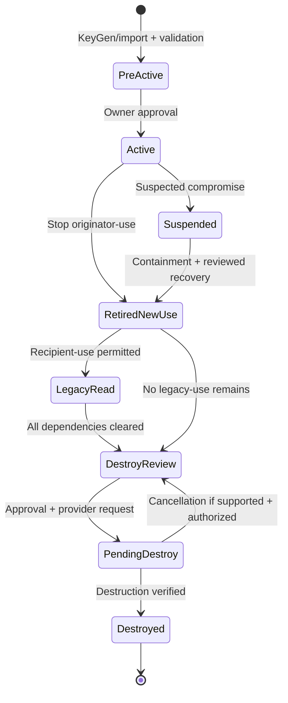
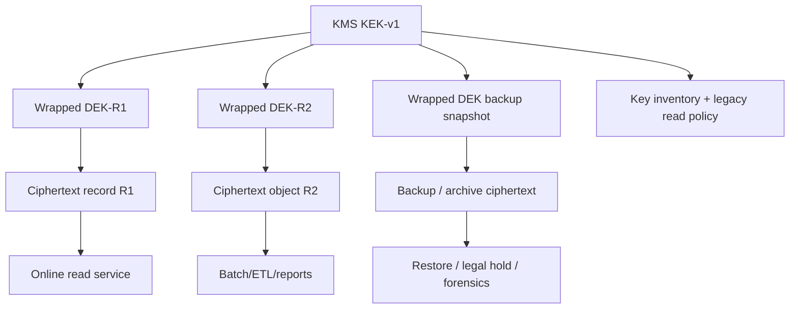
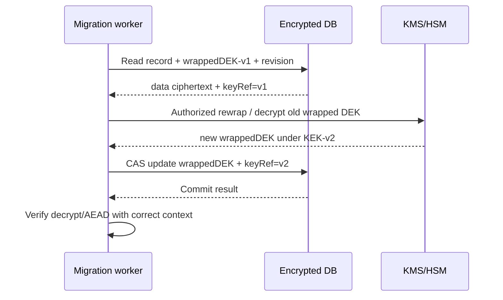
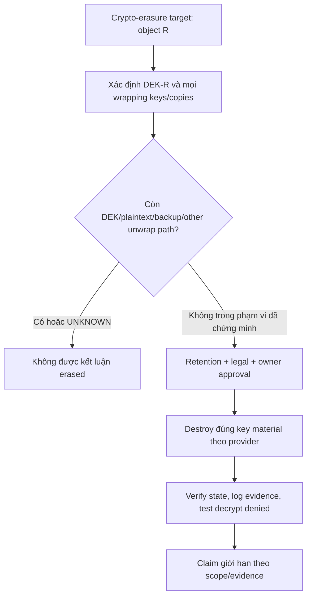

# Xác định thời điểm destroy key cũ trong cryptoperiod và rotation

> **Chương:** Cryptoperiod và rotation  
> **Module:** SECURITY_KEY_MANAGEMENT_FUNDAMENTALS

Một dịch vụ dùng **KEK v1** trong KMS để bọc hàng triệu **DEK**. Sau đợt rotation, các bản ghi mới dùng **KEK v2** và hệ thống không còn yêu cầu mã hóa mới dưới v1. Người vận hành có thể nghĩ rằng v1 đã vô dụng và tiến hành hủy. Ba tháng sau, tổ chức cần khôi phục một snapshot cũ để điều tra sự cố: snapshot vẫn chứa **wrapped DEK dưới KEK v1**. Nếu v1 đã bị hủy không có đường khôi phục được phép, bản mã có thể còn nguyên nhưng không thể giải mã. Ngược lại, giữ mọi khóa cũ vô thời hạn cũng làm tăng chi phí, phạm vi tấn công và khả năng một principal bị lạm dụng để mở dữ liệu đã hết hạn.

**Xác định thời điểm destroy key cũ** là quyết định có kiểm chứng về **khi nào vật liệu khóa hoặc khả năng sử dụng khóa có thể bị xóa/hủy vĩnh viễn** mà không vi phạm mục đích bảo vệ, nghĩa vụ lưu giữ, nhu cầu đọc/xác minh lịch sử và khả năng phục hồi. Nó **không đồng nghĩa** với ngày key hết hạn tạo ciphertext mới, ngày đổi alias, ngày quay vòng mật mã hay ngày vô hiệu hóa tài khoản dùng key.

Trong **SECURITY_KEY_MANAGEMENT_FUNDAMENTALS**, quyết định này là phần cuối của vòng đời **tạo → cấp phát → lưu trữ → sử dụng → xoay vòng → thu hồi → hủy**, gắn với mật mã đối xứng/bất đối xứng, chữ ký số, KMS/HSM, envelope encryption, kiểm soát truy cập và kiểm toán. Một chính sách destroy tốt phải đồng thời trả lời được câu hỏi **bảo mật** (“vì sao nên bỏ khóa?”) và **khả năng phục hồi** (“còn cái gì cần khóa này?”).

Sau bài học, bạn có thể:

- Phân biệt **cryptoperiod**, *originator-use*, *recipient-use*, *retire*, *disable*, *revoke*, *schedule deletion* và **irreversible key destruction**.
- Phân tích **key dependency graph** từ KEK → wrapped DEK → ciphertext → backup/DR/queue/consumer và từ signing key → verifier/trust/archive.
- Xác định điều kiện đủ để cho phép destroy, không chỉ dựa vào **key age** hoặc “số bản ghi còn dùng key v1 trong database chính = 0”.
- Phân biệt **rewrap DEK**, **reencrypt dữ liệu**, thay key dùng để ký/MAC và sự thay đổi quyền/trust của verifier.
- Xây **writer fencing, version/epoch gates, CAS**, xử lý retries và delayed jobs trước ngày đóng hoàn toàn new-use.
- Hiểu giới hạn provider KMS/HSM: có thể **không hủy riêng được một material version**, và `DisableKey` có thể chặn cả legacy Decrypt.
- Đánh giá **backup retention, legal hold, DR, timestamped signatures, JWT/HMAC, escrow và key copies**.
- Áp dụng **approval, audit, evidence bundle, destruction ceremony và negative tests** theo threat model.
- Đọc ví dụ Java 17 về **decision engine giả lập** đưa ra `BLOCK / READY_FOR_REVIEW` trên dữ liệu inventory, không kết nối hoặc xóa key thật.

## 1. Câu hỏi chính: “Key cũ” cũ theo nghĩa nào?

Trong quản lý khóa, “cũ” có thể có nhiều nghĩa:

1. **Key object** được tạo đã lâu.
2. **Material version** không còn active cho thao tác tạo ciphertext/chữ ký mới.
3. **Alias/current pointer** đã chuyển sang tài nguyên khác.
4. **Cryptoperiod new-use** đã kết thúc.
5. Key không còn xuất hiện trong **live database** nhưng vẫn có backup.
6. Key vẫn cần dùng để **Decrypt, Unwrap, Verify hoặc Decapsulate dữ liệu lịch sử**.
7. Key đã bị **compromise hoặc bị nghi ngờ compromise**, cần xử lý sự cố.
8. Key đã bị **disable**, đang chờ hủy hoặc đã bị hủy thật.

Những trạng thái này không tương đương nhau.

### 1.1. Một ví dụ theo dòng thời gian

```text
2026-01-01: Key KEK-v1 được tạo, bắt đầu wrap DEK mới.
2026-04-01: KEK-v2 active, v1 ngừng new-wrap.
2026-04-02: Hàng triệu records cũ vẫn chứa DEK wrap dưới v1.
2026-05-01: Live records đã rewrap sang v2, nhưng backup tháng 3 còn v1.
2026-07-01: Backup cũ hết retention; cần kiểm tra delayed jobs/DR/legal hold.
2026-07-10: Owner và Security xác minh không còn dependency, phê duyệt destroy.
2026-07-...: Provider thực hiện hủy theo trạng thái/tính năng cụ thể.
```

Các mốc chỉ là **ví dụ minh họa**, không phải lịch bắt buộc. Không có một quy tắc chung rằng “hủy sau 90 ngày kể từ rotation” là an toàn cho mọi key.

### 1.2. Thời gian tuổi khóa không nói đủ về lịch sử vật liệu

**CreatedAt của KMS resource** có thể khác **material generatedAt**, **importedAt**, **activatedAt** hoặc **key version createdAt**. Một key được import hôm qua có thể có vật liệu đã sinh từ nhiều năm trước. Một logical key tạo năm trước có thể chứa các material versions mới do provider-managed rotation.

Vì vậy cần quản lý ít nhất:

```text
keyResourceId
materialVersionId / provider-managed material generation (nếu có)
materialGeneratedAt / importedAt / createdAt
activatedAt
stopNewUseAt
lastKnownLegacyUseAt
dataDependencyClearanceAt
destroyApprovedAt
destroyRequestedAt
destroyEffectiveAt
```

Nếu thiếu ngày sinh vật liệu thật, ghi **UNKNOWN** và kiểm tra provenance; không tự coi ngày import là lúc vật liệu được tạo.

## 2. Thuật ngữ vòng đời phải phân biệt

| Thuật ngữ | Ý nghĩa | Có thể mở dữ liệu lịch sử? |
|---|---|---|
| **Cryptoperiod** | Khoảng sử dụng key cho một mục đích cụ thể theo chính sách | Tùy giai đoạn và usage |
| **Originator-use period** | Khoảng được dùng để tạo ciphertext, wrap, MAC/chữ ký mới | Không quyết định khả năng đọc lịch sử |
| **Recipient-use period** | Khoảng được phép Decrypt, Unwrap, Verify hay sử dụng dữ liệu nhận | Có thể còn sau new-use |
| **Rotation** | Chuyển sang key/material mới cho thao tác theo plan | Key cũ có thể vẫn cần giữ |
| **Retire from new use** | Cấm key cũ cho new Encrypt/Sign/Wrap | Có thể cho legacy Decrypt/Verify |
| **Revoke grant / access** | Rút quyền một principal hoặc trust path | Không nhất thiết xóa key material |
| **Disable / suspend** | Làm key tạm không sử dụng được theo provider/policy | Có provider sẽ chặn cả Decrypt |
| **Schedule deletion** | Đưa key vào trạng thái chờ xóa; có thể có thời gian hủy yêu cầu | Phụ thuộc provider và state |
| **Destroy key material** | Xóa/hủy khả năng sử dụng vật liệu khóa theo quy trình | Thường không nếu không còn bản sao/đường phục hồi |
| **Crypto-erasure** | Làm ciphertext không thể mở về mặt thực tiễn bằng hủy key | Chỉ đúng khi các giả định về bản sao được thỏa |

**Không nên dùng “revoke key”, “disable key” và “destroy key” như những từ đồng nghĩa.** Một JWT signing key có thể đã thôi ký token mới nhưng public verifier key vẫn cần tồn tại để xác minh token/hồ sơ lịch sử. Một KEK có thể thôi bọc DEK mới nhưng vẫn phải unwrap DEK của bản sao lưu cũ.

### 2.1. Trạng thái logic và trạng thái của provider



Sơ đồ là **state machine quản trị khái niệm**, không phải các trạng thái API của một KMS cụ thể. Provider có thể không hỗ trợ **legacy-decrypt-only** ở cấp key state; nếu `DisableKey` chặn cả Decrypt/Unwrap, phải cưỡng chế “stop new-use” qua **writer routing, IAM/grants/broker policy và kiểm thử**, thay vì disable key vội.

## 3. Điều kiện để có thể destroy: đừng bắt đầu từ một mốc thời gian

Thay vì hỏi “đủ 90 ngày chưa?”, trước tiên phải chứng minh:

**A. Không còn new-use trái phép.** Không writer/producer nào còn tạo ciphertext, DEK wrap, MAC hoặc chữ ký mới dùng key cũ; queue, delayed job, cache và fallback đã được khóa/kiểm soát.

**B. Không còn nhu cầu hợp lệ với material đó.** Tất cả object/backup/replica/DR/archives còn phải đọc hoặc xác minh đã được **migrate** hoặc hết thời hạn lưu giữ theo quyết định hợp lệ.

**C. Thẩm quyền và nghĩa vụ được đáp ứng.** Data owner, key custodian, security/compliance approver xác nhận retention, legal hold, audit, hợp đồng và nhu cầu điều tra.

**D. Khả năng phục hồi được chứng minh.** Các bản dữ liệu cần giữ đã restore/decrypt/verify được bằng key/scheme mới trong một **restore drill** đúng phạm vi.

**E. Phạm vi hủy đúng vật liệu.** Provider/API thật cho phép hủy **đúng key object/version** mà không phá keys/material generations khác đang được sử dụng.

**F. Kết quả được kiểm chứng.** Có change record, approval, pre-destroy evidence, hành động hủy và post-destroy verification; không log raw key hoặc tự tuyên bố hủy khi provider mới nhận request.

### 3.1. Một gate logic trước khi hủy

```text
destroyEligible(key) =
    NewUseFenced(key)
AND LiveDependenciesCleared(key)
AND BackupAndArchiveDependenciesCleared(key)
AND DRRecoveryVerified(key)
AND NoActiveLegalHoldOrRetentionConflict(key)
AND NoOtherValidUsePurpose(key)
AND KeyVersionAndProviderScopeVerified(key)
AND ApprovalsComplete(key)
AND EvidenceFreshAndConsistent(key)
```

Đây là **biểu thức chính sách**, không phải hàm có thể xác định bằng các flags do người dùng tự khai. Từng điều kiện cần **bằng chứng từ nguồn tin cậy** và có thời điểm hiệu lực.

### 3.2. Vì sao một phép tính ngày không đủ?

Nếu policy nói “khóa v1 ngừng Encrypt ngày 1/4”, backup của ngày 30/3 có thể còn giữ tới 1/10. Một legal hold có thể yêu cầu giữ dữ liệu thêm nhiều năm. Một job bị trì hoãn có thể tạo ciphertext mới bằng v1 sau 1/4 nếu không có writer fence.

Ngay cả khi suy ra:

\[
t_{\text{earliest review}} \geq
\max(t_{\text{stop-new-use}}, t_{\text{last-valid-retention}}, t_{\text{last-backup-expiry}})
\]

thì đó chỉ là **mốc sớm nhất để bắt đầu review khi dữ liệu và chính sách đã biết**, không tự là thời điểm hủy. Còn cần kiểm tra **dependencies, legal holds, cross-region state, grant validity và effective key use** tại thời điểm quyết định.

## 4. Dependency graph: muốn hủy key phải biết ai còn cần nó

Một khóa hiếm khi đứng riêng lẻ. Với envelope encryption:



Nếu một nhánh còn hợp lệ, **hủy KEK-v1 có thể làm mất khả năng truy cập nhánh đó**, dù `currentKeyAlias` đã chuyển sang v3.

### 4.1. Những nơi phải tìm dependency

| Vùng cần kiểm kê | Vật liệu liên quan |
|---|---|
| **Live DB** | Wrapped DEK, keyRef/version, ciphertext metadata |
| **Object storage** | File encrypted objects, manifests, object versions |
| **Backup/snapshot** | Historical wrapped DEKs, metadata, catalogs |
| **Archives** | Records lưu dài hạn, audit/forensic datasets |
| **Event queues** | Messages chưa xử lý hoặc replayable event streams |
| **Cache/sidecar** | DEK/credential/key reference tồn tại trong memory/disk |
| **DR/multi-region** | Replicas của ciphertext và key versions/policies |
| **Batch/ETL** | Công việc định kỳ dùng DEKs hoặc key version cũ |
| **External recipients** | Đối tác đã nhận wrapped DEK/package, khóa xác minh |
| **Signing/verifier systems** | Public key trust/issued signatures/tokens |
| **Developer/test artifacts** | Chỉ đánh giá khi có data/key thật; ngăn sao chép material ngoài chính sách |

**Key inventory không phải một file chứa tất cả raw keys.** Nó là metadata về **key identity/material version, purpose, owner, dependencies và lifecycle**.

### 4.2. “Số bản ghi theo key version = 0” không có nghĩa “không còn dependency”

Một truy vấn trên bảng production có thể trả zero nhưng các bản sao sau vẫn tồn tại:

- Backup của database từ 70 ngày trước.
- Snapshot object storage có version history.
- Một queue giữ event đã encrypt bằng key cũ.
- DR replica đồng bộ chậm hoặc đã bị tách khỏi cluster.
- Bộ hồ sơ pháp lý bị khóa trong legal hold.
- Một partner giữ encrypted package và vẫn có nghĩa vụ truy cập.

Do đó phải kiểm kê theo **data lineage và storage lifecycle**, không chỉ theo bảng record hiện tại.

### 4.3. Duy trì mapping version bất biến

Một alias `orders-kek-current` có thể thay từ KEK-v1 sang KEK-v2 nhưng data lịch sử vẫn cần **immutable keyRef/version**. Với provider-managed key material rotation, **ciphertext blob có thể tự mô tả** để provider chọn material cũ; phải kiểm tra hợp đồng API.

Đặc biệt, **không giả định có thể delete từng material generation** nếu provider chỉ hỗ trợ xóa cả logical key. Xóa một tài nguyên có nhiều generations có thể xóa **khả năng Decrypt tất cả ciphertext** gắn với tài nguyên đó.

## 5. Phân loại key purpose để xác định dependency đúng

Không thể dùng cùng một bài toán retention cho mọi loại key.

| Key type/purpose | “Còn cần key” nghĩa là gì? | Nguy cơ destroy sớm |
|---|---|---|
| **DEK AES-GCM** | Còn ciphertext phải mở hoặc cần khôi phục | Mất khả năng giải mã object |
| **KEK dùng wrap DEK** | Còn wrapped DEK theo KEK material/version | Mất khả năng lấy DEK dù data ciphertext còn |
| **RSA private decrypt key / KEM decapsulation key** | Còn recipient envelopes/ciphertexts gửi cho key đó | Không mở được package lịch sử |
| **Private signing key** | Còn cần Sign mới hay không; hồ sơ chữ ký lịch sử cần gì | Có thể ảnh hưởng ký tiếp, nhưng Verify thường dùng public key |
| **Public verification key** | Còn chữ ký/token/artifact cần Verify | Không xác minh được hoặc mất trust evidence nếu xóa key/trust record |
| **HMAC shared secret** | Còn phải Verify MAC cũ hay tạo MAC mới | Cắt webhook/integrity check, hoặc kéo dài rủi ro shared secret |
| **JWT signing/verification key** | Token nào còn hợp lệ, offline verifier/caches | Token hợp lệ bị từ chối hoặc token cũ vẫn bị chấp nhận ngoài ý muốn |
| **Root/intermediate CA private key** | Còn ký/cấp mới, key ceremony và quy tắc PKI | Cần xem certificate status, revocation và trust lịch sử |
| **KDF root/master secret** | Còn keys dẫn xuất cần tái tạo hay decrypt | Hủy một root có thể ảnh hưởng nhiều descendants |
| **Backup/DR recovery key** | Còn bản lưu nào muốn khôi phục | Mất khả năng DR dù hệ thống online vẫn chạy |

### 5.1. Public key không cần giữ bí mật nhưng cần giữ tính xác thực

Hủy **private signing key** khi hết nhu cầu ký mới không đồng nghĩa có thể xóa **public verification key**, certificates, chain, trust anchors hoặc lịch sử key ID. Một chữ ký số cũ có thể cần Verify sau nhiều năm; việc kiểm chứng còn phụ thuộc **thời điểm ký, validity/revocation policy, trusted timestamp, audit evidence và verification requirements**.

### 5.2. Một shared secret có thể vừa tạo vừa Verify

HMAC key được cả bên tạo MAC và verifier biết ở dạng raw key sẽ có đặc điểm khác chữ ký số bất đối xứng. Nếu verifier vẫn chấp nhận MAC của messages cũ, key có thể phải tiếp tục tồn tại hoặc protocol phải chuyển sang một hình thức lưu bằng chứng khác. Tuy nhiên, **kéo dài shared key cũng kéo dài khả năng giả mạo MAC** nếu key bị lộ; phải cân bằng cryptoperiod, timestamp/replay protection và retention.

## 6. Envelope encryption: KEK và DEK có điều kiện destroy khác nhau

Trong **envelope encryption**, DEK trực tiếp mã hóa dữ liệu (ví dụ AES-GCM), còn KEK bọc DEK. Việc hủy một trong hai khóa có hậu quả khác nhau:

```text
Record R:
  ciphertext = AES-GCM_Encrypt(DEK-R, plaintext, nonce, AAD)
  wrappedDEK = KMS_Wrap(KEK-v1, DEK-R, wrapContext)

Tại thời điểm decrypt:
  DEK-R = KMS_Unwrap(KEK-v1, wrappedDEK, wrapContext)
  plaintext = AES-GCM_Decrypt(DEK-R, ciphertext, nonce, AAD)
```

Nếu KEK-v1 không còn sử dụng được và **chưa có bản wrap khác của DEK-R**, hệ thống không thể lấy DEK-R từ wrapped DEK v1 bằng đường hợp lệ. Nếu có **một bản DEK-R plaintext còn tồn tại ở nơi khác**, dữ liệu vẫn có thể đọc được nhưng đó là **bản sao material cần đưa vào threat model**; việc không còn KEK không chứng minh crypto-erasure.

### 6.1. Khi nào có thể destroy KEK-v1 sau rotation?

Thực hiện các kiểm tra sau:

1. **New DEK wraps dùng KEK-v2** và mọi writer cũ đã bị fencing.
2. Mọi encrypted record còn phải đọc đã được **rewrap DEK** sang KEK còn hiệu lực, hoặc đã reencrypt dưới DEK/KEK mới.
3. Không còn backup, snapshot, archive, queue, export hoặc DR blob nào cần **material v1**; nếu có, phải có kế hoạch rewrap/restore/retention rõ.
4. **Key inventory và actual KMS usage** không còn chỉ ra dependency chưa xử lý; sự vắng mặt của API calls chỉ là một tín hiệu, **không phải chứng cứ duy nhất**.
5. Restore drill dùng bản snapshot từ **giai đoạn key-v1** vẫn có kết quả được chấp nhận theo retention.
6. Policy/legal hold/owner/security approvals đồng ý với hành động hủy và hậu quả.
7. Kiểm chứng provider thực sự hủy **đúng key material** mà không xóa những phiên bản khác cần dùng.

### 6.2. Rewrap có thể giữ data ciphertext



Nếu provider hỗ trợ **server-side rewrap/ReEncrypt** của data key, DEK plaintext có thể không rời ranh giới provider. Nếu không, worker có thể phải xử lý plaintext DEK trong memory theo quyền tối thiểu. **Không mặc định một KMS cung cấp cùng API hoặc semantics**.

### 6.3. Rewrap không thay thế reencrypt khi DEK bị lộ

Đổi KEK-v1 thành KEK-v2 chỉ tạo **vỏ bọc mới** cho **cùng raw DEK**. Nếu attacker đã có DEK-R, họ vẫn có thể mở data ciphertext cũ mà không cần KEK-v1. Nếu DEK đã compromise, phải đánh giá **sinh DEK mới, mã hóa lại dữ liệu, làm sạch copies và giới hạn quyền**.

### 6.4. Đừng xóa v1 khi mới đổi alias

Một alias `orders/kek-current` trỏ v2 không có nghĩa wrapped DEKs đã chuyển sang v2. Kiểm tra **actual wrapping key reference/material version** của từng record; khi provider dùng opaque ciphertext blob, phải theo dõi **logical key và migration compatibility** đúng hợp đồng API.

## 7. Chữ ký số: hủy private key khác việc hủy public verification material

Với chữ ký số bất đối xứng:

- **Private signing key** dùng tạo chữ ký mới.
- **Public verification key** dùng xác minh chữ ký; thường không bí mật.
- **Certificate/PKI chain, issuer trust, revocation information và timestamp evidence** có thể cần lưu lâu hơn private signing key.

Ví dụ một hệ thống ký báo cáo năm 2024 bằng key-v1, từ 2025 dùng key-v2. Năm 2028, hệ thống cần xác minh báo cáo 2024. Không nhất thiết phải giữ **private key v1** để Verify chữ ký; public key được tin và bằng chứng cần thiết có thể đủ, tùy policy/giao thức.

### 7.1. Khi nào private signing key cũ có thể hủy?

- Đã **ngừng tất cả Sign operations mới** bằng v1, kể cả batch, retry và code signing release cũ.
- Không có workflow hợp lệ cần **cùng private key v1** để phát hành chữ ký mới.
- Nếu private key từng phục vụ **Decrypt/Unwrap** khác mục đích, các dependencies đó đã được xử lý; tốt nhất không reuse key khác purpose.
- Có **public verification/trust material** đầy đủ phục vụ hồ sơ lịch sử.
- Lưu đủ **timestamp/revocation/verification evidence** theo nghĩa vụ lưu trữ; không giả định chữ ký có thể Verify hợp lệ mãi chỉ nhờ public key.
- Đã đáp ứng policy/hợp đồng/chứng thực/thu hồi liên quan đến key/certificate.

### 7.2. Key bị compromise không thể sửa bằng deletion đơn thuần

Nếu private signing key bị lộ, attacker có thể đã tạo chữ ký ngoài ý định. Hủy bản key ở KMS/HSM **không xóa bản copy** của attacker và không tự thu hồi chứng thư/tokens đã phát hành. Cần **revoke/trust update, timestamp analysis, incident investigation, replacement key** và quy tắc xử lý chữ ký lịch sử.

### 7.3. Code-signing và tài liệu ký lâu dài

Một package đã được ký trước đây có thể vẫn cần Verify trong nhiều năm. Quá trình destroy private signing key cần tách với:

1. **Public key/certificate archive**.
2. **Trusted timestamp và chain status evidence** nếu dùng.
3. **Artifact inventory** liên kết key ID/version với releases.
4. **Client/verifier compatibility**; các ứng dụng cũ có thể pin certificate/key.

Không xóa toàn bộ key metadata/trust evidence chỉ vì private key đã được hủy.

## 8. HMAC, JWT và token: thời điểm nào có thể bỏ key cũ?

### 8.1. HMAC key dùng cả GenerateMac và VerifyMac

Vì HMAC là **symmetric shared secret**, verifier có raw key có thể tạo MAC. Sau rotation:

- Producer tạo MAC mới bằng key-v2.
- Verifier có thể chấp nhận v1 và v2 trong một **grace period đã quy định**.
- Sau cửa sổ đó, phải ngừng chấp nhận v1 theo protocol/trust.
- Nhưng các message lịch sử cần verification có thể vẫn phụ thuộc v1 nếu không có cơ chế **lưu bằng chứng xác thực khác**.

Không kéo dài grace period vô thời hạn chỉ để tránh triển khai versioning. Nếu HMAC key bị lộ, cửa sổ chấp nhận key cũ có thể phải cắt sớm theo incident response, dù gây gián đoạn.

### 8.2. JWT signing key và `kid`

Với JWT ký bất đối xứng, public verification key cũ có thể cần xuất hiện trong JWKS/trust registry tới khi **token hợp lệ cuối cùng** dùng nó hết hạn và propagation/cache rules được xử lý; một số archived JWT cần verification lâu hơn theo thiết kế.

Với JWT dùng HMAC, verifier giữ shared secret, nên lifetime/compromise khác với public key. Cần kiểm tra:

- Thời điểm **cuối cùng Sign/Issue** bằng v1.
- Thời hạn `exp`, `nbf`, clock skew và accepted token lifetimes theo **policy thật**.
- Token revocation/blacklists, offline verifiers, JWKS/cache TTL.
- Scope/issuer/audience và trust policy; không dựa riêng vào `kid` để quyết định key đáng tin.
- Token dùng trong audit/record history có còn nghĩa vụ kiểm chứng hay không.

### 8.3. Một ví dụ quyết định

```text
2026-06-01: stop issuing JWT with signing key v1
2026-06-02: last v1 token expires, theo issuer policy
2026-06-03: expected verifier cache refresh completed
2026-06-...: audit/offline-verifier checks completed

Private signing key v1:
  có thể cân nhắc destroy khi không còn Sign purpose và approvals đạt.
Public key v1:
  có thể vẫn cần giữ trong trust archive cho signed tokens/artifacts lịch sử.
```

Ngày chỉ là ví dụ. Nếu security incident yêu cầu **ngừng trust v1 ngay**, phải ưu tiên incident controls, không giữ v1 vì “chưa tới ngày hết grace period”.

### 8.4. HMAC webhook có replay risk

Việc Verify bằng key cũ không tự chống **replay**. Message ID, timestamp/nonce và idempotency/expiry cần được kiểm tra theo giao thức. Nếu verifier còn chấp nhận v1 không giới hạn thời gian, attacker có key v1 có thể giả mạo message mới có MAC hợp lệ, bất kể producer đã rotate sang v2.

## 9. RSA private decrypt key, KEM và TLS

Một encrypted package có thể được wrap bằng **public key recipient v1**, và chỉ private key v1 tương ứng mới có thể Decapsulate/Decrypt theo scheme. Khi recipient rotate sang key-v2:

1. New packages được tạo cho public key v2 đã xác thực.
2. Old packages **không tự chuyển** sang v2.
3. Có thể giữ private key v1 cho legacy decrypt theo chính sách hoặc **rewrap/reencrypt** envelopes cần giữ.
4. Trước khi hủy v1, kiểm kê **archives, offline recipients, backups và protocol dependencies**.

### 9.1. KEM không tạo forward secrecy một cách tự động cho dữ liệu lưu dài hạn

Nếu người nhận dùng **static recipient private key** và attacker có bản copy của ciphertext/encapsulation cũ, việc lộ private key trong tương lai có thể khiến dữ liệu lịch sử bị mở, tùy scheme. Không coi tất cả KEM/HPKE đều forward-secret nếu giao thức chưa bảo đảm điều đó.

### 9.2. TLS termination key và session keys khác nhau

Một TLS server certificate private key có thể được rotate khi certificate thay. Khả năng mở lại **traffic TLS lịch sử** phụ thuộc giao thức và key exchange; không suy ra chỉ từ việc giữ hay hủy private cert key. Với TLS 1.3 ephemeral key agreement phù hợp, private signing key thường **không phải session traffic decryption key**. Tuy nhiên các session tickets, resumption keys, exported keying material và application data encryption có vòng đời riêng.

Vì vậy, trước khi hủy một TLS-related key phải xác định đúng **key purpose**, không đánh đồng certificate signing key, session traffic secret và application DEK.

### 9.3. Root CA/private CA key cần quy trình riêng

Hủy CA private key là quyết định PKI/key ceremony liên quan issuance, certificate revocation, trust anchors, cross-signing và hồ sơ kiểm chứng. Không áp runbook xóa KEK thông thường cho CA root mà không đánh giá **tác động PKI và thủ tục chuyên biệt**.

## 10. Backup và DR: nơi dễ bị bỏ sót nhất trước key destruction

Backup thường **không được rewrap theo cùng tốc độ với live database**. Một bản snapshot có thể chứa:

```text
snapshot-2026-02:
  object A: wrappedDEK under KEK-v1
  object B: wrappedDEK under KEK-v1

live-db-2026-08:
  object A: wrappedDEK under KEK-v3
  object B: wrappedDEK under KEK-v3
```

Nếu destroy KEK-v1, live DB vẫn đọc được nhưng **snapshot-2026-02 không còn tự phục hồi thành dữ liệu sử dụng được** nếu key v1/material không tồn tại.

### 10.1. Bốn lựa chọn xử lý backup

| Cách | Ưu điểm | Rủi ro/điều kiện |
|---|---|---|
| **Giữ KEK-v1 tới khi backup hết hạn** | Đơn giản, duy trì restore cho backup cũ | Key cũ còn tồn tại; cần IAM/monitoring/retention |
| **Migrate backup để rewrap DEK** | Có thể retire v1 sớm hơn | Backup immutable có thể không cho chỉnh; phải tạo snapshot mới và test |
| **Reencrypt/restore-and-resnapshot bằng key mới** | Chuyển dữ liệu sang key version mới | Chi phí, plaintext exposure, consistency và data residency |
| **Để backup hết retention và xóa theo policy** | Không cần migrate dữ liệu không còn nghĩa vụ giữ | Phải xác nhận không có legal hold và đã thực sự loại bỏ các copies |

Chọn phương án theo **tính bất biến của storage, provider capabilities, RPO/RTO, độ nhạy và chi phí**. Không có một lựa chọn luôn đúng.

### 10.2. Restore drill phải dùng ciphertext lịch sử

Một bài test có ý nghĩa:

1. Chọn snapshot thực tế tạo **trước khi rotate KEK**.
2. Dựng môi trường phục hồi có identity/IAM/registry được kiểm soát.
3. Tải record cùng **wrapped DEK, keyRef, nonce, tag và AAD schema** cũ.
4. Thực hiện Unwrap và AEAD Decrypt hợp lệ.
5. Kiểm tra ứng dụng có thể khởi động, truy vấn và phục hồi đúng dữ liệu nghiệp vụ.
6. Test **negative authorization**: workload không có quyền vẫn phải bị chặn.
7. Ghi evidence, version mapping và chi phí/giới hạn khi provider/key ở region khác.

**Backup restore thành công ở cấp file/database không chứng minh dữ liệu mã hóa đã mở được**.

### 10.3. DR sang region/account khác

Một key ID ở region B không mặc định chứa cùng vật liệu với key ID ở region A. Một số provider có cơ chế **multi-region keys/replicas**, một số có giới hạn đối với imported material hoặc HSM keys. Cần xác minh:

- Provider có hỗ trợ khôi phục **đúng material generation** không?
- Một logical key có giữ **các version cũ** khi replica/restore không?
- IAM/key policies ở DR có được kiểm soát độc lập?
- Nếu source region bị mất, DR có phụ thuộc vào KMS source hay không?
- Key protection có phù hợp với quy định **data residency/custody**?

Không xuất raw KEK từ HSM sang file không được bảo vệ chỉ vì cần “dự phòng nhanh”.

## 11. Retention, legal hold, audit và quyền được xóa

Quyết định destroy không chỉ dựa trên encryption lifecycle mà còn **data governance**:

- **Retention:** dữ liệu nào phải lưu tới ngày nào, cho ai đọc, trong phạm vi nào?
- **Legal hold/eDiscovery:** có yêu cầu bảo toàn dữ liệu đang điều tra không?
- **Contractual obligations:** khách hàng/đối tác còn quyền truy xuất hay phục hồi gì?
- **Data subject deletion / privacy policy:** có yêu cầu xóa dữ liệu và key material liên quan không?
- **Audit/forensics:** có cần chứng minh nội dung một hồ sơ lịch sử hoặc xác minh chữ ký không?
- **Disaster recovery:** RPO/RTO và backup retention thực sự áp dụng cho object/key nào?

### 11.1. Quyền xóa dữ liệu không đồng nghĩa ngay lập tức destroy KEK dùng chung

Nếu một KEK dùng chung bọc DEK của hàng triệu objects, yêu cầu xóa **một** object không nên dẫn đến hủy KEK rồi làm mất khả năng mở các objects khác. Các cách có thể phù hợp:

- Xóa dữ liệu theo policy khỏi các stores phù hợp và xử lý backups theo retention.
- Với **DEK riêng cho object** và không còn raw/wrapped copies, có thể dùng crypto-erasure ở độ hạt object theo thiết kế.
- Nếu KEK dùng chung, phải bảo vệ availability của các records khác; không hủy nó chỉ vì một object cần xóa.

### 11.2. Legal hold chặn destroy khi còn nghĩa vụ khôi phục

Một legal hold có thể yêu cầu giữ encrypted records *và* khả năng Decrypt/Verify tương ứng. Không “đáp ứng” hold bằng cách giữ ciphertext nhưng hủy hết key. Ngược lại, legal hold cũng cần giới hạn quyền và ghi audit, không phải cấp quyền đọc plaintext cho tất cả operator.

### 11.3. Retention và legal hold không thể suy từ một nhãn không xác thực

Một record có `retentionDays=30` trong JSON không chứng minh được xóa sau 30 ngày nếu quy định hệ thống yêu cầu 7 năm. Cần lấy **effective retention policy** từ nguồn tin cậy, biết scope/owner/exception và đối chiếu với legal hold trước khi quyết định.

## 12. Provider KMS/HSM: “destroy key version” có thể không tồn tại

Một chính sách ứng dụng nói “hủy KEK-v1” chưa chứng minh được nhà cung cấp hỗ trợ **hủy riêng đúng material version đó**. Nên phân biệt:

| Mô hình | Rotation làm gì? | Destruction cần xác minh |
|---|---|---|
| **Provider-managed automatic material rotation** | Logical key ID có thể giữ nguyên, provider dùng material generation mới cho new-use và vẫn hỗ trợ old ciphertext | Có thể chỉ hỗ trợ xóa **logical key**; không nhất thiết cho xóa một generation riêng |
| **Manual rotation thành key object khác** | `key-A-v1` và `key-A-v2` là tài nguyên tách biệt | Có thể xóa key resource v1 sau khi dọn hết dependencies |
| **Imported/external key material** | Key material có thể được import/reimport với rules riêng | Xóa material, xóa resource, disable và hết hạn imported material có semantics khác |
| **HSM key object/partition** | Key handle, label và usage attributes thay đổi theo cơ chế HSM | Backup, replicated HSM partitions, session objects, key copies và key ceremony |
| **Application-owned raw key** | App tự lưu material trong vault/DB/file | Xóa logic chưa chứng minh mọi copies, snapshots, memory/dumps đã bị hủy |

**Đừng đặt mặc định “delete version” trong code** nếu provider API không đảm bảo phạm vi đó. Một command xóa logical key có thể ảnh hưởng **mọi ciphertext được bọc dưới logical key**, gồm các material versions do provider duy trì.

### 12.1. Disable và schedule deletion

Một số dịch vụ hỗ trợ:

- Chuyển key sang **disabled** hoặc trạng thái không cho phép cryptographic operations.
- **Schedule deletion** với một waiting period theo quy định của provider.
- **Cancel deletion** trước khi hoàn tất nếu có quyền và state cho phép.
- Ghi audit về key deletion request và thời điểm provider báo đã destroyed.

Các khả năng trên **khác nhau theo provider, key type, region và cách key được tạo/import**; không có API hoặc số ngày chờ chung để áp cho AWS KMS, Google Cloud KMS, Azure Key Vault/Managed HSM và HSM khác. Phải xác minh **tài liệu/provider contract và integration tests** trước khi chạy action thực.

### 12.2. Không dùng alias như identity vật liệu

```text
alias/orders-kek-current -> kms/key-2026-v3
legacy record A         -> kms/key-2024-v1
legacy record B         -> kms/key-2025-v2
```

Xóa `alias/orders-kek-current` không tương đương xóa các key resource v1/v2/v3. Thay alias sang v4 cũng không tự rewrap records cũ. Lifecycle inventory phải theo **immutable resource IDs/material versions và actual dependencies**.

### 12.3. Multi-region replicas và imported copies

Nếu bản sao material tồn tại trong nhiều HSM partitions hoặc provider replicas, “destroy thành công ở region A” không tự khẳng định **mọi bản material trong DR/backup** đã bị hủy theo yêu cầu. Cần đánh giá **destruction semantics/custody** của sản phẩm, không tự đòi truy cập raw key để chứng minh.

### 12.4. Key deletion có thể không đảo ngược

Với một số hệ thống, xóa key material đã có hiệu lực là **không thể rollback**. Không được thử trực tiếp trên production để “xem sẽ xảy ra gì”. Cần kiểm chứng bằng **test key tương tự**, restore drill và review provider guarantees trước khi phê duyệt.

## 13. Chặn new-use thật sự: writer fencing và policy epoch

Để quyết định hủy an toàn, trước hết cần chứng minh **không có dữ liệu mới đang được tạo dưới key cũ**. Chuyển alias ở một nơi chưa đủ:

```text
Tại thời điểm rotate:
  Worker A cache active KEK-v2 (epoch 42).
  Worker B offline, cache active KEK-v1 (epoch 41).
  Queue có message từ tuần trước yêu cầu Encrypt.

Nếu Worker B thức dậy và vẫn được phép WrapNew dưới v1:
  -> xuất hiện wrapped DEK v1 mới sau khi inventory tuyên bố "zero".
```

### 13.1. Epoch/cutover gate

Thiết kế một **write selector** có phiên bản:

```text
KeyPurpose: tenant-A / orders / DATA_KEY_WRAP

epoch = 42
activeNewWrapKey = KEK-v2
legacyUnwrapAllowed = [KEK-v1, KEK-v2]

Writer request:
  expectedEpoch = 42
  wrapNew(DEK) only under KEK-v2

If writer uses epoch 41:
  reject stale write / refresh policy / retry safely
```

Khi cần hard cutover, các writers với policy cache cũ phải **thất bại có kiểm soát**, không tiếp tục tạo wrapped DEKs dưới v1. Nếu hệ thống cho phép overlap vì availability, phải **đo thời điểm mọi writers đã ngừng v1** trước khi tính eligibility.

### 13.2. Fencing ở đâu?

- **Application layer:** mọi writer bắt buộc tra chính sách mới và dùng expected epoch.
- **KMS policy/broker:** loại bỏ hoặc hạn chế quyền new-wrap trên key cũ nếu provider hỗ trợ operation separation.
- **Deployment:** drain/stop cũ, rollout versions mới, xác minh không còn long-running jobs.
- **Queues:** định nghĩa cách xử lý/retry messages cũ; không deserialize một keyRef v1 không được phép và tiếp tục new Encrypt.
- **Database:** commit actual keyRef và ciphertext trong một transaction logic, dùng CAS tránh lost updates.

Không một lớp riêng lẻ là đủ nếu có **đường ghi khác** vượt qua nó.

### 13.3. TOCTOU trước deletion

Giả sử inventory scan lúc 10:00 xác nhận zero dependencies, nhưng lúc 10:05 một writer cũ tạo record v1, rồi 10:10 operator hủy v1. Đây là lỗi **time-of-check/time-of-use**.

Giảm rủi ro bằng:

1. **Fencing new-use** từ trước.
2. Theo dõi **effective key usage** và producer versions.
3. Key inventory **fresh** theo cutover epoch.
4. Freeze/serialize destructive change với lifecycle controller.
5. Thực hiện **last-second dependency recheck** trước request destroy.
6. Nếu phát hiện thay đổi/unknown, **BLOCK** chứ không “đợi vài giây rồi tiếp tục”.

### 13.4. Zero write traffic không chứng minh zero future writes

Một batch chạy mỗi quý có thể không gọi KEK-v1 trong 30 ngày gần đây nhưng vẫn có code dùng version v1. Cần **inventory consumers, deployment images/config, scheduled tasks, delayed queue và grants**; không chỉ dựa vào last-use metric.

## 14. Rewrap, reencrypt, rekey và cách chứng minh dependency đã hết

| Thao tác | DEK | Wrapped DEK / KEK | Data ciphertext | Destroy old KEK readiness |
|---|---|---|---|---|
| **Đổi alias current** | Không đổi | Old wrapped DEK giữ nguyên | Không đổi | **Chưa chứng minh** |
| **Rewrap DEK v1→v2** | Có thể giữ nguyên | Tạo wrapped DEK mới, đổi keyRef | Có thể không đổi | Cần kiểm tra backup/other copies |
| **Reencrypt bằng DEK mới** | Đổi | DEK mới được wrap dưới KEK phù hợp | Đổi nonce/ciphertext/tag | Vẫn cần inventory old copies |
| **Revoke Unwrap grant** | Không đổi | Material vẫn tồn tại | Không đổi | Không phải destruction |
| **Delete old ciphertext/backup theo retention** | Có thể không đổi các objects khác | Giảm dependency | Xóa bản dữ liệu đó | Cần evidence và legal check |
| **Destroy KEK material** | Có thể làm không lấy được DEK | Material không còn dùng được | Ciphertext vẫn có thể tồn tại | Hậu quả có thể không đảo ngược |

### 14.1. Rewrap phải là phép toán thật, không phải sửa metadata

Phản ví dụ:

```sql
-- SAI: chỉ đổi tên khóa không làm raw DEK được bọc dưới KEK mới.
UPDATE encrypted_objects
SET wrapping_key_ref = 'KEK-v2'
WHERE wrapping_key_ref = 'KEK-v1';
```

Quy trình đúng phải **Unwrap/ReEncrypt/Wrap** DEK theo provider-supported scheme, tạo **wrapped DEK mới**, rồi commit **wrappedDEK + keyRef + wrapContext + recordRevision** atomically.

### 14.2. Idempotency và CAS

```text
Read record revision=17, wrapped under KEK-v1
Prepare new wrappedDEK under KEK-v2
CAS update:
    expected revision=17
    expected keyRef=KEK-v1
    new keyRef=KEK-v2
    new wrappedDEK=...

Nếu CONFLICT:
    đọc lại record
    nếu đã migrated -> verify, không ghi đè
    nếu data revision đổi -> chạy plan mới, không dùng snapshot cũ
```

Kết quả một KMS rewrap có thể chứa randomness và **không byte-for-byte giống nhau giữa retries**. Idempotency nên dựa vào operation ID, record revision và trạng thái, **không chỉ so sánh wrapped ciphertext bytes**.

### 14.3. Kiểm tra mật mã sau rewrap

Sau migration, cần đủ bằng chứng:

- New wrapped DEK mở được bằng KEK-v2 trong đúng IAM/context.
- Raw DEK sau Unwrap có thể giải mã ciphertext cũ với **nonce/AAD/tag** hợp lệ.
- Dữ liệu nghiệp vụ đúng theo test/verification strategy; không xuất tất cả plaintext ra audit.
- KeyRef v1 không còn ở các stores thuộc phạm vi migrate.
- Backup/DR đã xử lý hoặc còn được hỗ trợ bởi retention plan.

Một field `migrationStatus=SUCCESS` chỉ là metadata; không thể thay bằng chứng cryptographic readback.

### 14.4. Khi phải reencrypt thay vì rewrap

Nếu **DEK lộ**, **AES-GCM nonce reuse**, scheme không còn phù hợp hoặc data AAD/context cần thay đổi, việc rewrap cùng raw DEK có thể không giải quyết rủi ro. Nên đánh giá:

1. Sinh **DEK mới độc lập** đúng entropy/purpose.
2. Đọc dữ liệu cũ theo một path được authorization và kiểm tra tag.
3. Mã hóa lại bằng nonce/AAD/tag mới theo schema.
4. Wrap DEK mới dưới KEK đúng scope.
5. Commit atomically cùng object revision; không mất các writes đồng thời.
6. Theo dõi mọi bản cũ (backups, exports, remote copies) và dữ liệu đã bị lộ.

## 15. Khi key bị compromise: có nên destroy ngay?

**Compromise** làm xuất hiện nhu cầu hủy sớm để giảm lạm dụng, nhưng destroy vội **không thay thế containment** và có thể phá điều tra/khả năng phục hồi.

### 15.1. Trường hợp KEK bị raw-material compromise

Nếu attacker đã có **raw KEK-v1** và wrapped DEKs, họ có thể unwrap DEKs/ciphertext tương ứng theo scheme. **Xóa KEK-v1 khỏi KMS không xóa bản copy của attacker**.

Ứng phó có thể gồm:

1. Ngừng new-use và hạn các operations/identities bị chiếm.
2. Bảo toàn evidence; xác định phạm vi material, wrapped DEKs và ciphertext đã bị thu thập.
3. Tạo KEK mới; đánh giá rewrap để giảm phụ thuộc operational.
4. Nếu DEKs/plaintext đã hoặc có khả năng bị lộ, lên kế hoạch **thay DEK/reencrypt** với thông báo/risk acceptance cần thiết.
5. Xác minh backup/DR/retention và phương án khôi phục trước irrecoverable destroy.
6. Không hứa “rotate xong là dữ liệu lịch sử được bảo mật lại” khi attacker đã giữ dữ liệu.

### 15.2. KMS non-exportable nhưng quyền Decrypt bị lạm dụng

Một principal bị chiếm có thể dùng KMS/HSM làm **decryption oracle**: lấy plaintext DEKs hoặc dữ liệu thông qua API mà không export raw KEK. Rút IAM/grants có thể chặn **future calls**, nhưng không thu hồi plaintext/DEKs đã lấy. Audit phải phân biệt:

- **Material compromise:** raw key bị sao chép.
- **Usage compromise:** key service bị dùng trái phép.
- **Data compromise:** DEKs/plaintext/ciphertext đã bị đọc hoặc lộ.

Destroy key ngay có thể không cần thiết nếu containment và rotation thích hợp; quyết định phải qua incident commander/key owner với bằng chứng.

### 15.3. Bảo toàn forensic evidence nhưng không kéo dài tấn công

Nếu khóa còn đang bị lạm dụng, ưu tiên **disable/restrict API, revoke principal, block new-use** tùy provider và ảnh hưởng availability. Giữ key phục vụ forensic/legacy recovery có thể cần một **isolated path có approval, monitoring và TTL**, không mở lại quyền cho tất cả workload.

### 15.4. Hủy khóa để crypto-erase một nhóm dữ liệu

Nếu tổ chức muốn cố ý làm một tập dữ liệu **không còn giải mã được**, có thể lên kế hoạch hủy **DEK per-object hoặc key material bảo vệ duy nhất cho tập đó**, với giả định:

- Không còn bản sao DEK/KEK/private key hữu dụng khác.
- Không còn plaintext copies/caches/exports được xem là dữ liệu còn truy cập.
- Bản ciphertext và backup có cùng dependency được hiểu đúng.
- Việc xóa được phê duyệt theo retention/legal hold và có bằng chứng.

Nếu một KEK vẫn đang bảo vệ dữ liệu hợp lệ của tenants khác, **không destroy KEK dùng chung chỉ để xóa một object**.

## 16. Crypto-erasure: “hủy key” cần những giả định gì?

**Crypto-erasure** là cách làm dữ liệu đã mã hóa **không còn giải mã được trong thực tế** bằng cách hủy material cần thiết. Đây là một thuộc tính **có điều kiện**, không phải phép màu.



### 16.1. Tại sao cùng một KEK cho nhiều objects làm crypto-erasure khó hơn?

Nếu KEK-v1 bảo vệ 1.000.000 DEKs, hủy KEK-v1 có thể làm mất quyền đọc cả triệu objects. Nếu chỉ một record cần erase, giải pháp hợp lý hơn có thể là **DEK riêng per-object** và lifecycle/cleanup của các wrapped copies, thay vì phá key root chung.

### 16.2. Erasure không thể thu hồi dữ liệu đã lộ

Nếu attacker đã lấy plaintext, việc xóa DEK ở storage không thu hồi bản copy ấy. Nếu họ giữ raw DEK và data ciphertext, xóa wrapped DEK trong DB không ngăn họ giải mã offline. Vì vậy các báo cáo erasure phải mô tả **phạm vi quản lý được kiểm chứng và giới hạn với bản sao bên ngoài**.

### 16.3. Cần phân biệt backup retention với quyền xóa

Một số hệ thống dùng backup immutable theo policy; xóa material có thể làm dữ liệu trong backup không thể mở trước khi backup hết retention, điều này có thể **vi phạm khả năng phục hồi hoặc legal hold**. Ngược lại, nếu policy cho phép crypto-erasure ở cấp record, cần chứng minh không còn bản wrap/decryption path nào hữu dụng trong backups.

### 16.4. Xác nhận hủy là điều kiện kỹ thuật, không phải suy đoán

Một HTTP 200 từ API “schedule delete” chỉ có thể xác nhận **yêu cầu được chấp nhận**, không nhất thiết vật liệu đã bị phá hủy. Phải đọc lại **effective state** sau khi provider hoàn tất và thu thập evidence. Không cố Decrypt sản xuất hàng loạt chỉ để thử; dùng test fixture/canary đã thiết kế.

## 17. Owner, approvals, Separation of Duties và change control

Quyết định hủy một root/KEK có thể không đảo ngược, nên không nên để một application principal hoặc operator đơn lẻ:

- Tự đánh dấu không còn dependencies.
- Tự phê duyệt phá hủy.
- Tự gọi key deletion API.
- Tự sửa audit trails để ghi “COMPLETED”.

### 17.1. Ma trận vai trò tham khảo

| Vai trò | Trách nhiệm | Không mặc định có |
|---|---|---|
| **Data owner** | Xác nhận dữ liệu nào còn nghĩa vụ giữ/đọc | Quyền xóa raw key ở HSM |
| **Key custodian/KMS operator** | Key state, cryptoperiod, provider API, backup, destruction | Quyền tự quyết định dữ liệu đã hết retention |
| **Security approver** | Threat model, compromise risk, permissions và exceptions | Quyền Decrypt toàn bộ plaintext |
| **Compliance/legal** | Retention, legal hold, contractual constraints | Quyền sửa KMS policy hoặc dùng DEK |
| **Service owner** | Chứng minh writers đã cutover, readers/migrations an toàn | Quyền ScheduleDeletion trên key gốc |
| **Auditor** | Kiểm tra provenance, approvals, event logs, evidence | Raw KEK/DEK để “đối chiếu” |
| **Incident commander** | Quyết định containment trong trường hợp compromise | Quyền phá hủy không theo policy ngoài tình huống khẩn cấp được duyệt |

Trách nhiệm cụ thể phụ thuộc tổ chức và provider. Một **approval record** chỉ hợp lệ khi gắn **chính xác key ID/material generation, scope, dependencies, lý do và thời điểm**, không phải một tờ phê duyệt chung chung “xóa keys cũ”.

### 17.2. Hai giai đoạn: authorize → execute

```text
Phase 1 — Review:
  latest inventory + writer fence + restore evidence
  data owner + key custodian + security/compliance approvals
  immutable plan identifier and exact keyRef

Phase 2 — Execute:
  re-check state/dependencies near execution
  schedule deletion or destroy (provider-specific)
  monitor provider state and allow cancellation only if authorized
  verify effective destruction + issue audit certificate
```

Mọi thay đổi ở keyRef, affected records, active legal holds hoặc provider semantics sau approval cần **đánh giá lại**, không dùng approval cũ ngoài scope.

### 17.3. Hạn chế quyền xóa key

Key deletion/destruction là **privileged operation**. Nên có least privilege, JIT, MFA/dual control nếu platform hỗ trợ, change ticket, 2-person approval với nguồn identity khác nhau, session audit và alerts. Điều đó giảm khả năng một compromised workload âm thầm hủy root KEK.

### 17.4. Emergency path vẫn cần evidence

Khi xảy ra compromise nghiêm trọng, có thể cần containment ngay trước khi hoàn tất một review thông thường. Nhưng **khẩn cấp không đồng nghĩa được tùy tiện xóa key root**; incident path cần phân quyền/thẩm quyền rõ, logs, hậu kiểm và quyết định cân bằng giữa security và data availability.

## 18. Evidence bundle và metrics chứng minh “destroy-ready”

Một quyết định có thể được audit nên có **evidence bundle** tối thiểu:

| Bằng chứng | Nội dung cần ghi |
|---|---|
| **Key identity** | Immutable resource ID, material version, provider, region/account, purpose |
| **Cryptoperiod record** | KeyGen/import, activation, last new-use, retirement |
| **Writer fencing** | Cutover epoch, danh sách producers, deployments, scheduled jobs đã kiểm tra |
| **Dependency inventory** | Counts theo live DB, object store, backups, queues, archives, DR |
| **Migration results** | Rewrap/reencrypt successes, failures, CAS conflicts, record readback |
| **Restore drill** | Sample backups lịch sử, test decrypt/verify, failed cases |
| **Retention/legal** | Effective retention, legal hold clearance, signed approvals |
| **KMS/HSM state** | Effective operations/grants, version deletion scope, provider API semantics |
| **Security posture** | Compromise status, last unexpected use, open incidents |
| **Execution plan** | Exact keyRef, approval expiry, rollback/cancel plan nếu supported |
| **Post-destroy** | Final provider status, operation IDs, verified tests, audit digest |

### 18.1. Metrics không nên sử dụng một mình

| Metric | Ý nghĩa | Giới hạn |
|---|---|---|
| `liveRecordsUsingV1 = 0` | Không có record v1 được biết trong live DB | Không thấy backup, archive, missed partitions |
| `kmsDecryptLastSeen = 90d` | Không thấy KMS Decrypt v1 trong 90 ngày | App có thể cache DEK, offline jobs chưa chạy |
| `successfulMigration = 100%` | Jobs báo thành công | Có thể bỏ sót retries, lost updates, data snapshots |
| `backupOldestAge = 60d` | Tuổi backup theo metric | Legal hold và offline copies có thể nằm ngoài thống kê |
| `allWritersOnV2 = true` | Deployment inventory cho thấy v2 | Cron jobs, stale pods và direct API bypass có thể chưa tính |
| `deleteRequestAccepted = true` | Provider nhận request | Chưa chứng minh material đã hủy |

Mục tiêu là **triangulation**: nhiều nguồn bằng chứng độc lập nhất quán, đúng scope và **còn mới tại thời điểm thực thi**.

### 18.2. Alert cần có

- New Wrap/Encrypt/Sign bằng key đã retire.
- Key old có Decrypt/Unwrap traffic ngoài lịch approved.
- Key sắp deletion nhưng `legacyDependencies > 0` hoặc UNKNOWN.
- Restore drill fail trên snapshot cũ.
- KMS policy/grant bị mở rộng trước destruction.
- Legal hold mới áp dụng sau approval.
- Pending deletion bị cancel/đổi scope không đúng workflow.
- Destroy request cho logical key có nhiều material generations.
- Sai lệch giữa inventory và các hệ thống backup/DR.

### 18.3. Bằng chứng nào không nên ghi

Đừng đặt **raw DEK/KEK/private key, HMAC secret hoặc plaintext khách hàng** vào audit log, dashboard hay evidence bundle. Key IDs, hashes của artifacts (không phải hashes của secrets có entropy thấp), request IDs, inventory counts và signed change records thường đủ để truy vết.

## 19. Java 17: decision engine minh họa điều kiện destroy-ready

Ví dụ này **không kết nối KMS/HSM, không có API destroy, không xuất key material**. Nó chỉ mô phỏng một **pre-destroy decision gate** dựa trên bằng chứng do các hệ thống inventory, backup/DR, IAM, legal và change management cung cấp.

Tư tưởng chính:

1. Bằng chứng phải có **keyRef bất biến**, thời điểm đo và **scope**.
2. **UNKNOWN hoặc thiếu dữ liệu** luôn là blocker, không được suy thành zero.
3. Việc writers đã ngừng new-use phải được xác nhận bằng **policy epoch/fence**.
4. Mọi dependency còn tồn tại, legal hold, incident chưa xử lý hoặc missing approvals đều **BLOCK**.
5. Kết quả tốt nhất của demo chỉ là **READY_FOR_HUMAN_REVIEW**; **không phải** lệnh hủy hay bằng chứng provider đã hủy.

### 19.1. Mô hình Java 17, không dùng thư viện ngoài

```java
import java.time.Clock;
import java.time.Duration;
import java.time.Instant;
import java.time.ZoneOffset;
import java.util.ArrayList;
import java.util.List;

public final class OldKeyDestructionDecisionDemo {
    enum KeyState {
        ACTIVE,
        RETIRED_NEW_USE,
        SUSPENDED,
        DESTROY_PENDING,
        DESTROYED
    }

    enum Verdict {
        BLOCK,
        READY_FOR_HUMAN_REVIEW
    }

    // -1 nghĩa là UNKNOWN: không biến missing count thành zero.
    record Dependencies(
            long liveWrappedDeks,
            long objectStoreReferences,
            long archivedReferences,
            long backupReferences,
            long drReferences,
            long queuedOrDelayedJobs) {}

    // Các boolean này chỉ là evidence đã được nguồn đáng tin xác nhận.
    // Production phải kiểm tra chữ ký, authority, scope và freshness.
    record Evidence(
            String immutableKeyRef,
            KeyState keyState,
            Instant stoppedNewUseAt,
            Instant observedAt,
            boolean writerFenceConfirmed,
            long requiredEpoch,
            long observedWriterEpoch,
            Dependencies dependencies,
            boolean restoreDrillPassed,
            boolean retentionCleared,
            boolean legalHoldActive,
            boolean correctProviderDeletionScopeVerified,
            boolean unresolvedMigrationFailures,
            boolean securityIncidentOpen,
            boolean objectOwnerApproved,
            boolean securityApproved,
            boolean keyCustodianApproved,
            boolean effectiveAccessReviewed) {}

    record Decision(Verdict verdict, List<String> blockers) {
        Decision {
            blockers = List.copyOf(blockers);
        }
    }

    static final Duration MAX_INVENTORY_AGE =
            Duration.ofHours(24); // Chỉ là policy GIẢ ĐỊNH của demo.

    static void zeroOrBlock(
            List<String> blockers, String label, long value) {
        if (value < 0) {
            blockers.add(label + ": UNKNOWN");
        } else if (value != 0) {
            blockers.add(label + ": " + value + " dependencies remain");
        }
    }

    static Decision review(Evidence e, Clock clock) {
        List<String> blockers = new ArrayList<>();
        Instant now = clock.instant();

        if (e.immutableKeyRef() == null
                || e.immutableKeyRef().isBlank()) {
            blockers.add("Missing immutable key reference");
        }
        if (e.keyState() != KeyState.RETIRED_NEW_USE) {
            blockers.add("Key not confirmed retired from new use");
        }
        if (e.stoppedNewUseAt() == null
                || e.stoppedNewUseAt().isAfter(now)) {
            blockers.add("No trustworthy stop-new-use evidence");
        }

        if (e.observedAt() == null
                || e.observedAt().isAfter(now)
                || Duration.between(
                        e.observedAt(), now).compareTo(
                        MAX_INVENTORY_AGE) > 0) {
            blockers.add("Inventory missing, future-dated, or stale");
        }
        if (!e.writerFenceConfirmed()) {
            blockers.add("New-use writer fence not confirmed");
        }
        if (e.requiredEpoch() < 0
                || e.observedWriterEpoch() < e.requiredEpoch()) {
            blockers.add("Stale/unknown writer policy epoch");
        }

        Dependencies d = e.dependencies();
        if (d == null) {
            blockers.add("Dependency inventory unavailable");
        } else {
            zeroOrBlock(
                    blockers, "liveWrappedDeks", d.liveWrappedDeks());
            zeroOrBlock(
                    blockers, "objectStoreReferences",
                    d.objectStoreReferences());
            zeroOrBlock(
                    blockers, "archivedReferences",
                    d.archivedReferences());
            zeroOrBlock(
                    blockers, "backupReferences", d.backupReferences());
            zeroOrBlock(
                    blockers, "drReferences", d.drReferences());
            zeroOrBlock(
                    blockers, "queuedOrDelayedJobs",
                    d.queuedOrDelayedJobs());
        }

        if (!e.restoreDrillPassed()) {
            blockers.add("Restore drill not verified");
        }
        if (!e.retentionCleared()) {
            blockers.add("Retention/contract obligation remains");
        }
        if (e.legalHoldActive()) {
            blockers.add("Active legal hold");
        }
        if (!e.correctProviderDeletionScopeVerified()) {
            blockers.add("Provider version/deletion scope unverified");
        }
        if (e.unresolvedMigrationFailures()) {
            blockers.add("Migration failures unresolved");
        }
        if (e.securityIncidentOpen()) {
            blockers.add("Incident requires separate review");
        }
        if (!e.objectOwnerApproved()
                || !e.securityApproved()
                || !e.keyCustodianApproved()) {
            blockers.add("Required independent approvals missing");
        }
        if (!e.effectiveAccessReviewed()) {
            blockers.add("Effective IAM/key-use not reviewed");
        }

        if (!blockers.isEmpty()) {
            return new Decision(Verdict.BLOCK, blockers);
        }
        return new Decision(
                Verdict.READY_FOR_HUMAN_REVIEW, List.of());
    }

    // Convenience cho demo: records bất biến, thay bằng records mới.
    static Evidence withDependencies(
            Evidence e, Dependencies d) {
        return new Evidence(
                e.immutableKeyRef(), e.keyState(),
                e.stoppedNewUseAt(), e.observedAt(),
                e.writerFenceConfirmed(), e.requiredEpoch(),
                e.observedWriterEpoch(), d,
                e.restoreDrillPassed(), e.retentionCleared(),
                e.legalHoldActive(),
                e.correctProviderDeletionScopeVerified(),
                e.unresolvedMigrationFailures(),
                e.securityIncidentOpen(),
                e.objectOwnerApproved(), e.securityApproved(),
                e.keyCustodianApproved(),
                e.effectiveAccessReviewed());
    }

    public static void main(String[] args) {
        Clock clock = Clock.fixed(
                Instant.parse("2026-11-28T03:00:00Z"),
                ZoneOffset.UTC);
        Instant now = clock.instant();

        // Trường hợp 1: không còn live data nhưng backup dùng v1.
        Evidence oldBackup = new Evidence(
                "kms://test/orders/KEK-v1",
                KeyState.RETIRED_NEW_USE,
                now.minus(Duration.ofDays(60)),
                now.minus(Duration.ofHours(2)),
                true,
                42,
                42,
                new Dependencies(0, 0, 0, 12, 0, 0),
                true, true, false, true,
                false, false,
                true, true, true, true);

        Decision blocked = review(oldBackup, clock);
        System.out.println("Old backup: " + blocked.verdict());
        System.out.println("Reasons: " + blocked.blockers());

        // Trường hợp 2: backup clear, nhưng chưa có restore proof.
        Evidence noRestoreEvidence = new Evidence(
                oldBackup.immutableKeyRef(),
                oldBackup.keyState(),
                oldBackup.stoppedNewUseAt(),
                oldBackup.observedAt(),
                oldBackup.writerFenceConfirmed(),
                oldBackup.requiredEpoch(),
                oldBackup.observedWriterEpoch(),
                new Dependencies(0, 0, 0, 0, 0, 0),
                false,
                oldBackup.retentionCleared(),
                oldBackup.legalHoldActive(),
                oldBackup.correctProviderDeletionScopeVerified(),
                oldBackup.unresolvedMigrationFailures(),
                oldBackup.securityIncidentOpen(),
                oldBackup.objectOwnerApproved(),
                oldBackup.securityApproved(),
                oldBackup.keyCustodianApproved(),
                oldBackup.effectiveAccessReviewed());
        System.out.println(
                "Missing restore proof: "
                        + review(noRestoreEvidence, clock).verdict());

        // Trường hợp 3: đạt các gates mô phỏng.
        Evidence candidate = withDependencies(
                oldBackup, new Dependencies(0, 0, 0, 0, 0, 0));
        Decision ready = review(candidate, clock);
        System.out.println("Candidate: " + ready.verdict());
        System.out.println("No blockers: "
                + ready.blockers().isEmpty());
    }
}
```

### 19.2. Kết quả logic mong đợi

```text
Old backup: BLOCK
Reasons: [backupReferences: 12 dependencies remain]
Missing restore proof: BLOCK
Candidate: READY_FOR_HUMAN_REVIEW
No blockers: true
```

**Quan trọng:** Đây là kết quả theo dữ liệu *giả định* của demo, không phải báo cáo rằng một khóa production thật đã đủ điều kiện hủy. `READY_FOR_HUMAN_REVIEW` nghĩa là các điều kiện đơn giản của ví dụ đã PASS; còn phải **xác minh bằng chứng, API semantics và kiểm tra lần cuối**.

### 19.3. Những giới hạn khiến demo không được dùng như destructive automation

- `Evidence` chứa boolean có thể được bất kỳ code nào dựng lên; production cần **signed/attested evidence**, nguồn tin cậy, scope, owner, timestamp và độ mới.
- Các nguồn có thể **không đầy đủ** dù tất cả counts là 0. Cần chứng minh inventory coverage, discovery across accounts/regions và data lineage, không chỉ chấp nhận một counter.
- Cửa sổ 24 giờ là **giả định minh họa**, không phải tiêu chuẩn cryptoperiod.
- `observedWriterEpoch` không chứng minh mọi CronJob, offline node và backup writer đã bị fencing.
- Không kiểm tra policy thực sự của KMS/HSM, key material versions, provider deletion states, replicas hoặc imported copies.
- Không có legal system, approval identity/SoD, signature verification, audit tamper resistance hay evidence expiration.
- Không đánh giá **signing/HMAC/PKI semantics** riêng; các cờ chỉ mang nghĩa được điều phối từ policy bên ngoài.
- Không có transaction lock/chống TOCTOU tại lúc deletion; cần **re-evaluate trước destructive action**.
- Không có mã gọi `ScheduleKeyDeletion`, `DeleteKey` hay HSM destroy. **Không tự thêm destructive API vào demo và chạy production.**

### 19.4. Cách mở rộng design ở cấp hệ thống

Trong kiến trúc thật, thay các boolean bằng **evidence objects** có `sourceId`, `snapshotEpoch`, `observedAt`, `signature/attestation` và `scope`. Có thể dùng một **policy engine** tách phần đọc dữ liệu inventory khỏi phần quyết định, rồi **approval workflow** độc lập thực thi destructive action với key ID/expected state đã khóa.

### 19.5. Không biến review engine thành source of truth duy nhất

Nếu một hệ thống chỉ ghi `destroyEligible=true` trong database và để operator gọi trực tiếp KMS delete, policy có thể bị vượt qua hoặc stale. Quy trình thực thi phải kiểm tra lại **effective state, current legal holds và last-minute dependencies**, đồng thời bắt buộc **least-privileged deletion role**.

## 20. Policy-as-code: ý định hủy khóa cần cụ thể tới vật liệu và retention

Một chính sách **mô tả ý định** có thể được lưu như sau:

```yaml
# YAML minh họa, KHÔNG phải provider/KMS policy syntax.
schemaVersion: 1
policyId: "prod-orders-kek-destruction-v3"

keyIdentity:
  environment: "production"
  ownerService: "orders-service"
  keyPurpose: "DATA_KEY_WRAP"
  logicalKeyId: "orders-kek"
  immutableKeyRef: "kms://production/orders/kek-2024-v1"
  materialVersion: "provider-verified-v1"
  providerVersionDeletionSupported: "REQUIRES_VERIFICATION"

cryptoperiod:
  allowNewWrap: false
  stopNewUseEvidenceRequired: true
  legacyUnwrapAllowedUntilDependenciesCleared: true

dependencySources:
  - "live-database-index"
  - "versioned-object-storage"
  - "message-queues-and-replay"
  - "backup-catalog-and-snapshots"
  - "archive-and-legal-hold-register"
  - "multi-region-dr-inventory"
  - "client-and-batch-deployment-inventory"

gates:
  requireWriterFence: true
  requirePolicyEpochMatch: true
  requireZeroKnownDependencies: true
  rejectUnknownCounts: true
  requireMigrationReadback: true
  requireHistoricalRestoreDrill: true
  requireRetentionClearance: true
  rejectActiveLegalHold: true
  requireProviderDeletionScopeReview: true
  requireFreshEvidenceAtExecution: true
  rejectOpenSecurityIncidentWithoutIncidentApproval: true

approvals:
  - "data-owner"
  - "key-custodian"
  - "security-approver"
  - "compliance-if-applicable"
  requireSeparationOfDuties: true
  requireChangeTicket: true

execution:
  allowAutomaticDestruction: false
  requestAction: "PROVIDER_SPECIFIC_PENDING_DELETION"
  verifyEffectiveDestruction: true
  auditKeyMaterial: false
  auditFields:
    - "immutableKeyRef"
    - "materialVersion"
    - "keyPurpose"
    - "policyEpoch"
    - "inventoryEvidenceIds"
    - "approverIdentities"
    - "changeTicket"
    - "providerOperationId"
    - "effectiveState"
```

### 20.1. Vì sao policy phải có `keyPurpose`?

Điều kiện hủy **KEK dùng wrap DEK** không giống **private signing key** hay **HMAC key**. Để tránh một policy chung đánh giá thiếu, mỗi key purpose nên có **dependency adapters** tương ứng:

- `DATA_KEY_WRAP` → wrapped DEK records, backups/archives/DR, KMS Unwrap permissions.
- `DATA_ENCRYPT` → data ciphertext, DEK versions/nonce history, retention.
- `SIGN` → signed artifacts, pending signing jobs, certificate/public verifier availability.
- `MAC` → producer cutover, verifier grace period, message replay, historical verification.
- `KEY_AGREEMENT/KEM` → recipient envelopes, private decapsulation key, offline packages.
- `DERIVE` → descendants, context/salt/versioning, inability to rederive without root.

### 20.2. YAML chỉ là khai báo, không phải bằng chứng

Các dòng `requireZeroKnownDependencies: true` hoặc `requireWriterFence: true` **không tự chứng minh** chúng đã được thực hiện. Hệ thống phải có các connectors/attestations tới nguồn dữ liệu thật, kiểm tra tính đầy đủ/freshness và lập evidence bundle.

### 20.3. Không ghi raw key vào audit

Một trường như `auditKeyMaterial: false` thể hiện policy nhưng không tự ngăn code debug ghi raw DEK/KEK. Cần kiểm tra runtime logging, crash dumps, CI artifacts và quyền đọc audit.

## 21. Ma trận kiểm thử trước destroy

Trước khi phá hủy key thật, thử workflow với **test key và dữ liệu mô phỏng**, sau đó review controls trên key production theo policy. Mục tiêu là đảm bảo hệ thống **BLOCK mọi trạng thái không chắc chắn**.

| Kịch bản | Quyết định kỳ vọng |
|---|---|
| Key còn ACTIVE cho new Encrypt/Wrap | **BLOCK** |
| Alias chuyển sang v2 nhưng còn writer v1 | **BLOCK** |
| Writer epoch cũ và queue chưa drain | **BLOCK** |
| Live DB có zero dependencies, object storage còn v1 | **BLOCK** |
| Live DB zero, backup immutable còn wrapped DEK v1 | **BLOCK** |
| Backup hết retention nhưng legal hold còn active | **BLOCK** |
| Restore drill chưa chạy hoặc thất bại | **BLOCK** |
| Key material version không rõ, chỉ có alias current | **BLOCK** |
| Provider xóa whole logical key nhưng inventory chỉ xét material-v1 | **BLOCK** |
| Migration có CAS conflicts/partial commits | **BLOCK** |
| Key sử dụng làm signing và recipient key nhưng kiểm kê chỉ Wrap | **BLOCK** |
| Key usage logs im lặng 90 ngày, scheduled quarterly job chưa kiểm tra | **BLOCK** |
| IAM key-delete role có wildcard không được phê duyệt | **BLOCK** |
| Không xác minh DR region/replicated HSM key material | **BLOCK** |
| Inventory source trả UNKNOWN hoặc incomplete | **BLOCK** |
| Inventory snapshot quá cũ so với policy | **BLOCK** |
| Hai approvals đến từ cùng một thực thể trái quy định SoD | **BLOCK** |
| Key compromise vẫn đang điều tra, plan thường đã lỗi thời | **BLOCK / incident-specific review** |
| Không còn dependencies, writer fenced, DR verified, approvals đủ | **READY_FOR_HUMAN_REVIEW**, không gọi destroy tự động |
| Provider nhận request schedule deletion nhưng chưa hủy | **PENDING**, không báo DESTROYED |
| Pending deletion bị cancel theo quy trình được phép | **CANCELED**, rà lại policy và key state |
| Provider xác nhận destruction và bằng chứng kiểm tra hợp lệ | Có thể đánh dấu **DESTROYED_VERIFIED** theo khả năng chứng thực |

### 21.1. Negative test có ý nghĩa hơn happy path

Một workflow “hủy test key thành công” chưa chứng minh an toàn với production. Cần cố tình tạo:

- Encrypted fixture **bị bỏ sót** trong archive.
- **Delayed write** dùng key v1 sau cutover.
- Provider logical key có nhiều material generations.
- Legal hold được bổ sung **sau approval nhưng trước execution**.
- Key alias bị đổi giữa inventory scan và destroy request.
- IAM permission trực tiếp cho service khác ngoài đường API kiểm soát.
- Backup restore chỉ thành công khi KEK v1 còn khả dụng.

Hệ thống phải **phát hiện, ngừng và ghi blocker**, không tự sửa metadata hoặc mở quyền để “qua test”.

### 21.2. Test rollback không phải test khôi phục material đã hủy

Một số provider cho phép **cancel pending deletion** trong waiting period. Điều đó không có nghĩa key đã thực sự hủy có thể được “rollback” bằng một nút bấm. Cần phân biệt:

- Rollback **policy/alias**.
- Re-enable key đang Disabled (nếu an toàn và được phép).
- Cancel **scheduled deletion** trong trạng thái cho phép.
- **Không thể khôi phục** material đã destroy nếu không có approved backup/material copy còn hiệu lực.

### 21.3. Bằng chứng sau hủy

Kiểm tra post-condition theo tính năng provider:

- Đúng immutable keyRef/material scope.
- Provider báo state phù hợp **effective destruction**, không chỉ “request accepted”.
- KMS/HSM calls dùng key cũ thất bại theo **test path an toàn**.
- Các key/versions khác cần thiết vẫn dùng được.
- Inventory tombstone, audit operation ID, approvals, thời điểm và incident link được ghi.

Không cần xuất key material trước/sau destruction để chứng minh. Với HSM, có thể cần **ceremony attestation/logs** theo quy trình riêng.

## 22. Case study A: KEK-v1 của hệ thống đơn hàng và backup 90 ngày

Hệ thống có hàng triệu đơn hàng mã hóa bằng **DEK per-object** và KEK-v1 trong KMS. Ngày 1/4, tổ chức chuyển new-wrap sang KEK-v2. Đội vận hành bắt đầu rewrap từng record trong live DB.

### 22.1. Lúc migration báo “100%”

```text
Live database:
  wrappedDEK under KEK-v1 = 0
  wrappedDEK under KEK-v2 = 2,600,000

Other storage:
  backup-2026-03-15 = wrapped DEKs under KEK-v1
  backup-2026-03-31 = wrapped DEKs under KEK-v1
  DR replica snapshot = unknown last sync state
```

Dashboard live DB hiển thị **0 old-key records**. Nhưng zero chỉ đúng ở **một nguồn inventory**. Nếu destroy v1, backup-2026-03-15 và snapshot DR có thể không phục hồi được.

### 22.2. Phương án sai

Operator cho rằng “rotation xong nghĩa là key cũ nên hủy”, lập lịch deletion cho v1 mà không kiểm tra backup/DR. Một tháng sau, sự cố vận hành cần restore backup lịch sử và hệ thống báo **KEY_VERSION_UNAVAILABLE**. Nếu material đã destroy vĩnh viễn, không có cách hợp lệ để Unwrap DEK-v1.

### 22.3. Phương án an toàn

1. Ghi v1 **RETIRED_NEW_USE**, không dùng cho wrapped DEKs mới.
2. Xác nhận writer epochs, queues và batch jobs không thể tạo wrapped DEK v1.
3. Inventory backup/snapshots và các ngày retention hoặc legal hold thật.
4. Quyết định **giữ v1 cho legacy restore** tới khi backup hết hạn hoặc migrate backups theo cơ chế được duyệt.
5. Restore drill từ ít nhất một backup cũ; kiểm tra **Decrypt** chứ không chỉ mount database.
6. Kiểm tra nguồn DR/region và IAM ở nơi phục hồi.
7. Đối soát số dependencies còn lại và mọi migration failures.
8. Chỉ phê duyệt destruction khi evidence bundle đủ và có scope version chính xác.

### 22.4. Điều gì được xem là hoàn tất?

Không phải “100% live records đã rewrap”, mà là:

- Writer v1 đã bị fencing.
- Live/backup/queue/archive/DR dependencies được giải quyết theo retention.
- Restore/new-read paths đã được kiểm chứng bằng key còn hợp lệ.
- Provider deletion scope được kiểm tra.
- Owner/security/compliance phê duyệt.
- Provider state sau hủy được xác minh và audit.

### 22.5. Khi backup immutable

Nếu backups không được sửa để rewrap, có thể chọn **giữ v1 đến khi hết backup retention**, hoặc **restore/reencrypt/resnapshot** có kiểm soát nếu chi phí và chính sách cho phép. Không sửa trực tiếp các encrypted blobs opaque của KMS để “ép” keyRef sang v2.

## 23. Case study B: private signing key bị lộ và hồ sơ chữ ký cần lưu lâu

Một dịch vụ ký hợp đồng điện tử sử dụng private key v1 để tạo chữ ký. Sau khi phát hiện principal có hành vi Sign bất thường, nhóm security nghi ngờ key usage compromise. Công ty vẫn phải bảo toàn hàng nghìn **hợp đồng đã ký trước sự cố**.

### 23.1. Nhận định sai thường gặp

“Destroy v1 ngay và xóa luôn public key/certificate archive là an toàn, vì không ai verify chữ ký giả được nữa.”

Nhận định sai ở nhiều điểm:

- Nếu attacker có raw private key v1, xóa bản trong KMS không xóa bản copy của attacker.
- Nếu attacker chỉ dùng Sign API trái phép, cần điều tra **những chữ ký đã phát hành**.
- Xóa public verification material có thể làm **không thể xác minh chữ ký hợp lệ lịch sử**.
- Chính sách revocation/trusted timestamp có thể ảnh hưởng cách xử lý chữ ký được tạo trước/sau compromise.

### 23.2. Kế hoạch xử lý đúng

1. **Containment**: rút grants/credentials, chặn Sign mới bằng v1 và cô lập affected principals.
2. Kiểm kê signed artifacts, signing requests, issued certificates, KMS/HSM Sign events và nguồn timestamp.
3. Sinh key v2, phân phối trust/public key theo protocol.
4. Tùy scheme/PKI, **revoke certificate/trust** của v1 theo incident response; không coi đó là thao tác giống destroy private material.
5. Bảo toàn public verification key, chain/revocation/timestamp evidence và audit để có thể đánh giá chữ ký lịch sử.
6. Xem xét thời điểm nào private v1 không còn nhu cầu Sign hợp lệ và có thể hủy **theo thẩm quyền**.
7. Ghi evidence về chữ ký bị nghi ngờ, khoảng thời gian compromise và nghĩa vụ thông báo.

### 23.3. Destruction decision khác nhau giữa private và public

| Đối tượng | Quyết định |
|---|---|
| **Private key v1** | Ngừng Sign sớm; có thể destroy sau incident/evidence/owner review nếu không còn purpose hợp lệ |
| **Public key/certificate v1** | Có thể cần giữ làm trust/verification archive; không xóa cùng private key theo quán tính |
| **Revocation/timestamp evidence** | Lưu theo policy để đánh giá chữ ký được tạo trong từng giai đoạn |
| **Pending unsigned jobs** | Phải chuyển sang v2 hoặc hủy/reapprove, không cố ký bằng v1 |
| **KMS audit/signature inventory** | Bảo toàn, kiểm soát quyền, không ghi private material |

**Kết luận case study:** tiêu chí destroy private key không thể chỉ lấy từ tuổi khóa; phải hiểu **purpose Sign/Verify, trust semantics, incident scope và retention của hồ sơ**.

## 24. Runbook quyết định và thực thi destroy key cũ

Quy trình dưới đây là **quy trình quản trị theo nhiều pha**; từng API/số ngày chờ của KMS/HSM phải được chọn theo provider, key type và risk policy. Đây không phải một script xóa khóa tự động.

### Phase A — Register đúng key và phạm vi hủy

1. Xác nhận **immutable key resource ID** và **material version** (nếu provider hỗ trợ).
2. Xác định provider, account/project, region, HSM partition, algorithm và purpose.
3. Phân biệt **manual key rotation** thành tài nguyên riêng với **provider-managed material rotation** trong cùng logical key.
4. Ghi lại owner, custodian, application services, environments, tenants và key hierarchy.
5. Xác nhận hành động dự kiến là **disable, revoke grant, schedule deletion, destroy material hay destroy logical key**.
6. Xác minh thao tác ở cấp provider sẽ tác động chính xác những key materials nào.

**Gate A:** Nếu key/version identity hoặc phạm vi ảnh hưởng của API chưa rõ, **BLOCK**.

### Phase B — Chặn mọi new-use của old key

7. Chuyển key sang trạng thái logic **RETIRED_NEW_USE** theo policy.
8. Đổi write selector/alias cho writers mới **có actual keyRef rõ ràng**.
9. Cập nhật IAM/broker policy để chặn new Encrypt/Wrap/Sign khi provider hỗ trợ mà không phá legacy needs.
10. Drain/update workers, CronJobs, queues, delayed messages và sidecars còn dùng key cũ.
11. Ghi **cutover epoch**, kiểm tra effective grants và quan sát key usage sau cutover.
12. Nếu hard cutover, bắt stale writers **fail closed** thay vì fallback v1.

**Gate B:** Nếu còn đường tạo ciphertext/chữ ký mới bằng v1 không được kiểm soát, **BLOCK**.

### Phase C — Tìm và xử lý mọi dependencies

13. Quét live DB và object store theo immutable keyRef/material version, không chỉ alias.
14. Kiểm kê backups/snapshots, archives, DR regions, replay queues, delayed workflows và offline recipients.
15. Với KEK, liệt kê **wrapped DEKs còn cần Unwrap**; với DEK, liệt kê data ciphertext còn dùng DEK.
16. Với signing/HMAC/KEM, dùng **purpose-specific dependency check** cho verifier/trust/archive và recipient ciphertext.
17. Đối chiếu retention, legal hold, hợp đồng, investigation và data-owner policy.
18. Chọn **rewrap, reencrypt, archive/migrate, chờ hết retention hoặc destroy theo deletion policy** cho từng dependency.
19. Ghi failures/unknown counts, không tự chuyển UNKNOWN thành zero.

**Gate C:** Nếu bất kỳ dependency có nghĩa vụ hợp lệ hoặc chưa được kiểm kê đầy đủ, **BLOCK**.

### Phase D — Migration có kiểm chứng

20. Chuẩn bị new key/material và key permissions đúng purpose; không xuất raw KEK trái chính sách.
21. Rewrap DEKs hoặc reencrypt data theo threat model, có idempotency/CAS và transaction.
22. Readback encrypted records và xác minh **AEAD tag, AAD, nonce, key reference** đúng.
23. Giải quyết tất cả failures/partial commits và stale writes; không chỉ dựa vào job success count.
24. Restore backup/snapshot lịch sử bằng đường mới trong môi trường DR đã phê duyệt.
25. Negative test principal không có quyền và các key/objects không liên quan vẫn bị chặn.
26. Reconcile key dependency inventory ở **mọi nguồn/region**, ghi evidence snapshot + epoch.

**Gate D:** Nếu dữ liệu còn phải giữ không thể Decrypt/Verify/restore theo chính sách, **BLOCK**.

### Phase E — Review và phê duyệt độc lập

27. Tập hợp evidence bundle: inventory, writer fence, migration, restore, retention/legal, provider semantics.
28. Xác minh không còn incident/open investigation làm plan cũ không phù hợp.
29. Data owner, key custodian, Security và Compliance khi áp dụng cùng phê duyệt **đúng keyRef/version**.
30. Review hiệu lực approvals: thời hạn, phạm vi, SoD, change request và kế hoạch pending/cancel.
31. Kiểm tra **current state ngay trước execution**, phát hiện TOCTOU/new legal hold/key usage.

**Gate E:** Nếu approvals, evidence freshness hoặc key scope không còn hợp lệ, **BLOCK**.

### Phase F — Destruction request và trạng thái chờ

32. Người/role có quyền thực thi được cấp theo JIT/least privilege, không dùng application role.
33. Gọi provider-specific API **chỉ sau gates A–E**, theo key ID cố định.
34. Ghi provider operation ID, action type và state **REQUESTED/PENDING**, không báo DESTROYED sớm.
35. Theo dõi waiting period hoặc HSM ceremony theo contract; thực hiện cancellation **chỉ khi được cho phép và có lý do**.
36. Chặn các đường phục hồi alias/grants ngoài ý định nếu trạng thái key thay đổi.

**Gate F:** Nếu provider chưa xác nhận hiệu lực hủy, trạng thái là **PENDING**, không phải DONE.

### Phase G — Xác minh, ghi tombstone và hậu kiểm

37. Xác nhận **effective destroyed state** hoặc destruction attestation theo khả năng provider/HSM.
38. Dùng **test path an toàn** để xác minh key cũ không còn dùng được, không thử giải mã data production hàng loạt.
39. Kiểm tra key versions khác và đường phục hồi dữ liệu còn hợp lệ **không bị ảnh hưởng**.
40. Đóng change record bằng evidence và audit; ghi tombstone cho key resource đã hủy.
41. Cập nhật inventory/trust mapping nhưng **không xóa lịch sử** key ID/owner/key purpose.
42. Review lại IAM/grants, dashboards, alerts, runbook và bài học vận hành.

**Gate G:** Chỉ đánh dấu **DESTROYED_VERIFIED** khi có bằng chứng hiệu lực đúng scope.

### 24.1. Mô hình trạng thái để giám sát

```text
RETIRED_NEW_USE
  -> DEPENDENCY_REVIEW
  -> MIGRATION_PENDING (nếu cần)
  -> REVIEW_READY
  -> APPROVED_FOR_REQUEST
  -> DELETION_REQUESTED
  -> PROVIDER_PENDING
  -> DESTROYED_VERIFIED

Any step:
  BLOCKED (unknown dependencies, restore failure, legal hold...)
  INCIDENT_REVIEW (compromise/unauthorized access)

Provider pending:
  CANCELED / RETURN_TO_REVIEW nếu vendor hỗ trợ và được phê duyệt
```

Không đặt `status: DESTROYED` khi workflow mới qua `REQUESTED`.

### 24.2. Thế nào là một blocker thực sự?

Không có một công cụ “tự sửa mọi blocker” bằng cách:

- Tắt kiểm tra legal hold.
- Xóa backup trước retention chỉ để đạt zero.
- Đổi keyRef trong metadata mà không rewrap.
- Cấp wildcard Decrypt để restore test PASS.
- Đổi trạng thái `UNKNOWN` sang 0.
- Xóa public verification key/certificates chỉ để “inventory sạch”.

Mỗi blocker cần **owner, cách giải quyết, bằng chứng và thời hạn review**.

## 25. Anti-pattern khi xác định thời điểm destroy key cũ

| Anti-pattern | Vì sao sai | Cách làm phù hợp |
|---|---|---|
| “Key đã 90 ngày tuổi nên destroy” | Tuổi không nói về ciphertext/dependencies | Risk-based cryptoperiod + inventory gates |
| Đổi alias current sang v2 rồi hủy v1 | Old wrapped DEKs không tự đổi | Rewrap/reencrypt, verify, scan backups |
| Chỉ đếm wrapped DEKs ở live DB | Archive/DR/snapshot còn keyRef cũ | Dependency graph trên toàn lifecycle |
| Ghi migration SUCCESS khi KMS Wrap trả 200 | DB commit/readback có thể thất bại | Atomic update/CAS + cryptographic verification |
| Dùng v1 để Encrypt mới sau retirement vì pod stale | New dependency xuất hiện sau scan | Writer fencing/epoch and monitoring |
| Chỉ dựa vào KMS logs im lặng | Offline/cached usage không tạo KMS event | Quét consumers/jobs/records và application telemetry |
| Destroy KEK vì một record cần crypto-erase | KEK chung có thể bảo vệ nhiều records | Per-object DEK/targeted erasure theo policy |
| Rewrap cùng DEK rồi tuyên bố sửa compromise DEK | Raw DEK vẫn nguy hiểm | Thay DEK và reencrypt khi cần |
| Hủy key để che sự cố trước forensic review | Mất bằng chứng/khả năng cứu dữ liệu | Incident containment + authorized evidence preservation |
| Xem DisableKey là Decrypt-only mode | Provider có thể chặn mọi operations | Kiểm tra semantics; tách new-use với legacy-read |
| Xóa một logical KMS key vì nghĩ chỉ xóa generation v1 | Có thể hủy tất cả generations | Verify exact provider deletion scope |
| Xóa private signing key kèm public verification archive | Không còn trust/evidence để Verify lịch sử | Tách private destroy với public/cert/timestamp retention |
| Dùng JWT token expiry để quyết định mọi signing key retire | Offline verification/archived artifacts khác | Purpose-specific verifier inventory |
| Giữ HMAC v1 vô hạn vì verifier còn có thể cần | Kéo dài thời gian forged MAC nếu key lộ | Bounded acceptance + message authenticity evidence strategy |
| Dựa vào `createdAt` của imported key như generation time | Vật liệu có thể được sinh trước | Theo dõi material provenance/UNKNOWN |
| Xóa key ở region A, tuyên bố mọi copies đã hủy | DR/HSM backups/imported copies tồn tại | Custody/replica inventory và provider assurances |
| Hủy key khi legal hold đang active | Có thể vi phạm nghĩa vụ bảo toàn và làm mất Decrypt | Legal clearance bắt buộc |
| Restore test chỉ mount được database | Ciphertext có thể không Decrypt được | Historical decrypt/verify fixture tests |
| Tạo một backup raw KEK không kiểm soát để “phòng mất key” | Mở secret leak surface | HSM-backed/approved recovery custody |
| Một operator tự scan, approve, destroy và audit | Dễ che lỗi hoặc phá hoại | SoD/JIT/dual control |
| Grant delete nhận HTTP 200 và báo DESTROYED | Có thể mới pending | Verify effective provider destruction |
| Bỏ toàn bộ key registry record sau xóa | Mất evidence/dễ tái dùng ID sai | Giữ tombstone và audit theo retention |
| Nếu provider API lỗi thì retry deletion vô hạn | Có thể thao tác sai hoặc vượt approval | Idempotent, bounded retries, state reconciliation |
| Unknown dependency count coi bằng 0 | False-safe destructive action | Fail closed, investigate coverage |
| Xóa logs/audit để giảm key footprint | Mất provenance và chứng cứ | Giữ metadata logs có bảo vệ, không raw secrets |
| Hủy key đã dùng ngoài mục đích để không phải điều tra | Có thể còn signed/derived dependencies | Full-purpose inventory và incident review |
| Mọi key đều dùng chung policy destroy | Signing/MAC/KEK/DEK có nhu cầu lịch sử khác nhau | Purpose-specific rules |
| Policy ghi “delete eligible” nhưng không kiểm tra lại | TOCTOU và stale approvals | Re-evaluate ngay trước execution |
| “Crypto-erased” dù đã cấp plaintext cho đối tác | Bản sao ngoài phạm vi vẫn tồn tại | Báo cáo giới hạn đã chứng minh |

## 26. Checklist trước khi phá hủy key

**A. Identity và semantics**

- [ ] Đã biết **immutable keyRef, material version, logical key ID, provider/account/region** chính xác.
- [ ] Biết hành động thật của provider: revoke/disable/schedule/delete material/delete logical key.
- [ ] Kiểm tra automatic rotation vs manual key resources và phạm vi xóa của từng material generation.
- [ ] Biết key purpose: DEK, KEK, Sign, Verify, HMAC, KEM, KDF root, backup/DR.
- [ ] Key provenance/createdAt/importedAt/generation time không bị suy sai.

**B. Originator-use / new-use**

- [ ] Key đã ngừng New Encrypt/Wrap/Sign theo chính sách.
- [ ] Writer fence/policy epoch áp dụng cho mọi services, CronJobs, batch, queue và sidecar.
- [ ] Không còn writer cũ được phép sử dụng key v1 làm fallback.
- [ ] KMS/broker IAM đã kiểm tra effective operations/grants.
- [ ] Actual keyRef của writes mới là material version được cho phép.

**C. Dependencies toàn bộ lưu trữ**

- [ ] Live DB và object storage không còn wrapped DEK/data ciphertext cần v1.
- [ ] Đã kiểm kê historical object versions, snapshots và archives.
- [ ] Backups còn retention đã được migrate hoặc key vẫn được giữ hợp lệ.
- [ ] DR/multi-region replicas/key materials và permissions đã được đối soát.
- [ ] Queues/delayed/replay workflows không sinh thêm dữ liệu v1.
- [ ] Offline recipients, partner packages hoặc inherited derivatives đã được xem xét.
- [ ] KDF root descendants, HMAC verifiers và signing artifacts được kiểm tra theo purpose.
- [ ] Không còn unknown/incomplete data inventory, hoặc đã có **documented risk decision** với thẩm quyền phù hợp thay vì tuyên bố không còn phụ thuộc.

**D. Data migration và phục hồi**

- [ ] Rewrap/reencrypt là cryptographic operation thật, không sửa metadata suông.
- [ ] Wrapped DEK/keyRef/AAD/version được commit atomically bằng transaction/CAS.
- [ ] AEAD decrypt/tag verification và correctness readback PASS theo test strategy.
- [ ] Migration jobs failures, retries, stale writers và conflicts đã được xử lý.
- [ ] Historical backup restore drill thực sự Decrypt/Verify được dữ liệu cần giữ.
- [ ] Data class/tenant/security boundaries và effective ACL tại DR không bị mở rộng.

**E. Quyền, retention và phê duyệt**

- [ ] Data owner đã xác nhận retention và dữ liệu còn nghĩa vụ đọc/Verify.
- [ ] Legal hold/compliance/contractual constraints đã clear theo policy.
- [ ] Open incidents/compromise risks được xử lý theo incident plan.
- [ ] Key custodian và Security đã xác minh key identity/custody.
- [ ] SoD/dual control/JIT phù hợp, deletion role không là application workload.
- [ ] Approval đúng key/version/scope và chưa hết hiệu lực.
- [ ] Evidence snapshot còn đủ mới, không có thay đổi giữa review và execution.

**F. Thực thi và xác minh**

- [ ] Destructive API/hardware ceremony đúng key/version theo provider docs.
- [ ] Có plan cho pending/cancel khi provider hỗ trợ; không hứa rollback sau irreversible destroy.
- [ ] Requested/Pending/Destroyed là **trạng thái khác nhau** trong inventory.
- [ ] Provider effective destruction đã được xác minh và có audit operation ID.
- [ ] Các key/versions khác vẫn dùng được, dữ liệu còn giữ vẫn restore được.
- [ ] Key tombstone, evidence bundle và postmortem/change record được lưu an toàn.
- [ ] Không ghi raw keys/plaintext vào logs, evidence hoặc ticket.

## 27. Câu hỏi tự kiểm tra

**1. Vì sao key hết cryptoperiod new-use chưa thể destroy ngay?**  
Vì nó có thể vẫn cần dùng cho **recipient-use/legacy Decrypt, Unwrap hoặc Verify** dữ liệu/chữ ký còn nghĩa vụ lưu trữ. Phải kiểm tra dependencies, không chỉ ngày hết hạn.

**2. Điểm khác biệt giữa retire, disable và destroy là gì?**  
Retire thường dừng một mục đích dùng khóa mới; disable chặn operations theo semantics provider; destroy hủy vật liệu/khả năng sử dụng key theo cơ chế được xác minh. Chúng **không đồng nghĩa**.

**3. Có thể dùng ngày alias chuyển sang KEK-v2 làm thời điểm hủy v1 không?**  
Không. Alias chỉ đổi lựa chọn cho new-use; wrapped DEKs cũ không tự chuyển sang KEK-v2.

**4. Khi mọi live records đã rewrap thì hủy KEK-v1 được chưa?**  
Chưa chắc. Backups, snapshots, archives, queues, offline packages và DR có thể vẫn phụ thuộc v1.

**5. Tại sao không chỉ dựa vào `kmsDecryptLastSeen`?**  
Vì ứng dụng có thể cache DEK, một batch chưa chạy, backup chưa được restore hoặc KMS logs không thấy những bản copy ngoài service.

**6. Một signed artifact cũ có cần private signing key để Verify không?**  
Thông thường Verify chữ ký bất đối xứng dùng **public key**, cùng trust/timestamp/revocation evidence phù hợp. Vì vậy có thể hủy private signing key khi hết nhu cầu Sign, nhưng vẫn giữ public verification material theo policy.

**7. Khi private signing key v1 bị compromise, hủy key trong KMS có làm chữ ký giả biến mất không?**  
Không. Attacker có thể giữ raw key hoặc đã tạo chữ ký. Cần containment, trust/certificate revocation khi áp dụng, timestamp analysis và điều tra.

**8. HMAC key cũ có thể hủy ngay sau khi producer đổi sang key mới không?**  
Không luôn. Verifier có thể cần một **grace period** hoặc xử lý messages cũ. Nhưng giữ key quá lâu tăng khả năng giả mạo nếu key đã lộ; thời hạn phải thuộc protocol/policy.

**9. JWT dùng public/private key và JWT dùng HMAC có cùng destroy semantics không?**  
Không. Asymmetric JWT cần public verification key cho tokens/archives, còn HMAC verifier nắm shared secret và khả năng tạo MAC, nên retention/compromise khác.

**10. Nếu chỉ còn backup chứa wrapped DEK-v1, có thể hủy v1 vì live DB dùng v3?**  
Chỉ khi backup hết nghĩa vụ giữ, hoặc backup đã migrate và restore-tested, cùng toàn bộ gates khác đạt. Nếu backup còn cần phục hồi bằng v1, **không**.

**11. Rewrap DEK khác reencrypt dữ liệu ra sao?**  
Rewrap đổi lớp bảo vệ DEK dưới KEK mới, có thể giữ raw DEK và data ciphertext; reencrypt thường tạo DEK/nonce/tag/ciphertext mới theo scheme.

**12. Rewrap có giải quyết DEK đã lộ không?**  
Không. Rewrap cùng raw DEK không thu hồi bản copy. Cần đánh giá thay DEK/reencrypt và sự cố dữ liệu đã lộ.

**13. Nếu KEK-v1 bị raw-material compromise, hủy bản KMS v1 có ngăn attacker mở dữ liệu cũ không?**  
Không nếu attacker đã có raw KEK và wrapped DEKs/ciphertext. Xóa bản quản lý không xóa bản copy ngoài quyền kiểm soát.

**14. Nếu KMS key non-exportable, có thể bỏ qua kiểm tra lạm dụng Decrypt không?**  
Không. Principal có quyền Unwrap/Decrypt có thể dùng KMS làm **oracle**, lấy DEK/plaintext mà không export raw KEK.

**15. Vì sao cần writer fencing trước khi kết luận “dependencies = 0”?**  
Để tránh một producer cũ tạo wrapped DEK/ciphertext mới dưới v1 sau khi inventory scan, gây race giữa check và destroy.

**16. Expected epoch/CAS giúp gì khi rotate rồi chuẩn bị hủy?**  
Chúng giúp chặn stale writes và tránh một migration worker ghi đè key metadata/record revision mới bằng snapshot cũ.

**17. Có nên thử lần lượt v3, v2, v1 khi không rõ key version để decrypt không?**  
Không. Cần resolve **immutable keyRef/material version hoặc provider ciphertext format** đáng tin; việc thử tuần tự che lỗi và có thể tạo oracle.

**18. “Zero dependencies” trong inventory có nghĩa gì nếu một source trả UNKNOWN?**  
Không thể kết luận zero. Unknown/incomplete là blocker hoặc yêu cầu risk decision có thẩm quyền, không được tự sửa số liệu.

**19. Vì sao một provider-managed logical key có automatic rotation cần kiểm tra đặc biệt trước deletion?**  
Vì **nhiều material generations có thể nằm trong cùng logical key**; API xóa key object có thể làm mất khả năng Decrypt mọi generation, không chỉ “version cũ” mà operator nghĩ.

**20. `DisableKey` có luôn cho phép legacy decrypt không?**  
Không. Nhiều provider sẽ chặn cả new Encrypt và old Decrypt; phải xác minh API semantics và cưỡng chế retired-new-use bằng policy/routing phù hợp.

**21. Provider trả HTTP 200 cho ScheduleDeletion thì có thể đánh dấu DESTROYED không?**  
Không. Có thể mới **REQUESTED/PENDING**. Chỉ đánh dấu destroyed sau khi provider/ceremony xác nhận effective destruction theo khả năng kiểm chứng.

**22. Một legal hold có thể ảnh hưởng thời điểm hủy key thế nào?**  
Nếu hồ sơ cần được bảo toàn và truy cập/Verify, hủy material cần thiết có thể phá khả năng đó. Legal clearance là gate bắt buộc.

**23. Vì sao hủy KEK chung không phù hợp để crypto-erase một object?**  
Vì KEK chung còn bọc DEK của nhiều objects. Hủy nó có thể làm mất hàng loạt dữ liệu không cần xóa; nên thiết kế DEK per-object và kiểm soát mọi bản copy.

**24. Crypto-erasure có tự xóa plaintext mà đối tác đã tải không?**  
Không. Hủy key không xóa bản plaintext/raw DEK được sao chép bên ngoài. Claim phải giới hạn theo custody/evidence.

**25. Khi nào được destroy private recipient key RSA/KEM v1?**  
Sau khi không còn packages/envelopes phải Decrypt/Decapsulate dưới private key v1, hoặc đã migrate/hết retention và các gates khác đạt; không chỉ khi public key v2 được phát hành.

**26. Một TLS certificate private key có giống DEK ứng dụng không?**  
Không. TLS signing/authentication key, ephemeral session traffic secrets, resumption keys và application encryption DEKs có purpose/lifecycle riêng.

**27. Vì sao cần restore drill chứ không chỉ backup status SUCCESS?**  
Vì backup ciphertext có thể khôi phục được về mặt tệp nhưng không mở được nếu key material/version/context/IAM thiếu.

**28. Một imported KMS key có createdAt hôm qua; có thể nói material mới một ngày tuổi không?**  
Không. Material có thể được sinh từ trước; cần provenance/KeyGen/import records và xử lý UNKNOWN có kiểm soát.

**29. Ai nên phê duyệt irreversible key destruction?**  
Tùy tổ chức, thường cần data owner, key custodian, Security và Compliance/legal khi áp dụng, với **SoD, exact key ID/version và evidence**; không để workload tự quyết định.

**30. Điều kiện quan trọng nhất trước destroy key cũ là gì?**  
**Không còn nhu cầu hợp lệ hoặc khả năng tạo dependency mới với vật liệu ấy, mọi dữ liệu/chữ ký phải giữ đã có đường đọc/Verify/restore được chứng minh, và destructive operation đúng scope đã được phê duyệt, kiểm tra lại và xác minh kết quả.**

## 28. Thuật ngữ nhanh và kết luận

| Thuật ngữ | Ý nghĩa |
|---|---|
| **Cryptoperiod** | Khoảng được phép sử dụng một key cho một purpose theo policy |
| **Originator-use period** | Khoảng dùng tạo ciphertext, wrap, MAC hoặc chữ ký mới |
| **Recipient-use period** | Khoảng dùng mở/Verify dữ liệu đã tạo trước đó |
| **Key rotation** | Chuyển new-use sang material/version khác theo kế hoạch |
| **Retirement** | Ngừng một hoặc nhiều key uses; có thể còn legacy-read |
| **Disable/Suspend** | Chặn cryptographic operations theo provider/key policy |
| **Revocation** | Thu hồi quyền/trust/grant; không nhất thiết xóa material |
| **Key destruction** | Xóa/hủy key material hoặc khả năng sử dụng key theo cơ chế đã xác minh |
| **Schedule deletion** | Tạo yêu cầu phá hủy với trạng thái chờ theo provider |
| **KEK** | Key-encryption key dùng wrap/unwrap DEKs |
| **DEK** | Data-encryption key mã hóa trực tiếp dữ liệu |
| **Envelope encryption** | Mã hóa data bằng DEK, bảo vệ DEK bằng KEK hoặc recipient scheme |
| **Wrapped DEK** | DEK được bọc/mã hóa dưới key bảo vệ |
| **Logical key/material generation** | Tài nguyên khóa logic/phiên bản vật liệu bên trong theo provider |
| **Immutable key reference** | Định danh key/version thực sự dùng, không phụ thuộc alias hiện tại |
| **AAD** | Additional authenticated data gắn metadata với ciphertext AEAD |
| **Rewrap** | Bọc lại cùng DEK dưới KEK mới nếu scheme/policy cho phép |
| **Reencrypt** | Mã hóa lại dữ liệu, thường bằng DEK/nonce/tag mới |
| **Writer fencing** | Ngăn các producers cũ tiếp tục dùng key đã retire |
| **Policy epoch** | Phiên bản trạng thái key-use/cutover chống stale writes |
| **CAS** | Compare-and-swap, ghi theo expected revision để ngăn lost updates |
| **Dependency graph** | Quan hệ key → DEK → ciphertext → backups/consumers |
| **Legal hold** | Yêu cầu bảo toàn dữ liệu/chứng cứ có thể chặn destruction |
| **Restore drill** | Thử khôi phục và thực sự đọc/Verify dữ liệu lịch sử |
| **Crypto-erasure** | Làm ciphertext không thể mở nhờ hủy key, có điều kiện về bản sao |
| **KMS/HSM** | Dịch vụ/thiết bị bảo vệ key material và thực hiện phép toán |
| **Non-exportable** | Key material không được export theo ranh giới của provider/thiết bị |
| **Decryption oracle** | Quyền Decrypt bị lợi dụng để mở dữ liệu ngoài thẩm quyền |
| **SoD** | Separation of Duties, phân tách quyền quyết định và thực thi |
| **Evidence bundle** | Hồ sơ bằng chứng về dependencies, approvals, provider state và recovery |
| **Tombstone** | Bản ghi metadata lịch sử về key đã bị hủy, không chứa raw material |

**Thời điểm destroy key cũ không được quyết định chỉ bằng tuổi khóa, ngày đổi alias hoặc tỷ lệ rewrap của live database.** Cryptoperiod new-use kết thúc là lúc **ngừng tạo dữ liệu mới** bằng khóa đó; recipient-use có thể còn kéo dài vì ciphertext, wrapped DEK, chữ ký, backup, archive, legal hold hoặc nhu cầu phục hồi. Chỉ khi **không còn dependency hợp lệ, không còn writer stale, key material scope được xác định chính xác, restore/verification tests đạt và approvals đầy đủ** mới có thể đưa khóa vào quy trình destructive review.

Đối với envelope encryption, hãy quản lý chính xác quan hệ **KEK → wrapped DEK → DEK → ciphertext**, phân biệt **rewrap cùng DEK** và **reencrypt bằng DEK mới**. Với chữ ký số, đừng xóa public verification/trust evidence chỉ vì private signing key đã thôi dùng. Với HMAC/JWT, tính cả verifier grace period, token lifetimes và replay risk. Với provider-managed rotation, kiểm tra xem deletion là **toàn logical key hay chỉ material version** — không tự giả định.

Khi có compromise, **hủy bản key trong KMS không thu hồi raw key/plaintext đã bị sao chép**, và việc cố gắng crypto-erase phải mô tả rõ giả định về custody và các bản sao. Vì destroy có thể không đảo ngược, hãy ưu tiên **writer fencing → dependency inventory → migration/retention clearance → restore drill → independent approval → provider-specific deletion → effective-state verification**, với audit không chứa raw secret. **Một quyết định hủy khóa an toàn là quyết định chứng minh được cả giới hạn bảo mật lẫn khả năng đọc dữ liệu còn phải giữ sau khi khóa cũ biến mất.**
