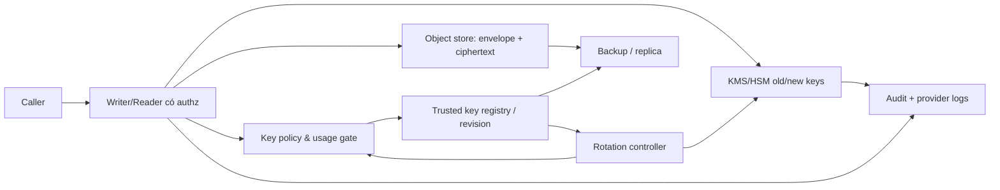
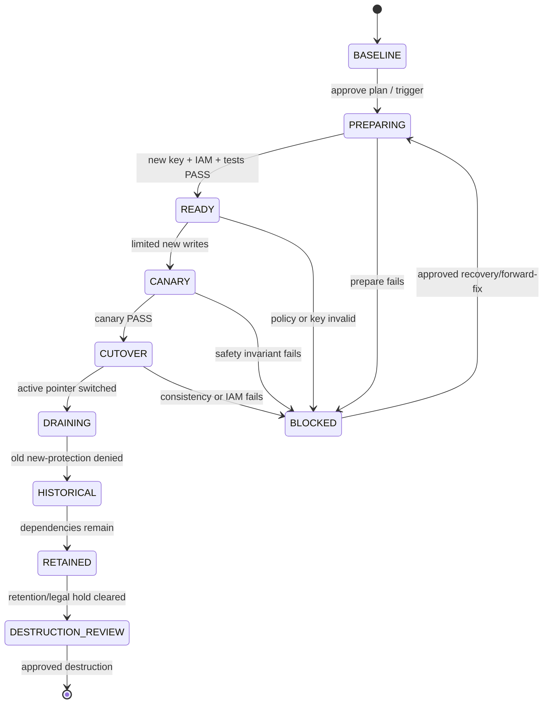
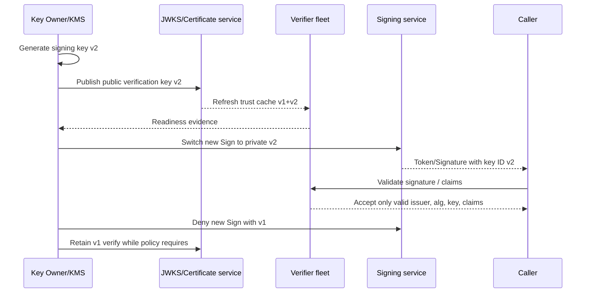
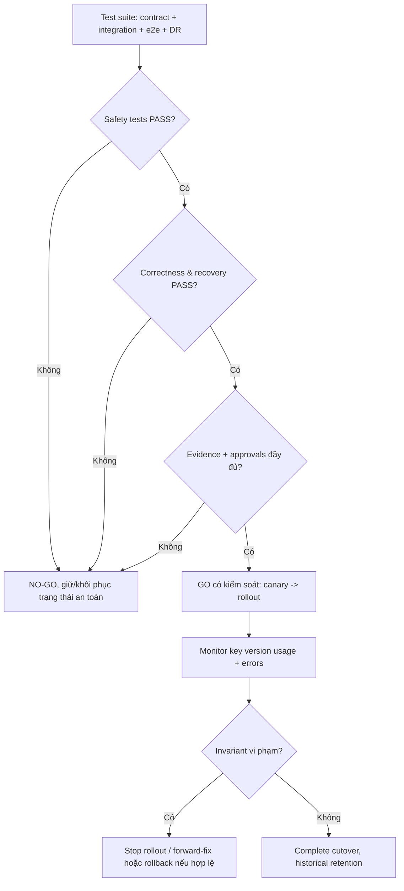

# Kiểm thử rotation trước production — Xác minh xoay vòng khóa mật mã an toàn

Trong chương **Cryptoperiod và rotation** của module **SECURITY_KEY_MANAGEMENT_FUNDAMENTALS**, **kiểm thử rotation trước production** là quá trình kiểm chứng, bằng chứng cứ có thể lặp lại, rằng hệ thống **chuyển các thao tác mật mã mới sang khóa/phiên bản khóa mới** mà không làm mất khả năng đọc dữ liệu lịch sử, không vô tình mở rộng quyền truy cập, không dùng lại nonce, không bỏ qua cryptoperiod và vẫn có phương án xử lý sự cố.

Đây không chỉ là bài test “gọi API RotateKey trả thành công”. Một lần xoay vòng có thể thành công trong **KMS/HSM** nhưng thất bại ở **ứng dụng**, **metadata của ciphertext**, **cache**, **signer/verifier**, **backup**, **region dự phòng** hoặc **kiểm soát truy cập**. Trong khi đó, mã hóa và chữ ký là các chức năng nhạy cảm: một lỗi tương thích có thể làm dịch vụ ngừng hoạt động; một lỗi bảo mật có thể khiến khóa cũ vẫn được dùng tạo dữ liệu mới hoặc ciphertext bị giải mã cho sai tenant.

**Nguyên tắc trung tâm:** kiểm thử rotation phải chứng minh đồng thời **safety** (*không thực hiện thao tác bị cấm, không dùng sai khóa/nonce, không mất integrity*), **liveness/availability** (*hệ thống vẫn thực hiện được các thao tác hợp lệ hoặc fail closed có kiểm soát*), **recoverability** (*dữ liệu và trust lịch sử được khôi phục đúng*) và **auditability** (*có bằng chứng để phê duyệt, điều tra và vận hành*).

Bài tập trung vào **phương pháp kiểm thử trước production**, không thay thế bài về thuật toán sinh khóa hay bài hướng dẫn rotation theo lịch/số lần. Nội dung gắn với **mật mã đối xứng/bất đối xứng, chữ ký số, KMS/HSM, envelope encryption, IAM, kiểm toán** và toàn bộ vòng đời khóa từ tạo, cấp phát, lưu trữ, sử dụng đến thu hồi và hủy.

## 1. Mục tiêu học tập

Sau bài học, bạn có thể:

1. Phân biệt **kiểm thử chức năng rotation**, **kiểm thử an toàn mật mã**, **kiểm thử phân quyền** và **kiểm thử vận hành/khôi phục**.
2. Xây dựng **test plan theo cryptoperiod và vòng đời khóa**, không chỉ test một lệnh rotate.
3. Thiết kế **fixtures** có ciphertext/chữ ký trước và sau rotation, key IDs thật, AAD, tenant, version và backup.
4. Kiểm chứng **old data decrypt / new data encrypt**, **old signature verify / new signature sign**, **HMAC overlap**, **KEK rewrap** và **DEK re-encrypt** đúng ngữ nghĩa.
5. Xác minh **KMS/HSM IAM, key-state semantics, alias/key-version mapping, grants, audit và khả năng không export khóa**.
6. Thử các lỗi **cache stale, concurrency, retry, partial cutover, vùng mất kết nối, nonce reuse, rollback và data/key dependency**.
7. Phân biệt **rollback việc định tuyến traffic** với **quay ngược trạng thái mật mã**; nhận biết khi nào phải **roll forward** thay vì dùng lại khóa cũ.
8. Thiết lập **Go/No-Go criteria**, canary, gate chặn production và bộ bằng chứng kiểm thử.
9. Đọc ví dụ **Java 17** tạo test harness hai lớp AES-GCM minh họa rotate KEK, rewrap DEK, phát hiện tamper và không fallback khi KMS lỗi.
10. Lập checklist nghiệm thu và runbook DR mà không cần đưa raw key vào log hoặc fixture.

## 2. Vì sao rotation dễ vượt qua bài test đơn giản nhưng vẫn nguy hiểm?

Một bài test sơ sài thường chỉ thực hiện:

```text
1. Tạo key-v2.
2. Đổi alias "current" sang key-v2.
3. Encrypt một chuỗi.
4. Decrypt lại thành công.
=> Kết luận "rotation thành công".
```

Kết luận này bỏ sót nhiều tình huống:

- **Key-v1 có thể vẫn đang được worker cũ dùng** do cache hoặc cấu hình chưa cập nhật.
- **Ciphertext lịch sử có thể không giải mã được** do key-v1 bị disable/xóa hoặc mất encryption context.
- **Một region khác có thể chưa nhận policy mới**, vẫn dùng key-v1 để bọc DEK mới.
- **Verifier JWT có thể chưa nhận public key-v2**, khiến token mới bị từ chối.
- **Quyền KMS có thể quá rộng**, cho phép service tenant A decrypt ciphertext tenant B.
- **Backup bất biến có thể phụ thuộc key-v1**, dù dữ liệu hiện hành đã rewrap.
- **Rewrap KEK có thể làm sai data AAD**, dẫn tới GCM tag không khớp.
- **Rotation do usage budget** có thể đổi alias nhưng không chặn gọi `Encrypt` trực tiếp dưới key-v1.
- **Rollback về snapshot cũ** có thể cấp lại nonce đã dùng dưới cùng AES-GCM DEK.

Vì vậy **đơn vị kiểm thử** là một **quy trình chuyển trạng thái toàn hệ thống**, không phải một API call.

### 2.1. Bốn thuộc tính kiểm chứng bắt buộc

| Thuộc tính | Câu hỏi phải trả lời | Bằng chứng điển hình |
| --- | --- | --- |
| **Safety** | Sau cutoff còn new `Encrypt/Sign/Wrap` bằng old key không? Có nonce/key misuse không? | Audit theo actual key ID, test deny và nonce-ledger checks. |
| **Correctness** | Dữ liệu/chữ ký tạo trước và sau rotation còn đọc/xác minh đúng? | Positive/negative test fixtures, AAD/tag, public trust. |
| **Recoverability** | Mất primary hoặc restore backup cũ có tiếp tục phục vụ đúng policy? | Restore drill trong môi trường cách ly, historical key dependencies. |
| **Auditability** | Có thể giải thích ai duyệt, key nào thay key nào và test nào đạt? | Change ID, test run, policy revision, KMS operation IDs, kết quả. |

**Không lấy availability làm lý do bỏ safety:** nếu key đã lộ hoặc vượt hard cryptographic bound, hệ thống có thể phải **fail closed** thay vì tạm dùng lại key đó.

## 3. Phạm vi kiểm thử phải bám vào loại khóa và operation

Bài kiểm thử rotation của **DEK**, **KEK**, **signing key** và **HMAC secret** không thể dùng chung một danh sách kết quả mong đợi.

| Loại khóa | Thao tác mới cần chuyển | Việc lịch sử cần giữ | Kiểm thử quan trọng nhất |
| --- | --- | --- | --- |
| **AES-GCM DEK** | `Encrypt` bằng DEK mới, nonce domain mới. | `Decrypt` ciphertext dùng DEK cũ theo retention. | GCM tag/AAD, key ID đúng, không lặp nonce, không reset usage. |
| **KEK/KMS wrapping key** | `Wrap/GenerateDataKey` dùng KEK mới. | `Unwrap/Decrypt` wrapped DEK cũ. | Rewrap không đổi payload khi thiết kế cho phép; actual KEK ref, IAM. |
| **RSA/ECDSA/Ed25519 private signing key** | `Sign` bằng private key mới. | `Verify` bằng public key/certificate lịch sử. | Publish-before-use, verifier cache, issuer, `kid`/algorithm allowlist. |
| **HMAC secret** | Sender tạo MAC bằng secret mới. | Receiver verify secret cũ trong overlap có hạn. | Anti-replay, MAC format, cửa sổ dual-verify, không chấp nhận key cũ vô hạn. |
| **RSA-OAEP/KEM recipient key** | Encrypt/encapsulate cho public key mới. | Decrypt/decapsulate ciphertext cũ khi policy cho phép. | Recipient public-key trust, key reference, KDF/AEAD context. |
| **Root/CA key** | Ký chứng chỉ/manifest mới theo ceremony. | Trust chain và xác minh lịch sử. | Dual control, HSM ceremony, trust-anchor rollout, certificate status. |

**KMS automatic rotation** có thể thay **cryptographic backing material** dưới một logical key ID mà các ciphertext lịch sử vẫn được provider giải mã. **Ứng dụng tự đổi key ID/alias** là hành vi khác: nếu ciphertext không lưu key version thực hoặc provider không quản lý lịch sử tương ứng, reader có thể không tìm ra khóa cũ. Test plan phải xác định **đúng semantics của provider và loại key**, không giả định mọi `RotateKey`, `ReEncrypt`, `DisableKey` hoặc `DeleteKey` giống nhau.

## 4. Mô hình hệ thống thử nghiệm tham chiếu

Xét dịch vụ Java lưu hóa đơn theo **envelope encryption**:

- **Writer** có quyền tạo hóa đơn, sử dụng **AES-GCM DEK** cho payload.
- **KEK** được quản lý bởi **KMS/HSM**; encrypted/wrapped DEK lưu cùng ciphertext.
- **Reader** phải xác thực tenant/object, unwrap đúng DEK và kiểm tra tag/AAD.
- **Key registry** lưu actual key IDs, version, state, owner, protection cryptoperiod, policy và dependencies.
- **Rotation controller** chuẩn bị key mới, cutover và xác minh old-key quiescence.
- **Audit/monitoring** thu thập kết quả nhưng không chứa raw secret.
- **Backup/DR** giữ ciphertext và khả năng xử lý historical keys theo retention.



**Kết quả “đạt”** phải chứng minh mọi thành phần liên quan thống nhất **old/new actual key ID**, phân quyền và metadata. Một alias thay đổi không chứng minh workload đã chuyển traffic.

### 4.1. Giả thiết về vùng tin cậy

Đặt threat model ít nhất cho:

- Attacker có quyền đọc/sửa object store nhưng không có quyền KMS.
- Attacker có thể gửi metadata/envelope sai cho API.
- Một workload bị chiếm có quyền KMS trong scope hẹp.
- Một region bị cô lập khỏi key registry hoặc KMS.
- Một operator có thể cấu hình sai IAM/grant hoặc nhập sai key ID.
- Một snapshot chứa key state/nonce ledger cũ.

**Không dùng test environment có quyền export/raw KEK rộng hơn production rồi suy ra production cũng an toàn.** Tương tự, staging nhiều khi ít traffic; cần các kiểm thử concurrency/load riêng để phát hiện lỗi chỉ xuất hiện ở scale lớn.

## 5. Chuẩn bị môi trường và bằng chứng trước khi chạy

### 5.1. Test environment nên giống production ở điểm nào?

Không cần sao chép toàn bộ dữ liệu thật, nhưng phải **tương đương về các cơ chế bảo mật ảnh hưởng tới rotation**:

| Thuộc tính | Yêu cầu cho staging/preprod |
| --- | --- |
| **KMS/HSM capability** | Cùng loại key, algorithm, API, key-state semantics quan trọng, hoặc có hồ sơ khác biệt. |
| **Key policy/IAM** | Cùng mô hình principals, grants, denies, tenant/resource scope; test cả quyền trực tiếp lẫn gateway. |
| **Envelope format** | Cùng schema, canonical AAD, key version refs, nonce/tag format, serialization. |
| **Writer/reader logic** | Cùng đường mã hóa/giải mã thực tế; không chỉ mock controller. |
| **Versioning/caches** | Cùng cơ chế cache TTL, rollout, signer/JWKS refresh, service discovery. |
| **Replication** | Đủ số region/zone hoặc mô phỏng partition/reconciliation đúng. |
| **Audit** | Có correlation IDs, key IDs, policy revisions, provider result, deny events. |
| **DR** | Có backup snapshot và thử restore tách biệt; không phụ thuộc primary online. |

Không được kết luận **HSM hardware behavior** hoặc IAM semantics dựa hoàn toàn trên một mock. Ngược lại, không cần gọi KMS thật cho mọi test unit: chia đúng **test pyramid** để vừa nhanh vừa có kiểm chứng tích hợp.

### 5.2. Test fixtures không được chứa secret production

Tạo riêng:

- DEK/KEK **test-only** sinh bằng CSPRNG hoặc KMS test tenant.
- Dữ liệu giả nhưng có cấu trúc/độ dài tương ứng (UTF-8, binary, file lớn, nhiều tenant).
- Ciphertext và wrapped DEK có **actual key refs** và **AAD** đáng tin.
- Chữ ký test (JWT hoặc manifest) được tạo bởi private key thử nghiệm.
- Backup snapshot có metadata rõ, không lẫn thật/giả.
- Test identities với roles hạn chế và các cases **deny**.

**Không copy private key, KEK, HMAC secret hoặc dữ liệu khách hàng thật vào fixtures để “giống production”**. Nếu bắt buộc dùng dữ liệu nhạy cảm vì mục đích kiểm định được phê duyệt, phải có cách bảo vệ/phê duyệt riêng; mục tiêu bài này là test bằng material và dữ liệu phi sản xuất.

### 5.3. Những định danh cần đóng băng trong test run

Một run cần ghi:

```text
testRunId
changeId / rotationJobId
policyVersion
sourceActualKeyId / sourceMaterialVersion
targetActualKeyId / targetMaterialVersion
tenantId + objectId + contentVersion
envelopeSchemaVersion
algorithm/profile
KMS provider + region + key-state semantics
writer/reader build versions
registry revision / rollout epoch
backup snapshot ID
expected trust/JWKS version (nếu có)
```

Các IDs là **metadata quản trị**, không phải quyền. Test phải đối chiếu với **nguồn thật đáng tin**, không chỉ tin JSON envelope gửi lên.

## 6. Chia tầng kiểm thử để định vị lỗi

### 6.1. Unit tests

Kiểm tra logic thuần:

- Trigger rotation theo time/count/bytes/nonce và **điều kiện đến sớm nhất**.
- Soft threshold, hard stop, off-by-one.
- Phân quyền new protection so với historical-use.
- Key reference và policy version validation.
- Trạng thái controller hợp lệ, idempotency và retry.
- Chặn downgrade/invalid schema khi deserialize metadata.

Unit test nhanh và chính xác nhưng **không chứng minh** provider IAM hay HSM thật hoạt động đúng.

### 6.2. Cryptographic contract tests

Kiểm chứng:

- Round-trip AES-GCM với nonce, tag và AAD đúng.
- Wrong key, tampered ciphertext, wrong AAD/tag đều fail closed.
- Wrapped DEK dưới KEK cũ/mới và đúng key ID.
- Rewrap không đổi data ciphertext/tag nếu schema cho phép.
- Data re-encryption bằng DEK mới tạo ciphertext/nonce/key ID tương ứng.
- Chữ ký và MAC bị sửa/đúng algorithm/đúng context.

**Không tự tạo primitive hoặc bỏ kiểm tra tag để phục vụ test.** Dùng thư viện/provider đã được chọn; có thể dùng test harness độc lập để xác nhận contract.

### 6.3. Integration tests

Chạy với KMS/HSM hoặc môi trường tương đương:

- Create, activate, wrap, unwrap, sign, verify, re-encrypt theo API thực tế.
- IAM/grants/key policy từ chối đúng operations.
- Deactivated/disabled behavior và recovery semantics.
- Tham chiếu actual key ID, alias, encrypted-DEK format, context.
- Lỗi quota, throttle, timeout, key not found, permission denied.

### 6.4. End-to-end/chaos/DR tests

Kiểm tra toàn bộ:

- Writer v1 → reader v1/v2 → writer v2 → reader v2.
- Cache không đồng bộ hoặc old writer còn sống.
- Traffic canary, partial rollout, rollback policy, drain.
- Multi-region replication lag, failover, split brain.
- Backup restore không cần primary online.
- Alert/audit và Go/No-Go gate.

Các test này có thể chậm/tốn tài nguyên hơn, nhưng cần cho **bằng chứng vận hành**, không thể thay bằng một JUnit test mock.

## 7. Bản đồ trạng thái để viết test cases

Rotation không chỉ có “old” và “new”. Một state machine hữu ích:



**Trạng thái trên là workflow ở tầng ứng dụng**, không phải tên state mặc định của mọi KMS. Test plan phải so sánh state ở **controller**, **key registry**, **KMS/HSM** và **effective permissions**.

### 7.1. Invariant cần chứng minh ở mỗi giai đoạn

| Giai đoạn | Invariant tối thiểu |
| --- | --- |
| **BASELINE** | Old key hoạt động đúng mục đích, dữ liệu/chữ ký mẫu có thể xác minh. |
| **PREPARING** | New key chỉ trong miền chuẩn bị, chưa được dùng ngoài policy; algorithm/provenance/grants đúng. |
| **READY** | New key đủ điều kiện tạo bảo vệ; old key/dữ liệu lịch sử chưa bị mất. |
| **CANARY** | Một phần nhỏ writes dùng new key; cả readers hiện hành giải mã/xác minh đúng. |
| **CUTOVER** | Tất cả new operations trỏ đúng key version mới tại enforcement point. |
| **DRAINING** | In-flight reservations xử lý theo policy; không phát sinh new use old key bị cấm. |
| **HISTORICAL** | Old key không tạo bảo vệ mới; historical decrypt/verify/unwrap vẫn theo quyền. |
| **RETAINED** | Backup, offline consumers, legal hold và dependencies đã được kiểm kê. |
| **DESTRUCTION_REVIEW** | Có thể chứng minh không còn phụ thuộc cần old key, được phê duyệt và có evidence. |

**Quan trọng:** không được chạy test phá hủy khóa thật chỉ để đo completeness của test plan. Dùng **keys test-only** và kiểm tra riêng các điều kiện pre-destruction ở môi trường production.

## 8. Ma trận smoke tests: trước, trong và sau rotation

| ID | Giai đoạn | Test | Kết quả kỳ vọng |
| --- | --- | --- | --- |
| R01 | Baseline | Encrypt bằng old DEK, decrypt đúng AAD. | PASS; xác minh tag. |
| R02 | Baseline | Wrap/unwrap DEK bằng old KEK. | PASS; metadata/key ref đúng. |
| R03 | Prepare | Tạo new KEK với đúng algorithm/purpose. | Key ở trạng thái chưa phục vụ ngoài ý muốn. |
| R04 | Prepare | Principal không có `Decrypt` thử unwrap. | DENY; audit đầy đủ. |
| R05 | Prepare | Caller tenant A thử dùng key tenant B. | DENY; không dựa trên key ID client tự khai. |
| R06 | Ready | New writer tạo ciphertext dùng new key. | PASS; actual key ID mới được ghi. |
| R07 | Canary | Reader mới đọc ciphertext old/new. | PASS cả hai, đúng AAD và data version. |
| R08 | Canary | Reader cũ đọc record dùng new key. | PASS nếu compatibility plan yêu cầu; nếu chưa, **không phát traffic mới**. |
| R09 | Cutover | Thay active pointer theo registry revision. | Chỉ một version được activate cho writer scope. |
| R10 | Cutover | Old writer stale cache cố new `Encrypt/Wrap`. | DENY hoặc bị fence tại policy boundary. |
| R11 | Drain | In-flight operation trước cutoff. | Xử lý theo policy đã xác định, không vượt hard bound. |
| R12 | Historical | Decrypt/unwrap old ciphertext sau cutoff. | PASS theo quyền/retention. |
| R13 | Historical | New `Encrypt/Sign/Wrap` với old key. | DENY theo policy. |
| R14 | Historical | Revoked/compromised old key. | Tuân thủ incident policy, không mặc định cho historical use. |
| R15 | Recovery | KMS mới outage, app cố fallback old forbidden key. | FAIL CLOSED; không ghi plaintext. |
| R16 | Backup | Restore snapshot có old wrapped DEK. | PASS nếu key dependency còn hợp lệ. |
| R17 | Audit | Đối chiếu new/old key operation counts. | Không còn new old-key use sau cutoff. |
| R18 | Gate | Kiểm tra evidence và approvals. | GO chỉ khi tất cả safety criteria PASS. |

Các test **DENY** cũng là kết quả thành công nếu thao tác bị cấm thực sự bị chặn. Trong báo cáo nên phân biệt **“expected denial observed”** với “test failure”.

## 9. Kiểm thử DEK rotation: ciphertext và nonce

### 9.1. Trước rotation

Tạo các fixtures:

```text
record-old-1:
  tenant = tenant-a
  object = invoice-101
  DEK = dek-v1
  dataAlgorithm = AES-GCM
  nonce = được cấp hợp lệ
  ciphertext + tag = fixture

record-old-2:
  tenant = tenant-b
  object = invoice-202
  DEK = dek-v1 hoặc DEK khác theo key scope
  context riêng
```

Không nên lấy **raw key** đưa vào fixture file; giữ key test trong keystore/KMS test hoặc tạo ở runtime. Cần lưu record metadata đủ để reader chọn đúng version theo policy.

### 9.2. Sau rotation

Sinh **DEK mới** từ CSPRNG/KMS có capability phù hợp; kiểm tra:

- Mọi **new Encrypt** dùng actual DEK ID/version mới.
- Nonce dưới DEK mới tuân thủ policy; **old DEK không được reset counter để dùng lại**.
- Data nonce/tag/AAD có schema phù hợp.
- Historical records dùng old DEK vẫn decrypt đúng khi có quyền.
- Wrong-key decrypt phải fail authentication, không fallback thử key tùy ý.
- Record bị sửa tenant/object/version phải bị chặn bởi AAD/trusted registry.
- Không log raw DEK hoặc plaintext trong test output.

### 9.3. Trường hợp chỉ đổi KEK

Nếu rotate **KEK** chứ không rotate DEK:

```text
BEFORE:
  dataCiphertext = AEAD_Encrypt(DEK-1, payload)
  wrappedDEK-old = Wrap(KEK-v1, DEK-1)

AFTER REWRAP:
  dataCiphertext = GIỮ NGUYÊN (nếu schema cho phép)
  wrappedDEK-new = Wrap(KEK-v2, DEK-1)
```

Test phải xác minh **payload ciphertext/nonce/tag không thay đổi** nếu mục tiêu chỉ là rewrap, đồng thời new wrapped DEK mở được dưới KEK-v2 và old wrapped DEK không bị thay đổi trái phép.

**Rewrap không đặt lại usage budget của DEK** và không sửa được rủi ro khi DEK đã bị lộ hoặc dùng trùng nonce. Nếu DEK không còn đạt an toàn, cần **re-encrypt payload bằng DEK mới**; đây là test case khác.

## 10. Kiểm thử KEK rotation và envelope encryption

### 10.1. Các lớp cần kiểm tra

Một envelope có hai miền xác thực:

```text
Payload layer:
  dataCiphertext, dataNonce, dataTag
  dataAAD = canonical(tenantId, objectId, contentVersion, dataKeyId)

DEK protection layer:
  wrappedDEK, wrappingAlgorithm, actualKekRef, wrapRevision
  wrapAAD = canonical(tenantId, objectId, dataKeyId,
                      actualKekRef, wrapRevision)
```

Các trường trong ví dụ là **mẫu thiết kế**, không phải schema KMS chuẩn.

Khi rewrap, **actualKekRef/wrapRevision đổi**, nhưng nếu data AAD không chứa các trường thay đổi do KEK rotation, payload tag có thể giữ nguyên. Test phải kiểm tra **cả integrity của wrapped DEK và integrity của payload**.

### 10.2. Test matrix dành riêng cho rewrap

| ID | Điều kiện | Kỳ vọng |
| --- | --- | --- |
| E01 | `Unwrap` DEK cũ bằng old KEK với context đúng. | Thành công theo quyền. |
| E02 | `Wrap` cùng DEK bằng new KEK với wrap context mới. | Wrapped key mới hợp lệ. |
| E03 | Payload bytes/nonce/tag trước và sau rewrap. | **Bằng nhau** nếu data encryption không đổi. |
| E04 | Reader dùng new KEK unwrap DEK đã rewrap. | Thành công, payload tag PASS. |
| E05 | Reader dùng wrong KEK hoặc wrong encryption context. | Từ chối; không chạy fallback không được duyệt. |
| E06 | Sửa `wrappedDEK`, `actualKekRef` hoặc tenant ID. | Integrity/policy check FAIL. |
| E07 | Data ciphertext bị sửa trước rewrap. | Rewrap có thể thành công, nhưng **end-to-end decrypt phải phát hiện sai tag**. |
| E08 | Rewrap thành công một phần, registry chưa update. | Không publish record thiếu consistency; có reconciliation. |
| E09 | Backup vẫn chứa wrapped DEK dưới old KEK. | Có thể restore theo policy, hoặc backlog migration được ghi nhận. |
| E10 | Old KEK đã hết new wrap period. | Không cho new wraps, historical unwrap theo provider semantics. |

### 10.3. Không nhầm KMS-managed automatic rotation với manual rewrap

Một provider có thể quản lý **key-material versions** bên trong một logical key; ciphertext lịch sử được giải mã bởi cùng logical reference. Một provider khác hoặc kiểu key khác có thể yêu cầu **migrate encrypted DEK**. Trước khi viết assertion, cần xác minh:

- API nào thật sự rotate vật liệu khóa?
- Ciphertext blob có chứa version metadata hay cần gửi key ID?
- Alias/ARN/key resource có đổi không?
- IAM/key policy và key state nào được áp dụng cho old material?
- Có hỗ trợ `ReEncrypt` giữa đúng các keys/regions/accounts không?
- Encryption context/AAD có được giữ/buộc giống nhau không?
- Provider có cache và eventual consistency trong rollout không?

Không gán cứng cách hành xử của một nhà cung cấp cho tất cả KMS/HSM.

## 11. Kiểm thử cryptoperiod, key state và authorization

### 11.1. New protection khác historical processing

Một chính sách điển hình:

| Key lifecycle state | New `Encrypt/Wrap/Sign` | Historical `Decrypt/Unwrap/Verify` |
| --- | --- | --- |
| **PRE-ACTIVE** | Deny ngoài preparation workflow. | Tùy migration có phê duyệt. |
| **ACTIVE** | Allow nếu IAM, purpose, limits PASS. | Allow theo quyền. |
| **DEACTIVATED logic** | **Deny** new protection. | Có thể allow theo retention, threat model. |
| **COMPROMISED** | **Deny**; incident workflow. | Không mặc định; cần đánh giá lại trust và quyền. |
| **DESTROYED** | Không thể dùng material đã hủy. | Không thể decrypt/unwrap bằng material đã hủy; public verify data có thể tồn tại riêng. |

**Đây là logic nghiệp vụ**, không phải bảng API mặc định. `DisableKey` của KMS có thể chặn cả decrypt lẫn encrypt. Khi test, phải **gọi đúng API thực tế** và ghi nhận sự khác biệt.

### 11.2. Negative tests về IAM

Kiểm chứng các đường gọi sau bị từ chối:

1. Reader có `Decrypt` đúng object nhưng tự chọn key của tenant khác.
2. Writer được `Encrypt` nhưng cố `DisableKey` hoặc sửa key policy.
3. Migration role chỉ có `ReEncrypt/Wrap` đúng scope nhưng cố `ExportKey`.
4. Old writer còn token/grant stale sau cutover.
5. User có quyền truy cập object store nhưng không có quyền KMS unwrap.
6. Service có KMS `Decrypt` nhưng không có **business authorization** trên object.
7. Principal bị revoke nhưng DEK cache vẫn cho dùng vô thời hạn.
8. Key admin có quyền quản trị nhưng không được đọc plaintext.
9. Rotation controller cố thay key trong region/tenant ngoài allowlist.
10. Public-only verifier cố gọi private signing operation.

**Test IAM không chỉ kiểm tra registry policy JSON.** Phải thực thi thử API bằng principal thật của test environment, đồng thời kiểm tra có **đường direct KMS/HSM bypass** crypto gateway hay không.

### 11.3. SoD và phê duyệt

Nếu yêu cầu **separation of duties** hoặc **dual control**:

- Người tạo key không tự phê duyệt destruction.
- Approver Security và Compliance phải có identities độc lập theo policy.
- Controller không tự tạo approval token cho chính request của mình.
- Emergency break-glass có TTL, audit, alert, scope hẹp và hậu kiểm.
- Key destruction/deactivation phải bị ngăn khi dependencies chưa xử lý.

**Hai role names khác nhau do cùng một operator tự khai không chứng minh dual control.** Test cần dựa trên identity/approval service tin cậy.

## 12. Kiểm thử rotation cho chữ ký số, JWT và public trust

Rotation signing key dễ lỗi vì **người ký** và **người xác minh** có thể ở nhiều service/region/cache khác nhau.

### 12.1. Quy trình publish-before-use



Kiểm thử:

- Verifier nhìn thấy **public key mới trước khi signer dùng private key mới**.
- New token có `kid`/issuer/algorithm đúng; `kid` là chỉ báo chọn key, không tự tạo trust.
- Old token còn hiệu lực được verify theo token TTL/trust policy.
- Invalid issuer, wrong audience, expired token, unsupported algorithm đều bị từ chối.
- Public key bị tráo từ untrusted URL/client-supplied header bị từ chối.
- JWKS cache stale có hành vi rõ: trì hoãn cutover, chờ refresh hoặc fail closed theo kế hoạch.
- Sau cutoff, private key cũ không tạo **new Sign**; public verification material có thể vẫn được giữ.
- Nếu private key cũ **compromised**, chiến lược trust/revocation được kích hoạt, không mặc định tiếp tục verify mọi chữ ký lịch sử.

### 12.2. Chứng chỉ và timestamp

Với PKI/document signing, cần xét:

- Certificate chain, key usage/extended key usage và issuer trust.
- Certificate validity tại thời điểm sử dụng.
- CRL/OCSP hoặc cơ chế kiểm tra trạng thái phù hợp với hệ thống.
- Trusted timestamp/archival validation nếu yêu cầu xác minh tài liệu dài hạn.
- Chính sách thay private signing key, certificate renewal và key destruction.

**Không đồng nhất “ký hợp lệ về mặt toán học” với “tài liệu được chấp nhận theo trust policy”**. Kiểm thử phải đo cả hai lớp.

## 13. Kiểm thử HMAC rotation và shared secret overlap

HMAC không có public verification key. Sender và receiver đều có thể biết secret, nên phối hợp rotation cần chặt hơn.

```text
Trước:
  Sender -> HMAC key-v1
  Receiver -> verify key-v1

Giai đoạn overlap:
  Sender -> new MAC với key-v2
  Receiver -> verify key-v2; key-v1 chỉ theo window

Sau cutoff:
  Sender -> key-v2
  Receiver -> không còn chấp nhận key-v1 (trừ ngoại lệ được duyệt)
```

### 13.1. Test cases bắt buộc

| Tình huống | Kỳ vọng |
| --- | --- |
| MAC v2 đúng trong khi receiver đang overlap. | PASS. |
| MAC v1 đúng nhưng vẫn trong overlap hợp lệ. | PASS nếu policy cho phép. |
| MAC v1 đúng sau thời điểm trust cutoff. | DENY. |
| MAC bị sửa 1 byte. | DENY. |
| Cùng request ID/timestamp replay. | DENY theo replay tracking, dù MAC hợp lệ. |
| Caller chọn key ID của partner khác. | DENY, không truy secret tenant khác. |
| Receiver có hai keys nhưng thử tất cả keys không giới hạn. | Test phát hiện thiết kế dễ bị abuse/oracle. |
| Secret đã compromise nhưng overlap chưa hết. | Emergency revocation test và alert. |

**Rate-limit `MAC_VERIFY`**, giới hạn tag length và chuẩn hóa MAC input có ý nghĩa khác với cutover key. Một secret cũ còn trong cache có thể tiếp tục tạo MAC hợp lệ nếu receiver vẫn tin cậy; cần kiểm thử cache invalidation.

## 14. Kiểm thử concurrency, cache và thao tác đang chạy

### 14.1. Race giữa active-key pointer và worker

```text
T0: Worker A đọc activeKey = v1.
T1: Controller chuyển registry activeKey = v2.
T2: Worker A vẫn encrypt dưới v1.
T3: Audit chỉ kiểm tra alias current và không thấy lỗi.
```

Test phải xác minh **actual key ID được sử dụng**. Hai cách quản trị:

- **Graceful draining:** chỉ cho phép những reservations hợp lệ trước cutoff hoàn thành trong giới hạn đã duyệt.
- **Strict fencing:** khi epoch/key state thay đổi, backend chặn thực thi bằng old key, kể cả một số reservation đã cấp.

Cần xác định **cutoff** theo sự kiện nào: registry commit, policy enforcement, gate epoch hay deadline. Nếu key compromise hoặc hard cryptographic limit, **không cho phép “grace period” vượt ràng buộc bắt buộc**.

### 14.2. Những phép thử concurrency cụ thể

1. Nhiều threads/processes đồng thời xin reservation cuối của old key.
2. Rotation controller và writer đồng thời cập nhật active key pointer.
3. Hai controllers cùng nhận soft threshold → chỉ một rotation job có hiệu lực.
4. Cùng request retry sau timeout → idempotency không double-spend nonce/budget.
5. Worker bị kill giữa encrypt và publish ciphertext.
6. Cache key ID/DEK còn sống sau policy revoke.
7. Reader có cache version cũ nhưng nhận ciphertext dùng key mới.
8. Server clock drift gần cryptoperiod cutoff.
9. Key state thay đổi sau khi IAM check nhưng trước crypto execution (**TOCTOU**).
10. Batch job giữ raw DEK quá lâu hoặc không hủy tham chiếu sau khi hoàn tất.

**Không chỉ kiểm tra counter application logs**; cần có enforcement evidence từ provider/crypto service và durable ledger.

### 14.3. AES-GCM nonce uniqueness

Rotation và failover không được gây:

```text
Writer A: DEK-v1, nonce 00000001
Writer B: DEK-v1, nonce 00000001   <-- vi phạm uniqueness
```

Test nonce allocator bằng:

- State snapshot/restart/restore.
- Multiple writers cùng material.
- Partition và leader failover.
- Byte/nonce range exhaustion.
- Retry sau timeout.
- Key alias đổi v1→v2 nhưng material chưa đổi.
- DEK mới có identity mới và nonce domain riêng.

**Không thực hiện test cố tình reuse nonce trên data production**. Dùng allocator mocks, test key/material và môi trường cách ly để chứng minh uniqueness invariant.

## 15. Kiểm thử count/volume-based rotation và cryptoperiod

Bài kiểm thử rotation phải bao gồm trường hợp **mốc đến sớm nhất** giữa:

- Protection cutoff theo thời gian.
- Tổng `Encrypt/Sign/Wrap` invocations.
- Data bytes/blocks.
- Nonce issuance budget.
- Compromise hoặc policy event.
- Provider-specific constraints.

Ví dụ các ngưỡng **minh họa**:

```text
softCalls = 850
hardCalls = 1000
softBytes = 8 GiB
hardBytes = 10 GiB
protectionUntil = policy deadline

Expected:
  At 849 calls   -> no mandatory soft trigger.
  At 850 calls   -> one rotation preparation event.
  At 1000 calls  -> cannot reserve call 1001.
  At 9 GiB       -> bytes soft already triggered.
  At deadline    -> no new protection even if calls remain.
```

**Các số ở ví dụ không phải giới hạn an toàn mặc định của AES-GCM hoặc KMS.** Con số thật cần từ scheme analysis, tag/nonce configuration, data sizes, security review và chính sách.

### 15.1. Cần test off-by-one và atomicity

| Test | Kết quả |
| --- | --- |
| Còn đúng 1 call. Hai writers reserve đồng thời. | Tối đa 1 reservation hợp lệ. |
| Một message vượt byte limit dù call còn. | Reject trước crypto. |
| Đúng hard count nhưng key vẫn ACTIVE theo thời gian. | Reject call tiếp theo. |
| Sau cutover, alias mới nhưng request chỉ định actual key ID cũ. | Reject new protection. |
| KMS request quota còn nhưng DEK cached đã hết usage. | Reject tại crypto gate. |
| Retry sau timeout có thể đã dùng nonce. | Không refund/tái cấp thiếu chứng cứ. |
| Restore snapshot counter thấp hơn actual ledger. | Detect rollback, không new Encrypt dưới old key. |

**Dùng metric counter bất đồng bộ để phát cảnh báo**, không để nó trở thành **nguồn kiểm soát hard bound** nếu không atomic.

## 16. KMS/HSM: kiểm thử khả năng thật, không dựa trên tên API

Mỗi nhà cung cấp có semantics riêng về:

- Key type, algorithm và import/export/non-exportable.
- Automatic key material rotation và lịch sử decrypt.
- Alias propagation, replica state, key versions và quotas.
- `DisableKey`, `ScheduleDeletion`, cancellation và thời gian chờ.
- `Encrypt`/`Decrypt`, `GenerateDataKey`, `ReEncrypt`, `Sign`.
- Grants và encryption context.
- KMS event logging/retention.

### 16.1. Bảng provider contract

| Hành vi | Cách kiểm chứng |
| --- | --- |
| New key có đúng purpose/algorithm? | Gọi describe/inspect thuộc tính, thử operation hợp lệ/bị cấm. |
| KEK non-exportable có thật không? | Test API permissions/capabilities; không thử trích xuất trái phép. |
| Old ciphertext còn decrypt được sau provider automatic rotation? | Lưu ciphertext fixture rồi decrypt sau rotation test-only. |
| `DisableKey` chặn operation nào? | Dùng test key và thử `Encrypt`/`Decrypt`/`Wrap`/`Unwrap`. |
| Alias đổi có lập tức thấy ở mọi client/region? | Kiểm tra propagation/cache và actual key IDs. |
| Encryption context phải đúng khi unwrap? | Test context chính xác/sai; xem provider error behavior. |
| Cross-region rewrap có được API hỗ trợ? | Dựa trên provider contract và integration test phạm vi đúng. |
| KMS outage/quota có fail closed không? | Fault injection, retry/backoff, audit. |
| Key deletion có bước chờ/phê duyệt? | Dry-run/precheck; không xóa keys đang bảo vệ dữ liệu thật. |
| Audit provider có ghi metadata nào? | Kiểm tra tránh lộ plaintext/key/encryption context nhạy cảm. |

**Quan trọng:** key rotation trong ứng dụng phải kiểm thử **IAM và quyền nghiệp vụ** đồng thời. KMS `Decrypt` thành công không chứng minh caller có quyền đọc object được mã hóa.

## 17. Multi-region, disaster recovery và failure injection

### 17.1. Active-passive

Với region B dự phòng:

- Data/metadata/key refs có mặt ở B đúng RPO.
- KEK/DEK hoặc capability unwrap sẵn sàng đúng DR plan.
- B có grants/trust và policy phù hợp.
- Khi A mất, B có thể giải mã dữ liệu lịch sử và tạo ciphertext mới bằng **key hợp lệ**.
- Không reset nonce counter hoặc usage ledger của cùng key material.
- Việc quay về A không tạo **split-brain active writers** dùng chung nonce range.

### 17.2. Active-active

Với A và B cùng làm writer:

- Có **global key usage budget** hoặc budget partitions không chồng lấn khi dùng cùng material.
- Nonce uniqueness được đảm bảo toàn vùng.
- Registry/cutover epoch có nguyên tắc consistency và fencing.
- Policy/IAM changes có propagation budget rõ.
- Không region nào tiếp tục new `Encrypt/Sign/Wrap` bằng revoked key sau cutoff bắt buộc.

### 17.3. Fault matrix

| Fault injection | Kết quả cần chứng minh |
| --- | --- |
| KMS old key unavailable trong historical read. | Reader báo lỗi an toàn/DR, không trả plaintext giả. |
| KMS new key outage trước cutover. | Controller không chuyển traffic thiếu an toàn. |
| KMS new key outage sau cutover. | Fail closed/forward-fix, không tự fallback old key bị cấm. |
| Replica region B thiếu một key version. | Detector và readiness gate chặn failover không đáp ứng RTO/RPO. |
| Registry stale trong một region. | New writes không dùng key bị thu hồi ngoài policy. |
| Network partition controller–KMS. | Không commit “rotation completed” thiếu bằng chứng. |
| Audit pipeline chậm. | Safety vẫn được thực thi; ghi buffer/hành vi phù hợp audit policy. |
| Crash giữa rewrap và ghi object. | Không publish envelope nửa cũ/nửa mới; reconcile idempotently. |
| Restore snapshot cũ. | Anti-rollback không cấp lại key/nonce usage đã tiêu thụ. |
| Hai controllers cùng rotate. | Một cutover revision hợp lệ, orphan keys được kiểm kê. |

### 17.4. RPO/RTO phải bao gồm khóa

**RPO (Recovery Point Objective)** cần xét dữ liệu, wrapped DEK, key registry, trust manifest, IAM/grants và nonce/usage ledger. **RTO (Recovery Time Objective)** cần tính cả thời gian phục hồi KMS/HSM, approvals/quorum, rewrap hoặc load trusted metadata.

**Một object đã backup nhưng không có KEK để unwrap không phải bản backup phục hồi thành công.**

## 18. Rollback rotation: khi nào an toàn và khi nào phải roll forward?

Từ “rollback” có ít nhất ba nghĩa:

1. **Rollback deployment:** đưa code app về build cũ.
2. **Rollback routing/cutover:** chuyển new operations từ key mới về key cũ.
3. **Rollback cryptographic/data state:** dùng lại key material, nonce/counter, trust hoặc ciphertext version cũ.

Ba hành vi không tương đương.

### 18.1. Có thể rollback traffic về key cũ khi nào?

Chỉ cân nhắc khi **tất cả** điều kiện sau thỏa:

- Old key chưa bị compromised/revoked.
- Chưa vượt hard cryptographic usage/nonce/cryptoperiod bounds.
- IAM/key policy cho phép new protection theo quy trình đã phê duyệt.
- Old writer/reader có khả năng đọc các records đã tạo bằng key mới.
- Không bị mất/trộn nonce or usage state sau chuyển.
- Thay đổi có audit và phê duyệt rõ.

**Không dùng rollback traffic để né hard limit.** Nếu old key không còn hợp lệ, phải **roll forward sang key version khác** hoặc ngừng new operations có kiểm soát.

### 18.2. Data đã mã hóa bởi key mới không tự biến thành dữ liệu cũ

Giả sử v2 đã tạo 1.000 records. Dù writer quay về v1, readers vẫn cần mở **cả v1 và v2** cho dữ liệu phù hợp. Do đó rollback deployment hoặc active pointer **không được xóa v2/key metadata**.

Với signing keys, token đã ký bằng v2 vẫn cần public verification key v2 theo trust policy; bỏ v2 khỏi JWKS ngay có thể làm các token vừa phát hành không thể verify.

### 18.3. Khi nào chỉ nên roll forward?

- Key cũ bị compromised.
- Old usage/nonce state không xác định sau DR.
- Hard cryptographic limit đã hết.
- Old KEK đã bị destroy hoặc không thể restore đúng.
- Data schema mới không tương thích an toàn với old writer.
- Signatures/ciphertexts đã được tạo với key mới và không thể đảo ngược mà không làm gián đoạn trust/data.

Một test plan tốt phải chứng minh **đường forward recovery** thay vì chỉ thử “đặt alias trở lại v1”.

## 19. Test harness Java 17: kiểm chứng rotate KEK và rewrap DEK

Ví dụ sau chạy độc lập trên **Java 17**, mô phỏng hai KEK (v1/v2) được giữ **trong bộ nhớ chương trình thử nghiệm** và **AES-256-GCM** cho hai lớp:

- Data ciphertext được mã hóa bởi **DEK riêng**.
- DEK được bọc dưới KEK-v1 hoặc KEK-v2 bằng AES-GCM và AAD phù hợp.
- `PREPARED` → `ACTIVE` → `HISTORICAL_ONLY` mô phỏng policy.
- **New write sau cutover** phải dùng v2.
- **Old data vẫn đọc được**, kể cả sau khi v1 không được dùng new wrap.
- **Rewrap** giữ nguyên data ciphertext/tag/nonce.
- Sửa ciphertext, tráo expected identity và thử new wrap bằng old key phải bị từ chối.
- KMS giả lập outage để xác minh **không fallback old key ngoài policy**.

**Cảnh báo:** đây là test harness dạy hợp đồng hành vi. Raw KEK nằm trong JVM **chỉ để minh họa**, không phải kiến trúc production. Test này **không chứng minh quyền IAM/khả năng HSM/non-exportability**; phải chạy integration tests riêng với provider được chọn.

```java
import java.io.ByteArrayOutputStream;
import java.io.DataOutputStream;
import java.nio.charset.StandardCharsets;
import java.security.GeneralSecurityException;
import java.security.SecureRandom;
import java.util.Arrays;
import java.util.HashMap;
import java.util.Map;
import java.util.Objects;
import javax.crypto.AEADBadTagException;
import javax.crypto.Cipher;
import javax.crypto.KeyGenerator;
import javax.crypto.SecretKey;
import javax.crypto.spec.GCMParameterSpec;
import javax.crypto.spec.SecretKeySpec;

public final class PreproductionRotationContractDemo {
    private static final SecureRandom RNG = new SecureRandom();
    private static final int NONCE_BYTES = 12;
    private static final int TAG_BITS = 128;

    enum KeyMode {
        PREPARED, ACTIVE, HISTORICAL_ONLY, DISABLED
    }

    record Blob(byte[] nonce, byte[] ciphertextAndTag) {
        Blob {
            nonce = Objects.requireNonNull(nonce).clone();
            ciphertextAndTag =
                    Objects.requireNonNull(ciphertextAndTag).clone();
            if (nonce.length != NONCE_BYTES
                    || ciphertextAndTag.length < 16) {
                throw new IllegalArgumentException("Invalid GCM blob");
            }
        }
        @Override public byte[] nonce() { return nonce.clone(); }
        @Override public byte[] ciphertextAndTag() {
            return ciphertextAndTag.clone();
        }
    }

    record Envelope(
            String tenant,
            String objectId,
            long contentVersion,
            String kekRef,
            Blob data,
            Blob wrappedDek) {}

    static SecretKey newAesKey() throws Exception {
        KeyGenerator generator = KeyGenerator.getInstance("AES");
        generator.init(256, RNG);
        return generator.generateKey();
    }

    static byte[] aad(String domain, String... fields) throws Exception {
        ByteArrayOutputStream buffer = new ByteArrayOutputStream();
        try (DataOutputStream out = new DataOutputStream(buffer)) {
            put(out, domain);
            for (String field : fields) {
                put(out, field);
            }
        }
        return buffer.toByteArray();
    }

    static void put(DataOutputStream out, String value) throws Exception {
        byte[] encoded = Objects.requireNonNull(value)
                .getBytes(StandardCharsets.UTF_8);
        if (encoded.length == 0 || encoded.length > 1024) {
            throw new IllegalArgumentException("Invalid AAD field");
        }
        out.writeInt(encoded.length);
        out.write(encoded);
    }

    static byte[] dataAad(
            String tenant, String objectId, long version)
            throws Exception {
        return aad("invoice-data:v1",
                tenant, objectId, Long.toString(version));
    }

    static byte[] wrapAad(
            String tenant, String objectId,
            long version, String kekRef) throws Exception {
        return aad("dek-wrap:v1",
                tenant, objectId, Long.toString(version), kekRef);
    }

    static Blob seal(
            SecretKey key, byte[] plaintext, byte[] associatedData)
            throws Exception {
        byte[] nonce = new byte[NONCE_BYTES];
        RNG.nextBytes(nonce);

        Cipher cipher = Cipher.getInstance("AES/GCM/NoPadding");
        cipher.init(Cipher.ENCRYPT_MODE, key,
                new GCMParameterSpec(TAG_BITS, nonce));
        cipher.updateAAD(associatedData);
        return new Blob(nonce, cipher.doFinal(plaintext));
    }

    static byte[] open(
            SecretKey key, Blob blob, byte[] associatedData)
            throws Exception {
        Cipher cipher = Cipher.getInstance("AES/GCM/NoPadding");
        cipher.init(Cipher.DECRYPT_MODE, key,
                new GCMParameterSpec(TAG_BITS, blob.nonce()));
        cipher.updateAAD(associatedData);
        return cipher.doFinal(blob.ciphertextAndTag());
    }

    // FakeKms chỉ mô phỏng API và policy để chạy test độc lập.
    static final class FakeKms {
        private final Map<String, SecretKey> keys = new HashMap<>();
        private final Map<String, KeyMode> states = new HashMap<>();
        private boolean available = true;

        void create(String keyRef, KeyMode initial) throws Exception {
            if (keys.containsKey(keyRef)) {
                throw new IllegalArgumentException("Duplicate key");
            }
            keys.put(keyRef, newAesKey()); // Test only, không phải HSM
            states.put(keyRef, initial);
        }

        void setMode(String keyRef, KeyMode mode) {
            if (!keys.containsKey(keyRef)) {
                throw new IllegalArgumentException("Unknown key");
            }
            states.put(keyRef, mode);
        }

        void setAvailable(boolean value) {
            available = value;
        }

        Blob wrap(String keyRef, byte[] dek, byte[] context)
                throws Exception {
            requireAvailable();
            if (states.get(keyRef) != KeyMode.ACTIVE) {
                throw new SecurityException("New wrap forbidden");
            }
            return seal(keys.get(keyRef), dek, context);
        }

        byte[] unwrap(String keyRef, Blob wrapped, byte[] context)
                throws Exception {
            requireAvailable();
            KeyMode state = states.get(keyRef);
            if (state != KeyMode.ACTIVE
                    && state != KeyMode.HISTORICAL_ONLY) {
                throw new SecurityException("Unwrap forbidden");
            }
            return open(keys.get(keyRef), wrapped, context);
        }

        private void requireAvailable() {
            if (!available) {
                throw new SecurityException("KMS unavailable");
            }
        }
    }

    static final class App {
        private final FakeKms kms;
        private String activeKekRef;

        App(FakeKms kms, String activeKekRef) {
            this.kms = kms;
            this.activeKekRef = activeKekRef;
        }

        void switchWriter(String targetRef) {
            activeKekRef = targetRef;
        }

        Envelope write(
                String tenant, String objectId,
                long version, byte[] plaintext) throws Exception {
            SecretKey dek = newAesKey();
            Blob data = seal(
                    dek, plaintext, dataAad(tenant, objectId, version));

            // DEK plaintext chỉ xuất hiện ở JVM demo; production dùng KMS.
            byte[] rawDek = dek.getEncoded();
            try {
                Blob wrapped = kms.wrap(
                        activeKekRef, rawDek,
                        wrapAad(tenant, objectId, version, activeKekRef));
                return new Envelope(
                        tenant, objectId, version,
                        activeKekRef, data, wrapped);
            } finally {
                Arrays.fill(rawDek, (byte) 0);
            }
        }

        byte[] read(
                Envelope envelope, String expectedTenant,
                String expectedObjectId, long expectedVersion)
                throws Exception {
            // Expected identity phải đến từ trusted registry và authz.
            if (!envelope.tenant().equals(expectedTenant)
                    || !envelope.objectId().equals(expectedObjectId)
                    || envelope.contentVersion() != expectedVersion) {
                throw new SecurityException("Identity/version mismatch");
            }

            byte[] rawDek = kms.unwrap(
                    envelope.kekRef(), envelope.wrappedDek(),
                    wrapAad(expectedTenant, expectedObjectId,
                            expectedVersion, envelope.kekRef()));
            try {
                if (rawDek.length != 32) {
                    throw new SecurityException("Wrong DEK length");
                }
                SecretKey dek = new SecretKeySpec(rawDek, "AES");
                return open(dek, envelope.data(),
                        dataAad(expectedTenant,
                                expectedObjectId, expectedVersion));
            } finally {
                Arrays.fill(rawDek, (byte) 0);
            }
        }

        Envelope rewrap(Envelope old, String newKekRef)
                throws Exception {
            byte[] rawDek = kms.unwrap(
                    old.kekRef(), old.wrappedDek(),
                    wrapAad(old.tenant(), old.objectId(),
                            old.contentVersion(), old.kekRef()));
            try {
                Blob newWrapped = kms.wrap(
                        newKekRef, rawDek,
                        wrapAad(old.tenant(), old.objectId(),
                                old.contentVersion(), newKekRef));

                // Chỉ đổi cách bọc DEK, data ciphertext giữ nguyên.
                return new Envelope(
                        old.tenant(), old.objectId(),
                        old.contentVersion(),
                        newKekRef, old.data(), newWrapped);
            } finally {
                Arrays.fill(rawDek, (byte) 0);
            }
        }
    }

    @FunctionalInterface
    interface ThrowingAction {
        void execute() throws Exception;
    }

    static void expectDenied(ThrowingAction action) throws Exception {
        try {
            action.execute();
            throw new AssertionError("Expected failure was not raised");
        } catch (AEADBadTagException | SecurityException expected) {
            // Một failure được mong đợi: test PASS.
        }
    }

    static void require(boolean condition, String message) {
        if (!condition) {
            throw new AssertionError(message);
        }
    }

    public static void main(String[] args) throws Exception {
        FakeKms kms = new FakeKms();
        kms.create("kek-v1", KeyMode.ACTIVE);
        kms.create("kek-v2", KeyMode.PREPARED);
        App app = new App(kms, "kek-v1");

        byte[] message = "Hoa don thu nghiem"
                .getBytes(StandardCharsets.UTF_8);
        Envelope before = app.write("tenant-a", "invoice-7", 1, message);
        require("kek-v1".equals(before.kekRef()), "Wrong old key");
        require(Arrays.equals(
                message, app.read(before, "tenant-a", "invoice-7", 1)),
                "Old record failed before rotation");

        // Staging cutover: new key ACTIVE, writer pointer đổi,
        // old key chỉ cho phép historical unwrap.
        kms.setMode("kek-v2", KeyMode.ACTIVE);
        app.switchWriter("kek-v2");
        kms.setMode("kek-v1", KeyMode.HISTORICAL_ONLY);

        Envelope after = app.write("tenant-a", "invoice-8", 1, message);
        require("kek-v2".equals(after.kekRef()), "New writes use old key");
        require(Arrays.equals(
                message, app.read(after, "tenant-a", "invoice-8", 1)),
                "New record failed");
        require(Arrays.equals(
                message, app.read(before, "tenant-a", "invoice-7", 1)),
                "Old record became unreadable");

        // Bỏ qua app alias, cố new wrap trực tiếp dưới key v1.
        expectDenied(() -> kms.wrap(
                "kek-v1", new byte[32],
                wrapAad("tenant-a", "invoice-7", 1, "kek-v1")));

        // Rewrap DEK cũ thành KEK v2; giữ data bytes/nonce/tag.
        Envelope migrated = app.rewrap(before, "kek-v2");
        require(Arrays.equals(
                before.data().nonce(), migrated.data().nonce()),
                "Rewrap changed data nonce");
        require(Arrays.equals(
                before.data().ciphertextAndTag(),
                migrated.data().ciphertextAndTag()),
                "Rewrap changed payload");
        require(Arrays.equals(
                message, app.read(migrated, "tenant-a", "invoice-7", 1)),
                "Rewrapped record failed");

        // Sửa ciphertext nhưng giữ tag: bắt buộc reject.
        byte[] changed = migrated.data().ciphertextAndTag();
        changed[0] ^= 1;
        Envelope tampered = new Envelope(
                migrated.tenant(), migrated.objectId(),
                migrated.contentVersion(), migrated.kekRef(),
                new Blob(migrated.data().nonce(), changed),
                migrated.wrappedDek());
        expectDenied(() ->
                app.read(tampered, "tenant-a", "invoice-7", 1));

        // Trusted expected identity không khớp: chặn trước decrypt.
        expectDenied(() ->
                app.read(migrated, "tenant-b", "invoice-7", 1));

        // KMS outage: fail closed, KHÔNG fallback sang KEK-v1.
        kms.setAvailable(false);
        expectDenied(() ->
                app.write("tenant-a", "invoice-9", 1, message));
        kms.setAvailable(true);

        System.out.println("Old/new decrypt: PASS");
        System.out.println("Old new-wrap denied: PASS");
        System.out.println("Rewrap keeps payload: PASS");
        System.out.println("Tamper/identity rejected: PASS");
        System.out.println("KMS outage fail-closed: PASS");

        Arrays.fill(message, (byte) 0);
    }
}
```

Đầu ra dự kiến:

```text
Old/new decrypt: PASS
Old new-wrap denied: PASS
Rewrap keeps payload: PASS
Tamper/identity rejected: PASS
KMS outage fail-closed: PASS
```

### 19.1. Các điều kiện mà demo đã kiểm tra

- Trước cutover, record được bọc bởi **KEK-v1** và giải mã đúng.
- Sau cutover, new writes dùng **KEK-v2**, old record còn đọc được.
- **New wrap dưới KEK-v1** bị chặn vì state `HISTORICAL_ONLY`.
- Rewrap dưới v2 **không thay data ciphertext/tag/nonce**, nhưng tạo wrapped DEK mới.
- Sửa ciphertext bị từ chối bằng **GCM authentication tag**.
- Reader đối chiếu **expected tenant/object/version** trước khi unwrap.
- KMS outage không tự chuyển hướng về một key cũ đã không được phép tạo wraps.

### 19.2. Những điều demo **chưa** chứng minh

1. **IAM thật:** `FakeKms` không có principal, grant, key policy hoặc tenant isolation; cần integration tests với KMS/HSM thật.
2. **Cryptoperiod & usage budget:** ví dụ mô phỏng key state; chưa có durable time/count/byte limits.
3. **Multi-process consistency:** `activeKekRef` là một biến trong JVM, không có atomic registry/cutover cho fleet.
4. **Atomic publication:** không ghi file/DB; metadata mới và record migration chưa có transaction/CAS.
5. **Nonce uniqueness đa node:** random nonce demo không chứng minh không collision cho lưu lượng lớn.
6. **KMS semantics:** mode `HISTORICAL_ONLY` là logic của fake provider, **không nhất thiết tồn tại như state thật**.
7. **Key erasure:** `Arrays.fill` xóa một array, không bảo đảm mọi bản sao DEK trong JVM/crypto provider đã biến mất.
8. **Provider outage:** fake boolean không thay fault injection network/quota/throttle thật.
9. **Anti-rollback:** expectedVersion trong test chỉ minh họa trusted registry; không có nguồn version ngoài object store.
10. **Audit & approval:** chưa có log compliance, dual control, break-glass hoặc Go/No-Go gate.
11. **Chunked streaming:** demo xử lý một payload nhỏ, không mô phỏng file lớn/chunk manifest/finalization.
12. **Key destruction:** không dùng `DESTROYED` test vì còn dependencies; production cần inventory/retention checks.

**Không copy nguyên `FakeKms` vào production.** Production nên dùng provider SDK, API contract đúng, workload identity, KMS/HSM protected key material và một hệ test độc lập xác nhận các điều kiện không thể mô phỏng.

## 20. Test data matrix: kích thước, encoding và phiên bản

Ngoài happy path một chuỗi ngắn, cần test nhiều dạng nội dung:

| Dạng dữ liệu | Kỳ vọng |
| --- | --- |
| Empty payload (nếu scheme cho phép) | Encrypt/decrypt đúng với tag hợp lệ, không tạo lỗi parser. |
| Binary có byte 0, 0xFF | Không lỗi encoding; round-trip byte-for-byte. |
| UTF-8 có dấu/Unicode | Không biến đổi encoding trong AAD hoặc plaintext. |
| Record gần per-message size limit | Correct bounds và fail closed khi vượt. |
| File lớn/chunked | Nonce/chunk index/order/final marker được xác thực. |
| AAD có tenant/object ID khác | Reject. |
| Object có schema cũ còn được hỗ trợ | Decrypt theo allowlist và retention policy. |
| Object có schema không hỗ trợ hoặc algorithm bị cấm | Reject, không fallback yếu. |
| Record với old actual KEK version | Historical unwrap đúng key. |
| Record vừa được rewrap | Payload vẫn đúng, registry metadata nhất quán. |
| Backup cũ với wrapped DEK dưới old KEK | Restore theo policy, không hủy old KEK sớm. |
| Record bị tráo version hợp lệ cũ | Trusted anti-rollback state từ chối khi không được phép. |

### 20.1. AEAD và AAD encoding

Nếu data AAD dùng tenant/object/version, writer và reader phải tạo **chính xác cùng byte sequence**. Test nên phát hiện:

- Thay đổi thứ tự trường.
- Chuyển số nguyên thành chuỗi hoặc đổi format thời gian.
- Khác Unicode normalization.
- Thay schema version không tương thích.
- Nối chuỗi không có length-prefix gây ambiguity.
- Metadata bị client sửa nhưng business registry vẫn giữ giá trị khác.

**AAD bảo vệ integrity của byte context**, nhưng không tự đưa ra quyết định ai được phép đọc dữ liệu. Nếu attacker copy cả envelope cũ hợp lệ, **trusted version state** mới giúp phát hiện rollback.

## 21. Bộ tiêu chí Go/No-Go trước production

Các tiêu chí phải được **định nghĩa trước khi test**, không lựa chọn lại sau khi thấy lỗi.

### 21.1. Safety gates — không chấp nhận ngoại lệ không được duyệt

- Không có new `Encrypt/Sign/Wrap` bằng old key **sau cutoff bắt buộc**.
- Không phát hiện **nonce reuse** dưới cùng key hoặc cấp lại nonce range khi failover.
- IAM/KMS denies đúng với các principal không đủ quyền, kể cả đường gọi trực tiếp.
- Wrong key, wrong AAD, tampered ciphertext/wrapped DEK đều bị từ chối.
- Không có plaintext DEK/KEK/private key trong log, object metadata, trace hoặc test artifact.
- Không có đường fallback thành **plaintext, thuật toán yếu hoặc key bị cấm**.
- Không phá hard cryptographic usage/cryptoperiod bounds.
- Không có key destruction hoặc disable gây mất dữ liệu lịch sử ngoài policy.

**Chỉ một safety gate bắt buộc FAIL có thể đủ để NO-GO**, bất kể throughput hay tỷ lệ thành công còn lại.

### 21.2. Correctness/availability gates

- Baseline old data decrypt/old signature verify đạt.
- New data decrypt/new signature verify đạt trên tất cả reader/verifier được hỗ trợ.
- Canary traffic dùng actual key version đúng.
- Stale cache xử lý theo plan và không tạo new old-key usage bị cấm.
- Error rates, latency và KMS quotas trong **SLO được duyệt**, không suy ra con số chuẩn chung.
- DR restore thành công không phụ thuộc primary online.
- Backup/key dependencies đã được inventory và giữ đủ quyền lịch sử.
- Key registry và provider state được đối soát chính xác.

### 21.3. Audit/evidence gates

- Test run có correlation ID, change ID và expected/actual key versions.
- Ghi lại các negative tests **expected denial observed**.
- Có provider audit evidence khi liên quan.
- Rotation controller state và policy revisions được ghi nhận.
- Security/Key Owner/Operations ký xác nhận theo separation of duties.
- Có rollback/roll-forward runbook kèm điều kiện sử dụng và on-call owner.
- Không có unresolved high-severity findings hoặc exception chưa phê duyệt.



**GO không có nghĩa “không còn rủi ro”**; nó là quyết định có bằng chứng rằng các điều kiện chấp nhận đã đạt và các rủi ro còn lại được quản trị.

## 22. Mẫu test case có thể đưa vào test management

```text
Test ID: ROT-KEK-017
Name: Historical unwrap after new-wrap cutoff

Given:
  - KEK-v1 đã được dùng bọc DEK của object A.
  - KEK-v2 ACTIVE và writer đã cutover.
  - v1 không còn cho phép new WRAP.
  - Historical UNWRAP v1 được policy cho phép.

When:
  1. Reader có quyền đọc object A yêu cầu decrypt.
  2. Reader gọi KMS unwrap v1 đúng encryption context.
  3. Reader dùng DEK giải mã payload với đúng AAD.
  4. Writer thử tạo wrapped DEK mới bằng KEK-v1.

Then:
  - Reader nhận plaintext đúng, authentication tag PASS.
  - Operation new WRAP bằng v1 bị DENY.
  - Audit có actualKekRef, requestId, actor và outcomes.
  - Không có raw key/plaintext trong log.

Evidence:
  - Test run ID, KMS operation refs, registry revision.
  - Ciphertext fixture reference, policy version.
  - Assertions + denial event.

Rollback/recovery:
  - Không xóa v1; chỉ xử lý theo dependency/retention review.
```

### 22.1. Test suite nên lưu kèm gì?

| Tài liệu | Nội dung |
| --- | --- |
| **Threat model** | Các vùng tin cậy và attacker capabilities. |
| **Key inventory snapshot** | Old/new key type, algorithm, ID, state, cryptoperiod, dependencies. |
| **Rotation plan** | Phạm vi, chủ sở hữu, triggers, cutover, canary, drain và rollback conditions. |
| **Test case matrix** | ID, Given/When/Then, expected deny/allow, tầng thực thi. |
| **Provider contract** | API semantics KMS/HSM, key-state/grant behavior, các khác biệt staging/prod. |
| **Results/evidence** | Test run, timestamps, correlation ID, logs đã làm sạch. |
| **Incident/DR runbook** | Dừng rollout, fail closed, forward-fix, restore và approvals. |
| **Go/No-Go record** | Người phê duyệt, risk exceptions, trạng thái còn mở. |

## 23. Một lịch diễn tập trước production

### 23.1. Giai đoạn A — Design review

Đối chiếu threat model, cryptoperiod, usage limits, algorithm profile, key policy, ownership, data retention và dependency map. Chỉ chuyển sang test khi biết rõ **điều gì phải tiếp tục hoạt động** sau rotation.

### 23.2. Giai đoạn B — Offline/unit/contract tests

Dùng fixture dữ liệu không nhạy cảm để xác minh format, AAD, tags, wrong-key denial, state transitions, off-by-one, counters, idempotency và parser compatibility.

### 23.3. Giai đoạn C — KMS/HSM integration

Chạy trên test tenant/key đúng loại, principal thật, encryption context, IAM, key-state và audit. Kiểm chứng những hành vi mà mock không thể đại diện.

### 23.4. Giai đoạn D — Staging end-to-end và canary mô phỏng

Chạy writer/reader/verifier đa phiên bản, nhiều worker, cache, batch, data sizes, quota. Trigger rotation, kiểm tra cutover và new old-key use. Theo dõi SLO và correctness, không chỉ số lượng API successes.

### 23.5. Giai đoạn E — Chaos và DR

Cô lập một region/KMS, thay đổi network delay, kill process giữa publish, restore snapshot, kiểm tra stale policy và nonce/usage ledger. Yêu cầu **fail closed** với các thao tác không còn bảo đảm an toàn.

### 23.6. Giai đoạn F — Phê duyệt và rollout có kiểm soát

Khi Go/No-Go đạt, lập kế hoạch canary production với giám sát, on-call, key IDs và lệnh dừng đã được kiểm chứng. **Không được dùng destructive test trên key thật**. Sau rollout, tiếp tục theo dõi historical dependency và key retirement.

## 24. Anti-patterns thường gặp trong kiểm thử rotation

| Sai lầm | Hậu quả | Cách làm đúng |
| --- | --- | --- |
| Chỉ thử API `RotateKey` trả success. | Không kiểm tra apps, aliases, readers, backups. | E2E + provider contract + DR. |
| Chỉ tạo và đọc ciphertext sau rotation. | Không phát hiện old historical data bị hỏng. | Cố định fixtures trước/sau, đọc cả hai. |
| Coi đổi alias là toàn bộ writers đã cutover. | Stale workers vẫn dùng old key. | Audit actual key ID và deny old new-use. |
| Dùng key secrets production trong staging. | Tăng rủi ro lộ material/dữ liệu thật. | Test-only keys và synthetic data. |
| Mock IAM và tuyên bố role boundaries đã đúng. | Prod grants có thể bị mở rộng/bypass. | Integration test principal/KMS thật. |
| Dùng provider `DisableKey` mà không thử historical decrypt. | Có thể gây outage backup/historical reads. | Xác minh semantics trên test keys. |
| Chỉ kiểm tra rewrap API success. | Payload đã hỏng hoặc AAD sai vẫn không được phát hiện. | Decrypt/tag end-to-end và registry check. |
| Rewrap KEK rồi reset DEK usage counter. | DEK cũ tiếp tục quá hạn dùng. | Ledger theo actual DEK material. |
| Không test wrong tenant/key context. | Cross-tenant confused deputy. | AAD + IAM + object authorization tests. |
| Thử JWT signer v2 trước khi public key v2 xuất bản. | Verifier không biết `kid` mới. | Publish-before-use readiness gate. |
| Ngừng tin public key cũ ngay sau cutover. | Token/chữ ký lịch sử hợp lệ bị từ chối. | Verify retention theo trust/token policy. |
| Cho receiver verify HMAC v1 vô hạn. | Old secret vẫn là cửa giả mạo. | Overlap TTL và anti-replay test. |
| Chỉ kiểm tra average latency. | Peak tải/KMS quota lỗi khi rollout. | Load/burst tests và SLO gate. |
| Không test race/cached DEK/stale policy. | New old-key use hoặc nonce reuse sau cutoff. | Concurrency/fencing/usage tests. |
| Khôi phục backup nhưng không khôi phục key capability. | Ciphertext có nhưng không mở được. | Full restore drill, key refs/context/grants. |
| Đồng bộ data nhưng không đồng bộ nonce state. | Failover dùng trùng nonce với cùng DEK. | Nonce/usage DR invariants. |
| Coi AEAD tag là anti-rollback hoàn chỉnh. | Envelope cũ hợp lệ vẫn pass. | Trusted monotonic version/state. |
| Có rollback script là có thể dùng key cũ. | Old key có thể revoked/compromised/hết hard bound. | Điều kiện rollback rõ; ưu tiên roll forward khi cần. |
| Tạo key mới nhưng không kiểm thử quyền cấm key admin. | Separation of duties bị phá vỡ. | Negative IAM/key-policy tests. |
| Đánh dấu GO dù còn unresolved safety failure. | Lỗi mật mã có thể lan vào production. | No-Go gates và Security approval. |
| Không lưu test evidence/correlation IDs. | Khó truy vết lỗi sau rollout. | Test management, provider operation refs và audit. |
| Test hủy key khi backup vẫn phụ thuộc. | Mất khả năng giải mã dữ liệu lịch sử. | Test-only keys, dependency precheck và dry-run. |

## 25. Checklist trước khi ký Go/No-Go

1. **Thời điểm và phạm vi:** rotation theo time/count/volume/incident nào? Key types/tenants/regions nào?
2. **Định danh khóa:** đã ghi actual old/new key IDs, material lineage và policy version?
3. **Approval:** Key Owner, Security, SRE và bên nghiệp vụ đã hiểu mức rủi ro?
4. **Test environment:** mô hình KMS/HSM/IAM/crypto format đủ tương đồng production?
5. **Test data:** chỉ dùng synthetic plaintext, test-only keys và protected fixtures?
6. **Baseline:** old data decrypt, old signature verify, old HMAC MAC đúng?
7. **New key:** algorithm, key purpose, entropy/provider attributes, state và grants đúng?
8. **Denied API paths:** export/delete/policy modification và cross-tenant unwrap bị từ chối?
9. **Envelope compatibility:** actual key refs, wrapped DEK, AAD, nonce, tag, version đúng?
10. **DEK rotation:** new data dùng DEK mới, nonce domain và usage ledger mới đúng?
11. **KEK rotation:** rewrap giữ data khi thiết kế cho phép; old wrapped DEK còn khôi phục?
12. **Signing rotation:** public key/JWKS/certificate v2 publish trước new Sign?
13. **HMAC rotation:** dual verify có TTL, replay defense và key scope đúng?
14. **Multi-version readers:** readers đang hỗ trợ đúng old/new data/schema?
15. **Cache behavior:** stale alias/DEK/JWKS xử lý theo rollout plan?
16. **Concurrency:** in-flight, retries, timeout, CAS/fencing và dual controllers đã thử?
17. **Nonce uniqueness:** không tái cấp key–nonce qua restart/clone/failover?
18. **Usage bounds:** hard cryptographic count/byte/time limits không bị bypass?
19. **New old-key use:** sau cutoff không có new Encrypt/Sign/Wrap old key ngoài policy?
20. **KMS semantics:** `DisableKey`/automatic rotation/grants được chứng minh trên test key?
21. **Negative crypto:** wrong key/AAD/tag/algorithm/tenant đều bị reject?
22. **Anti-rollback:** expected current version từ trusted registry, không chỉ metadata trong envelope?
23. **Multi-region:** replica keys, policy, grants, trust, data và cutover epochs sẵn sàng?
24. **DR:** có thể restore dữ liệu lịch sử **khi primary offline**, không reset usage state?
25. **Failure injection:** KMS outage, network split, partial write và registry lag đều có expected behavior?
26. **Rollback policy:** đã phân biệt revert app, revert routing và crypto state; không dùng key bị cấm?
27. **Logs/audit:** actor, key ID, event, outcome, policy version có đủ mà không lộ raw secret?
28. **Metrics:** có canary error thresholds, latency/SLO, old-key operations và migration backlog?
29. **Retention:** backup, legal hold, offline consumers còn cần old key được kiểm kê?
30. **Destruction:** không có thao tác xóa material production thiếu dependency/approval?
31. **Evidence:** test runs, provider refs và security sign-off đã lưu tại nơi được phép?
32. **Open issues:** tất cả safety failures đã đóng hoặc có risk decision theo policy?
33. **Rollout:** production canary có stop switch, on-call owner và forward-fix runbook?
34. **Post-cutover:** kế hoạch quan sát và historical-use review được phân công?

## 26. Câu hỏi tự kiểm tra

1. Vì sao API KMS báo rotate thành công không đủ để kết luận hệ thống sẵn sàng production?
2. Trong rotation, **safety** khác **availability** và **recoverability** như thế nào?
3. Test fixture nên có những bản ghi nào trước khi cutover?
4. Sự khác nhau giữa rotate **DEK**, rotate **KEK/rewrap** và rotate **signing key**?
5. Khi rewrap KEK, tại sao payload ciphertext/tag có thể không đổi?
6. Vì sao rewrap không tự khôi phục độ an toàn của DEK đã lộ hoặc dùng trùng nonce?
7. Tại sao một data AAD gắn `actualKekRef` có thể khiến rewrap không đổi payload thất bại?
8. `DisableKey` của KMS có luôn chỉ chặn new protection không?
9. Làm sao xác minh old writer đã ngừng dùng actual key ID cũ thay vì chỉ nhìn alias?
10. Một caller có KMS `Decrypt` nhưng không có business authorization trên invoice sẽ được xử lý ra sao?
11. Tại sao test phải bao gồm wrong tenant, wrong AAD, tampered ciphertext và wrong wrapped DEK?
12. AEAD tag có tự phát hiện một envelope cũ hợp lệ bị replay không? Cần thêm nguồn state nào?
13. Tại sao JWT signer phải publish public key v2 trước khi ký token v2?
14. Với HMAC, tại sao receiver không nên giữ overlap v1/v2 vô thời hạn?
15. Khi hard usage budget đã hết, có được rollback traffic về old key nếu v2 gặp sự cố không?
16. Nếu JWT đã được ký bằng v2, rollback application về code cũ có thể gây vấn đề gì?
17. Hai controllers cùng trigger rotation tại một soft threshold có thể gây xung đột nào?
18. Cache DEK/alias/JWKS ảnh hưởng gì tới consistency và thời điểm cutoff?
19. Trong active-active multi-region, test nào phát hiện nguy cơ trùng nonce dưới cùng DEK?
20. Khi restore snapshot cũ, những state nào không được phép rollback cùng database?
21. Vì sao ciphertext backup tồn tại không chứng minh dữ liệu có thể khôi phục?
22. Khi KMS-v2 outage sau cutover, tại sao tự fallback về KEK-v1 có thể không được phép?
23. Test harness Java 17 trong bài kiểm chứng được điều gì về AES-GCM tag và rewrap?
24. Những thuộc tính nào của KMS/HSM mock không thể thay thế provider integration test?
25. Hãy viết Given/When/Then cho kịch bản “old KEK cấm new wraps nhưng vẫn cho historical unwrap”.
26. Hãy chọn năm **No-Go safety conditions** quan trọng nhất cho dịch vụ thanh toán.
27. Khi key-v1 bị compromise, vì sao quy trình roll forward có thể bắt buộc hơn rollback?
28. Nên lưu những bằng chứng nào để chứng minh không có new `Sign` bằng old key sau cutoff?
29. Tại sao người tạo khóa mới không nhất thiết được phép xóa khóa cũ?
30. Hãy xây một test plan cho hệ thống **AES-GCM envelope encryption + JWT signing + DR region**, gồm happy path, negative tests, chaos và Go/No-Go.

**Ghi nhớ:** **Kiểm thử rotation trước production phải chứng minh tính đúng đắn của cả hành trình chuyển khóa**: có baseline lịch sử, tạo và phân quyền key mới, phát hành metadata/trust trước cutover, mã hóa/ký mới bằng actual key version đúng, từ chối new operations dùng old key sau cutoff, tiếp tục xử lý dữ liệu/chữ ký cũ theo policy và khôi phục được khi lỗi. **AEAD/AAD, KMS/HSM, IAM, nonce uniqueness, atomic cutover, cache, backup, DR, audit và chứng cứ Go/No-Go** đều nằm trong phạm vi kiểm thử. **Không hủy khóa chỉ vì rotation hoàn tất**, không dùng key cũ đã compromised/hết hard bound để rollback, và không đánh dấu GO nếu còn lỗi an toàn chưa được giải quyết.
