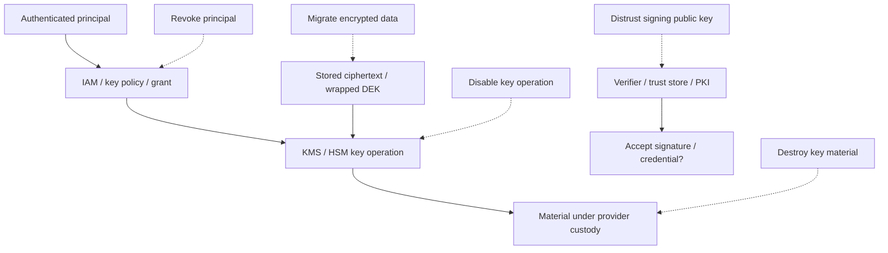
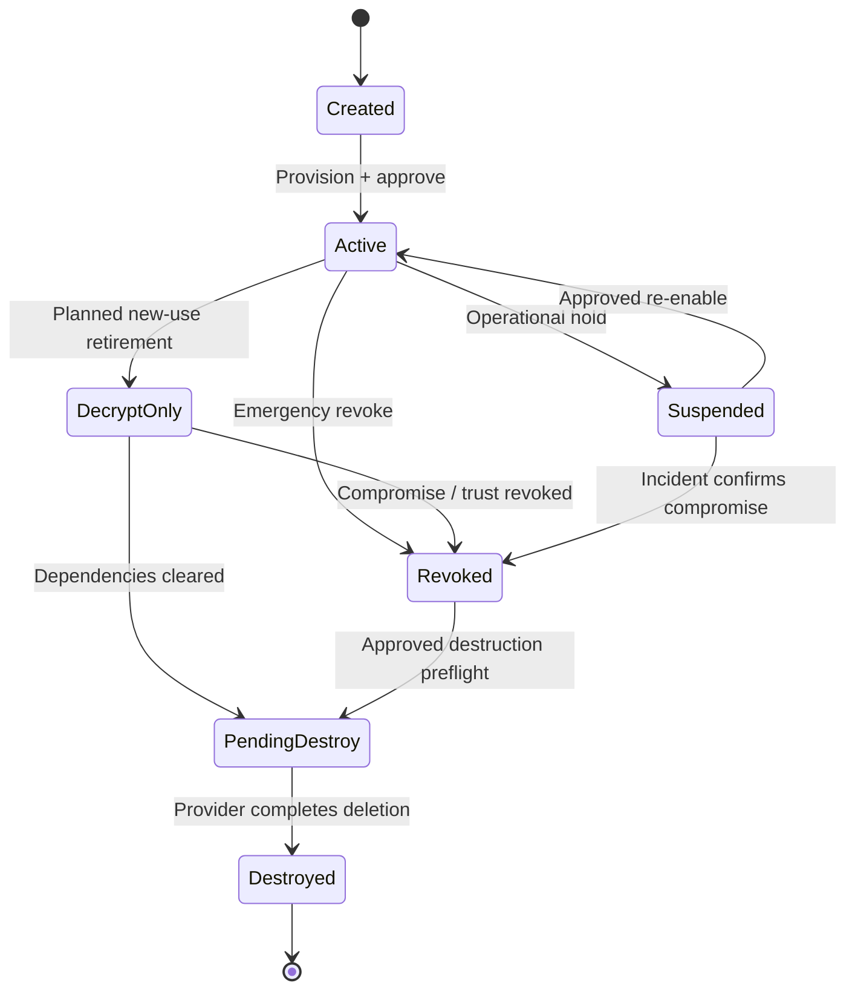
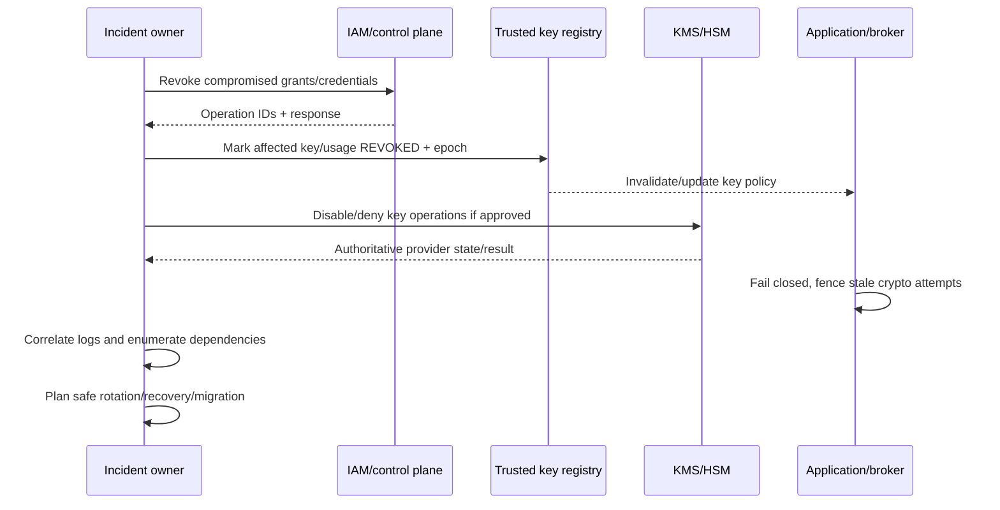
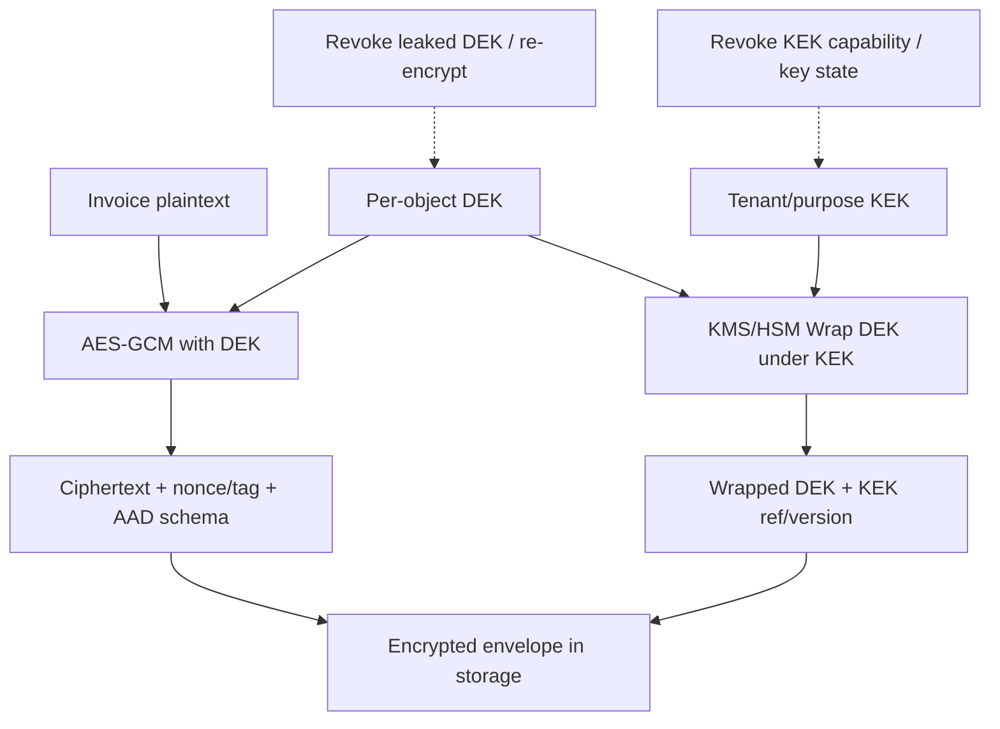
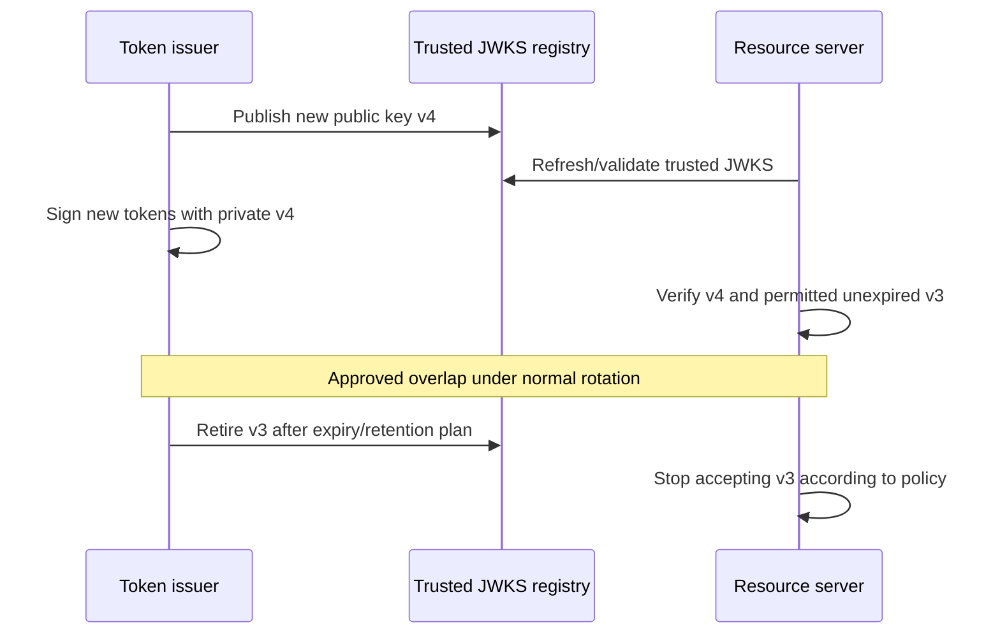
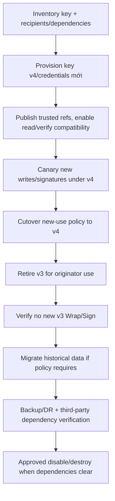
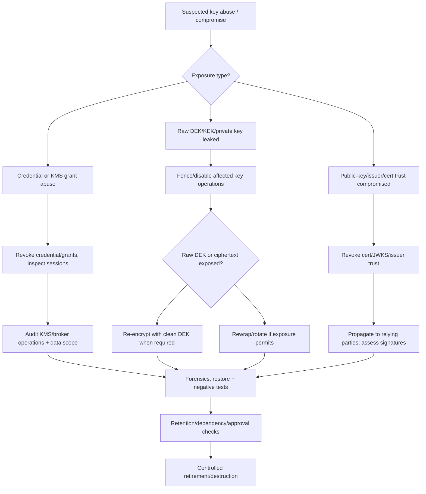

# Revoke key

## 1. Revoke key là gì?

**Revoke key (thu hồi khóa)** là hành động **rút lại một hoặc nhiều sự cho phép liên quan tới khóa mật mã**, ví dụ: không cho một principal tiếp tục dùng khóa, không cho khóa tạo ciphertext/chữ ký mới, không còn tin một public verification key, hoặc chặn hoàn toàn các cryptographic operations trên một key resource. Phạm vi và hiệu lực cụ thể phải được định nghĩa theo **loại khóa, giao thức, provider, trạng thái dữ liệu và mục tiêu an ninh**.

Không tồn tại một nút `Revoke` có cùng ý nghĩa cho **AES DEK, KMS KEK, RSA/Ed25519 signing key, HMAC secret, chứng chỉ X.509, JWT access token và credential của workload**. Thậm chí cùng một sự kiện “khóa bị lộ” có thể cần các hành động khác nhau:

- Một **KMS grant** bị thu hồi có thể chặn principal gọi `Decrypt` nhưng không làm mất raw DEK đã nằm trong memory.
- Một **KMS key** bị disable có thể ngăn các API crypto của provider nhưng không làm ciphertext tự đổi thành ciphertext mới.
- Một **X.509 certificate** bị revoke có thể bị các relying parties từ chối theo chính sách và thông tin revocation họ thực sự kiểm; certificate vẫn tồn tại dưới dạng bytes.
- Một **private signing key** bị lộ có thể cho phép attacker tạo chữ ký giả; hủy bản trên HSM không xóa key bytes attacker đã copy, cũng không tự khiến chữ ký trước đó sai về mặt toán học.
- Một **AES KEK** bị lộ có thể gây nguy cơ cho các wrapped DEKs dưới KEK ấy; chỉ thay alias hoặc thu hồi một IAM principal không thu hồi được material đã exfiltrate.

Bài học này thuộc chương **Revocation và compromise** trong module `SECURITY_KEY_MANAGEMENT_FUNDAMENTALS`. Phạm vi module bao trùm vòng đời khóa từ **tạo, cấp phát, lưu trữ, sử dụng, xoay vòng, thu hồi đến hủy**, cùng mật mã đối xứng/bất đối xứng, chữ ký số, KMS/HSM, envelope encryption, IAM và kiểm toán để bảo vệ khóa trong hệ thống thực.

### 1.1. Tình huống mở đầu

Một hệ thống hóa đơn lưu:

```text
Invoice A:
  AES-GCM payload ciphertext
  + wrapped DEK encrypted under KEK v3
  + key reference/version
  + nonce/tag/AAD context

Key registry:
  KEK v3 = ACTIVE
  KEK v4 = prepared, not yet active

Incident:
  Credential của invoice-reader bị chiếm,
  attacker có thể gọi KMS Unwrap bằng v3.
```

Đội vận hành nói “**revoke v3 ngay**”. Nhưng cần xác định điều gì bị thu hồi:

1. **Principal bị chiếm:** revoke credential và grants của nó, không nhất thiết phải destroy KEK v3.
2. **Khả năng new use:** dừng v3 cho `Wrap` mới và cutover writer sang v4.
3. **Dữ liệu lịch sử:** nếu key v3 vẫn an toàn về material và policy cho phép, reader đáng tin có thể cần `Unwrap` v3 cho hóa đơn cũ.
4. **Nếu raw KEK v3 đã lộ:** phạm vi rủi ro khác; phải đánh giá các wrapped DEKs, ciphertexts, backups và có thể rewrap/re-encrypt.
5. **Nếu raw DEK đã lộ:** rewrap bằng v4 không lấy lại bí mật của DEK cũ.

**Thu hồi đúng** bắt đầu từ phân loại *điều gì đã mất tin cậy*, không bắt đầu bằng một lệnh xóa key ngẫu nhiên.

### 1.2. Mục tiêu học tập

Sau bài học, bạn có thể:

1. Phân biệt **revoke grant, deny operation, disable key, rotate key, revoke certificate/trust, destroy material và crypto-erasure**.
2. Xác định phạm vi sự cố: **raw key exfiltration, credential compromise, API capability abuse, policy misconfiguration, algorithm weakness, key/issuer distrust**.
3. Thiết kế state machine và chính sách **fail closed** khi key bị revoke; phân biệt **originator-use** và **recipient-use**.
4. Thực hiện quy trình thu hồi **KMS/HSM key** theo đúng IAM, version, tenant, purpose, approval và DR obligations.
5. Hiểu ảnh hưởng của revocation với **AES DEK/KEK, envelope encryption, HMAC, signing key, JWT/JWS, X.509/PKI, KEM và workload credentials**.
6. Quản lý thời điểm effective revoke, propagation delay, key caches, active sessions, distributed services và race conditions.
7. Lập kế hoạch **rotation, rewrap, re-encrypt, trust rollover, revoke token/session, backup/restore, data retention và destruction**.
8. Viết ví dụ **Java 17** mô phỏng registry với key `ACTIVE`/`DECRYPT_ONLY`/`REVOKED` và mã hóa AES-GCM, gồm negative tests trước/sau revoke.
9. Thu thập **audit evidence**, phát hiện sử dụng khóa sau revoke và tránh lộ key existence cho attacker.
10. Sử dụng **ma trận kiểm thử, incident runbook và production checklist** để thu hồi an toàn, có thể chứng minh.

## 2. Ngôn ngữ chính xác: revoke cái gì, ở đâu, bởi ai?

Hãy tách năm đối tượng thường bị gom chung là “key”.

| Đối tượng | Ví dụ | Hành động “revoke” phù hợp | Hành động đó **không** bảo đảm |
| --- | --- | --- | --- |
| **Key-use permission** | `invoice-reader` có `kms:Decrypt` | Remove/deny grant/IAM, revoke access token/session | Raw keys hoặc plaintext đã lấy không tự biến mất |
| **Key resource/operation** | KMS KEK `invoice-kek:v3` | Disable key, deny Wrap/Unwrap/Sign theo provider, đổi state/policy | Tất cả material copies ngoài provider đã bị xóa |
| **Trust in public verification material** | CA cert, signer public key, `kid` | Revoke certificate, distrust issuer/key, cập nhật trust store/JWKS | Chữ ký cũ tự sai về mặt toán học |
| **Secret material** | Raw AES DEK, HMAC secret, exported private key | Rotate, ngừng sử dụng, zeroize/destroy những bản do mình kiểm soát | Attacker đã copy không còn giữ secret |
| **Encrypted data dependency** | Wrapped DEK và ciphertext dùng v3 | Rewrap/re-encrypt/migrate hoặc giữ legacy decrypt có điều kiện | Đổi một metadata field tự biến thành encryption mới |

### 2.1. Revoke khác rotate, disable, delete và destroy

- **Revoke access:** rút lại quyền của principal; có thể áp dụng ngay tại IAM/broker với giới hạn propagation.
- **Retire for new use:** key không còn được phép tạo ciphertext, MAC hoặc chữ ký mới nhưng có thể còn được đọc/xác minh lịch sử.
- **Disable key:** chặn operation tại provider theo API/state của họ; thường có khả năng enable lại nếu quyền cho phép.
- **Rotate key:** cấp vật liệu/phiên bản mới rồi chuyển new-use; không mặc định thay thế ciphertext/chữ ký cũ.
- **Revoke trust:** phía xác minh không còn chấp nhận credential/certificate/issuer/key theo chính sách.
- **Schedule delete/destroy:** bắt đầu quy trình hủy; có thể có thời gian chờ và quyền hủy được kiểm soát.
- **Destroy/zeroize:** loại bỏ vật liệu trong phạm vi nhất định; có thể làm dữ liệu mất khả năng giải mã.
- **Crypto-erasure:** kỳ vọng ciphertext trở nên không thể giải mã vì **mọi đường lấy key material cần thiết trong phạm vi đánh giá** đã bị loại bỏ; điều này đòi nhiều bằng chứng hơn xóa alias.

Không nên dùng các từ trên như đồng nghĩa trong ticket/audit vì mỗi từ **thay đổi rủi ro và khả năng phục hồi khác nhau**.

### 2.2. Quyền truy cập, vật liệu và niềm tin là ba trục độc lập



Một hệ thống có thể **chặn quyền IAM** nhưng vẫn phải **tiếp tục tin chữ ký lịch sử**, hoặc **distrust signer công khai** mà không tác động tới một KEK bảo vệ database. Hành động revoke phải nêu rõ **đường thực thi**.

## 3. Threat model: những sự kiện nào cần revoke?

Bắt đầu bằng bằng chứng và phạm vi thay vì suy đoán toàn bộ khóa đã lộ.

### 3.1. Các loại compromise

| Sự kiện | Khả năng của attacker | Phản ứng ban đầu | Điều tra bổ sung |
| --- | --- | --- | --- |
| **IAM/service-account token bị lộ** | Gọi API mà principal có quyền | Revoke credential/session, thu hẹp IAM | Operation logs, accessed data, long-lived grants |
| **mTLS client private key bị lộ** | Mạo danh workload nếu còn các điều kiện khác | Revoke/replace cert hoặc mapping identity | Active connections, backend authorization |
| **Raw DEK bị lộ** | Giải mã ciphertext tương ứng nếu có dữ liệu | Cô lập use, sinh DEK mới, đánh giá re-encrypt | Object/batch/backup scope, data exfiltration |
| **Raw KEK bị lộ** | Unwrap các DEKs phù hợp nếu có wrapped blobs | Dừng new use, provision KEK sạch | Wrapped DEK inventory, DEK exposure, copies |
| **HSM Sign API bị abuse** | Tạo chữ ký hợp lệ mà không export private key | Revoke Sign grant/credential, chặn nội dung | Signed artifacts/tokens, trust/revocation |
| **HMAC shared secret bị lộ** | Tạo MAC hợp lệ, giả webhook/token | Rotate secret, revoke verifier acceptance | Replay, forged messages, overlap window |
| **Private signing key bị exfiltrate** | Tạo chữ ký giả ngoài HSM | Ngừng sign, distrust/revoke theo trust model | Issued signatures, timestamps, relying parties |
| **Public-key registry bị tráo** | Hướng Encrypt/Verify tới key sai | Khôi phục trust anchor, revoke untrusted mapping | Ciphertexts gửi nhầm, forged verification |
| **KMS policy sai scope** | Principal dùng key tenant khác | Deny grant/fix broker, audit | Cross-tenant objects, provider logs |
| **Key algorithm/strength bị phá** | Bảo mật toán học suy giảm | Ngừng sử dụng key/suite, migrate | Exposure model, data retention |
| **Key không còn chủ sở hữu** | Key không được giám sát/grants quá rộng | Tạm chặn new use theo policy | Owner, dependencies, approvals |

### 3.2. Compromise không đồng nghĩa material exfiltration

Một attacker có quyền gọi `KMS Decrypt` chưa chắc đã biết **raw KEK**. Nhưng họ có thể đã nhận **plaintext DEKs** từ các API và giải mã dữ liệu.

Ngược lại, **raw KEK bị lộ** cho phép mở wrapped DEKs ở ngoài KMS nếu attacker có đủ dữ liệu, ngay cả khi tổ chức đã thu hồi tất cả IAM grants. Vì vậy cần phân biệt:

```text
A. Unauthorized capability / grant abuse
B. Raw material exfiltration
C. Algorithm/protocol compromise
D. Trust decision compromise
E. Accidental key loss / unavailable key
```

Mỗi nhánh có khác biệt về **recovery, revocation effectiveness, incident severity và dữ liệu phải migrate**.

### 3.3. Câu hỏi phạm vi bắt buộc

1. Key ID/version nào, tenant/environment/purpose nào?
2. Material có bị copy thật không, hay chỉ có bằng chứng API calls?
3. Attacker đã có **ciphertext/wrapped DEK/plaintext** nào?
4. Principal nào bị chiếm, có quyền gọi `Sign/Decrypt/Unwrap/Export/Destroy` gì?
5. Key được dùng ở bao nhiêu systems/regions, có BYOK/imported/escrow copies không?
6. Có backup lạnh, archive, queue, client offline và external partners phụ thuộc?
7. Có key khác được **derive từ cùng master**, reuse material hoặc dùng trong nhiều protocols không?
8. Cần thông báo pháp lý, khách hàng, đối tác hoặc hủy trust theo timeline nào?
9. Có bằng chứng audit đầy đủ chưa, hay log gap?
10. Những thao tác có thể dừng **ngay mà không mất dữ liệu** và những thao tác phải chờ approved recovery?

## 4. Thiết kế state machine cho key revocation

Không phải KMS nào cũng có native state `REVOKED`. Nên tách **logical policy state ở ứng dụng** với **provider key state**.

### 4.1. State minh họa



Đây là **state machine logic, không phải API provider**. “Revoked” ở đây nghĩa là **cấm mọi key operation trong normal path**; một recovery path chỉ có thể mở nếu có **quy trình riêng**. Một state khác như `DECRYPT_ONLY` phù hợp khi chỉ **kết thúc new-use có kế hoạch**, không phải emergency compromise.

### 4.2. Ma trận operation theo state

| State logic | New Encrypt/Wrap/Sign | Historical Decrypt/Unwrap | Verify signature / trust | Hành vi |
| --- | --- | --- | --- | --- |
| `ACTIVE` | ALLOW theo IAM | ALLOW theo IAM và business authorization | Theo trusted issuer/key policy | Normal operation |
| `DECRYPT_ONLY` | **DENY** | ALLOW có điều kiện | Có thể tiếp tục Verify | Planned rotation |
| `SUSPENDED` | DENY | DENY cho normal path | Policy-dependent | Tạm ngừng, điều tra |
| `REVOKED` | **DENY** | **DENY normal path** | Thường distrust hoặc xử lý riêng theo incident | Emergency security event |
| `PENDING_DESTROY` | DENY | Theo provider có thể DENY | Policy-dependent | Chờ hủy |
| `DESTROYED` | DENY | Không nếu material thật sự đã mất | Public verification material có thể vẫn còn | Hậu hủy |

### 4.3. Revocation effective time và propagation

Một sự kiện revoke phải ghi rõ:

- `requestedAt`: lúc có yêu cầu.
- `approvedAt`: lúc người có thẩm quyền đồng ý.
- `effectiveAt`: thời điểm policy bắt đầu từ chối **theo mô hình lý tưởng**.
- `enforcedAt` trên từng service/provider: khi lệnh thực thi thực sự có hiệu lực.
- `observedLastUse`: lần key-use cuối còn thấy trong logs.
- `propagationDeadline`/`maxStaleness`: trễ đồng bộ được chấp nhận.
- `revocationEpoch`: generation tăng đơn điệu phục vụ kiểm tra stale writers/permissions.
- `evidenceRefs`: link tới ticket/operation/audit, không chứa secrets.

**Một timestamp trong database không tự chặn key use** nếu process vẫn cache policy, token, session hoặc raw DEK. Cần enforcement tại nơi thực hiện operation và kiểm tra hiệu lực.

### 4.4. Không tự động rollback từ REVOKED sang ACTIVE

Nếu key bị revoke vì **nghi ngờ compromise**, việc khôi phục có thể cần incident owner, evidence review, approval đa bên và xác minh material chưa lộ.

Nếu đã xác nhận raw key bị exfiltrate, **không nên tái sử dụng key ấy cho cryptographic new-use** chỉ vì một lệnh `enable` có thể chạy được. Hãy cấp key mới và migrate theo phạm vi. Restore availability từ backup phải tuân chính sách, không tái kích hoạt bí mật bị compromise như một fallback ngầm.

## 5. Revoke theo phép toán: key use restriction cần có hiệu lực thật

### 5.1. Revoke `Encrypt/Wrap` nhưng tiếp tục `Decrypt/Unwrap`

Đây là **planned retirement**, thường gọi `DECRYPT_ONLY` hoặc `recipient-use only`. Ví dụ:

```text
KEK v3:
  2026-01 ... 2026-11-28: Wrap + Unwrap
  after cutover:             Unwrap lịch sử được phép
  after retention clearance: xem xét Destroy

KEK v4:
  after cutover:             New Wrap + permitted Unwrap
```

- Writers mới không được tạo wrapped DEKs dưới v3.
- Readers có thể mở wrapped DEKs lịch sử dưới v3 nếu đúng quyền.
- Không delete v3 ngay chỉ vì v4 active.
- Chỉ mã hóa mới dùng key đã được phép originator use.
- Nếu v3 bị compromise thật, **recipient-use policy phải được đánh giá lại**: không giữ mở rộng tùy tiện chỉ để tránh outage.

### 5.2. Revoke `Decrypt/Unwrap`

Thu hồi Decrypt có thể dùng khi:

- Một principal reader bị chiếm.
- Một tenant thu hồi quyền SaaS sử dụng CMEK.
- Một key bị nghi lộ hoặc misuse.
- Một legal/business policy yêu cầu dừng truy cập dữ liệu.

Cần phân biệt:

1. **Revoke một principal:** key vẫn tồn tại và principal đáng tin khác có thể Unwrap.
2. **Revoke tất cả grants của resource:** chặn hầu hết use theo provider, nhưng xem key policy/admin/cross-account grants.
3. **Disable key resource:** chặn operations theo provider contract.
4. **Destroy key material:** có thể làm dữ liệu vĩnh viễn không giải mã được; không nên là hành động phản xạ đầu tiên.

Không xóa bản backup hoặc key cũ trước khi làm rõ **data retention, disaster recovery và obligations**.

### 5.3. Revoke `Sign`

Nếu signing credential hoặc private key bị lộ:

- Ngừng cấp chữ ký mới bằng signer đó.
- Thu hồi grants/certificates/trust theo giao thức.
- Đánh giá chữ ký đã phát hành, JWTs, release artifacts và consumer caches.
- Rotate signer, phân phối public verification key mới qua nguồn tin cậy.
- Không chỉ đổi `kid` hoặc xóa file private key trong repository.

### 5.4. Revoke `GenerateMac` / HMAC shared secret

Với HMAC, bên nào biết raw shared secret đều có thể **tạo MAC** dù ứng dụng chỉ intended Verify. Vì vậy:

- Thu hồi một API permission chỉ có ý nghĩa mạnh khi key **không exportable và provider thực thi operation restrictions**.
- Nếu raw secret đã tới nhiều services, revoke phải bao gồm **secret rotation và thay đổi verification acceptance** ở các consumers.
- Nếu có overlap window để nhận webhook cũ, phải giới hạn thời gian, `kid`/version, replay protection và audit.
- HMAC hợp lệ không chứng minh message là mới; cần timestamp/nonce/event ID/idempotency khi protocol yêu cầu.

### 5.5. Revoke private KEM/decapsulation key

Nếu private decapsulation key bị lộ, wrapped/encapsulated shared secrets và ciphertexts của protocol có thể chịu rủi ro. Cần ngừng new-use, provision key pair mới, phân phối public key xác thực, kiểm legacy encapsulated data/handshakes và protocol key schedule.

**KEM decapsulation thành công không tự xác thực sender**, và revocation không sửa được một protocol thiếu authentication.

## 6. Kiểm soát khi revoke tại KMS/HSM

### 6.1. Phân biệt grant, key policy và key state

KMS/HSM có thể cung cấp nhiều lớp:

- **Identity policy:** principal có những API actions nào?
- **Key resource policy/grants:** ai có quyền với key resource cụ thể?
- **Key type/usage attributes:** key dành cho Encrypt/Decrypt/Sign/Unwrap theo capability provider.
- **Provider key state:** Enabled/Disabled/PendingDeletion hoặc state riêng.
- **Workload authentication:** credential, token, mTLS identity.
- **Broker policy:** ánh xạ caller/tenant/object → exact key/operation.

Không giả định chỉ revoke một **IAM role attachment** là mọi đường truy cập đã hết: có thể tồn tại grants, key policy delegation, cached sessions, service principal khác, cross-account capabilities hoặc direct SDK use.

### 6.2. Workflow KMS provider-agnostic



Sơ đồ mô tả một **workflow**, không phải tên method dùng được chung mọi cloud. Thứ tự cụ thể có thể thay đổi khi cần containment khẩn cấp, nhưng **mục đích và phạm vi phải có chứng cứ**.

### 6.3. KMS-native key state không đồng nghĩa deletion

`Disable` có thể reversible, `ScheduleDeletion` có waiting period và `DeleteKey` thường có semantics riêng. Trước destructive operations phải:

1. Xác định **exact resource ID** và owner, không thao tác theo alias mơ hồ.
2. Kiểm **region/account/project/HSM partition** và key references thực.
3. Kiểm historical ciphertext, wrapped DEKs, backups, clients/offline data.
4. Xác nhận legal hold, data retention và approvals.
5. Kiểm imported/exported material/copies ngoài provider.
6. Thử restore theo plan phù hợp và giữ recovery path được duyệt.
7. Log provider operation ID, requested/enforced state và actor.
8. Tránh rộng quyền `Destroy` cho chính người đang điều tra.

### 6.4. Non-exportable không có nghĩa non-abusable

Một KEK không export được nhưng attacker chiếm credential có quyền `Decrypt/Unwrap` vẫn có thể gửi wrapped DEKs tới KMS và nhận DEKs/plaintext tùy API.

Một signing key non-exportable nhưng attacker có quyền `Sign` vẫn có thể được dùng để ký malware manifest nếu signing service không kiểm **artifact authorization**. Revoke phải chặn **API capability** và kiểm signed outputs, không chỉ xác nhận không có `ExportKey` event.

### 6.5. Tham chiếu KMS key version phải chính xác

Có providers tự rotate internal backing material dưới một logical key ID, không expose app-level `v1/v2` cho từng material. Không tự bịa version và không cho rằng revoke logical key sẽ chỉ chặn đúng internal generation.

Nếu ứng dụng có nhiều **KMS key resources riêng** như `invoice-kek-2026-a` và `invoice-kek-2026-b`, inventory cần exact references, aliases và wrapped-key dependencies để tránh disable nhầm.

## 7. Envelope encryption: revoke KEK/DEK ảnh hưởng dữ liệu như thế nào?

**Envelope encryption** thường dùng:

- **DEK** (Data Encryption Key) để AES-GCM mã hóa payload.
- **KEK** (Key Encryption Key) trong KMS/HSM để wrap/encrypt DEK.
- **Wrapped DEK** lưu cạnh ciphertext.
- **Key ID/version**, nonce, tag và **AAD** để chọn đúng key và xác thực ngữ cảnh.
- **IAM/object authorization** để quyết định ai được Unwrap/Decrypt.



### 7.1. Revoke KEK usage

Nếu KMS KEK bị disable:

- New Wrap/Unwrap operations có thể thất bại theo provider contract.
- Ciphertext **vẫn tồn tại**.
- Wrapped DEK vẫn tồn tại, không biến thành bản rõ hay tự rewrap.
- Người đang giữ raw DEK trước đó có thể vẫn decrypt local.
- Reader/DR có thể mất availability nếu không có alternative authorized recovery.
- Tắt một KEK dùng chung nhiều tenants có thể ảnh hưởng tất cả tenants phụ thuộc.

Một revoke action có thể **ngăn truy cập bình thường** nhưng chưa chứng minh **crypto-erasure**.

### 7.2. Revoke/rotate DEK

Khi raw DEK bị lộ hoặc policy không còn cho phép dùng:

1. Ngừng dùng DEK cũ cho new Encrypt.
2. Điều tra ciphertext/objects được mã hóa dưới DEK đó.
3. Tạo DEK mới từ CSPRNG/KMS.
4. **Decrypt/verify hợp lệ bằng DEK cũ trong quy trình recovery được duyệt**, khi chính sách cho phép; dùng raw material hạn chế.
5. **Re-encrypt payload bằng DEK mới**, nonce mới, AAD/context đúng.
6. Wrap DEK mới dưới KEK đang được phép, lưu envelope atomically.
7. Xử lý caches/exports/backup copies và revoke old references theo policy.
8. Không tuyên bố dữ liệu quá khứ chưa từng bị lộ.

Nếu raw DEK **đã bị attacker copy**, không có revoke API nào buộc attacker quên raw bytes. Rotation làm dữ liệu được tạo về sau không còn phụ thuộc DEK cũ và có thể giảm rủi ro lưu trữ hiện tại; nó **không hồi tố xóa các ciphertext/plaintext attacker đã thu được**.

### 7.3. Rewrap KEK có đủ không?

| Bối cảnh | Rewrap DEK dưới KEK mới | Cần thêm gì? |
| --- | --- | --- |
| KEK v1 hết cryptoperiod new-use, không có dấu hiệu lộ | Thường phù hợp nếu policy cần migration | Registry/IAM, audit, backup/DR, atomic metadata update |
| Một IAM principal có Unwrap quá rộng nhưng không có raw-key exfiltration | Có thể cần, tùy incident | Revoke grants, xác định DEKs từng được Unwrap |
| Raw KEK v1 bị lộ, attacker có thể đã có wrapped DEKs | Rewrap **không đảm bảo** data quá khứ an toàn | Đánh giá DEK/ciphertext exposure, có thể re-encrypt |
| Raw DEK bị lộ | **Không đủ** | Re-encrypt bằng DEK mới, điều tra exfiltration |
| AEAD algorithm/nonce strategy bị phá | Không đủ | Thay suite, nonce strategy, tạo key mới, migrate |
| Customer revoke CMEK vì offboarding | Có thể **không được phép** tự rewrap | Consent, retention, contractual revocation semantics |

### 7.4. Rewrap và AAD

Nếu payload AAD có chứa mutable KEK ref/version, thay KEK khi rewrap làm payload tag không khớp. Có thể chọn thiết kế:

- **Full-header AAD:** KEK metadata nằm trong payload AAD; migration cần tạo lại authentication payload đúng cách.
- **Stable payload AAD + independently authenticated wrap context:** giữ payload ciphertext/tag khi rewrap DEK, với điều kiện wrapping header và tenant/object/key reference được xác thực riêng.

Không được chỉ cập nhật `kekVersion` và `wrappedDek` nếu authenticated binding cần cập nhật thêm. **Đổi metadata không thay thế phép toán mật mã.**

### 7.5. Không cho record chọn KMS key tùy ý

`kekReference` nằm trong envelope chỉ là **routing hint chưa tin cậy**. Backend phải:

- Kiểm authenticated principal và object/tenant authorization.
- Resolve exact reference qua trusted registry/allowlist.
- Validate algorithm/purpose/key state/version.
- Dùng KMS IAM/encryption context theo policy.
- Verify wrapped DEK và payload AEAD tag.
- Fail closed nếu key bị revoke; không thử tất cả keys hoặc fallback sang `current`.

## 8. Revoke khóa bất đối xứng và chữ ký số

### 8.1. Private Sign và public Verify là hai mặt khác nhau

Với Ed25519/RSA-PSS/ECDSA:

- **Private signing key** tạo chữ ký.
- **Public verification key** cho phép verifier kiểm chữ ký.
- Key ID/`kid` giúp chọn public key, **không phải trust root**.
- Key metadata/certificate/PKI/trust policy quyết định có **chấp nhận** chữ ký sau khi verify toán học hay không.

Nếu private key bị compromise, attacker có thể tạo chữ ký mới với cùng private key. **Không có cách mật mã nào phân biệt chữ ký hợp lệ do issuer và chữ ký hợp lệ do attacker** nếu cả hai có cùng private key, ngoài các bằng chứng giao thức, thời gian đáng tin, logs và các hạn chế khác.

### 8.2. Vì sao revoke không làm chữ ký cũ sai toán học?

Phép kiểm:

```text
Verify(publicKey, message, signature) -> valid / invalid
```

là kiểm tra toán học. Một lệnh revoke thay đổi **trust/policy acceptance**, không thay đổi bytes của public key hay signature.

```text
Cryptographic verification:
  valid signature under public key K

Application trust evaluation:
  trusted issuer?
  intended purpose/algorithm?
  certificate/key revoked?
  trustworthy signing time?
  issuer/audience/claims/expiry?
  policy allows acceptance?

Only if all required checks pass:
  accept signed artifact / token / document.
```

### 8.3. Signing time và revocation effective time

Với long-term signatures, có thể cần:

- Time-stamping authority hoặc evidence về thời điểm ký đáng tin.
- Certificate validity, revocation status tại thời điểm phù hợp theo profile.
- Signed attributes, document integrity, trust anchors.
- Retention và validation policy của ứng dụng.
- Compromise date/effective revocation date có căn cứ.

Không dùng timestamp **do signer không tin cậy tự ghi** để chứng minh chữ ký được tạo trước khi key lộ. Không có một câu “tất cả chữ ký trước revoke vẫn hợp lệ” hay “mọi chữ ký cũ đều vô hiệu” đúng cho tất cả PKI profiles.

### 8.4. HSM signing capability abuse

Nếu private key không export nhưng API `Sign` bị abuse, cần:

1. Revoke signer credential/grants.
2. Chặn phát hành chữ ký mới qua signing service.
3. Thu thập exact signed artifact/request IDs, hashes và approvals.
4. Xác định có thể phân biệt signed outputs đáng tin bằng workflow/audit không.
5. Rotate signer, rollout trust store/JWKS và consumer changes.
6. Quyết định distrust/revocation của old signer theo incident scope.
7. Giám sát phản hồi từ relying parties và caches.

Một private key non-exportable không ngăn attacker đã có `Sign` permission tạo chữ ký tùy ý nếu ứng dụng không enforce **message/purpose authorization**.

## 9. X.509/PKI: certificate revocation khác key deletion

Một **X.509 certificate** gắn **public key với identity** thông qua signature của CA. Khi CA revoke certificate, họ thường công bố trạng thái thông qua **Certificate Revocation List (CRL)**, **Online Certificate Status Protocol (OCSP)** hoặc cơ chế/profiles liên quan.

### 9.1. Điều gì thực sự bị revoke?

Certificate có thể bị revoke vì:

- Private key của subject bị compromise.
- CA hoặc quy trình phát hành có vấn đề.
- Certificate được cấp nhầm danh tính/purpose.
- Chủ thể không còn quyền dùng identity/service.
- Thay đổi tổ chức, thu hồi quyền, policy violation.

Certificate bị revoke **không tự hủy private key**, không buộc endpoints dừng sử dụng material và không đảm bảo mọi clients sẽ biết trạng thái ngay lập tức.

### 9.2. CRL và OCSP

| Cơ chế | Tóm tắt | Lưu ý |
| --- | --- | --- |
| **CRL** | Danh sách certificate serials bị CA revoke | Client cần tải/cache/kiểm thời hạn, distribution và update |
| **OCSP** | Hỏi trạng thái certificate theo responder | Có cache, availability, responder trust, soft/hard fail policy |
| **OCSP stapling** | Server gửi OCSP response trong handshake khi hỗ trợ | Client vẫn phải validate response và policy |
| **Short-lived certificates** | Giảm thời gian sử dụng credential | Không thay IAM/content authorization; cần automation renewal |
| **Direct truststore/allowlist change** | Bỏ CA/certificate/public key khỏi tập tin cậy | Phải rollout tới tất cả relying parties và cache |

**Không mặc định mọi TLS client kiểm CRL/OCSP hoặc fail closed**. Việc kiểm trạng thái phụ thuộc TLS stack, trust profile, policy và cấu hình thực tế. Một certificate có ngày hết hạn trong tương lai vẫn có thể không còn được tin nếu đã revoke.

### 9.3. Revocation freshness và availability

Nếu responder không truy cập được, có hệ thống **soft-fail** để duy trì availability, có hệ thống **hard-fail** theo chính sách. Với key-management infrastructure hoặc threat model nhạy cảm, cần quy định rõ:

- Relying parties nào bắt buộc kiểm revocation.
- Trạng thái được cache bao lâu.
- Không có thông tin fresh thì deny hay có approved emergency path.
- Có khả năng thu hồi identity tại backend IAM/trust store nhanh hơn PKI propagation không.
- Cách nhận biết phiên TLS/mTLS đang mở từ trước revoke.

Một certificate bị revoke không nhất thiết **kết thúc ngay những kết nối TLS đã thiết lập**, trừ khi hệ thống có cơ chế chủ động kết thúc và reauthorize session.

### 9.4. X.509 KeyUsage/EKU không phải revocation policy

Các trường **KeyUsage** và **ExtendedKeyUsage** mô tả intended purpose như digitalSignature, serverAuth hoặc clientAuth, **không phải trạng thái revoked**. Certificate profile/validator phải kiểm đúng purpose, chain, identity, expiry và revocation theo chính sách.

Một private key có thể bị dùng ngoài certificate nếu attacker giữ raw bytes, bất kể EKU của certificate nói gì.

## 10. JWT/JWS: revoke signing key có thể ảnh hưởng cả kho token

### 10.1. `kid` chỉ là hint chọn key

JWT/JWS có thể chứa `kid` trong protected header. Verifier chọn **public verification key** từ trusted issuer/JWKS/PKI và kiểm chữ ký/claims. Không tải `jku`/`x5u` từ URL tùy ý do attacker cung cấp, không chấp nhận algorithm ngoài allowlist và không coi “signature valid” là đủ để có quyền.

### 10.2. Ba cấp thu hồi thường bị nhầm

| Cấp | Hành động | Hệ quả |
| --- | --- | --- |
| **Thu hồi một access token** | Server-side denylist `jti`, revocation/introspection hoặc cơ chế application-specific | Chặn token cụ thể nếu mọi resource servers thực thi |
| **Thu hồi một user/session/refresh token** | Session/token-store revoke, refresh rotation, account disable | Hạn chế tiếp tục cấp token mới; access tokens đã phát có thể còn hiệu lực tới expiry nếu không kiểm revoked state |
| **Thu hồi signing key/issuer trust** | Loại old public key khỏi trusted JWKS hoặc distrust theo policy | Có thể ảnh hưởng **mọi token** được ký bởi key đó, không chỉ token của attacker |

**Không có cơ chế revoke mọi JWT tự chứa ngay lập tức chỉ bằng đổi một biến ở issuer** nếu resource servers còn giữ cached verification keys, chưa kiểm denylist/introspection và token chưa hết hạn.

### 10.3. Thứ tự bình thường của key rollover



**Emergency compromise khác normal rollover.** Nếu private v3 thực sự lộ, kéo dài trust v3 chỉ để tránh logout có thể cho attacker tiếp tục phát token giả. Cần đánh giá denylist/issuer disable/forced reauthentication/short token TTL và truyền thông, phù hợp mức rủi ro.

### 10.4. Caches và JWKS propagation

- JWKS responses có thể được cache bởi proxies/resource servers.
- Issuer xóa `kid=v3` khỏi endpoint **không bắt buộc mọi verifier đang chạy dừng tin v3 tức thì**.
- Cần xác định maximum cache age, refresh trigger, failure behavior và emergency purge.
- Nếu token không dùng `jti` hoặc không có state server-side, revoke một token riêng lẻ có thể không thực thi ngay với mọi verifier.
- Phân biệt `NotBefore/issuedAt/expiry` với **revocation time từ server-trusted state**.

### 10.5. Token revocation và key compromise

Nếu signing key bị lộ, không đơn giản “revoke user account của attacker” vì attacker có thể tự ký token dưới nhiều subjects. Phải xử lý **trust của signer** và rà soát toàn bộ relying parties, caches và issued artifacts.

## 11. HMAC, API keys và workload credentials

### 11.1. HMAC key khác asymmetric signer

HMAC dùng một shared secret. Bên giữ raw key có thể **tạo và xác minh MAC**. Nếu secret bị lộ:

1. Provision HMAC secret mới độc lập.
2. Producer mới dùng secret version mới.
3. Verifier chuyển trust policy theo lịch/incident.
4. Nếu cho phép old version trong overlap, giới hạn TTL, rate, replay checks.
5. Thu hồi static credential/distribution paths cũ.
6. Đánh giá message/webhook đã được giả mạo và dữ liệu downstream.

Đổi `keyId` trong message mà không thay secret và verifier trust **không phải rotation có ý nghĩa**.

### 11.2. API key của khách hàng không phải cryptographic DEK

Một API key thường là **bearer credential** để authenticate caller. Revoke nó nghĩa là server **không còn chấp nhận credential đó** tại authentication layer; không liên quan trực tiếp tới AES key hay ciphertext, dù sản phẩm đều gọi là “key”.

Không lưu API key plaintext nếu có thể lưu verifier phù hợp; hỗ trợ creation, scope, expiry, rotation, hashed token storage, revoke và audit. Một credential bị revoke vẫn có thể nằm trong logs nhưng không được chấp nhận tại API.

### 11.3. Workload identity và mTLS client certificates

Nếu KMS broker dùng mTLS, revoke identity có thể gồm:

- Revoke/expire certificate, update CA/trust/identity mapping.
- Thu hồi IAM principal/grants/tokens tương ứng.
- Chủ động drain/close sessions và refresh authorized connections khi cần.
- Giới hạn service account permissions, áp dụng least privilege.
- Kiểm queue jobs và scheduled tasks vẫn đang chạy với cached identity.

**mTLS xác thực kênh**, không tự kiểm tenant/object authorization. Client certificate bị revoke nhưng một process vẫn có **raw DEK cache** có thể tiếp tục giải mã local; cần xử lý key caches/secret lifetime theo incident model.

## 12. Effective revocation trong hệ thống phân tán

Revoke không chỉ là state transition tại database. Hệ thống có thể có:

- Nhiều API pods, batch workers, cron jobs, DLQ replayers.
- Multi-region KMS/replicas hoặc key registries.
- Caches tại service, SDK, service mesh, sidecar, gateway.
- IAM session/token có TTL.
- Offline clients có encrypted blobs hoặc raw keys.
- HSM sessions, local key handles, plaintext DEK cache.
- Long-lived TLS/mTLS sessions.
- External partners chưa nhận tín hiệu thu hồi.

### 12.1. Sự kiện được ghi và hiệu lực thực tế

```text
t0: Incident team requests revoke
t1: IAM/token/session grant disabled at provider
t2: Registry state REVOKED, epoch=88
t3: Service A refreshes policy
t4: Service B still has cached ACTIVE (stale)
t5: Service B attempts Decrypt under stale policy
t6: Provider/broker denies, or call succeeds if no central enforcement
t7: Team verifies no accepted operations after enforcement deadline
```

Cần **phân biệt thời điểm yêu cầu, xác nhận từ control plane và thời điểm mọi request paths ngừng hoạt động**. Một event `revoke_requested` không đủ chứng minh operation đã bị chặn.

### 12.2. Cache TTL không bảo đảm hard revocation

Giảm TTL policy cache xuống vài giây chỉ **giảm cửa sổ stale**, không tạo cam kết “không có một key-use nào sau t2”. Có thể cần:

- Centralized crypto broker policy checked **mỗi operation**.
- Provider-level deny/disable khi contract cho phép.
- Revocation epoch hoặc fencing token do authoritative state cấp.
- Graceful cancellation/drain of in-flight operations.
- Commit-time check để ngăn publish data do old key tạo sau effective barrier.
- Revocation event fan-out với acknowledgement/health reporting.
- Circuit-breaker fail closed khi không thể kiểm revoked state.
- Endpoint/session cache invalidation và credential revoke.

### 12.3. Có hai thời điểm nhạy cảm: dùng khóa và commit dữ liệu

Một writer có thể **Encrypt bằng old key trước revoke** nhưng **commit ciphertext sau revoke**. Nếu policy yêu cầu không có successful new writes dưới revoked key sau cutover, cần commit-time fencing/epoch và xử lý retry.

Một reader có thể **Unwrap DEK trước revoke**, rồi dùng DEK từ cache để decrypt sau revoke. Nếu policy yêu cầu dừng plaintext access, phải điều tra/khống chế **cả raw DEK caches và application session authorization**, không chỉ KMS call logs.

### 12.4. Revocation epoch và replay/rollback

Một pattern:

```yaml
keyRef: billing/prod/invoice-kek:v3
logicalState: REVOKED
revocationEpoch: 88
revokedAt: "2026-11-28T09:00:00Z"
normalOperationsAllowed: []
policyOwner: security-operations
evidenceRef: incident-2026-042
```

Ứng dụng phải kiểm `revocationEpoch` với nguồn authoritative. Một số `88` ghi trong envelope do attacker sửa **không chứng minh freshness**. Nếu cần anti-rollback của policy, dùng monotonic state/version và optimistic transaction/signed config cùng cách xử lý cache stale.

### 12.5. Fail closed và availability

Nếu service không truy cập được policy registry hoặc KMS đang outage:

- Không bật trust-all, không fallback raw KEK hardcoded.
- Không tự bỏ kiểm revocation rồi tiếp tục Decrypt.
- Trả lỗi theo service contract, log request ID và trạng thái.
- Có approved HA/DR path với policy tương đương, không “DR = admin toàn quyền”.
- Với read-only historical data, nếu doanh nghiệp có exception riêng cần approval/time limit/audit, không biến nó thành default.

**Độ sẵn sàng cao và revocation nhanh là một trade-off cần thiết kế có chứng cứ**, không được giải quyết bằng cách tắt security khi lỗi mạng.

## 13. Thu hồi quyền theo tenant và object

Một platform nhiều tenant phải scope revocation ở các lớp:

1. **Authenticated principal** được phép đại diện tenant nào?
2. **Object ownership** của ciphertext thuộc tenant nào?
3. **Key registry** map tenant/purpose tới exact KMS key nào?
4. **IAM/grant** cho principal có giới hạn theo key/tenant?
5. **AAD/encryption context** ràng buộc ciphertext/wrapped DEK với tenant/object?
6. **Audit** có phân biệt upstream caller và broker principal?
7. **Dependency inventory** cho mỗi tenant có đủ live/backup/export không?

### 13.1. Revoke principal A không nên vô hiệu tenant B

Nếu tenant A báo credential bị lộ, có thể revoke `reader-A` ngay mà không phải disable **cả KEK dùng chung của mọi tenant**, tùy threat model và IAM separation. Ngược lại, nếu raw **shared KEK** lộ, nhiều tenants có thể cùng bị ảnh hưởng.

### 13.2. Key-per-tenant hỗ trợ blast-radius reduction

Một pattern hữu ích là **KEK riêng tenant + DEK riêng object/batch**. Việc thu hồi KEK tenant A có thể không ảnh hưởng dữ liệu B về mặt material, **nếu** keys độc lập, broker/IAM không sai và không có shared root/master compromise.

**Không khẳng định key ID khác nhau nghĩa là key material độc lập**. Aliases/imports/derivation từ một master có thể làm chung một failure domain.

### 13.3. Không cho client chỉ định key muốn revoke

Các API quản trị revocation phải xác minh:

- Caller có quyền quản trị **tenant/key cụ thể**.
- Key ID được resolve qua trusted registry, không một URI tùy ý.
- Operation thuộc **allowed administrative scope** và có required approvals.
- Không revoke bằng cách chọn alias `current` sau khi alias đã bị đổi mà không kiểm actual target.
- Audit target key resource/tenant/version và policy reason.

Một lỗi quản trị có thể vô tình disable **key root/shared KEK**, làm mất khả năng phục hồi của các tenant không liên quan.

## 14. Quy trình planned revocation / retirement khi không có compromise

Một rotation bình thường không yêu cầu phản ứng khẩn cấp như incident.

### 14.1. Quy trình chuẩn



Các bước **không phải lệnh KMS chung**, mà là lifecycle workflow. Có thể tách `DECRYPT_ONLY` tại broker nếu provider không hỗ trợ native state.

### 14.2. Khi nào planned revoke hoàn thành?

Có thể xem **new-use revocation** hoàn thành khi:

- Key mới đã active cho writer/issuer.
- Các writers/issuers không còn thành công khi dùng v3 để tạo dữ liệu/chữ ký mới.
- Reader/verifier tiếp tục xử lý lịch sử theo policy.
- Có audit theo actual key resource/version, principal và operation.
- Legacy dependency inventory và destruction plan rõ ràng.

Không lấy điều kiện “v3 đã Destroyed” làm mốc bắt buộc cho **new-use retirement**.

### 14.3. Chặn old-key new writes trong hệ thống phân tán

Một cron/queue worker có thể giữ `current=v3` trước cutover. Chỉ đổi alias chưa chặn in-flight writes. Dùng **central epoch/fencing**, provider IAM/broker operation policy và committed-write evidence khi yêu cầu hard barrier.

Không đơn giản coi **mọi Unwrap v3 sau cutover** là vi phạm: đó có thể là historical recipient use hợp lệ.

## 15. Emergency revocation khi nghi hoặc xác nhận compromise

Khi có dấu hiệu key compromise, thứ tự hành động có thể khác planned rotation. **Containment ưu tiên**, nhưng phải tránh hủy nhầm key material cần forensic/retention khi chưa đánh giá.

### 15.1. Runbook P0–P8

| Giai đoạn | Hành động | Bằng chứng cần giữ |
| --- | --- | --- |
| **P0 — Detect/triage** | Xác định key/principal/tenant, dấu hiệu leak hoặc abuse | Alert, timestamp, request IDs, provenance |
| **P1 — Contain** | Revoke compromised credentials/grants, chặn new key use, giảm network/routing | IAM changes, provider receipts |
| **P2 — Protect evidence** | Giữ audit logs, key inventory, affected ciphertext metadata, approvals | Immutable/tamper-aware evidence refs |
| **P3 — Assess exposure** | Raw material lộ? API abuse? Ciphertext/plaintext đã bị truy cập? | KMS usage, data access, device/log review |
| **P4 — Establish clean trust** | Provision new key/cert/token/trust anchors an toàn | Key origin, new resource, policy review |
| **P5 — Cutover** | New writes/Sign/MAC dùng key mới; old key fail closed | Epoch/grant tests, committed event logs |
| **P6 — Migrate/respond** | Rewrap, re-encrypt, trust rollover, revoke token/cert theo evidence | Migration proofs, affected records |
| **P7 — Recover/verify** | Restore/negative tests, monitor residual old key use | DR evidence, replay tests, coverage |
| **P8 — Close** | Approved retirement/destruction, lessons learned, notification | Owner, approvals, final provider state |

### 15.2. Không dùng một “kill switch” không scope

Lệnh disable một KMS root/shared KEK có thể dừng database, backups và nhiều tenants. Nếu chỉ một service credential bị lộ, **revoke credential/grants có scope** thường là containment đầu tiên hợp lý; nếu raw KEK lộ hoặc provider policy bị chiếm, có thể cần disable resource.

Quyết định dựa trên **mức độ lộ, data dependencies và khả năng tiếp tục abuse**, không dựa vào thói quen.

### 15.3. Không cần chờ điều tra hoàn tất mới chặn credential đang bị abuse

Nếu có bằng chứng principal đang bị chiếm và thực hiện unauthorized Decrypt/Sign, có thể khẩn cấp **revoke chính capability đó** rồi tiếp tục điều tra. Những thay đổi destructive/irreversible cần workflow phê duyệt và bảo đảm evidentiary integrity.

### 15.4. Runbook khác nhau theo key type

- **AES DEK:** đánh giá objects/data, re-encrypt với DEK mới.
- **KMS KEK:** chặn Wrap mới, thu hẹp Unwrap/Decrypt, đánh giá wrapped DEKs và rewrap/re-encrypt.
- **Signing key:** chặn Sign, cập nhật verifier trust/JWKS/PKI; rà soát signed artifacts.
- **HMAC:** rotate shared secret và verifier acceptance; kiểm replay.
- **Certificate:** revoke/reissue và enforce relying-party status/mTLS identity.
- **API credential:** server-side revoke, rotate và disable sessions.
- **KEM private key:** thay key pair và protocol recipients, đánh giá archive/shared secrets.
- **Master/derived-key root:** đánh giá **mọi derived keys và tenants**, không chỉ key bị phát hiện đầu tiên.

## 16. Điều tra trước khi destroy: dependencies và khả năng phục hồi

Một key có thể không còn được phép sử dụng nhưng vẫn **bắt buộc được giữ** để phục hồi encrypted data theo retention, hoặc để xác minh chữ ký lịch sử theo trust policy. Việc chọn có cho phép legacy decrypt trong incident hay không là **quyết định an ninh**, không phải mặc định.

### 16.1. Dependency inventory của KEK

```yaml
keyReference: billing/prod/invoice-kek
applicationVersion: v3
logicalState: REVOKED
newWriteAllowed: false
normalDecryptAllowed: false
incidentRef: INC-2026-042
dependencies:
  liveWrappedDekRecords: 21000
  archiveObjects: 430000
  backupSets:
    - monthly-2026-09
    - monthly-2026-10
  externalConsumers:
    - invoice-audit-export
recovery:
  requiresSeparateApproval: true
  lastVerifiedRestore: "2026-11-20"
deletion:
  authorized: false
  reason: "Backup and legal retention dependencies remain"
```

**Các con số và refs chỉ minh họa**. Một status `REVOKED` không thay inventory/restore evidence.

### 16.2. Câu hỏi bắt buộc trước khi hủy

1. Live/archived ciphertext nào còn cần material?
2. Wrapped DEKs trong backups/queue/object versioning nào đang phụ thuộc?
3. Có legal hold, retention or financial records obligations?
4. Có imported/exported/BYOK copies nằm ngoài KMS?
5. Có provider replica/multi-region hoặc escrow/recovery path được duyệt?
6. Có xác minh rewrap/re-encrypt hoàn tất **và dữ liệu còn đọc được**?
7. Một backup cũ khi restore còn đọc được **với key ring và policy sau destruction**?
8. Có API clients/offline signed artifacts cần public verification material cũ?
9. Đã kiểm tác động lên tenants khác và shared root dependencies?
10. Destruction approval và authoritative provider completion event có được ghi không?

### 16.3. Revoke không đồng nghĩa crypto-erasure

**Cryptographic erasure** chỉ có cơ sở khi **các vật liệu cần thiết để giải mã đã không còn khả dụng trong phạm vi được xác minh**, dữ liệu đã được mã hóa bằng primitive/scheme đủ mạnh và không còn plaintext/DEK copies ngoài phạm vi bị bỏ sót.

Không dùng các chứng cứ sau như bằng chứng đủ cho crypto-erasure:

- Alias `current` đã đổi.
- `status: REVOKED` trong database.
- Một IAM grant đã bị xóa.
- KMS key đang `Disabled`.
- Một storage bucket bị xóa nhưng các snapshots khác còn.
- Đã đổi KEK nhưng raw DEK cũ vẫn cache/export.
- Provider `Destroy` trong khi BYOK raw source material vẫn còn.

## 17. Planned retirement và emergency revocation phải được xử lý khác nhau

| Thuộc tính | Planned retirement | Emergency revoke |
| --- | --- | --- |
| **Lý do** | Hết originator cryptoperiod hoặc thay key theo lịch | Compromise, key misuse, unauthorized grant |
| **Mục tiêu** | Chuyển new-use sang khóa mới | Ngăn hành vi gây hại tiếp diễn |
| **New Encrypt/Wrap/Sign** | Chuyển theo cutover | DENY ngay theo enforcement scope |
| **Historical Decrypt/Verify** | Có thể tiếp tục theo retention/trust | Có thể phải DENY normal path; recovery phải được duyệt riêng |
| **Overlap** | Được phép khi có kế hoạch | Không mặc định cho phép khi old key không còn tin cậy |
| **Rollback** | Có thể theo risk-approved window | Không bật lại key bị lộ chỉ vì outage |
| **Destruction** | Sau khi hết dependencies | Theo evidence/forensics/retention và approvals |
| **Evidence** | Cutover/legacy-read tests, inventory | Containment timeline, signed audit, impact assessment |

### 17.1. Fail closed là gì khi một key bị REVOKED?

Trong đường xử lý bình thường:

- Không tạo ciphertext/wrapped DEK/chữ ký/MAC mới với key bị revoke.
- Không cho `Decrypt/Unwrap/Decapsulate` nếu emergency policy đã chặn.
- Không thử keys khác, không tự dùng fallback `current` và không bỏ AEAD tag validation.
- Không cho client gửi `force=true` hoặc sửa `tenantId` để bypass.
- Không tiết lộ key existence/version ngoài phạm vi được phép.
- Khi policy/KMS unreachable, không tự coi key là active.

**Recovery path** nếu cần phải tách thành workflow khác có **identity/approval/time limit/audit**; không phải tạm sửa `REVOKED→ACTIVE` mà không để lại dấu vết.

### 17.2. Revoke key-use không xóa key material đã lọt ra ngoài

Enforcement trong KMS/HSM/crypto broker chỉ kiểm soát các operations **qua ranh giới mà ta quản lý**. Nếu attacker giữ raw key, họ có thể dùng một thư viện AES/HMAC/Ed25519 ngoại tuyến. Do đó **revoke là containment**, còn **rotation và xử lý dữ liệu/trust bị ảnh hưởng** giải quyết phần rủi ro còn lại.

## 18. Java 17: Key ACTIVE/DECRYPT_ONLY/REVOKED với AES-GCM

Ví dụ chạy độc lập minh họa:

- **KEK v1** bảo vệ một DEK của bản ghi cũ.
- **KEK v2** trở thành key active, v1 chuyển sang `DECRYPT_ONLY`.
- Reader có thể decrypt bản ghi v1 khi policy vẫn cho legacy read.
- Sau khi `revoke(v1)`, **normal path từ chối** v1, trong khi v2 vẫn đọc được.
- Các negative tests chặn **cross-tenant, revoked version và ciphertext tampering**.
- DEK per object, wrapped DEK và payload ciphertext được xác thực bằng **hai AAD contexts độc lập**.

**Chú ý:** registry local chỉ minh họa quy tắc; **không thể thay KMS/HSM/IAM**. Ai lấy được raw key hoặc chiếm JVM có thể bypass Java adapter. Production phải thực thi policy tại một boundary được tin cậy, không chỉ ở lớp controller.

### 18.1. Source: `RevokeKeyDemo.java`

```java
import java.io.ByteArrayOutputStream;
import java.io.DataOutputStream;
import java.io.IOException;
import java.nio.charset.StandardCharsets;
import java.security.GeneralSecurityException;
import java.security.MessageDigest;
import java.security.SecureRandom;
import java.util.Arrays;
import java.util.HashMap;
import java.util.Map;
import java.util.Objects;
import java.util.Set;

import javax.crypto.AEADBadTagException;
import javax.crypto.Cipher;
import javax.crypto.KeyGenerator;
import javax.crypto.SecretKey;
import javax.crypto.spec.GCMParameterSpec;
import javax.crypto.spec.SecretKeySpec;

public final class RevokeKeyDemo {
    private static final SecureRandom RNG = new SecureRandom();
    private static final int FORMAT_VERSION = 1;
    private static final int NONCE_BYTES = 12;
    private static final int GCM_TAG_BITS = 128;
    private static final String DATA_ALG = "AES-256-GCM";
    private static final String WRAP_ALG = "AES-GCM-DEK-WRAP-DEMO";
    private static final String KEK_ID = "billing/prod/invoice-kek";

    enum KeyState { ACTIVE, DECRYPT_ONLY, REVOKED, DISABLED }

    record KeyRef(String id, String version) {}

    // Identity chỉ hợp lệ khi được authentication layer xác minh.
    record Principal(
        String name, String tenantId, Set<String> roles
    ) {}

    // Demo: byte[] mutable; production DTO phải defensive-copy.
    record Envelope(
        int formatVersion,
        String tenantId,
        String objectId,
        String contentAlgorithm,
        String wrapAlgorithm,
        KeyRef kekRef,
        byte[] wrapNonce,
        byte[] wrappedDek,
        byte[] dataNonce,
        byte[] ciphertextAndTag
    ) {}

    static final class KeySlot {
        final KeyRef ref;
        final SecretKey material;
        KeyState state;

        KeySlot(KeyRef ref, SecretKey material, KeyState state) {
            this.ref = ref;
            this.material = material;
            this.state = state;
        }
    }

    static final class TrustedRegistry {
        private final Map<KeyRef, KeySlot> slots = new HashMap<>();
        private KeyRef current;
        private long policyEpoch;

        synchronized void addPrepared(KeyRef ref, SecretKey kek) {
            if (slots.containsKey(ref)) {
                throw new SecurityException("Duplicate key reference");
            }
            slots.put(ref, new KeySlot(
                ref, kek, KeyState.DECRYPT_ONLY
            ));
            policyEpoch++;
        }

        synchronized void activate(KeyRef ref) {
            KeySlot next = slots.get(ref);
            if (next == null || next.state == KeyState.REVOKED
                    || next.state == KeyState.DISABLED) {
                throw new SecurityException("Cannot activate key");
            }
            if (current != null) {
                KeySlot previous = slots.get(current);
                if (previous != null
                        && previous.state == KeyState.ACTIVE) {
                    previous.state = KeyState.DECRYPT_ONLY;
                }
            }
            current = ref;
            next.state = KeyState.ACTIVE;
            policyEpoch++;
        }

        synchronized void revoke(KeyRef ref) {
            KeySlot slot = slots.get(ref);
            if (slot == null) {
                throw new SecurityException("Unknown key");
            }
            slot.state = KeyState.REVOKED;
            if (ref.equals(current)) {
                current = null; // Không fallback tự động.
            }
            policyEpoch++;
        }

        synchronized KeySlot forNewWrite() {
            KeySlot slot = slots.get(current);
            if (slot == null || slot.state != KeyState.ACTIVE) {
                throw new SecurityException("No active write key");
            }
            return slot;
        }

        synchronized KeySlot forNormalRead(KeyRef ref) {
            KeySlot slot = slots.get(ref);
            if (slot == null || slot.state == KeyState.REVOKED
                    || slot.state == KeyState.DISABLED) {
                throw new SecurityException("Key revoked/unavailable");
            }
            return slot;
        }

        synchronized long epoch() {
            return policyEpoch;
        }
    }

    static SecretKey newAes256() throws GeneralSecurityException {
        KeyGenerator gen = KeyGenerator.getInstance("AES");
        gen.init(256, RNG);
        return gen.generateKey();
    }

    static byte[] newNonce() {
        byte[] nonce = new byte[NONCE_BYTES];
        RNG.nextBytes(nonce);
        return nonce;
    }

    static void field(DataOutputStream out, String value)
            throws IOException {
        byte[] bytes = value.getBytes(StandardCharsets.UTF_8);
        out.writeInt(bytes.length);
        out.write(bytes);
    }

    // Payload AAD ổn định, không có KEK version mutable.
    static byte[] payloadAad(Envelope e) throws IOException {
        ByteArrayOutputStream buf = new ByteArrayOutputStream();
        try (DataOutputStream out = new DataOutputStream(buf)) {
            field(out, "invoice-payload/aead/v1");
            out.writeInt(e.formatVersion());
            field(out, e.contentAlgorithm());
            field(out, e.tenantId());
            field(out, e.objectId());
        }
        return buf.toByteArray();
    }

    // Wrap AAD chứa exact KEK ID/version để chống tráo header.
    static byte[] wrapAad(Envelope e) throws IOException {
        ByteArrayOutputStream buf = new ByteArrayOutputStream();
        try (DataOutputStream out = new DataOutputStream(buf)) {
            field(out, "invoice-dek-wrap/v1");
            out.writeInt(e.formatVersion());
            field(out, e.wrapAlgorithm());
            field(out, e.tenantId());
            field(out, e.objectId());
            field(out, e.kekRef().id());
            field(out, e.kekRef().version());
        }
        return buf.toByteArray();
    }

    static byte[] aead(
        int mode, SecretKey key, byte[] nonce,
        byte[] input, byte[] aad
    ) throws GeneralSecurityException {
        Cipher cipher = Cipher.getInstance("AES/GCM/NoPadding");
        cipher.init(
            mode, key, new GCMParameterSpec(GCM_TAG_BITS, nonce)
        );
        cipher.updateAAD(aad);
        return cipher.doFinal(input);
    }

    static void authorize(
        Principal caller, String expectedTenant, String role
    ) {
        if (caller == null || caller.name() == null
                || caller.name().isBlank()
                || caller.roles() == null
                || !Objects.equals(
                    caller.tenantId(), expectedTenant)
                || !caller.roles().contains(role)) {
            throw new SecurityException("Principal/tenant/role denied");
        }
    }

    static Envelope encrypt(
        TrustedRegistry registry,
        Principal writer,
        String trustedTenant,
        String trustedObject,
        byte[] plaintext
    ) throws Exception {
        authorize(writer, trustedTenant, "invoice-writer");
        if (trustedObject == null || trustedObject.isBlank()
                || plaintext == null) {
            throw new SecurityException("Invalid object");
        }

        // Chỉ bảo vệ một instance/JVM trong demo.
        synchronized (registry) {
            KeySlot slot = registry.forNewWrite();
            SecretKey dek = newAes256();
            byte[] rawDek = dek.getEncoded();
            if (rawDek == null || rawDek.length != 32) {
                throw new GeneralSecurityException("Invalid demo DEK");
            }

            byte[] wrapIv = newNonce();
            byte[] dataIv = newNonce();
            Envelope header = new Envelope(
                FORMAT_VERSION, trustedTenant, trustedObject,
                DATA_ALG, WRAP_ALG, slot.ref,
                wrapIv, null, dataIv, null
            );

            try {
                byte[] wrappedDek = aead(
                    Cipher.ENCRYPT_MODE,
                    slot.material, wrapIv, rawDek,
                    wrapAad(header)
                );
                byte[] ciphertext = aead(
                    Cipher.ENCRYPT_MODE,
                    dek, dataIv, plaintext, payloadAad(header)
                );
                return new Envelope(
                    FORMAT_VERSION, trustedTenant, trustedObject,
                    DATA_ALG, WRAP_ALG, slot.ref,
                    wrapIv, wrappedDek, dataIv, ciphertext
                );
            } finally {
                Arrays.fill(rawDek, (byte) 0);
            }
        }
    }

    static byte[] decryptNormal(
        TrustedRegistry registry,
        Principal reader,
        Envelope e,
        String trustedTenant,
        String trustedObject
    ) throws Exception {
        authorize(reader, trustedTenant, "invoice-reader");
        if (e == null || e.kekRef() == null
                || e.formatVersion() != FORMAT_VERSION
                || !DATA_ALG.equals(e.contentAlgorithm())
                || !WRAP_ALG.equals(e.wrapAlgorithm())
                || !KEK_ID.equals(e.kekRef().id())
                || !Objects.equals(e.tenantId(), trustedTenant)
                || !Objects.equals(e.objectId(), trustedObject)
                || e.wrapNonce() == null
                || e.wrapNonce().length != NONCE_BYTES
                || e.wrappedDek() == null
                || e.wrappedDek().length < 16
                || e.dataNonce() == null
                || e.dataNonce().length != NONCE_BYTES
                || e.ciphertextAndTag() == null
                || e.ciphertextAndTag().length < 16) {
            throw new SecurityException("Envelope/context invalid");
        }

        synchronized (registry) {
            KeySlot slot = registry.forNormalRead(e.kekRef());
            byte[] rawDek = aead(
                Cipher.DECRYPT_MODE, slot.material,
                e.wrapNonce(), e.wrappedDek(), wrapAad(e)
            );
            try {
                if (rawDek.length != 32) {
                    throw new GeneralSecurityException(
                        "Invalid unwrapped DEK"
                    );
                }
                SecretKey dek = new SecretKeySpec(rawDek, "AES");
                return aead(
                    Cipher.DECRYPT_MODE, dek,
                    e.dataNonce(), e.ciphertextAndTag(),
                    payloadAad(e)
                );
            } finally {
                Arrays.fill(rawDek, (byte) 0);
            }
        }
    }

    static Envelope withVersion(Envelope e, String version) {
        return new Envelope(
            e.formatVersion(), e.tenantId(), e.objectId(),
            e.contentAlgorithm(), e.wrapAlgorithm(),
            new KeyRef(e.kekRef().id(), version),
            e.wrapNonce(), e.wrappedDek(),
            e.dataNonce(), e.ciphertextAndTag()
        );
    }

    public static void main(String[] args) throws Exception {
        TrustedRegistry registry = new TrustedRegistry();
        KeyRef v1 = new KeyRef(KEK_ID, "v1");
        KeyRef v2 = new KeyRef(KEK_ID, "v2");

        Principal writer = new Principal(
            "service://invoice-writer", "tenant-01",
            Set.of("invoice-writer")
        );
        Principal reader = new Principal(
            "service://invoice-reader", "tenant-01",
            Set.of("invoice-reader")
        );
        Principal otherReader = new Principal(
            "service://other-reader", "tenant-02",
            Set.of("invoice-reader")
        );

        registry.addPrepared(v1, newAes256());
        registry.activate(v1);

        byte[] legacyText = "invoice=OLD-42;amount=100"
            .getBytes(StandardCharsets.UTF_8);
        Envelope old = encrypt(
            registry, writer, "tenant-01",
            "OLD-42", legacyText
        );

        registry.addPrepared(v2, newAes256());
        registry.activate(v2);

        byte[] freshText = "invoice=NEW-43;amount=200"
            .getBytes(StandardCharsets.UTF_8);
        Envelope fresh = encrypt(
            registry, writer, "tenant-01",
            "NEW-43", freshText
        );

        byte[] legacyRead = decryptNormal(
            registry, reader, old, "tenant-01", "OLD-42"
        );
        System.out.println(
            "Legacy read before revoke: "
            + MessageDigest.isEqual(legacyText, legacyRead)
        );

        byte[] freshRead = decryptNormal(
            registry, reader, fresh, "tenant-01", "NEW-43"
        );
        System.out.println(
            "New read with v2: "
            + MessageDigest.isEqual(freshText, freshRead)
        );

        registry.revoke(v1); // Emergency revoke: deny normal read.
        boolean revokedReadDenied = false;
        try {
            decryptNormal(
                registry, reader, old, "tenant-01", "OLD-42"
            );
        } catch (SecurityException expected) {
            revokedReadDenied = true;
        }
        System.out.println(
            "Revoked v1 read denied: " + revokedReadDenied
        );

        byte[] stillReadable = decryptNormal(
            registry, reader, fresh, "tenant-01", "NEW-43"
        );
        System.out.println(
            "Unaffected v2 read: "
            + MessageDigest.isEqual(freshText, stillReadable)
        );

        boolean wrongTenantDenied = false;
        try {
            decryptNormal(
                registry, otherReader, fresh,
                "tenant-01", "NEW-43"
            );
        } catch (SecurityException expected) {
            wrongTenantDenied = true;
        }
        System.out.println(
            "Cross-tenant denied: " + wrongTenantDenied
        );

        boolean revokedVersionDenied = false;
        try {
            decryptNormal(
                registry, reader, withVersion(fresh, "v1"),
                "tenant-01", "NEW-43"
            );
        } catch (SecurityException expected) {
            revokedVersionDenied = true;
        }
        System.out.println(
            "Revoked version rejected: " + revokedVersionDenied
        );

        byte[] modified = fresh.ciphertextAndTag().clone();
        modified[0] ^= 1;
        Envelope tampered = new Envelope(
            fresh.formatVersion(), fresh.tenantId(),
            fresh.objectId(), fresh.contentAlgorithm(),
            fresh.wrapAlgorithm(), fresh.kekRef(),
            fresh.wrapNonce(), fresh.wrappedDek(),
            fresh.dataNonce(), modified
        );

        boolean tamperRejected = false;
        try {
            decryptNormal(
                registry, reader, tampered,
                "tenant-01", "NEW-43"
            );
        } catch (AEADBadTagException expected) {
            tamperRejected = true;
        }
        System.out.println(
            "Tampered payload rejected: " + tamperRejected
        );
        System.out.println(
            "Policy epoch after revoke: " + registry.epoch()
        );

        Arrays.fill(legacyText, (byte) 0);
        Arrays.fill(freshText, (byte) 0);
        Arrays.fill(legacyRead, (byte) 0);
        Arrays.fill(freshRead, (byte) 0);
        Arrays.fill(stillReadable, (byte) 0);
        Arrays.fill(modified, (byte) 0);
    }
}
```

### 18.2. Chạy với Java 17+

```bash
javac RevokeKeyDemo.java
java RevokeKeyDemo
```

Output dự kiến:

```text
Legacy read before revoke: true
New read with v2: true
Revoked v1 read denied: true
Unaffected v2 read: true
Cross-tenant denied: true
Revoked version rejected: true
Tampered payload rejected: true
Policy epoch after revoke: 5
```

### 18.3. Vì sao ví dụ này hữu ích?

- **v1 DECRYPT_ONLY** sau normal rotation vẫn được đọc trong phạm vi cho phép.
- **v1 REVOKED** trong emergency policy **không thể decrypt bằng normal path**, dù local key material còn hiện diện.
- **v2 unaffected**: revoke v1 có scope, không tự chặn key khác.
- **No implicit fallback**: không thử mọi KEK hoặc lấy current alias khi decrypt.
- **AAD có domain separation**: payload bind tenant/object, wrapping bind thêm KEK ID/version.
- **Authorization**: caller tenant khác bị chặn trước Unwrap.
- **AEAD authentication**: payload bị sửa sẽ bị từ chối.
- **Không có hardcoded secret keys**: key material sinh qua JCA.

### 18.4. Giới hạn demo và các việc production phải làm

1. **Local policy có thể bypass:** người chiếm process có thể trực tiếp gọi `Cipher` với raw key. KMS/HSM/crypto broker cần bảo vệ key boundary.
2. **Không có IAM/mTLS/provider thật:** phải enforce principal, operation, tenant, key state tại những lớp tương ứng.
3. **Không có distributed revocation:** `synchronized` chỉ kiểm soát một JVM, không chặn cache stale ở nhiều pods/regions.
4. **Không có commit-time fencing/DB transaction:** nếu write đã Encrypt trước revoke, cần gate riêng trước commit.
5. **Không có persistence/backup:** restart demo tạo KEKs khác, không thể restore historical ciphertext.
6. **Không có object ownership model thật:** expected tenant/object phải do authenticated domain layer cung cấp.
7. **Record `byte[]` mutable:** production phải defensive-copy, validate lengths và chống TOCTOU.
8. **AES-GCM dùng để wrap trong demo:** production dùng KMS-native wrapping, AES-KW/KWP hoặc scheme AEAD được duyệt, nonce/usage bounds đúng.
9. **Nonce random 96 bit có xác suất trùng**: phải áp dụng usage bounds/strategy; không coi uniqueness tuyệt đối.
10. **Arrays.fill không xóa mọi copy key trong JVM**; đặc biệt nếu `SecretKeySpec` hoặc provider đã copy bytes.
11. **Không có approved recovery path** cho v1 emergency revoke. Forensic migration cần workflow, không mở lối bypass trong controller.
12. **Không chứng minh FIPS/compliance** chỉ vì JCA/AES-256; kiểm module/provider và chính sách nếu yêu cầu.

## 19. Policy-as-code cho thu hồi key

Ví dụ **policy nghiệp vụ** sau không phải cấu hình IAM/KMS có thể chạy nguyên bản:

```yaml
policyId: revoke-key-policy-v2
environment: production
defaultDecision: DENY
target:
  tenantId: tenant-01
  purpose: invoice-dek-wrapping
  keyReference: billing/prod/invoice-kek
  applicationKeyVersion: v3
revocation:
  incidentRef: INC-2026-042
  reason: SUSPECTED_COMPROMISE
  requestedAt: "2026-11-28T08:58:00Z"
  approvedAt: "2026-11-28T09:00:00Z"
  effectiveEpoch: 88
  logicalState: REVOKED
  allowedNormalOperations: []
  stalePolicyTreatment: FAIL_CLOSED
  invalidateCachedCredentials: true
  invalidateKeyPolicyCache: true
recovery:
  separateIdentityRequired: true
  separateApprovalRequired: true
  timeBoundGrantRequired: true
  dataOwnershipCheckRequired: true
  rawKeyExportPermitted: false
audit:
  include:
    - actor
    - approvalRef
    - keyReference
    - principal
    - operation
    - providerOperationRef
    - enforcementTime
    - policyEpoch
    - result
  exclude:
    - rawDek
    - rawKek
    - privateKey
    - bearerToken
    - plaintext
```

Để chính sách có hiệu lực, automation/broker phải **chuyển nó thành IAM grants/provider key state và kiểm thử actual operations**. Một file YAML ghi `REVOKED` không tự làm cloud KMS chặn Decrypt.

### 19.1. Declared, configured, observed

| Lớp | Câu hỏi | Evidence |
| --- | --- | --- |
| **Declared** | Có policy/ticket revoke được duyệt? | Version, owner, reason, epoch |
| **Configured** | IAM/key policy/provider state thực sự đổi? | Describe/policy snapshots, API operation IDs |
| **Observed** | Revoked principal/key còn có successful operations? | KMS/HSM/broker logs và committed data records |
| **Residual** | Còn raw DEK/KEK cache, sessions, token, copies? | Forensic inventory, revocation acknowledgements |
| **Recovery** | Live/archive/backups và retention đã xử lý? | Restore tests, migration/destruction evidence |

Không báo **revoke fully completed** nếu mới có sự kiện `revoke_requested`, trong khi DR region chưa nhận epoch hoặc cached DEKs vẫn usable.

## 20. Audit và monitoring sau revocation

### 20.1. Event schema minh họa

```yaml
event: crypto.key.revocation
eventTime: "2026-11-28T09:00:00Z"
incidentRef: INC-2026-042
requestId: revoke-req-042
actor: principal://prod/security/incident-operator
approvalRef: approval-042
tenantScope: tenant-01
keyReference: billing/prod/invoice-kek
keyVersion: v3
reason: SUSPECTED_COMPROMISE
previousLogicalState: DECRYPT_ONLY
newLogicalState: REVOKED
policyEpoch: 88
providerOperation: DisableKey
providerOperationRef: kms-op-042
providerStatusObserved: disabled
result: success
materialDestroyed: false
```

**Đây là schema minh họa**, không phải provider format. `providerStatusObserved: disabled` không chứng minh mọi cache/raw copies đã biến mất.

### 20.2. Tín hiệu cảnh báo

| Tín hiệu | Rủi ro |
| --- | --- |
| `Decrypt/Unwrap` thành công sau revocation enforcement deadline | Stale IAM/broker, provider policy bypass |
| `Sign` bằng signer đã distrust | Phát hành artifact/token trái phép |
| `GenerateMac` dưới shared secret retired | Producer chưa rotate, secret reuse |
| Một principal lạ gọi revoked key | Key enumeration/probing, credential compromise |
| Các pods có `policyEpoch` thấp hơn target | Stale registry cache hoặc missed events |
| JWKS verifier vẫn accept revoked `kid` | Caches/trust rollout thiếu |
| CRL/OCSP bị bỏ qua khi policy yêu cầu | PKI revocation enforcement gap |
| Retry decrypt bằng mọi key versions | Oracle/DoS và thiếu exact key routing |
| Backup restore fail sau disable key | Thiếu approved recovery path |
| Key destroy khi archive dependencies còn | Nguy cơ mất dữ liệu vĩnh viễn |
| Raw key xuất hiện trong audit/trace/log | Secret exposure mới |

### 20.3. Reconcile logs ở nhiều lớp

```text
authenticated upstream caller
 + tenant/object authorization
 + broker request ID/operation
 + key ID/version + revocation epoch
 + KMS provider principal/operation ID/result
 + successful committed read/write result
 + policy decision and enforcement time
```

KMS audit thấy direct principal của broker, không nhất thiết thấy upstream user. Nếu raw key đã export và app dùng nó local, provider **không nhìn thấy những phép toán đó**. Cần kiểm tra coverage và độ trễ log ingestion, không kết luận chỉ từ một chart.

### 20.4. Audit không được chứa raw secrets

Không ghi DEK, KEK, private key, HMAC secret, plaintext, passwords, bearer tokens, session traffic keys hoặc heap dumps. Key IDs và tenant/object IDs cũng có thể nhạy cảm; hạn chế viewers, retention và export. Tính **toàn vẹn** audit quan trọng, nhưng **độ đầy đủ** của logs qua mọi account/region còn quan trọng không kém.

## 21. Cây quyết định ứng cứu khi cần revoke



Đây là **khung ra quyết định**, không phải thuật toán tự động quyết định có được hủy key. Những ngã rẽ như `DEK exposed?` có thể chưa biết chắc khi điều tra; **unknown** phải được ghi nhận rõ, không tự đổi thành `no`.

### 21.1. Khi có mâu thuẫn giữa containment và data availability

Ví dụ một KEK bị nghi compromise nhưng dữ liệu giao dịch còn cần để hoạt động. Những lựa chọn có thể gồm:

1. Chặn principal bị chiếm và ngừng new-use old key.
2. Đóng/giới hạn normal decrypt với old KEK trong phạm vi rủi ro.
3. Tạo clean key để phục vụ new writes.
4. Thiết kế **separate approved recovery channel** cho dữ liệu không thể bỏ, với time-bound grants, audit và người phê duyệt.
5. Migrate ciphertext nếu policy/evidence cho phép, kiểm AEAD và tính toàn vẹn nghiệp vụ.
6. Không mở đường fallback vĩnh viễn tới raw old key để tiện vận hành.

**Một câu trả lời “revoke hết ngay” có thể gây mất dữ liệu**, còn “cứ tiếp tục dùng key cũ” có thể tiếp tục phơi lộ thông tin. Chính sách và incident owner phải quyết định có căn cứ.

## 22. Case study 1: thu hồi KMS grant bị lộ nhưng KEK vẫn non-exportable

### 22.1. Bối cảnh

`invoice-platform` dùng một KEK trong KMS để Wrap per-object DEKs. `invoice-reader` có quyền `Unwrap` dưới service account. Credential reader-A bất ngờ xuất hiện trong log công khai. KMS giữ KEK non-exportable; broker cũng có grant rộng cho nhiều tenants.

### 22.2. Các quyết định sai dễ gặp

- **Hủy KEK ngay:** backup/archive có thể mất khả năng Unwrap nhưng raw DEKs attacker đã lấy vẫn còn.
- **Chỉ đổi alias KEK:** credential vẫn có thể gọi Decrypt theo quyền cũ.
- **Chỉ xóa credential khỏi Git:** mọi copy đang hoạt động chưa bị thu hồi.
- **Coi non-exportable là không có data risk:** API có thể trả plaintext DEK.
- **Không kiểm cross-tenant scope:** broker dùng quyền rộng thay caller.

### 22.3. Xử lý đề xuất

1. Thu hồi credential/token, sessions và grants bị ảnh hưởng ở IAM/broker.
2. Kiểm KMS logs theo principal, time range, key reference, API operation và result.
3. Ghép với storage access logs để biết ciphertext/wrapped DEKs nào có thể đã bị lấy.
4. Kiểm broker có dùng authenticated tenant/object mapping trước KMS không.
5. Điều tra plaintext DEK/response body caches/logs/proxy; phân biệt **API misuse** với **raw KEK exfiltration**.
6. Provision identity mới, hạn chế `Unwrap`, rate limits và separation of duties.
7. Quyết định rewrap/re-encrypt theo data/DEK exposure, không mặc định “rewrap là đủ”.
8. Chạy negative IAM tests và restore drills; theo dõi residual operations sau effective revoke.
9. Không destroy KEK cho đến khi đánh giá backup/legal hold và evidence.

### 22.4. Bài học

**Revoke credential** là containment. **Disable/destroy KEK** là thao tác với availability và dependency khác. **Key custody** tốt không ngăn lạm dụng `Decrypt` khi principal có quyền.

## 23. Case study 2: private signing key của JWT issuer bị compromise

### 23.1. Bối cảnh

Một auth issuer phát JWT ký bằng `Ed25519 privateKey:v6` trong HSM. Nhiều resource servers cache JWKS. Đội an ninh thấy một service account có quyền `Sign` đã bị attacker sử dụng; chưa rõ raw private key có export được hay không.

### 23.2. Ứng cứu

- Chặn Sign grant/credential và các issuance paths bị chiếm.
- Thu thập key operation logs, token IDs, timestamps, subjects, audiences, claims, source identities và artifacts.
- Provision `privateKey:v7` trong HSM, phát hành **public verification key v7** từ trusted JWKS/issuer.
- Xác định có cần **distrust public v6 ngay** hay có thể áp dụng điều kiện thời gian và các bằng chứng mạnh theo policy.
- Cập nhật resource servers, purge/invalidate JWKS caches theo cơ chế được hỗ trợ.
- Nếu giao thức cho phép, dùng server-side session revocation, token denylist/introspection và forced reauthentication.
- Điều tra forged tokens/artifacts; kiểm authorizations và đối tượng bị truy cập.
- Sau containment, review whether old verification key/evidence cần lưu cho legal/historical validation.

### 23.3. Vì sao `Destroy private v6` không giải quyết mọi thứ?

Một token attacker đã ký với v6 có thể **đúng chữ ký toán học**. Resource server còn tin public v6 có thể tiếp tục chấp nhận token đó nếu policy/claims cũng phù hợp. Phải xử lý **trust ở relying parties**, không chỉ trạng thái HSM.

### 23.4. Hệ quả với historical signatures

Chữ ký tài liệu hoặc firmware có thể cần proof of trusted signing time, revocation information tại thời điểm liên quan, provenance và retention. Không đơn giản xóa public v6 khỏi mọi nơi nếu còn nghĩa vụ **xác minh lịch sử**, nhưng cũng không tiếp tục trust nó bừa bãi sau compromise.

## 24. Case study 3: HMAC webhook secret bị lộ

### 24.1. Bối cảnh

Hệ thống thanh toán có `webhook-signing-secret:v2` dùng HMAC-SHA256. Bên gửi tạo HMAC; bên nhận cùng giữ raw secret để Verify. Secret vô tình bị ghi vào log của integration test.

### 24.2. Những sai lầm

- Chỉ đổi giá trị `secretName` nhưng vẫn giữ raw key v2.
- Thay `kid` trong webhook payload nhưng verifier vẫn tin v2 vô thời hạn.
- Gửi raw v3 secret qua email hoặc ticket công khai.
- Không bảo vệ replay: attacker phát lại webhook v2 có tag hợp lệ.
- Đưa shared secret v2 vào cả analytics và support tools.

### 24.3. Kế hoạch

1. Thu hồi access đến log, giảm quyền và điều tra ai đã xem secret.
2. Sinh **v3 độc lập** bằng CSPRNG/secret manager và phân phối qua kênh xác thực.
3. Producer mới `GenerateMac(v3)`, verifier nhận v3 theo trusted version mapping.
4. Nếu business cần overlap, chỉ giữ v2 trong **cửa sổ rất hẹp, có owner và cut-off rõ**, phù hợp incident severity.
5. Kiểm canonical message format, timestamp, nonce/event ID và idempotency.
6. Loại v2 khỏi verifier trust/secret store khi hết window, xử lý cached copies.
7. Điều tra forged/replayed webhooks, reconcile business transactions, audit clients.

**HMAC secret không thể “verify-only” ở nơi đã có raw bytes**: ai biết raw v2 có thể tạo tag hợp lệ, nên thu hồi thực chất phải bao gồm **thay secret và ngừng chấp nhận tag của secret cũ**.

## 25. Case study 4: tenant tự thu hồi Customer-Managed Key

### 25.1. Bối cảnh

Một SaaS cho khách quản lý CMEK. Khách `tenant-A` disable key ở KMS phía họ và yêu cầu “ngừng ngay mọi khả năng đọc dữ liệu”. SaaS giữ wrapped DEKs trong storage và có các service/DR jobs.

### 25.2. Cần xác định điều gì đã thật sự xảy ra

- KMS đã từ chối `Unwrap` mới cho key tenant-A?
- Có plaintext DEK còn sống trong memory/cache của workers không?
- Có data đã được decrypt từ trước nằm trong database/cache/log/export không?
- Có backup riêng chứa key material hoặc DEK không?
- Service `tenant-B` có bị ảnh hưởng không?
- Những KMS requests đang chạy trước disable đã trả DEKs chưa?
- Contract có yêu cầu **immediate revoke** hay “có hiệu lực trong một cửa sổ tối đa”?
- Data retention/legal hold có cho phép hoặc yêu cầu approved recovery không?

### 25.3. Phản ứng an toàn

1. Nhận verified customer request và tenant ownership.
2. Từ chối new Wrap/Unwrap theo key policy/provider.
3. Invalidate plaintext DEK cache theo SLA/revocation requirement.
4. Chặn/restrict active sessions và background jobs dùng key tenant-A.
5. Không fallback sang shared KEK khác nếu trái hợp đồng.
6. Bảo quản ciphertext/envelope/metadata và audit theo retention.
7. Thông báo availability impact, support/recovery terms và bằng chứng thực thi.
8. Kiểm tenant-B không bị ảnh hưởng và không có shared admin/cross-tenant API bypass.

**Disable CMEK không đồng nghĩa các bản plaintext hoặc raw DEK đã cấp trước đó tự biến mất**. Những cam kết với khách về quyền cắt truy cập phải được kiểm tra từ kiến trúc, không chỉ từ API response.

## 26. Backup/DR, legal hold và key destruction sau revoke

### 26.1. Backup không có key continuity là backup có thể vô dụng

Một snapshot chứa ciphertext/tag/nonce/wrapped DEK và key ID nhưng KEK đã destroy có thể **không bao giờ giải mã lại** nếu không có recovery material hợp lệ. Cần:

- Khả năng xác định **exact key resource/version hoặc provider blob**.
- Tenant/object/AAD schema gốc và wrapping context.
- IAM và DR identity được phê duyệt.
- Kế hoạch giữ/khôi phục key theo retention.
- Xác minh backups ở các regions, offsite và external processors.
- Restore drill sau key rotation/permission changes.

### 26.2. Khi nào recovery được phép dùng revoked key?

Không có đáp án cố định. Ví dụ:

- **Planned retirement:** legacy decrypt có thể là đường bình thường.
- **Credential compromise:** sau khi revoke credential lộ, một principal lành mạnh vẫn có thể được dùng key nếu material không bị lộ, tùy policy.
- **Raw KEK compromise:** có thể cần approved migration/recovery path để xử lý ciphertext lịch sử; phải hạn chế và audit.
- **Confirmed DEK exfiltration:** forensic decrypt có thể vẫn thực hiện trong môi trường điều tra nhưng phải đánh giá data breach và thay DEK.
- **Crypto-erasure/offboarding:** không nên giữ một đường recovery bí mật trái với hợp đồng và legal deletion requirements.

Điểm chung: **normal path và recovery path phải tách chính sách và danh tính**, không cho `REVOKED` vô tình bypass.

### 26.3. Tối thiểu một recovery rehearsal

1. Chọn encrypted backup đã biết thuộc old key/version.
2. Kiểm owner/tenant và chính sách phục hồi.
3. Cấp time-bound DR approval/capability đúng phạm vi.
4. Xác thực key blob/AAD/AEAD tag hoặc signature/trust.
5. Reconcile object integrity/data counts.
6. Thu hồi grants và đóng kênh/credential sau drill.
7. Không ghi raw DEK/KEK/plaintext vào evidence.
8. Kiểm hậu quả với các tenants khác và policy epoch.

Nếu key đã thật sự Destroyed mà không có material/restore path hợp lệ, **metadata key ID không thể tái tạo secret**. Báo rõ limitation; không thử “derive key từ tên resource”.

## 27. Những hiểu nhầm thường gặp

| Hiểu nhầm | Thực tế |
| --- | --- |
| “Revoke và destroy là một.” | Revoke quyền/trust khác xóa material; destruction có rủi ro dữ liệu vĩnh viễn. |
| “Chỉ đổi alias là revoke old key.” | Principal có exact old ref/grant vẫn có thể gọi. |
| “Cấp `status=REVOKED` trong DB tức KMS chặn.” | Phải có provider/IAM/broker enforcement và negative tests. |
| “Hủy KMS key làm attacker mất raw copy.” | Raw bytes đã exfiltrate không thể thu hồi từ xa. |
| “KMS key non-exportable không thể bị lạm dụng.” | `Decrypt/Sign/Unwrap` API vẫn có thể bị gọi trái phép. |
| “Rewrap KEK đã lộ là bảo mật quá khứ được phục hồi.” | Attacker có thể đã unwrap DEKs/có ciphertext; cần scope assessment. |
| “DEK lộ nhưng rewrap dưới KEK mới là đủ.” | Raw DEK đã lộ vẫn giải mã dữ liệu từng dùng DEK ấy. |
| “Tắt key là dữ liệu ciphertext tự bị xóa.” | Ciphertext/backup vẫn còn, normal decrypt có thể fail. |
| “Thu hồi credential có nghĩa plaintext DEK cache bị xóa.” | Existing memory/cache không tự hết hiệu lực. |
| “Revoke X.509 certificate là mọi TLS client dừng tin ngay.” | CRL/OCSP/status validation/caches/active sessions phụ thuộc cấu hình. |
| “OCSP responder không trả lời thì mọi client fail closed.” | Soft/hard fail là policy/stack-specific. |
| “Private signing key bị revoke làm chữ ký cũ toán học sai.” | Verification math không đổi; trust acceptance mới đổi. |
| “Xóa old `kid` khỏi JWKS cắt JWT ngay tức thì.” | Verifiers có thể cache key, token còn effective tới expiry nếu không kiểm revoke. |
| “JWT có signature valid chắc chắn được chấp nhận.” | Cần issuer, audience, expiry, algorithms, claims, trust/revocation. |
| “Revoke một token = revoke toàn signing key.” | Phạm vi hoàn toàn khác; khóa ký ảnh hưởng nhiều tokens. |
| “HMAC key verify-only dù verifier giữ raw bytes.” | Ai có shared secret có thể tạo MAC. |
| “API key là cùng loại với AES DEK.” | API key thường là bearer credential, revoke tại authentication layer. |
| “mTLS chứng minh caller có quyền trên mọi object.” | Peer authentication khác tenant/object authorization. |
| “Key ID là secret/password.” | Key ID là reference; IAM/policy quyết định quyền. |
| “Revoke tenant A luôn chỉ ảnh hưởng A.” | Shared KEK/admin/master/credential có thể tạo common failure domain. |
| “Cache TTL nhỏ đảm bảo immediate revoke.” | Stale in-flight requests/caches và local raw key vẫn có thể tồn tại. |
| “KMS disable success là mọi region/pod đã thực thi.” | Phải kiểm propagation và negative tests. |
| “Không có KMS logs sau revoke nghĩa không còn key use.” | Local raw material/third-party tools và log gaps có thể bị bỏ sót. |
| “Hết cryptoperiod new-use thì phải hủy old key.” | Recipient-use và backup/retention có thể kéo dài. |
| “KMS `Decrypt` success chứng minh caller sở hữu dữ liệu.” | Cần business authorization và authenticated context. |
| “Bật lại compromised key là cách rollback thông thường.” | Có thể tiếp tục exposure; cần incident-approved recovery hoặc key sạch. |
| “Crypto-erasure chỉ là xóa một database row.” | Cần chứng minh key copies/DEKs/backup/plaintext dependencies đã xử lý. |

## 28. Ma trận kiểm thử Revoke key

| Nhóm | Tình huống | Kỳ vọng |
| --- | --- | --- |
| **Revoke principal** | Credential bị thu hồi gọi `Unwrap` | DENY theo IAM/broker. |
| **Different principal** | Identity lành mạnh có scope hợp lệ | Chỉ ALLOW theo current policy/key state. |
| **Key REVOKED** | Normal `Encrypt/Wrap` | DENY, không fallback key khác. |
| **Key REVOKED** | Normal `Decrypt/Unwrap` | DENY nếu emergency policy chặn mọi normal use. |
| **Key DECRYPT_ONLY** | New `Encrypt/Wrap` | DENY. |
| **Key DECRYPT_ONLY** | Historical decrypt còn retention | ALLOW theo business/IAM/AEAD policy. |
| **Wrong tenant** | Tenant A chỉ định KEK B | DENY trước KMS. |
| **Wrong key ID** | Envelope trỏ key ngoài trusted registry | DENY, không key enumeration. |
| **Wrong version** | Wrapped DEK v2 khai v1 | Registry/wrapping authentication fail. |
| **Tampered ciphertext** | Sửa payload/tag/nonce | AEAD decrypt fail. |
| **Tampered AAD** | Sửa tenant/object/purpose | Context/AEAD fail. |
| **Revocation epoch** | Pod có epoch cũ | Fail closed, fence hoặc chặn operation. |
| **In-flight write** | Encrypt trước revoke, commit sau hard barrier | Commit-time gate reject/retry theo policy. |
| **KMS policy outage** | Không kiểm được revoked state | Fail closed; approved DR path mới được phép. |
| **Raw DEK cache** | Raw DEK còn sau revoke | Cache invalidation/incident finding. |
| **Other key** | Revoke KEK v1 không liên quan v2 | v2 vẫn chạy theo policy. |
| **Shared KEK** | Revoke một KEK dùng nhiều tenants | Impact review; không khẳng định chỉ một tenant. |
| **Client certificate** | Cert bị revoke được dùng mTLS | Backend từ chối theo revocation/trust policy; active sessions được xử lý. |
| **OCSP/CRL** | Status stale/unavailable | Hành vi theo documented hard/soft fail policy, có monitor. |
| **Signing key** | `Sign` sau revoke | DENY ở issuer/HSM/broker. |
| **Signature trust** | Verifier nhận chữ ký từ distrusted key | Application trust evaluation DENY. |
| **JWT key** | `kid` old bị distrust nhưng verifier cache | Cache invalidation/negative test phát hiện chấp nhận trái policy. |
| **JWT token** | Token jti trên denylist | DENY ở mọi resource server thuộc scope. |
| **HMAC rotation** | Producer dùng old secret sau hard cutover | DENY/alert, không tạo MAC mới. |
| **HMAC replay** | Reuse webhook hợp lệ | Timestamp/idempotency checks từ chối theo policy. |
| **Key wrapping** | Raw DEK lộ nhưng chỉ rewrap | Test/incident review xác định chưa đủ mitigation. |
| **Legacy restore** | Backup dùng old KEK | Có recovery decision/test trước destruction. |
| **BYOK copies** | KMS destroy nhưng nguồn imported key còn | Không báo crypto-erasure complete. |
| **Multi-region** | Region DR chưa nhận revoke | Alert và deny before declared effective completion. |
| **Audit** | Revoke event thiếu principal/evidence | Không đạt closure; cần bổ sung coverage. |
| **Logging** | Debug in raw DEK/KEK | Vi phạm, xử lý exposure. |
| **Re-enable** | Operator muốn bật lại compromised key | Deny/default change-control approval, không rollback tự động. |
| **Destruction** | Archive còn phụ thuộc version | Prevent destroy theo dependency/retention checklist. |
| **Negative client feedback** | Lỗi kể rõ key tồn tại nhưng user không có quyền | Response giảm enumeration; details chỉ ở secure audit. |

## 29. Checklist production: thu hồi khóa an toàn

1. **Phân loại:** đối tượng cần revoke là IAM grant, API token, cert, key-use, signer trust, KEK, DEK hay raw material?
2. **Incident/context:** reason, owner, target key ID/version, tenant/environment/purpose và case ID có rõ?
3. **Evidence:** có xác định raw material leak hay chỉ API capability abuse, độ chắc chắn và khoảng thời gian?
4. **Business scope:** caller/tenant/object authorization có được kiểm độc lập với KMS?
5. **Provider semantics:** state/operation của KMS/HSM thực sự chặn cái gì, ở resource nào?
6. **No false equivalence:** phân biệt revoke, rotate, disable, delete, destroy và crypto-erasure?
7. **Key version:** logical key resource vs app version vs internal KMS backing material được phân biệt?
8. **AuthN/AuthZ:** credentials, IAM grants, key policies, cross-account access và broker principals đã kiểm?
9. **Normal path:** `REVOKED` chặn đúng operations, không fallback hoặc thử mọi keys?
10. **Historical policy:** v3 `DECRYPT_ONLY` có khác emergency `REVOKED` theo mục tiêu incident?
11. **Trusted registry:** key reference/tenant/purpose xác thực, không dùng untrusted URI/key ID?
12. **Envelope:** wrapped DEK, nonce/tag/AAD/version được lưu để đánh giá dependencies?
13. **Data compromise:** DEK/KEK/ciphertext exposure có dẫn tới nhu cầu rewrap hay re-encrypt?
14. **Cryptographic semantics:** rewrap không tự thay DEK; đổi metadata không thay AEAD authentication?
15. **Public trust:** signing key/cert/JWKS revoke có được relying parties enforce không?
16. **Token/session:** API credentials, JWT `jti`/refresh tokens và long-lived sessions đã được xử lý?
17. **CRL/OCSP:** policies, caching và failure behavior được xác minh theo actual clients?
18. **HMAC:** raw shared secrets bị lộ đã rotate, verifier overlap có hạn, replay protected?
19. **KEM/DH:** public-key authenticity và private-key compromise scope được đánh giá?
20. **Distributed enforcement:** policy epoch, propagation, stale caches, in-flight requests, regions, DLQs đã kiểm?
21. **Hard barrier:** new writes dưới revoked key có bị chặn tại operation/commit theo SLA?
22. **Raw key caches:** DEK/secret material từng được phân phối có TTL, eviction và memory controls?
23. **No insecure fallback:** KMS outage không làm bật hardcoded KEK hoặc trust-all TLS?
24. **Least privilege:** writer/reader/signer/auditor/admin phân quyền, break-glass time-bound?
25. **SoD:** người yêu cầu, duyệt, thực thi revoke và destroy có phù hợp trách nhiệm?
26. **Provider acknowledgement:** có authoritative state/result/operation ID cho scope đã đổi?
27. **Observed denial:** negative tests chứng minh revoked principals/keys không được dùng?
28. **Audit correlation:** có nối upstream caller → broker → KMS → object/result?
29. **Log security:** không log raw KEK/DEK/private signing key, passwords, tokens hoặc plaintext?
30. **Dependency inventory:** live/archive/backup/queue/external copies và consumers được liệt kê?
31. **Retention/legal:** legal hold và nghiệp vụ khôi phục dữ liệu đã được phê duyệt?
32. **Backup/DR:** có restore tests trước destructive actions và kế hoạch key continuity?
33. **CMEK/BYOK:** customer-controlled keys/imported copies/escrow có trong destruction scope?
34. **Multi-tenant:** revoke một tenant không vô tình làm tenants khác mất key?
35. **Compromise impact:** dữ liệu cũ đã bị truy cập có được đánh giá riêng với future confidentiality?
36. **Revocation freshness:** time requested/approved/enforced cùng max propagation time được ghi?
37. **Unknowns:** những vấn đề chưa chắc chắn về exfiltration/cache/trust có owner để theo dõi?
38. **Communication:** có thông báo tới security, SRE, data owners, customers/relying parties theo policy?
39. **Recovery:** mọi exception dùng revoked key có identity/approval/time limit/audit riêng?
40. **Final destruction:** chỉ tuyên bố sau khi kiểm copies, dependencies, provider state và evidence; không hủy nhầm.
41. **Regression tests:** sau revoke, key mới/tenant khác vẫn hoạt động, không có bypass qua retry/backfill.
42. **Closure:** kết luận nêu rõ phạm vi containment, residual risk, migration còn mở và deadlines.

## 30. Câu hỏi tự kiểm tra

**1. Một KMS `DisableKey` trả thành công, có thể kết luận attacker không còn đọc dữ liệu không?** Không. Nếu attacker đã giữ raw DEK, KEK, plaintext hoặc cached session, họ vẫn có thể sử dụng ngoài KMS. Phải đánh giá data/cache/copies.

**2. Khi planned rotation từ v3 sang v4, phải hủy v3 ngay không?** Không. v3 có thể còn cần recipient-use cho dữ liệu lịch sử/backup trong retention, trừ khi incident policy yêu cầu ngăn sử dụng. New writes phải dùng v4.

**3. Nếu raw DEK bị lộ, chỉ rewrap bằng KEK mới đã đủ chưa?** Chưa. DEK cũ vẫn giải mã các ciphertext từng mã hóa dưới nó. Cần đánh giá re-encrypt với DEK mới và exposure của dữ liệu cũ.

**4. Một private signing key bị revoke, chữ ký cũ tự invalid về toán học không?** Không. Trust evaluation có thể từ chối chữ ký theo thời điểm/revocation profile; phép verify toán học vẫn có thể hợp lệ.

**5. Tại sao xóa `kid` khỏi JWKS chưa chắc revoke được toàn bộ token ngay?** Verifiers có thể cache public key hoặc không kiểm trạng thái thu hồi của từng token. Cần kiểm propagation, token lifetime và trust/session policies.

**6. Tại sao shared HMAC secret khó thực thi “verify-only”?** Vì bất cứ ai có raw secret có thể tạo MAC. Muốn giới hạn capability cần non-exportable provider API có operation policy hoặc dùng chữ ký bất đối xứng khi phù hợp.

**7. Làm sao chứng minh revocation đã hoàn tất?** Đối chiếu approved policy, actual IAM/provider state, operation denials, distributed propagation, cached material, logs và tests ở toàn bộ scope; ghi residual issues.

**8. Khi nào được destroy key đã revoked?** Chỉ sau khi retention/legal, live/archive/backup/external dependencies, recovery requirements, imported copies và approvals được xử lý; trạng thái revoke không phải bằng chứng đủ.

## 31. Kết luận

**Revoke key** không phải một lệnh chung thay thế mọi bước của vòng đời mật mã. Để thu hồi đúng, cần xác định **đang rút quyền sử dụng khóa, chặn một key resource, ngừng tin certificate/signing key, thay vật liệu đã lộ hay chuẩn bị hủy key**. Các hành động có thể phối hợp nhưng có tác động khác nhau tới **confidentiality, integrity, availability, trust và khả năng khôi phục**.

Trong hệ thống **KMS/HSM + envelope encryption**, revoke IAM/grant có thể chặn quyền gọi API nhưng **không thu hồi raw DEK/KEK đã bị sao chép**; rotate KEK và rewrap DEK cũng không tự giải quyết **DEK đã lộ**. Trong hệ thống **JWT/PKI/chữ ký số**, revoke thay đổi **trust policy và quyền phát hành/xác minh**, không thay đổi phép kiểm chữ ký toán học đã có. Với **HMAC**, quyền xác minh không thể thực sự giới hạn khi bên nhận đã có raw shared secret. Với hệ thống phân tán, cần kiểm **revocation propagation, session/cache, IAM grants và commit-time fencing** thay vì tin rằng một trạng thái database đủ bảo vệ.

Một quy trình hoàn chỉnh kết hợp **containment đúng phạm vi, key/purpose authorization, trusted registry, KMS/HSM enforcement, rotation/migration, audit, dependency inventory, backup/DR, legal retention và destruction có bằng chứng**. **Thu hồi để ngăn rủi ro tiếp diễn, nhưng chỉ tuyên bố đã xử lý xong compromise khi những dữ liệu, key copies và bên xác minh còn phụ thuộc cũng đã được đánh giá và xử lý.**


