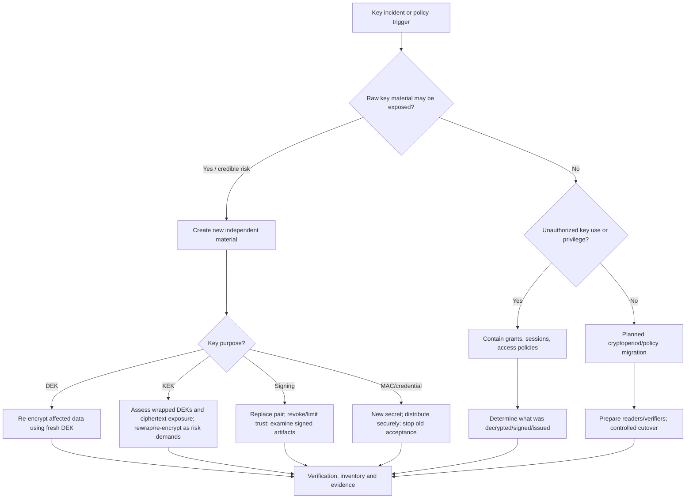
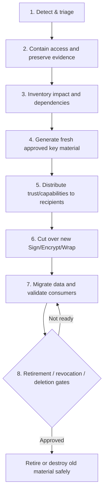
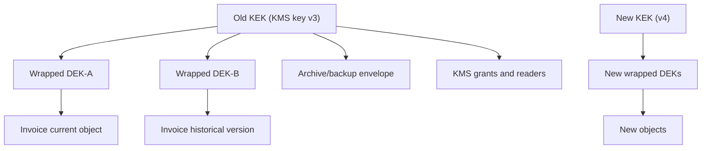
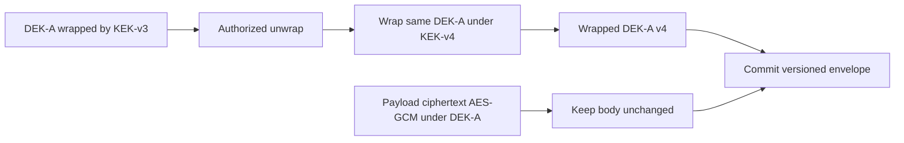
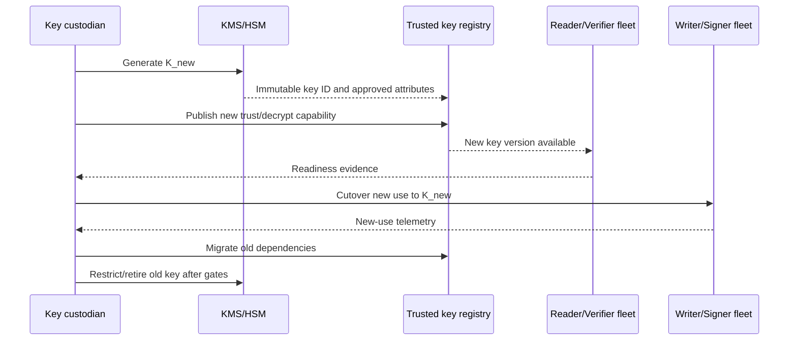
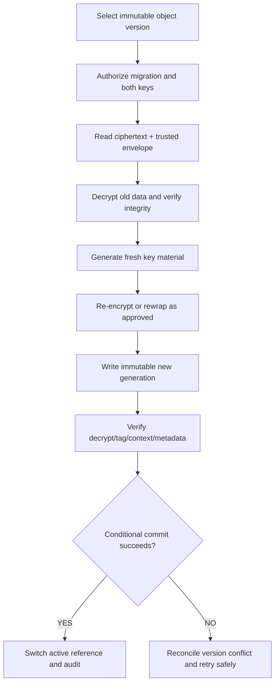

# Replace key: Thay thế khóa mật mã sau thu hồi, lộ khóa hoặc mất khả năng sử dụng

> **Chương:** Revocation và compromise  
> **Bài học:** Replace key  
> **Module:** `SECURITY_KEY_MANAGEMENT_FUNDAMENTALS` — hiểu vòng đời khóa mật mã từ tạo, cấp phát, lưu trữ, sử dụng, xoay vòng đến thu hồi và hủy; kết nối mật mã đối xứng, bất đối xứng, chữ ký số, KMS/HSM, envelope encryption, kiểm soát truy cập và kiểm toán để thiết kế hệ thống bảo vệ khóa an toàn.

## 1. Tình huống mở đầu: Đổi tên key không sửa được sự cố lộ khóa

Một hệ thống lưu hóa đơn dưới dạng ciphertext. Mỗi hóa đơn được mã hóa bởi một **Data Encryption Key (DEK)** và DEK được bọc bởi **Key Encryption Key (KEK)** trong KMS. Cùng lúc, hệ thống phát hành JWT bằng một private signing key non-exportable trong HSM.

Security team phát hiện:

- Một bản sao **plaintext DEK** đã xuất hiện trong crash dump của ứng dụng.
- Một service account từng được cấp quyền KMS `Decrypt` ngoài phạm vi tenant.
- Một artifact CI chứa **private signing key** thuộc môi trường cũ, nhưng chưa rõ nó đã được dùng ở production hay chưa.
- Key alias `current` đã trỏ sang key resource mới, nhưng dữ liệu cũ vẫn phụ thuộc các key versions trước đó.

Operator đề xuất: “Đổi alias sang `key-v2`, xóa old key, vậy là hoàn tất replacement.”

Đề xuất này vừa có thể **không xử lý được việc lộ khóa** vừa có thể **làm mất khả năng giải mã dữ liệu hợp lệ**.

Để thay khóa đúng, phải xác định:

1. **Khóa nào thực sự bị ảnh hưởng?** Raw DEK, KEK, private signing key, certificate, KMS grant hay chỉ credential?
2. **Vật liệu khóa có bị lộ hay chỉ khả năng sử dụng khóa bị lạm dụng?**
3. **Ai có thể đã giữ bản sao khóa hoặc bản mã trước khi thay?**
4. **Phạm vi cần phát hành lại và mã hóa/ký lại là gì?**
5. **Khóa mới được tạo, phân phối, kích hoạt và xác minh theo cách nào?**
6. **Dữ liệu lịch sử, bản sao lưu, chữ ký và token đang lưu hành xử lý ra sao?**
7. **Khi nào được disable, revoke hoặc destroy key cũ?**
8. **Bằng chứng nào chứng minh replacement đã thực sự hoàn thành?**

**Replace key** là quy trình **thay thế key material hoặc key pair cũ bằng key material hoặc key pair mới**, cập nhật cách sử dụng và các đối tượng phụ thuộc, đồng thời xử lý an toàn khóa cũ. Đây không phải chỉ là thay `keyId` trong một tệp cấu hình.

> **Nguyên tắc quan trọng:** Nếu raw key cũ đã lộ, việc bọc lại chính raw key đó bằng một KEK mới **không làm nó bí mật trở lại**. Muốn khắc phục compromise của DEK, thường phải tạo **DEK mới và mã hóa lại dữ liệu** trong phạm vi cần bảo vệ.

### Mục tiêu học tập

Sau bài này, bạn có thể:

1. Phân biệt replacement, key rotation, rekey, rewrap, re-encrypt, revoke, disable, retire và destroy.
2. Xác định **trigger** thay khóa: cryptoperiod, compromise, key loss, policy/algorithm migration, thay owner hoặc trust boundary.
3. Xây dựng quy trình thay khóa từ **containment → triage → fresh key → trusted distribution → cutover → migration → verification → retirement**.
4. Thực hiện quyết định khác nhau cho **DEK, KEK, HMAC secret, asymmetric signing key, TLS/SSH key và KMS/HSM grant**.
5. Hiểu vì sao **compromise** đòi hỏi chiến lược khác planned gradual rotation.
6. Quản lý metadata, immutable key IDs, versions, dependencies, object versions, backups và archival requirements.
7. Thiết kế access decision, separation of duties, KMS/HSM policies và audit cho thao tác replacement.
8. Đọc ví dụ **Java 17** mô phỏng thay signing key Ed25519 và các giới hạn so với HSM thật.
9. Lập kế hoạch migration, rollback và disaster recovery mà không hủy khả năng giải mã dữ liệu còn được giữ.
10. Kiểm thử chứng minh **khóa cũ không còn được sử dụng trái phép** và artifacts mới thực sự dùng khóa mới.

---

## 2. Khái niệm: Replace key, rotate key và revoke key không giống nhau

### 2.1. Định nghĩa theo hành động thực tế

| Thuật ngữ | Hành động chính | Điều không tự xảy ra |
|---|---|---|
| **Replace key** | Đưa một key material/key pair **mới** thay key cũ trong mục đích sử dụng xác định. | Không tự migrate mọi ciphertext/chữ ký hay revoke grants. |
| **Rotate key** | Quy trình theo policy để chuyển sang key/version mới, có thể định kỳ hoặc theo sự cố. | Không phải mọi provider rotation đều tạo key resource ID mới. |
| **Rekey** | Thay key material bảo vệ dữ liệu hoặc keying context; thuật ngữ có thể khác theo hệ. | Không mặc định có cùng nghĩa với rewrap. |
| **Rewrap** | Bọc **cùng một DEK** dưới KEK mới hoặc wrapping mechanism mới. | **Không đổi raw DEK** và không mặc định re-encrypt payload. |
| **Re-encrypt** | Giải mã rồi mã hóa lại dữ liệu, thường với DEK mới/algorithm hoặc nonce mới. | Không mặc định xóa ciphertext cũ và backups. |
| **Revoke** | Thu hồi trạng thái tin cậy/quyền sử dụng key, certificate hoặc credential. | Không xóa bản sao key đã xuất hiện ở nơi khác. |
| **Disable/suspend** | Ngăn operation theo provider/policy; có thể đảo ngược tùy trạng thái. | Không mặc định xóa key hay làm attacker quên bản sao raw key. |
| **Retire** | Ngừng một số hoặc tất cả mục đích sử dụng key theo lifecycle. | Có thể vẫn cần key để decrypt/verify lịch sử. |
| **Destroy** | Hủy key material theo chính sách/cơ chế được phê duyệt. | Không xóa mọi bản sao dữ liệu và không đảo ngược việc lộ plaintext. |
| **Alias cutover** | Con trỏ/tên logic trỏ sang key khác. | Không biến ciphertext/key blob cũ thành material mới. |

**Dùng đúng từ rất quan trọng trong audit.** Nếu chỉ tạo key mới và đổi alias, không được báo `ALL_DATA_REENCRYPTED` hoặc `COMPROMISE_REMEDIATED` khi chưa có bằng chứng.

### 2.2. Ví dụ với ba lớp khóa

```text
Plaintext object
     |
     v
AES-GCM encrypt with DEK-A
     |
     v
Ciphertext object

DEK-A --(wrap under KEK-v3)--> Wrapped DEK-A

KEK-v3 --(KMS-managed protected material)--> key identity/grants
```

Có ba thay đổi khác nhau:

- Thay **KEK-v3 bằng KEK-v4**, rewrap DEK-A, giữ DEK-A và ciphertext: **chưa replace DEK-A**.
- Thay **DEK-A bằng DEK-B**, re-encrypt payload, wrap DEK-B dưới approved KEK: **replace DEK**.
- Thay **KMS key alias** từ v3 sang v4: mới chỉ thay **key selection cho những thao tác dùng alias**.

### 2.3. “Tạo key mới” mới là một phần nhỏ

Một replacement chưa hoàn tất nếu:

- Writers vẫn chọn old key từ cache.
- Verifiers chưa biết new public key.
- Stored objects vẫn chỉ có wrapped DEK dưới old KEK mà old KEK đã bị hủy.
- Grants vẫn cho phép service bị compromise dùng old key.
- Trust store cũ vẫn chấp nhận chữ ký giả mạo.
- Backups và noncurrent object versions bị bỏ sót.
- KMS/HSM logs không chứng minh actual state.

### 2.4. Thay key material khác thay certificate

Một certificate mới có thể dùng **cùng public/private key pair** nếu policy/provider cho phép. Đây là **certificate renewal**, không nhất thiết là **key replacement**.

Nếu private key bị lộ, phát hành certificate mới nhưng tái sử dụng private key cũ **không xử lý compromise**; phải tạo key pair mới.

---

## 3. Khi nào phải replace key?

### 3.1. Những trigger thường gặp

| Trigger | Ví dụ | Điều cần ưu tiên |
|---|---|---|
| **Confirmed compromise** | Raw DEK/private key được tìm thấy trong artifact public. | Containment, impact analysis, fresh material, revoke trust. |
| **Suspected compromise** | KMS credential bị lạm dụng, logs cho thấy decrypt ngoài scope. | Preserve evidence, giảm rủi ro trước, xác minh custody. |
| **Key loss/unavailability** | HSM partition hỏng; backup KEK không thể phục hồi. | Recovery paths và migration từ nơi còn decrypt được. |
| **End of originator cryptoperiod** | Key không được tạo ciphertext/chữ ký mới. | Planned gradual replacement. |
| **Algorithm/parameter deprecation** | Old key type/size không còn đáp ứng crypto policy. | Migrate format, consumer support và dependencies. |
| **Tenant/ownership boundary change** | Chuyển hệ sang tenant/account khác. | Key isolation, quyền custody và AAD/context. |
| **Operator/offboarding event** | Người từng biết shared secret nghỉ việc. | Replace shared secret nếu có risk truy cập còn lại. |
| **Provider/KMS migration** | Đổi cloud account/KMS/HSM platform. | Import/export rules, non-exportability, escrow/DR. |
| **Accidental exposure** | CI logs ghi private key. | Điều tra phân phối, rotate và scrub theo incident. |
| **Usage/nonce limits** | Key usage hoặc nonce budget sắp hết. | Rekey trước khi vi phạm giới hạn bảo mật. |

### 3.2. Suspected compromise không đồng nghĩa proven extraction

Nếu một API KMS bị gọi trái phép, có thể xảy ra:

```text
Unauthorized Decrypt operation
```

mà không có bằng chứng raw KEK xuất khỏi HSM. Điều đó vẫn có thể làm lộ plaintext DEK hoặc dữ liệu. Phải tách:

- **Key material exposure** — attacker biết raw key.
- **Unauthorized key use** — attacker gọi Sign/Decrypt với key non-exportable.
- **Access policy failure** — quyền rộng, chưa chắc key được dùng.
- **Availability loss** — key bị mất/disabled, nhưng chưa chắc bị lộ.
- **Trust anchor compromise** — CA/private issuer key bị lộ.

Cách khắc phục khác nhau. Ví dụ đổi private signing key **không xóa chữ ký giả đã phát hành**; còn đổi KEK **không phục hồi confidentiality của plaintext đã bị giải mã**.

### 3.3. Có cần replace khi key chỉ bị mất?

Nếu key không còn sử dụng được nhưng **chưa bị lộ**, tạo key mới có thể đảm bảo future use. Tuy nhiên dữ liệu mã hóa chỉ với old key có thể không đọc được; **replacement không hồi sinh old ciphertext**.

Nếu còn backup/escrow hợp lệ, cần kiểm recovery và re-encrypt sang key mới trước khi retire old path. Nếu old material đã mất hoàn toàn, phải báo tình trạng **unrecoverable** thay vì khẳng định replacement đã phục hồi dữ liệu.

### 3.4. Không có chu kỳ cố định cho mọi key

Một symmetric DEK dùng cho một object và một HSM root key có blast radius/lifecycle khác nhau. Thời hạn replacement phải dựa vào loại key, cryptoperiod, usage, threat model, data retention và provider capabilities, không chỉ một scheduler chung.

---

## 4. Threat model của key replacement

### 4.1. Tài sản cần bảo vệ

- Raw secret/symmetric key material.
- Private key/non-exportable key handles và quyền dùng.
- DEK/KEK hierarchy và wrapping metadata.
- Public-key trust bindings/issuer identity.
- Ciphertext, signatures, tokens, backups và replicas.
- Key inventory, rotation plans và approvals.
- IAM/KMS grants, HSM sessions, break-glass credentials.
- Audit evidence, provenance và recovery artifacts.

### 4.2. Đối thủ có thể lợi dụng cả quá trình replacement

| Rủi ro | Cơ chế | Control |
|---|---|---|
| Thay nhầm key | Admin chọn wrong tenant/key ref. | Immutable identity, 2-person review, test. |
| Key substitution | Attacker đưa public key mới vào JWKS/trust store. | Authenticated trusted publication, issuer binding. |
| Rollback key bị lộ | Incident bị coi là config error. | Compromise flag, immutable incident policy, no rollback. |
| Lộ raw key khi migrate | Export private key từ HSM hoặc log DEK. | Non-exportable path, approved KMS rewrap, secret-safe logs. |
| Incomplete replacement | Forgotten job vẫn dùng old key. | Inventory, telemetry, direct-KMS access audit. |
| Replay old artifacts | Chữ ký cũ hợp lệ được dùng lại. | Expiry, sequence/version, revocation state. |
| Premature deletion | Xóa KEK khi old object versions còn tồn tại. | Dependency gate và DR restore. |
| Grants còn hiệu lực | KMS alias đổi nhưng old `Sign` grant còn. | Revoke and provider state readback. |
| Downgrade | Verifier chấp nhận deprecated algorithm hoặc arbitrary kid. | Trusted algorithm/key allowlist. |
| Data copy còn tồn tại | Reencrypt current object nhưng backup cũ vẫn đọc bằng key bị lộ. | Retention, backup controls, risk-aware erasure. |
| Metadata tampering | Wrapped DEK/KekRef bị thay trong sidecar. | Authenticated envelope/versioned commit. |
| Orphaned material | Retry tạo nhiều keys và package không kiểm kê. | Idempotency, reconciliation và cleanup. |

### 4.3. “Compromise window” có thể dài hơn thời gian phát hiện

Nếu key xuất hiện trong build artifact từ ba tháng trước, không được chỉ kiểm các operations sau khi alert xảy ra. Cần xác định:

```text
earliest plausible exposure time
first confirmed misuse
last possible unauthorized access
time old key trust/grants effectively revoked
```

Phân tích token, signed messages, ciphertext và sessions trong **cửa sổ phơi nhiễm** thích hợp. Không suy ra không bị lạm dụng chỉ vì audit trống; audit có thể thiếu coverage hoặc provider caching.

---

## 5. Mô hình quyết định: Replace, revoke, rewrap hay re-encrypt?

### 5.1. Decision tree khái niệm



Đây là hỗ trợ tư duy, **không phải engine tự động quyết định rủi ro**. Một sự cố có thể đồng thời ảnh hưởng KEK, DEK và signing key; cần nhiều nhánh.

### 5.2. Thay KEK khi KEK có thể đã lộ

Nếu attacker có **raw KEK** và đã sao chép wrapped DEKs:

- Rewrap old DEKs dưới KEK mới giúp giảm **future dependencies** vào old KEK.
- Nhưng attacker có thể đã unwrap DEKs từ old blobs.
- Mã hóa lại dữ liệu bằng DEKs mới có thể cần thiết trong phạm vi confidentiality đã bị ảnh hưởng.
- Phải đánh giá ciphertext copies, backup, scope và blast radius.

Không kết luận “KEK mới nên dữ liệu cũ an toàn” khi old KEK/ciphertext/wrapped DEKs có thể đã bị đối thủ nắm giữ.

### 5.3. Thay private signing key khi key có thể đã lộ

Nếu attacker sở hữu raw private key cũ:

- Public key cũ vẫn có thể xác minh các chữ ký do attacker tạo.
- Chỉ thay issuer sang key mới **không làm mọi token giả cũ vô hiệu** nếu verifier vẫn chấp nhận key cũ.
- Có thể cần revoke trust key cũ, invalidate sessions/token generations, cập nhật JWKS/verifiers, kiểm soát sự gián đoạn.
- Historical document signatures cần chính sách trust/timestamp và validation evidence riêng.

### 5.4. Mất khóa mà không có bản sao hợp lệ

Nếu old symmetric DEK mất hoàn toàn:

- Không có phương án mật mã chung để khôi phục ciphertext.
- Tạo new DEK chỉ giúp mã hóa dữ liệu mới.
- Cần tìm plaintext backup đã được phép lưu, key escrow, DR replica hoặc upstream regeneration; nếu không có, ghi nhận data loss.

---

## 6. Quy trình 8 pha thay khóa có kiểm soát

### 6.1. Tổng thể



### 6.2. Pha 1 — Detect, classify và chỉ định owner

Ghi tối thiểu:

```text
incident/rotation ID
affected logical key + immutable key ID/version
key type, algorithm, origin, owner, tenant/environment
reason = compromise | suspected | lost | planned | deprecated
first/last known exposure
business systems/data classes affected
incident commander and key custodian
```

Không chèn raw key vào incident ticket, chat hoặc SIEM để “minh chứng”. Bằng chứng cần được bảo quản ở kho được kiểm soát, có chain of custody.

### 6.3. Pha 2 — Containment có cân nhắc availability

Có thể:

- Disable old key/credential hoặc revoke HSM/KMS grants.
- Chặn đường phân phối mới, dừng `Sign`, `Decrypt` hoặc `Unwrap` trái phép.
- Rotate/thu hồi workload identity bị compromise.
- Vô hiệu hóa vulnerable endpoint hoặc hạn chế network.
- Invalidate tokens/sessions/trust theo risk.
- Bảo toàn logs, deployment manifests, KMS events trước khi chúng bị xoá theo retention.

**Không tự delete key không thể khôi phục ngay khi vừa có alert** nếu làm mất chứng cứ hoặc dữ liệu thiết yếu; quyết định containment và deletion là hai bước khác nhau. Tuy nhiên khi private signing key đã lộ rõ, trì hoãn revoke trust có thể gây nguy cơ giả mạo.

### 6.4. Pha 3 — Inventory phạm vi và dependencies

Tìm:

- Ai từng được cấp raw key hoặc capability?
- Key hierarchy có DEKs/KEKs nào dưới nó?
- Bao nhiêu object/version, archive, backup hoặc replica cần old key?
- JWT/cert/messages/signatures cũ có hạn/retention ra sao?
- Key đã export/import qua KMS/HSM nào?
- Mọi region/account/tenant và offline consumers?
- Có cache plaintext DEK, signing key hoặc shared secret không?

Không báo “scope complete” khi còn phần `UNKNOWN`.

### 6.5. Pha 4 — Generate **fresh independent** key material

- Dùng KMS/HSM hoặc CSPRNG đã được phê duyệt, đúng thuật toán và độ dài.
- Bảo đảm key mới độc lập, không reimport lại material cũ bị lộ.
- Kiểm key purpose, non-exportability, origin, tenant/environment.
- Gán **immutable key ID/version**, record provenance và owner.
- Giới hạn IAM/grants theo action/recipient.
- Kiểm cryptographic operation bằng test fixtures và negative tests.
- Không đưa private/raw material vào app config, issue tracker, logs.

### 6.6. Pha 5 — Distribute key/trust hợp lệ

Với signing key, công bố public verification key qua **authenticated trusted keyset**. Với HMAC/secret, phân phối **secret mới** cho verifiers qua secret manager và quyền phù hợp. Với envelope, chuẩn bị readers hiểu wrapped DEK/KEK references.

Mỗi recipient cần nhận đúng tài liệu/khả năng ở trust boundary thích hợp. `PUT JWKS` thành công không tự chứng minh mọi verifier đã tải key mới.

### 6.7. Pha 6 — Cutover originator use

- New writes/signatures/MAC/wrap dùng key mới.
- Chặn old key new-use ở app **và provider** nếu có thể.
- Gắn immutable key ID vào artifacts/metadata để reader biết đúng version.
- Theo dõi canary/readiness theo region và service version.
- Không retry bằng admin credential khi provider deny old operation.

### 6.8. Pha 7 — Migrate, reconcile và xác minh

- Stored ciphertext: rewrap hoặc re-encrypt tùy key bị lộ và policy.
- Signed tokens: đợi hết hạn nếu planned/old key an toàn; nếu compromise có thể revoke sớm.
- TLS/mTLS: update trust/certificate/key pair và kiểm handshake.
- HMAC: ngừng tạo mới và kiểm old-secret acceptance theo risk.
- Đối soát stale jobs, caches, replicas, historical objects và backup.
- Test DR restore/verify với old và new versions theo mục đích còn hợp lệ.

### 6.9. Pha 8 — Retire, revoke, destroy có điều kiện

Quyết định kết thúc phải dựa vào evidence:

```text
new key used for all authorized new operations
old key not used for new operations
legacy decrypt/verify requirements explicitly handled
critical dependencies migrated/recovered or lawfully erased
old permissions/grants revoked or constrained
audit and incident evidence preserved
approval + deletion gates passed
```

**Retire khác destroy.** Khi historical decrypt bắt buộc, old key có thể được giữ trong KMS ở trạng thái giới hạn thay vì xóa ngay.

---

## 7. Replacement theo kế hoạch khác incident compromise

### 7.1. Planned replacement

Một quy trình dự kiến thay key do cryptoperiod có thể:

```text
K_old creates signatures/ciphertext.
Prepare K_new and publish reader/verifier support.
Cut over new-originator operations.
Allow old historical verify/decrypt for bounded period.
Migrate old dependencies where required.
Retire K_old after evidence gates.
```

Khi old material chưa có dấu hiệu lộ, **overlap** có thể giúp tránh downtime.

### 7.2. Emergency replacement

Nếu old private key/HMAC secret đã bị lộ:

- Chấp nhận old signatures/MACs trong overlap có thể tiếp tục cho attacker giả mạo.
- Có thể phải revoke old trust/disable operations **trước** khi mọi consumer nâng cấp.
- Phải có kế hoạch session invalidation, fallback nghiệp vụ và thông báo.
- Không rollback sang compromised old key chỉ vì new rollout có lỗi.
- Điều tra forged artifacts trong entire exposure window.

### 7.3. Rollback eligibility

| Tình huống | Rollback producer sang old key? | Lưu ý |
|---|---|---|
| Planned rotate, old key an toàn và còn cryptoperiod | Có thể, với approval và kiểm provider policy. | New artifacts đã tạo vẫn cần hỗ trợ. |
| New key cấu hình lỗi, old key vẫn không compromise | Có thể cân nhắc. | Không bỏ new trust quá sớm. |
| Old private key bị lộ | **Không nên**. | Forward-fix sang một key sạch. |
| Old DEK lộ | Không coi old encryption an toàn. | Re-encrypt bằng DEK mới. |
| Old algorithm bị cấm | Thường không. | Dùng approved algorithm mới. |
| Old key destroyed/lost | Không khả thi. | DR/restore hoặc record data loss. |

### 7.4. RTO và security trade-off

Với incident key compromise, mục tiêu có thể không phải **zero downtime** bằng mọi giá. Một khoảng outage có kiểm soát có thể tốt hơn tiếp tục tin một signing key đã bị lộ.

Decision phải dựa vào severity, blast radius, business criticality, evidence và phê duyệt của incident commander; không dùng chiến lược planned rotation mặc định cho mọi sự cố.

---

## 8. Key inventory: Muốn replace được phải biết key nằm ở đâu

### 8.1. Key identity không phải alias

Ví dụ:

```text
logicalName: billing-kek-current
alias:      kms/billing-current
oldKeyId:   immutable-kms-key-227
newKeyId:   immutable-kms-key-381
```

Sau cutover alias trỏ `newKeyId`, nhưng wrapped DEKs cũ có thể ghi `oldKeyId`. Nếu inventory chỉ giữ alias, việc tìm dependencies sẽ không đầy đủ.

### 8.2. Trường inventory khuyến nghị

| Trường | Vai trò |
|---|---|
| `immutableKeyId`, `materialVersion` | Key material cụ thể. |
| `logicalKeyName`, `aliasHistory` | Tên nghiệp vụ và lịch sử cutover. |
| `keyType`, `algorithm`, `strength` | Kiểm crypto policy. |
| `purpose`, `allowedOperations` | Không nhầm Sign, Decrypt, Wrap. |
| `keyOrigin`, `providerRef`, `nonExportable` | Provenance và custody. |
| `ownerTenant`, `environment`, `dataClassification` | Scope và blast radius. |
| `state`, `cryptoperiod`, `retireAt` | Vòng đời sử dụng. |
| `compromiseStatus`, `incidentRef` | Chặn rollback và xử lý trust. |
| `recipients`, `grants`, `policies` | Quyền sử dụng thực tế. |
| `wrappedDekRefs`, `objectVersions`, `backupRefs` | Data dependencies. |
| `replacementOperationId`, `replacementKeyId` | Lineage old → new. |
| `lastVerifiedAt`, `verificationSource` | Bằng chứng trạng thái. |
| `deletionEligibility`, `retentionUntil` | Điều kiện hủy. |

Không bao giờ ghi raw private key, plaintext DEK/KEK hoặc passphrase vào inventory.

### 8.3. Dependency graph



Nhìn graph thấy **replace key** không thể hoàn thành bằng cách đổi alias nếu các cạnh vào old key vẫn tồn tại.

### 8.4. Trạng thái UNKNOWN phải chặn deletion

Một archive chưa scan được hoặc một mobile client offline lâu ngày:

```text
dependencyStatus=UNKNOWN
reason=unavailable-for-verification
```

Không được báo `MIGRATED` hoặc xóa old KEK khi không thể chứng minh tính an toàn của hành động.

---

## 9. Thay DEK cho dữ liệu đối xứng

### 9.1. Khi nào phải thay DEK?

- Raw DEK bị lộ/suspected exposed.
- DEK có usage/nonce limit hoặc cryptoperiod hết.
- Thuật toán/mode hoặc key size không còn được cho phép.
- Dữ liệu được chuyển sang trust boundary/tenant mới.
- Compliance yêu cầu re-encryption bằng material mới.

### 9.2. Quy trình DEK replacement

```text
1. Xác định chính xác object và immutable generation bị ảnh hưởng.
2. Authorize người/workload thực hiện migration, scope và key usage.
3. Lấy ciphertext + old envelope từ nguồn tin cậy.
4. Decrypt dưới old DEK/KEK qua approved path.
5. Xác minh AEAD tag và authenticated context của bản cũ.
6. Sinh DEK_new độc lập bằng CSPRNG/KMS.
7. Encrypt plaintext bằng AEAD đã duyệt với nonce mới.
8. Wrap DEK_new dưới approved KEK, bind context.
9. Lưu ciphertext/envelope version mới bằng conditional commit.
10. Verify decrypt/tag và mapping mới trước khi chuyển active pointer.
11. Kiểm backup/replicas/noncurrent versions và audit.
12. Dọn plaintext/key buffers best effort; không log secrets.
```

### 9.3. Vì sao AEAD tag phải được verify?

Không lấy dữ liệu chưa được xác thực từ ciphertext cũ rồi re-encrypt như thể nó hợp lệ. Nếu attacker sửa bản mã/metadata, xác minh tag/AAD của old object phải thất bại trước khi dữ liệu đó được coi là plaintext đáng tin.

### 9.4. Nonce của AES-GCM và key mới

Với AES-GCM, việc tái sử dụng cùng `(key, nonce)` cho các plaintext khác nhau là lỗi nghiêm trọng.

Khi replace DEK:

- Dùng DEK mới và nonce scheme hợp lệ.
- Không tái sử dụng old DEK với nonce cũ cho payload đã thay.
- Đảm bảo uniqueness giữa chunks/retries.
- Với multipart, có authenticated manifest và unique nonces theo protocol.

### 9.5. Re-encrypt không xóa bản sao ciphertext cũ

Thậm chí sau khi writer chuyển sang ciphertext mới:

```text
old object version
old backup snapshot
CDN/cache copy
attacker-held old ciphertext
```

có thể còn tồn tại. Nếu old DEK đã lộ, attacker vẫn có thể decrypt **bản ciphertext cũ họ đã có**. Replacement hạn chế exposure tương lai; không đảo ngược lịch sử.

---

## 10. Thay KEK và quản lý envelope encryption

### 10.1. KEK có blast radius lớn hơn một DEK

Một KEK bảo vệ hàng trăm nghìn/millions DEKs. Nếu KEK bị mất/disabled, nhiều object có thể không decrypt được; nếu KEK raw material lộ, nhiều DEKs có thể bị ảnh hưởng.

### 10.2. Thay KEK bằng rewrap khi chưa có compromise



Một rewrap có thể chỉ thay wrapped DEK metadata, nếu content AAD không ràng buộc trực tiếp vào KEK mutable reference. Phải kiểm design cụ thể.

### 10.3. Content AAD và wrapping context nên được phân tách

Ví dụ:

```text
contentAAD = canonical(
  "object-content-v1",
  tenantId,
  immutableApplicationObjectId,
  stableContentKeyId,
  encryptionAlgorithm
)

wrapContext = canonical(
  "dek-wrap-v1",
  tenantId,
  immutableApplicationObjectId,
  wrappingKeyId,
  stableContentKeyId
)
```

Nếu content AAD đã chứa `wrappingKeyId=v3`, đổi nó thành v4 có thể làm GCM tag không còn khớp. Không được tự hứa rewrap “luôn không cần thay payload” nếu protocol đã bind metadata theo cách khác.

### 10.4. Khi old KEK bị compromise

Đánh giá:

- Có evidence raw KEK đã lộ hay chỉ KMS `Decrypt` grants bị lạm dụng?
- Attacker có thể có old wrapped DEKs/ciphertext không?
- Có plaintext DEKs trong cache/log/backups không?
- KEK có bọc keys nhiều tenant không?
- Có cần re-encrypt data dưới fresh DEKs không?
- Retention/legal hold và DR có cho phép migrate/deactivate không?

**Rewrap chỉ thay lớp bảo vệ DEK**, không làm attacker quên DEKs mà họ đã lấy được.

### 10.5. Provider-managed rotation khác replacement toàn phần

Một KMS có thể tự rotate internal key material của **cùng logical KMS key**, hỗ trợ decrypt ciphertext cũ. Không mặc định đó là thay hẳn KMS key resource hoặc migrate dữ liệu.

Khi chọn resource KEK mới, có thể cần new IAM/grants, new key ID, batch rewrap/re-encrypt và reference migration riêng.

---

## 11. Thay private signing key và trust binding

### 11.1. Signing key khác symmetric encryption key

Với asymmetric signing:

```text
Private key S_old -> Sign artifacts
Public key  P_old -> Verify historical artifacts

Private key S_new -> Sign future artifacts
Public key  P_new -> Verify new artifacts
```

Không phải cứ replace private key là phải xóa public key cũ. Nếu old private key **chưa compromise**, public key cũ có thể cần được lưu để verify chữ ký lịch sử.

### 11.2. Planned replacement

1. Tạo fresh key pair trong HSM/approved boundary.
2. Kiểm public/private pairing và key attributes.
3. Publish new public key qua trusted JWKS/PKI/registry.
4. Chờ verifier readiness/cache propagation.
5. Chuyển new Sign operation sang S_new.
6. Ngừng Sign mới với S_old bằng IAM/HSM usage state.
7. Giữ P_old cho historical verify theo token expiry/retention.
8. Thu hồi/hủy old private material khi policy cho phép.

### 11.3. Incident compromise

Nếu S_old bị lộ:

- Attacker có thể tạo chữ ký giả mà P_old vẫn verify đúng.
- Giữ P_old trong normal trustset có thể tiếp tục chấp nhận forgery.
- Có thể cần loại P_old khỏi active verification trust, invalidate credentials, triển khai thêm server-side revocation/version policy.
- Historic document signatures có thể được đánh giá bằng timestamp/trust evidence phù hợp, **không phải cứ private key bị lộ thì mọi chữ ký từ trước trở nên sai về toán học**.

### 11.4. Quyền `Sign` không đồng nghĩa key đã bị export

Nếu private key non-exportable ở HSM và một workload được cấp `Sign` trái phép, đây là **unauthorized key use**. Không tự kết luận raw private key đã bị trích xuất; nhưng chữ ký được tạo có thể gây tác hại tương đương về mặt nghiệp vụ.

Nên kiểm `CKA_SIGN`/attributes, grants, identity và business authorization; thay key không thay thế việc vá signing oracle.

### 11.5. JWT `kid` chỉ là selector

Một JWT có:

```json
{"alg":"EdDSA","kid":"sign-v4"}
```

Verifier chỉ nên resolve `kid` trong trusted keyset của đúng issuer và policy, kiểm signature, `exp`, `nbf`, `aud`, issuer, session revocation. Không tải arbitrary JWK URL do token tự khai.

---

## 12. Replace HMAC key/shared secret và vấn đề đồng bộ hai phía

### 12.1. HMAC không có public verifier

HMAC secret được cả producer và verifier giữ. Vì vậy:

- Phân phối new secret tới verifiers phải qua kênh bảo vệ và IAM.
- Verifiers có thể tạo MAC nếu nắm secret.
- Giữ old secret trong overlap làm tăng số secrets có thể bị lạm dụng.
- Thời gian overlap phải có giới hạn và risk review.

### 12.2. Planned replacement

```text
T0: Producer v1, verifier trusts {v1}
T1: Distribute v2 to verifier via secrets manager
T2: Verifier trusts {v1,v2} with known key/version selector
T3: Producer uses v2
T4: Old messages expire/drain, verifier drops v1
T5: Revoke/destroy old secret under policy
```

Với protocol không có key version selector, có thể cần kiểm một **tập khóa hữu hạn, cho phép rõ ràng**, tránh thử toàn bộ keys và rò thông tin qua response/time differences.

### 12.3. Khi secret đã lộ

Không kéo dài dual-accept vô hạn chỉ để tránh downtime. Cần cutover mới và stop accepting old MACs theo incident policy. Có thể invalidate messages/sessions cũ, thêm replay controls và đánh giá attacker-generated messages.

### 12.4. Key derivation và sự khác biệt

Nếu master secret dùng HKDF để dẫn xuất nhiều keys, thay master secret có thể làm thay toàn bộ derived material. Cần domain separation, purpose-specific key IDs/version và migration cho dữ liệu cũ. Không giả định đổi salt/public label là thay master secret đã bị lộ.

---

## 13. Replace TLS/mTLS và SSH key: Key, certificate và trust chain

### 13.1. Thay TLS private key khác gia hạn certificate

```text
TLS private key:  private signing/authentication material
TLS certificate: binds public key to subject under issuer trust
CA chain:        trust hierarchy
```

Nếu chỉ renew certificate giữ same key pair, đó không phải full key replacement.

Khi private key bị compromise, tạo **new key pair**, phát hành certificate mới, triển khai và thu hồi certificate/trust cũ theo CA/PKI policy.

### 13.2. Planned TLS/mTLS rollout

- Chuẩn bị new keypair/certificate đúng SAN, EKU, chain.
- Kiểm client trust store, CA/intermediate compatibility.
- Deploy canary và quan sát TLS handshake errors.
- Rolling rollout server identity/cert config.
- Với mTLS client, đảm bảo server trust/allowlist được cập nhật trước client cutover.
- Kiểm cached credentials, key manager reload và session resumption semantics.
- Thu hồi old cert/key theo plan.

### 13.3. Sự cố private key TLS

Cần:

- Revoke certificate nếu phù hợp.
- Thay pair/cert trên tất cả endpoints/regions.
- Đánh giá khả năng MITM/impersonation trong thời gian lộ.
- Kiểm các service còn trust old cert/pin.
- Không giả định CRL/OCSP được mọi client kiểm cùng cách.
- Không dump TLS traffic secrets để “chẩn đoán”.

### 13.4. SSH host key replacement

Host key rotation cần bảo vệ mapping **host identity → trusted public key**. Không đơn giản xóa `known_hosts` và bật cơ chế bỏ qua host key verification.

Nếu host private key bị lộ:

- Phát hành host key mới.
- Cập nhật trusted host key records qua kênh bảo vệ.
- Giới hạn/chấm dứt trust key cũ theo risk.
- Điều tra spoofed host/session trong exposure window.

### 13.5. SSH user key replacement

Thay user public/private pair phải xét:

- Authorized keys và IAM cấp quyền.
- Endpoint/bastion configurations.
- Known copies của private key và agent forwarding.
- Old key revocation và access logs.
- Không yêu cầu người dùng gửi private key qua ticket/chat để xác minh.

---

## 14. KMS/HSM: Thay key nhưng vẫn enforce key custody

### 14.1. Key replacement không cần export raw KEK

Một HSM có thể sinh new key object và cung cấp key wrapping/rewrapping operation **trong module**. Khi có approved workflow, raw KEK không cần rời module.

Không đặt mục tiêu “migrate cho nhanh” cao hơn non-exportability policy.

### 14.2. Key operation attributes

| Operation/attribute | Cần xét khi replace |
|---|---|
| `SIGN` | Old signing grants bị dừng, new signing key đúng purpose. |
| `VERIFY` | Public trust của old/new versions theo policy. |
| `ENCRYPT` | New-originator use chỉ dưới key được duyệt. |
| `DECRYPT` | Historical ciphertext path theo key ID/retention. |
| `WRAP/UNWRAP` | Source/destination KEK và data-key lifecycle. |
| `DERIVE` | Master key/context version, derived-key dependencies. |
| `EXPORT/IMPORT` | Approval, origin/provenance, wrapping mechanisms. |
| `DISABLE/DESTROY` | Dependencies, SoD, actual provider state. |

PKCS#11 thường có attributes như `CKA_SIGN`, `CKA_DECRYPT`, `CKA_WRAP`, `CKA_UNWRAP`, `CKA_EXTRACTABLE`; semantics thực tế phụ thuộc key type/token/vendor.

### 14.3. Cấp quyền mới không có nghĩa quyền cũ biến mất

Nếu tạo `newKeyId` và cập nhật app, old KMS grants có thể vẫn còn. Cần:

```text
create/authorize new grants
verify current workload uses new key
disable/revoke old new-use grants
audit actual state
limit historical use when justified
```

### 14.4. KMS `Decrypt` success không chứng minh nghiệp vụ hợp lệ

Một backend có `Decrypt` rộng có thể bị lợi dụng thành **confused deputy**. Trước khi unwrap DEK, kiểm người dùng và resource/tenant qua trusted registry, sau đó KMS IAM/encryption context thực thi thêm.

Thay KEK không sửa được lỗ hổng authorization nếu service role vẫn cho phép decrypt mọi tenant.

### 14.5. Khả năng import/reimport

Một imported key reimport cùng raw bytes **không phải fresh replacement**, dù resource status đổi. Khi material cũ bị lộ, phải dùng independent new material; kiểm BYOK origin, import token/session, HSM custody, exportability và audit.

---

## 15. Key selection và backward compatibility khi chuyển sang key mới

### 15.1. Writers và readers có nhịp khác nhau

```text
Before:
 writer encrypt/sign with K_old
 reader decrypt/verify with K_old

Transition:
 reader supports {K_old,K_new} where safe
 writer switches new operations to K_new

After:
 writer uses K_new
 reader only allows K_old for approved historical uses, if any
```

**Reader compatibility trước writer cutover** giúp giảm lỗi trong planned replacement. Khi key cũ compromised, có thể cần ưu tiên revoke và chấp nhận gián đoạn.

### 15.2. Key/version trong artifact

Ví dụ envelope:

```json
{
  "formatVersion": 2,
  "contentKeyId": "dek-opaque-241",
  "wrappingKeyId": "kms-immutable-kek-84",
  "algorithm": "AES-256-GCM",
  "objectGeneration": "invoice-7821-gen-08"
}
```

Ví dụ JWS:

```json
{"alg":"EdDSA","kid":"issuer-a-sign-v5"}
```

**Selector không phải authority.** Mọi key references cần đối chiếu trusted registry, scope, algorithm, issuer/tenant/purpose.

### 15.3. Không thử mọi khóa đến khi decrypt thành công

Sai:

```text
for each KMS key in account:
    attempt decrypt until it works
```

Vừa tốn tài nguyên, vừa có thể làm lộ cross-tenant data, tạo oracle và phá audit. Chọn đúng key qua metadata/registry được xác thực rồi kiểm allowed operation.

### 15.4. Active alias và immutable key ID

`alias/current` có thể đổi. Stored ciphertext, signed artifacts và audit cần biết **key material/version cụ thể**, không dùng alias hiện tại để suy ra lịch sử.

### 15.5. Không chấp nhận algorithm downgrade

Khi cùng lúc tồn tại key cũ và mới, verifier/reader không được cho phép caller tự ép dùng deprecated weak algorithm. Gắn algorithm/purpose vào trusted key record, không tin mỗi token/envelope header.

---

## 16. Planned cutover, emergency cutover và rollback

### 16.1. Planned: chuẩn bị từng lớp



### 16.2. Emergency: Không để availability phá containment

Nếu old key compromised:

```text
contain old credential/operation
generate and validate new key
publish new trust
force producers and consumers to switch
invalidate compromised old acceptance
reconcile affected artifacts/data
```

Có thể không thực hiện đầy đủ “dual acceptance” bình thường. Chính sách chấp nhận old verification phải được Security/Incident Commander duyệt dựa trên rủi ro giả mạo.

### 16.3. Rollback không đảo ngược ciphertext/chữ ký đã sinh

Nếu đã có token mới ký bằng new key, rollback signer sang old key không làm token mới mất đi. Nếu new object đã encrypt dưới DEK/KEK mới, old reader vẫn phải hỗ trợ nó.

Không xóa new key/trust trong lúc rollback mà chưa kiểm những artifacts đã tạo.

### 16.4. Các điều kiện cấm rollback

- Raw old key đã lộ hoặc có căn cứ compromise nghiêm trọng.
- Old algorithm/mode không còn an toàn/được phép.
- Old key originator cryptoperiod hoặc usage limits bị vượt.
- Old key đã destroyed/lost.
- Security đã revoke trust và yêu cầu forward-fix.
- Chính sách regulatory không cho tái kích hoạt.

### 16.5. Feature flag không phải key custody

Một flag `enableNewKey=true` không tự tạo key, chặn old grants, bảo vệ key storage hay chứng minh KMS actual state. Phải có control plane, IAM/provider checks và audit riêng.

---

## 17. Key replacement và access decision trước crypto operation

### 17.1. Ai được phép thực hiện replacement?

Một quy trình thay khóa thường cần quyền:

```text
Create/Generate new key
Change policy/alias/grants
Wrap/Unwrap or ReEncrypt data keys
Update trust stores/JWKS
Disable/retire old key
Schedule destruction
```

Không có lý do một service writer thường ngày phải có toàn bộ quyền này.

### 17.2. Separation of duties

- **Key custodian:** quản lý key origin/lifecycle, approvals.
- **Application owner:** thay key references/reader compatibility, business authz.
- **Security/incident response:** đánh giá compromise, containment và evidence.
- **SRE/platform:** rollout, rollback, DR và monitoring.
- **Auditor:** xem metadata/logs, không cần raw secrets.
- **Data governance:** retention/legal hold và data erasure decisions.

Những key có blast radius lớn có thể yêu cầu dual-control/quorum trước khi destroy hoặc export.

### 17.3. Quyết định trước Decrypt/Unwrap

Một migration worker có quyền KMS rộng cũng cần được kiểm:

```text
subject/workload identity
operation type
approved incident/rotation ID
tenant/object generation
immutable old and new key IDs
source/destination wrapping context
key lifecycle state
migration lease/expiry
allowed data class/region
```

Không lấy arbitrary old/new KMS IDs từ client làm đầu vào cho một `ReEncrypt` endpoint đặc quyền.

### 17.4. Chặn key substitution trong trust update

Công bố new public key phải xác minh provenance/issuer/certificate chain và approvals. Nếu attacker thay public key trong JWKS, họ có thể tạo signatures hợp lệ dưới key của mình đối với verifier tin registry bị nhiễm.

### 17.5. Fail closed trước thao tác nguy hiểm

Nếu inventory, approval hoặc KMS key state không truy vấn được, không tự “cho phép migration tạm thời”. Với action có nguy cơ làm mất dữ liệu/hủy key, `UNKNOWN` phải dẫn đến chặn hoặc quy trình ngoại lệ được phê duyệt, không tự cho `PERMIT`.

---

## 18. Versioning, object metadata và các bản sao lịch sử

### 18.1. Một đường dẫn object có thể phụ thuộc nhiều keys

Khi object storage bật versioning:

```text
bucket/invoices/7821.pdf:
  current v3    -> DEK-C -> KEK-v4
  historical v2 -> DEK-B -> KEK-v3
  historical v1 -> DEK-A -> KEK-v2
```

Thay KEK-v3 rồi nhìn current v3 là **không đủ**. Noncurrent versions, backup và archive có thể vẫn cần v3 hoặc v2.

### 18.2. Metadata cần cho việc giải mã sau replacement

| Field | Lý do cần lưu | Điều cần bảo vệ |
|---|---|---|
| `formatVersion` | Parse đúng envelope. | Schema allowlist, chống downgrade. |
| `applicationObjectId/generation` | Context bất biến. | Trusted identity/anti-rollback. |
| `contentAlgorithm` | Chọn AEAD đúng. | Approved algorithm policy. |
| `contentKeyId` | Keying material của payload. | Stable reference. |
| `nonce/tagLocation` | Xác minh AES-GCM. | Không sửa/lặp nonce; integrity. |
| `wrappedDek` hoặc reference | Mở DEK an toàn. | Không chứa raw DEK. |
| `wrappingKeyId/version` | Resolve KEK lịch sử. | Immutable ID, trusted mapping. |
| `aadSchemaVersion` | Tạo expected AAD. | Canonical format. |
| `storageVersionId` | Version thực tế. | Registry và authorization. |
| `replacementGenerationId` | Lineage migration. | Versioned atomic commit. |
| `migrationStatus` | Progress PASS/FAIL/UNKNOWN. | Đối soát và audit. |

### 18.3. Metadata cũng có thể bị tấn công

Attacker có quyền sửa metadata có thể cố đổi `tenantId`, `kekId`, `algorithm`, `nonce` hoặc `wrappedDEK`. AES-GCM authentication tag chỉ xác thực ciphertext và **AAD thật sự đã đưa vào phép mã hóa**; nó không tự bảo vệ mọi JSON field/metadata.

Cần trusted registry, canonical AAD, authenticated envelope/manifest, policy allowlist. Không lấy `tenantId` từ blob không đáng tin rồi coi đó là bằng chứng quyền truy cập.

### 18.4. Storage version ID có thể chưa biết khi mã hóa

Một số object stores sinh storage version ID sau PUT. Không thể đưa ID chưa tồn tại vào content AAD một cách trung thực. Dùng **immutable application generation ID** cấp trước, sau PUT ghi mapping tới version ID thực trong registry có kiểm soát.

### 18.5. Anti-rollback khi thay khóa

Old ciphertext có tag hợp lệ vẫn có thể là version bị replay. Reader phải xác định **version nào còn được phép**, qua trusted current pointer/monotonic revision hoặc chính sách archival. Cryptographic validation không thay business authorization và anti-rollback state.

---

## 19. Migration stored ciphertext an toàn

### 19.1. Chọn đúng hành động

| Tình huống | Hành động cân nhắc |
|---|---|
| Planned KEK replacement, DEKs chưa lộ | Rewrap DEKs; body có thể giữ nguyên. |
| KEK lộ, DEKs có nguy cơ bị unwrap | Đánh giá DEK replacement/re-encryption, không chỉ rewrap. |
| Raw DEK lộ | Fresh DEK + re-encrypt affected data. |
| Algorithm bị cấm | Re-encrypt với approved algorithm/protocol. |
| KMS/account migration | Target key và rewrap/re-encrypt theo provider semantics. |
| Key mất, không còn đường decrypt | Không thể tự tạo lại plaintext từ ciphertext; tìm recovery path hoặc ghi nhận data loss. |

### 19.2. Workflow một object



Phải kiểm **old AEAD tag/AAD** trước khi coi plaintext là đáng tin, và **new AEAD tag/AAD** sau migration. Không giải mã thử lần lượt qua arbitrary keys khi kiểm tra thất bại.

### 19.3. Atomicity ở cấp ứng dụng

Nếu ciphertext và envelope nằm ở hai objects, không thể mặc định hai PUT là transaction nguyên tử. Các lựa chọn gồm:

- Immutable generations và versioned manifest.
- Conditional writes/compare-and-swap pointer.
- Transactional registry commit.
- Commit marker và idempotent retry.
- Garbage collection old material sau khi reader và DR đã chuyển.

Không xóa old reference trước khi new object có thể decrypt/verify.

### 19.4. Batch migration nhiều worker

- Phân vùng theo tenant, key version, data class, region.
- Dùng operationId/idempotency token, leases và bounded concurrency.
- KMS throttling: retry có backoff/jitter, không unlimited parallelism.
- Retry không tái sử dụng `(DEK, nonce)` với plaintext khác.
- Kiểm checkpoint, logs, failed items và orphaned envelopes.
- Đo chi phí KMS, object PUT/GET, egress, audit events.
- Không bỏ `FAILED` hoặc `UNKNOWN` khỏi denominator completion.

### 19.5. Retention lock và archive

Object bị legal hold/Object Lock có thể không thể overwrite. Migration có thể tạo generation mới nhưng old version vẫn tồn tại và có key dependency. Phải tách **chuyển đường đọc active** khỏi **xóa dữ liệu cũ**, đồng thời tôn trọng retention.

---

## 20. Java 17: Demo thay signing key Ed25519 và thu hồi trust cũ

Ví dụ này mô phỏng **compromise response**:

1. Có old signing pair và artifact được ký hợp lệ.
2. Sinh một **new independent Ed25519 pair**.
3. Đăng ký public key mới vào trusted verifier registry.
4. Chuyển active signing key sang new private key.
5. Đặt old verifier entry thành `REVOKED` theo giả định incident.
6. Chứng minh artifact mới verify được; artifact cũ bị từ chối **theo policy** dù chữ ký cũ có thể vẫn đúng toán học.

Đây là **demo trong bộ nhớ**, không kết nối KMS/HSM hoặc issuer/JWKS thật. Với production, private key nên được giữ non-exportable trong HSM/provider khi policy yêu cầu, và trust updates phải qua authenticated control plane.

```java
import java.nio.charset.StandardCharsets;
import java.security.GeneralSecurityException;
import java.security.KeyPair;
import java.security.KeyPairGenerator;
import java.security.PublicKey;
import java.security.Signature;
import java.util.HashMap;
import java.util.Map;
import java.util.Objects;

public final class ReplaceSigningKeyDemo {

    private static final byte[] DOMAIN =
            "PAYMENT-SETTLEMENT:v1:".getBytes(StandardCharsets.UTF_8);

    enum TrustState { ACTIVE_VERIFY, REVOKED }

    // Demo only: byte[] is mutable; production requires defensive copies.
    record SignedArtifact(
            String immutableKeyId,
            byte[] canonicalPayload,
            byte[] signature) {}

    record VerifierEntry(
            PublicKey publicKey,
            TrustState state) {}

    private final Map<String, VerifierEntry> trustedKeys =
            new HashMap<>();

    private String activeKeyId;
    private KeyPair activeKeyPair;

    static KeyPair generateFreshKeyPair()
            throws GeneralSecurityException {
        KeyPairGenerator generator =
                KeyPairGenerator.getInstance("Ed25519");
        return generator.generateKeyPair();
    }

    void initialize(String keyId, KeyPair pair) {
        if (activeKeyId != null) {
            throw new IllegalStateException("Already initialized");
        }
        if (trustedKeys.containsKey(keyId)) {
            throw new IllegalArgumentException("Duplicate ID");
        }

        trustedKeys.put(keyId, new VerifierEntry(
                pair.getPublic(), TrustState.ACTIVE_VERIFY));
        activeKeyId = keyId;
        activeKeyPair = pair;
    }

    static byte[] canonicalPayload(String approvedRecord) {
        byte[] body = approvedRecord.getBytes(StandardCharsets.UTF_8);
        byte[] message = new byte[DOMAIN.length + body.length];
        System.arraycopy(DOMAIN, 0, message, 0, DOMAIN.length);
        System.arraycopy(body, 0,
                message, DOMAIN.length, body.length);
        return message;
    }

    SignedArtifact sign(String simulatedApprovedRecord)
            throws GeneralSecurityException {

        // Production: authorization, canonical business records,
        // purpose/domain checks and quota BEFORE HSM Sign.
        byte[] message = canonicalPayload(simulatedApprovedRecord);
        Signature signer = Signature.getInstance("Ed25519");
        signer.initSign(activeKeyPair.getPrivate());
        signer.update(message);

        return new SignedArtifact(
                activeKeyId, message, signer.sign());
    }

    boolean verify(SignedArtifact artifact)
            throws GeneralSecurityException {

        Objects.requireNonNull(artifact);

        VerifierEntry entry = trustedKeys.get(
                artifact.immutableKeyId());

        if (entry == null
                || entry.state() != TrustState.ACTIVE_VERIFY) {
            return false;
        }

        byte[] payload = artifact.canonicalPayload();
        if (payload.length < DOMAIN.length) {
            return false;
        }
        for (int i = 0; i < DOMAIN.length; i++) {
            if (payload[i] != DOMAIN[i]) {
                return false;
            }
        }

        Signature verifier = Signature.getInstance("Ed25519");
        verifier.initVerify(entry.publicKey());
        verifier.update(payload);
        return verifier.verify(artifact.signature());
    }

    void replaceCompromisedKey(
            String oldKeyId,
            String newKeyId,
            KeyPair newIndependentPair) {

        if (!oldKeyId.equals(activeKeyId)) {
            throw new IllegalArgumentException("Unexpected old ID");
        }
        if (newKeyId.equals(oldKeyId)
                || trustedKeys.containsKey(newKeyId)) {
            throw new IllegalArgumentException("Not a fresh ID");
        }

        // Production: verify HSM provenance, IAM, approval,
        // authenticated distribution, readiness and audit.
        trustedKeys.put(newKeyId, new VerifierEntry(
                newIndependentPair.getPublic(),
                TrustState.ACTIVE_VERIFY));

        VerifierEntry old = trustedKeys.get(oldKeyId);
        trustedKeys.put(oldKeyId, new VerifierEntry(
                old.publicKey(), TrustState.REVOKED));

        activeKeyId = newKeyId;
        activeKeyPair = newIndependentPair;
    }

    public static void main(String[] args)
            throws GeneralSecurityException {

        ReplaceSigningKeyDemo demo =
                new ReplaceSigningKeyDemo();

        demo.initialize("issuer-sign-v1", generateFreshKeyPair());
        SignedArtifact old = demo.sign("settlement-001");

        System.out.println("Old initially accepted: "
                + demo.verify(old));

        demo.replaceCompromisedKey(
                "issuer-sign-v1", "issuer-sign-v2",
                generateFreshKeyPair());

        SignedArtifact current = demo.sign("settlement-002");

        System.out.println("New accepted: "
                + demo.verify(current));

        System.out.println("Old revoked: "
                + !demo.verify(old));

        byte[] changed = current.canonicalPayload().clone();
        changed[changed.length - 1] ^= 1;

        SignedArtifact tampered = new SignedArtifact(
                current.immutableKeyId(),
                changed, current.signature());

        System.out.println("Tampering rejected: "
                + !demo.verify(tampered));
    }
}
```

### 20.1. Kết quả dự kiến

```text
Old initially accepted: true
New accepted: true
Old revoked: true
Tampering rejected: true
```

Đây là kết quả **dự kiến theo logic của Java 17**, không phải khẳng định đã compile hoặc test trên HSM thực.

### 20.2. Điều gì được minh họa?

- Tạo key pair mới, không đổi alias tới cùng raw material.
- Verifier chọn public key từ registry tin cậy theo immutable key ID.
- New Sign dùng private key mới.
- Old trust được từ chối có chủ đích theo incident policy.
- Chữ ký của payload bị sửa sẽ không verify.
- Không ghi raw secret vào audit.

### 20.3. Giới hạn bảo mật

- JVM có thể còn old private key trong heap/GC; thay `activeKeyPair` không bảo đảm secure zeroization.
- `HashMap` không thread-safe; cập nhật nhiều dịch vụ/JWKS cần versioned atomic control-plane rollout.
- Demo không xác thực người gọi, không thực hiện approved business transaction checks.
- `SignedArtifact` có byte arrays mutable; cần defensive copying và schema/protocol canonicalization.
- Không có JWT issuer/audience/exp/nbf, sessions, historical signature trust validation hoặc reliable timestamp.
- Không có KMS/HSM IAM/grant revocation, attestation, audit integrity hoặc key pinning.
- Revocation ngay lập tức có thể gây outage; trong compromise case cần cân nhắc containment và thông báo theo policy.
- Không coi `old rejected` là bằng chứng các bản sao token old bên ngoài không thể bị sử dụng nếu verifiers khác chưa nhận trust update.

### 20.4. Production boundary

```text
Signer service -> HSM Sign(new immutable key ID, approved payload)
Verifier fleet -> trusted issuer-specific public key registry
Control plane  -> revoke old Sign grants and trust, audit/readiness
Incident team  -> invalidate sessions and investigate forgery window
```

Verifier không cần biết raw private key.

---

## 21. Pseudocode thay DEK sau compromise

Đoạn dưới là **pseudocode**, không phải SDK của bất kỳ KMS cụ thể nào:

```text
replaceDekForObject(objectGenerationId, incidentOperationId):

  assert authenticatedMigrationWorkload
  assert approvedIncidentScope(incidentOperationId)
  assert authorizedObjectAndTenant(objectGenerationId)
  assert oldKeyRef resolved from trusted registry

  original = getImmutableCiphertextAndEnvelope(objectGenerationId)
  verify envelope identity, metadata and AAD

  oldDek = authorizedKmsUnwrap(
      original.wrappedDek,
      original.oldKekImmutableId,
      original.oldWrapContext)

  plaintext = aeadDecryptAndVerify(
      oldDek,
      original.nonce,
      original.ciphertext,
      trustedOriginalAAD)

  freshDek = kmsGenerateFreshDataKey(
      approvedNewKekId,
      approvedNewWrapContext)

  newNonce = secureUniqueNonceFor(freshDek)

  newCiphertext = aeadEncrypt(
      freshDek, newNonce, plaintext, newTrustedAAD)

  newEnvelope = wrapAndFormatNewDek(
      freshDek,
      approvedNewKekId,
      newContentKeyId,
      newWrapContext)

  stage new immutable object generation + new envelope
  verify AEAD decrypt/tag, size, identity and manifest
  conditionalCommitNewGeneration(expectedOldGeneration)
  record audit and key dependency lineage

  clear plaintext and key buffers best effort
  schedule approved cleanup of old dependencies
```

### 21.1. Nonce reuse khi retry

Nếu worker timeout rồi retry cùng `(DEK, nonce)` với plaintext khác, AES-GCM có thể bị phá nghiêm trọng. Có thể tạo **fresh DEK per immutable attempt/generation** hoặc phát lại đúng ciphertext bytes đã tạo thay vì re-encrypt nội dung đã thay dưới cùng nonce.

### 21.2. Không chuyển integrity failure thành “try another key”

Sai AEAD tag/AAD là lỗi phải fail safely và điều tra; không thử qua mọi KEKs, không bỏ tag, không trả partial plaintext.

### 21.3. Java memory hygiene có giới hạn

Một SDK có thể trả plaintext DEK cho app. Zeroize mảng trong Java chỉ best effort: provider và GC có thể giữ copies. Nếu policy yêu cầu key never-export, dùng KMS/HSM operations giữ key trong module boundary thích hợp, không tự mô phỏng bằng raw config.

### 21.4. Provider semantics không đồng nhất

Các KMS khác nhau có API `GenerateDataKey`, `ReEncrypt`, `WrapKey`, `UnwrapKey` và policy/region restrictions khác nhau. Không tự giả định một operation rewrap giữa hai accounts giữ key material hoàn toàn bên trong HSM; kiểm đúng provider contract.

---

## 22. Multi-region và bản sao dữ liệu

### 22.1. Một key hierarchy có nhiều vị trí

```text
Primary:
  object g3 -> DEK-v3 -> KEK-region-A

Replica:
  object g3 -> DEK-v3 -> wrapped under KEK-region-B

Archive:
  object g1 -> DEK-v1 -> KEK-legacy
```

Đổi primary KEK không tự thay regional KEKs, replicas hay archival envelopes.

### 22.2. Những điều cần kiểm

- Destination KMS key resource, grants và IAM.
- Source decrypt/destination wrap permissions.
- Encryption context/AAD và data residency.
- Object version/manifest/metadata replication.
- Source outage assumptions và key recovery paths.
- Imported/BYOK key custody và provenance.
- Restore test từ môi trường cô lập khi có thể.

**Không export raw KEK sang vùng khác nếu policy non-exportable cấm.**

### 22.3. RPO/RTO phải gắn với decryptability

Đếm object copies hoặc replication events không chứng minh DR hoạt động. Cần thực hiện:

```text
restore ciphertext + wrapped DEK/manifest
resolve approved immutable key refs
authorize DR principal
unwrap/re-encrypt as required
verify AEAD tag and object identity
audit result
```

---

## 23. Incident response theo loại key

### 23.1. Lộ private JWT signing key

1. Xác định issuer/key version và phạm vi artifact bị phát tán.
2. Chặn old signing grants, vá CI/log/storage leak.
3. Tạo new independent pair trong KMS/HSM.
4. Publish new public trust có xác thực.
5. Migrate issuers/verifiers và chặn old compromised trust theo policy.
6. Invalidate sessions/token families bị ảnh hưởng.
7. Điều tra forged JWT trong plausible exposure window.
8. Kiểm `iat` không đủ chống forgery: attacker có thể tự ghi `iat` giả.

### 23.2. Raw DEK lộ qua crash dump

1. Stop unsafe dumps/logs và thu hồi rộng quyền vào debug storage.
2. Bảo toàn evidence có kiểm soát.
3. Map DEK ID đến affected object generations/tenants.
4. Sinh DEK mới và re-encrypt, kiểm AEAD tags.
5. Xử lý old versions/backups/snapshots, residual risks.
6. Cải tiến memory handling và negative log-leak tests.

### 23.3. Raw KEK lộ

KEK có thể mở nhiều wrapped DEKs offline nếu attacker có wrapped blobs. Đánh giá toàn bộ DEK graph/ciphertext exposure; rewrap giúp giảm phụ thuộc tương lai nhưng không mặc định bảo vệ old ciphertext. Có thể phải thay DEKs/re-encrypt dữ liệu trong phạm vi.

### 23.4. KMS identity bị lộ nhưng KEK vẫn non-exportable

Một account bị lạm dụng `Decrypt` có thể đã nhận plaintext DEKs, nhưng không nhất thiết raw KEK xuất khỏi HSM. Thu hồi principal/grants, điều tra API calls, access scope, business authorization; quyết định thay KEK/DEKs dựa trên evidence và risk, không đoán.

### 23.5. Lưu evidence mà không phát tán secret

Không dán raw private key/DEK vào ticket, chat, SIEM hoặc email để “chứng minh đã lộ”. Dùng controlled evidence storage, secret references và chain of custody.

---

## 24. Crypto-shredding, deletion và legal hold

### 24.1. Destroy old key không giống replace

**Cryptographic erasure** có thể làm ciphertext không còn decrypt được theo threat model nếu key không còn tồn tại/không có copies/recovery. Nhưng:

- Có thể có nhiều bản key escrow/backup.
- DEK có thể được bọc dưới nhiều KEKs.
- Cache có thể giữ raw DEK.
- Attacker có thể đã lấy old key+old ciphertext.
- Một KEK dùng chung bảo vệ nhiều objects khác.

Destroy old key quá sớm có thể gây data loss, phá retention/DR.

### 24.2. Public verification material có thể cần giữ

Private signing key cũ có thể bị revoke/hủy, nhưng public key/certificate chain/timestamp evidence cho chứng từ lịch sử vẫn có thể cần được giữ theo validation policy. Không mặc định xóa mọi public key vì private key bị thay.

### 24.3. Key bị compromise thì destroy có đủ không?

Destroy tại provider giúp ngăn các operation tiếp theo **qua provider**. Nó không khiến attacker quên raw key đã xuất hoặc plaintext đã đọc, và không ngăn forged signatures nếu verifiers còn tin old public key.

### 24.4. Retention-aware key lifecycle

Trước khi hủy phải có:

```text
no required decrypt dependency
historical verify path handled
legal hold and retention reviewed
backup/DR tested
KMS actual state and copies reconciled
owner and independent approval
audit/evidence preserved
```

---

## 25. Giới hạn không thể đảo ngược bằng replacement

### 25.1. Plaintext đã bị exfiltrate

Thay khóa không làm attacker mất dữ liệu đã tải. Incident cần xử lý hậu quả, thông báo/quy định nếu áp dụng và nguyên nhân lộ.

### 25.2. Attacker đã giữ raw DEK + old ciphertext

Re-encrypt active object giúp bảo vệ future generations, nhưng attacker vẫn có thể decrypt old snapshot mà họ giữ. Không nói “đã thu hồi được confidentiality lịch sử”.

### 25.3. Signing/decryption oracle vẫn tồn tại

Nếu backend tiếp tục ký arbitrary input hoặc decrypt object trái quyền bằng new key, replacement chỉ đổi key của oracle. Phải vá business authorization, canonical payload, tenant/resource mapping và IAM.

### 25.4. Trust/control plane bị chiếm

Nếu attacker có quyền sửa JWKS/trust store, họ có thể chèn public key của họ vào keyset. Không giải quyết bằng cách cứ tạo thêm pairs; cần trusted publication, access controls, approvals và audit.

### 25.5. Credential KMS cũ chưa revoked

Thay KEK trong khi principal bị chiếm vẫn có `Decrypt`/`Sign` quyền rộng có thể tái diễn ngay. Credential/identity containment là phần bắt buộc của remediation.

---

## 26. Audit chứng minh replacement đã hoàn thành

### 26.1. Event chain khuyến nghị

```text
REPLACEMENT_REQUESTED
INCIDENT_CLASSIFIED / PLANNED_REASON_APPROVED
OLD_KEY_CONTAINMENT_APPLIED
NEW_KEY_GENERATED
NEW_KEY_POLICY_VERIFIED
NEW_TRUST_OR_GRANT_PUBLISHED
CONSUMER_READINESS_CONFIRMED
NEW_USE_CUTOVER_STARTED
NEW_USE_CUTOVER_VERIFIED
OLD_NEW_USE_REVOKED
DATA_MIGRATION_STARTED
DATA_MIGRATION_CHECKPOINT
DATA_MIGRATION_VERIFIED
OLD_DEPENDENCIES_RECONCILED
RETIREMENT_APPROVED
OLD_KEY_RETIRED / DESTROYED (if eligible)
REPLACEMENT_CLOSED_WITH_RISKS
```

Một event `NEW_KEY_CREATED` **chưa chứng minh** ứng dụng dùng key mới hay old key ngừng hoạt động.

### 26.2. Audit metadata

| Trường | Mục đích |
|---|---|
| `operationId`, `incidentId`, `attemptId` | Correlation/retry. |
| `oldImmutableKeyId`, `newImmutableKeyId` | Material lineage. |
| `keyPurpose`, `algorithm`, `tenant`, `environment` | Scope. |
| `actor`, `approver`, `executingWorkload` | Trách nhiệm. |
| `reasonCode`, `compromiseStatus`, `policyVersion` | Quyết định. |
| `stage`, `outcome`, `providerRequestId` | Kết quả. |
| `consumerCoverage`, `migrationCheckpoint` | Progress. |
| `retentionUntil`, `deletionEligibility` | Lifecycle. |
| `region`, `dependencyRefs`, `inventorySnapshotRef` | DR/reconciliation. |
| `eventTimeUtc`, `ingestedAtUtc` | Time lineage. |

Không log raw DEK/KEK/private key, passphrase, import token, full KMS secret response hoặc customer plaintext. Wrapped material cũng thường chỉ cần reference thay vì log blob.

### 26.3. Kết hợp nhiều nguồn chứng cứ

```text
Application cutover / authorization audit
KMS/HSM actual key/grant states
Inventory and object-version scans
Reader/verifier observed behavior
Backup/DR restore tests
Protected SIEM/incident evidence
```

KMS `Decrypt` không có trong một ngày chưa chứng minh không còn dependencies do cache, hiếm khi đọc hoặc archive tiers.

### 26.4. UNKNOWN không phải PASS

Object archive chưa thể verify hoặc region offline phải ghi `UNKNOWN`, theo dõi owner/deadline. Không ép xóa old key để đạt KPI completion khi còn critical dependencies chưa xử lý.

---

## 27. Monitoring và metrics

| Metric | Dùng để đánh giá | Giới hạn |
|---|---|---|
| `% new Sign under new key ID` | Producer chuyển key chưa. | Không nói verifier đã nhận. |
| `% new Encrypt/Wrap under new key` | New writes. | Không nói old data đã migrate. |
| `old Sign/Wrap attempts after cutover` | Drift/misuse. | Cần KMS/HSM và app telemetry. |
| `old Decrypt/Unwrap by principal` | Legacy use hoặc abuse. | Provider caching có thể che uses. |
| `unknown-kid / verify failures` | Keyset propagation. | Group theo issuer/region. |
| `AEAD tag/context failures` | Integrity/metadata mismatch. | Chưa xác định được nguyên nhân. |
| `object versions migrated/total` | Progress. | Mẫu số phải gồm scope lịch sử/backup. |
| `UNKNOWN/FAILED dependencies` | Chặn destroy. | Không loại khỏi báo cáo. |
| `old active grants` | Quyền provider còn hiệu lực. | Actual-state readback. |
| `KMS latency/throttling` | SLO migration. | Theo region/operation. |
| `DR decrypt/verify pass rate` | Recovery path. | Phải test metadata/key refs. |
| `revocation propagation lag` | Exposure window. | Offline clients có giới hạn thực. |

Alerts: old new-use sau cutover, new key accessed by unapproved principal, unauthorized cross-tenant decrypt, mismatched KEK metadata, missing audit, archived dependencies còn ở key sắp delete, wrong algorithm/kid, spike Sign, failed restore.

---

## 28. Policy-as-code cho Replace key

Đây là **pseudo-policy minh họa**, không phải cú pháp cloud KMS/HSM cụ thể:

```yaml
policyId: cryptographic-key-replacement
version: 1
defaultEffect: DENY

reasons:
  - PLANNED_CRYPTOPERIOD
  - ALGORITHM_MIGRATION
  - MATERIAL_COMPROMISE
  - MATERIAL_LOST
  - KEY_CUSTODY_CHANGE

mandatory:
  - authenticatedActor
  - approvedOwnerOrIncidentAuthority
  - oldImmutableKeyId
  - keyPurpose
  - tenantAndEnvironment
  - dependencyInventoryReference
  - riskClassification

newMaterial:
  freshIndependent: true
  generatedInApprovedBoundary: true
  immutableNewKeyId: true
  approvedAlgorithmAndStrength: true
  keyUsageRestrictionsEnforced: true
  noRawKeyInLogs: true

compromise:
  allowRollbackToCompromisedKey: false
  requireContainmentEvidence: true
  requireArtifactImpactAssessment: true
  denyRewrapAsFullDekRemediation: true

cutoverGates:
  - newKeyPolicyVerified
  - consumerTrustReadyOrIncidentExceptionApproved
  - newOriginatorOperationsUseNewKey
  - oldOriginatorPermissionsRestricted
  - migrationAndAuditProgressRecorded

destructionGates:
  - noUnresolvedCriticalDependencies
  - allRequiredVersionsAndBackupsConsidered
  - restoreAndVerificationEvidenceRecorded
  - retentionAndLegalHoldApproved
  - independentCustodianApproval
```

Một YAML trong Git không bảo đảm đã được enforce. KMS/HSM key policies, PEP/PDP, separation of duties, CI tests, provider readback và audit phải kiểm soát hành vi thực. Break-glass grants cần TTL/scope/audit, không permanent admin role.

---

## 29. Case study A: JWT signing key bị lộ qua CI

### 29.1. Bối cảnh

Identity Service ký JWT Ed25519, verifiers tải JWKS qua CDN. CI artifact chứa old private key; không biết ai đã truy cập.

### 29.2. Quyết định

1. Classify suspected material compromise.
2. Tạo fresh HSM Ed25519 keypair và immutable key ID.
3. Đăng new public key vào trusted JWKS đúng issuer.
4. Chuyển issuers sang key mới.
5. Revoke old HSM Sign grants và key trust theo incident policy.
6. Invalidate relevant token/session generations.
7. Rà soát forged JWT, anomalous access theo exposure window.
8. Vá CI artifact retention/access và secret scanning.

### 29.3. Vì sao chỉ kiểm `iat` không đủ?

Attacker có private key cũ có thể tự ký token với `iat` giả trong quá khứ. Chỉ tin một mốc `iat < cutover` không phân biệt thật/giả. Có thể cần server-side session state, token IDs, revocation epochs hoặc policy thu hồi old trust.

### 29.4. Long-term signatures

Chứng từ số có thể cần historical validation và timestamp evidence. Không nhầm việc giữ public key để kiểm chứng lưu trữ với tiếp tục chấp nhận old JWT cho authentication.

### 29.5. Completion evidence

Old Sign revoked, new key live, verifiers updated, old trust restricted, sessions addressed, CI leak path remediated, audits/alerts effective, residual risks documented.

---

## 30. Case study B: Raw DEK lộ trong Java crash dump

### 30.1. Bối cảnh

Một worker dùng AES-GCM per object, crash reporter lưu heap dump chứa DEK-A; dump storage có IAM rộng. Có current object và old versions phụ thuộc DEK-A.

### 30.2. Quy trình

1. Stop unsafe dumps/log export; giới hạn quyền đọc.
2. Preserve forensic evidence trong kho phù hợp.
3. Map DEK-A tới đúng object generations.
4. Kiểm old AEAD tag/AAD và new policy.
5. Sinh DEK-B mới, re-encrypt affected data, wrap bằng approved KEK.
6. Stage immutable new generation và verify before cutover.
7. Xem old versions, backups và attacker-held copies.
8. Thu hồi quyền vào old dump và siết CI/crash reporter settings.
9. Audit scope và residual confidentiality risk.

### 30.3. Vì sao không chỉ đổi KEK?

Raw DEK-A đã lộ; rewrap DEK-A dưới KEK mới không khôi phục confidentiality. New DEK + re-encrypt cần thiết với dữ liệu còn cần bảo vệ, nhưng cũng không xóa exposure của old copied ciphertext.

---

## 31. Case study C: KMS KEK account migration và DR

### 31.1. Bối cảnh

Hệ SaaS chuyển sang account/region mới; KEK nguồn bọc hàng triệu DEKs, archive tiers và legal holds còn tồn tại.

### 31.2. Planned migration

```text
inventory all old wrapped DEKs and object versions
generate target KEK with approved policy/region
prepare readers and IAM/context in target
cut over new wraps/writes
rewrap legacy DEKs where permitted
reconcile replicas, archive, backup and unknowns
test restore/decrypt isolated from source
retire old KEK only after approved dependency gate
```

### 31.3. Nếu KEK nghi bị lộ

Phải xem attacker có old wrapped DEKs/ciphertext hoặc plaintext DEKs không. Nếu có risk, rewrap đơn thuần không đủ; cần DEK replacement/re-encryption trong phạm vi, cùng bảo vệ old backups và compromise records.

### 31.4. Trường hợp không thể sửa old object

Legal hold có thể bắt giữ old ciphertext và old key references; new generation giúp service chạy nhưng không xóa dependency lịch sử. Phải ghi rõ retention/residual risk và không tự hủy key.

---

## 32. Negative tests và acceptance criteria

| Test | Tình huống | Kỳ vọng |
|---|---|---|
| `T-KEY-01` | New raw key giống old material. | Không coi independent replacement. |
| `T-KEY-02` | Client chọn arbitrary target KMS ID. | Deny/trusted registry resolve. |
| `T-KEY-03` | Migration worker thiếu tenant permission. | Deny trước KMS. |
| `T-KEY-04` | Old HSM Sign grant bị gọi sau cutover. | Provider deny, audit. |
| `T-KEY-05` | Compromised old signature vào active JWT trust. | Rejected theo incident policy. |
| `T-KEY-06` | Verifier thiếu new public key khi planned rollout. | Readiness gate fail. |
| `T-KEY-07` | Old KEK còn archived dependency. | Destruction gate block. |
| `T-KEY-08` | New envelope sai AAD/metadata. | AEAD failure, no plaintext. |
| `T-KEY-09` | Same DEK rewrapped được báo fresh DEK. | Audit/policy check reject. |
| `T-KEY-10` | Leaked DEK chỉ rewrap mà không reencrypt. | Incident remediation incomplete. |
| `T-KEY-11` | Tenant A xin decrypt object B qua migration API. | Deny, zero unauthorized crypto calls. |
| `T-KEY-12` | Retry reuses GCM nonce with new content. | Implementation prevents nonce collision. |
| `T-KEY-13` | Attacker thay new public JWKS key. | Authenticated trust validation rejects. |
| `T-KEY-14` | PDP/KMS unavailable. | Fail safely, no hardcoded fallback. |
| `T-KEY-15` | KMS denies; app tries admin credential. | No bypass, alert. |
| `T-KEY-16` | Reader dùng alias-current cho old ciphertext. | Trusted immutable key selection. |
| `T-KEY-17` | Provider key disabled during in-flight operation. | Outcome tracked, no unsafe retry. |
| `T-KEY-18` | Duplicate migration workers/late ack. | Conditional commit and reconciliation. |

Functional tests: new Sign/Verify, new AES-GCM roundtrip, old historical verify/decrypt theo policy, rewrap vs re-encrypt semantics, object versions, grants, audit, key inventory và DR.

Resilience tests: KMS timeout/throttle, alias drift, CDN cache stale, cross-region failover, legal hold, object commit partial failure, retry/idempotency, log sink outage, revoked-but-cached grants.

**DENY phải dẫn tới KMS/HSM invocation count bằng 0** ở PEP test khi đáng ra chặn trước crypto call. Provider negative tests dùng test keys, không xóa/disable key production chỉ để thử.

---

## 33. Checklist production: Replace key

### Xác định sự cố và phạm vi

- [ ] Classify planned, compromised/suspected, lost, deprecated hoặc custody change.
- [ ] Có old immutable key ID, material version, purpose, algorithm, tenant và owner.
- [ ] Phân biệt raw material exposure với unauthorized key usage.
- [ ] Bảo toàn forensic evidence và plausible exposure window.
- [ ] Có incident commander/key custodian/app owner và approvals.
- [ ] Inventory recipients, grants, object versions, archives, backups, replicas.
- [ ] UNKNOWN dependencies được ghi riêng.

### Sinh và bảo vệ key mới

- [ ] Fresh independent key material từ approved KMS/HSM/CSPRNG.
- [ ] Không reimport same compromised material rồi gọi là replaced.
- [ ] New immutable key ID/provenance/usage policy/cryptoperiod.
- [ ] Non-exportability nếu policy yêu cầu.
- [ ] Restrictive IAM/grants và separation of duties.
- [ ] Key operation test fixtures pass.
- [ ] Trust publication được xác thực, readiness có evidence.
- [ ] Không raw keys trong config, logs, ticket, debug dumps hoặc audit.

### Cutover và incident containment

- [ ] New Sign/Encrypt/Wrap dùng key mới và version rõ ràng.
- [ ] Old originator-use bị chặn ở app/provider.
- [ ] Không kéo dài old trust không kiểm soát khi key compromised.
- [ ] Không rollback về old compromised key.
- [ ] HMAC/JWT/TLS/SSH trust và sessions được đánh giá.
- [ ] KMS grants, caches, HSM sessions, background jobs đã kiểm.
- [ ] Business authorization chống Sign/Decrypt oracle đã được vá.
- [ ] Không chấp nhận arbitrary key IDs/algorithms từ caller.

### Stored data và migration

- [ ] Phân biệt alias cutover, rewrap và fresh DEK re-encrypt.
- [ ] Leaked DEK có plan fresh DEK theo scope.
- [ ] AEAD tag/AAD verified trước/sau migrate.
- [ ] Nonce strategy, retries và multipart không reuse `(DEK,nonce)`.
- [ ] Versioned envelope/manifest và conditional commit.
- [ ] Noncurrent versions, replicas, backups, archive được đối soát.
- [ ] Restore test chứng minh decrypt/verify end-to-end.
- [ ] Retention/legal hold được xét trước cleanup/destruction.
- [ ] Không tuyên bố old exfiltrated copies đã được thu hồi.

### Kiểm toán và đóng sự cố

- [ ] Audit old/new immutable key IDs, operation/incident ID và outcomes.
- [ ] Provider readback chứng minh old grants/Sign rights bị hạn chế.
- [ ] SIEM theo dõi old-key new-use và policy bypass.
- [ ] Consumer coverage và migration checkpoints có bằng chứng.
- [ ] Không báo PASS nếu còn critical UNKNOWN/FAILED.
- [ ] Retirement và destruction có independent approval.
- [ ] Legal/retention/DR gates được kiểm trước key deletion.
- [ ] Residual risk và prevention follow-ups được báo cáo.

---

## 34. Câu hỏi tự kiểm tra

**Câu 1.** Replace key khác đổi alias KMS như thế nào?

**Gợi ý:** alias chỉ là con trỏ; replace tạo material mới và chuyển usage/dependencies.

**Câu 2.** Vì sao rewrap cùng DEK không xử lý raw DEK bị lộ?

**Gợi ý:** DEK plaintext vẫn là cùng material.

**Câu 3.** KEK lộ ảnh hưởng những gì?

**Gợi ý:** nhiều wrapped DEKs và dữ liệu phụ thuộc; đánh giá ciphertext exposure.

**Câu 4.** HSM private key non-exportable bị dùng Sign trái phép có chứng minh raw private key đã bị export không?

**Gợi ý:** chưa. Unauthorized use/signing oracle vẫn có thể gây hại.

**Câu 5.** Vì sao old public JWT key còn được trust sau khi private key lộ là nguy hiểm?

**Gợi ý:** attacker có thể ký token giả; chữ ký vẫn verify.

**Câu 6.** Token có `iat` cũ có chứng minh được do issuer hợp lệ cấp không?

**Gợi ý:** không; attacker có private key có thể tự đặt claim `iat`.

**Câu 7.** Vì sao historical document verification khác active JWT authentication?

**Gợi ý:** mục tiêu trust, thời gian, timestamp và revocation khác nhau.

**Câu 8.** Old key mất hoàn toàn thì fresh key có decrypt được ciphertext không?

**Gợi ý:** không; cần approved recovery copy/path.

**Câu 9.** Vì sao re-encrypt current object không bảo vệ old exfiltrated snapshot?

**Gợi ý:** attacker vẫn giữ old ciphertext + raw key.

**Câu 10.** Khi content AAD bind KEK ID cũ, sửa wrapping metadata có thể gây gì?

**Gợi ý:** AEAD tag mismatch.

**Câu 11.** Vì sao planned replacement có thể overlap, nhưng compromise không được mặc định overlap?

**Gợi ý:** old compromised key tiếp tục hỗ trợ attacker giả mạo/giải mã.

**Câu 12.** Khi new rollout lỗi, có được rollback về old compromised key không?

**Gợi ý:** không; forward-fix với trusted key mới.

**Câu 13.** Vì sao `CKA_SIGN=true` không chứng minh nghiệp vụ đã authorize chữ ký?

**Gợi ý:** key usage khác business authorization.

**Câu 14.** RETIRED có đồng nghĩa destroyed không?

**Gợi ý:** không; old recipient-use có thể cần.

**Câu 15.** Vì sao ciphertext cần immutable key reference?

**Gợi ý:** alias động không xác định material lịch sử.

**Câu 16.** Một object bị legal hold gây ảnh hưởng gì tới KEK destruction?

**Gợi ý:** dữ liệu còn retention/decrypt dependency.

**Câu 17.** Tại sao cần actual KMS grant readback sau revoke?

**Gợi ý:** config/inventory không chứng minh provider đã chặn quyền.

**Câu 18.** Với AES-GCM, cặp giá trị nào không được reuse cho plaintext khác?

**Gợi ý:** `(DEK,nonce)`.

**Câu 19.** Vì sao UNKNOWN dependencies không phải PASS?

**Gợi ý:** có thể còn data bắt buộc phải decrypt.

**Câu 20.** Thay KEK khi backend vẫn `Decrypt *` có đủ không?

**Gợi ý:** không, IAM/confused deputy phải sửa.

**Câu 21.** `NEW_KEY_GENERATED` có đủ chứng minh replacement hoàn tất không?

**Gợi ý:** chưa; cần cutover, revoke, migration, trust, DR.

**Câu 22.** Có nên export raw private key từ HSM để test key hoạt động?

**Gợi ý:** không nếu key non-exportable; dùng approved Sign/Verify test.

**Câu 23.** Certificate renewal dùng lại private key đã lộ có sửa được compromise không?

**Gợi ý:** không; cần new key pair.

**Câu 24.** Replication thành công có đảm bảo DR decrypt được không?

**Gợi ý:** không, còn KEK, IAM, metadata, context.

**Câu 25.** Lộ plaintext rồi thay DEK có làm attacker mất dữ liệu đã lấy không?

**Gợi ý:** không, phải incident response riêng.

**Câu 26.** Nếu service vẫn Sign dưới old key sau cutover, cần kiểm gì?

**Gợi ý:** alias/cache, HSM grants, direct API bypass và provider audit.

---

## 35. Tổng kết: Replace key là thay cả vật liệu và quan hệ tin cậy

Key replacement thành công phải trả lời:

```text
Why was old key replaced?
Which material or capability was exposed?
Is new key independent, approved and correctly protected?
Who now signs/encrypts/wraps under the new key?
Who still verifies/decrypts under the old key and why?
Which ciphertexts, tokens, backups and grants still depend on old key?
Can retained data be restored and verified?
What evidence supports retirement/destruction?
What risks remain because old plaintext/ciphertext already escaped?
```

Những kết luận cốt lõi:

1. **Replace khác alias cutover, rewrap và revoke.** Cần new material và chuyển usage/dependencies.
2. **Compromise khác planned rotation.** Không rollback về old compromised key hoặc kéo dài trust thiếu kiểm soát.
3. **Raw DEK lộ cần fresh DEK/re-encryption** cho scope cần bảo vệ; rewrap không sửa DEK đã lộ.
4. **KEK compromise tác động cả đồ thị DEKs.** Phải đánh giá blast radius/ciphertext copies.
5. **Private signing key lộ làm suy yếu trust** dù Verify vẫn đúng toán học.
6. **HSM non-exportability không ngăn Sign/Decrypt oracle** nếu IAM/business authz yếu.
7. **Immutable IDs, AEAD/AAD, versioning và trust binding** là nền tảng để migrate.
8. **Retire khác destroy:** historical ciphertext/signatures có thể cần recipient-use.
9. **DR phải kiểm decrypt/verify thật** chứ không chỉ replica tồn tại.
10. **Audit và negative tests** chứng minh old grants bị thu hồi, new material được dùng và dependencies đã xử lý.
11. **Key deletion cần approval/dependency gate**, đặc biệt với KEK bảo vệ nhiều objects.
12. **Không thể đảo ngược dữ liệu đã bị lấy đi.** Replacement giảm rủi ro tương lai nhưng không xóa exposure quá khứ.

Một hệ thống bảo vệ khóa cần coi việc thay khóa là **thay đổi trạng thái tin cậy trên toàn hệ thống**, chứ không chỉ là một thao tác tạo random bytes mới.

### Tài liệu nền

- **NIST SP 800-57 Part 1**, *Recommendation for Key Management* — key lifecycle, cryptoperiod, compromise, recipient usage, replacement và destruction.
- **NIST SP 800-130**, *A Framework for Designing Key Management Systems* — KMS roles, key custody, audit và governance.
- **NIST SP 800-53 Rev. 5**, *Security and Privacy Controls for Information Systems and Organizations* — Access Control, Incident Response, Audit, Configuration Management.
- **NIST SP 800-61**, *Computer Security Incident Handling guidance* — phát hiện, containment, eradication, recovery; xem bản hướng dẫn phù hợp với tổ chức.
- **NIST SP 800-38D**, *Recommendation for GCM and GMAC* — AEAD, nonce và authentication tags.
- **NIST SP 800-38F**, *Methods for Key Wrapping* — AES Key Wrap/KWP.
- **FIPS 140-3**, *Security Requirements for Cryptographic Modules* — module boundary, roles, key handling.
- **PKCS #11 (Cryptoki)** — HSM key attributes, Sign/Decrypt/Wrap/Unwrap.
- **RFC 7515**, *JSON Web Signature (JWS)* — signing và key selectors.
- **RFC 7517**, *JSON Web Key (JWK)* — trusted public key distribution.
- **RFC 7519**, *JSON Web Token (JWT)* — claims và validation.
- **RFC 8446**, *TLS 1.3* — key establishment, certificate authentication.
- **Java SE 17 JCA/JCE documentation** — `Signature`, `KeyPairGenerator`, `Cipher` và provider behavior.
- **OWASP Key Management Cheat Sheet** — key generation, compromise, rotation, destruction.
- **OWASP Cryptographic Storage Cheat Sheet** — DEK/KEK, AEAD và envelope encryption.
- **OWASP Secrets Management Cheat Sheet** — secret exposure, rotation và audit.
- **OWASP Logging Cheat Sheet** — security evidence và tránh rò rỉ key trong logs.
