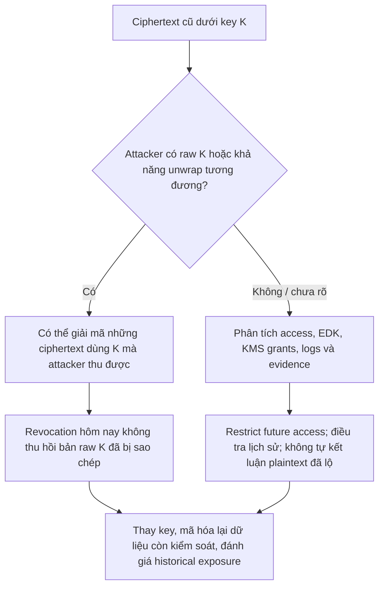
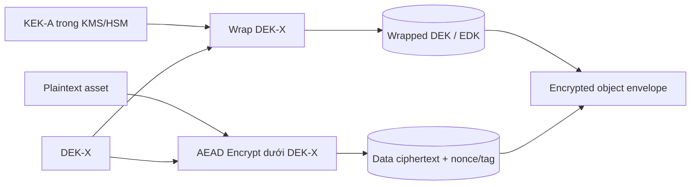
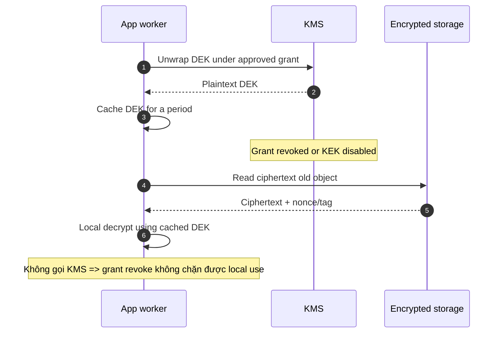
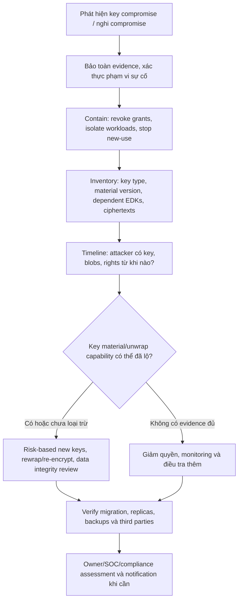
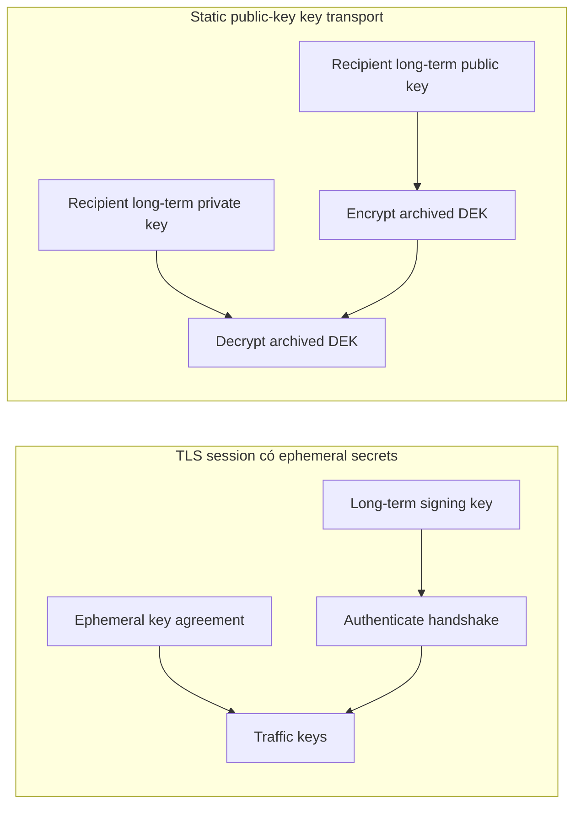
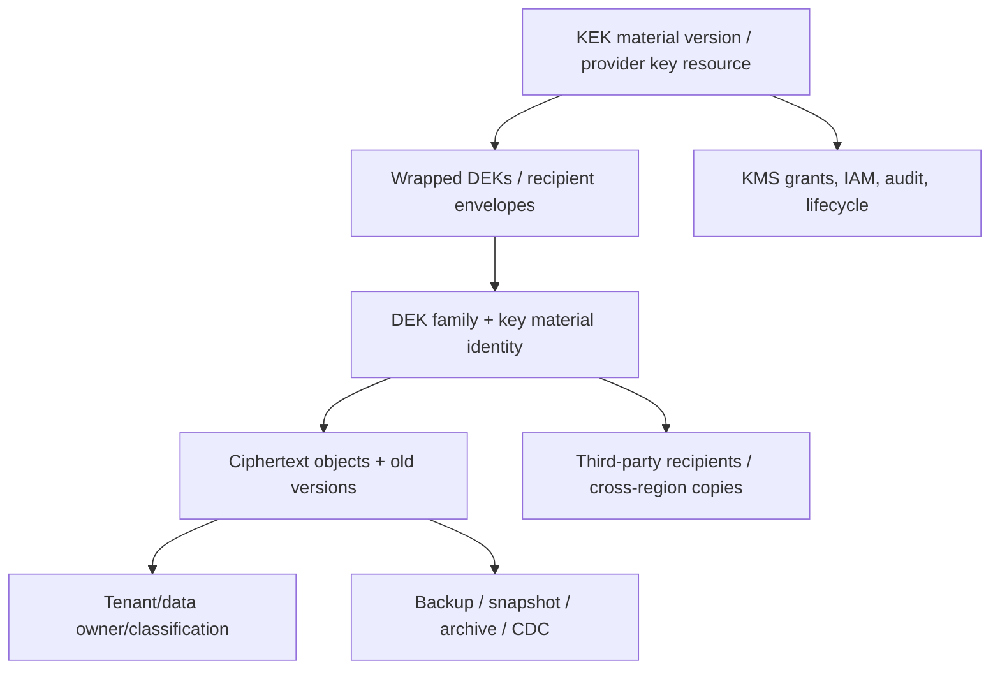
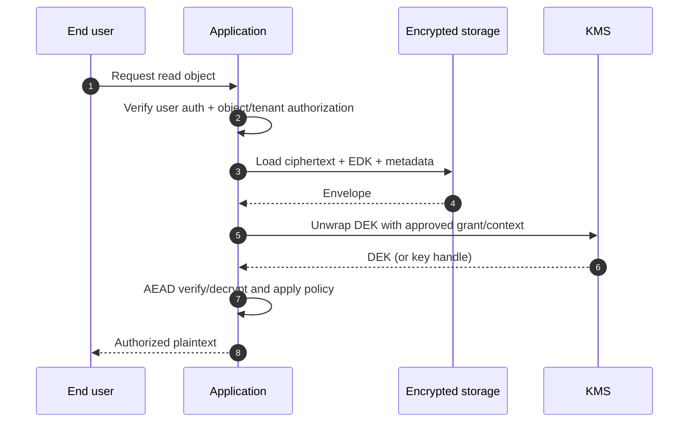
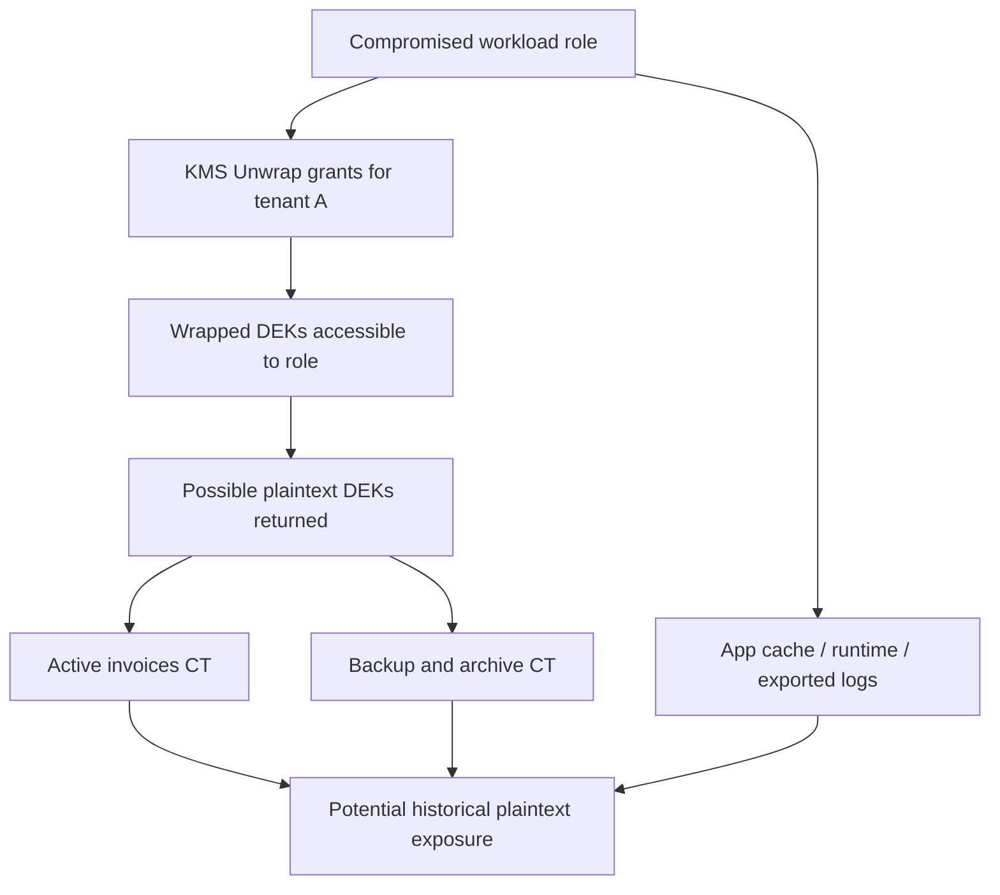

# Ảnh hưởng đến ciphertext cũ — Khi khóa bị thu hồi hoặc compromise

> **Chương:** Revocation và compromise  
> **Module:** SECURITY_KEY_MANAGEMENT_FUNDAMENTALS — hiểu vòng đời khóa mật mã từ tạo, cấp phát, lưu trữ, sử dụng, xoay vòng đến thu hồi và hủy; kết nối mật mã đối xứng, bất đối xứng, chữ ký số, KMS/HSM, envelope encryption, kiểm soát truy cập và kiểm toán để thiết kế hệ thống bảo vệ khóa an toàn.

## 1. Mục tiêu học tập

Sau bài học, bạn có thể:

1. Giải thích vì sao **revoke, disable, retire hoặc rotate một khóa không thể thay đổi các bản ciphertext đã tồn tại**.
2. Phân biệt **thu hồi quyền dùng khóa**, **key material compromise**, **nghi ngờ lộ khóa**, **khóa bị mất**, **hết cryptoperiod** và **key destruction**.
3. Phân tích mức độ tác động tới ciphertext lịch sử khi lộ **DEK, KEK, private key dùng giải mã, private key chỉ dùng ký, HMAC key, KMS credentials** hoặc một service account có quyền unwrap.
4. Giải thích nguy cơ **harvest now, decrypt later**, các bản dữ liệu đã bị sao chép và vì sao việc mã hóa lại hôm nay không thu hồi thông tin đối phương đã có từ hôm qua.
5. Sử dụng **key inventory và dependency graph** để truy tìm ciphertext, wrapped DEKs, key versions, tenants, archives, backups và replicas nằm trong phạm vi ảnh hưởng.
6. Phân biệt rõ **KEK rotation, DEK rewrap, data re-encryption và key revocation**, kể cả giới hạn bảo mật của từng thao tác.
7. Hiểu tác động lên **AES-GCM confidentiality và integrity** khi DEK bị lộ, cùng khác biệt giữa **cryptographic integrity** và provenance của dữ liệu lịch sử.
8. Đánh giá **forward secrecy**, bao gồm trường hợp TLS dùng key agreement tạm thời so với các key-transport/envelope encryption schemes dựa vào khóa dài hạn.
9. Thiết kế **KMS/HSM IAM, decrypt-only, cache invalidation, audit, key retirement, backup/DR và incident response** phù hợp.
10. Đọc ví dụ Java/SQL, phân tích case study, lập checklist và tự kiểm tra bằng các tình huống cụ thể.

## 2. Câu hỏi cốt lõi: sau khi revoke, ciphertext cũ còn an toàn không?

Câu trả lời **phụ thuộc vào điều gì đã bị thu hồi/lộ và attacker có những gì**, không có một kết luận đúng cho mọi hệ thống.

Nếu một bản mã được tạo hôm qua và hôm nay hệ thống gọi `DisableKey` hoặc xóa IAM grant, **những byte ciphertext hôm qua không tự thay đổi**. Thuật toán mã hóa cũng không gửi tín hiệu đến mọi bản sao ciphertext để “cấm giải mã”.

Nếu attacker **đã có plaintext Data Encryption Key (DEK)** và một bản sao ciphertext được mã hóa dưới DEK đó, việc khóa bị disable trong KMS hôm nay không làm attacker quên key. Họ có thể chạy thuật toán giải mã **bên ngoài KMS**, miễn là họ có các tham số cần thiết và ciphertext có thể giải mã với key đã lấy.

Ngược lại, nếu attacker chỉ thấy ciphertext và **chưa từng có khóa hay đường unwrap hợp lệ**, việc giới hạn quyền, giữ KEK an toàn và điều tra sự cố có thể giúp bảo vệ dữ liệu lịch sử. Không thể chỉ từ việc “khóa bị revoke” mà khẳng định ciphertext đã bị đọc.

### 2.1. Ba câu cần trả lời độc lập

- **Ciphertext còn decrypt được bởi ai?** Những ai đang giữ raw key, key handles, authorized KMS paths hoặc backup/recovery keys?
- **Attacker đã lấy gì và vào lúc nào?** Có ciphertext, wrapped DEK, plaintext DEK, private key, app memory, backup hoặc quyền KMS không?
- **Dữ liệu nào cần bảo vệ cho tương lai?** Những ciphertext còn trong hệ thống, historical snapshots, các dữ liệu đã phân phối cho recipients và bản attacker có thể đã sao chép?

### 2.2. Mô hình đơn giản



**Nguyên tắc:** Revocation tác động đến **các đường sử dụng trong tương lai mà mình kiểm soát**. Nó **không bảo đảm** đảo ngược một disclosure đã xảy ra.

## 3. Phân biệt những trạng thái và sự kiện liên quan đến khóa

| Khái niệm | Điều xảy ra | Ciphertext cũ có tự thay đổi? | Tác dụng và giới hạn |
| --- | --- | --- | --- |
| **Revoke IAM grant** | Thu hồi quyền gọi KMS/ứng dụng của một principal | **Không** | Chặn đường API về sau; không xóa raw key/cache đã rời KMS |
| **Disable key** | KMS không cho dùng key theo trạng thái/policy | **Không** | Có thể chặn decrypt qua KMS; không làm mất plaintext key đã sao chép |
| **Retire key** | Ngừng cho key tạo ciphertext mới | **Không** | Giảm new-use risk; old decrypt có thể còn được phép |
| **Rotate key/alias** | Chọn key/material mới cho new operations | **Không** | Old ciphertext vẫn cần key cũ trừ khi có migration |
| **Rewrap DEK** | Bọc lại cùng DEK dưới KEK mới | **Không** | Bảo vệ đường mở DEK tương lai; không đổi DEK đã lộ |
| **Re-encrypt data** | Dùng new DEK/profile tạo ciphertext mới | **Có** | Bảo vệ dữ liệu còn kiểm soát; không xóa các bản cũ attacker đã lấy |
| **Destroy key material** | Hủy key theo assurance/policy | **Không nhất thiết** | Có thể làm data không phục hồi được; không xóa raw key copies ngoài boundary |
| **Key compromise** | Raw key hoặc khả năng sử dụng key trái phép bị lộ/lạm dụng | **Không** | Có thể đe dọa confidentiality, authenticity, integrity tùy loại key |
| **Key loss** | Owner mất khả năng lấy key | **Không** | Có thể làm ciphertext hợp lệ cũng không còn decrypt được |
| **Cryptoperiod expiry** | Kết thúc thời hạn sử dụng theo purpose | **Không** | Cần quyết định encrypt-new vs decrypt-old và retention |

### 3.1. Cryptographic revocation không phải phép toán đảo ngược toán học

Không có thao tác chung:

```text
revoke(key-v1)
  -> tất cả ciphertext-v1 trên mọi thiết bị trở nên vô dụng với attacker
```

nếu attacker đã có **material bí mật đúng**. Hệ thống quản lý khóa chỉ kiểm soát những nơi mà **quyền và thao tác còn nằm trong trust boundary của mình**.

### 3.2. Key state và business authorization là hai lớp

Một KMS key còn `ENABLED` không có nghĩa mọi end-user được phép đọc tài liệu dùng key đó. Ngược lại, một user có quyền đọc tài liệu nhưng KMS key đã `DISABLED` có thể không giải mã được.

Cần cả:

- **Application authorization:** principal → tenant/object/action.
- **Key authorization:** workload → KMS key/material version → operation.
- **Key lifecycle:** active/new-use, historical-use/decrypt-only, disabled, pending deletion.
- **Data integrity:** ciphertext/metadata đúng và AEAD tag hợp lệ.

### 3.3. Vô hiệu hóa key có thể làm mất availability

Nếu một KEK đang bọc hàng triệu DEKs bị disable, ứng dụng có thể không unwrap được EDKs, dẫn đến **outage** ngay cả khi không có attacker. Khi revoke do sự cố, cần cân bằng giữa containment và business continuity trong khuôn khổ policy — không tự mở lại key hoặc bỏ authentication để “cứu availability”.

## 4. DEK, KEK và ảnh hưởng lên ciphertext lịch sử

### 4.1. Hai tầng của envelope encryption



Một **DEK** trực tiếp bảo vệ data ciphertext; một **KEK** dùng wrap/unwrap DEK. Vai trò khác nhau kéo theo **blast radius** khác nhau.

### 4.2. Lộ DEK

Nếu `DEK-X` bị lộ, những ciphertext được mã hóa dưới **đúng DEK-X** có thể bị ảnh hưởng về confidentiality. Với AEAD đối xứng, ai biết DEK có thể tạo những ciphertext/tag **hợp lệ về mật mã** dưới key đó — vì vậy integrity/provenance của dữ liệu dựa riêng vào key cũng cần đánh giá.

**Không được kết luận** một DEK chỉ dùng cho một object nếu implementation đã reuse DEK giữa nhiều revisions, chunks, services hoặc tenants. Phải kiểm kê thực tế.

### 4.3. Lộ KEK

Nếu `KEK-A` bị lộ, attacker có thể unwrap những **wrapped DEKs dưới KEK-A** mà họ có được và từ đó decrypt ciphertext tương ứng.

Rủi ro phụ thuộc:

- Có bao nhiêu EDKs từng được bảo vệ dưới KEK đó.
- Attacker có thu được EDKs/ciphertexts từ DB dumps, backups hoặc logs không.
- KEK có thể đã được dùng ở tenants/regions khác không.
- Có nhiều recipients/alternate wrappers không.
- Các DEKs có bị attacker unwrap trước khi containment không.

**Một KEK lộ có thể ảnh hưởng hàng nghìn hoặc hàng triệu ciphertext**, nhưng không nên khẳng định mọi đối tượng đều chắc chắn đã bị đọc nếu không có evidence.

### 4.4. KEK non-exportable vẫn có thể bị lạm dụng

Một KEK trong HSM không xuất raw key vẫn có thể bị workload có `KMS Decrypt/Unwrap` permission lạm dụng để mở nhiều EDKs. Attacker không cần lấy raw KEK nếu có thể gọi API và nhận **plaintext DEK**.

**Bảo vệ key material** và **kiểm soát API use** là hai việc phải cùng làm.

### 4.5. Một DEK, nhiều wrappers

```text
Data ciphertext-1 -- DEK-X
                        |-- Wrapped under KEK-A
                        |-- Wrapped under KEK-B (DR)
                        |-- Wrapped for Partner-C
```

Hủy wrapper dưới KEK-A không bảo đảm mất khả năng decrypt nếu KEK-B hoặc Partner-C vẫn có đường phục hồi DEK-X. Ngược lại, xóa một KEK có thể gây mất dữ liệu ở các objects không còn wrapper khác.

Key inventory cần quản lý **key-to-data** và **key-to-key/recipient** dependencies đầy đủ.

## 5. Loại khóa bị compromise quyết định kiểu thiệt hại

| Bí mật bị lộ | Ciphertext lịch sử chịu ảnh hưởng gì? | Giới hạn cần nhớ |
| --- | --- | --- |
| **AES DEK** | Có thể decrypt tất cả ciphertext dùng DEK và có thể giả mạo AEAD ciphertext/tag dưới key | Phạm vi thực tùy key reuse, versions và data copies |
| **KEK plaintext** | Có thể unwrap EDKs tương ứng rồi decrypt data | Cần EDKs và ciphertext; những DEKs đã unwrap có thể còn ở attacker |
| **KMS credential có quyền Unwrap** | Có thể truy cập EDKs qua KMS khi credential/grant còn dùng được | Thu hồi grant chặn use mới nhưng phải điều tra historical calls và cached keys |
| **Private key dùng RSA-OAEP decrypt** | Encrypted DEKs/secret blobs cũ gửi tới public key tương ứng có thể decrypt nếu attacker thu được | Static key transport không tự có forward secrecy |
| **Private key chỉ dùng ký** | Không tự giải mã ciphertext của một hệ mã hóa khác | Có thể tạo chữ ký giả; tác động tới độ tin cậy chữ ký lịch sử |
| **HMAC key** | Không tự giải mã ciphertext AES riêng biệt | Có thể forge MAC; nếu key bị reuse trái purpose, blast radius lớn hơn |
| **TLS server signing key** | Trong các phiên TLS có forward secrecy đúng, không mặc nhiên decrypt past traffic chỉ từ signing key | Phải kiểm tra TLS version/handshake/PSKs/ticket secrets và endpoints |
| **Traffic/session encryption key** | Có thể đọc những records mã hóa dưới đúng traffic key mà attacker đã capture | Key updates và scope khác nhau theo protocol |
| **Password-derived encryption key** | Dữ liệu lịch sử có thể bị offline guessing nếu ciphertext và KDF metadata lộ | Độ mạnh password/KDF/salt và attacker resources rất quan trọng |
| **Public key/certificate công khai** | Bản thân public key **không phải secret**; công khai nó không làm lộ ciphertext | Key substitution/trust-anchor compromise là vấn đề khác |
| **Secret seed/DRBG state** | Có thể đe dọa nhiều keys sinh cùng giai đoạn nếu attacker suy ra chúng | Phải điều tra RNG/DRBG, snapshots/fork/reseed và key provenance |
| **Database snapshot không có keys** | Có ciphertext/EDKs để phân tích hoặc dùng sau khi lấy keys | Metadata/unencrypted columns vẫn có thể lộ ngay |

### 5.1. Không phải “lộ bất kỳ khóa nào” cũng decrypt được data

Ví dụ private key dùng **ECDSA/Ed25519 signing-only** bị đánh cắp không tự cấp một thuật toán để mở ciphertext AES-GCM được bảo vệ bởi DEK độc lập. Tuy nhiên attacker có thể tạo signatures giả và phá hệ thống tin cậy/chứng thực.

Điều tra phải gắn **key usage** với **data flow**, không gom mọi key vào một nhóm.

### 5.2. Một khóa dùng sai nhiều mục đích tăng hậu quả

Nếu đội phát triển dùng **cùng raw key** cho AES encryption và HMAC, hoặc dùng một private key cho nhiều protocols không có domain separation, sự cố có thể lan rộng hơn thiết kế danh nghĩa.

Ưu tiên **key separation, explicit purpose/key usage attributes, KDF domain separation** và policy không cho dùng key tùy tiện ngoài mục đích.

## 6. Thời điểm compromise và thời điểm attacker thu ciphertext

Một phân tích chính xác cần **timeline**, không chỉ cờ `compromised=true`.

### 6.1. Mốc sự kiện

```text
T0: Sinh DEK-X / KEK-A; bắt đầu encrypt objects
T1: Tạo ciphertext-v1 và backup copy
T2: Attacker lấy snapshot chứa ciphertext + wrapped DEK
T3: Attacker lấy được raw KEK-A hoặc khả năng Unwrap
T4: SOC phát hiện anomaly
T5: Thu hồi grants, disable key, chặn new use
T6: Tạo DEK-v2, re-encrypt dữ liệu production
T7: Old data/backup dependencies được xử lý theo policy
```

Nếu attacker giữ **snapshot từ T2** và có **key ở T3**, họ có thể decrypt bản snapshot cũ **ngay cả khi production được re-encrypt ở T6**.

### 6.2. Harvest now, decrypt later

Đối thủ có thể:

1. Thu thập ciphertext/EDKs hôm nay.
2. Chờ lỗ hổng IAM, key leak, private-key theft, yếu thuật toán hoặc lỗi vận hành trong tương lai.
3. Giải mã dữ liệu đã lưu từ nhiều năm trước.

Do đó phải quản lý **retention của ciphertext, key exposure và sự an toàn dài hạn**. Không coi việc ciphertext cũ nằm trên storage mà không có plaintext là chứng minh rủi ro đã kết thúc.

### 6.3. Mốc phát hiện không nhất thiết là mốc bắt đầu lộ

Nếu phát hiện key xuất hiện trong logs lúc 16:00, không thể tự suy rằng attacker **chỉ có key từ 16:00**. Cần tìm:

- Thời điểm raw key bắt đầu bị log.
- Thời điểm logs được tạo/backed up.
- Quyền đọc log và dấu hiệu exfiltration.
- Khi key được cấp cho workload/recipient nào.
- Những phiên bản data được mã hóa dưới key trong toàn khoảng.
- Evidence còn hay đã hết retention.

Tách:

- `firstKnownCompromiseAt`: mốc evidence sớm nhất.
- `lastKnownSecureAt`: mốc cuối có thể chứng minh key an toàn.
- `detectedAt`: thời điểm phát hiện.
- `containedAt`: thời điểm chặn đường lộ đang kiểm soát.
- `impactWindow`: khoảng giả định cần đánh giá, có uncertainty.

### 6.4. Không khẳng định “mọi ciphertext cũ đã bị lộ”

Nếu raw DEK bị lộ nhưng attacker không có các ciphertext nào, chưa đủ evidence rằng data đã được đọc. Nhưng nếu ciphertext nằm trên cloud bucket public hoặc attacker từng dump DB, khả năng đọc dữ liệu lịch sử phải được xem xét nghiêm túc.

**Đánh giá nguy cơ và bằng chứng, không phóng đại cũng không giảm nhẹ.**

## 7. Confidentiality của ciphertext cũ sau compromise

### 7.1. Biết đúng DEK thường đủ để decrypt offline

Với AES-GCM (hoặc AEAD đối xứng tương đương), một người có:

```text
DEK plaintext K
nonce/IV N
ciphertext + tag CT
AAD (hoặc đủ metadata để tái tạo AAD)
algorithm/format
```

có thể thực hiện decrypt/verify bên ngoài KMS. Nonce/AAD thường **không phải secret**; attacker có thể lấy chúng cùng encrypted object.

**KMS `DisableKey` không tham gia vào phép giải mã offline nếu attacker đã có raw DEK K.**

### 7.2. Tác động theo key scope

| DEK scope | Một DEK bị lộ có thể ảnh hưởng | Điều cần điều tra |
| --- | --- | --- |
| **Per-record/object** | Một object và các versions/chunks dùng lại key | Có thực sự one-time DEK, có backups không? |
| **Per-batch** | Mọi objects trong batch dùng DEK | Batch IDs, encrypted versions, nonce strategy |
| **Per-tenant** | Nhiều objects của một tenant | Data asset inventory, exports, snapshots |
| **Shared toàn service** | Có thể nhiều tenants/regions | Blast radius lớn, cross-service reuse |
| **Session/traffic key** | Các records/frames thuộc scope key | Protocol epochs, key updates, capture windows |
| **Unknown reuse** | Chưa giới hạn được | Treat unknown dependencies as findings, không đoán scope hẹp |

### 7.3. DEK có thể xuất hiện ngoài KMS

Một KMS kiểu `GenerateDataKey` có thể trả **plaintext DEK + wrapped DEK**. Khi đó:

- App RAM có plaintext DEK.
- Tracing/APM có thể vô tình thu KMS response.
- Worker dumps có thể lưu key.
- Cache DEK có thể tồn tại sau khi grant bị revoke.
- Application đang compromise có thể exfiltrate cả key lẫn plaintext.

Một KEK non-exportable **không đồng nghĩa DEK luôn ở trong HSM**.

## 8. Integrity và authenticity của ciphertext lịch sử cũng bị ảnh hưởng

### 8.1. AES-GCM tag hợp lệ không còn là bằng chứng về origin đáng tin khi key lộ

AES-GCM authentication tag chứng minh ciphertext/AAD được tạo hoặc xác thực bởi **ai đó có khóa phù hợp**, theo các giả định mật mã và nonce đúng.

Nếu attacker có raw DEK, họ có thể tạo **ciphertext và tag hợp lệ về mật mã** dưới key đó. Vì vậy:

- Tag hợp lệ sau compromise **không chứng minh** ciphertext xuất phát từ ứng dụng được ủy quyền.
- Attacker có quyền **ghi storage** có thể thay blob bằng ciphertext tự tạo.
- Nếu attacker chỉ có ciphertext read-only mà không thể sửa data, khả năng forge chưa đồng nghĩa họ đã thay record thật.
- App vẫn phải kiểm tra authorization, object revision và expected data provenance.

### 8.2. AEAD tag không cung cấp anti-rollback

Ngay cả **trước** compromise, kẻ có quyền ghi có thể phát lại một ciphertext cũ từng hợp lệ cùng nonce/tag/AAD. Tag vẫn có thể verify.

Để chống rollback khi nghiệp vụ cần:

- Monotonic business/data revision từ trusted source.
- Append-only audit/manifest có integrity.
- Database transaction integrity + version checks.
- Trusted timestamp hoặc external freshness anchor.
- Chống thay toàn bộ state, không chỉ một row.

Không coi một `updatedAt` nằm trong cùng DB do attacker có quyền rollback là anchor độc lập.

### 8.3. AAD không phải access control

AAD gắn metadata với ciphertext ở cấp authentication. Nó không chứng minh **caller được phép đọc** một object. Nếu attacker có DEK, họ có thể tính tag cho AAD tự chọn; vì vậy phải dùng **authenticated principal, tenant/object policy và trusted metadata** độc lập.

### 8.4. Kết quả điều tra có thể cần phân loại dữ liệu lịch sử

Một tổ chức có thể phân loại:

- **Verified pre-compromise source:** integrity/provenance có bằng chứng độc lập đủ mạnh.
- **Cryptographically valid but provenance uncertain:** AEAD tag đúng nhưng key đã có thể bị attacker dùng.
- **Tampered/corrupt:** tag mismatch hoặc metadata sai.
- **Rollback-suspected:** version lùi bất thường dù tag hợp lệ.
- **Unauthenticated legacy ciphertext:** thuật toán cũ không có MAC/tag, cần risk controls riêng.

Không tự re-encrypt data **chưa được xác minh** rồi tuyên bố nó đáng tin chỉ vì target AES-GCM tag mới hợp lệ. Nếu nguồn đã bị giả mạo, re-encryption chỉ mã hóa lại dữ liệu giả mạo.

## 9. Thu hồi quyền khác với xóa kiến thức về khóa

### 9.1. KMS IAM revoke chỉ kiểm soát đường KMS

Một workload có `kms:Decrypt` có thể dùng key qua KMS. Thu hồi grant có thể ngăn **những lời gọi tiếp theo** theo semantics của provider/propagation.

Nhưng grant revoke **không**:

- Xóa plaintext DEK đang ở app memory.
- Hủy bản raw DEK đã bị sao chép vào log/backup.
- Xóa ciphertext cũ.
- Hủy một alternate KEK/recipient wrapper.
- Thu hồi plaintext document người dùng đã tải về.
- Xóa cached decrypt results.

### 9.2. Cache là một phần của incident blast radius



Thiết kế cần định nghĩa **cache TTL, max uses, scopes, invalidation, strict cutoff và memory exposure**.

### 9.3. Khi nào cần strict cutoff?

Ví dụ khi một principal bị sa thải hoặc service account compromise, tổ chức có thể yêu cầu **không có thêm một decrypt nào** sau mốc thu hồi.

Chỉ thay IAM grant **không đủ** nếu application caches giữ plaintext key. Có thể cần:

- Tắt workload/rotate credentials.
- Invalidate/flush caches theo cơ chế đáng tin.
- KMS-backed operations trên từng request hoặc reauthorization gate.
- Network isolation và fencing stale workers.
- Giám sát mọi nơi có raw key copies.
- Đánh giá dữ liệu đã được decrypt trước mốc cutoff.

“Strict cutoff” chỉ có thể khẳng định trong **phạm vi các endpoints mình thực sự kiểm soát**, không thể làm attacker mất raw key đã có.

## 10. Các bản sao ciphertext cũ tồn tại ở đâu?

### 10.1. Storage không chỉ có active database rows

Một ciphertext có thể có bản sao trong:

- Database backups, full/incremental snapshots.
- Write-ahead logs (WAL), CDC topics, transaction logs.
- Read replicas, multi-region replicas và failover snapshots.
- Object storage versioning, archive tiers, retention bucket.
- Search index, analytics lake, ETL exports và data warehouse.
- Cache/CDN, client sync và offline downloads.
- Testing environments hoặc support reproductions.
- Third-party processors/partners được phép nhận data.
- Logs, crash dumps, debugging bundles nếu cấu hình sai.
- Attacker-held snapshots hoặc stolen media.

### 10.2. Các loại bản sao có điều kiện rủi ro khác nhau

| Nơi giữ bản sao | Người có thể tiếp cận | Rủi ro khi key lộ |
| --- | --- | --- |
| Active production DB | Workloads, DBA, stolen DB credentials | Có thể decrypt nếu lấy được đúng key/EDK |
| Encrypted backup | Backup operators, DR role, attacker có backup | Backup encryption là lớp khác; cần kiểm tra dependencies |
| Object version lịch sử | Admin, restore readers | Có thể giữ ciphertext được mã hóa bằng DEK cũ |
| Client offline copy | Recipient đã tải | Không thể buộc mọi client xóa copy chỉ từ phía server |
| Partner archive | Bên thứ ba theo hợp đồng | Cần scope/revoke/notification phối hợp |
| Attacker snapshot | Ngoài quyền kiểm soát | Re-encrypt production không thay bytes của snapshot |
| Logs/heap dumps | Observability/support/admin | Có thể chứa cả plaintext key lẫn ciphertext |
| Storage encrypted at rest | Storage provider/authorized service | Không thay key wrapping/app-level authorization |

### 10.3. Backup retention và key retention là hai lịch riêng

Nếu backup giữ ciphertext-v1 thêm hai năm, nhưng `DEK-v1`/`KEK-v1` bị xóa sau 30 ngày, có thể không restore được dữ liệu.

Nếu giữ old key để đảm bảo restore, key đó **vẫn là một dependency bảo mật**, cần IAM/decrypt-only và audit phù hợp. Không có một đáp án “xóa key ngay” hay “giữ key mãi” đúng cho mọi risk/retention policy.

### 10.4. Không đánh đồng bản sao mình kiểm soát và bản sao attacker giữ

Tổ chức có thể migrate active/backup datasets theo policy. Nhưng không thể ép attacker xóa ciphertext đã đánh cắp; cũng không thể tự thu hồi các plaintext đã được một recipient hợp lệ ghi lại.

**Thiết kế incident phải chấp nhận giới hạn này trong impact assessment và thông báo**, thay vì đưa ra một cam kết mã hóa lại “xóa sạch rủi ro quá khứ”.


## 11. Revoke, rewrap và re-encrypt: chọn đúng phản ứng

### 11.1. Ma trận quyết định khái quát

| Tình huống | Revoke/disable | Rewrap EDK | Thay DEK + re-encrypt data | Điều cần điều tra |
| --- | --- | --- | --- | --- |
| **Service role bị lộ, chưa có evidence raw DEK** | Có, ngăn API use | Có thể tùy phạm vi KEK/grants | Tùy xác suất DEK bị unwrap | Audit calls, cached keys, snapshots, exfiltration |
| **Raw DEK chắc chắn bị lộ** | Cần containment nhưng **không đủ** | **Không đủ** nếu giữ DEK cũ | Thường phải cân nhắc mạnh cho data còn kiểm soát | Toàn bộ ciphertext dưới DEK, copies và lịch sử |
| **Raw KEK chắc chắn bị lộ** | Chặn key use, thay KEK | Thường có, nếu data keys chưa lộ | Có thể cần khi DEKs đã hoặc có thể bị unwrap | EDKs, KMS calls, old backups, data scope |
| **KEK sắp hết hạn new-use, không có compromise** | Chuyển trạng thái theo policy | Có thể migrate những EDK cũ | Không luôn bắt buộc | Cryptoperiod, retention và compliance |
| **Recipient private decrypt key bị lộ** | Thu hồi/rotate key pair và grants | Migrate encrypted keys sang recipient key mới | Có thể cần nếu attacker đã mở DEKs | Archived encrypted key blobs, sessions |
| **Key chỉ dùng signing bị lộ** | Thu hồi signing authorization/cert | Không trực tiếp liên quan DEK | Không tự cần re-encrypt data ciphertext | Forged signatures, timestamps, provenance |
| **Customer BYOK key bị revoke có chủ ý** | Tôn trọng chính sách khách hàng | Chỉ với sự cho phép hợp lệ | Không tự bypass | Contract, data accessibility, authorized recovery |
| **GCM nonce reuse** | Dừng affected DEK new-use | Không khắc phục reuse | Cân nhắc new DEK + data re-encryption | Privacy/integrity ảnh hưởng của ciphertext cũ |
| **Mất key, không còn đường phục hồi** | Không giải quyết availability | Không nếu không thể unwrap | **Không thực hiện được** trên ciphertext không decrypt được | Backup, alternate authorized recipient, DR |

**Ma trận là định hướng điều tra**, không thay một quyết định bảo mật/cơ sở pháp lý theo dữ liệu thực.

### 11.2. Rotate KEK không thay dữ liệu

Ví dụ:

```text
Data CT_old = Encrypt(DEK-X, data)
EDK_old     = Wrap(KEK-A, DEK-X)
EDK_new     = Wrap(KEK-B, DEK-X)

CT_old vẫn là CT_old; DEK-X vẫn là DEK-X.
```

Nếu attacker đã có `DEK-X`, lớp bọc mới không thay điều đó. Nếu attacker chưa biết DEK-X và mới chỉ có EDK_old, phải đánh giá liệu KEK-A từng bị lộ và attacker có mở được EDK_old hay không.

### 11.3. Re-encryption thay data ciphertext

```text
data P
  -> CT_old = AEAD_Encrypt(DEK-X, N1, AAD1, P)

migration trong trusted runtime:
  P = AEAD_Decrypt(DEK-X, N1, AAD1, CT_old)
  DEK-Y = approved fresh data key
  CT_new = AEAD_Encrypt(DEK-Y, N2, AAD2, P)
```

Để bảo vệ dữ liệu còn kiểm soát, cần publish **CT_new + new nonce/tag + wrapped DEK-Y + key reference + format/AAD schema** như một logical version.

### 11.4. Re-encryption không phải “xóa dấu vết”

Nếu attacker từng lấy CT_old và DEK-X, thì:

- CT_new có thể được bảo vệ dưới DEK-Y mới.
- **CT_old trong tay attacker vẫn decrypt được dưới DEK-X**.
- Những plaintext copies đã rời hệ thống không bị thu hồi.
- Data leak impact và compliance phải xét cả dữ liệu lịch sử.
- Re-encryption không làm giả mạo dữ liệu trước đó biến mất.

Cần diễn đạt chính xác: *“Dữ liệu còn trong phạm vi kiểm soát đã được mã hóa lại để bảo vệ các phiên bản tiếp theo”*, không phải *“toàn bộ dữ liệu bị lộ trước đó đã an toàn trở lại”*.

### 11.5. Re-encrypt không tự sửa sai tính toàn vẹn nguồn

Nếu DEK-X đã lộ và attacker có thể **ghi** storage, CT_old có thể là ciphertext giả mạo với AEAD tag hợp lệ. Mã hóa lại CT_old thành CT_new dưới key mới sẽ **đóng gói lại dữ liệu giả** và tạo tag mới.

Cần **xác minh provenance/business integrity độc lập** khi threat model có adversary write access: version history, application audit, signed manifests, trusted source, reconciliation với ledger hoặc backup đã được xác minh.

## 12. Trình tự ưu tiên xử lý một key compromise

Một security incident thường có **hai mục tiêu tách nhau**:

- **Containment ngay:** ngăn attacker tiếp tục truy cập hoặc dùng key qua hệ thống mình kiểm soát.
- **Historical impact/remediation:** xác định dữ liệu trước đây có thể đã bị đọc/sửa và xây lại lớp bảo vệ cho tương lai.

### 12.1. Nguyên tắc xử lý



### 12.2. Giữ chứng cứ nhưng không tiếp tục phơi lộ key

Khi phát hiện key material trong log:

- Hạn chế quyền đọc log, cô lập bản có key nếu được phép.
- Bảo toàn chain-of-custody/evidence theo incident procedure.
- Không copy raw key qua chat/email/ticket để trao đổi.
- Có thể trích **metadata đã khử nhạy cảm** cho điều tra.
- Đối soát các bản sao của log, retention, backup và logs forwarded.
- Xác định hệ thống nào từng đọc hoặc export log.
- Không xóa bằng chứng tùy tiện trước yêu cầu điều tra/pháp lý.

### 12.3. Dừng new-use nhưng cân nhắc historical availability

Có thể chuyển old key sang **Decrypt-only** khi không có yêu cầu disable ngay và policy cho phép. Trong compromise thật sự, có trường hợp phải **disable ngay** để containment; nếu vậy các luồng đọc dữ liệu lịch sử sẽ có thể bị gián đoạn.

Phải định nghĩa ai phê duyệt quyết định, dịch vụ nào được ảnh hưởng, liệu có DR/recovery path hợp lệ và cách thông báo outage. **Không bật lại compromised key bừa bãi chỉ để sửa SLO**.

### 12.4. Không dùng cùng một công thức cho mọi incidents

- **IAM credential compromise:** thu hồi credential/role, xem KMS logs và cached DEK.
- **Raw DEK leak:** đánh giá ciphertext bị ảnh hưởng và thay DEK/re-encrypt.
- **Raw KEK leak:** đánh giá toàn bộ wrapped keys/EDKs và khả năng DEKs bị unwrap.
- **Private decrypt key leak:** khẩn cấp đánh giá encrypted keys/records gửi tới public key tương ứng.
- **Signing key leak:** revoke ký mới, xác minh signatures/trust records lịch sử.
- **Lost key (không lộ):** ưu tiên authorized recovery, dữ liệu có thể không decrypt được.

## 13. Forward secrecy: vì sao một số ciphertext cũ chịu tác động khác?

**Forward secrecy** (thường gọi Perfect Forward Secrecy trong ngữ cảnh lịch sử TLS) là một thuộc tính của **giao thức thiết lập khóa**, trong đó compromise các khóa xác thực dài hạn ở thời điểm sau **không tự động làm lộ các session secrets đã thiết lập trước đó**, dưới các giả định của giao thức.

### 13.1. TLS với ephemeral key agreement

Trong các phiên TLS 1.3 dùng (EC)DHE và key schedule đúng, server signing key/certificate private key chủ yếu dùng **xác thực handshake**. Sau đó traffic keys được dẫn xuất từ các ephemeral shared secrets và transcript theo giao thức.

Nếu **chỉ server signing key** bị lấy về sau, attacker ghi lại phiên trước đó **thường không thể** suy ra traffic keys cũ chỉ từ signing key.

Nhưng phải xét thêm:

- Ephemeral private values hoặc traffic secrets có bị lộ không?
- PSK/session resumption secrets và ticket keys có bị compromise không?
- Có key logging/debug, memory dump, endpoint compromise không?
- Handshake suite/mode và retention thực tế là gì?
- Phiên đó đã thật sự được authenticated và cấu hình an toàn chưa?

**Không khẳng định “TLS 1.3 bảo vệ mọi ciphertext cũ trong mọi tình huống”.**

### 13.2. Static RSA key transport là mô hình khác

Trong một giao thức tự bọc DEK bằng RSA-OAEP dưới **long-term recipient RSA public key**:

```text
DEK-X -> RSA-OAEP(PublicKey_B, DEK-X) -> encryptedDEK
```

Nếu attacker thu thập encryptedDEK hôm nay và lấy **PrivateKey_B** sau này, họ có thể decrypt encryptedDEK cũ nếu không có lớp bảo vệ độc lập khác. Đó **không phải forward secrecy**.

RSA-OAEP có thể là key transport hợp lệ theo threat model, nhưng việc ciphertext cũ phụ thuộc vào **an toàn dài hạn của private key B** phải được tính đến.

### 13.3. HPKE và các thuộc tính phụ thuộc mode

HPKE (RFC 9180) kết hợp KEM/KDF/AEAD; **đừng tự suy mọi HPKE mode cho mọi thuộc tính forward secrecy**. Nếu encrypted payload được bảo vệ cho recipient long-term private key, attacker có private key đó cùng encapsulation/ciphertext đã ghi lại có thể có đường khôi phục payload, tùy mode và yếu tố secret khác.

Phải đánh giá cụ thể **HPKE mode/suite, key lifecycle, compromise assumptions và giao thức sử dụng**, không chỉ nhìn nhãn “HPKE”.

### 13.4. At-rest encryption thường không có forward secrecy như session handshake

Một object lưu lâu dài dưới `DEK-X` thường yêu cầu **cùng DEK-X** để decrypt sau nhiều năm. Vì thế nếu DEK-X bị lộ, các bản ciphertext tương ứng có thể bị đọc.

Các kỹ thuật giảm phạm vi:

- **DEK per object** hoặc per-scope hẹp.
- Rotation và re-encryption theo cryptoperiod.
- KMS/HSM bảo vệ KEK và IAM.
- Hạn chế tuổi thọ plaintext DEK trong memory.
- Key derivation với domain separation khi phù hợp.
- Backup/key lifecycle được kiểm soát.

Những kỹ thuật này giúp **giảm blast radius**; không biến toàn bộ at-rest encryption thành một giao thức có forward secrecy.

### 13.5. Sơ đồ so sánh



Sơ đồ chỉ minh họa **vai trò của khóa**, không phải một cài đặt TLS/HPKE đầy đủ.

## 14. Private keys, certificates và chữ ký số lịch sử

### 14.1. Revoke certificate khác với phá ciphertext dữ liệu

Một X.509 certificate hoặc signing credential bị revoke thường tác động đến **mức độ tin cậy khi xác minh danh tính/chữ ký**, không trực tiếp thay đổi ciphertext AES được mã hóa bằng một DEK riêng.

Phải phân biệt:

- **Encryption private key:** có thể decrypt encrypted DEKs/secret records gửi tới public key tương ứng.
- **Signing private key:** cho phép tạo chữ ký; không mặc nhiên decrypt AES ciphertext.
- **CA private key:** có thể ảnh hưởng nghiêm trọng tới phát hành certificate và trust chain, cần xử lý theo PKI incident policy.
- **TLS server signing key:** dùng xác thực một số handshakes, không đồng nghĩa là traffic encryption key.
- **Timestamping authority key:** có thể ảnh hưởng độ tin cậy bằng chứng ký đúng thời điểm.

### 14.2. Chữ ký trước thời điểm compromise có còn hợp lệ không?

Không có quy tắc “certificate bị revoke hôm nay nên mọi chữ ký trước đó đều tự vô hiệu”. Cũng **không được** khẳng định tất cả chữ ký trước đó vẫn đáng tin.

Cần phân tích:

- **Thời điểm đáng tin của chữ ký** có được chứng minh bằng trusted timestamp/countersignature hay bằng chứng LTV không?
- Certificate có hiệu lực và chưa bị thu hồi **tại thời điểm có cơ sở tin cậy** không?
- Revocation reason là **keyCompromise, cessationOfOperation, affiliationChanged** hay lý do khác?
- Revocation/invalidity date và historical CRL/OCSP evidence được xử lý theo policy thế nào?
- Compromise bắt đầu khi nào và có thể đã có forged signatures trước phát hiện không?
- Chính sách pháp lý/PKI/software xác minh yêu cầu gì?

Một chữ ký toán học có thể **verify đúng** dưới public key dù private key đã bị lộ. Nhưng **mức tin cậy nguồn gốc, thời điểm và thẩm quyền** phải được đánh giá riêng.

### 14.3. Phân biệt xác minh toán học và xác minh tin cậy

```text
Verify(signature, publicKey, message) == true
    không tự chứng minh:
      signer có quyền?
      key chưa bị compromise tại thời điểm ký?
      message chưa bị replay?
      certificate chain hợp lệ ở thời điểm được xét?
      timestamp có đáng tin?
```

Tương tự, một AES-GCM tag hợp lệ sau khi DEK lộ không tự chứng minh ciphertext do service có quyền tạo.

### 14.4. Historical verification evidence

Các hệ thống ký dài hạn có thể cần lưu:

- Certificate chain.
- CRL/OCSP responses hoặc bằng chứng revocation status theo profile.
- Trusted timestamp token.
- Signature format/version/algorithm.
- Policy và lý do phê duyệt.
- Audit logs/timeline.

Không dùng **một kết quả OCSP hiện tại** rồi suy ngay toàn bộ trạng thái ở thời điểm ký lịch sử. Cần đúng chuẩn và profile xác minh chữ ký của tổ chức.

### 14.5. Signing-key compromise không nên dẫn tới mã hóa lại mọi dữ liệu vô cớ

Nếu private key chỉ dùng ký và không liên hệ với DEK/KEK, thao tác cần tập trung vào **ngăn ký mới, revoke certificate, thay signing keys và đánh giá chữ ký lịch sử**. Việc re-encrypt toàn bộ AES ciphertext có thể không giải quyết trust problem của chữ ký, lại thêm rủi ro vận hành.

## 15. KMS/HSM, quyền lịch sử và cached plaintext keys

### 15.1. KMS audit giúp nhưng không phải chứng minh tuyệt đối

KMS logs có thể giúp tìm:

- `Decrypt/Unwrap` calls sau khi grant bị mở rộng.
- Caller identity, key resource ID, timestamp và outcome.
- Hoạt động bất thường theo account/region/tenant.
- Policy/grant/key-state changes.
- Cross-account key usage, imported keys và unusual error bursts.

Nhưng một **cached plaintext DEK** dùng giải mã local **không tạo KMS Decrypt event cho mỗi lần đọc**. Một số provider logs còn có latency/sampling/retention hoặc cấu hình coverage riêng.

Không kết luận “không có KMS Decrypt log => không có dữ liệu nào bị decrypt”.

### 15.2. Historical decrypt-only khác key bị disabled

Một key hết thời hạn dùng encrypt mới có thể vẫn cần `Decrypt/Unwrap` cho ciphertext lịch sử. Mô hình quản trị:

```text
PENDING
  -> ACTIVE_FOR_NEW_USE
  -> HISTORICAL_DECRYPT_ONLY
  -> DISABLED
  -> PENDING_DELETION
  -> DESTROYED
```

Đây là **policy model**, không phải danh sách trạng thái nhất thiết được KMS provider hỗ trợ nguyên tên. Enforcement có thể cần IAM, application checks, key alias mapping và traffic admission gate.

### 15.3. Revoke IAM có thể không tức thời như một phép xóa RAM

Thực tế phải xét:

- Propagation của IAM/key policies.
- Cached tokens/roles và credential expiration.
- Queued/in-flight KMS operations.
- Application-side DEK caches.
- Partner services đã unwrap keys.
- Recovery keys ở DR.
- Offline copies hoặc snapshots.

Một kế hoạch strict cutoff phải định nghĩa mốc và phạm vi thực thi có thể chứng minh được. **Không cam kết attacker-held raw key bị thu hồi chỉ vì grant đã bị revoke**.

### 15.4. HSM non-exportability có giới hạn cụ thể

Một KEK non-exportable có thể không thể đọc raw bytes qua API thông thường, nhưng vẫn có thể được **sử dụng bởi actor có Unwrap grant**. Nếu API trả plaintext DEK, bảo mật của DEK sau đó phụ thuộc ứng dụng.

Nếu HSM hỗ trợ key handle và internal decrypt/import không xuất raw key, đây có thể là trust boundary mạnh hơn cho một số use cases, nhưng **không thay IAM và authorized object access**.

### 15.5. Key sharing ngoài KMS

Nếu một DEK từng được phân phối cho 3 recipients, KMS của bên gửi chỉ kiểm soát **một vài đường sử dụng**. Recipient có thể giữ plaintext key hoặc wrapper dưới key của riêng họ.

Cần quy định shared responsibility, quyền revoke, key destruction/rotation, data retention và bằng chứng bên nhận đã thực hiện điều gì, nhưng không tự giả định mọi bản sao có thể thu hồi.

## 16. Cryptoperiod và vai trò của decrypt-only

### 16.1. Hai khoảng sử dụng thường khác nhau

- **Origination usage period:** khoảng cho phép dùng key để tạo ciphertext mới.
- **Historical/recipient usage period:** khoảng cần dùng key để decrypt dữ liệu đã tạo hợp lệ trước đó.

Một key có thể hết **new encryption period** nhưng vẫn cần cho historical decrypt theo retention, legal hold hoặc DR.

### 16.2. Khi compromise, decrypt-only chưa chắc là trạng thái đủ an toàn

Nếu old key có thể đã bị attacker dùng trái phép, cho phép mọi workload tiếp tục Decrypt trong nhiều năm có thể duy trì lỗ hổng.

Các lựa chọn theo incident policy:

- Disable hoàn toàn, chấp nhận outage có kiểm soát.
- Chỉ cho recovery workload được cô lập dùng historical decrypt.
- Giảm grants tới tối thiểu, time-bound approvals.
- Re-encrypt dữ liệu còn kiểm soát dưới key mới.
- Giữ old key cho data dependencies còn chưa chuyển.
- Hủy sau khi hết retention, đủ evidence và approvals.

Không chọn “decrypt-only” như một kết luận tự động trong mọi compromise.

### 16.3. Key destruction không làm attacker quên key

Hủy original KEK/DEK trong KMS có thể làm các apps còn phụ thuộc không decrypt được. Nhưng attacker từng có raw key vẫn giữ bản đó; cryptographic erasure chỉ có thể kết luận khi đã kiểm tra **mọi đường khôi phục key/data** theo threat model.

### 16.4. Thời hạn giữ key phụ thuộc dữ liệu

Ví dụ:

- Session traffic keys có thời hạn ngắn theo protocol.
- DEK cho object phục vụ retention nhiều năm.
- KEK bọc nhiều DEKs của dữ liệu lịch sử.
- Signing key có thể cần bảo toàn public verification artifacts chứ không phải giữ private key.
- Backup recovery key có thể có thời hạn dài nhưng quyền dùng nghiêm ngặt.

Không áp dụng một quy tắc “hết 90 ngày thì xóa mọi key” không gắn data dependencies và compliance.

## 17. Java 17: chứng minh revoke không thay ciphertext đã có

Ví dụ dưới đây mô phỏng **cùng plaintext được mã hóa dưới DEK cũ và DEK mới**, sau đó một actor giữ **DEK cũ** vẫn có thể mở **ciphertext cũ**, ngay cả khi hệ thống coi DEK đó không còn được dùng để mã hóa mới.

Ví dụ là chương trình Java 17 học tập, **không** kết nối KMS thật, không thực hiện exfiltration hay quản trị IAM.

### 17.1. Demo AES-256-GCM độc lập

```java
import java.nio.charset.StandardCharsets;
import java.security.GeneralSecurityException;
import java.security.SecureRandom;
import java.util.Arrays;

import javax.crypto.Cipher;
import javax.crypto.KeyGenerator;
import javax.crypto.SecretKey;
import javax.crypto.spec.GCMParameterSpec;

public final class HistoricalCiphertextDemo {
    private static final SecureRandom RNG = new SecureRandom();
    private static final int NONCE_BYTES = 12;
    private static final int TAG_BITS = 128;

    private HistoricalCiphertextDemo() {}

    record Envelope(byte[] nonce, byte[] ciphertextAndTag) {}

    static SecretKey newDek() throws GeneralSecurityException {
        KeyGenerator generator = KeyGenerator.getInstance("AES");
        generator.init(256, RNG);
        return generator.generateKey();
    }

    static Envelope encrypt(
            SecretKey dek, byte[] plaintext, byte[] aad)
            throws GeneralSecurityException {

        byte[] nonce = new byte[NONCE_BYTES];
        RNG.nextBytes(nonce);

        Cipher cipher = Cipher.getInstance("AES/GCM/NoPadding");
        cipher.init(
            Cipher.ENCRYPT_MODE, dek,
            new GCMParameterSpec(TAG_BITS, nonce));
        cipher.updateAAD(aad);

        return new Envelope(nonce, cipher.doFinal(plaintext));
    }

    static byte[] decrypt(
            SecretKey dek, Envelope record, byte[] aad)
            throws GeneralSecurityException {

        Cipher cipher = Cipher.getInstance("AES/GCM/NoPadding");
        cipher.init(
            Cipher.DECRYPT_MODE, dek,
            new GCMParameterSpec(TAG_BITS, record.nonce()));
        cipher.updateAAD(aad);
        // Nếu tag sai, doFinal sẽ báo lỗi, không trả dữ liệu.
        return cipher.doFinal(record.ciphertextAndTag());
    }

    public static void main(String[] args)
            throws GeneralSecurityException {

        SecretKey oldDek = newDek();
        byte[] plaintext =
            "Invoice: example payload"
            .getBytes(StandardCharsets.UTF_8);
        byte[] aad = "tenant-42|invoice-1|format-v1"
            .getBytes(StandardCharsets.UTF_8);

        // Trước sự cố: data được mã hóa bằng old DEK.
        Envelope archivedOldCiphertext =
            encrypt(oldDek, plaintext, aad);

        // Phản ứng sau sự cố: key mới, ciphertext mới.
        SecretKey newDek = newDek();
        byte[] sourceRecovered = null;
        byte[] attackerRecovery = null;
        byte[] newRecovered = null;

        try {
            sourceRecovered =
                decrypt(oldDek, archivedOldCiphertext, aad);

            Envelope newCiphertext =
                encrypt(newDek, sourceRecovered, aad);

            newRecovered = decrypt(newDek, newCiphertext, aad);

            // Mô phỏng: actor đã giữ old DEK và old CT trước revoke.
            // Không có KMS call nào ở đây; local decrypt vẫn chạy.
            SecretKey attackerHeldOldDek = oldDek;
            attackerRecovery = decrypt(
                attackerHeldOldDek, archivedOldCiphertext, aad);

            System.out.println(
                "New ciphertext verified: " +
                Arrays.equals(plaintext, newRecovered));
            System.out.println(
                "Old ciphertext STILL decryptable by old DEK: " +
                Arrays.equals(plaintext, attackerRecovery));

        } finally {
            Arrays.fill(plaintext, (byte) 0);
            if (sourceRecovered != null)
                Arrays.fill(sourceRecovered, (byte) 0);
            if (newRecovered != null)
                Arrays.fill(newRecovered, (byte) 0);
            if (attackerRecovery != null)
                Arrays.fill(attackerRecovery, (byte) 0);
        }
    }
}
```

### 17.2. Bài học từ demo

- Một lần re-encrypt dưới `newDek` có thể tạo **ciphertext mới hợp lệ**.
- `archivedOldCiphertext` vẫn nguyên vẹn, và **`oldDek` vẫn mở được nó** trong ví dụ.
- Mô phỏng không cần gọi `KMS Decrypt`, vì actor đã có raw key.
- Việc key bị revoke/disabled **là một thay đổi policy/availability**, không thay kết quả toán học của AES-GCM trên old ciphertext.
- Một **new DEK thật sự độc lập** tách phạm vi ciphertext mới, nhưng không loại bỏ disclosure lịch sử.

### 17.3. Vì sao không dùng code này nguyên trạng trong production?

1. Key được tạo bằng JCA, chưa có KMS/HSM custody hay IAM.
2. `oldDek` và `newDek` đều tồn tại dưới dạng objects trong JVM; demo không bảo đảm zeroization key material.
3. `record Envelope` chứa `byte[]` mutable; production cần defensive copies và size checks.
4. AAD trong demo là một chuỗi minh họa; production cần **canonical trusted encoding/versioned context**.
5. Mỗi DEK được mã hóa một lần trong demo; nếu reuse một DEK cho nhiều objects, cần **nonce uniqueness và key usage limits toàn hệ thống**.
6. Không có envelope metadata/EDK, atomic DB write, data owner authorization, anti-rollback hoặc audit.
7. Demo không chứng minh forward secrecy hay data breach occurrence.
8. Không có lifecycle action thật `DisableKey`, bởi mục tiêu là minh họa **giới hạn của revocation**.

### 17.4. Đừng làm giả “đã thu hồi raw key” bằng một cờ

```java
// SAI NẾU ĐƯỢC HIỂU LÀ BẢO MẬT CỦA CÁC BẢN RAW KEY ĐÃ LỘ:
boolean keyRevoked = true;

// Một biến/cờ trong app không thể làm biến mất:
// 1. byte[] key đã được sao chép vào tiến trình khác;
// 2. key đã export ra logs/backup;
// 3. ciphertext đã nằm trong snapshot attacker sở hữu.
```

Revocation phải gắn với **cơ chế enforce được**: KMS IAM, key state, workload isolation, cache invalidation, key rotation, asset migration và incident process.

## 18. Java: kiểm soát historical decrypt với policy tường minh

Khi một key bị retired nhưng chưa bị compromise, ứng dụng có thể cần cho phép **decrypt dữ liệu lịch sử**. Ngược lại, key đã `COMPROMISED` có thể cần chế độ khẩn cấp hoặc bị cấm trong read path thông thường.

### 18.1. Policy gate mẫu

```java
import java.security.GeneralSecurityException;
import java.util.Objects;

public final class HistoricalKeyPolicy {
    enum LifecycleState {
        ACTIVE,
        DECRYPT_ONLY,
        DISABLED,
        COMPROMISED,
        DESTROYED
    }

    record KeyPolicy(
        String canonicalKeyId,
        String tenantId,
        LifecycleState state,
        boolean allowNewEncrypt,
        boolean allowHistoricalDecrypt) {}

    public void requireUse(
            KeyPolicy trustedPolicy,
            String authenticatedTenant,
            boolean encryptNew) throws GeneralSecurityException {

        Objects.requireNonNull(trustedPolicy);
        if (!trustedPolicy.tenantId().equals(authenticatedTenant)) {
            throw new GeneralSecurityException("Key scope mismatch");
        }

        if (trustedPolicy.state() == LifecycleState.DISABLED
                || trustedPolicy.state() == LifecycleState.COMPROMISED
                || trustedPolicy.state() == LifecycleState.DESTROYED) {
            throw new GeneralSecurityException(
                "Key blocked by lifecycle policy");
        }

        if (encryptNew) {
            if (trustedPolicy.state() != LifecycleState.ACTIVE
                    || !trustedPolicy.allowNewEncrypt()) {
                throw new GeneralSecurityException(
                    "New encryption not allowed");
            }
        } else if (!trustedPolicy.allowHistoricalDecrypt()) {
            throw new GeneralSecurityException(
                "Historical decrypt not allowed");
        }
    }
}
```

### 18.2. Giới hạn quan trọng

- `KeyPolicy` phải lấy từ **nguồn trusted/authoritative**, không từ user request hay metadata attacker sửa.
- Caller còn phải qua **authentication và object-level authorization**; khớp tenant chưa đủ.
- Thao tác thực tế phải dùng KMS/HSM/Java crypto API đúng profile.
- Một key có thể bị hạn chế theo policy phức tạp hơn enum mẫu (time, grant, purpose, emergency).
- Gate có thể ngăn application operation **trong hệ thống mình kiểm soát**, không ngăn attacker đang giữ raw key giải mã offline.
- Strict cutoff đòi giải quyết **cached DEKs, in-flight requests, IAM propagation và stale workers**.
- Từ chối compromised key trong production read path có thể gây outage; recovery-only path nếu có cần phê duyệt/kiểm soát riêng.

### 18.3. Audit không chứa key bytes

Một event về historical decrypt nên chứa metadata theo data policy:

```text
eventTime
principalId / workloadId
tenantId / objectId hoặc scoped asset reference
actualKeyMaterialRef / keyVersion
operation: HistoricalDecrypt
policyVersion / outcome / reason
correlationId
```

**Không log plaintext key, ciphertext đủ để replay, plaintext object hoặc toàn bộ KMS response** chỉ để chứng minh đã dùng key nào.


## 19. Key inventory: tìm chính xác ciphertext nào còn phụ thuộc khóa cũ

### 19.1. Cần truy được một key tới tất cả data assets

Một tổ chức nên trả lời được:

> “Nếu `KEK-A` hoặc `DEK-X` bị compromise hôm nay, những dữ liệu nào trong production, archive, backup và bên nhận bên ngoài có thể bị ảnh hưởng?”



**Chỉ có danh sách KEK resources trong KMS không đủ** để biết data exposure. Cần **dependency graph**, data catalog và các hệ thống giữ ciphertext lịch sử.

### 19.2. Mỗi key có thể có nhiều identity

Cần phân biệt:

- **Logical key family:** ví dụ `billing-kek`.
- **KMS resource identity:** key ID/ARN/URI và account/region.
- **Actual key material version:** tùy semantics provider.
- **Alias:** pointer có thể thay.
- **Wrapped DEK identity:** một encrypted data key blob.
- **Raw DEK identity:** có thể không có ID riêng ngoài object/DEK scope, nhưng phải truy được dependencies.
- **Crypto format version:** schema của ciphertext/AAD, **không phải key material version**.

Một alias `current` đã đổi sang v2 **không chứng minh** các blobs cũ đã rewrap/migrate.

### 19.3. PostgreSQL schema minh họa

```sql
-- Metadata registry, KHÔNG được lưu raw KEK/DEK.
CREATE TABLE crypto_key_registry (
    key_ref                TEXT PRIMARY KEY,
    logical_key_family     TEXT NOT NULL,
    key_kind               TEXT NOT NULL,
    owner_team             TEXT NOT NULL,
    custodian_team         TEXT NOT NULL,
    environment            TEXT NOT NULL,
    lifecycle_state        TEXT NOT NULL,
    allow_new_use          BOOLEAN NOT NULL,
    last_reviewed_at       TIMESTAMPTZ,
    CHECK (key_kind IN ('KEK', 'DEK_REF', 'ASYMMETRIC_PRIVATE')),
    CHECK (lifecycle_state IN (
        'PENDING', 'ACTIVE', 'DECRYPT_ONLY',
        'DISABLED', 'COMPROMISED', 'PENDING_DELETION'
    ))
);

-- Mỗi row là một logical version của encrypted asset.
CREATE TABLE encrypted_asset_version (
    tenant_id              TEXT NOT NULL,
    object_id              UUID NOT NULL,
    object_version         BIGINT NOT NULL,
    crypto_format          SMALLINT NOT NULL,
    algorithm              TEXT NOT NULL,
    nonce                  BYTEA NOT NULL,
    ciphertext_and_tag     BYTEA NOT NULL,
    wrapped_dek            BYTEA NOT NULL,
    wrapping_kek_ref       TEXT NOT NULL
                           REFERENCES crypto_key_registry(key_ref),
    aad_schema             TEXT NOT NULL,
    storage_class          TEXT NOT NULL,
    is_current             BOOLEAN NOT NULL DEFAULT FALSE,
    PRIMARY KEY (tenant_id, object_id, object_version),
    CHECK (object_version > 0),
    CHECK (octet_length(wrapped_dek) > 0),
    CHECK (octet_length(nonce) > 0)
);

-- Catalogue bản sao bên ngoài active objects.
CREATE TABLE encrypted_backup_dependency (
    backup_id              TEXT NOT NULL,
    data_asset_ref         TEXT NOT NULL,
    wrapping_kek_ref       TEXT NOT NULL,
    snapshot_created_at    TIMESTAMPTZ NOT NULL,
    retention_until        TIMESTAMPTZ,
    restore_test_status    TEXT NOT NULL,
    PRIMARY KEY (backup_id, data_asset_ref, wrapping_kek_ref)
);
```

Đây là **schema minh họa**, không phải cấu trúc sản phẩm thực. Nó không có mọi constraints/tenancy/RLS/index/partition, không chứa mọi biến thể EDK hoặc multiple recipients, và chỉ theo dõi **metadata được hệ thống biết đến**.

### 19.4. Tìm phạm vi active + historical objects phụ thuộc KEK

```sql
SELECT wrapping_kek_ref,
       COUNT(*) AS encrypted_versions,
       COUNT(*) FILTER (WHERE is_current) AS current_versions,
       COUNT(DISTINCT tenant_id) AS tenants
FROM encrypted_asset_version
GROUP BY wrapping_kek_ref
ORDER BY encrypted_versions DESC;
```

**Không được kết luận 0 row => 0 dependency** nếu còn backup, object store versions, other services, KMS environments hoặc third-party recipients chưa được ingest.

### 19.5. Đối soát với backup catalogue

```sql
SELECT d.wrapping_kek_ref,
       COUNT(DISTINCT d.backup_id) AS backup_count,
       MAX(d.retention_until) AS latest_retention_until
FROM encrypted_backup_dependency AS d
GROUP BY d.wrapping_kek_ref
ORDER BY backup_count DESC;
```

Một KEK có thể không còn active objects nhưng **vẫn có backups giữ EDK dưới key đó**. Để destroy key, phải có chính sách xử lý backup và historical access rõ.

### 19.6. Các lỗi kiểm kê thường gặp

- Inventory chỉ quét **current rows**, bỏ object versions.
- Alias được ghi thay canonical key ID.
- Không biết một DEK được reuse ở nhiều objects.
- Không thấy wrapped DEK copies ở backup/DR.
- Không biết partner có plaintext DEK đã nhận.
- Không theo dõi key use trong CDN/client/offline exports.
- Không có owner/custodian và cryptoperiod.
- Không tích hợp KMS grants/audit.
- Một scan thất bại nhưng dashboard vẫn hiển thị “100% covered”.
- Key đã disable nhưng historical decrypt demand vẫn cao.

**Cần công bố mẫu số, phạm vi và những phụ thuộc chưa xác minh.**

## 20. Phân tích impact theo timeline và bằng chứng

### 20.1. Ma trận attacker capabilities

Một cách đánh giá là tách **ba năng lực độc lập**:

| Capability | Câu hỏi | Hệ quả |
| --- | --- | --- |
| **C — Ciphertext possession** | Attacker có CT/EDK/backup của thời kỳ nào? | Có dữ liệu đầu vào để cố gắng decrypt offline |
| **K — Key access** | Có raw DEK/KEK/private key hoặc Unwrap API? | Có thể khôi phục key theo scope |
| **W — Write/modify ability** | Có thể thay ciphertext/metadata/rollback không? | Có thể đe dọa authenticity/integrity |
| **L — Live application access** | Có thể đọc plaintext qua API hoặc memory không? | Có thể không cần tự decrypt |
| **R — Recovery path** | Có alternate wrapper/backup keys hay cached DEK? | Revocation một đường không loại bỏ mọi khả năng |

Ví dụ `C=true` và `K=true` có thể hỗ trợ decrypt các ciphertext tương ứng; `W=true` mở thêm khả năng tampering. `L=true` có thể gây disclosure ngay cả khi key material never-exportable.

### 20.2. Phân biệt ba nhóm tác động

1. **Confirmed exposure:** evidence đủ mạnh rằng attacker đã có plaintext hoặc thao tác đọc trái phép thành công.
2. **Potential exposure:** key/ciphertext/ability kết hợp khiến dữ liệu có thể bị đọc, nhưng thiếu evidence trực tiếp.
3. **No supported evidence of exposure:** chưa tìm thấy đường đọc hợp lý trong phạm vi điều tra; vẫn phải ghi mức tin cậy và khoảng trống logging.

Không nên gọi nhóm 3 là **“đã chứng minh không lộ”** nếu logs không đầy đủ hoặc data copies chưa được kiểm kê.

### 20.3. Cửa sổ compromise ảnh hưởng phạm vi ciphertext

Nếu KEK-A dùng từ tháng 1 đến tháng 10, và evidence cho thấy attacker có KEK-A từ tháng 7, ta vẫn phải xem những **wrapped DEKs được tạo từ trước tháng 7** mà attacker có thể lấy: một KEK dùng để unwrap **không chỉ có hiệu lực cho ciphertext tạo sau thời điểm bị lộ**.

Đây là lý do historical impact không thể tính bằng:

```text
count(ciphertexts_created_after_compromise_time)
```

mà phải xem **mọi ciphertext/EDK bảo vệ bằng key đó và nằm trong khả năng attacker thu thập**.

### 20.4. Không suy luận ngược từ ngày rotation

Nếu KEK-v1 đã rotate sang v2 tại T6, điều đó không cho biết **khi nào v1 bị compromise**. Rotation là **hành động remediation**, không nhất thiết là mốc đầu tiên có rủi ro.

### 20.5. Key provenance và entropy

Nếu một lỗi RNG tạo các DEKs dễ đoán trong một khoảng thời gian:

- Không chỉ một DEK bị ảnh hưởng.
- Những ciphertext cũ dưới các DEKs sinh cùng giai đoạn có thể có rủi ro tương quan.
- Cần rà key generation logs/DRBG/VM snapshot/reseed và provider documentation.
- Không dùng thống kê “chưa thấy hai DEK trùng” để kết luận entropy an toàn.
- Sửa nguồn RNG **trước** khi sinh keys thay thế.

## 21. Backup/DR và cách giữ khả năng phục hồi sau revoke

### 21.1. Khi khóa cũ vẫn cần cho restoration

Một backup có thể gồm ciphertext và wrapped DEK dưới `KEK-v1`. Để restore, cần:

```text
old data ciphertext
old nonce/tag/AAD format
old wrapped DEK
old KEK/private unwrapping key material
correct KMS permissions / recipient identity
application support for old crypto format
```

Nếu thiếu một phần, backup có thể **không phục hồi được** dù storage bytes còn nguyên.

### 21.2. Revoke nhanh đôi khi gây outage có chủ ý

Khi compromise nghiêm trọng, việc disable key có thể cắt ngay access tới dữ liệu lịch sử. Đây có thể là **hành động containment được phê duyệt**, nhưng cần:

- Ghi những services/tenants bị ảnh hưởng.
- Kích hoạt incident communications.
- Dựng recovery-only path trong môi trường cô lập khi hợp lệ.
- Có approval và dual control theo policy.
- Không dùng insecure fallback hoặc raw key export workaround.
- Đánh giá legal hold/forensics.

### 21.3. Restore khác với “đưa dữ liệu trở lại active”

Khôi phục old ciphertext từ backup có thể đưa data về trạng thái **vẫn mã hóa dưới key bị lộ**. Một quy trình recovery an toàn có thể:

1. Restore vào isolated environment với quyền hạn tối thiểu.
2. Decrypt bằng historical key qua authorized recovery.
3. Verify business integrity/provenance và current tenant policy.
4. **Re-encrypt** bằng new approved DEK/KEK.
5. Publish target envelope bằng versioned/CAS workflow.
6. Không cho new writes dưới old compromised key.
7. Audit mọi bước và xóa temporary plaintext/copies theo policy.

Không tự đưa snapshot cũ lên production và gọi lại old key/new-use grants.

### 21.4. DR multi-region

Alias tên giống nhau ở hai vùng không bảo đảm cùng key material. Cần xác minh:

- KMS account/region/key material/version identity.
- Multi-region key replication semantics theo provider.
- Wrapping encryption context và thuật toán.
- Workload/service identity ở DR.
- Old key availability theo retention.
- Cross-region data replicas và object versions.
- Có thể restore cả thời điểm trước và sau rotation.

### 21.5. Một lần restore test phải kiểm tra thực sự decrypt được

Một test hữu ích không chỉ xác nhận backup load được; nó phải giải mã **một sample đại diện** với key/metadata đúng và xác thực AEAD tag, sau đó so sánh business integrity theo workflow được phép.

Nếu test phải mở old compromised key, cần môi trường cô lập, approval và key use audit. Không tạo thêm plaintext copies lưu lâu dài chỉ để “có bằng chứng”.

### 21.6. Key escrow/recovery increases blast radius

Một alternate recovery wrapper có thể cần cho availability, nhưng đồng nghĩa tồn tại **nhiều đường phục hồi DEK**. Owner phải theo dõi recipient identities, access controls, quorum/dual control, backups, retention và các rủi ro exfiltration của recovery path.

## 22. Cryptographic erasure và giới hạn khi key đã lộ

### 22.1. Hủy khóa có thể làm dữ liệu không phục hồi được

Nếu một ciphertext được mã hóa an toàn, và **mọi khóa/đường phục hồi thực sự không còn tồn tại**, cryptographic erasure có thể khiến dữ liệu không còn giải mã được đối với các bên không có key.

Nhưng phải xét:

- Raw DEK trong application memory, dumps hoặc logs.
- EDKs dưới các KEKs/recipient keys khác.
- Backup keys và replicas.
- Plaintext exports/caches.
- Partner copies.
- Previously compromised keys và attacker-held copies.
- Old object versions/WAL/archives.
- Secure destruction assurance của provider.
- Key deletion scheduling/retention/legal holds.

### 22.2. Nếu attacker đã sao chép key, không thể khẳng định crypto erasure tuyệt đối

Hủy **bản key mình quản lý** không thể kiểm soát một bản raw key đã rời trust boundary. Nếu attacker có cả key và ciphertext, khả năng giải mã lịch sử vẫn còn.

Vì vậy cần phân biệt:

- **Operational deletion completed:** đã xóa key resources theo control của tổ chức.
- **Cryptographic erasure assurance:** có bằng chứng rằng không còn recovery paths thuộc threat model.
- **Data exposure remediation:** đánh giá và xử lý dữ liệu đã/ có thể bị lộ, không chỉ thực hiện deletion command.

### 22.3. Hủy KEK có blast radius lớn

Một KEK có thể wrap nhiều DEKs. Hủy nhầm KEK khi old EDKs vẫn cần làm mất khả năng restore nhiều assets.

Trước khi destroy:

1. Quét active/historical EDK references.
2. Quét backups, snapshots, archives, DR.
3. Kiểm tra recipients/alternative wrappers.
4. Review data retention và legal hold.
5. Test restore.
6. Xác minh key owner/custodian approvals.
7. Ghi destruction event/evidence.
8. Có stop/reversal window nếu provider hỗ trợ và policy cho phép.

### 22.4. Không coi “delete key after 7 days” là universal best practice

Thời hạn deletion phụ thuộc mục đích, data retention, compromise urgency và provider semantics. Một hệ thống có dữ liệu hợp đồng cần restore trong nhiều năm có thể cần **historical read** lâu hơn một phiên TLS.

## 23. Multi-tenant, external recipients và BYOK

### 23.1. Blast radius theo thiết kế key hierarchy

| Thiết kế | Khi một key bị lộ | Những dữ liệu cần kiểm tra |
| --- | --- | --- |
| Per-object DEK + tenant KEK | DEK leak scope nhỏ hơn; tenant KEK leak rộng hơn | Object versions, tenant EDKs, backup |
| One shared KEK cho nhiều tenants | KEK leak có thể ảnh hưởng nhiều tenants | All EDKs wrapped under KEK và cross-tenant grants |
| Per-tenant KEK | Dễ khoanh theo tenant hơn | Tenant-specific backups, partner/wrap copies |
| Shared DEK nhiều tenants | Raw DEK leak có thể rất rộng | Toàn bộ data versions dưới DEK |
| Partner public-key wrapper | Recipient private key leak ảnh hưởng wrapped DEKs họ nhận | Partner distributions, historical envelopes |
| BYOK/CMEK external key | Khách hàng có quyền đối với key/availability | Shared responsibility, revoke/DR/retention |

### 23.2. Per-tenant KEK không tự cho tenant isolation đầy đủ

Ngay cả khi mỗi tenant có KEK riêng, một application service role có **Decrypt permission trên mọi KEKs** vẫn có thể bị compromise và unwrap DEKs toàn hệ thống.

Cần key IAM + application object authorization, least privilege, service identities, tenant mapping và audit.

### 23.3. Khách hàng revoke BYOK key

Khi khách hàng disable/revoke external key:

- Service provider có thể mất quyền unwrap, gây data unavailability.
- Không được dùng một privileged bypass trái hợp đồng.
- Một plaintext DEK đang cached có thể vẫn decrypt được, ảnh hưởng revocation semantics.
- Cần tuân retention/legal hold và hợp đồng về xử lý backups.
- Có thể cần thông báo khách hàng rằng revocation không xóa plaintext/ciphertext copies đã phân phối trước đó.
- Owner/contact và response time phải có trong key inventory.

### 23.4. Multiple recipients

Một object có thể được mã hóa một lần, rồi **DEK wrap cho nhiều recipients**. Nếu một recipient đã unwrap DEK, việc xóa wrapper của họ không thu hồi những DEK plaintext họ đã sao chép.

Để cắt future access thực sự, có thể cần new DEK và re-encrypt object, đồng thời tạo wrappers chỉ cho các recipients còn được phép. Nhưng **historical snapshots của recipient bị loại bỏ** vẫn có thể mở bằng key cũ nếu họ giữ nó.

### 23.5. Tenant ownership transfer

Chuyển object từ tenant A sang B có thể cần re-encrypt dưới DEK/KEK mới và AAD đúng tenant mới. Tuy nhiên nếu A từng đọc plaintext, việc chuyển khóa không khiến A quên dữ liệu. Cần business ownership policy, retention, partner agreements và cross-tenant audit.

## 24. Sự khác nhau giữa revoked access, revoked certificate và revoked key material

### 24.1. “Revoke” là từ rất rộng

Trong cùng một hệ thống, từ revoke có thể dùng cho:

- Revoke end-user session/token.
- Revoke IAM/KMS grant.
- Revoke certificate qua CRL/OCSP.
- Disable/retire cryptographic key.
- Revoke partner recipient access.
- Revoke ability to export key.
- Mark old DEK compromised.
- Delete data or perform cryptographic erasure.

Mỗi trường hợp có **đường enforcement và hậu quả khác nhau**. Không dùng một event `key_revoked=true` để suy toàn bộ dữ liệu lịch sử an toàn.

### 24.2. Một luồng API có nhiều lớp quyền



Nếu user session bị revoke, ứng dụng phải từ chối request trước KMS. Nếu KMS grant bị revoke, KMS có thể từ chối unwrap. Nếu raw DEK đang cache, đường KMS bị bypass; ứng dụng phải kiểm tra **authorization mỗi lần đọc**, không coi cached key là quyền.

### 24.3. App authorization không thể thay key rotation sau disclosure

Ngăn người dùng không được phép gọi API là cần thiết, nhưng nếu attacker giữ raw DEK và old ciphertext, họ có thể decrypt offline. Khi ấy cần **incident impact, key replacement, re-encryption và recovery policies** chứ không chỉ trả HTTP 403.

### 24.4. Certificate revocation và historical trust

Certificate revocation ảnh hưởng cách clients đánh giá **trustworthiness** của một certificate. Nó không làm một AES ciphertext khác tự đổi. Với chữ ký lịch sử cần kiểm tra revocation timing, trusted timestamp và policy; với private decrypt key leak cần đánh giá archived encrypted key blobs.

Không được dùng cùng một thông điệp “all old data invalid” cho mọi loại revocation.

## 25. Monitoring, audit và bằng chứng điều tra

### 25.1. Cần logging có mục đích

Nên có:

```text
eventTime
incidentId / correlationId
workloadPrincipal / requester
keyResource / keyMaterialVersion
operation: GenerateDataKey, Unwrap, Decrypt, Rewrap, Disable
decision / outcome / policyVersion
tenant/dataScopeRef theo data classification
KMS account/region
data object count hoặc batch scope
reviewedAt / ownerApprovalRef
```

**Không log raw DEK/KEK, private keys, plaintext, KMS GenerateDataKey plaintext response, HSM PIN hoặc full encrypted envelopes** chỉ để làm audit.

### 25.2. Metrics quan trọng

| Metric | Điều giúp nhận biết |
| --- | --- |
| `old_key_unwrap_total` | Old key còn được dùng để mở EDK |
| `decrypt_after_revocation_attempt_total` | Có actor tiếp tục gọi sau cutoff |
| `unknown_key_reference_total` | Data không map vào registry |
| `key_access_denied_total` | IAM/key state denials |
| `unexpected_grant_change_total` | Grant/policy drift |
| `historical_ciphertext_count` | Phạm vi active/history còn dưới old key |
| `backup_dependency_count` | Mức phụ thuộc old KEK ở backups |
| `migration_verified_total` | New ciphertext đã verify |
| `stale_writer_after_cutover_total` | New writes còn dùng old key |
| `aead_tag_failure_total` | Corruption/tampering/key/AAD mismatch |
| `replay_or_rollback_detected_total` | Dữ liệu lịch sử bị phát lại trái policy |
| `plaintext_key_logging_findings` | Secret leakage qua telemetry |

Các tên chỉ là ví dụ. Không tự tạo **high-cardinality labels** cho mọi object hoặc ghi raw IV/DEK lên metric series.

### 25.3. KMS logs không nhìn thấy mọi local operation

Nếu ứng dụng dùng cached DEK để decrypt 1.000 objects, KMS có thể chỉ thấy **một lần Unwrap**. Đối chiếu application logs, cache behavior, storage read patterns, IAM history và network/endpoint evidence theo khả năng.

Không dựa vào **duy nhất một log source** để kết luận không có exposure.

### 25.4. Audit logs có thể đã bị attacker can thiệp

Nếu attacker có quyền xóa/sửa logs, absence of evidence không đáng tin. Có thể cần:

- Centralized/append-only logging với separate IAM.
- Immutable storage theo retention.
- Signed event chains/attestation khi yêu cầu.
- Correlation từ KMS, app, DB, cloud control plane, network.
- Evidence chain-of-custody.
- Nêu rõ unknowns và sampling/coverage limitations.

### 25.5. Kết luận cuối phải có phạm vi và độ tin cậy

Một báo cáo có thể ghi:

```text
Confirmed:
  compromised workload credential, 07:15–08:30 UTC
  124 KMS Unwrap calls from unexpected principal
  18 tenants with EDKs available via that role

Potential:
  archived ciphertext copies may have been exported
  unknown cached DEK lifetime in 2 legacy processes

Remediated:
  credentials revoked; key grants tightened
  new DEKs/KEK wrappers for affected active data
  archive/backup dependencies remain under monitored retention

Not established:
  attacker-held plaintext or all historical copies
```

Số liệu, tenant IDs và timestamps trên là **ví dụ giả định**, không phải một sự cố thực. Mục đích là minh họa cách tách **sự kiện đã xác nhận, khả năng ảnh hưởng, biện pháp sửa và điều chưa biết**.


## 26. Case study: thu hồi KEK sau sự cố lộ khóa ở nền tảng hóa đơn

### 26.1. Bối cảnh giả định

Một nền tảng SaaS xử lý hóa đơn cho nhiều tenant:

- **BillingAPI:** tạo hóa đơn và mã hóa dữ liệu nhạy cảm.
- **InvoiceArchive:** giữ ciphertext versions nhiều năm.
- **KeyManagementService:** sử dụng KMS/HSM quản lý per-tenant KEKs.
- **PostgreSQL:** lưu metadata, wrapped DEKs, business revisions.
- **Backup/DR:** snapshot định kỳ sang region khác.
- **SecurityOps:** theo dõi KMS IAM, access logs và key lifecycle.

Mỗi hóa đơn dùng **một DEK AES-256 riêng**, DEK được bọc dưới `KEK-v1` của tenant. Blob lưu:

```text
tenantId
invoiceId
cryptoFormat
nonce + GCM tag
data ciphertext
wrapped DEK
canonical KEK reference / version
business revision
```

Một service role cần `Unwrap/Decrypt` để đọc hóa đơn. Vai trò ấy vô tình được cấp quyền quá rộng cho cả batch support tool.

### 26.2. Dòng thời gian sự cố

| Thời điểm giả định | Sự kiện | Ý nghĩa bảo mật |
| --- | --- | --- |
| **T0** | Tenant A dùng KEK-v1, tạo 120.000 encrypted invoices | Có EDKs và ciphertext dưới key family cũ |
| **T1** | Backup 1 sao chép ciphertext + EDK | Lưu dữ liệu lịch sử |
| **T2** | Support service role lộ credential | Có thể gọi KMS Unwrap theo quyền role |
| **T3** | Audit có nhiều Unwrap calls không đúng mẫu | Có evidence lạm dụng KMS |
| **T4** | SOC revoke role, disable risky grants | Ngăn future KMS API use trong phạm vi kiểm soát |
| **T5** | Kiểm kê thấy một số DEKs có thể đã được trả plaintext | Phải đánh giá data exposure |
| **T6** | Migrate affected active invoices sang DEK mới | Tạo ciphertext mới cho tương lai |
| **T7** | Backups/v1 archives còn theo retention | Old key dependency và exposure vẫn cần xử lý |

Các số liệu và sự kiện hoàn toàn **giả định để học tập**.

### 26.3. Sai lầm ban đầu

Đội ứng dụng tuyên bố:

> “Đã revoke role và đổi alias KEK sang v2, nên tất cả hóa đơn v1 đã an toàn.”

Kết luận này sai ở nhiều điểm:

1. Revoke role không xóa **DEKs đã trả trong quá khứ**.
2. Đổi alias KEK không tự rewrap những EDKs cũ.
3. **Ngay cả khi rewrap** một DEK, bản DEK plaintext attacker đã biết vẫn mở ciphertext cũ.
4. Backups/archive versions chứa old ciphertext.
5. Không biết attacker đã copy ciphertext/EDKs từ storage hay chưa.
6. Một API role có thể đã gọi `Unwrap` nhiều lần trước khi thu hồi.
7. Dữ liệu business đã bị đọc hoặc cache trong application có thể tồn tại ngoài KMS logs.

### 26.4. Phân tích blast radius



Security không được mặc định mọi DEK đã bị lấy, nhưng phải xác định:

- Những KMS Unwrap calls đáng ngờ và thời gian.
- Những EDKs thực sự có thể truy cập từ role đó.
- Những ciphertext/backup attacker có quyền đọc hoặc đã sao chép.
- Vai trò của cached DEKs và plaintext app responses.
- Có cross-tenant grants không.
- Độ tin cậy của logs, network evidence và storage access history.

### 26.5. Phương án khắc phục

**Bước 1 — containment.**

- Revoke credentials/grants và cô lập support tool.
- Giới hạn `Decrypt/Unwrap` theo workload, tenant, purpose.
- Dừng new encrypt dưới affected key nếu policy yêu cầu.
- Bảo toàn evidence, ngăn xuất raw DEK ra logs/traces.

**Bước 2 — tạo key target.**

- Approved KMS/DEK generation.
- KEK-v2 và new DEK per affected invoice theo scope.
- Key material/format/AAD version rõ.
- IAM cho migration worker time-bound.

**Bước 3 — di trú dữ liệu còn kiểm soát.**

- Authorize old decrypt theo approved plan.
- Verify old ciphertext/tag và business revision.
- Encrypt dưới DEK mới + nonce đúng.
- Atomic publish ciphertext + new EDK + metadata bằng CAS.
- Readback, audit, quarantine errors.

**Bước 4 — lịch sử và backup.**

- Truy ra object versions, old backups, DR.
- Chọn migrate, giữ historical decrypt-only hoặc chờ retention theo risk/legal policy.
- Test restore với historical key.
- Không destroy KEK-v1 chỉ vì active DB đã 100% target.
- Không tự tuyên bố các bản attacker đã giữ được “xóa”.

**Bước 5 — kết thúc và học từ sự cố.**

- Giảm IAM blast radius.
- Đổi cache/secret logging controls.
- Theo dõi unexpected Unwrap calls và alerts.
- Cập nhật owner, cryptoperiod, runbooks, key inventory.
- Hoàn thành impact assessment và notification nếu có nghĩa vụ.

### 26.6. Khi phát hiện key còn trong APM logs

Nhóm nhận thấy một worker từng bật debug và đưa **plaintext DEK** vào trace export. Điều này mở rộng phạm vi cần điều tra:

- Log viewers có quyền gì?
- Logs có forward tới external monitoring vendor không?
- Có backup/export của traces không?
- DEKs nào có trong logs và thuộc objects/versions nào?
- Thời gian giữ logs là bao lâu?
- Có evidence ai đã đọc/export traces?
- Cần revoke/rotate thông tin đăng nhập APM không?

Đổi KEK không loại bỏ raw DEK trong trace history. Phải **xử lý chính nguồn lộ và đánh giá affected ciphertexts**.

### 26.7. Kết quả có thể tuyên bố và không thể tuyên bố

**Có thể tuyên bố khi có bằng chứng:**

- Credentials/grants compromised đã bị thu hồi theo phạm vi kiểm soát.
- New writes đã chuyển sang approved key profile.
- Active objects trong phạm vi inventory đã được re-encrypt/verify.
- Old key dependencies được giữ hoặc xử lý theo retention.
- Historical decrypt/read path được giới hạn theo policy.

**Không thể chỉ từ các bước trên suy ra:**

- Không có bản ciphertext cũ nào attacker đã lấy.
- Attacker không biết bất kỳ DEK plaintext nào.
- Mọi backup/recipient đã bị xóa hoặc chuyển khóa.
- Plaintext từng bị lộ đã được “thu hồi”.
- Dữ liệu trước đây có provenance đáng tin chỉ vì AEAD tag hiện đúng.

### 26.8. Bài học

**Compromise không chỉ là vấn đề làm sao cấp key mới.** Nó là bài toán điều tra **đường đi lịch sử của key và ciphertext**, đồng thời thiết kế lại các ranh giới IAM, KMS/HSM, application authorization, logging, backup và key lifecycle.

## 27. Các sai lầm thường gặp

| Sai lầm | Vì sao sai | Cách tiếp cận phù hợp |
| --- | --- | --- |
| “Disable key là đã xóa rủi ro ciphertext cũ” | Attacker có thể giữ raw key | Đánh giá historical key/ciphertext possession |
| “Đổi alias KEK là mọi EDK đã đổi” | Alias không migrate ciphertext/EDK | Kiểm kê và rewrap theo plan nếu cần |
| “Rewrap chữa được raw DEK leak” | DEK không thay | Đánh giá new DEK và re-encrypt |
| “Re-encrypt xóa disclosure quá khứ” | Attacker vẫn giữ CT/key/plaintext đã sao chép | Incident exposure assessment riêng |
| “Không thấy KMS Decrypt log nên an toàn” | Cached keys, gaps và offline decrypt | Correlate app/storage/KMS evidence |
| “Một KEK bị lộ chỉ ảnh hưởng object gần nhất” | KEK có thể wrap rất nhiều DEKs | Dependency graph theo key versions |
| “DEK per object nên chắc một object duy nhất” | Implementation có thể reuse key | Kiểm tra actual key scope/chunks/versions |
| “Certificate revoke làm mọi chữ ký cũ vô hiệu” | Trust phụ thuộc mốc ký/revocation/timestamp | Historical PKI validation |
| “Signing key lộ nên mọi AES ciphertext có thể decrypt” | Khác key usage | Đối chiếu key purpose và data flow |
| “TLS signing key lộ = mọi past TLS traffic lộ” | Forward secrecy có thể bảo vệ | Kiểm tra handshake/session/PSKs và evidence |
| “AES-GCM tag đúng = app source luôn đáng tin” | Attacker biết key có thể forge | Trusted audit/provenance và write controls |
| “AAD chứng minh caller có quyền” | AAD không cấp business access | Object/tenant authorization độc lập |
| “Xóa một wrapper là revoke recipient” | Recipient có thể giữ plaintext DEK | New DEK/re-encrypt và partner controls |
| “Active table 0 rows dùng v1 => hủy KEK-v1” | Backup/archive/old versions còn | Full inventory và restore test |
| “Không còn raw key trong app hiện tại => xóa sạch” | Logs/dumps/backup/attacker copies | Secret exposure audit |
| “Compromised KMS role giống raw KEK leak” | Capability/timeline/scope khác | Điều tra API calls và key export paths |
| “Key lost có thể re-encrypt dù không decrypt được” | Không có plaintext recovery | Approved recovery path nếu tồn tại |
| “Mọi compromised key đều phải re-encrypt toàn DB” | Signing-only/HMAC key có tác động khác | Remediation theo key purpose |
| “KMS key non-exportable chặn mọi lạm dụng” | API Unwrap vẫn có thể trả DEK | Least privilege và authorization |
| “Giữ key mãi cho backup là an toàn” | Tăng exposure/attack surface | Retention, decrypt-only, tested retirement |
| “Hủy key ngay luôn tốt nhất” | Có thể phá restore/legal hold | Owner approval và dependency gate |
| “Dùng password-derived key mới là xong” | Password/entropy yếu vẫn có thể bị brute force | CSPRNG/KMS hoặc KDF theo profile |
| “Mã hóa lại tampered ciphertext làm nó trusted” | Target tag bảo vệ dữ liệu có thể đã giả | Verify source provenance |
| “Chỉ dựa vào T_detected là đủ” | Compromise có thể trước đó rất lâu | Impact window và unknowns |
| “Backup encryption at rest che mọi vấn đề” | App-level EDKs/key grants vẫn có rủi ro | Phân tích nhiều security layers |
| “Không cần nói unknowns trong báo cáo” | Dẫn tới kết luận quá chắc chắn | Công bố scope/evidence gaps |
| “Thu hồi IAM grant cũng thu hồi raw key của partner” | Bên ngoài trust boundary không bị điều khiển | Contracts, recipient lifecycle, rekey |
| “Revoke customer BYOK có thể bypass để giữ dịch vụ” | Trái quyền/hợp đồng | Approved recovery và shared responsibility |

## 28. Checklist đánh giá ảnh hưởng lên ciphertext cũ

| Hạng mục | Câu hỏi cần trả lời | Bằng chứng mong đợi |
| --- | --- | --- |
| **Key type** | DEK, KEK, private decrypt, signing hay HMAC? | Key inventory và key usage |
| **Actual key material** | Key ID/version/alias nào thực sự được dùng? | Canonical provider references |
| **Incident state** | Revoke, disable, lost key hay confirmed compromise? | Timeline và incident record |
| **First suspected exposure** | Khoảng thời gian có thể lộ là khi nào? | Logs, provider audit, environment history |
| **Ciphertext possession** | Ai có active/backed-up ciphertext/EDKs? | Storage/access review |
| **Raw key possession** | Có raw DEK/KEK, cached key, HSM export? | Evidence và key custody review |
| **KMS API use** | Unwrap/Decrypt grants đã bị lạm dụng? | Cloud/provider logs |
| **Key hierarchy** | KEK này bảo vệ những DEKs nào? | Key dependency graph |
| **Data inventory** | Những objects/versions/tenants nào bị ảnh hưởng? | Independent data catalog |
| **Backup/DR** | Old ciphertext còn trong snapshots/replicas? | Backup catalogue + restore tests |
| **Partner recipients** | Có alternate wrappers hoặc raw key đã gửi? | Distribution records/agreements |
| **Forward secrecy** | Giao thức session có thuộc tính này không? | Actual handshake/key schedule evidence |
| **Crypto integrity** | Attacker có key + storage write access? | AEAD/provenance and DB audit |
| **Anti-rollback** | Old envelope có thể replay không? | Trusted revisions/freshness controls |
| **Authorization** | End-user và service permissions được tách? | IAM/object-level policy |
| **Cache** | Raw DEK còn trong RAM/log/dump bao lâu? | Cache/telemetry inventory |
| **Containment** | Revoke grants/stop new-use đã được enforce? | Audit và cutover evidence |
| **Rewrap necessity** | KEK mới giải quyết điều gì? | EDK source/target report |
| **Re-encrypt necessity** | Raw DEK có thể đã lộ không? | Risk decision và migration plan |
| **New key generation** | DEK mới có đủ entropy và key scope? | KMS/CSPRNG/protection evidence |
| **Data provenance** | Source plaintext có đáng tin trước migration? | Integrity/ledger/audit evidence |
| **Historical decrypt** | Old key cần cho restore đến khi nào? | Retention/decrypt-only policy |
| **Cryptographic erasure** | Còn key copies/recovery paths? | Dependency and destruction review |
| **Legal obligations** | Có phải notify hoặc preserve evidence? | Counsel/compliance assessment |
| **Unknowns** | Có blind spots trong logs, regions, recipients? | Reported limitations |
| **Final sign-off** | Owner, SOC, custodian đã chấp thuận? | Incident closure/retirement record |

## 29. Negative tests và diễn tập

Các thử nghiệm cần dùng **synthetic data/test keys trong môi trường cô lập**. Không chủ động exfiltrate key production hoặc tạo compromise để “kiểm tra lý thuyết”.

| Test | Tình huống giả lập | Kết quả mong đợi |
| --- | --- | --- |
| **KMS grant revoked** | Principal cũ gọi Unwrap | Deny theo IAM/state semantics |
| **Cached raw DEK** | App đã cache trước revoke | Phát hiện cần cache cutoff; không tuyên bố revoke chặn offline use |
| **DEK replaced** | New ciphertext dưới DEK-v2 | Decrypt v2 đúng; old CT vẫn mở bằng DEK-v1 khi key còn |
| **KEK rewrapped** | EDK v1 → EDK v2, giữ DEK | Data CT không đổi; không kết luận DEK compromise đã giải quyết |
| **Old EDK + compromised KEK** | Có encrypted key blob và old KEK | Nhận diện blast radius theo EDK dependencies |
| **Unknown key reference** | DB row trỏ key lạ | Reject, không thử arbitrary key |
| **Cross-tenant key substitution** | Đổi KEK/DEK metadata | Trusted authorization từ chối |
| **Bad AEAD tag** | Đảo ciphertext/tag | Không trả plaintext, quarantine |
| **Wrong AAD** | Đổi tenant/object/format | AEAD verification fail |
| **Valid rollback** | Phát lại old ciphertext có tag hợp lệ | Trusted freshness check phát hiện nếu yêu cầu |
| **Compromised key + write** | Tạo ciphertext/tag hợp lệ dưới key lộ | Provenance policy không dựa riêng vào tag |
| **Signing-key revocation** | Chữ ký trước/sau thời gian nghi lộ | Validation xét timestamp/revocation policy |
| **TLS ephemeral session** | Long-term signing key bị lộ sau phiên | Không suy ngay past traffic decrypt được |
| **RSA recipient private leak** | Archived OAEP encrypted DEK | Nhận diện risk của static key transport |
| **Backup dependency** | Active DB hết v1 nhưng backup còn | Retirement gate không destroy v1 sớm |
| **DR restore** | Khôi phục old EDK/ciphertext | Authorized historical decrypt hoặc controlled recovery |
| **Snapshot after compromise** | CT_old còn trong copy độc lập | Re-encrypt active không thay snapshot |
| **Partner already unwrapped** | Xóa wrapper sau khi partner lấy DEK | Nhận diện residual recipient access |
| **KMS log gap** | Decrypt local bằng cached DEK | App/endpoint audit phát hiện log insufficiency |
| **Migration stale writer** | Service vẫn encrypt dưới retired DEK | New-use policy enforcement/fencing |
| **New key wrong scope** | Per-tenant DEK dùng chéo tenants | Từ chối, kiểm tra key inventory |
| **Expired cryptoperiod** | New encrypt dùng key decrypt-only | Deny |
| **HSM disabled** | Unwrap cần old key | Fail closed hoặc authorized DR, không weak fallback |
| **Secret logging** | Debug in KMS response | Không có raw key/credentials trong logs |
| **Key deletion with legal hold** | Old key có backup/hold | Destruction bị chặn |
| **Idempotent key migration** | Job chạy hai lần | Không phá envelope/concurrency |
| **Concurrent data update** | User ghi khi migrator re-encrypt | CAS tránh lost update |
| **Unknown historical ciphertext** | Inventory thiếu object versions | Coverage report nêu gaps |
| **Attacker has raw DEK** | Kiểm tra revocation semantics với test key | Local decrypt old CT vẫn khả thi |
| **CA/PKI trust review** | Certificate revoked nhưng signed archive có timestamp | Policy-based historical verification, không kết luận tự động |
| **KMS throttling during containment** | Migration/recovery quá tải | Rate limit, backoff, không export KEK trái policy |

### 29.1. Một successful decrypt test không xác định được lịch sử compromise

Đọc được old ciphertext bằng old key **không chứng minh attacker đã đọc**. Nó chỉ minh họa **khả năng cryptographic decryption**. Điều tra lịch sử cần logs, access paths, data inventory, key custody, exfiltration indicators và những evidence khác.

### 29.2. Một cuộc diễn tập phải kiểm chứng hai đường

- **Security response:** revoke access, stop new-use, rotate/re-encrypt theo scope, no secret leak.
- **Recovery response:** backup/old-version vẫn có thể restore theo policy hoặc có quyết định chấp nhận mất khả năng restore được phê duyệt.

Không chỉ kiểm tra “đã disable key” rồi bỏ qua availability và retention.

### 29.3. Test signed history khác test encrypted history

Signature verification cần trust chain, historical timestamp và revocation evidence; AEAD decrypt cần DEK/nonce/AAD/tag. Không dùng cùng pass/fail tiêu chí cho hai loại artifact.

## 30. Bài tập tự kiểm tra

**Câu 1.** Một DEK AES-GCM bị lộ hôm nay. Ciphertext được tạo năm ngoái có tự thay đổi không?

**Gợi ý:** Không. Nếu attacker giữ DEK và old ciphertext, có thể decrypt offline.

**Câu 2.** Revoke IAM `Decrypt` có làm raw DEK đã được export khỏi KMS biến mất không?

**Gợi ý:** Không; cần đánh giá cached/attacker-held keys.

**Câu 3.** Vì sao đổi alias KEK-v1 sang KEK-v2 chưa đủ xử lý compromise?

**Gợi ý:** Old EDK/ciphertext vẫn tồn tại, và DEKs từng unwrap có thể đã lộ.

**Câu 4.** Rewrap cùng DEK dưới KEK mới có đổi data ciphertext không?

**Gợi ý:** Thông thường không, DEK/ciphertext giữ nguyên.

**Câu 5.** Nếu raw DEK bị lộ, rewrap có ngăn attacker mở old ciphertext không?

**Gợi ý:** Không. Attacker vẫn có DEK cũ.

**Câu 6.** Re-encrypt dữ liệu còn quản lý có thu hồi old ciphertext attacker đã sao chép không?

**Gợi ý:** Không. Nó bảo vệ các phiên bản mới/còn kiểm soát.

**Câu 7.** Lộ KEK ảnh hưởng dữ liệu nào?

**Gợi ý:** Những DEKs có wrappers dưới KEK và ciphertext tương ứng mà attacker có thể tiếp cận; cần key hierarchy/inventory.

**Câu 8.** Một DEK per object bị lộ có chắc chỉ ảnh hưởng đúng một phiên bản object không?

**Gợi ý:** Không nếu DEK đã được reuse cho versions/chunks/copies khác.

**Câu 9.** KEK được HSM giữ non-exportable có ngăn workload có `Unwrap` grant rộng lạm dụng không?

**Gợi ý:** Không; API có thể trả plaintext DEK.

**Câu 10.** KMS logs không có bất thường. Có thể khẳng định không có decrypt trái phép không?

**Gợi ý:** Không; có local cache/endpoint access và log gaps.

**Câu 11.** AES-GCM tag hợp lệ có chứng minh dữ liệu được tạo bởi app hợp pháp sau khi DEK lộ không?

**Gợi ý:** Không; ai có DEK có thể tạo ciphertext/tag hợp lệ.

**Câu 12.** AEAD có tự chống attacker phát lại một old valid ciphertext không?

**Gợi ý:** Không. Cần freshness/revision từ trusted state nếu yêu cầu.

**Câu 13.** AAD chứa tenant ID có thay object authorization được không?

**Gợi ý:** Không. AAD là crypto binding, không cấp quyền.

**Câu 14.** Signing private key bị lộ có tự giải mã được AES-GCM ciphertext dùng DEK độc lập không?

**Gợi ý:** Không; key usage khác nhau. Nhưng chữ ký/provenance có thể bị đe dọa.

**Câu 15.** Certificate bị revoke hôm nay có tự làm mọi chữ ký từ năm ngoái vô hiệu không?

**Gợi ý:** Không có kết luận chung; xét trusted timestamp, compromise/revocation dates và PKI policy.

**Câu 16.** Trong TLS dùng ephemeral key agreement và forward secrecy phù hợp, lộ long-term server signing key sau phiên có nhất thiết làm lộ past traffic không?

**Gợi ý:** Không tự động; cần xem handshake, PSKs/session secrets, endpoints và logs.

**Câu 17.** Static RSA-OAEP key transport cho DEK có tự mang forward secrecy khi private decrypt key bị lộ sau này không?

**Gợi ý:** Không; archived encrypted DEKs có thể bị decrypt với private key đã lộ.

**Câu 18.** Backup giữ ciphertext v1 nhưng old KEK bị destroy. Điều gì có thể xảy ra?

**Gợi ý:** Backup có thể không restore được nếu không còn authorized key recovery path.

**Câu 19.** Xóa old EDK row có chắc đạt cryptographic erasure không?

**Gợi ý:** Không, có thể còn EDK/key copies khác hoặc plaintext exports.

**Câu 20.** Vì sao attacker có CT ở T1 và key ở T3 vẫn có thể đọc data sau T6 re-encryption?

**Gợi ý:** Attacker giữ old CT và old key, không phụ thuộc current production.

**Câu 21.** Key inventory cần gì ngoài KMS key IDs?

**Gợi ý:** DEK/KEK/EDK dependencies, data assets, tenant, versions, backups, recipients, IAM và cryptoperiod.

**Câu 22.** Nếu một KMS role bị lộ, có thể xem nó giống một raw KEK leak không?

**Gợi ý:** Không hoàn toàn; scope và evidence phụ thuộc API grants, calls và key material đã trả.

**Câu 23.** Vì sao mốc `detectedAt` không đủ xác định impact window?

**Gợi ý:** Compromise có thể bắt đầu sớm hơn; phải điều tra logs và last-known-safe.

**Câu 24.** Một partner đã unwrap DEK. Xóa wrapper của họ có làm họ quên DEK không?

**Gợi ý:** Không. Có thể cần new DEK/re-encrypt và biện pháp theo hợp đồng.

**Câu 25.** Một user bị khóa tài khoản có còn decrypt offline file đã tải cùng raw key trước đó không?

**Gợi ý:** Có thể. Revoke account không điều khiển những copies nằm ngoài hệ thống.

**Câu 26.** Customer BYOK revoke key có cho phép provider bypass để duy trì dịch vụ không?

**Gợi ý:** Không tự ý; tuân shared responsibility và authorized recovery/contract.

**Câu 27.** Có nên hủy ngay KEK v1 khi active DB đã chuyển 100% sang v2 không?

**Gợi ý:** Chưa chắc; backups, archives, restore và recipients vẫn có thể phụ thuộc.

**Câu 28.** Re-encrypt một ciphertext nguồn có thể đã bị attacker forge rồi tuyên bố verified source có đúng không?

**Gợi ý:** Không. Cần provenance/business integrity độc lập.

**Câu 29.** Nếu DEK bị lộ từ logs, chỉ xóa logs và đổi key là đủ đóng incident chưa?

**Gợi ý:** Chưa; phải đánh giá logs đã bị sao chép, ciphertext scope, historical exposure và notification.

**Câu 30.** Một báo cáo kết thúc sự cố cần tách điều gì?

**Gợi ý:** Confirmed exposure, potential exposure, mitigations, key/data dependencies, retention, remaining unknowns và owner sign-off.

## 31. Ghi nhớ và tài liệu tham khảo

### 31.1. Mười nguyên tắc phải nhớ

1. **Revocation/disable không thay đổi ciphertext cũ.** Nó kiểm soát những thao tác về sau trong phạm vi enforcement của hệ thống.
2. **Nếu attacker giữ raw DEK và old ciphertext, họ có thể decrypt offline**, bất kể KMS grants đã bị thu hồi.
3. **Lộ KEK có thể tác động nhiều DEKs/objects** thông qua các EDKs, kể cả backup lịch sử; phải điều tra dependency graph.
4. **Rewrap không thay DEK; re-encrypt tạo ciphertext mới bằng key/profile mới.** Không dùng hai khái niệm thay thế nhau.
5. **Re-encryption không đảo ngược historical disclosure.** Plaintext/ciphertext attacker đã sao chép nằm ngoài khả năng thu hồi bằng crypto.
6. **Confidentiality và integrity đều có thể bị ảnh hưởng khi AEAD key lộ.** Tag hợp lệ không tự chứng minh provenance đáng tin nếu attacker có key và quyền ghi.
7. **Signing-key/certificate revocation và encryption-key compromise có tác động khác nhau**; historical signature validity cần mốc thời gian, timestamp và PKI policy.
8. **Forward secrecy là thuộc tính giao thức key establishment**, không phải một hiệu ứng tự có khi gọi KMS rotation hoặc dùng một public key dài hạn.
9. **Backup, object versions, recipients, cached keys, logs và DR** phải nằm trong phạm vi đánh giá; current DB 100% mới không đồng nghĩa old-key retirement đã an toàn.
10. **Kết luận incident phải dựa trên evidence, phạm vi và uncertainty**: đừng tuyên bố mọi dữ liệu đã bị đọc hoặc chưa hề bị đọc khi chưa đủ cơ sở.

### 31.2. Tài liệu tham khảo

- **NIST SP 800-57 Part 1 — Recommendation for Key Management: General:** key states, compromise, cryptoperiod, key recovery, backup và destruction.
- **NIST SP 800-57 Part 2 — Best Practices for Key Management Organizations:** governance, key owner/custodian, incidents và policy.
- **NIST SP 800-130 — A Framework for Designing Cryptographic Key Management Systems:** CKMS security boundaries, key hierarchy và audit.
- **NIST SP 800-133 — Recommendation for Cryptographic Key Generation:** nguồn sinh khóa và đảm bảo key material.
- **NIST SP 800-38D — Galois/Counter Mode (GCM):** authenticated encryption, IV/nonce, tag và usage requirements.
- **FIPS 197 — Advanced Encryption Standard (AES):** key length và AES primitive.
- **NIST SP 800-90A/800-90B:** DRBG và entropy sources, đặc biệt khi nhiều keys có cùng RNG risk.
- **RFC 5116 — An Interface and Algorithms for Authenticated Encryption:** AEAD/nonce và bản mã có xác thực.
- **RFC 3394 và RFC 5649 — AES Key Wrap/Key Wrap with Padding:** cơ chế wrapping key material khác data encryption.
- **RFC 8017 — PKCS #1 (RSA Cryptography Specifications):** RSAES-OAEP key transport và giới hạn.
- **RFC 9180 — Hybrid Public Key Encryption (HPKE):** public-key encryption modes và context/security assumptions.
- **RFC 8446 — TLS 1.3:** handshake, key schedule, traffic secrets, session resumption và forward secrecy considerations.
- **RFC 5280 — Internet X.509 PKI Certificate and CRL Profile:** certificate/revocation semantics và validation.
- **RFC 6960 — Online Certificate Status Protocol (OCSP):** certificate status evidence.
- **RFC 3161 — Internet X.509 PKI Time-Stamp Protocol:** trusted timestamps cho historical evidence.
- **OWASP Key Management Cheat Sheet:** key compromise, rotation, revocation, key custody, logging và destruction.
- **OWASP Cryptographic Storage Cheat Sheet:** DEK/KEK, AEAD, data scope và crypto storage.
- **Java Platform SE JCA/JCE Documentation:** `Cipher`, `GCMParameterSpec`, `SecureRandom`, `KeyGenerator` và provider behavior.
- **Tài liệu KMS/HSM/PKI/DB/object storage provider thực tế:** key grants, pending deletion, rewrap/re-encrypt semantics, backup/restore, IAM propagation, cryptographic erasure và audit coverage.

**Lưu ý triển khai:** Những ví dụ Java, SQL, số liệu, timeline, sơ đồ và tên key trong bài chỉ phục vụ học tập. Kết luận compromise, revocation, data exposure, cryptographic erasure hoặc historical signature validity phải dựa vào **threat model, chứng cứ thực tế, policy của provider, data classification, key usage, retention và nghĩa vụ pháp lý/hợp đồng**. Bài này hoàn tất nội dung STEP 4; QA chuyên môn và kiểm thử tích hợp thuộc giai đoạn tiếp theo.


