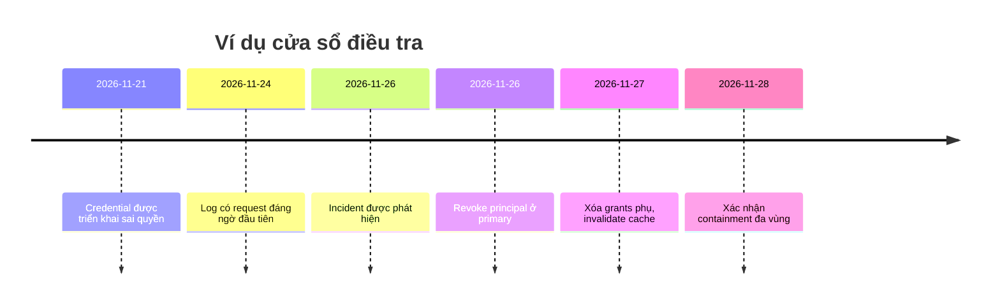
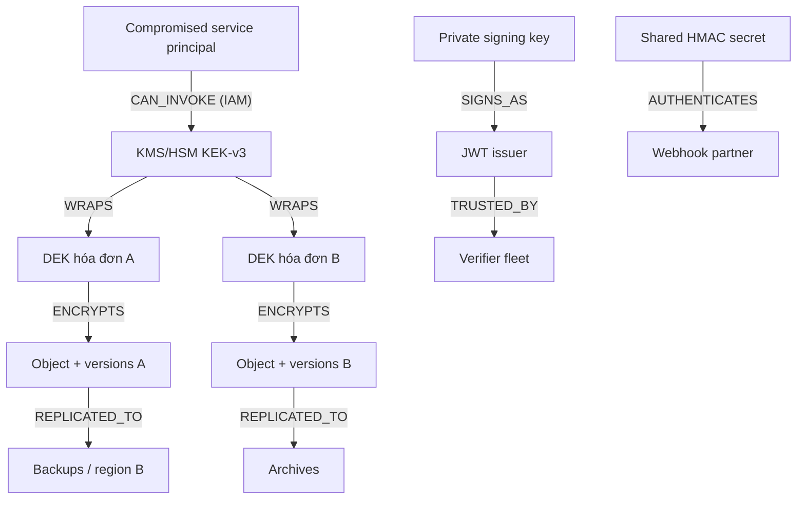
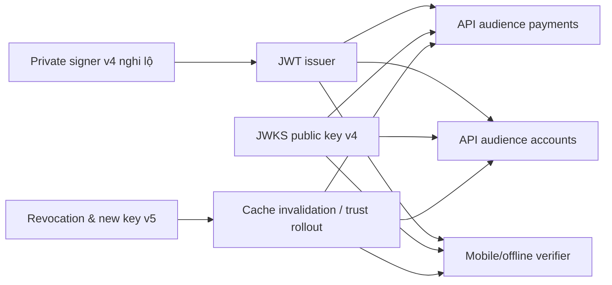
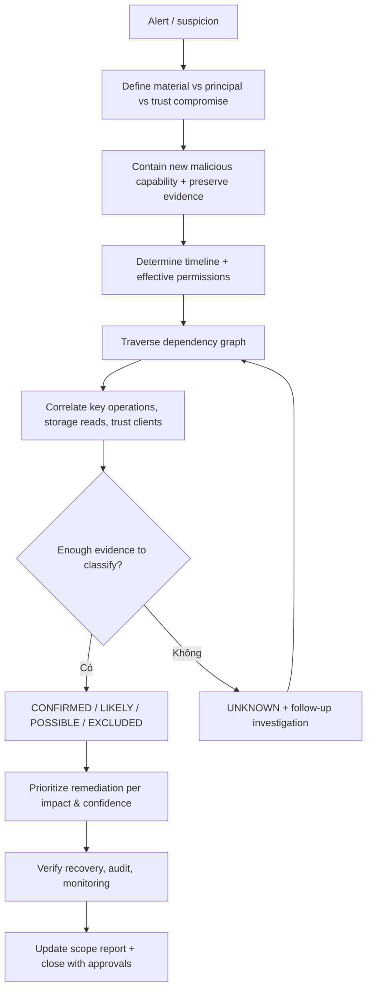
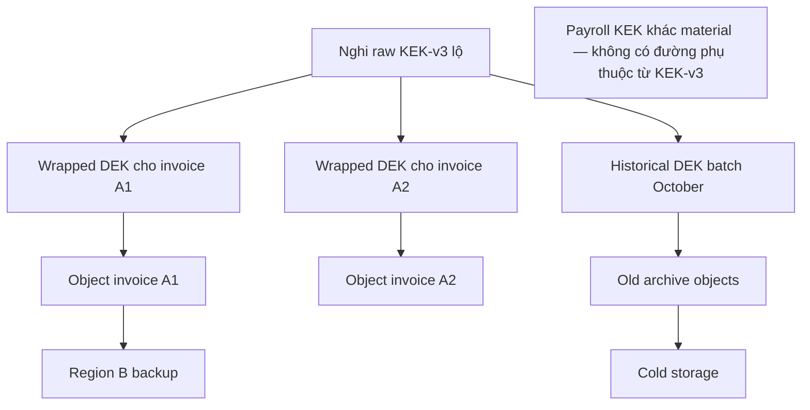

# Xác định phạm vi bị ảnh hưởng — Khoanh vùng sự cố lộ khóa và lạm dụng quyền mật mã

Trong chương **Revocation và compromise** của module **SECURITY_KEY_MANAGEMENT_FUNDAMENTALS**, **xác định phạm vi bị ảnh hưởng** (*impact scoping*, *blast-radius analysis*) là quá trình làm rõ **khóa hoặc quyền sử dụng khóa nào có thể đã bị xâm phạm, những tài sản nào phụ thuộc vào chúng, trong khoảng thời gian nào và hệ quả bảo mật nào thực sự có thể xảy ra**.

Khi nhận thông báo “khóa KMS bị lộ” hoặc “khóa ký JWT có dấu hiệu bị sử dụng trái phép”, hành động đầu tiên không phải chỉ đổi alias hoặc tạo một khóa mới. Đội xử lý sự cố cần trả lời những câu hỏi cụ thể:

- **Điều gì đã bị xâm phạm?** Raw DEK/KEK/private key, một service account có quyền gọi API, encrypted key backup, public key/trust store hay chỉ một metadata?
- **Bên tấn công làm được gì?** Đọc ciphertext, yêu cầu KMS `Decrypt`, tạo chữ ký, bọc DEK mới, sửa IAM hay tải bản sao khóa?
- **Tài sản nào nằm trong chuỗi phụ thuộc?** DEK được bọc dưới KEK, dữ liệu được mã hóa bằng DEK, chữ ký được tạo bằng private key, token được verifier tin cậy, backup/region còn giữ material?
- **Khoảng thời gian rủi ro là bao lâu?** Từ thời điểm lộ sớm nhất có cơ sở đến khi quyền, key usage, cache và trust liên quan thực sự được cô lập.
- **Bằng chứng mạnh đến đâu?** Có log thao tác thành công hay chỉ biết attacker có khả năng truy cập? Log có đầy đủ không?
- **Biện pháp nào sửa được loại thiệt hại tương ứng?** Thu hồi IAM, rotate KEK, **re-encrypt bằng DEK mới**, thu hồi trust, vô hiệu hóa token, xử lý backup hay phục hồi dữ liệu?

**Nguyên tắc cốt lõi:** **“Khóa có quan hệ với dữ liệu” không đồng nghĩa “dữ liệu đã bị đọc”; “không thấy log truy cập” cũng không đồng nghĩa “dữ liệu an toàn”.** Phải phân biệt **phạm vi có khả năng bị ảnh hưởng**, **tác động đã xác nhận** và **những vùng còn thiếu bằng chứng**. Mọi kết luận cần dựa trên **loại khóa, capability thực tế của attacker, dependency graph, thời gian và chất lượng log**.

Bài học kết nối khoanh vùng sự cố với mật mã đối xứng/bất đối xứng, chữ ký số, KMS/HSM, envelope encryption, IAM, kiểm toán và **vòng đời khóa từ tạo, cấp phát, lưu trữ, sử dụng đến xoay vòng, thu hồi và hủy**.

## 1. Mục tiêu học tập

Sau bài học, bạn có thể:

1. Phân biệt **key material compromise**, **key-operation credential compromise**, **policy compromise**, **metadata/trust compromise** và **public-key exposure**.
2. Xác định phạm vi theo bốn chiều: **confidentiality, integrity, authenticity/authorization và availability**.
3. Dựng **dependency graph** nối principal → KMS/HSM capability → KEK → wrapped DEK → ciphertext → object/backup/tenant/region.
4. Điều tra theo **actual key material/version**, không chỉ alias động hoặc tên logic của ứng dụng.
5. Xây **exposure window** với mốc sớm nhất có thể, mốc phát hiện và mốc cô lập thực tế, kể cả cache và replication lag.
6. Khoanh vùng riêng cho **DEK, KEK, private signing key, HMAC secret, CA/root key, KEM/agreement key** và lỗi RNG/nonce.
7. Biết khi nào **rewrap** là cần thiết nhưng **không đủ**, và khi nào phải **re-encrypt data, thay signing trust, vô hiệu hóa token hoặc sửa quyền**.
8. Lập bảng **confirmed / likely / possible / unknown / excluded with evidence** mà không đưa ra kết luận chắc chắn khi thiếu telemetry.
9. Đọc ví dụ **Java 17** truy vết graph phụ thuộc để sinh danh sách ứng viên bị ảnh hưởng, và hiểu rằng graph **không xác nhận attacker đã giải mã dữ liệu**.
10. Viết báo cáo phạm vi sự cố có căn cứ để phục vụ containment, recovery, audit, quyết định thông báo và quản trị rủi ro.

## 2. “Phạm vi bị ảnh hưởng” gồm những gì?

Một kết luận kiểu “có 2 khóa bị ảnh hưởng” thường quá hẹp. Cần mô tả **tài sản, quyền, người dùng, thời gian, loại tác động và sự không chắc chắn**.

| Chiều phân tích | Câu hỏi | Ví dụ |
| --- | --- | --- |
| **Vật liệu khóa** | Secret/private material nào có thể bị đọc hoặc dùng? | DEK-v7, KEK-v3, signing-key-v4. |
| **Capability** | Attacker có thao tác nào? | `Decrypt`, `Sign`, `ReEncrypt`, `CreateGrant`, download file backup. |
| **Dữ liệu/phụ thuộc** | Object nào được bảo vệ hoặc xác thực bằng khóa đó? | 1.200 hóa đơn, 30 backup snapshots, JWT issuer. |
| **Danh tính và quyền** | Principal, tenant, region, workload nào có thể bị lợi dụng? | Role của batch worker chỉ có tenant A. |
| **Thời gian** | Khả năng tấn công tồn tại trong cửa sổ nào? | Từ lần đầu credential có thể bị lấy đến khi revoke toàn bộ grants. |
| **Hệ quả** | Có nguy cơ đọc, sửa, giả mạo hoặc gây gián đoạn? | Confidentiality của hóa đơn, integrity của webhook, availability của encrypted backup. |
| **Bằng chứng** | Điều nào đã thấy, điều nào chỉ giả định? | KMS `Decrypt` success logs so với key inventory edge. |

### 2.1. Bốn chiều tác động không nên gộp thành một nhãn

- **Confidentiality:** plaintext hoặc secret có thể bị tiết lộ.
- **Integrity:** ciphertext, dữ liệu hoặc state có thể bị sửa mà hệ thống vẫn chấp nhận nếu attacker có khóa/phép toán phù hợp.
- **Authenticity/authorization:** attacker có thể tạo token, chữ ký, MAC hoặc yêu cầu giải mã dưới danh tính hợp lệ.
- **Availability:** vô hiệu hóa/xóa khóa, phá grants, làm hỏng key mapping có thể khiến dữ liệu không còn truy cập được.

Ví dụ, một attacker chỉ có quyền **KMS DisableKey** có thể gây **availability impact** nghiêm trọng nhưng **không mặc nhiên đọc được plaintext**. Ngược lại, người có raw DEK có thể giải mã ciphertext mà không để lại API log trong KMS, nếu họ có ciphertext tương ứng.

### 2.2. Potential impact khác confirmed impact

```text
Key A có thể unwrap DEK B
  -> Dữ liệu dưới DEK B là ứng viên cần điều tra.

Attacker thật sự sở hữu Key A và ciphertext của DEK B
  -> Có khả năng kỹ thuật để khôi phục DEK B.

Có bằng chứng attacker đã khôi phục DEK B và đọc object C
  -> Confirmed exposure cho dữ liệu C theo mức bằng chứng.

Không tìm thấy thao tác trong log
  -> Chưa đủ để loại trừ nếu attacker có material offline,
     log mất, ghi thiếu hoặc thời gian lưu không bao phủ.
```

Không dùng số record trong inventory thay cho số record **đã bị đọc**, và cũng không giới hạn điều tra chỉ ở những record có API log khi có đường truy cập offline.

## 3. Phân loại điểm xuất phát của sự cố

Để khoanh vùng chính xác, trước tiên phải định nghĩa **root exposure hypothesis** — giả thuyết nguồn bị xâm phạm. Nếu định nghĩa sai từ đầu, dependency traversal có thể phóng đại hoặc bỏ sót.

| Nguồn nghi vấn | Attacker có thể đạt được | Điều chưa được phép suy ra |
| --- | --- | --- |
| **Raw DEK bị lộ** | Decrypt các ciphertext phù hợp mà attacker lấy được; có thể tạo ciphertext/tag hợp lệ dưới DEK. | Không tự có KEK hoặc dữ liệu của DEK khác. |
| **Raw KEK bị lộ** | Có thể unwrap các wrapped DEK tương thích mà attacker thu thập được. | Không tự chứng minh đã có tất cả wrapped DEK/ciphertext. |
| **Private signing key bị lộ** | Tạo chữ ký hợp lệ theo key và scheme; giả mạo thông điệp nếu verifier còn tin key. | Không tự giải mã dữ liệu bằng khóa ký. |
| **HMAC secret bị lộ** | Tạo/kiểm tra MAC cho message domain tương ứng. | Không xác định được bên nào tạo một MAC nếu nhiều bên giữ secret. |
| **KMS principal/credential bị chiếm** | Gọi những API/keys/context mà IAM/grants cho phép trong cửa sổ chiếm quyền. | Không tự suy ra raw KEK non-exportable đã bị xuất. |
| **KMS/HSM admin credential bị chiếm** | Có thể sửa grant, key policy, disable/delete/schedule rotation tùy quyền. | Không mặc nhiên có khả năng `Decrypt` hoặc export material. |
| **Encrypted DEK/key backup bị đọc** | Sở hữu wrapped key blobs. | Không tự unwrap được nếu key management/rights còn an toàn. |
| **Public key bị lộ** | Biết public key — điều được phép theo thiết kế public-key crypto. | Không phải bằng chứng private key compromise. |
| **Public trust store/JWKS bị tráo** | Có thể khiến verifier chấp nhận public key/issuer sai nếu control yếu. | Không cần private key gốc bị lộ để gây trust substitution. |
| **RNG/nonce allocator lỗi** | Nhiều phép mã hóa/chữ ký có thể giảm bảo mật, tùy scheme. | Không giới hạn sự cố ở một key nếu RNG/allocator dùng chung. |

**Không đánh đồng “quyền sử dụng khóa bị lạm dụng” với “vật liệu khóa đã bị xuất”.** Hai trường hợp cần các phép truy vết và remediation khác nhau.

## 4. Một mô hình điều tra theo giả thuyết và bằng chứng

Bắt đầu với các giả thuyết nhỏ, có thể kiểm chứng:

- **H1:** một file raw DEK bị copy khỏi memory dump.
- **H2:** token của workload có quyền `KMS.Decrypt` trong tenant A bị chiếm.
- **H3:** private signing key của JWT issuer bị lộ qua secret store.
- **H4:** old KEK không lộ, nhưng attacker có quyền thay alias/policy để điều hướng decrypt.
- **H5:** lỗi nonce reuse làm mất giả định an toàn AES-GCM mà không cần ai đánh cắp raw key.

Mỗi giả thuyết có ba phần:

```text
Statement:
  Điều kiện attacker đã đạt được là gì?

Supporting evidence:
  Artefact/log/cấu hình/forensic observation nào ủng hộ?

Disconfirming evidence hoặc gaps:
  Có bằng chứng giới hạn phạm vi nào?
  Telemetry/asset nào chưa quan sát được?
```

**Không chuyển “H2 có thể xảy ra” thành “mọi DEK dưới KEK đều đã lộ” khi chưa phân tích quyền KMS và đường lấy wrapped DEK.** Tuy nhiên, nếu chưa thể kiểm chứng H2 là sai, vẫn giữ vùng rủi ro tương ứng trong **potential impact**.

## 5. Dựng exposure window: từ lúc sớm nhất đến khi cô lập thực sự

### 5.1. Không dùng thời điểm phát hiện làm thời điểm bắt đầu

Có ba mốc dễ bị nhầm:

1. **Earliest plausible exposure** — thời điểm sớm nhất có cơ sở attacker đã có thể đọc/điều khiển secret hoặc principal.
2. **Detection time** — lúc hệ thống/nhân viên phát hiện nghi vấn.
3. **Effective containment time** — lúc các đường sử dụng trái phép **thực sự** bị chặn trong mọi vùng/cache/credential liên quan.



Trong ví dụ này, **không được mặc định** cửa sổ chỉ bắt đầu ngày 24 hoặc kết thúc ngay khi revoke primary. Nếu credential đã có thể bị chiếm từ ngày 21, cần mở rộng điều tra phù hợp. Các ngày trên là **dữ liệu minh họa**, không phải sự kiện có thật.

### 5.2. Cửa sổ có thể không kết thúc chỉ vì API bị khóa

- **Raw symmetric key đã bị copy:** attacker có thể tiếp tục hoạt động offline với ciphertext họ giữ; việc disable KMS không làm bản sao raw key biến mất.
- **Signing key đã lộ:** rủi ro giả mạo còn tồn tại cho đến khi verifiers không còn tin private-key counterpart theo policy; cache/JWKS/certificate/trust timelines quan trọng.
- **HMAC secret đã lộ:** receiver tiếp tục chấp nhận secret cũ trong overlap thì attacker vẫn có thể tạo MAC hợp lệ.
- **KMS credential bị chiếm nhưng chưa lấy raw material:** effective containment có thể đạt khi revoke quyền, phiên, grants, refresh tokens và DEK caches liên quan, tùy capability.

**Phân biệt cửa sổ tạo hành động mới trái phép và cửa sổ rủi ro với dữ liệu đã bị lấy.** Một file plaintext bị exfiltrate không trở lại bí mật sau rotation.

### 5.3. Xử lý khoảng mù telemetry

Nếu audit log chỉ giữ 7 ngày nhưng credential có thể đã bị lộ 30 ngày, đánh dấu:

```text
Evidence coverage:
  day -30 .. day -8 = UNKNOWN / no reliable telemetry
  day -7  .. now    = logs available

Impact window:
  không được rút gọn chỉ còn 7 ngày do retention.
```

Một số dữ liệu có thời gian tồn tại dài hơn cửa sổ log. Inventory/backup, configuration history, build artifacts, memory/log leakage và business events có thể là nguồn bằng chứng bổ sung.

## 6. Key inventory là điều kiện cần để tính blast radius

**Không thể xác định phạm vi đáng tin nếu không biết khóa đang bảo vệ những gì.** Một key inventory đủ mạnh không chỉ liệt kê tên key và ngày tạo.

### 6.1. Trường inventory tối thiểu

| Nhóm metadata | Các trường gợi ý |
| --- | --- |
| **Định danh** | Actual key ID, material lineage, key version, alias histories, provider/region. |
| **Loại & mục đích** | AES DEK, KEK, HMAC, private signing, public verification, KEM key, algorithm/profile. |
| **Trạng thái & thời gian** | Created/activated/deactivated, protection cryptoperiod, retention, rotation/compromise events. |
| **Quyền** | Principals, IAM roles/grants, allowed operations, encryption context, key policy version. |
| **Phụ thuộc** | Wrapped DEKs, object IDs, content versions, signing issuers, trust stores, backup references. |
| **Phân phối** | Regions, key replicas, cache paths, import/export/backup procedures. |
| **Dấu vết** | Provider operation IDs, usage ledger, audit log refs, last known key use. |
| **Chủ sở hữu** | Key owner, data owner, service owner, incident contact, compliance scope. |

**Actual key ID và version khác alias**: `billing/current` có thể đã trỏ v1 ở tuần trước nhưng v2 hiện tại. Query chỉ dựa trên alias mới có thể bỏ sót ciphertext lịch sử.

### 6.2. Những bản sao dễ bị quên

- Wrapped DEK nằm trong file/object version cũ.
- Database snapshots và point-in-time recovery logs.
- Archived events, message queues, export CSV hoặc data lake.
- Multi-region replicas và offline DR.
- DEK cache trong memory của worker, container snapshots, crash dumps.
- Backup KMS/HSM theo quy trình provider, key escrow/import artifacts.
- Certificate/private key trong keystores, CI/CD secret stores hoặc signer phụ.
- JWKS/trust cache ở reverse proxy, mobile/offline clients.
- Test/staging key reuse sai phạm vi giữa môi trường.
- Service account tokens, emergency/break-glass roles và migration credentials.

Không được giả định “key không còn trong primary DB” nghĩa là không còn bản sao hoặc không còn bên có quyền dùng.

### 6.3. Đặt ranh giới dữ liệu từ quyền thực tế

Nếu tài khoản bị chiếm chỉ có **KMS Decrypt** nhưng không có quyền đọc object store, attacker có thể cần một nguồn **ciphertext/wrapped DEK khác** để khai thác. Ngược lại, nếu object store public/readable hoặc backup đã bị tải, khả năng khai thác rộng hơn.

Đánh giá **giao của các capability**, không chỉ riêng IAM của KMS:

```text
Potential plaintext exposure depends on:
  usable key/decrypt capability
  AND relevant ciphertext/wrapped DEK availability
  AND any required context/authentication inputs
  AND cryptographic/protocol conditions.
```

Đây là **quy tắc phân tích điều kiện**, không phải chứng minh attacker thực sự đã đọc. Một hệ thống có thể có đường side channel/bypass chưa được inventory ghi nhận; phải giữ mục UNKNOWN khi cần.

## 7. Dependency graph: mô hình hóa khóa → dữ liệu → niềm tin

Một **dependency graph** giúp đi từ tài sản nghi bị lộ đến các phụ thuộc cần điều tra.



**Cực kỳ quan trọng:** các mũi tên là **quan hệ phụ thuộc khác nhau**, **không phải một quy tắc “nhiễm bẩn bí mật” tự động**.

- `WRAPS`: KEK có khả năng bảo vệ/unwrap DEK theo scheme, nhưng phải xét attacker có material/API, wrapped ciphertext và quyền cần thiết hay không.
- `ENCRYPTS`: DEK liên kết với ciphertext; plaintext exposure còn phụ thuộc ciphertext availability và việc attacker khôi phục được DEK.
- `REPLICATED_TO`: có bản sao cần điều tra; không khẳng định đã bị truy cập.
- `CAN_INVOKE`: principal được phép gọi API tại một thời điểm; không suy ra raw key exportable.
- `TRUSTED_BY`: phạm vi có thể chấp nhận chữ ký/token giả, không phải phạm vi data decrypt.
- `AUTHENTICATES`: HMAC key cho phép tạo thông điệp xác thực theo protocol, không tự cho quyền sửa mọi dữ liệu phía receiver.

### 7.1. Không chỉ xét liên kết trực tiếp

Một KEK có thể bọc 100 DEK; mỗi DEK dùng mã hóa hàng nghìn object versions; các object được sao lưu sang nhiều vùng. **Blast radius có thể tăng theo chiều sâu của graph**, không chỉ số keys trực tiếp.

Một private signing key có thể không mã hóa data nào nhưng cấp token mà nhiều APIs tin cậy. Trong trường hợp này graph cần đi theo **issuer → audience/verifier → capability có thể được cấp** chứ không đi theo `WRAPS`.

### 7.2. Graph phải mang thông tin thời gian

Một edge nên ghi:

```text
relationship: WRAPS
source: kek/billing/v3
target: dek/invoice-42/v1
validFrom: 2026-10-01
validTo: 2026-11-20 hoặc UNKNOWN
evidence: inventory-record-8841
confidence: observed
```

Nếu KEK đã rotate từ v3 sang v4, object hiện tại dùng v4 nhưng **backup tạo hồi v3 vẫn có thể giữ wrapped DEK dưới v3**. Không dùng “quan hệ hiện hành” để loại bỏ quan hệ lịch sử trong exposure window.

### 7.3. Path là giả thuyết, evidence quyết định mức kết luận

Một kết quả traversal như:

```text
KEK-v3 -> WRAPS -> DEK-A -> ENCRYPTS -> invoice-42
```

là **ứng viên ảnh hưởng**, chưa phải bằng chứng `invoice-42` đã bị đọc. Muốn nâng mức kết luận cần thông tin về:

- Raw KEK hay KMS operation capability đã bị chiếm?
- Wrapped DEK-A có thể bị attacker lấy hay đã được gửi tới `Decrypt`?
- Dữ liệu invoice ciphertext có thể bị đọc từ object store/backup?
- Encryption context/AAD, tenant conditions, IAM grants có thỏa?
- Log các thao tác được ghi đầy đủ, có đường offline không?
- Nếu key material bị lộ, có thể dùng offline ngoài telemetry không?

## 8. Khoanh vùng khi DEK bị lộ

**DEK (Data Encryption Key)** mã hóa dữ liệu cụ thể, ví dụ AES-GCM cho hóa đơn hoặc tài liệu.

### 8.1. Những đối tượng cần liệt kê

1. Mọi object/version được encrypt bằng **cùng actual DEK material**, không chỉ tên alias.
2. Các bản sao: primary, replicated region, snapshot, backup, export, archive và cached ciphertext.
3. Những bản ghi dùng chung DEK ngoài dự kiến (tenant/batch/multi-region).
4. Nonce, AAD và algorithm/profile của từng ciphertext.
5. Quyền đọc ciphertext và khả năng lấy dữ liệu của attacker.
6. Thời gian DEK có thể đã bị đọc và số phiên bản dữ liệu được tạo trong cửa sổ đó.
7. Logs/caches/memory dumps có chứa raw DEK hoặc plaintext.
8. Khả năng attacker **tạo ciphertext/tag mới** nếu có quyền ghi object store hoặc gửi payload vào API.

### 8.2. Confidentiality và integrity đều liên quan

Nếu attacker có raw AES-GCM DEK và ciphertext tương ứng, họ có thể giải mã dữ liệu (khi biết các tham số cần thiết). Nếu họ còn có khả năng **thay ciphertext/metadata ở nơi reader tin cậy**, họ có thể tạo ciphertext/tag hợp lệ dưới DEK đó. Vì vậy:

- **Confidentiality:** dữ liệu đã được mã hóa bằng DEK có thể bị đọc.
- **Integrity:** ciphertext/tag không còn là bằng chứng độc lập rằng attacker không can thiệp, nếu attacker có DEK và có khả năng thay bản ghi.
- **Authorization:** attacker có DEK không tự trở thành chủ sở hữu dữ liệu; nhưng có thể bỏ qua policy nếu dữ liệu ciphertext có sẵn bên ngoài hệ thống.
- **Availability:** khi vô hiệu hóa hoặc hủy DEK vội, các bản ghi còn phụ thuộc có thể không decrypt được.

**AEAD không phải chữ ký số độc lập**: người biết DEK có thể tạo authentication tag hợp lệ.

### 8.3. Chọn remediation đúng

- Ngăn phát sinh **new Encrypt** dưới DEK nghi bị lộ.
- Sinh **DEK mới** cho new data.
- Cân nhắc **re-encrypt** những object còn cần bí mật/integrity theo risk assessment.
- Xác minh AAD, object identity và trusted version để chống ciphertext swap/rollback.
- Rà soát quyền đọc ciphertext, audit và backups.
- Xác định raw DEK có thể nằm ở memory/cache, logs, crash dumps hoặc artifacts nào.
- Giữ khả năng historical decrypt đúng quyền cho migration, trừ khi incident policy yêu cầu cách ly chặt hơn.
- Không hủy key trước khi hoàn tất đường khôi phục và retention; không coi re-encrypt là cách “xóa” dữ liệu attacker đã lấy.

**Chỉ rewrap cùng DEK dưới KEK mới không khắc phục rủi ro từ raw DEK đã bị lộ.**

## 9. Khoanh vùng khi KEK bị lộ

**KEK (Key Encryption Key)** thường bảo vệ nhiều DEK. Một sự cố ở KEK có thể **mở rộng phạm vi theo hình cây**, đặc biệt với envelope encryption.

### 9.1. Các bước điều tra

1. Xác minh **actual KEK material/version** và có phải **raw material exposure** hay chỉ KMS `Decrypt/Unwrap` permission.
2. Liệt kê mọi wrapped DEK đã được bảo vệ dưới KEK đó, bao gồm historical versions.
3. Xác định wrapping algorithm, encryption context, AAD và key version metadata.
4. Kiểm kê nơi wrapped DEK được lưu và ai có thể tải nó.
5. Với mỗi DEK, truy vết các object/backup/regions được bảo vệ.
6. Ghi lại **key material lineage** nếu KMS replicas chia sẻ cùng material.
7. Đối chiếu grants, cross-account/cross-region permissions, service roles.
8. Phân biệt **đã unwrap được xác nhận** với **có khả năng unwrap offline/API**.

### 9.2. Không coi mọi phụ thuộc đều đã chắc chắn lộ plaintext

Bảng phân biệt:

| Tình huống | Suy luận phù hợp |
| --- | --- |
| Chỉ lộ `wrappedDek`, không lộ KEK hay API unwrap. | Không mặc định plaintext bị lộ; điều tra scheme/permissions. |
| Lộ **raw KEK** và attacker có encrypted DEKs. | Có khả năng unwrap những DEK tương ứng nếu scheme và context cho phép. |
| Lộ raw KEK nhưng chưa biết attacker có blob nào. | Đặt các wrapped DEK thuộc key đó trong **potential scope**, xác minh storage access và exfil. |
| Role có quyền KMS `Decrypt` hẹp, KEK non-exportable. | Scope theo API grants, policy, context, time, request evidence; không mặc định raw KEK bị lộ. |
| KEK đã được provider rotate backing material. | Historical wrapped DEKs vẫn cần xem key-material versions và backup semantics. |
| KEK đã bị hủy nhưng bản sao raw từng lộ. | Hủy key server không xóa bản sao attacker có thể đang giữ. |

### 9.3. Rewrap và re-encrypt khác nhau về tác động

Nếu **KEK bị lộ**, **rewrap DEKs dưới KEK mới** giúp hạn chế sử dụng **key cũ cho các bản bọc mới** và cho phép retire key cũ, nhưng:

- Không làm attacker quên DEK đã được họ unwrap từ trước.
- Không làm ciphertext/backup mà attacker đã giữ trở lại bí mật.
- Không bảo đảm toàn bộ old wrapped DEKs ở archive/backup đã biến mất.
- Không tự xác minh payload integrity nếu chỉ gọi API rewrap.

Nếu có căn cứ attacker đã lấy được DEK hoặc khả năng lấy DEK/ciphertext đáng kể, cần đánh giá **thay DEK và re-encrypt data**. Quyết định phải dựa trên capability, dữ liệu nhạy cảm, thời gian lưu, khả năng thu thập ciphertext và risk policy; không có quy tắc “rotate KEK là đủ” cho mọi sự cố.

## 10. Khi KMS credential bị chiếm nhưng raw KEK không lộ

Đây là tình huống rất hay bị báo cáo nhầm thành “lộ tất cả khóa”.

Giả sử attacker chiếm service role `invoice-reader` được phép:

```text
kms:Decrypt
  on KEK billing-v3
  only with approved encryption context
  only through workload identity
  while credentials valid
```

Nếu KEK không exportable, attacker **không mặc nhiên đọc raw KEK**. Tuy nhiên họ có thể lợi dụng **API Decrypt** để unwrap encrypted DEKs mà họ có được và thỏa điều kiện KMS.

### 10.1. Phạm vi phải tính theo effective permissions

| Câu hỏi | Bằng chứng |
| --- | --- |
| Credential có những operations nào? | IAM/key policy/grants và lịch sử thay đổi. |
| Những key resources nào có thể thao tác? | Key IDs/versions, aliases tại từng thời điểm, regions/accounts. |
| Có encryption context constraints không? | Policy thực tế, request logs, test deny. |
| Credential có thể đọc encrypted DEK/ciphertext ở đâu? | Storage ACL, object access logs, service APIs. |
| Có thể tạo grants hoặc tự mở rộng quyền không? | Permission graph, admin logs, role assumption paths. |
| Có DEK cache/raw material nào bị đọc từ workload không? | Host/container forensic evidence theo phạm vi phê duyệt. |
| Các lời gọi thành công xảy ra lúc nào? | KMS audit correlation, request IDs, principal/session IDs. |
| Có đường gọi ngoài gateway không? | Direct API access, egress, bypass/sidecar logs. |

### 10.2. Không xem log vắng mặt là bằng chứng an toàn tuyệt đối

Log provider có thể không bao phủ vùng, tài khoản, thời gian, operations, offline copies hoặc bị attacker can thiệp qua quyền admin. **KMS Decrypt success** xác nhận một thao tác đã được thực hiện theo bằng chứng log, nhưng không tự chứng minh attacker đã đọc mọi plaintext payload: còn cần xem wrapped DEK, application context và object availability.

Ngược lại, raw DEK cache bị lộ trong process có thể cho phép attacker giải mã offline mà KMS không thấy thêm `Decrypt` request.

### 10.3. Biện pháp containment phù hợp

- Vô hiệu hóa/rotate **credential và tokens**, revoke sessions/grants theo khả năng thật.
- Giới hạn IAM/key policy để ngăn tiếp tục unwrap ngoài scope.
- Kiểm tra cached DEKs và quyền của workload bị chiếm.
- Khôi phục nguyên trạng chính sách từ nguồn đáng tin; rà soát grants mới lạ.
- Đối chiếu KMS operations với storage/object access.
- Xác định có cần rewrap/re-encrypt/rotate key hay không theo kết quả đánh giá, không làm máy móc.
- Duy trì đường phục hồi và audit trước khi làm thao tác destroy không thể đảo ngược.

**Thu hồi một session không tự thu hồi các raw DEK đã có thể bị copy vào memory/log.** Hai nhánh điều tra phải được thực hiện song song khi có dấu hiệu.

## 11. Private signing key compromise: phạm vi theo niềm tin và giao thức

Với **RSA-PSS, ECDSA, Ed25519** hoặc private signing key khác, rủi ro chủ yếu là **giả mạo chữ ký**; không mặc định là lộ plaintext.

### 11.1. Những tài sản cần xác định

- Actual private key ID/material và certificate/public key counterpart.
- Issuer, key usage/purpose, algorithm allowlist, `kid`, certificate chain.
- Các service/tenant/region đang dùng private key để `Sign`.
- Những verifiers tin public key tương ứng; trust caches và thời gian refresh.
- Loại artifact: JWT, payment authorization, software release, document, audit manifest.
- Các thông điệp và chữ ký được phát hành trong exposure window.
- Signing logs/counters, approvals, timestamp evidence, artifact transparency nếu có.
- Khả năng offline verifier tiếp tục tin khóa cũ sau khi primary revoke.

### 11.2. Với JWT signing key



Một attacker có private signing key có thể tạo token có chữ ký hợp lệ. **Chỉ xác thực chữ ký không đủ để phân biệt token hợp pháp và token giả**. Hệ thống còn cần kiểm tra issuer, audience, claims, token issuance/ID, session state, revocation/allowlist, replay và nhật ký phát hành đáng tin.

Trong điều tra, liệt kê:

- `iss`, `aud`, loại quyền/scope mà issuer có thể phát.
- Các verifiers đang tin key version v4.
- Token TTL, clock skew, refresh token/session behavior.
- JWKS cache/CDN TTL và offline clients.
- Token ID/jti/session registry nếu có; logic revoke theo thực tế.
- Kết quả access logs, không chỉ số token được issuer log là đã phát.

**Phạm vi khả năng giả mạo** có thể rộng hơn tập token được issuer phát hành thật. Nếu attacker có private key, họ có thể ký token ngoài pipeline chính thức và không để lại signing API log.

### 11.3. Việc phải làm khác với symmetric key

- Chặn khả năng `Sign` mới bằng key nghi bị lộ.
- Sinh signing key pair mới; thiết lập trust metadata/`kid`/certificate phù hợp.
- Thực hiện **trust revocation hoặc giới hạn chấp nhận key cũ** theo incident policy.
- Rà soát token/artifact từ cửa sổ nghi ngờ và hiệu lực còn lại.
- Nếu yêu cầu xác minh tài liệu lịch sử, cần cơ chế trust/timestamp/revocation riêng; không đơn giản xóa toàn bộ public key mà không xét hậu quả.
- Không dùng một thao tác rotate private key làm bằng chứng rằng verifiers đã ngừng tin public key cũ.

**Ký mới bằng key v5 không tự vô hiệu hóa token giả đã được ký bằng v4** nếu verifiers vẫn chấp nhận v4.

## 12. HMAC secret compromise: cả bên gửi và bên nhận đều có khả năng tạo MAC

Khác chữ ký bất đối xứng, **HMAC dùng secret chia sẻ**. Các bên giữ secret đều có thể tạo MAC hợp lệ.

### 12.1. Phạm vi cần xem

- Secret version và danh sách partner/tenant/regions cùng biết secret.
- Message domain: webhook, API auth, internal event, file manifest, request signing.
- Những receiver còn chấp nhận vOld trong thời gian overlap.
- Message format có MAC những trường nào: method/path/body/timestamp/nonce/request ID?
- Replay cache/window; rate limits và tag length policy.
- Nơi secret có thể tồn tại: partner config, secrets manager, logs, CI, backup.
- Khả năng secret dùng chung cho nhiều partners sai thiết kế.

### 12.2. Tại sao không quy trách nhiệm bằng MAC một mình?

Nếu cả partner A và server B biết HMAC key, một MAC hợp lệ chỉ chứng minh message được tạo bởi **ai đó có khả năng dùng secret**. Nó không chứng minh độc lập chính xác bên nào tạo, đặc biệt khi secret đã bị lộ.

Vì vậy kết luận kiểu “message có HMAC hợp lệ nên chắc chắn do đối tác gửi” **không còn vững** trong exposure window. Cần đối chiếu network, request ID, business transaction, audit và các bằng chứng độc lập.

### 12.3. Khắc phục theo scope

- Rotate secret ở **tất cả endpoints giữ cùng material**, có coordination.
- Chặn secret cũ ở receivers sau cutoff; không giữ dual-verify vô thời hạn.
- Vô hiệu hóa/replay-filter các request nghi vấn.
- Xét lại MAC input canonicalization, timestamp, nonce và tag truncation.
- Nếu nhiều partner chia cùng secret, đánh giá phạm vi toàn nhóm; cân nhắc **tách secret per partner/per direction**.

**Rate limit API không giới hạn MAC attacker có thể tạo offline** nếu họ đã giữ raw HMAC secret.

## 13. Root CA, certificate và trust-anchor compromise

Một **CA private key** hoặc **root trust anchor** có phạm vi ảnh hưởng khác rất nhiều một DEK đơn lẻ.

### 13.1. Những nhánh graph quan trọng

```text
Compromised CA private key
  -> Khả năng cấp chứng chỉ/chuỗi chứng chỉ giả
  -> Subordinate CAs hoặc end-entity certs có thể được chấp nhận
  -> Clients, browsers, internal services, mTLS verifiers
  -> Authn/Authz phụ thuộc vào certificate identity

Compromised trust store
  -> Clients có thể tin một CA/public key do attacker chèn
  -> Không cần private key gốc bị lộ
```

Cần xét:

- Issuing hierarchy, path validation, constraints, key usage và certificate policy.
- Những relying parties nào tin CA/root đó.
- Certificate issuance logs, CT/transparency nếu áp dụng, CA audit.
- CRL/OCSP/revocation semantics, distribution lag, offline trust.
- Thời hạn, certificate pinning hoặc embedded trust anchors.
- Thiết bị không thể cập nhật dễ dàng, khách hàng bên ngoài, multi-region.

**Không mặc định thu hồi một end-entity certificate xử lý xong private CA compromise.** Phạm vi có thể đòi hỏi đổi intermediate/root/trust tùy kiến trúc và mức độ xâm phạm. Quy trình thực tế cần đội PKI/Legal/Operations phê duyệt vì ảnh hưởng dây chuyền rất lớn.

### 13.2. Private server certificate key bị lộ

Một private TLS key bị lộ có thể cho phép impersonation trong những điều kiện nhất định nếu attacker kiểm soát network/endpoint và verifier còn tin chứng chỉ. **Khả năng giải mã traffic quá khứ không thể kết luận chỉ từ việc lộ certificate private key**; còn phụ thuộc TLS version, key exchange, forward secrecy và việc traffic có được thu thập trước đó hay không.

## 14. Key agreement, KEM và forward secrecy: tránh kết luận quá rộng

Với **ECDH/X25519, RSA key transport, HPKE, ML-KEM** và các giao thức handshake, loại khóa nào bị lộ quyết định tác động.

### 14.1. Các trường hợp cần phân biệt

| Tình huống | Điều cần xác minh |
| --- | --- |
| Static key agreement private key lộ. | Protocol có xác thực peer và forward secrecy không? Cấu hình session/key schedule thế nào? |
| Ephemeral session secret lộ. | Session nào dùng secret đó; khả năng derive traffic keys và records tương ứng? |
| KEM decapsulation private key lộ. | Ciphertexts nào được encapsulate cho public key đó; attacker có recorded encapsulations không? |
| RSA private key cho key transport lộ. | Ciphertexts/handshakes đã dùng scheme nào; liệu recorded secrets bị ảnh hưởng? |
| Certificate signing key lộ. | Trust/impersonation, không mặc định lộ session keys trong giao thức có PFS. |

**Forward secrecy** là thuộc tính của **giao thức và cách quản lý ephemeral secrets**, không phải nhãn có thể suy từ việc “dùng ECDH” một cách chung chung.

### 14.2. Ba điều kiện trước khi kết luận traffic lịch sử bị đọc

1. Attacker có private key/secret **đúng loại** và đúng phiên bản có khả năng derive traffic keys theo protocol.
2. Attacker có **ciphertexts/handshake transcripts** cần thiết.
3. Giao thức/cấu hình thực tế **không bảo vệ** traffic đó bằng forward secrecy hoặc các secret bổ sung mà attacker không có.

Thiếu một trong các điều kiện hoặc không biết cấu hình cần ghi **UNKNOWN/POTENTIAL**, không tự khẳng định mọi traffic TLS cũ đã bị giải mã hay hoàn toàn an toàn.

## 15. Lỗi RNG, nonce hoặc key derivation có thể mở rộng phạm vi vượt một key

Không phải sự cố nào cũng bắt đầu bằng raw key bị lấy. Một **CSPRNG yếu**, **nonce issuer sai**, **key derivation dùng sai salt/info** hoặc **ECDSA nonce reuse** có thể tạo phạm vi ảnh hưởng khác.

### 15.1. AES-GCM nonce reuse

Cùng cặp **(key, nonce)** dùng cho nhiều phép mã hóa có thể gây hậu quả nghiêm trọng cho confidentiality/integrity. Phạm vi cần truy:

- Actual DEK material và các encryptors dùng material đó.
- Lịch sử nonce allocations, counter leases, region/writer IDs.
- Cặp ciphertext được tạo với nonce trùng; data lengths/AAD nếu cần phân tích.
- Snapshot/clone/restart/failover có thể reset counter.
- Cùng DEK có còn tiếp tục new Encrypt không?
- Những object liên quan cần re-encrypt hoặc điều tra integrity.

**Rotation KEK không sửa được nonce reuse dưới cùng DEK.**

### 15.2. ECDSA nonce lỗi

ECDSA cần xử lý nonce theo scheme đúng; nonce bị lặp hoặc đoán được có thể làm lộ private signing key. Nếu phát hiện lỗi này, phạm vi không chỉ là hai chữ ký có nonce trùng mà có thể **mở rộng đến mọi verifier đang tin signing key** trong window tương ứng.

Không suy ra Ed25519, RSA-PSS và AES-GCM có cùng cấu trúc nonce hoặc cùng loại hậu quả; phải phân tích theo primitive/profile cụ thể.

### 15.3. RNG dùng chung ở nhiều service

Nếu cùng một nguồn entropy lỗi được dùng tạo **DEK, HMAC secret, ECDSA nonce, token signing key và session secret**, scope có thể bao trùm nhiều key versions dù chúng **không có quan hệ `WRAPS`**. Inventory cần một chiều riêng: **key provenance/creator RNG instance/build version**.

### 15.4. Key derivation

Nếu nhiều derived keys được tạo từ một master secret bằng KDF:

```text
master secret
  -> HKDF(info="billing:tenant-A") -> key A
  -> HKDF(info="billing:tenant-B") -> key B
```

Mức độ ảnh hưởng từ **master secret compromise** thường rộng hơn derived-key compromise. Nhưng không kết luận một derived key lộ thì chắc chắn derive được master key hoặc các derived keys khác: phải dựa vào tính chất KDF, domain separation và cách triển khai. Lỗi reuse/`info` collision có thể làm phạm vi rộng hơn dự kiến.

## 16. Multi-region, backup, cache và vòng đời khóa lịch sử

### 16.1. Phạm vi theo region

Một key có thể có:

- Managed replicas chia sẻ **cùng material** (tùy provider).
- KEK độc lập per region nhưng cùng DEK được rewrap cho nhiều vùng.
- Một HSM ở region A phục vụ remote requests từ B.
- Data replication tới C nhưng C chỉ có ciphertext, không có quyền unwrap.
- IAM/grants khác nhau ở mỗi region.

**Đừng đếm replicas như khóa độc lập nếu chúng cùng material**, và cũng đừng gộp mọi key khác material chỉ vì chung alias logic.

### 16.2. Backup, snapshot và dữ liệu đã xóa

Một object bị xóa ở primary vẫn có thể tồn tại trong:

- Snapshot point-in-time.
- Backup immutable/cold archive.
- Logs/events retained.
- Legal hold/long-term storage.
- DR region hoặc offline replica.

Điều này quan trọng theo hai hướng:

1. **Confidentiality scope:** attacker đã lấy key có thể đọc ciphertext vẫn còn ở các bản sao.
2. **Availability/recovery:** việc hủy old key có thể làm backup không còn restore được.

**Retire/delete ở primary không xóa bản sao raw key hoặc ciphertext attacker đã giữ.** Khi điều tra, phải phân biệt dữ liệu “không còn phục vụ” với dữ liệu “không còn tồn tại ở bất kỳ đâu”.

### 16.3. DEK cache và stale permissions

Ngay cả khi KMS principal bị thu hồi, một workload có thể còn raw DEK trong RAM. Kiểm tra:

- TTL/cache scope theo tenant/object.
- Thread/worker pools, batch jobs, warm containers.
- Key material copies/heap/crash dumps.
- In-flight requests đã reserve trước revoke.
- Khi nào cache entries bị invalidate thực sự.
- Có đường Encrypt/Decrypt offline không qua usage gate/KMS.

**Disable KMS key không buộc một DEK đã được tải vào RAM tự biến mất.** Đánh giá phạm vi phải bao gồm các phiên và process thực tế.

### 16.4. Cryptoperiod và trạng thái hiện tại không xóa lịch sử

Một key hiện đang `DEACTIVATED` hoặc đã rotate vẫn có thể từng tạo ciphertext/chữ ký trong exposure window. Ngược lại, nếu old key đã bị `DESTROYED` đúng cách và không còn bản sao/credential, khả năng thực hiện thao tác mới tại provider có thể bị cắt, nhưng **không phủ định exposure đã xảy ra trước đó**.

## 17. Thu thập bằng chứng: xác minh capability thay vì đoán

### 17.1. Các nguồn bằng chứng chính

| Nguồn | Câu hỏi trả lời được | Hạn chế |
| --- | --- | --- |
| **KMS/HSM audit** | Ai gọi `Decrypt/Sign/Wrap`, key ref, result, region/context? | Không nhất thiết thấy offline key usage hoặc logs bị thiếu. |
| **IAM/grant history** | Principal từng được phép làm gì, có quyền tự mở rộng không? | Policy hiện tại không luôn phản ánh policy lịch sử. |
| **Object storage access** | Ciphertext/wrapped DEK nào đã được đọc, export hoặc sửa? | Không cho biết attacker đã giải mã offline hay chưa. |
| **Key inventory** | Khóa nào bọc DEK nào, dữ liệu/phụ thuộc nào? | Có thể thiếu shadow copies, backups và aliases lịch sử. |
| **App/business logs** | Object, tenant, request, authorization, transaction nào liên quan? | Dễ thiếu crypto details hoặc correlation IDs. |
| **Host/container forensics** | Secret/cache có thể đã xuất hiện trong memory/artifacts? | Thu thập phải bảo vệ dữ liệu nhạy cảm và chain of custody. |
| **CI/CD/config history** | Key material/credential có bị đưa vào image, artifact, repo/log? | Không chứng minh tất cả đối tượng đã tải bản sao. |
| **JWKS/PKI trust history** | Verifier đã tin key version nào, trong bao lâu? | Cache/offline clients có thể cập nhật chậm. |
| **Backup catalog** | Dữ liệu/key dependencies còn ở snapshot/DR nào? | Catalog không luôn chứng minh restore thành công. |
| **Network/egress telemetry** | Có đường export, gọi KMS hoặc tải object bất thường? | Không kết luận đã đọc plaintext; có thể thiếu coverage. |

### 17.2. Bảo vệ chứng cứ và riêng tư

- Ghi thời điểm, nguồn, người thu thập, phương thức và access controls.
- Khi có thể, dùng **hash/chữ ký của artifact điều tra** và hệ audit chống sửa để giữ integrity.
- Thu thập **key IDs, operation IDs, request IDs**, không ghi raw DEK/KEK/private key vào tài liệu điều tra.
- Hạn chế thông tin tenant/customer trong báo cáo ở mức cần thiết.
- Nếu forensic memory có secret, lưu trong khu vực hạn chế, có retention/disposal.
- Không tự xóa log hoặc thay đổi trạng thái nguồn trước khi lưu bằng chứng cần thiết, trừ hành động containment cấp thiết đã được quyết định; ghi rõ thứ tự sự kiện.
- Đồng bộ timestamp và hiểu clock skew/lag của từng nguồn.

### 17.3. Tại sao bằng chứng âm tính phải được giải thích?

Câu “không có `KMS.Decrypt` success trong log” có giá trị **chỉ trong phạm vi coverage**:

```text
Covered:
  account A / region X
  API Decrypt
  audit enabled from T0 to T1
  integrity of logs checked

Not covered:
  region Y, prior time, cached DEK, offline raw key,
  old credentials, indirect service APIs
```

Chỉ khi có **kiểm tra độc lập và phù hợp** mới có thể loại trừ một vùng khỏi scope. Một log rỗng không làm toàn bộ dependency graph “an toàn”.

## 18. Ma trận mức độ chắc chắn và tác động

Không nên dùng một nhãn “affected = true” cho mọi record. Một mô hình có thể dùng:

| Nhãn | Tiêu chí | Cách trình bày |
| --- | --- | --- |
| **CONFIRMED** | Có chứng cứ trực tiếp, đáng tin về event/capability hoặc thao tác dẫn tới tác động cụ thể. | “Đã xác nhận X theo log/forensic evidence Y.” |
| **LIKELY** | Nhiều bằng chứng mạnh hội tụ, còn thiếu xác nhận trực tiếp một phần. | “Khả năng cao, căn cứ A+B; cần xác minh C.” |
| **POSSIBLE** | Có đường kỹ thuật khả thi và phụ thuộc, nhưng chưa rõ điều kiện khai thác. | “Nằm trong potential scope, chưa xác nhận exposure.” |
| **UNKNOWN** | Thiếu inventory/log/time coverage hoặc capability chưa rõ. | “Không đủ dữ kiện để loại trừ hoặc xác nhận.” |
| **EXCLUDED_WITH_EVIDENCE** | Có bằng chứng độc lập loại trừ đúng giả thuyết trong phạm vi thời gian/đường truy cập đã định. | “Loại trừ theo kiểm soát X, coverage Y; không áp cho đường khác.” |

**Không gắn nhãn CONFIRMED chỉ vì graph traversal tìm được một đường phụ thuộc.** Ngược lại, việc chưa có bằng chứng trực tiếp không đủ để chuyển POSSIBLE thành EXCLUDED.

### 18.1. Cường độ tác động và sự chắc chắn là hai trục khác nhau

Một nhóm dữ liệu có thể:

- **Impact cao, confidence thấp:** raw KEK có thể bị lộ, nhưng ciphertext access chưa rõ.
- **Impact vừa, confidence cao:** đã xác nhận một principal đọc một object không được phép.
- **Impact thấp, confidence cao:** chỉ có public verification key được tải đúng thiết kế.
- **Impact cao, confidence cao:** attacker có raw DEK và plaintext của nhiều object trong forensic artifacts.

Sử dụng cả **risk severity** và **evidence confidence**, không gộp chúng thành một thang điểm tự chế thiếu giải thích.

### 18.2. Một bảng hồ sơ đối tượng

```text
Asset: invoice-42/v6
ProtectedBy: dek/invoice-42/v1
WrappedUnder: kek/billing/v3
Storage: primary-A, backup-B
ExposureHypothesis: raw KEK-v3 available to attacker
KeyBlobAccess: UNKNOWN
CiphertextAccess: POSSIBLE
ImpactConfidentiality: POTENTIAL HIGH
ImpactIntegrity: POSSIBLE (phụ thuộc quyền ghi)
EvidenceConfidence: POSSIBLE
NextAction: verify object access logs + snapshot inventory
Owner: billing-data-owner
```

Đây là **một kết quả điều tra đang mở**, không phải chứng minh invoice đã bị đọc.

## 19. Quy trình khoanh vùng theo từng vòng điều tra

### Vòng A — Triage và containment sơ bộ

1. Nhận dấu hiệu: secret leak, unauthorized KMS use, suspicious signature hoặc policy change.
2. Định danh **actual key/principal/material** và người chịu trách nhiệm.
3. Giữ bằng chứng thiết yếu, ghi thời điểm và trạng thái hiện tại.
4. Chặn các đường lạm dụng mới **theo quyền được phê duyệt**: revoke credential/grants, block new Sign/Encrypt, cô lập workload/host.
5. Không hủy key đang bảo vệ dữ liệu lịch sử khi chưa có kế hoạch khôi phục, trừ khi incident policy yêu cầu và đã hiểu hệ quả.
6. Tạo incident record và giả thuyết ban đầu, không tuyên bố scope đã đóng.

### Vòng B — Khôi phục bối cảnh và quyền

1. Thu thập key inventory và key usage/policy histories.
2. Phân tích effective IAM/grants và account/region access.
3. Xác định raw material đã bị copy hay chỉ có API rights.
4. Xác định exposure window và log coverage.
5. Lập principal/key/material lineage graph.
6. Phân loại capability: `Decrypt`, `Sign`, `Wrap`, `Export`, `Disable`, IAM mutation, object reads.

### Vòng C — Truy vết tài sản

1. Với **DEK/KEK**, truy encrypted DEKs, objects, versions, backups và region replicas.
2. Với **signing key**, truy issuers, audiences/verifiers, trust/JWKS caches, issued artifacts.
3. Với **HMAC**, truy partners, secret copies, verification windows và replay state.
4. Với **CA**, truy chains, relying parties, certificates và revocation distribution.
5. Với **KEM/agreement keys**, truy sessions, transcripts, protocol/forward secrecy.
6. Với **RNG/nonce**, truy build/service/key provenance chứ không chỉ edge giữa keys.
7. Đánh dấu asset nào confirmed/likely/possible/unknown và bằng chứng cho từng nhánh.

### Vòng D — Xác minh giới hạn phạm vi

- Xác minh permission **thật tại thời điểm sự cố**, không chỉ cấu hình hiện tại.
- Đối chiếu data/object read logs, forensic artifacts và KMS API calls.
- Thử **negative access** bằng principal test-only để kiểm tra policy, không chủ động dùng credential attacker.
- Đối chiếu backup/regions và caches với runtime inventory.
- Kiểm tra các source of truth độc lập; ghi rõ data gaps.
- Để lại mục UNKNOWN khi không chứng minh được sự an toàn.

### Vòng E — Đưa phạm vi vào remediation

- Chọn key/credential/trust cần thu hồi trước.
- Lập danh sách DEK/object phải re-encrypt hoặc cần review.
- Lập kế hoạch rewrap KEK và kiểm thử historical decrypt.
- Chọn token/session revocation, JWKS/certificate update và partner HMAC rotation.
- Thiết kế restoration, evidence retention và dependency-aware destruction.
- Cập nhật báo cáo định kỳ khi có evidence mới; scope **có thể mở rộng hoặc thu hẹp có căn cứ**.



## 20. Java 17: truy vết dependency graph để tìm ứng viên bị ảnh hưởng

Ví dụ này **không làm crypto và không truy KMS**. Nó minh họa công cụ triage dùng graph từ key inventory để **liệt kê ứng viên** bị ảnh hưởng khi một key material nghi bị lộ.

### 20.1. Mô hình dữ liệu

Mỗi nút là một asset:

- `KEK`, `DEK`.
- `DATA_OBJECT`, `BACKUP_COPY`.
- `SIGNING_KEY`, `JWT_ISSUER`, `VERIFIER`.
- `HMAC_SECRET`, `WEBHOOK_ENDPOINT`.

Mỗi cạnh mô tả một quan hệ:

- `WRAPS`, `ENCRYPTS`, `COPIED_TO`.
- `SIGNS_AS`, `TRUSTED_BY`, `AUTHENTICATES`.

**Một cạnh chỉ là metadata về quan hệ**, không chứng minh attacker có ciphertext, đã giải mã, đã phát hành token giả hoặc đã qua authentication. Vì vậy output được gắn nhãn **POTENTIAL_CANDIDATE**. Cơ chế kết luận actual compromise phải có **evidence correlation** độc lập.

### 20.2. Code Java 17 hoàn chỉnh

```java
import java.util.ArrayDeque;
import java.util.ArrayList;
import java.util.HashMap;
import java.util.LinkedHashMap;
import java.util.List;
import java.util.Map;
import java.util.Objects;
import java.util.Set;

public final class KeyCompromiseScopeDemo {

    enum AssetType {
        KEK, DEK, DATA_OBJECT, BACKUP_COPY,
        SIGNING_KEY, JWT_ISSUER, VERIFIER,
        HMAC_SECRET, WEBHOOK_ENDPOINT
    }

    enum Relation {
        WRAPS, ENCRYPTS, COPIED_TO,
        SIGNS_AS, TRUSTED_BY, AUTHENTICATES
    }

    record Asset(String id, AssetType type) {
        Asset {
            if (id == null || id.isBlank()) {
                throw new IllegalArgumentException("Blank asset ID");
            }
            Objects.requireNonNull(type);
        }
    }

    record Edge(
            String from, String to,
            Relation relation, String evidenceRef) {
        Edge {
            Objects.requireNonNull(from);
            Objects.requireNonNull(to);
            Objects.requireNonNull(relation);
            if (evidenceRef == null || evidenceRef.isBlank()) {
                throw new IllegalArgumentException("Missing evidence ref");
            }
        }
    }

    record Candidate(
            String assetId,
            List<String> dependencyPath,
            List<String> evidenceRefs,
            String classification) {
        Candidate {
            dependencyPath = List.copyOf(dependencyPath);
            evidenceRefs = List.copyOf(evidenceRefs);
        }
    }

    static Map<String, Candidate> findCandidates(
            String suspectedRoot,
            Map<String, Asset> assets,
            List<Edge> edges) {

        if (!assets.containsKey(suspectedRoot)) {
            throw new IllegalArgumentException("Unknown root");
        }

        Map<String, List<Edge>> outgoing = new HashMap<>();
        for (Edge edge : edges) {
            if (!assets.containsKey(edge.from())
                    || !assets.containsKey(edge.to())) {
                throw new IllegalArgumentException(
                        "Edge points to unknown asset");
            }
            outgoing.computeIfAbsent(
                    edge.from(), unused -> new ArrayList<>()).add(edge);
        }

        Map<String, Candidate> result = new LinkedHashMap<>();
        ArrayDeque<String> queue = new ArrayDeque<>();

        result.put(suspectedRoot, new Candidate(
                suspectedRoot,
                List.of(suspectedRoot),
                List.of("ROOT_EXPOSURE_HYPOTHESIS"),
                "POTENTIAL_CANDIDATE"));
        queue.add(suspectedRoot);

        while (!queue.isEmpty()) {
            String current = queue.removeFirst();
            Candidate parent = result.get(current);

            for (Edge edge : outgoing.getOrDefault(
                    current, List.of())) {
                if (result.containsKey(edge.to())) {
                    continue; // Chống vòng lặp; giữ đường phát hiện đầu.
                }

                List<String> path =
                        new ArrayList<>(parent.dependencyPath());
                path.add(edge.relation() + " -> " + edge.to());

                List<String> evidence =
                        new ArrayList<>(parent.evidenceRefs());
                evidence.add(edge.evidenceRef());

                Candidate next = new Candidate(
                        edge.to(), path, evidence,
                        "POTENTIAL_CANDIDATE");

                result.put(edge.to(), next);
                queue.addLast(edge.to());
            }
        }

        return result;
    }

    static void require(boolean condition, String message) {
        if (!condition) {
            throw new AssertionError(message);
        }
    }

    public static void main(String[] args) {
        Map<String, Asset> assets = new LinkedHashMap<>();
        List<Asset> input = List.of(
                new Asset("kek/billing/v3", AssetType.KEK),
                new Asset("dek/invoice-42/v1", AssetType.DEK),
                new Asset("dek/invoice-43/v1", AssetType.DEK),
                new Asset("object/invoice-42/v6", AssetType.DATA_OBJECT),
                new Asset("object/invoice-43/v2", AssetType.DATA_OBJECT),
                new Asset("backup/region-b/invoice-42", AssetType.BACKUP_COPY),
                new Asset("kek/payroll/v2", AssetType.KEK),
                new Asset("dek/payroll-9/v1", AssetType.DEK),
                new Asset("object/payroll-9", AssetType.DATA_OBJECT)
        );

        for (Asset asset : input) {
            assets.put(asset.id(), asset);
        }

        List<Edge> dependencies = List.of(
                new Edge("kek/billing/v3", "dek/invoice-42/v1",
                        Relation.WRAPS, "inventory-101"),
                new Edge("kek/billing/v3", "dek/invoice-43/v1",
                        Relation.WRAPS, "inventory-102"),
                new Edge("dek/invoice-42/v1", "object/invoice-42/v6",
                        Relation.ENCRYPTS, "record-index-201"),
                new Edge("dek/invoice-43/v1", "object/invoice-43/v2",
                        Relation.ENCRYPTS, "record-index-202"),
                new Edge("object/invoice-42/v6",
                        "backup/region-b/invoice-42",
                        Relation.COPIED_TO, "backup-catalog-301"),
                new Edge("kek/payroll/v2", "dek/payroll-9/v1",
                        Relation.WRAPS, "inventory-103"),
                new Edge("dek/payroll-9/v1", "object/payroll-9",
                        Relation.ENCRYPTS, "record-index-203")
        );

        Map<String, Candidate> scope = findCandidates(
                "kek/billing/v3", assets, dependencies);

        require(scope.containsKey("object/invoice-42/v6"),
                "Expected invoice-42 candidate");
        require(scope.containsKey("object/invoice-43/v2"),
                "Expected invoice-43 candidate");
        require(scope.containsKey("backup/region-b/invoice-42"),
                "Expected historical backup candidate");
        require(!scope.containsKey("object/payroll-9"),
                "Unrelated payroll unexpectedly included");

        for (Candidate finding : scope.values()) {
            System.out.println(
                    finding.classification() + " "
                    + finding.assetId()
                    + " path=" + String.join(" | ",
                            finding.dependencyPath()));
        }

        System.out.println("Candidates including root: "
                + scope.size());
        System.out.println("Unrelated payroll excluded by graph: true");
    }
}
```

Một phần đầu ra dự kiến (thứ tự traversal theo danh sách cạnh):

```text
POTENTIAL_CANDIDATE kek/billing/v3 path=kek/billing/v3
POTENTIAL_CANDIDATE dek/invoice-42/v1 path=kek/billing/v3 | WRAPS -> dek/invoice-42/v1
POTENTIAL_CANDIDATE dek/invoice-43/v1 path=kek/billing/v3 | WRAPS -> dek/invoice-43/v1
POTENTIAL_CANDIDATE object/invoice-42/v6 path=kek/billing/v3 | WRAPS -> dek/invoice-42/v1 | ENCRYPTS -> object/invoice-42/v6
POTENTIAL_CANDIDATE object/invoice-43/v2 path=kek/billing/v3 | WRAPS -> dek/invoice-43/v1 | ENCRYPTS -> object/invoice-43/v2
POTENTIAL_CANDIDATE backup/region-b/invoice-42 path=kek/billing/v3 | WRAPS -> dek/invoice-42/v1 | ENCRYPTS -> object/invoice-42/v6 | COPIED_TO -> backup/region-b/invoice-42
Candidates including root: 6
Unrelated payroll excluded by graph: true
```

### 20.3. Điều demo chứng minh và không chứng minh

**Chứng minh ở mức logic graph:**

- Một KEK có thể dẫn tới nhiều DEK và data objects phụ thuộc.
- Backup copy có thể nằm ngoài primary nhưng vẫn thuộc potential scope.
- Tài sản payroll không có đường phụ thuộc từ KEK billing **không bị thêm vào scope của giả thuyết KEK billing đơn lẻ**.
- Mỗi candidate có trace đường đi và evidence reference để analyst xác minh.

**Không chứng minh:**

1. Raw KEK thật đã bị attacker lấy.
2. Attacker có wrapped DEK và ciphertext tương ứng.
3. KMS encryption context/permissions cho phép unwrap.
4. Bất kỳ object nào đã thật sự bị đọc/sửa.
5. Ngày bắt đầu/kết thúc exposure.
6. Đường truyền key, replica, KMS grants hoặc alias lịch sử đầy đủ.
7. Đã tìm hết mọi path; BFS minh họa giữ **đường đầu tiên**, không liệt kê toàn bộ khả năng.
8. Một cạnh `ENCRYPTS` có cùng ý nghĩa với `SIGNS_AS` hoặc `TRUSTED_BY`.
9. Phạm vi của **principal compromise** giống raw material compromise.
10. Thuật toán và key schema có thực sự tuân thủ security policy.

**Production phải bổ sung** edge validity periods, permission conditions, key material lineage, multiple paths, evidence coverage/confidence, classification per impact axis, pagination/indexing, data access controls, audit và kiểm tra bất thường. Không chạy truy vấn graph trên kho secret không được phép hoặc xuất danh sách khách hàng vượt quyền.

## 21. Mô hình báo cáo phạm vi sự cố

Một báo cáo hữu ích cần mô tả **đang biết gì, chưa biết gì và tác động tới quyết định nào**.

```json
{
  "incidentId": "sec-inc-2026-017",
  "status": "INVESTIGATING",
  "hypothesis": {
    "type": "RAW_KEK_POSSIBLE_EXPOSURE",
    "actualKeyId": "kek/billing/v3",
    "materialLineage": "billing-root-lineage-7"
  },
  "timeline": {
    "earliestPlausibleExposure": "2026-11-21T00:00:00Z",
    "detectedAt": "2026-11-26T09:00:00Z",
    "effectiveContainmentAt": null
  },
  "affectedCandidates": [
    {
      "assetRef": "invoice-batch/november",
      "reason": "DEKs wrapped under KEK-v3",
      "confidence": "POSSIBLE",
      "impact": ["CONFIDENTIALITY", "INTEGRITY"],
      "evidenceRefs": ["inventory-101", "backup-catalog-301"]
    }
  ],
  "confirmedEvents": [],
  "unknowns": [
    "Attacker access to encrypted DEK blobs not yet established",
    "Backup-region storage access logs incomplete"
  ],
  "outOfScopeWithEvidence": [],
  "nextActions": [
    "Reconcile KMS and object access events",
    "Verify cached DEKs and old KEK backup dependencies",
    "Prepare replacement KEK and potential DEK migration"
  ]
}
```

Đây là **schema minh họa**. Các giá trị ngày, ID và tenant chỉ là dữ liệu giả. Không đưa raw key/plaintext, signed bearer token hoặc private forensic evidence vào JSON chia sẻ rộng.

### 21.1. Một kết luận có chất lượng gồm năm phần

1. **Nhãn:** confirmed/likely/possible/unknown/excluded.
2. **Đối tượng:** actual key/material, asset/tenant/region, thời gian.
3. **Cơ chế:** attacker cần và đã có capability gì.
4. **Bằng chứng:** log/graph/forensic/trust records, coverage, giới hạn.
5. **Hành động:** containment, recovery, owner, deadline/priority.

Ví dụ:

> “Tại thời điểm báo cáo, các hóa đơn được bọc dưới KEK-v3 thuộc **potential confidentiality scope** vì nghi vấn raw KEK exposure; **chưa xác nhận** attacker tải wrapped DEKs hoặc ciphertext. KMS logs chỉ bao phủ region A từ mốc X; backup region B còn thiếu dữ liệu. Đang kiểm tra object access và chuẩn bị thay KEK/đánh giá re-encrypt theo mức rủi ro.”

Cách diễn đạt này **không thu hẹp sai sự cố** và cũng **không khẳng định thiệt hại không có bằng chứng**.

## 22. Bảng quyết định biện pháp theo loại sự cố

| Phát hiện | Containment khẩn cấp | Recovery/rotation cần đánh giá | Điều không được khẳng định |
| --- | --- | --- | --- |
| **Raw DEK lộ** | Chặn new use, cô lập bản sao/cache. | DEK mới + re-encrypt affected data theo risk, kiểm tra integrity. | Rewrap KEK đã làm DEK cũ an toàn. |
| **Raw KEK lộ** | Cấm new wrap, hạn chế truy cập wrapped DEKs. | KEK mới + rewrap; xét DEK replacement/re-encryption nếu exposure. | Toàn bộ plaintext đã chắc chắn bị đọc. |
| **KMS Decrypt principal lộ** | Revoke credential/session/grants, giới hạn API. | Xác minh DEKs đã unwrap/cache; key rotation tùy scope. | Raw KEK non-exportable chắc chắn đã bị lấy. |
| **Private signing key lộ** | Chặn new Sign, thu hồi/trusted acceptance theo plan. | Key pair mới, JWKS/cert/trust update, token/session/artifact investigation. | Đổi private key làm các verifier tự hết tin old key. |
| **HMAC secret lộ** | Vô hiệu hóa secret cũ theo coordination, chống replay. | Shared-secret rotation toàn bộ peers, overlap giới hạn. | MAC hợp lệ vẫn chứng minh đúng tác giả cũ. |
| **CA/trust compromised** | Cô lập issuance/trust changes, điều phối PKI incident. | Reissue/revoke/update anchors/clients theo CA plan. | Thu hồi một cert đã xử lý toàn chain. |
| **Nonce reuse GCM** | Dừng new encrypt dưới DEK đó. | DEK mới, phân tích affected ciphertext, sửa nonce issuer. | KEK rotation chữa lỗi nonce reuse. |
| **RNG/derivation lỗi** | Dừng phát key/nonce từ nguồn lỗi. | Inventory keys tạo trong window, regenerate/re-encrypt/revoke theo scope. | Chỉ một key đã bị ảnh hưởng. |
| **KMS admin disable/delete lạm dụng** | Khôi phục control plane/quyền an toàn, bảo vệ evidence. | Restore permissions/keys/backups theo provider, DR drill. | Confidentiality tự động bị phá chỉ vì key unavailable. |

### 22.1. Biện pháp kỹ thuật phải tương ứng với loại tác động

- **Confidentiality bị rủi ro:** đổi secret, re-encrypt, giảm khả năng truy cập ciphertext, xem xét xử lý dữ liệu đã exfiltrate.
- **Integrity bị rủi ro:** xác minh against trusted version/log/manifest, phục hồi nội dung từ nguồn độc lập; tag tạo bằng leaked key có thể không đủ.
- **Authenticity bị rủi ro:** thu hồi trust, token/session revocation, certificate/HMAC/key update, bổ sung nguồn attestation độc lập.
- **Availability bị rủi ro:** backup/DR, restore key dependencies, tránh destroy/disable sai ngữ nghĩa.

**Cùng một sự cố có thể cần cả bốn nhóm**, nhưng việc khắc phục một nhóm không tự động khắc phục nhóm còn lại.

## 23. Tình huống tổng hợp: nghi lộ KEK của dịch vụ hóa đơn

Một hệ thống Java phục vụ hai region:

```text
Region A (primary)
  KMS-A KEK/billing/v3
  Wrapped DEKs cho invoices tenant-A
  Object storage và audit

Region B (DR)
  Bản sao ciphertext và một số wrapped DEKs cũ
  KMS/rights theo DR policy

Incident
  CI artifact có dấu hiệu chứa material hoặc credential liên quan KEK-v3
```

### 23.1. Khâu triage

Không lập tức báo “mọi hóa đơn đã bị lộ”. Phân biệt:

- File chứa **raw KEK bytes** hay chỉ **KMS key ID/ARN**?
- File chứa **workload credential** hay token hết hạn?
- Attacker/third party nào có thể tải artifact?
- Có bằng chứng download thực tế, thời điểm và địa chỉ nguồn không?
- Key v3 là logical key có managed backing material, hay một file-sourced software KEK?
- KMS/HSM có cho export material không?

Nếu chỉ có key ID công khai, chưa đủ chứng minh secret compromise. Nếu file chứa raw KEK, cần xử lý nghiêm trọng hơn vì quyền API KMS không giới hạn offline attacker.

### 23.2. Khoanh vùng bằng inventory



Trong graph, **invoice A1/A2/archives là candidate scope**, còn payroll có thể được loại khỏi **giả thuyết “chỉ KEK-v3 lộ”** nếu bằng chứng xác nhận không có chung material, principal/admin access, RNG source hoặc đường lateral movement khác.

### 23.3. Kết hợp quyền với dữ liệu

- Kiểm tra wrapped DEKs ở DB/object nào attacker có thể đọc.
- Kiểm tra ciphertext có ở public/object share/CI backup hay không.
- Kiểm tra KMS logs về `Decrypt` và `CreateGrant` trong window.
- Kiểm tra CI artifact permissions và download logs.
- Xác định caches/replicas ngoài primary.
- Đánh giá backups encrypted bằng KEK-v3 cần migrate/giữ theo policy.

### 23.4. Containment và recovery

1. Thu hồi credential/grants hoặc cô lập material path đã lộ.
2. Cấm new wrap dưới KEK-v3, chuyển writes sang KEK-v4.
3. Rewrap DEKs theo migration plan để retire old KEK có kiểm soát.
4. Với data mà DEK có khả năng bị attacker khôi phục, đánh giá **DEK rotation + re-encryption**.
5. Xác minh old/new payload AEAD, AAD và trusted object versions.
6. Không hủy KEK-v3 khi backup còn cần historical unwrap chưa được migrate.
7. Audit và báo cáo scope theo CONFIRMED/LIKELY/POSSIBLE/UNKNOWN.
8. Nếu xuất hiện bằng chứng tải artifact/ciphertext, cập nhật confidence và remediation ưu tiên.

### 23.5. Khi nào có thể thu hẹp phạm vi?

Chỉ khi có bằng chứng về các ranh giới thật, chẳng hạn:

- Raw material trong artifact thực tế **không phải KEK-v3** sau khi kiểm tra cấu trúc phù hợp.
- KMS key v3 là non-exportable và artifact chỉ có key reference, **đồng thời** điều tra chưa tìm thấy đường compromise khác.
- Một tập object thực tế được encrypt bằng DEK dưới **KEK khác và material lineage độc lập**, không bị principal admin khác tác động.
- Logs/ACL/egress/forensic xác thực được phạm vi access trong window đủ bao phủ.

**Không đủ** nếu chỉ có lời khẳng định “không thấy gì đáng ngờ” mà chưa biết coverage.

## 24. Kiểm thử và validation cho hoạt động khoanh vùng

Đây là những kiểm thử **phục vụ xác định phạm vi**, khác với chỉ kiểm thử chức năng rotation.

| ID | Tình huống kiểm thử | Kết quả mong muốn |
| --- | --- | --- |
| S01 | Một KEK bọc hai DEK; mỗi DEK bảo vệ nhiều objects. | Tìm toàn bộ ứng viên qua graph. |
| S02 | KEK alias đã chuyển v1→v2. | Không bỏ sót DEK/backup còn bọc dưới v1. |
| S03 | Region B có replica cùng KEK material. | Phân tích material lineage xuyên vùng, không đếm sai. |
| S04 | Region B có KEK độc lập và data được rewrap. | Phân biệt material exposure và shared DEK. |
| S05 | Principal có KMS `Decrypt` nhưng không `ExportKey`. | Scope theo operation, không giả định raw KEK lộ. |
| S06 | Principal bị revoke ở A nhưng grant tồn tại ở B. | Containment chưa được kết luận hoàn tất. |
| S07 | DEK cached sau khi KMS disabled. | Vẫn tính capability ở workload cache. |
| S08 | Object primary đã xóa nhưng backup còn ciphertext. | Backup vẫn vào dependency scope. |
| S09 | Không có API logs nhưng raw DEK có khả năng exfil. | Không loại trừ offline decrypt. |
| S10 | Logs chỉ giữ 7 ngày, suspicion 30 ngày. | Đánh dấu time gap UNKNOWN. |
| S11 | Private signing key lộ, JWT verifier cache còn tin old `kid`. | Trust exposure window chưa đóng. |
| S12 | JWT được ký giả ngoài signing service. | Không dựa signing logs làm toàn bộ danh sách token. |
| S13 | HMAC secret dùng chung hai partners. | Cả hai partner nằm trong potential authentication scope. |
| S14 | Chỉ public key được công bố đúng thiết kế. | Không tự nâng thành private key compromise. |
| S15 | Trust store bị sửa nhưng private CA key không lộ. | Phân tích trust substitution đúng nguồn. |
| S16 | TLS static private key lộ; sessions dùng PFS. | Không suy rằng mọi traffic lịch sử đã lộ; kiểm tra protocol. |
| S17 | AES-GCM nonce allocator reset khi failover. | Truy các ciphertext dùng trùng key–nonce. |
| S18 | ECDSA nonce reuse. | Mở rộng phân tích tới private signing key/trust. |
| S19 | KEK rewrap thành công nhưng DEK từng lộ raw. | Không loại bỏ data confidentiality risk chỉ vì rewrap. |
| S20 | Key state DESTROYED nhưng bản sao material offline từng lộ. | Không coi destroy làm xóa quá khứ. |
| S21 | Có edge graph nhưng attacker thiếu ciphertext access. | Giữ candidate và điều kiện, chưa xác nhận read. |
| S22 | Artifact exfil được xác nhận có raw DEK và ciphertext. | Nâng classification theo evidence thực tế. |
| S23 | Principal có quyền sửa IAM/grants. | Phân tích privilege escalation/time-varying permissions. |
| S24 | Graph thiếu bản sao shadow key trên CI. | Đánh dấu inventory gap, không báo đã hoàn chỉnh. |
| S25 | Scope có tenant khác không cùng key, không cùng grant. | Exclusion chỉ khi đủ evidence và coverage. |
| S26 | KMS audit bị gián đoạn trong thời gian nghi vấn. | Giữ khoảng mù, không lấy log rỗng làm loại trừ. |
| S27 | Dữ liệu ciphertext bị attacker sửa nhưng AEAD key đã lộ. | Điều tra integrity bằng nguồn trusted khác. |
| S28 | Client offline chưa nhận JWT public-key revocation. | Effective containment chưa hoàn tất cho client đó. |

**Không làm thử nghiệm “giải mã dữ liệu khách hàng bằng key nghi bị lộ” trên production để chứng minh attacker có khả năng**, trừ quy trình forensic được phê duyệt và bảo vệ dữ liệu. Có thể xác minh thuộc tính kỹ thuật bằng test keys và bằng chứng cấu hình/provider.

## 25. Anti-patterns khi báo cáo phạm vi bị ảnh hưởng

| Sai lầm | Rủi ro của kết luận | Cách làm đúng |
| --- | --- | --- |
| Gộp key ID lộ với raw key material lộ. | Thổi phồng hoặc phân loại sai sự cố. | Xác minh material/credential/reference. |
| Thấy IAM `Decrypt` nên kết luận raw KEK bị lấy. | Không phân biệt API misuse và exportability. | Phân tích provider capabilities và logs. |
| Thấy `DisableKey` success nên tuyên bố hết rủi ro. | Raw key/cached DEK vẫn có thể dùng offline. | Đánh giá copies và trust/ciphertext access. |
| Chỉ xem alias `current`. | Bỏ sót key versions cũ và backup. | Actual material ID/version, alias history. |
| Đếm mọi encrypted objects là confirmed breach. | Nhầm dependency với observed exposure. | Evidence levels và capability conditions. |
| Không thấy KMS logs nên loại trừ data exposure. | Bỏ sót offline key use/log gaps. | Nêu rõ coverage và UNKNOWN. |
| Chỉ xem primary DB. | Bỏ sót backups, DR, archives, caches. | Graph đa kho/vùng và retention. |
| KEK bị lộ nhưng chỉ rotate alias. | Old wrapped DEKs vẫn có thể bị unwrap. | Rewrap và đánh giá DEK/data risk. |
| DEK đã lộ nhưng chỉ rewrap bằng KEK mới. | Data vẫn có thể bị giải mã. | DEK mới + re-encrypt theo risk. |
| JWT private signer bị lộ nhưng chỉ đổi private key. | Verifier còn tin old public key. | Trust revocation, JWKS/cache, token strategy. |
| HMAC MAC hợp lệ nên quy cho đúng đối tác. | Nhiều bên có secret, attacker có thể giả. | Correlate independent audit/network evidence. |
| Dùng TLS key compromise để khẳng định mọi session quá khứ bị lộ. | Bỏ qua PFS/protocol. | Phân tích handshake và traffic capture. |
| Ngừng điều tra từ ngày detection. | Bỏ sót cửa sổ trước đó. | Earliest plausible exposure và uncertainty. |
| Chỉ lấy ngày revoke primary làm containment time. | Grants/cache/regions còn hoạt động. | Effective containment verification. |
| Đặt UNKNOWN = SAFE. | Thu hẹp giả tạo scope. | Giữ gaps và follow-up actions. |
| Coi graph traversal là kết luận forensic. | Không chứng minh điều kiện attacker khai thác. | Validate edges và capability/evidence. |
| Hủy old KEK trước khi kiểm kê backups. | Làm mất dữ liệu lịch sử. | Dependency review, restore drill. |
| Log raw DEK/KEK để dễ đối chiếu. | Tạo thêm sự cố lộ secret. | Chỉ ghi IDs, operation refs, evidence hashes. |
| Thu thập forensic artifacts không có quyền và chain of custody. | Rủi ro pháp lý, riêng tư và thiếu chứng cứ. | Quy trình phê duyệt, bảo vệ, integrity. |
| Kết luận “100% sạch” dù log không đầy đủ. | Khẳng định vượt mức evidence. | Confidence, coverage, residual risk. |
| Chỉ chú ý confidentiality. | Bỏ sót token forgery, MAC spoofing, key deletion. | Đánh giá integrity/authenticity/availability. |
| Không cập nhật scope khi có bằng chứng mới. | Remediation lệch thực tế. | Versioned incident report/review cadence. |

## 26. Checklist xác định phạm vi bị ảnh hưởng

1. **Sự kiện nguồn:** material, KMS principal, key policy, trust store hay RNG/nonce lỗi?
2. **Key identity:** đã biết actual ID/version/material lineage, alias history?
3. **Key type:** DEK, KEK, HMAC, private signing, CA, KEM/agreement hay public-only?
4. **Cryptographic purpose:** Encrypt/Decrypt/Wrap/Unwrap/Sign/Verify/MAC/Derive nào?
5. **Attacker capability:** raw key, API calls, policy modifications, ciphertext access hay trust substitution?
6. **Trust boundary:** tenant, account, region, workload và network nào liên quan?
7. **Timeline:** earliest plausible exposure, detection, effective containment, log coverage?
8. **Key state:** active/deactivated/compromised/retired/historical-use theo provider semantics?
9. **KMS/HSM evidence:** operations, encryption context, grants, IAM history, rate anomalies?
10. **Raw material copies:** logs, caches, CI artifacts, memory dumps, backups, exports?
11. **Inventory completeness:** có bản sao shadow/unmanaged hoặc metadata thiếu?
12. **Dependency graph:** KEK→DEK→objects, signing→issuer→verifiers, HMAC→partners?
13. **Edge evidence:** mỗi quan hệ có nguồn, validity interval và owner?
14. **Ciphertext availability:** attacker có thể lấy encrypted DEKs/data/handshakes ở đâu?
15. **Data scope:** object versions, tenants, classifications, retention, backups?
16. **Integrity scope:** attacker có key và quyền ghi/tạo ciphertext/tag hay trust artifacts không?
17. **Signing scope:** issuers, audiences, `kid`, JWKS/cert caches, token TTL, offline verifiers?
18. **HMAC scope:** partner distribution, overlap, replay state, tag length?
19. **CA scope:** cert hierarchy, relying parties, revocation/trust propagation?
20. **Agreement/KEM scope:** static/ephemeral secrets, forward secrecy, recorded traffic?
21. **Nonce/RNG scope:** usage histories, affected key provenance và related ciphers/signatures?
22. **Multi-region:** same material replicas, independent KEKs, remote API grants?
23. **Caching:** raw DEK or session keys tồn tại sau revoke không?
24. **Evidence level:** confirmed/likely/possible/unknown/excluded có căn cứ cho từng asset?
25. **No overclaim:** chưa đồng nhất candidates với confirmed plaintext exposure?
26. **Remediation mapping:** revoke credential, rotate KEK/DEK, rewrap/re-encrypt, trust revocation tương ứng?
27. **Recovery:** có historical decrypt/verify, backup/DR restore drill trước destruction?
28. **Audit:** key IDs, actor, operation IDs, timestamp, confidence và gaps được lưu an toàn?
29. **Owners:** key owner/data owner/security/PKI/Legal/Operations có nhiệm vụ rõ?
30. **Residual risk:** dữ liệu đã exfiltrate, offline trust và khoảng mù được mô tả không?
31. **Report update:** có cơ chế tăng/giảm scope khi evidence mới xuất hiện?
32. **Closure:** containment được xác minh thực tế, không chỉ “đã nhấn Disable”?

## 27. Câu hỏi tự kiểm tra

1. “Một key có quan hệ với 10.000 objects” khác gì “10.000 objects đã bị đọc”?
2. Vì sao phải phân biệt raw KEK bị lộ với service account có quyền `KMS.Decrypt` bị chiếm?
3. **Confidentiality, integrity, authenticity và availability** khác nhau thế nào trong sự cố khóa?
4. Một KMS key ID/ARN xuất hiện công khai có chứng minh raw material đã bị lộ không?
5. Tại sao alias hiện hành không đủ để truy mọi ciphertext bị ảnh hưởng?
6. Tại sao **old wrapped DEK** ở backup vẫn quan trọng sau rotation KEK?
7. Khi raw DEK lộ, rewrap KEK có đủ phục hồi confidentiality không? Vì sao?
8. Với raw KEK lộ nhưng chưa có bằng chứng encrypted DEKs được lấy, nên phân loại scope thế nào?
9. Điều kiện nào cần có để attacker dùng raw KEK giải mã plaintext của một object?
10. Vì sao API `KMS.Decrypt` không xuất raw KEK vẫn tạo rủi ro dữ liệu?
11. Một workload bị revoke quyền KMS có thể còn dùng DEK cache không?
12. “Không thấy KMS Decrypt success” có thể loại trừ offline decryption không?
13. Earliest plausible exposure, detection và effective containment khác nhau ra sao?
14. Nếu log giữ 7 ngày nhưng credential có thể đã bị lộ 30 ngày, scope timeline phải trình bày thế nào?
15. Khi private JWT signing key bị lộ, vì sao thay private key không làm token giả dùng key cũ tự bị từ chối?
16. JWT `kid` giúp gì và vì sao nó không tự chứng minh trust?
17. Với HMAC dùng chung cho hai đối tác, một MAC hợp lệ có chứng minh ai đã gửi không?
18. Public key bị công khai và public trust store bị tráo là hai tình huống khác nhau thế nào?
19. Khi CA private key bị lộ, vì sao phạm vi có thể vượt một certificate?
20. Một TLS certificate private key bị lộ có làm toàn bộ traffic TLS lịch sử có thể giải mã không? Phải xét điều kiện nào?
21. Vì sao lỗi AES-GCM nonce reuse có thể mở rộng sang integrity dù DEK không bị đánh cắp?
22. Nếu ECDSA nonce bị lặp và private key có thể bị suy ra, phạm vi nên mở rộng tới đâu?
23. KDF master key bị lộ có nhất thiết giống derived key bị lộ về phạm vi ảnh hưởng không?
24. Khi managed KMS replicas có cùng material, vì sao chỉ nhìn region-specific key IDs có thể sai?
25. Tại sao graph `WRAPS→ENCRYPTS` là candidate path chứ chưa phải bằng chứng plaintext đã bị đọc?
26. Java 17 demo trong bài đã loại trừ payroll theo giả thuyết nào? Vì sao loại trừ đó chưa chứng minh mọi đường tấn công khác đều an toàn?
27. Nên phân biệt CONFIRMED, LIKELY, POSSIBLE, UNKNOWN và EXCLUDED_WITH_EVIDENCE thế nào?
28. Khi nào có thể thu hẹp scope với bằng chứng âm tính từ logs?
29. Những audit/forensic artifacts nào có thể giúp điều tra mà không lưu raw secret?
30. Vì sao hủy old KEK ngay sau khi phát hiện sự cố có thể gây mất dữ liệu lịch sử?
31. Khi nào remediation yêu cầu **DEK replacement + re-encryption** thay vì chỉ **KEK rewrap**?
32. Hãy lập một scope report cho ba giả thuyết: **raw DEK invoice bị lộ**, **KMS reader role bị chiếm**, **JWT signing private key bị lộ**.
33. Hãy mô tả quy trình từ cảnh báo đầu tiên đến khi đóng incident, bao gồm evidence confidence, containment, dependencies và residual risk.

**Ghi nhớ:** **Xác định phạm vi bị ảnh hưởng** là xác định **đúng capability bị xâm phạm, key material/version thực, dependency graph, exposure window và loại tác động**, không chỉ đếm số khóa hoặc API calls. **DEK lộ** có thể ảnh hưởng dữ liệu đã mã hóa; **KEK lộ** đòi hỏi truy wrapped DEKs và khả năng lấy ciphertext; **KMS principal bị chiếm** phải phân tích quyền thao tác thực tế; **signing/HMAC/CA key lộ** mở rộng tới **trust và giả mạo**; **nonce/RNG lỗi** có thể vượt ranh giới một key. Luôn phân biệt **potential scope với confirmed impact**, ghi rõ **UNKNOWN**, giữ bằng chứng an toàn, và chọn **revocation, rewrap, re-encryption, trust update, backup/DR** theo đúng loại rủi ro. Không tuyên bố dữ liệu đã an toàn chỉ vì đã rotate hoặc disable key.
