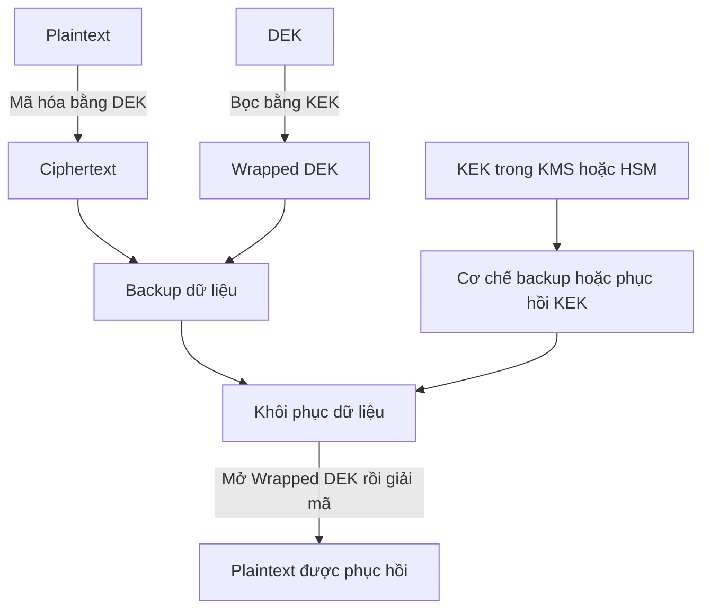

# Key backup là gì

Trong chương **Backup và recovery** của module `SECURITY_KEY_MANAGEMENT_FUNDAMENTALS`, bài học này giải thích cách tạo và bảo vệ bản sao dự phòng của khóa mật mã để có thể khôi phục khi xảy ra mất mát, hỏng thiết bị, xóa nhầm hoặc thảm họa tại một khu vực vận hành. Đây là một phần của vòng đời quản lý khóa: khóa cần được tạo, lưu trữ và sử dụng an toàn, đồng thời phải có phương án phục hồi phù hợp trong suốt thời gian dữ liệu hoặc dịch vụ còn phụ thuộc vào khóa đó.

## 1. Khái niệm key backup

**Key backup** là quy trình tạo, bảo vệ và duy trì một bản sao có thể phục hồi của khóa mật mã, hoặc một cơ chế khôi phục tương đương do KMS/HSM cung cấp. Bản sao có thể chứa key material đã được mã hóa (wrapped key), được lưu trong thiết bị backup bảo mật, hoặc được giữ dưới dạng bản sao/replica do dịch vụ quản lý. Mục tiêu là khôi phục được đúng khóa cần thiết khi bản đang hoạt động bị mất hoặc không thể truy cập.

Khóa mật mã có vai trò đặc biệt vì dữ liệu đã mã hóa thường không thể đọc được nếu thiếu khóa phù hợp. Một bản backup dữ liệu có thể vẫn nguyên vẹn nhưng trở nên vô dụng nếu khóa giải mã duy nhất bị xóa hoặc thất lạc. Ngược lại, giữ được khóa mà không giữ được ciphertext cũng không khôi phục được dữ liệu đã mất. Vì vậy, kế hoạch backup và recovery phải xem dữ liệu, khóa và các thành phần phụ thuộc vào nhau như một hệ thống.

Key backup không đơn giản là sao chép một tệp chứa khóa. Bản sao phải được bảo vệ khỏi truy cập trái phép, sửa đổi và phá hủy; đồng thời tổ chức phải có đủ thông tin, quyền hạn và thiết bị để phục hồi nó. Nếu chỉ lưu một bản sao mà không còn khóa dùng để mở bản sao đó, không có quyền truy cập KMS/HSM hoặc không biết phiên bản khóa nào đã bảo vệ dữ liệu, việc backup sẽ không đem lại khả năng phục hồi thực tế.

### Phân biệt backup với các khái niệm liên quan

| Khái niệm | Mục đích | Điểm cần phân biệt |
|---|---|---|
| Key backup | Khôi phục lại khóa khi bản đang dùng bị mất hoặc hỏng | Cần giữ được bản sao và toàn bộ chuỗi phụ thuộc để mở, xác minh và sử dụng khóa |
| Key replication | Duy trì khả năng phục vụ từ một bản sao ở hệ thống hoặc khu vực khác | Replication thường đồng bộ thay đổi; thao tác xóa hoặc cấu hình sai có thể lan sang replica. Nó không tự động cung cấp điểm khôi phục lịch sử |
| Key rotation | Thay khóa hiện tại bằng khóa mới theo chính sách hoặc khi có rủi ro | Rotation tạo hoặc kích hoạt khóa mới; backup giúp phục hồi khóa cũ khi còn được phép sử dụng |
| Key escrow | Gửi hoặc lưu một bản khóa dưới quyền kiểm soát của bên/cá nhân được chỉ định | Escrow là mô hình lưu giữ và quản trị quyền truy cập; nó có thể là một phần của phương án backup nhưng có mục tiêu và ràng buộc riêng |
| Data backup | Khôi phục dữ liệu và trạng thái ứng dụng | Không đảm bảo khôi phục được khóa cần để giải mã dữ liệu đó |

Một hệ thống có thể dùng đồng thời replication và backup. Replica giúp chuyển hoạt động sang một vùng khác khi vùng chính gặp sự cố; bản backup có phiên bản và chính sách lưu giữ giúp phục hồi trạng thái trước khi xảy ra xóa nhầm, hỏng dữ liệu hoặc cấu hình sai.

## 2. Vì sao cần backup khóa

Mất khóa có thể gây ra hậu quả khác nhau tùy mục đích sử dụng:

- **Khóa mã hóa dữ liệu:** nếu mất khóa giải mã, dữ liệu lưu trữ có thể không còn truy cập được, kể cả khi ciphertext vẫn tồn tại và không bị hỏng.
- **Khóa mã hóa khóa (KEK):** nếu KEK dùng để bọc các DEK bị mất, những DEK đã được bọc có thể không mở được. Điều này có thể ảnh hưởng đến rất nhiều bản ghi hoặc tệp cùng lúc.
- **Khóa giải mã bất đối xứng:** nếu hệ thống cần khóa riêng để giải mã dữ liệu cũ, mất khóa có thể khiến các thông điệp hoặc bản lưu trữ trước đây không thể đọc lại.
- **Khóa ký số:** mất khóa riêng có thể làm gián đoạn việc ký mới. Tuy nhiên, nếu khóa riêng bị lộ hoặc bị khôi phục sai cách, kẻ tấn công có thể tạo chữ ký giả mạo. Vì vậy, backup khóa ký số cần được cân nhắc kỹ theo chính sách và mô hình tin cậy.
- **Khóa gốc hoặc khóa miền HSM:** nếu thiếu cơ chế phục hồi, tổ chức có thể mất quyền truy cập vào nhiều khóa được bảo vệ bên dưới.

Backup phù hợp giúp giảm nguy cơ gián đoạn dịch vụ, mất khả năng giải mã dữ liệu lưu trữ dài hạn và phụ thuộc vào một thiết bị hoặc một khu vực duy nhất. Nó cũng hỗ trợ kế hoạch khôi phục thảm họa, nhưng chỉ hiệu quả khi thời gian phục hồi và phạm vi dữ liệu có thể phục hồi đáp ứng yêu cầu nghiệp vụ.

## 3. Những gì cần được bảo vệ trong một bản key backup

Đối tượng cần backup phụ thuộc vào loại khóa, cách triển khai và chính sách bảo mật. Một gói phục hồi thường cần nhiều hơn key material:

| Thành phần | Vai trò trong phục hồi |
|---|---|
| Key material hoặc bản biểu diễn có thể phục hồi | Cung cấp chính khóa bí mật/khóa riêng, hoặc tham chiếu đến cơ chế phục hồi do KMS/HSM quản lý |
| Key ID và phiên bản | Xác định đúng khóa mà ứng dụng hoặc dữ liệu đang tham chiếu |
| Thuật toán, độ dài khóa và mục đích sử dụng | Giúp xác minh khóa được khôi phục đúng loại và đúng chức năng |
| Trạng thái và mốc thời gian | Cho biết khóa đang hoạt động, đã hết hạn, bị thu hồi hay chỉ còn được giữ để giải mã dữ liệu cũ |
| Thông tin wrapping | Xác định khóa nào đã dùng để bọc bản backup và cách phục hồi khóa wrapping đó |
| Thông tin KMS/HSM | Ghi nhận tenant, miền bảo mật, thiết bị hoặc dịch vụ cần thiết cho quy trình phục hồi |
| Chính sách và tham chiếu quyền truy cập | Hỗ trợ khôi phục quyền sử dụng theo nguyên tắc đặc quyền tối thiểu |
| Chứng thư, khóa công khai hoặc fingerprint | Hỗ trợ xác minh danh tính và tính toàn vẹn của khóa bất đối xứng |
| Dữ liệu đã mã hóa và DEK đã bọc | Cần thiết trong hệ thống envelope encryption để dữ liệu và khóa dữ liệu có thể được phục hồi cùng nhau |

Metadata không phải bí mật như key material, nhưng vẫn cần được bảo vệ khỏi sửa đổi. Nếu một bản backup bị gắn nhầm key ID, phiên bản hoặc mục đích sử dụng, hệ thống có thể phục hồi nhầm khóa hoặc từ chối xử lý dữ liệu hợp lệ.

Một số loại khóa không cần hoặc không nên backup. Khóa phiên có thời hạn rất ngắn, khóa dẫn xuất có thể tạo lại an toàn từ đầu vào gốc, hoặc khóa chỉ dùng cho một phiên giao tiếp thường có thể được tạo mới khi phiên mới bắt đầu. Quyết định phải dựa trên việc dữ liệu có cần được giải mã về sau hay không, khả năng tái tạo khóa, thời hạn lưu trữ và chính sách của tổ chức.

Khóa công khai thường không cần giữ bí mật, nhưng vẫn cần được lưu và xác minh tính toàn vẹn để kiểm tra chữ ký hoặc duy trì chuỗi tin cậy. Khóa riêng và khóa đối xứng cần mức bảo vệ nghiêm ngặt hơn vì người có được chúng có thể giải mã dữ liệu hoặc thực hiện thao tác mật mã thay mặt hệ thống.

## 4. Các cách triển khai key backup

Không có một cách backup áp dụng cho mọi loại khóa. Cách triển khai phải phù hợp với nơi khóa được tạo và lưu trữ.

### 4.1. Backup khóa phần mềm

Với khóa được quản lý trong phần mềm và được phép xuất, hệ thống có thể tạo một bản export đã mã hóa. Key material phải được bọc bằng một khóa bảo vệ backup độc lập, thường gọi là backup wrapping key. Khóa bảo vệ này cần được lưu trong HSM hoặc một miền bảo mật riêng có cơ chế kiểm soát truy cập chặt chẽ.

Không xuất khóa ở dạng plaintext để đưa vào thư mục dùng chung, email, hệ thống quản lý mã nguồn, log hoặc bản backup máy chủ thông thường. Nếu quy trình bắt buộc phải đi qua bộ nhớ tạm, cần giới hạn quyền truy cập, thời gian tồn tại và khả năng ghi ra đĩa; sau khi hoàn tất phải xóa an toàn theo cơ chế của nền tảng.

### 4.2. Backup khóa trong HSM

HSM thường được thiết kế để hạn chế việc xuất key material. Với khóa không thể xuất, tổ chức phải sử dụng cơ chế backup/restore được nhà cung cấp HSM hỗ trợ, chẳng hạn bản backup được mã hóa và ràng buộc với một miền bảo mật hoặc thiết bị tương thích. Việc phục hồi có thể yêu cầu thiết bị thay thế, backup domain key, nhiều quản trị viên hoặc quy trình xác nhận theo ngưỡng.

Không nên giả định rằng một bản sao đồng bộ giữa các HSM trong cụm có thể thay thế backup. Cụm HA giúp duy trì hoạt động khi một thiết bị lỗi, còn backup có phiên bản và được bảo vệ độc lập giúp phục hồi khi thiết bị, cấu hình hoặc toàn bộ miền vận hành gặp sự cố.

### 4.3. Backup khóa trong KMS

KMS có thể quản lý vòng đời và key material thay cho ứng dụng. Với khóa do nhà cung cấp quản lý, key material thường không được phép xuất trực tiếp. Khả năng phục hồi có thể dựa vào replica đa vùng, cơ chế backup nội bộ, thời gian chờ xóa hoặc tính năng khôi phục do dịch vụ cung cấp.

Vì mỗi KMS có giới hạn và hành vi khác nhau, cần xác minh rõ khóa nào có thể export, khóa nào chỉ có thể replicate, thời gian lưu giữ sau khi yêu cầu xóa, điều kiện khôi phục và trách nhiệm của nhà cung cấp. Thiết kế phải dựa trên tính năng thực tế của dịch vụ và tài liệu vận hành đã được kiểm chứng. Không được xem một key ID hoặc cấu hình KMS là bản backup nếu dịch vụ không còn khả năng phục hồi key material tương ứng.

### 4.4. Escrow và lưu giữ bản sao có kiểm soát

Một số tổ chức cần escrow để đáp ứng yêu cầu phục hồi dài hạn, phân quyền hoặc nghĩa vụ pháp lý. Bản khóa được giao cho một custodian hoặc nhóm được chỉ định, kèm điều kiện truy cập, mục đích sử dụng, thời hạn lưu giữ và quy trình phê duyệt. Escrow làm tăng số nơi có thể tiếp cận khóa, vì vậy phải kiểm soát chặt danh tính, trách nhiệm và nhật ký sử dụng.

## 5. Bảo vệ bản backup

Bản backup chứa hoặc cho phép khôi phục bí mật mật mã nên bản thân nó là tài sản nhạy cảm. Nếu kẻ tấn công lấy được backup và khóa dùng để mở backup, họ có thể có quyền tương đương với việc lấy khóa gốc.

### 5.1. Mã hóa bằng khóa bảo vệ độc lập

Khi backup key material, hãy bọc nó bằng một backup wrapping key được quản lý độc lập. Không dùng chính khóa đang được backup để mã hóa bản sao của nó. Nếu khóa gốc bị mất hoặc hỏng, bản backup cũng có thể trở nên không thể mở; đây là một phụ thuộc vòng tròn.

Khóa wrapping cần có đường phục hồi riêng, được bảo vệ trong HSM hoặc một miền quản lý khóa tách biệt. Nếu bản backup chỉ có thể được mở bằng một khóa nằm trong cùng thiết bị hoặc cùng tài khoản có thể bị mất, thiết kế vẫn còn một điểm lỗi duy nhất. Cần xác định trước cách khôi phục backup wrapping key khi thiết bị hoặc tài khoản chính không còn khả dụng.

### 5.2. Tách biệt quyền và nơi lưu trữ

- Áp dụng quyền tối thiểu: người tạo backup không mặc nhiên có quyền khôi phục hoặc sử dụng khóa.
- Dùng dual control hoặc cơ chế M-of-N khi mức độ nhạy cảm yêu cầu nhiều người cùng phê duyệt.
- Tách quyền quản trị KMS/HSM, quyền quản lý kho backup và quyền sử dụng khóa trong ứng dụng.
- Lưu bản sao ở miền lỗi khác với hệ thống chính; cân nhắc bản sao offline hoặc immutable để giảm nguy cơ bị xóa cùng lúc.
- Mã hóa đường truyền và nơi lưu trữ; giới hạn ai có thể tải xuống, sao chép, xóa hoặc thay thế bản backup.
- Ghi audit log cho thao tác tạo, đọc, phục hồi, thay đổi chính sách và hủy backup.

Phân tách địa lý giúp chống lại sự cố tại một địa điểm, nhưng không tự động bảo vệ khỏi việc cùng một tài khoản quản trị bị chiếm quyền. Cần tách cả miền quyền hạn và thông tin xác thực.

### 5.3. Kiểm tra tính toàn vẹn và quản lý phiên bản

Mỗi bản backup nên có manifest mô tả key ID, phiên bản, thuật toán, thời điểm tạo, phương thức wrapping và thông tin kiểm tra tính toàn vẹn. Manifest có thể được ký số hoặc lưu trong hệ thống chống sửa đổi. Checksum giúp phát hiện dữ liệu bị hỏng; chữ ký hoặc cơ chế xác thực giúp phát hiện manifest bị thay đổi bởi người không có quyền.

Giữ lịch sử phiên bản theo chính sách lưu giữ. Khi khóa được rotate, bản backup của khóa cũ có thể vẫn cần thiết để giải mã dữ liệu đã lưu trước đó. Nếu backup wrapping key được rotate, phải bảo đảm các bản backup cũ vẫn mở được trong suốt thời gian lưu giữ: có thể giữ phiên bản wrapping key cũ trong miền bảo mật, hoặc thực hiện quy trình rewrap đã được kiểm chứng.

## 6. Quy trình tạo key backup

Một quy trình có thể triển khai theo các bước sau:

1. **Kiểm kê và phân loại khóa.** Xác định chủ sở hữu, mục đích, mức độ nhạy cảm, thời gian cần giữ và hậu quả nếu mất khóa. Đánh dấu khóa nào cần backup, khóa nào được phục hồi bằng replica và khóa nào có thể tạo mới.
2. **Chọn phương thức được hỗ trợ.** Xác minh khả năng export, backup, replication và restore của phần mềm, HSM hoặc KMS. Không xây dựng quy trình dựa trên giả định rằng mọi khóa đều có thể xuất.
3. **Tạo bản backup.** Thực hiện bằng công cụ hoặc API được phê duyệt. Gắn đúng key ID và phiên bản để tránh nhầm lẫn giữa các khóa có cùng mục đích.
4. **Bọc và bảo vệ bản sao.** Dùng backup wrapping key độc lập; lưu bản sao trong kho được kiểm soát, tách khỏi miền lỗi của hệ thống chính.
5. **Ghi metadata và audit.** Lưu manifest, người thực hiện, thời điểm, kết quả và vị trí lưu trữ. Không ghi key material hoặc bí mật có thể mở khóa vào log.
6. **Xác minh bản backup.** Kiểm tra tính toàn vẹn, khả năng đọc và các điều kiện cần thiết cho restore. Việc xác minh phải tránh làm lộ key material.
7. **Lập lịch và lưu giữ.** Tạo backup sau các thay đổi quan trọng như tạo khóa, thay đổi cấu hình bảo vệ hoặc rotate; đồng thời thực hiện theo chu kỳ phù hợp với mức độ quan trọng của hệ thống.

Chính sách cần quy định tần suất backup, số phiên bản giữ lại, nơi lưu, người có quyền phục hồi, thời hạn hoàn thành restore và cách hủy bản sao hết hạn. Các mốc này phải phù hợp với RPO (mức mất dữ liệu chấp nhận được) và RTO (thời gian khôi phục mục tiêu) của dịch vụ.

## 7. Quy trình phục hồi khóa

Backup chỉ có giá trị khi tổ chức có thể phục hồi nó trong điều kiện thực tế. Quy trình restore cần được ghi thành runbook, có người chịu trách nhiệm và được diễn tập định kỳ.

1. **Xác nhận sự cố và thẩm quyền.** Xác định khóa bị mất, hỏng hay chỉ tạm thời không truy cập được; xác minh người yêu cầu và phê duyệt theo chính sách.
2. **Đánh giá trạng thái bảo mật của khóa.** Xác định khóa có bị lộ hoặc bị nghi ngờ xâm phạm hay không. Nếu khóa bị compromise, không khôi phục nó để tiếp tục sử dụng như khóa tin cậy; cần thực hiện quy trình thu hồi, thay khóa và xử lý dữ liệu liên quan.
3. **Chọn đúng bản backup.** Kiểm tra key ID, phiên bản, trạng thái, thời điểm tạo và manifest. Chỉ chọn bản được xác định là hợp lệ và chưa bị ảnh hưởng bởi sự cố.
4. **Khôi phục khóa bảo vệ backup.** Đảm bảo backup wrapping key hoặc backup domain key có thể được truy cập qua quy trình độc lập, đủ phê duyệt và có audit.
5. **Phục hồi vào môi trường tin cậy.** Dùng quy trình import/restore được KMS/HSM hỗ trợ. Giữ nguyên mục đích sử dụng và các giới hạn xuất khóa; không cấp quyền rộng hơn chỉ để làm cho restore thành công.
6. **Xác minh khóa.** Với khóa bất đối xứng, có thể đối chiếu fingerprint của khóa công khai hoặc chứng thư đã biết. Với khóa đối xứng, dùng cơ chế kiểm tra an toàn do nền tảng hỗ trợ và kiểm thử trên dữ liệu thử nghiệm; không in hoặc so sánh plaintext key material trong log.
7. **Kiểm tra hoạt động và khôi phục dịch vụ.** Thử đúng thao tác mà ứng dụng cần, chẳng hạn giải mã một mẫu ciphertext đã biết hoặc xác minh chữ ký kiểm thử. Sau khi đạt yêu cầu, mới đưa khóa vào luồng xử lý thật.
8. **Ghi nhận và rà soát.** Lưu người phê duyệt, bản backup được dùng, thiết bị đích, kết quả kiểm tra và thời điểm hoàn tất. Theo dõi hệ thống sau khi phục hồi để phát hiện lỗi hoặc truy cập bất thường.

Không nên phục hồi trực tiếp vào môi trường production trước khi xác minh tính toàn vẹn và trạng thái bảo mật. Môi trường phục hồi tách biệt giúp giảm nguy cơ đưa bản backup hỏng hoặc khóa đã bị xâm phạm trở lại hệ thống.

## 8. Ví dụ: backup trong envelope encryption

Trong envelope encryption, ứng dụng tạo một Data Encryption Key (DEK) để mã hóa dữ liệu. Sau đó, DEK được Key Encryption Key (KEK) trong KMS/HSM bọc lại. Ứng dụng có thể lưu ciphertext cùng wrapped DEK mà không cần lưu DEK ở dạng plaintext.

Để phục hồi dữ liệu, hệ thống cần đồng thời có ciphertext, wrapped DEK và khả năng sử dụng KEK tương ứng. Nếu chỉ backup ciphertext và wrapped DEK nhưng KEK đã bị xóa vĩnh viễn, DEK không thể được mở. Nếu chỉ backup KEK nhưng bản dữ liệu và wrapped DEK đã mất, khóa cũng không thể tái tạo nội dung dữ liệu.

Ví dụ, một hệ thống lưu trữ hồ sơ nhiều năm cần backup dữ liệu ở kho lưu trữ và giữ khả năng phục hồi KEK trong suốt thời hạn lưu hồ sơ. Khi rotate KEK, tổ chức phải bảo đảm wrapped DEK cũ vẫn có thể được mở bằng phiên bản KEK cũ, hoặc thực hiện rewrap toàn bộ DEK và xác minh kết quả trước khi ngừng giữ phiên bản cũ.

## 9. Xử lý các tình huống thường gặp

### Xóa nhầm khóa

Trước hết kiểm tra khóa có đang trong thời gian chờ xóa hoặc có thể khôi phục bằng tính năng của KMS hay không. Nếu không, dùng bản backup hợp lệ và thực hiện quy trình restore. Sau đó kiểm tra ứng dụng có tham chiếu đúng key ID và phiên bản đã phục hồi hay không.

### HSM hoặc thiết bị lưu khóa bị hỏng

Thực hiện quy trình thay thế thiết bị và restore theo hướng dẫn của nhà cung cấp. Cần có sẵn backup domain key, thiết bị backup tương thích, quyền của các quản trị viên cần thiết và runbook đã được thử nghiệm. Bản sao HA trong cụm có thể giúp dịch vụ tiếp tục chạy, nhưng không nên xem đó là phương án duy nhất cho thảm họa làm mất toàn bộ cụm.

### KMS ở một khu vực không khả dụng

Nếu kiến trúc có replica đa vùng, có thể chuyển hoạt động theo quy trình đã thiết kế. Cần kiểm tra replica có cùng key material và chính sách cần thiết hay không, ứng dụng có thể truy cập endpoint thay thế hay không, và thao tác chuyển vùng có tạo ra rủi ro ghi hoặc xóa không mong muốn hay không. Khả năng chuyển vùng phụ thuộc vào tính năng và giới hạn của KMS cụ thể.

### Khóa bị compromise

Đây là tình huống xử lý sự cố bảo mật, không phải phục hồi mất mát thông thường. Khóa bị compromise phải được cô lập, vô hiệu hóa hoặc thu hồi theo chính sách; tạo khóa thay thế và đánh giá dữ liệu có thể đã bị truy cập. Với dữ liệu mã hóa, cần xem xét mã hóa lại bằng khóa mới nếu mô hình đe dọa và yêu cầu bảo mật đòi hỏi. Không khôi phục bản backup của khóa bị compromise rồi đưa nó trở lại sử dụng chỉ vì bản sao còn nguyên vẹn.

## 10. Những lỗi thiết kế cần tránh

- **Mã hóa backup bằng chính khóa đang được backup:** khi khóa gốc mất, bản backup cũng không thể mở.
- **Để backup và khóa bảo vệ backup cùng một miền lỗi:** một sự cố hoặc tài khoản bị chiếm quyền có thể làm mất cả hai.
- **Nhầm replication với backup:** thao tác xóa hoặc thay đổi sai có thể lan sang các replica.
- **Không giữ phiên bản khóa cũ:** dữ liệu lưu trữ dài hạn có thể vẫn phụ thuộc vào khóa đã rotate.
- **Không backup metadata và quyền cần thiết:** có key material nhưng không xác định được key ID, wrapping key hoặc cách truy cập thì vẫn không phục hồi được.
- **Không diễn tập restore:** backup có thể bị hỏng, thiếu phụ thuộc hoặc không tương thích với thiết bị mới mà tổ chức không phát hiện cho đến khi xảy ra sự cố.
- **Cho quá nhiều người quyền restore:** bản backup có thể trở thành đường tắt để lấy khóa nhạy cảm.
- **Khôi phục khóa đã bị compromise:** hành động này có thể tái tạo chính rủi ro mà quy trình ứng phó sự cố đang cố loại bỏ.

## 11. Tiêu chí đánh giá một phương án key backup

Một phương án tốt cần trả lời được các câu hỏi sau:

- Khóa nào cần backup, vì sao cần giữ lại và giữ trong bao lâu?
- Bản backup được tạo bằng cơ chế nào, có được nền tảng hỗ trợ và kiểm chứng không?
- Khóa dùng để mở backup được bảo vệ và phục hồi độc lập ra sao?
- Ai có quyền tạo, đọc, phục hồi và hủy backup? Có yêu cầu nhiều người phê duyệt không?
- Bản backup có đủ metadata, phiên bản và thông tin phụ thuộc để chọn đúng khóa không?
- Có thể phục hồi trong một miền lỗi khác với hệ thống chính không?
- Restore mất bao lâu, có đáp ứng RTO/RPO và có được diễn tập định kỳ không?
- Có cách phân biệt khóa bị mất với khóa bị compromise để tránh phục hồi sai mục đích không?

Key backup là một cơ chế duy trì khả năng sử dụng dữ liệu và dịch vụ trong suốt vòng đời của khóa. Giá trị của nó được quyết định bởi khả năng phục hồi đã được kiểm chứng, mức độ bảo vệ bản sao và việc quản lý đầy đủ các phụ thuộc như wrapping key, KMS/HSM, metadata, quyền truy cập và phiên bản khóa. Một bản backup chỉ thực sự hữu ích khi tổ chức có thể khôi phục đúng khóa, đúng trạng thái và đúng quyền trong thời điểm cần thiết.
