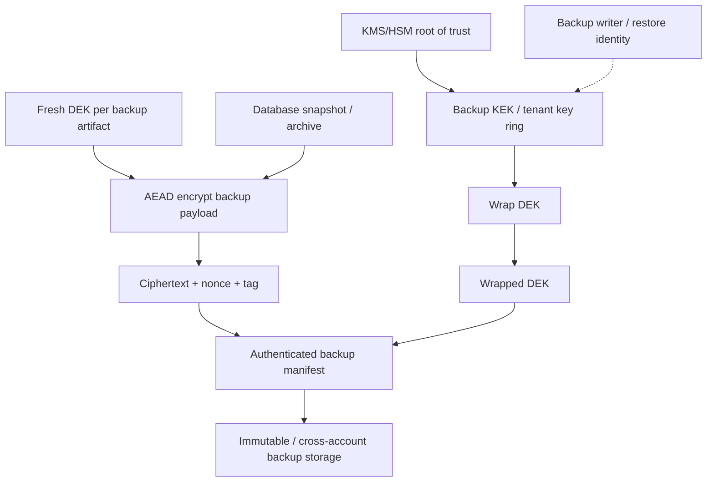
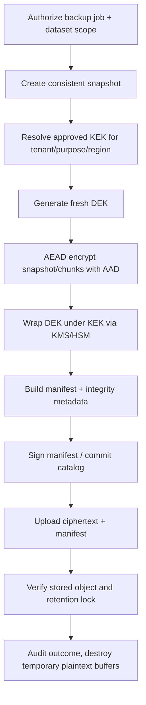
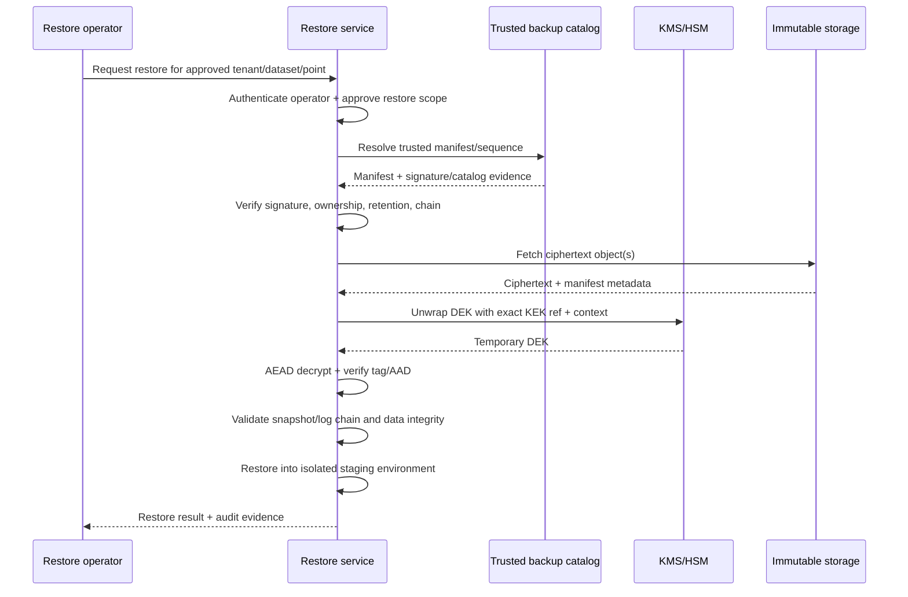

# Backup encryption

## 1. Backup encryption là gì?

**Backup encryption (mã hóa bản sao lưu)** là việc bảo vệ dữ liệu backup bằng mật mã để người không có quyền và vật liệu khóa phù hợp không thể đọc nội dung, đồng thời phát hiện việc sửa đổi trái phép khi dùng một cơ chế xác thực toàn vẹn phù hợp.

Backup có thể là:

- Bản sao toàn bộ database, file system, object storage hoặc máy ảo.
- Snapshot block volume, disk image, container volume hoặc database snapshot.
- Bản sao gia tăng (*incremental backup*), log giao dịch/WAL/binlog hoặc archive.
- Export dữ liệu ứng dụng, cấu hình, secret, audit logs, source artifacts.
- Bản sao ở region khác, tài khoản cloud khác, thiết bị offline hoặc kho lưu trữ dài hạn.
- Bản sao do nhà cung cấp SaaS/backup service tạo và giữ thay khách hàng.

Backup thường chứa **nhiều dữ liệu nhạy cảm hơn một record đang hoạt động**: dữ liệu lịch sử, tài khoản, PII, thông tin thanh toán, secrets, access tokens, cấu hình và cả những dữ liệu đã bị xóa khỏi hệ thống chính. Vì vậy, backup là một **bản sao dữ liệu có giá trị cao**, phải được bảo vệ xuyên suốt lúc tạo, truyền, lưu trữ, phục hồi và hủy.

Một backup mã hóa tốt cần trả lời đồng thời:

1. **Confidentiality:** ai có thể đọc backup?
2. **Integrity/authenticity:** có phát hiện ciphertext, manifest hoặc chuỗi snapshot bị sửa/tráo không?
3. **Availability/recoverability:** có còn key và quyền cần thiết để restore khi production hoặc KMS gặp sự cố không?
4. **Isolation:** một tenant, operator hoặc credential bị chiếm có ảnh hưởng backup của tenant khác không?
5. **Lifecycle:** key nào dùng cho backup mới, key nào còn cần để đọc backup cũ, khi nào được rotate/revoke/destroy?

Mã hóa backup bảo vệ **nội dung**. Nó không tự đảm bảo snapshot nhất quán, backup không bị xóa, ứng dụng khôi phục đúng, hay dữ liệu không bị attacker sửa trước khi backup được tạo. Cần kết hợp encryption với snapshot consistency, access control, immutable storage, integrity verification, retention, monitoring và restore drills.

Bài thuộc chương **Backup và recovery** của module `SECURITY_KEY_MANAGEMENT_FUNDAMENTALS`. Module giúp hiểu vòng đời khóa mật mã từ tạo, cấp phát, lưu trữ, sử dụng, xoay vòng đến thu hồi và hủy; kết nối mật mã đối xứng/bất đối xứng, chữ ký số, KMS/HSM, envelope encryption, kiểm soát truy cập và kiểm toán. Trong bối cảnh backup, **khả năng khôi phục khóa là một phần của khả năng khôi phục dữ liệu**.

### 1.1. Mục tiêu học tập

Sau bài này, bạn có thể:

1. Phân biệt **server-side encryption, client-side encryption, database-native encryption, volume encryption và TLS**.
2. Thiết kế hierarchy **root of trust → KEK → DEK → backup ciphertext** bằng KMS/HSM.
3. Chọn phạm vi DEK: per backup, per snapshot, per chunk, per object hoặc per tenant.
4. Xây dựng manifest ràng buộc tenant/dataset/backup ID, key reference/version, nonce, format và AAD.
5. Giải thích vai trò của **AEAD, AES-GCM, authenticated metadata, signatures và hash chaining**.
6. Tách quyền tạo backup, đọc/restore, quản trị retention, quản trị key và hủy dữ liệu.
7. Lập kế hoạch rotation, rewrap, re-encrypt, retention, legal hold và crypto-erasure.
8. Bảo vệ backup trước ransomware, insider, credential compromise, region outage và mất KMS access.
9. Viết ví dụ Java 17 mã hóa backup bằng DEK riêng, wrap DEK dưới KEK và restore bằng đúng key version.
10. Thiết kế restore drills, DR key continuity, audit, ma trận kiểm thử và checklist production.

## 2. Threat model: backup thường là mục tiêu hấp dẫn

Backup có thể chứa dữ liệu cũ nhưng vẫn có giá trị cho attacker. Một kẻ tấn công không nhất thiết phải xâm nhập production database nếu có thể tải một snapshot đã mã hóa yếu, lấy key ở một nơi khác hoặc xóa cả backup lẫn recovery key.

### 2.1. Các rủi ro chính

| Threat | Tác động | Kiểm soát cần xem xét |
| --- | --- | --- |
| **Backup storage bị truy cập trái phép** | Đọc PII, secrets và dữ liệu lịch sử | Client-side/envelope encryption, IAM, private endpoints |
| **Raw DEK bị lộ** | Giải mã backup tương ứng | DEK per backup/chunk, memory protection, re-encrypt |
| **KEK/KMS permission bị lạm dụng** | Unwrap nhiều DEKs hoặc tạo backup giả | Least privilege, KMS grants, context, audit |
| **Backup admin bị chiếm** | Xóa, sửa hoặc rút ngắn retention | Immutable/WORM, separate admin plane, MFA/SoD |
| **KMS admin bị chiếm** | Disable/destroy key hoặc cấp quyền rộng | Dual control, protected key policy, break-glass |
| **Backup và key cùng bị xóa** | Không còn khả năng restore | Cross-account/region copy, independent recovery controls |
| **Ransomware sửa dữ liệu trước backup** | Backup lưu cả dữ liệu đã bị mã hóa/phá hoại | Detection, clean restore points, immutable history |
| **Snapshot bị tráo hoặc rollback** | Restore sai tenant/dataset/thời điểm | Authenticated manifest, signatures, monotonic catalog |
| **Nonce/AAD sai hoặc bị tái sử dụng** | AEAD mất bảo đảm hoặc decrypt thất bại | Per-key nonce strategy, canonical AAD, format version |
| **KMS region outage** | Không Unwrap được DEK | Tested replica/recovery key path, DR identity |
| **Mất key version cũ** | Backup cũ không thể đọc | Key dependency inventory, retention alignment |
| **Plaintext xuất hiện trong logs/temp files** | Bypass encryption at rest | Secure staging, cleanup, logging controls |
| **Backup bị lưu ngoài residency** | Vi phạm policy/hợp đồng | Region controls, inventory, provider review |

### 2.2. Confidentiality, integrity và availability là các mục tiêu khác nhau

- **Encryption** làm ciphertext khó đọc nếu thiếu key.
- **AEAD authentication** phát hiện sửa ciphertext và AAD trong phạm vi một object/record được xác thực.
- **Digital signature hoặc authenticated catalog** có thể bảo vệ nguồn gốc manifest, snapshot order và policy metadata.
- **Immutable storage/WORM** hạn chế sửa/xóa trong retention, nhưng không tự bảo vệ key.
- **Cross-account/offline copies** giúp phục hồi khi một control plane bị chiếm, nhưng cần key continuity.
- **Restore testing** chứng minh khả năng đọc và khôi phục thực tế.

Một file có AES-GCM tag hợp lệ vẫn có thể là **backup của dữ liệu đã bị ransomware mã hóa trước khi snapshot**. Mã hóa backup không thay thế phát hiện sự cố ở application/data layer.

## 3. Những lớp mã hóa của backup

Không phải mọi lớp mã hóa đều bảo vệ cùng một ranh giới.

| Lớp | Dữ liệu được mã hóa ở đâu? | Ai thường kiểm soát key? | Giới hạn |
| --- | --- | --- | --- |
| **TLS in transit** | Kết nối backup agent → storage/KMS | TLS endpoints/certificate owners | Không bảo vệ object sau khi lưu |
| **Volume/disk encryption** | Block device/snapshot volume | Cloud/platform KMS hoặc host | Khi volume được mount, workload có thể đọc plaintext |
| **Database-native backup encryption** | Backup engine tạo encrypted dump/archive | Database engine/key store | Phụ thuộc DB product, export/restore tooling |
| **Storage server-side encryption (SSE)** | Storage service mã hóa object khi lưu | Provider-managed hoặc customer-managed KMS | Storage service có thể decrypt khi phục vụ request |
| **Client-side encryption** | Backup agent mã hóa trước khi upload | Customer/application KMS/HSM | Cần bảo vệ agent và key distribution |
| **Application envelope encryption** | DEK mã hóa payload, KEK wrap DEK | KMS/HSM + application | Cần quản lý manifest, key version và restore |
| **Layered encryption** | Nhiều lớp độc lập | Nhiều control planes | Tăng complexity, không thay threat modeling |

### 3.1. Server-side encryption (SSE)

Với SSE, backup client upload dữ liệu và storage service mã hóa dữ liệu trước khi ghi xuống storage media. Có thể có các biến thể:

- **Provider-managed key:** provider vận hành key và rotation theo dịch vụ.
- **Customer-managed key (CMEK):** khách hàng quản lý key resource/policy trong KMS.
- **Per-object key hoặc envelope nội bộ:** storage service dùng data key và key hierarchy của provider.

SSE hữu ích cho dữ liệu lưu tại storage, nhưng phải hiểu **storage service có thể decrypt để trả dữ liệu cho principal được phép**. Nếu attacker có quyền đọc object và đường decrypt của storage service, SSE không nhất thiết ngăn họ.

### 3.2. Client-side encryption

Backup agent hoặc ứng dụng mã hóa **trước khi gửi** tới storage. Storage chỉ nhận ciphertext và encrypted metadata, theo thiết kế phù hợp.

Lợi ích:

- Giảm khả năng storage operator đọc plaintext.
- Có thể giữ KEK trong KMS/HSM của customer.
- Cho phép dùng cùng một encrypted backup format ở nhiều storage providers.

Đổi lại, phải quản lý agent, KMS connectivity, plaintext memory/temp files, key metadata, restore tooling và khả năng phục hồi khi source environment không còn tồn tại.

### 3.3. Layered encryption có ích khi nào?

Một kiến trúc có thể dùng **client-side envelope encryption + SSE-KMS + TLS**. Ba lớp bảo vệ ba ranh giới khác nhau:

1. TLS bảo vệ khi truyền.
2. Client-side encryption bảo vệ payload trước storage provider.
3. SSE bảo vệ media/object ở storage layer.

Nhưng thêm lớp không tự làm key custody tốt hơn. Nếu cả client-side KEK và SSE KEK đều do cùng một admin credential quản lý, common failure domain vẫn tồn tại.

## 4. Key hierarchy cho backup encryption

Một pattern phổ biến là **envelope encryption**:

- **DEK (Data Encryption Key):** key dữ liệu, mã hóa backup payload bằng AEAD.
- **KEK (Key Encryption Key):** key trong KMS/HSM, wrap DEK.
- **Root of trust:** nền tảng bảo vệ KEK, HSM/KMS administrative controls, recovery/replica strategy.



### 4.1. DEK riêng cho mỗi backup artifact

Một lựa chọn dễ kiểm soát là sinh **DEK ngẫu nhiên mới cho mỗi backup artifact**:

- Backup ngày 1 có DEK-1.
- Backup ngày 2 có DEK-2.
- Backup ngày 3 có DEK-3.
- Tất cả DEKs được wrap bởi KEK phù hợp.

Nếu DEK-2 bị lộ, phạm vi trực tiếp có thể giới hạn ở artifact được mã hóa bằng DEK-2, nếu không có reuse/copy ngoài dự kiến. Không dùng cùng một DEK vĩnh viễn cho toàn bộ backup repository.

### 4.2. Phạm vi key granularity

| Phạm vi | Ưu điểm | Đánh đổi |
| --- | --- | --- |
| **DEK per full backup** | Dễ quản lý và restore độc lập | Một backup rất lớn có blast radius lớn |
| **DEK per snapshot** | Mỗi snapshot có key riêng | Snapshot chain có nhiều keys cần giữ |
| **DEK per chunk/object** | Khoanh vùng tốt, hỗ trợ song song | Nhiều wrapped DEKs/metadata và KMS operations |
| **DEK per tenant** | Giảm số keys | Compromise ảnh hưởng nhiều backups của tenant |
| **DEK dùng chung toàn repository** | Ít thao tác, đơn giản ban đầu | Blast radius rất lớn; khó revoke/crypto-erase riêng |

Chọn granularity dựa trên kích thước backup, tốc độ, KMS quotas, recovery requirements, retention và blast radius. **Một DEK riêng mỗi backup** thường là điểm bắt đầu hợp lý cho archive artifacts có ranh giới rõ; hệ thống lớn có thể chọn per-chunk hoặc per-object.

### 4.3. KEK scope

KEK có thể scope theo:

- Environment: production, staging, development.
- Tenant/customer.
- Dataset/classification: payment, identity, audit, analytics.
- Region/residency boundary.
- Backup tier: short-term, archive, legal-hold.
- Purpose: backup wrapping, signing manifest, application data.

Không dùng một global KEK cho mọi environment/tenant nếu threat model yêu cầu blast-radius separation. **Tên key khác nhau không chứng minh material độc lập**; registry/provider inventory cần xác minh actual resource và ownership.

### 4.4. Sinh và sử dụng DEK

Trong KMS có API kiểu **GenerateDataKey** hoặc quy trình tương đương:

1. Workload identity được xác thực.
2. KMS/HSM sinh DEK theo approved algorithm/length.
3. Client nhận plaintext DEK tạm thời và wrapped DEK, hoặc một key handle/operation result theo provider.
4. Client mã hóa payload bằng plaintext DEK trong memory.
5. Client loại bỏ DEK khỏi các buffer có thể kiểm soát và chỉ lưu wrapped DEK.
6. Manifest lưu exact KEK reference/version hoặc opaque provider blob theo contract.

Không tự sinh key bằng `UUID`, timestamp, dataset name, tenant ID hoặc hash của một identifier công khai. Cần CSPRNG/KMS/HSM và algorithm được phê duyệt.

## 5. AEAD, AES-GCM và authenticated backup metadata

### 5.1. Encryption phải kèm integrity

Một chế độ AEAD như **AES-GCM** cung cấp confidentiality và authentication cho ciphertext cùng AAD. Khi restore, tag validation phải thành công trước khi plaintext được coi là dữ liệu đáng tin.

Không dùng các cấu hình tự ghép như AES-CBC rồi bỏ qua MAC, hoặc AES-ECB. Nếu hệ thống legacy dùng encryption và MAC riêng, cần một construction được chuẩn hóa, xác thực đúng thứ tự và quản lý key separation.

### 5.2. AAD nên ràng buộc backup identity

AAD là dữ liệu **không được mã hóa nhưng được xác thực**. Ví dụ:

```text
payload-AAD:
  domain        = "backup-payload/v1"
  formatVersion = 1
  tenantId      = "tenant-01"
  datasetId     = "billing-db"
  backupId      = "backup-2026-11-28T010000Z"
  chunkIndex    = 0
  algorithm     = "AES-256-GCM"
```

Nếu attacker tráo ciphertext từ tenant A sang manifest tenant B hoặc object ID khác, tag phải không hợp lệ khi reader tạo đúng AAD mong đợi.

**AAD không phải quyền truy cập**. Reader vẫn phải xác minh principal có quyền restore dataset/tenant trước khi gọi KMS hoặc trả plaintext.

### 5.3. Wrap context và payload AAD có thể tách riêng

- **Payload AAD** bind dữ liệu ổn định: tenant, dataset, backup ID, format, chunk.
- **Wrap AAD/encryption context** bind wrapped DEK với tenant, dataset, backup ID, purpose, KEK reference/version theo provider.

Thiết kế này có thể cho phép **rewrap DEK khi KEK rotate mà không re-encrypt payload**, miễn là wrapping header/context được authenticate và payload AAD không phụ thuộc KEK version mutable.

Nếu payload AAD chứa KEK version, thay key version có thể khiến AEAD tag cũ không còn hợp lệ. Phải thiết kế format từ đầu và không tự sửa header để bỏ qua authentication.

### 5.4. Canonical encoding

Không tạo AAD bằng nối chuỗi tùy ý như `tenant + "|" + dataset + "|" + backup` nếu values có thể chứa delimiter/encoding ambiguity. Dùng **length-prefix, canonical CBOR hoặc canonical JSON** được đặc tả; tất cả implementations phải tạo cùng bytes.

## 6. Manifest của backup: metadata là một phần của security boundary

Backup không chỉ là ciphertext. Restore cần biết **đúng dataset, thời điểm, snapshot sequence, key reference, schema và integrity metadata**.

### 6.1. Manifest JSON minh họa

```json
{
  "manifestVersion": 1,
  "tenantId": "tenant-01",
  "datasetId": "billing-db",
  "backupId": "backup-2026-11-28T010000Z",
  "backupType": "FULL",
  "snapshotSequence": 1042,
  "createdAt": "2026-11-28T01:00:00Z",
  "formatVersion": 1,
  "contentAlgorithm": "AES-256-GCM",
  "aadSchema": "backup-payload-v1",
  "kekReference": "backup/prod/tenant-01/kek",
  "kekVersion": "v3",
  "wrappingAlgorithm": "KMS-NATIVE-WRAP",
  "wrappedDek": "<opaque-wrapped-data-key>",
  "nonce": "<base64url-96-bit-nonce>",
  "ciphertextObject": "objects/backup-1042.enc",
  "ciphertextLength": 84512000,
  "previousManifestHash": "<optional-chain-reference>",
  "signatureKeyReference": "backup-manifest-signer:v2"
}
```

Các chuỗi `<...>` là placeholder, không phải provider format. Manifest không nên chứa raw DEK/KEK hoặc credential.

### 6.2. Trường quan trọng

| Trường | Vai trò | Kiểm tra khi restore |
| --- | --- | --- |
| `tenantId` / `datasetId` | Ownership/scope | Khớp trusted catalog và caller |
| `backupId` | Định danh duy nhất | Không trùng/không bị thay |
| `backupType` | FULL/INCREMENTAL/LOG | Chuỗi phụ thuộc và thứ tự |
| `snapshotSequence` | Thứ tự snapshot/log | Chống restore nhầm hoặc rollback |
| `createdAt` | Retention và timeline | Nguồn thời gian đáng tin |
| `formatVersion` / `aadSchema` | Parser/AAD | Có handler tương thích |
| `contentAlgorithm` | Cipher suite | Server-side allowlist |
| `kekReference` / `kekVersion` | Resolve đúng KEK | Trusted registry/provider blob |
| `wrappedDek` | Khôi phục DEK | Không thay bằng raw DEK |
| `nonce` / tag | AEAD | Kích thước/format đúng |
| `ciphertextLength` | Truncation/size checks | So với storage object thực |
| `previousManifestHash` | Chain continuity | Kiểm sequence/integrity |
| `signatureKeyReference` | Verify nguồn gốc | Trusted signer/policy |

Key reference thường không phải secret nhưng có thể lộ topology/tenant names. Manifest và catalog cần ACL, retention và audit phù hợp.

### 6.3. Manifest signature và rollback protection

AEAD bảo vệ payload theo AAD nhưng có thể chưa đủ để chứng minh **backup này là snapshot mới nhất hoặc do đúng backup service tạo**. Có thể ký manifest bằng một signing key tách biệt:

- Backup writer ký manifest sau khi ciphertext và metadata được commit.
- Restore verifier kiểm issuer/key trust, signature, dataset scope, sequence và retention.
- Public verification key được phân phối qua trust store đáng tin.
- Signing private key có policy riêng và không dùng chung với KEK/DEK.
- Hash chain hoặc append-only catalog có thể phát hiện thiếu/sửa/thay thứ tự snapshots.

Một signature hợp lệ không tự ngăn replay một manifest cũ hợp lệ. Cần **trusted latest sequence/catalog, monotonic state hoặc approval** để chống rollback.

## 7. Pipeline tạo backup mã hóa



### 7.1. Thứ tự thực hiện

1. **Authenticate workload:** backup job chạy dưới workload identity riêng.
2. **Authorize dataset:** xác minh tenant, database, environment và snapshot scope.
3. **Tạo snapshot nhất quán:** database checkpoint/quiesce/WAL hoặc snapshot primitive phù hợp.
4. **Resolve KEK:** trusted registry chọn key active cho đúng tenant/purpose/region.
5. **Generate DEK:** DEK mới cho backup artifact/chunk theo policy.
6. **Encrypt payload:** AEAD, nonce strategy và canonical AAD.
7. **Wrap DEK:** KMS/HSM; encryption context ràng buộc tenant/dataset/backup ID.
8. **Build manifest:** lưu exact key ref/version, wrapped DEK, nonce/tag, schema và snapshot metadata.
9. **Sign/authenticate manifest:** theo trust model.
10. **Upload ciphertext:** qua TLS tới storage, dùng private endpoint/approved destination.
11. **Verify persisted object:** length, checksum, AEAD/tag test hoặc read-after-write sample theo design.
12. **Set retention/immutability:** lock object theo policy và xác minh lock đã áp dụng.
13. **Audit:** backup ID, principal, key ref/version, KMS operation ID, outcome; không log secrets.
14. **Clean staging:** xóa plaintext temporary files và hạn chế DEK memory lifetime theo khả năng runtime.

### 7.2. Snapshot consistency là điều kiện riêng

Một backup được mã hóa tốt nhưng lấy từ database ở trạng thái không nhất quán vẫn có thể không restore được. Tùy workload cần:

- Database-native consistent snapshot.
- Transaction checkpoint hoặc quiesce.
- WAL/binlog/transaction log cùng base snapshot.
- Filesystem freeze/quiesce khi snapshot volume.
- Application hooks để flush buffers.
- Snapshot sequence và dependency chain được ghi trong manifest.

**Encryption không sửa được logical corruption** hoặc snapshot bị cắt giữa các transaction.

### 7.3. Không upload plaintext staging ngoài policy

Nếu backup tool tạo file plaintext tạm trên disk rồi mới mã hóa:

- Staging volume phải có encryption/access controls phù hợp.
- Directory/permissions/umask và temp naming phải an toàn.
- Xóa file không luôn đảm bảo secure erase trên SSD, snapshots hoặc copy-on-write filesystems.
- Tốt hơn, stream dữ liệu qua pipeline encrypt trước khi ghi vào storage đích khi công cụ hỗ trợ.
- Không ghi plaintext backup vào container layer, debug log, crash dump hoặc shared workspace.

## 8. Restore pipeline: khôi phục phải xác minh trước khi tin dữ liệu



### 8.1. Các bước bắt buộc

1. Xác thực restore operator và phê duyệt **dataset, tenant, point-in-time, target environment**.
2. Resolve manifest từ **trusted catalog**; không tin file manifest do caller upload tự khai.
3. Kiểm chữ ký/hash chain, sequence, timestamp, backup type và dependencies.
4. Kiểm tenantId, datasetId, region, retention và restore scope.
5. Lấy exact key reference/version từ trusted metadata; validate key state và purpose.
6. Gọi KMS/HSM Unwrap với đúng encryption context.
7. Decrypt và verify AEAD tag/AAD; nếu tag fail, dừng và điều tra.
8. Kiểm ciphertext length, chunk ordering, snapshot/WAL sequence và format parser.
9. Restore vào **isolated staging**, không ghi đè production ngay.
10. Kiểm ứng dụng/data consistency, record counts và business invariants.
11. Security review trước cutover/failback; giữ production cũ nếu cần rollback.
12. Thu hồi DR grants/time-bound permissions và audit restore completion.

### 8.2. Không restore trực tiếp vào production một cách mù quáng

Backup có thể chứa:

- Malware hoặc ransomware payload đã tồn tại trước snapshot.
- Admin accounts/SSH keys/credentials đã bị compromise.
- Vulnerable binaries, scheduled tasks, backdoor hoặc malicious database triggers.
- Dữ liệu bị xóa/đổi bởi attacker trước thời điểm backup.
- Secrets hết hạn hoặc không còn được tin cậy.

Restore cần **clean-room/isolation**, quét và xác minh trước khi promote. Mã hóa bảo vệ dữ liệu khi lưu, không chứng minh nội dung an toàn.

### 8.3. Khi AEAD tag hoặc signature thất bại

- Dừng restore object/chain bị lỗi; không bỏ qua tag.
- Bảo toàn ciphertext, manifest, storage version IDs và logs để điều tra.
- Kiểm đúng key version, AAD schema, nonce, serialization, region và provider context.
- Thử lại chỉ khi xác định được lỗi vận chuyển/metadata và có bản sao đáng tin; không brute-force keys.
- Kiểm các backup copies độc lập khác và hash/catalog evidence.
- Ghi incident, không âm thầm thay bằng một bản plaintext hoặc key hardcoded.


## 9. Incremental backup, log chain và dependency graph

Mã hóa từng file backup độc lập không tự giải quyết dependency giữa **full backup, incremental backup và transaction logs**.

Ví dụ:

```text
Full F0 (Sunday)
  ├── Incremental I1 (Monday)
  ├── Incremental I2 (Tuesday)
  ├── Incremental I3 (Wednesday)
  └── WAL/binlog segments W1 ... Wn

Point-in-time restore at Wednesday 10:15:
  F0 -> I1 -> I2 -> required WAL/binlog segments
```

### 9.1. Mỗi artifact cần identity và key metadata riêng

Một lựa chọn là mỗi full/incremental/log segment có:

- Backup ID và snapshot/log sequence.
- DEK riêng cho artifact hoặc chunk group.
- Wrapped DEK và exact KEK reference/version.
- AAD chứa tenant, dataset, artifact ID, sequence, type và format.
- Manifest ghi parent/base backup ID và dependency references.
- Integrity/authenticity metadata và retention expiry.

Nếu một incremental phụ thuộc F0 và I1, restore phải lấy **đúng tất cả artifacts và keys** trong dependency graph. Chỉ kiểm bản backup gần nhất là chưa đủ.

### 9.2. Mã hóa log segment

WAL/binlog thường có nhiều segments nhỏ và liên tục. Có thể:

- Dùng DEK riêng từng segment hoặc một DEK theo epoch ngắn với usage bounds rõ.
- Bind sequence, segment ID, database identity và previous segment hash trong AAD/manifest.
- Ghi checkpoint, start/end LSN hoặc transaction sequence.
- Kiểm continuity, không bỏ segment hoặc phát lại một segment cũ.
- Rotate theo số lượng bytes/operations, thời gian và incident policy.

Không reuse một nonce GCM dưới cùng key giữa các segments. Nếu dùng một DEK cho nhiều chunks, phải có nonce strategy toàn cục giữa mọi writers/processes.

### 9.3. Xóa một backup có thể làm đứt chain

Trước khi lifecycle policy xóa full backup hoặc incremental segment, cần kiểm tra **mọi restore point còn trong retention** có phụ thuộc artifact đó hay không. Xóa một object cũ có thể khiến hàng loạt snapshots sau không còn restore được, dù ciphertext của chúng vẫn nguyên vẹn.

Catalog cần theo dõi dependency graph, reference count/retention, legal hold và trạng thái restore verification.

## 10. Backup lớn: chunking, streaming và nonce strategy

Một database dump có thể lớn hơn bộ nhớ process. Không nên đọc toàn bộ plaintext vào một mảng chỉ để gọi AES-GCM nếu backup có kích thước hàng trăm GB.

### 10.1. Chunked authenticated encryption

Một định dạng có thể chia payload thành các chunks độc lập:

```text
Backup ID: B-1042
DEK: one fresh DEK for this artifact (or a scoped chunk-key hierarchy)

Chunk 0: nonce N0, AAD=(B-1042, index=0, total/format), ciphertext+tag
Chunk 1: nonce N1, AAD=(B-1042, index=1, total/format), ciphertext+tag
Chunk 2: nonce N2, AAD=(B-1042, index=2, total/format), ciphertext+tag
...
Manifest: ordered chunk IDs, lengths, count, hashes, wrapped DEK
```

AAD cần ràng buộc **backup ID, chunk index, dataset/tenant, format và các thông tin cấu trúc**. Khi restore, xác minh từng chunk và toàn bộ sequence.

### 10.2. Chống reorder, duplicate và truncation

Nếu mỗi chunk được AEAD-authenticate nhưng manifest không xác thực tổng số chunk/sequence, attacker có thể thử bỏ chunk cuối hoặc tráo thứ tự. Thiết kế nên xác thực:

- Chunk index và total count (hoặc terminal marker).
- Expected byte length và plaintext length.
- Backup ID, snapshot sequence, dataset.
- Previous/next chunk hash hoặc Merkle root khi phù hợp.
- Manifest được ký/authenticate và lưu trong trusted catalog.
- Completion marker chỉ được commit sau khi mọi chunks đã ghi và kiểm tra.

AEAD tag từng chunk chứng minh chunk hợp lệ theo AAD; **manifest/catalog** chứng minh cấu trúc backup hoàn chỉnh và thứ tự được mong đợi.

### 10.3. Nonce cho AES-GCM

AES-GCM yêu cầu **không reuse nonce dưới cùng key**. Với nonce 96-bit ngẫu nhiên, collision không phải bất khả thi; xác suất tăng theo số lần sử dụng dưới cùng key. Cần:

- Chọn usage limits theo tiêu chuẩn/provider và threat model.
- Giới hạn số chunks/bytes/operations mỗi DEK.
- Có unique nonce allocation khi nhiều workers cùng dùng một key.
- Hoặc sinh DEK độc lập mỗi chunk/group để đơn giản hóa domain uniqueness.
- Không dùng chunk index trực tiếp làm nonce nếu chưa có thiết kế domain separation, key uniqueness và format được kiểm chứng.
- Khi retry, không mã hóa plaintext mới dưới cùng key+nonce đã dùng cho một plaintext khác.

Một lần retry cùng operation có thể trả lại ciphertext đã commit nếu idempotency đảm bảo; nếu phải tạo encryption attempt mới, dùng nonce mới theo policy.

### 10.4. Tránh tự thiết kế streaming cipher protocol

Đối với backup lớn, ưu tiên **backup format/library đã được review**, database-native encryption hoặc chunked AEAD construction đã được chuẩn hóa/kiểm chứng. Không tự cắt AES-GCM stream tùy tiện rồi ghép nonce/tag mà không có parser, ordering, truncation, crash recovery và versioning spec.

## 11. Storage immutability, ransomware và separation of duties

Encryption bảo vệ confidentiality nhưng ransomware thường nhắm tới **khả năng khôi phục** bằng cách xóa backup, phá catalog hoặc disable/destroy keys.

### 11.1. Tách control planes

| Vai trò | Quyền cần thiết | Quyền không nên mặc định có |
| --- | --- | --- |
| **Backup writer** | GenerateDataKey/Wrap, upload ciphertext | Destroy KEK, sửa retention lock, đọc mọi dataset |
| **Restore operator** | Request restore theo ticket, Unwrap trong scope | Xóa backup, thay key policy, admin mọi tenants |
| **Storage administrator** | Quản lý storage platform theo role | Unwrap DEK hoặc đọc plaintext client-side encrypted backup |
| **KMS key administrator** | Provision, rotate, policy change theo approval | Xóa backup object hoặc tự restore dữ liệu nhạy cảm |
| **Retention/compliance officer** | Approve legal hold/retention exception | Export raw keys hoặc bypass audit |
| **Security auditor** | Read-only audit/config evidence | Sign/Decrypt/Destroy key |
| **Break-glass recovery** | Time-bound restore quyền hạn chế | Standing administrator credential |

Không phải sản phẩm nào cũng có đúng các role này; đây là **mô hình trách nhiệm** để ánh xạ vào IAM/KMS/storage permissions.

### 11.2. Immutable/WORM backup

Immutable storage hoặc WORM retention có thể ngăn xóa/sửa object trong thời gian được khóa. Cần kiểm tra:

- Retention lock có thực sự bật và áp dụng cho mọi object/manifest/version?
- Ai có thể rút ngắn retention hoặc bypass governance mode?
- Object versioning/replication có giữ cả bản xấu do attacker ghi không?
- Catalog/manifest có nằm trong cùng control plane với backup objects?
- KMS key administrator có thể destroy KEK làm backup immutable nhưng không đọc được không?
- Storage administrator có thể xóa cả replica hoặc disable account không?

**Immutable ciphertext không có ích nếu attacker hủy key duy nhất**, và key còn nguyên không giúp gì nếu mọi bản backup đều bị xóa.

### 11.3. 3-2-1-1-0 như một nguyên tắc vận hành

Một cách nhớ phổ biến:

- Có nhiều bản sao dữ liệu.
- Lưu trên nhiều loại media hoặc failure domains.
- Có ít nhất một bản ở ngoài site/region chính.
- Có một bản offline hoặc immutable/air-gapped.
- Có zero unverified backup errors sau khi kiểm tra/restore verification theo kế hoạch.

Đây là nguyên tắc về **resilience**, không thay thế thiết kế encryption/key custody. Mỗi copy cần manifest, key dependencies, access controls và restore tests.

### 11.4. Chống attacker xóa cả backup lẫn KEK

- Tách account/project/subscription cho backup và KMS khi phù hợp.
- Dùng dual control cho key destruction và retention changes.
- Có offline/independent recovery material theo threat model.
- Cấm backup writer tự Destroy KEK; cấm key admin tự xóa immutable backup.
- Bảo vệ root/admin identities bằng MFA, phishing-resistant auth và just-in-time access.
- Alert khi có hàng loạt delete, key disable, policy changes hoặc retention changes.
- Kiểm tra cả deletion protection của catalog, manifest signer và audit store.

## 12. KMS/HSM, IAM và key custody cho backup

### 12.1. Permission matrix

| Principal | GenerateDataKey/Wrap | Unwrap/Decrypt | Key admin | Destroy | Điều kiện |
| --- | --- | --- | --- | --- | --- |
| **Backup writer** | Allow cho tenant/dataset/purpose | Thường không cần đọc backup cũ | Deny | Deny | Job identity và scope đã xác thực |
| **Restore service** | Không cần cho restore thuần | Allow theo ticket/tenant/backup | Deny | Deny | Time-bound grant, object authorization |
| **Backup catalog service** | Không cần | Không cần raw DEK | Metadata-only | Deny | Không giữ secret |
| **KMS key admin** | Quản lý resource/policy theo role | Không mặc định | Allow có approval | Dual approval | Separation of duties |
| **Storage admin** | Deny | Deny nếu client-side encryption | Storage only | Không được bypass retention | Immutable policy |
| **Auditor** | Deny | Deny | Read-only evidence | Deny | Least privilege |
| **Break-glass** | Theo case | Theo case | Không mặc định | Không | Approval, expiry, audit |

Các KMS API có tên operation khác nhau. Ví dụ `GenerateDataKey`, `Encrypt`, `Decrypt`, `ReEncrypt` hoặc wrapping operations có semantics riêng. Phải kiểm **provider API thật**, không áp nguyên bảng nghiệp vụ vào IAM mà không xác minh.

### 12.2. Encryption context

Một KMS provider có thể hỗ trợ encryption context được ràng buộc vào encrypted data key và dùng trong policy conditions. Context nên chứa các định danh không bí mật nhưng ổn định:

- Purpose: backup-dek-wrap.
- Tenant ID bất biến.
- Dataset ID.
- Backup ID hoặc artifact ID.
- Environment/region khi policy yêu cầu.

Không đưa password, bearer token, raw secret hoặc PII không cần thiết vào context. Context không phải authorization tự động; values phải đến từ trusted backup catalog/identity layer.

### 12.3. Non-exportable KEK và plaintext DEK

KEK có thể non-exportable trong KMS/HSM. Tuy nhiên một số API data-key trả plaintext DEK tạm cho backup process. Cần:

- Giới hạn workload identity và process privilege.
- Không log request/response chứa DEK.
- Không đưa DEK vào environment variable, command-line args hoặc crash report.
- Giới hạn heap dump/core dump access.
- Tránh reuse DEK giữa backups.
- Zeroize buffers khi có thể, nhưng không tuyên bố zeroization tuyệt đối nếu runtime/provider có thể copy.
- Dùng KMS/HSM operation/handle phù hợp nếu provider hỗ trợ encryption mà không xuất raw key.

### 12.4. KMS admin không nên là restore operator mặc định

Nếu cùng một identity vừa có quyền đổi key policy, export/unwrap mọi key và xóa backup, một lần compromise có thể phá toàn bộ recovery boundary. Tách quyền và phê duyệt độc lập giúp giảm blast radius; audit phải thể hiện ai yêu cầu, ai duyệt và ai thực thi.

## 13. Key recovery: giữ khóa đủ lâu để phục hồi, nhưng bảo vệ đường phục hồi

Mất key có thể nguy hiểm tương đương mất backup. **Ciphertext tốt nhưng không còn cách lấy đúng DEK/KEK là backup không thể restore**.

### 13.1. Recovery dependency chain

```text
Backup object
  -> manifest / AAD schema / format parser
  -> wrapped DEK
  -> exact KEK resource/version or provider-native blob
  -> KMS/HSM account, region, policy and recovery identity
  -> data restore tooling + database/application dependencies
```

Chỉ giữ wrapped DEK mà xóa KEK không đủ. Chỉ giữ KEK mà mất manifest/AAD schema hoặc parser cũng có thể khiến restore thất bại.

### 13.2. Các mô hình bảo vệ khả năng khôi phục KEK

- **Provider-managed KMS durability:** dựa trên SLA/backup/replication của provider, phải xác minh scope và account recovery.
- **Multi-region/replica key:** hỗ trợ failover theo khả năng thực tế của provider; kiểm region semantics.
- **Cross-account recovery key:** một resource/key ring độc lập để bảo vệ recovery material theo approved architecture.
- **HSM backup/replication:** quy trình backup/restore thiết bị, partition, quorum và operator ceremony.
- **Key escrow:** giữ recovery material hoặc quyền truy cập trong hệ thống kiểm soát riêng; tăng attack surface nên cần dual control.
- **Customer-held/BYOK source material:** khách giữ bản gốc; phải có inventory, backup và trách nhiệm rõ.
- **Threshold/dual-control recovery:** nhiều người/thiết bị cùng tham gia để phục hồi, tránh một cá nhân tự lấy toàn bộ quyền.

Không mặc định xuất raw KEK ra file để “backup cho chắc”. Việc export có thể tạo một bản sao có độ rủi ro cao hơn và phá lợi ích non-exportability. Chọn cơ chế theo product/contract và kiểm thử restore thật.

### 13.3. Escrow có trade-off

Escrow có thể giúp khôi phục khi KMS account bị mất, nhưng đồng thời tạo một **đường mở khóa thứ hai**. Cần xác định:

- Ai là custodian và ai có quyền yêu cầu recovery?
- Material được mã hóa/bảo vệ bằng gì?
- Có dual control hoặc threshold approval không?
- Bản escrow nằm ở region/account/physical site nào?
- Audit và tamper-evidence được bảo vệ thế nào?
- Có lịch restore rehearsal và quy trình thay material không?
- Khi key compromised hoặc tenant offboard, escrow copy được xử lý ra sao?

Một bản escrow không được kiểm thử có thể không dùng được khi sự cố xảy ra; một bản escrow quá dễ truy cập có thể trở thành mục tiêu lớn.

### 13.4. KMS account recovery và root identity

Backup team phải biết cách khôi phục quyền truy cập KMS khi:

- Admin identity bị khóa hoặc tổ chức mất quyền quản trị account.
- Billing/subscription bị đình chỉ.
- Region/control plane gặp outage.
- KMS key policy bị sửa sai, không còn principal hợp lệ.
- HSM partition hoặc quorum/operator credentials bị mất.
- Vendor/contract thay đổi.

Recovery plan cần được lưu ở nơi backup admin và production admin không thể cùng sửa/xóa tùy tiện. Kiểm thử **đường phục hồi độc lập** mà không cần production control plane.

## 14. Rotation và retention của backup keys

Backup có vòng đời dài hơn ứng dụng thường ngày. Một key mới active cho backup hôm nay **không tự làm các archive 5 năm trước chuyển key**.

### 14.1. New backups dùng KEK active; old backups dùng exact historical KEK

```text
Before rotation:
  backup B1 -> DEK1 -> wrapped by KEK v2
  backup B2 -> DEK2 -> wrapped by KEK v2

Cutover:
  new backup wrapping -> KEK v3
  KEK v2 -> RESTORE_ONLY (nếu policy cho phép)

After cutover:
  backup B3 -> DEK3 -> wrapped by KEK v3

Restore:
  B1/B2 -> exact v2
  B3    -> exact v3
```

Không resolve alias `current` để giải mã backup cũ. Manifest/catalog phải định tuyến đúng key version hoặc provider-native blob theo contract.

### 14.2. Rotate KEK: rewrap DEK hay re-encrypt payload?

| Hành động | Thay đổi | Khi phù hợp |
| --- | --- | --- |
| **KEK rotation + new backups** | New backup DEKs được wrap bằng KEK mới | Bắt đầu dùng key mới |
| **Rewrap old DEKs** | Wrapped DEK chuyển từ KEK cũ sang KEK mới | KEK cũ cần retire, DEK/payload vẫn an toàn |
| **Re-encrypt backup payload** | Tạo DEK mới, ciphertext/tag/nonce mới | DEK lộ, suite yếu, policy yêu cầu |
| **Re-sign manifest** | Signature mới theo signer/trust mới | Signing key rollover hoặc signature policy |
| **Keep old key for restore** | Không thay archive cũ | Retention/legal hold còn phụ thuộc |

Rewrap **không** bảo vệ lại DEK đã bị lộ. Nếu raw DEK bị attacker copy, cần đánh giá re-encrypt và dữ liệu quá khứ.

### 14.3. Rotation không được làm mất restore point

Trước khi chuyển hoặc retire key:

1. Provision KEK mới và xác minh IAM.
2. Đảm bảo restore service có thể Unwrap dưới version mới.
3. Tạo backup thử nghiệm, upload, download và restore đầy đủ.
4. Cutover backup writer.
5. Giữ old KEK ở restore-only theo policy.
6. Nếu migrate, rewrap/re-encrypt theo batch có checkpoint/idempotency.
7. Kiểm mọi full/incremental/log chain và offsite copies.
8. Chỉ destroy sau khi hết dependencies, retention và approvals.

### 14.4. Backup key có cryptoperiod khác production data key

Một KEK có thể không còn được phép Wrap mới nhưng vẫn cần Unwrap archive. **Originator-use period** và **recipient-use period** cần được xác định riêng. Đừng hủy key chỉ vì đã hết thời gian dùng để tạo backup mới.

## 15. Retention, legal hold và crypto-erasure

### 15.1. Retention của backup và key phải đồng bộ

Ví dụ backup phải giữ 7 năm nhưng KEK bị xóa sau 1 năm thì archive còn object bytes nhưng không thể giải mã. Ngược lại, giữ KEK vô thời hạn sau khi backup bị xóa có thể tạo key material không còn owner hoặc không còn mục đích.

Catalog nên ghi:

- Backup ID, dataset/tenant, backup type, created time.
- Retention expiry và legal hold state.
- Wrapped DEK/key version dependency.
- Archive/replica locations.
- Restore verification date.
- Migration status và destruction eligibility.

### 15.2. Crypto-erasure

Crypto-erasure có thể làm backup ciphertext không còn giải mã khả thi khi **mọi vật liệu khóa cần thiết trong phạm vi** đã được hủy và không còn bản plaintext/DEK/key copy có thể dùng.

Cần kiểm:

- Raw DEK không tồn tại trong exports, memory dumps, temp files hoặc cache.
- KEK và imported/BYOK/escrow copies đã được xử lý.
- Wrapped DEKs và ciphertext có còn trong snapshots/replicas/offsite copies không.
- Plaintext exports, search indexes, analytics copies và downstream systems.
- Legal hold, contractual retention và audit obligations.
- Provider destruction completion, không chỉ alias deletion/disable.

**Xóa object hoặc hủy KEK không chứng minh mọi bản sao đã biến mất.** Crypto-erasure phải là kết luận có scope và evidence.

### 15.3. Legal hold có thể ngăn hủy key

Nếu backup nằm trong legal hold, việc hủy KEK duy nhất có thể khiến tổ chức không thực hiện được nghĩa vụ giữ/khôi phục dữ liệu. Cần approval từ data owner/legal/compliance trước destructive operation; worker vận hành không tự suy đoán thời hạn.


## 16. Java 17: mã hóa backup bằng DEK riêng và KEK trong key ring

Ví dụ dưới đây mô phỏng một backup artifact có:

- DEK AES-256 mới cho mỗi backup.
- KEK v1 ban đầu, sau đó provision và activate KEK v2.
- Backup cũ vẫn restore bằng exact KEK v1 khi v1 ở `RESTORE_ONLY`.
- Backup mới phải được wrap dưới v2.
- Payload AAD bind tenant, dataset, backup ID và format.
- Wrap AAD bind thêm exact KEK ID/version.
- Negative tests cho cross-tenant, sai key version và ciphertext bị sửa.

**Đây là demo JCA chạy trong một JVM**, không phải tích hợp KMS/HSM thực. KEKs nằm trong heap; production cần non-exportable KEK/provider API, IAM, trusted catalog, immutable storage, manifest signature và distributed restore controls.

### 16.1. Source: `BackupEncryptionDemo.java`

```java
import java.io.ByteArrayOutputStream;
import java.io.DataOutputStream;
import java.io.IOException;
import java.nio.charset.StandardCharsets;
import java.security.GeneralSecurityException;
import java.security.MessageDigest;
import java.security.SecureRandom;
import java.util.Arrays;
import java.util.HashMap;
import java.util.Map;
import java.util.Objects;
import java.util.Set;

import javax.crypto.AEADBadTagException;
import javax.crypto.Cipher;
import javax.crypto.KeyGenerator;
import javax.crypto.SecretKey;
import javax.crypto.spec.GCMParameterSpec;
import javax.crypto.spec.SecretKeySpec;

public final class BackupEncryptionDemo {
    private static final SecureRandom RNG = new SecureRandom();
    private static final int FORMAT_VERSION = 1;
    private static final int NONCE_BYTES = 12;
    private static final int TAG_BITS = 128;
    private static final String CONTENT_ALG = "AES-256-GCM";
    private static final String WRAP_ALG = "AES-GCM-DEK-WRAP-DEMO";
    private static final String KEK_ID =
        "backup/prod/tenant-01/billing-kek";

    enum KeyState { ACTIVE, RESTORE_ONLY, REVOKED }

    record KeyRef(String id, String version) {}

    // Identity phải đến từ authentication/authorization layer.
    record Principal(
        String name, String tenantId, Set<String> roles
    ) {}

    // Demo DTO: production phải defensive-copy mọi byte[].
    record BackupEnvelope(
        int formatVersion,
        String tenantId,
        String datasetId,
        String backupId,
        String contentAlgorithm,
        String wrappingAlgorithm,
        KeyRef kekRef,
        byte[] wrapNonce,
        byte[] wrappedDek,
        byte[] payloadNonce,
        byte[] ciphertextAndTag
    ) {}

    static final class KeySlot {
        final KeyRef ref;
        final SecretKey material;
        KeyState state;

        KeySlot(KeyRef ref, SecretKey material, KeyState state) {
            this.ref = ref;
            this.material = material;
            this.state = state;
        }
    }

    static final class BackupKeyRing {
        private final Map<KeyRef, KeySlot> slots = new HashMap<>();
        private KeyRef active;

        synchronized void register(KeyRef ref, SecretKey kek) {
            if (slots.containsKey(ref)) {
                throw new SecurityException("Duplicate KEK reference");
            }
            // Key mới được chuẩn bị cho restore, chưa active để write.
            slots.put(ref, new KeySlot(
                ref, kek, KeyState.RESTORE_ONLY
            ));
        }

        synchronized void activate(KeyRef ref) {
            KeySlot next = slots.get(ref);
            if (next == null || next.state == KeyState.REVOKED) {
                throw new SecurityException("KEK not eligible");
            }
            if (active != null) {
                KeySlot old = slots.get(active);
                if (old != null && old.state == KeyState.ACTIVE) {
                    old.state = KeyState.RESTORE_ONLY;
                }
            }
            next.state = KeyState.ACTIVE;
            active = ref;
        }

        synchronized KeySlot forNewBackup() {
            KeySlot slot = slots.get(active);
            if (slot == null || slot.state != KeyState.ACTIVE) {
                throw new SecurityException("No active backup KEK");
            }
            return slot;
        }

        synchronized KeySlot forRestore(KeyRef ref) {
            KeySlot slot = slots.get(ref);
            if (slot == null || slot.state == KeyState.REVOKED) {
                throw new SecurityException("KEK unavailable/revoked");
            }
            return slot;
        }

        synchronized void requireNewWrite(KeyRef ref) {
            KeySlot slot = forNewBackup();
            if (!slot.ref.equals(ref)) {
                throw new SecurityException(
                    "Historical KEK cannot wrap new backup"
                );
            }
        }

        synchronized void revoke(KeyRef ref) {
            KeySlot slot = slots.get(ref);
            if (slot == null) {
                throw new SecurityException("Unknown KEK");
            }
            slot.state = KeyState.REVOKED;
            if (ref.equals(active)) {
                active = null; // Không fallback sang key cũ.
            }
        }
    }

    static SecretKey newAes256() throws GeneralSecurityException {
        KeyGenerator generator = KeyGenerator.getInstance("AES");
        generator.init(256, RNG);
        return generator.generateKey();
    }

    static byte[] randomNonce() {
        byte[] nonce = new byte[NONCE_BYTES];
        RNG.nextBytes(nonce);
        return nonce;
    }

    static void writeField(DataOutputStream out, String value)
            throws IOException {
        byte[] bytes = value.getBytes(StandardCharsets.UTF_8);
        out.writeInt(bytes.length);
        out.write(bytes);
    }

    // AAD payload ổn định: không chứa KEK version mutable.
    static byte[] payloadAad(BackupEnvelope e) throws IOException {
        ByteArrayOutputStream buffer = new ByteArrayOutputStream();
        try (DataOutputStream out = new DataOutputStream(buffer)) {
            writeField(out, "backup-payload/v1");
            out.writeInt(e.formatVersion());
            writeField(out, e.contentAlgorithm());
            writeField(out, e.tenantId());
            writeField(out, e.datasetId());
            writeField(out, e.backupId());
        }
        return buffer.toByteArray();
    }

    // Wrap AAD bind DEK với exact KEK ref/version.
    static byte[] wrapAad(BackupEnvelope e) throws IOException {
        ByteArrayOutputStream buffer = new ByteArrayOutputStream();
        try (DataOutputStream out = new DataOutputStream(buffer)) {
            writeField(out, "backup-dek-wrap/v1");
            out.writeInt(e.formatVersion());
            writeField(out, e.wrappingAlgorithm());
            writeField(out, e.tenantId());
            writeField(out, e.datasetId());
            writeField(out, e.backupId());
            writeField(out, e.kekRef().id());
            writeField(out, e.kekRef().version());
        }
        return buffer.toByteArray();
    }

    static byte[] aead(
        int mode, SecretKey key, byte[] nonce,
        byte[] input, byte[] aad
    ) throws GeneralSecurityException {
        Cipher cipher = Cipher.getInstance("AES/GCM/NoPadding");
        cipher.init(
            mode, key, new GCMParameterSpec(TAG_BITS, nonce)
        );
        cipher.updateAAD(aad);
        return cipher.doFinal(input);
    }

    static void authorize(
        Principal caller, String tenant, String role
    ) {
        if (caller == null || caller.name() == null
                || caller.name().isBlank()
                || caller.roles() == null
                || !Objects.equals(caller.tenantId(), tenant)
                || !caller.roles().contains(role)) {
            throw new SecurityException("Backup access denied");
        }
    }

    static BackupEnvelope encryptBackup(
        BackupKeyRing keyRing,
        Principal writer,
        String trustedTenant,
        String trustedDataset,
        String trustedBackupId,
        byte[] plaintext
    ) throws Exception {
        authorize(writer, trustedTenant, "backup-writer");
        if (trustedDataset == null || trustedDataset.isBlank()
                || trustedBackupId == null || trustedBackupId.isBlank()
                || plaintext == null) {
            throw new SecurityException("Invalid backup input");
        }

        // Lock chỉ mô phỏng cutover trong một JVM.
        synchronized (keyRing) {
            KeySlot kek = keyRing.forNewBackup();
            SecretKey dek = newAes256();
            byte[] rawDek = dek.getEncoded();
            if (rawDek == null || rawDek.length != 32) {
                throw new GeneralSecurityException("Invalid DEK");
            }

            byte[] wrapNonce = randomNonce();
            byte[] payloadNonce = randomNonce();
            BackupEnvelope header = new BackupEnvelope(
                FORMAT_VERSION, trustedTenant, trustedDataset,
                trustedBackupId, CONTENT_ALG, WRAP_ALG,
                kek.ref, wrapNonce, null, payloadNonce, null
            );

            try {
                byte[] wrappedDek = aead(
                    Cipher.ENCRYPT_MODE, kek.material,
                    wrapNonce, rawDek, wrapAad(header)
                );
                byte[] ciphertext = aead(
                    Cipher.ENCRYPT_MODE, dek,
                    payloadNonce, plaintext, payloadAad(header)
                );
                return new BackupEnvelope(
                    FORMAT_VERSION, trustedTenant, trustedDataset,
                    trustedBackupId, CONTENT_ALG, WRAP_ALG,
                    kek.ref, wrapNonce, wrappedDek,
                    payloadNonce, ciphertext
                );
            } finally {
                Arrays.fill(rawDek, (byte) 0);
            }
        }
    }

    static byte[] restoreBackup(
        BackupKeyRing keyRing,
        Principal restoreOperator,
        BackupEnvelope e,
        String trustedTenant,
        String trustedDataset,
        String trustedBackupId
    ) throws Exception {
        authorize(restoreOperator, trustedTenant, "backup-restore");
        if (e == null || e.kekRef() == null
                || e.formatVersion() != FORMAT_VERSION
                || !CONTENT_ALG.equals(e.contentAlgorithm())
                || !WRAP_ALG.equals(e.wrappingAlgorithm())
                || !KEK_ID.equals(e.kekRef().id())
                || !Objects.equals(e.tenantId(), trustedTenant)
                || !Objects.equals(e.datasetId(), trustedDataset)
                || !Objects.equals(e.backupId(), trustedBackupId)
                || e.wrapNonce() == null
                || e.wrapNonce().length != NONCE_BYTES
                || e.wrappedDek() == null
                || e.wrappedDek().length < 16
                || e.payloadNonce() == null
                || e.payloadNonce().length != NONCE_BYTES
                || e.ciphertextAndTag() == null
                || e.ciphertextAndTag().length < 16) {
            throw new SecurityException("Invalid backup envelope");
        }

        synchronized (keyRing) {
            KeySlot kek = keyRing.forRestore(e.kekRef());
            byte[] rawDek = aead(
                Cipher.DECRYPT_MODE, kek.material,
                e.wrapNonce(), e.wrappedDek(), wrapAad(e)
            );
            try {
                if (rawDek.length != 32) {
                    throw new GeneralSecurityException("Invalid DEK length");
                }
                SecretKey dek = new SecretKeySpec(rawDek, "AES");
                return aead(
                    Cipher.DECRYPT_MODE, dek,
                    e.payloadNonce(), e.ciphertextAndTag(),
                    payloadAad(e)
                );
            } finally {
                Arrays.fill(rawDek, (byte) 0);
            }
        }
    }

    static BackupEnvelope withKekVersion(
        BackupEnvelope e, String version
    ) {
        return new BackupEnvelope(
            e.formatVersion(), e.tenantId(), e.datasetId(),
            e.backupId(), e.contentAlgorithm(), e.wrappingAlgorithm(),
            new KeyRef(e.kekRef().id(), version),
            e.wrapNonce(), e.wrappedDek(),
            e.payloadNonce(), e.ciphertextAndTag()
        );
    }

    public static void main(String[] args) throws Exception {
        BackupKeyRing keyRing = new BackupKeyRing();
        KeyRef v1 = new KeyRef(KEK_ID, "v1");
        KeyRef v2 = new KeyRef(KEK_ID, "v2");

        Principal writer = new Principal(
            "service://backup-writer", "tenant-01",
            Set.of("backup-writer")
        );
        Principal restorer = new Principal(
            "service://restore-service", "tenant-01",
            Set.of("backup-restore")
        );
        Principal otherTenant = new Principal(
            "service://tenant-02-restorer", "tenant-02",
            Set.of("backup-restore")
        );

        keyRing.register(v1, newAes256());
        keyRing.activate(v1);

        byte[] oldPayload = "snapshot=FULL-100;records=500"
            .getBytes(StandardCharsets.UTF_8);
        BackupEnvelope oldBackup = encryptBackup(
            keyRing, writer, "tenant-01",
            "billing-db", "backup-100", oldPayload
        );

        // Provision v2, sau đó chuyển new backup writes sang v2.
        keyRing.register(v2, newAes256());
        keyRing.activate(v2);

        byte[] newPayload = "snapshot=FULL-101;records=520"
            .getBytes(StandardCharsets.UTF_8);
        BackupEnvelope newBackup = encryptBackup(
            keyRing, writer, "tenant-01",
            "billing-db", "backup-101", newPayload
        );

        byte[] restoredOld = restoreBackup(
            keyRing, restorer, oldBackup,
            "tenant-01", "billing-db", "backup-100"
        );
        byte[] restoredNew = restoreBackup(
            keyRing, restorer, newBackup,
            "tenant-01", "billing-db", "backup-101"
        );
        System.out.println(
            "Old backup still restores with v1: "
            + MessageDigest.isEqual(oldPayload, restoredOld)
        );
        System.out.println(
            "New backup uses v2 and restores: "
            + MessageDigest.isEqual(newPayload, restoredNew)
        );

        boolean oldKeyNewWriteDenied = false;
        try {
            keyRing.requireNewWrite(v1);
        } catch (SecurityException expected) {
            oldKeyNewWriteDenied = true;
        }
        System.out.println(
            "Old KEK denied for new backup: " + oldKeyNewWriteDenied
        );

        boolean crossTenantDenied = false;
        try {
            restoreBackup(
                keyRing, otherTenant, newBackup,
                "tenant-01", "billing-db", "backup-101"
            );
        } catch (SecurityException expected) {
            crossTenantDenied = true;
        }
        System.out.println(
            "Cross-tenant restore denied: " + crossTenantDenied
        );

        boolean wrongVersionRejected = false;
        try {
            restoreBackup(
                keyRing, restorer,
                withKekVersion(newBackup, "v1"),
                "tenant-01", "billing-db", "backup-101"
            );
        } catch (AEADBadTagException expected) {
            wrongVersionRejected = true;
        }
        System.out.println(
            "Wrong KEK version rejected: " + wrongVersionRejected
        );

        byte[] changed = newBackup.ciphertextAndTag().clone();
        changed[0] ^= 1;
        BackupEnvelope tampered = new BackupEnvelope(
            newBackup.formatVersion(), newBackup.tenantId(),
            newBackup.datasetId(), newBackup.backupId(),
            newBackup.contentAlgorithm(), newBackup.wrappingAlgorithm(),
            newBackup.kekRef(), newBackup.wrapNonce(),
            newBackup.wrappedDek(), newBackup.payloadNonce(), changed
        );
        boolean tamperRejected = false;
        try {
            restoreBackup(
                keyRing, restorer, tampered,
                "tenant-01", "billing-db", "backup-101"
            );
        } catch (AEADBadTagException expected) {
            tamperRejected = true;
        }
        System.out.println(
            "Tampered backup rejected: " + tamperRejected
        );

        Arrays.fill(oldPayload, (byte) 0);
        Arrays.fill(newPayload, (byte) 0);
        Arrays.fill(restoredOld, (byte) 0);
        Arrays.fill(restoredNew, (byte) 0);
        Arrays.fill(changed, (byte) 0);
    }
}
```

### 16.2. Chạy demo

Lưu source thành `BackupEncryptionDemo.java` và chạy với JDK 17+:

```bash
javac BackupEncryptionDemo.java
java BackupEncryptionDemo
```

Output dự kiến:

```text
Old backup still restores with v1: true
New backup uses v2 and restores: true
Old KEK denied for new backup: true
Cross-tenant restore denied: true
Wrong KEK version rejected: true
Tampered backup rejected: true
```

### 16.3. Giới hạn của demo

1. **Không dùng KMS/HSM thật:** KEKs nằm trong Java heap; process compromise có thể lấy material và bypass registry.
2. **Không có file streaming/persistence:** ví dụ dùng byte arrays cho payload nhỏ; backup production cần streaming/chunked AEAD và atomic storage.
3. **Không có manifest signature/catalog:** DTO không chống replay/rollback của một backup cũ hợp lệ.
4. **Không có distributed fencing:** synchronized chỉ khóa một JVM, không đảm bảo mọi workers/regions đã chuyển KEK.
5. **Không có storage immutability:** code không bật WORM/object lock hay cross-account replication.
6. **Không có database snapshot consistency:** plaintext demo đã được giả định là snapshot hợp lệ.
7. **byte[] mutable:** production cần defensive copies, size limits và parser validation.
8. **AES-GCM dùng làm wrapping trong demo:** production ưu tiên KMS-native data-key wrapping, AES-KW/KWP hoặc construction được duyệt theo provider.
9. **Nonce random 96-bit không bảo đảm tuyệt đối không collision:** phải có usage bounds và chiến lược nonce/DEK theo production workload.
10. **Arrays.fill không zeroize mọi bản copy:** JVM/provider có thể đã sao chép key vào native memory.
11. **Không có tenant registry đa tenant:** ví dụ chỉ có một tenant để minh họa boundary.
12. **Không có restore authorization workflow đầy đủ:** principal/role được giả định đã xác thực; production cần ticket, approval, target isolation và audit.
13. **Không chạy compliance validation:** JCA/AES-256 không tự chứng minh FIPS validation hoặc compliance.


## 17. Multi-region và disaster recovery

Backup thường được lưu ở một region khác production để giảm rủi ro mất site. Nhưng **ciphertext replication không đồng nghĩa key replication**.

### 17.1. Key continuity qua region

Trước khi bật backup cross-region, xác minh:

- KEK resource có hỗ trợ multi-region/replica theo provider không?
- Wrapped DEK có portable sang region khác không, hay gắn với exact key resource/region?
- Region DR có principal/role và KMS grants cần thiết?
- Encryption context/AAD có chứa region hoặc resource ID không?
- BYOK/HSM source material có được phép sử dụng ở region đích?
- Quotas, throttling, latency và service endpoints có đáp ứng RTO?
- Có legal/data-residency rule hạn chế copy key material hoặc ciphertext không?

Không tự sửa chuỗi KEK ID trong manifest để trỏ sang resource cùng tên ở region khác. Cần cơ chế **replica, rewrap hoặc migration** được provider và architecture hỗ trợ.

### 17.2. Tách failure domains

Một thiết kế DR có thể tách:

- Production account/project.
- Backup storage account/project.
- KMS key administration account/project.
- Security/audit account.
- Offline recovery custody.

Tách account chỉ có ích khi credentials, administrators, policies và recovery paths cũng được tách. Nếu một root identity có quyền quản trị mọi accounts, common failure domain vẫn còn.

### 17.3. DR key access phải được diễn tập

Không đợi production KMS outage mới phát hiện restore service không có quyền Unwrap. Thực hiện rehearsal:

1. Dùng backup đã chọn và manifest thật.
2. Chạy restore từ region/account DR.
3. Resolve exact historical KEK/version hoặc provider blob.
4. Unwrap dưới DR identity có time-bound approval.
5. Verify AEAD tag/AAD và snapshot/log sequence.
6. Restore vào isolated target.
7. Đo RTO, lượng dữ liệu và KMS throttling.
8. Thu hồi grant và giữ audit evidence.

### 17.4. Không đánh đổi confidentiality để đạt RTO

Một raw global KEK được copy vào mọi region có thể làm restore nhanh hơn nhưng tạo blast radius lớn. Cần cân nhắc **replica non-exportable, authorized rewrap, recovery account hoặc escrow dual-control** theo threat model, không tạo plaintext key distribution chỉ để giảm vài giây latency.

## 18. Restore testing, RPO/RTO và bằng chứng khôi phục

### 18.1. RPO và RTO

- **RPO (Recovery Point Objective):** lượng dữ liệu tối đa có thể mất, thường thể hiện bằng khoảng thời gian hoặc transaction sequence.
- **RTO (Recovery Time Objective):** thời gian mục tiêu để khôi phục dịch vụ/dữ liệu.

Encryption có thể thêm thời gian cho KMS calls, Unwrap, decrypt, signature verification và data validation. Nhưng **không được bỏ bước authentication/tag check để đạt RTO**.

### 18.2. Các mức kiểm tra backup

| Mức | Kiểm tra | Chứng minh được gì? | Chưa chứng minh được gì? |
| --- | --- | --- | --- |
| **Job success** | Backup job kết thúc không lỗi | Pipeline báo thành công | Object có thể đọc/restore |
| **Storage verification** | Object exists, length, checksum/version | Upload có vẻ đầy đủ | Key/AAD/parser hoạt động |
| **Crypto verification** | Unwrap DEK, AEAD tag pass | Key và ciphertext có thể xác thực | Database/application consistency |
| **Sample restore** | Restore một phần dữ liệu | Một đường restore có hoạt động | Toàn bộ dependency chain |
| **Full restore drill** | Restore full + incrementals/logs | Recovery workflow end-to-end | Mọi failure mode/region đã được kiểm |
| **Application validation** | Start app, check invariants | Dữ liệu dùng được theo scenario | Mọi business process/DR SLA |

### 18.3. Lịch restore drill

Tần suất phụ thuộc criticality, retention và thay đổi hệ thống. Một kế hoạch có thể gồm:

- Crypto verification tự động sau khi upload.
- Sample restore định kỳ theo dataset/tenant.
- Full restore drill theo lịch đã phê duyệt.
- Restore test ngay sau thay đổi KMS policy, KEK rotation, manifest schema hoặc backup software.
- Cross-region/account DR rehearsal.
- Incident-driven restore test sau ransomware hoặc key compromise.

Không chỉ test backup mới; cần chọn **archive cũ gần cuối retention** vì chúng thường dùng key version/parser ít được gọi.

### 18.4. Restore evidence

Ghi tối thiểu:

- Backup ID, dataset/tenant, snapshot sequence và region.
- Manifest/signature/catalog validation result.
- KEK resource/version và KMS operation reference.
- AEAD/tag verification result.
- Restore duration, data volume và RPO/RTO measured.
- Application/data consistency checks.
- Identity/approval và temporary grants.
- Findings, failed objects và remediation owner.

Không đưa raw key hoặc plaintext nhạy cảm vào evidence. Evidence cũng cần integrity, access control và retention.

## 19. Tenant isolation và quyền restore

Trong SaaS multi-tenant, backup encryption cần đảm bảo **restore service không trở thành confused deputy**.

### 19.1. Tenant-aware key selection

Trình tự an toàn:

```text
Authenticated restore principal
    -> authorize tenant membership and dataset ownership
    -> resolve trusted backup manifest/catalog
    -> verify tenant + dataset + backup ID
    -> trusted registry resolves exact tenant KEK
    -> KMS Unwrap with authenticated context
    -> AEAD verify with tenant/dataset/backup AAD
    -> restore to approved isolated target
```

Không cho client gửi `tenantId`, `kekReference` hoặc storage URL rồi backend gọi KMS theo đúng tham số đó mà không kiểm tra ownership. Key ID là reference, không phải credential.

### 19.2. Key-per-tenant và DEK-per-backup

Một pattern có thể dùng:

- KEK riêng cho tenant hoặc tenant/data domain.
- DEK riêng cho mỗi backup artifact hoặc chunk group.
- AAD bind tenant/dataset/backup ID.
- Restore IAM chỉ Unwrap KEKs trong scope được phê duyệt.
- Catalog phân quyền đọc metadata và backup objects.
- Audit ghi upstream caller, tenant, object và KMS operation.

Nếu dùng shared KEK, context/AAD có thể ràng buộc tenant nhưng **không tạo key-material isolation**. Một raw shared KEK compromise hoặc broker credential quá rộng vẫn có thể ảnh hưởng nhiều tenants.

### 19.3. Restore vào tenant khác là một migration, không phải đổi metadata

Nếu chuyển backup tenant A sang tenant B, cần kiểm tra ownership/consent, decrypt/verify theo context A, tạo envelope mới với tenant B và AAD mới, wrap DEK/DEK mới theo policy B, cập nhật manifest/catalog atomically và audit. Chỉ đổi `tenantId` trong manifest sẽ làm sai authenticated context hoặc mở cross-tenant path.

### 19.4. Restore operator không nên có quyền restore mọi tenant mặc định

Dùng ticket/approval, short-lived grants, exact dataset/backup scope, break-glass logging và dual approval khi cần. Một operator có quyền restore mọi tenant có thể đọc dữ liệu nhạy cảm ngay cả khi storage admin không thể.

## 20. Backup compromise và incident response

### 20.1. Phân loại sự cố

| Sự cố | Điều cần đánh giá | Hành động thường xem xét |
| --- | --- | --- |
| **Ciphertext bị tải trái phép, KEK/DEK chưa lộ** | KMS access, wrapped DEK, metadata exposure | Revoke storage credentials, audit KMS use, assess key scope |
| **Raw DEK bị lộ** | Backup artifact/chunks đã mã hóa bằng DEK | Re-encrypt nếu cần, xử lý copies và data breach |
| **KEK bị lộ** | Wrapped DEKs, tenant/dataset scope, imported copies | Stop new use, provision clean KEK, assess DEKs/re-encryption |
| **KMS restore principal bị chiếm** | Successful Unwrap, plaintext DEKs, data read | Revoke grants/session, inspect logs and restore destinations |
| **Backup admin bị chiếm** | Delete/retention changes, manifest/catalog | Immutable copy, revoke admin, preserve evidence |
| **Manifest/catalog bị sửa** | Wrong key routing, rollback, snapshot substitution | Restore trusted catalog, signature/hash-chain verification |
| **Backup trước ransomware** | Dữ liệu đã bị sửa trước snapshot | Find clean point, malware/data validation |
| **KMS account unavailable** | Key resource, IAM and recovery identities | Tested DR/escrow/replica path |
| **Key destroyed sớm** | Copies/replicas/provider recovery state | Assess whether any authorized recovery material remains |

### 20.2. Runbook khi backup key bị compromise

1. **Triage:** xác định KEK/DEK/key version, tenant/dataset, time range, principal và loại exposure.
2. **Contain:** revoke credential/grants hoặc chặn key operations theo scope; dừng new backup writes dưới key bị ảnh hưởng.
3. **Preserve evidence:** giữ KMS/HSM logs, storage access logs, object versions, manifest/catalog và IAM changes.
4. **Determine data exposure:** attacker có ciphertext, wrapped DEK, raw DEK, KEK hoặc plaintext nào?
5. **Provision clean key:** tạo KEK/DEK mới bằng KMS/HSM/CSPRNG và kiểm reader readiness.
6. **Cut over:** backup mới dùng key sạch; không fallback ngầm về key compromised.
7. **Migrate:** rewrap nếu chỉ KEK bị retire và DEK vẫn an toàn; re-encrypt nếu DEK lộ hoặc policy yêu cầu.
8. **Verify:** restore full/incremental chains, cross-region copies và negative access tests.
9. **Review retention:** xác định backup cũ phải giữ, migrate hay destroy theo legal/contract policy.
10. **Communicate and close:** thông báo đúng đối tượng, ghi residual risks và approval.

### 20.3. Nếu ransomware xóa backup và disable KMS

Phản ứng không chỉ là rotate key. Cần dùng bản immutable/offline/cross-account đã được kiểm thử; khôi phục key access qua identity/control plane độc lập; kiểm tra catalog và manifest integrity; restore vào clean environment; rà soát credentials/secrets trong snapshot cũ và rotate chúng sau khi phục hồi.

### 20.4. Không rewrap khi DEK đã bị lộ rồi kết luận an toàn

Nếu attacker có raw DEK và ciphertext, việc wrap cùng DEK dưới KEK mới **không ngăn attacker giải mã bản backup đã copy**. Re-encrypt với DEK mới có thể bảo vệ bản đang lưu hiện tại, nhưng không thu hồi ciphertext/plaintext mà attacker đã lấy. Incident report phải nêu rõ giới hạn hồi tố.

## 21. Policy-as-code cho backup encryption

Ví dụ YAML sau mô tả **chính sách nghiệp vụ**, không phải cấu hình chạy trực tiếp cho mọi KMS/storage provider:

```yaml
policyId: backup-encryption-v2
environment: production
defaultDecision: DENY
scope:
  tenantId: tenant-01
  datasetId: billing-db
  purpose: backup-dek-wrapping
encryption:
  contentAlgorithm: AES-256-GCM
  dekScope: per-backup-artifact
  keySource: approved-kms
  activeKekReference: backup/prod/tenant-01/billing-kek
  requireFreshDek: true
  requireAuthenticatedAad: true
  aadFields:
    - tenantId
    - datasetId
    - backupId
    - formatVersion
  wrappingContextFields:
    - tenantId
    - datasetId
    - backupId
    - purpose
storage:
  requireTls: true
  requireImmutableRetention: true
  requireCrossAccountCopy: true
  plaintextUploadAllowed: false
restore:
  requireApprovedOperator: true
  requireTrustedManifest: true
  requireExactKeyVersion: true
  requireAeadVerification: true
  requireIsolatedStaging: true
  defaultFallback: DENY
keyLifecycle:
  oldKeyRestoreAllowed: true
  newBackupWithOldKey: false
  destroyRequiresDependencyCheck: true
  destroyRequiresDualApproval: true
audit:
  include:
    - principal
    - tenantId
    - datasetId
    - backupId
    - keyReference
    - keyVersion
    - operation
    - providerOperationRef
    - restoreResult
  exclude:
    - rawDek
    - rawKek
    - plaintext
    - credentials
```

### 21.1. Declared, configured và observed

| Lớp | Câu hỏi | Evidence |
| --- | --- | --- |
| **Declared** | Policy yêu cầu client-side encryption/KEK riêng? | Approved policy/version |
| **Configured** | KMS IAM, storage lock, TLS, catalog thực sự áp dụng? | Provider config, grants, object retention |
| **Observed** | Backup mới có dùng đúng KEK, restore có verify tag? | KMS logs, manifest, restore evidence |
| **Recoverable** | Có thể restore khi production/KMS primary unavailable? | DR drill, replica/escrow rehearsal |
| **Residual** | Còn plaintext/DEK copies và old key dependencies? | Inventory, forensic/retention review |

Một file YAML ghi `requireImmutableRetention: true` không tự bật Object Lock; automation và tests phải enforce.

## 22. Audit và monitoring

### 22.1. Backup creation event

```yaml
event: backup.encryption.completed
eventTime: "2026-11-28T01:00:00Z"
requestId: backup-job-1042
principal: principal://prod/backup/billing-writer
tenantId: tenant-01
datasetId: billing-db
backupId: backup-2026-11-28T010000Z
backupType: FULL
contentAlgorithm: AES-256-GCM
keyReference: backup/prod/tenant-01/billing-kek
keyVersion: v3
providerOperationRef: kms-op-1042
ciphertextObjectVersion: storage-version-81
immutableRetentionApplied: true
manifestVerified: true
result: success
rawKeyMaterialLogged: false
```

### 22.2. Restore event

```yaml
event: backup.restore.completed
eventTime: "2026-11-28T03:15:00Z"
restoreRequestId: restore-req-204
operator: principal://prod/dr/restore-operator
approvalRef: dr-ticket-204
tenantId: tenant-01
datasetId: billing-db
backupId: backup-2026-11-28T010000Z
keyReference: backup/prod/tenant-01/billing-kek
keyVersion: v3
kmsOperationRef: kms-unwrap-204
manifestSignatureVerified: true
aeadTagVerified: true
snapshotChainVerified: true
target: isolated-staging-cluster
result: success
rawKeyMaterialLogged: false
```

Đây là schema minh họa; tránh log plaintext, raw DEK/KEK, access token, private key hoặc thông tin cá nhân không cần thiết. Tenant/object/key IDs cũng có thể nhạy cảm, nên kiểm soát viewers và retention.

### 22.3. Metrics và alerts

| Tín hiệu | Có thể chỉ ra |
| --- | --- |
| Backup job thành công nhưng chưa có manifest/catalog commit | Backup chưa hoàn chỉnh hoặc pipeline bị gián đoạn |
| Wrapped DEK key version khác active policy | Writer stale hoặc key selection bug |
| KMS Unwrap tăng đột biến | Restore bất thường hoặc credential bị lạm dụng |
| Một principal restore nhiều tenants | Privilege abuse hoặc automation sai scope |
| Backup object bị delete/retention thay đổi | Ransomware/admin compromise |
| KMS key disable/destroy ngoài change window | Control-plane compromise |
| AEAD tag/signature failure | Corruption, tampering, wrong key/AAD |
| Snapshot/WAL sequence gap | Backup chain không đầy đủ |
| Restore drill quá RTO | Capacity, KMS quota hoặc workflow issue |
| Old KEK không còn được gọi nhưng archive còn phụ thuộc | Inventory/monitoring gap |
| Plaintext temp files tăng bất thường | Cleanup/staging issue |
| Cross-region restore không Unwrap được | Key replica/IAM/region mismatch |

### 22.4. Đối chiếu nhiều nguồn

Để chứng minh backup được mã hóa và restore được, kết hợp:

- Backup job result.
- KMS GenerateDataKey/Wrap/Unwrap audit.
- Trusted manifest/catalog.
- Storage object version, retention lock và replication state.
- AEAD/signature verification.
- Restore drill và application consistency evidence.

Không dùng một metric `backup_success_total` để tuyên bố backup có thể phục hồi.

## 23. Case study: ransomware nhắm vào backup repository

### 23.1. Tình huống

Một doanh nghiệp có database production, backup object storage và KMS cùng trong một cloud account. Backup writer có quyền ghi/xóa object; một automation principal có quyền thay retention; KMS admin và backup admin dùng chung một administrator identity. Attacker chiếm credential đó.

Attacker:

1. Mã hóa dữ liệu production.
2. Xóa các backup objects có thể xóa.
3. Giảm retention hoặc xóa catalog.
4. Disable/destroy KEK nếu policy cho phép.
5. Xóa logs trong cùng account.

### 23.2. Vì sao chỉ mã hóa backup không đủ?

Ciphertext giữ confidentiality nhưng **không bảo vệ availability**. Attacker có thể không cần decrypt backup; họ chỉ cần phá object, manifest hoặc key access để tổ chức không thể restore.

### 23.3. Thiết kế cải thiện

- Tách backup storage, KMS administration và production identity thành failure domains.
- Immutable/WORM retention có approval độc lập.
- Backup writer không có quyền delete/destroy key/shorten retention.
- KMS admin không có quyền xóa backup repository.
- Audit được gửi sang account/security plane riêng.
- Có offline hoặc cross-account copy, catalog và recovery path được kiểm thử.
- Có alert cho bulk deletion, retention change, KMS disable và grant escalation.
- Restore drill kiểm tra cả backup cũ, key continuity và clean-room recovery.

### 23.4. Bài học

**Backup encryption bảo vệ bí mật; immutable copies và independent key recovery bảo vệ khả năng phục hồi.** Cả hai cần thiết cho ransomware resilience.

## 24. Case study: mất quyền truy cập KMS sau khi tổ chức thay đổi account

### 24.1. Tình huống

Một công ty chuyển cloud account/tenant hoặc chấm dứt hợp đồng với provider. Backup ciphertext đã copy sang archive mới nhưng KEK vẫn ở account cũ; root admin của account cũ không còn hoạt động. Manifest còn key ID và wrapped DEK, nhưng restore service không có đường Unwrap.

### 24.2. Root cause

- Backup project chỉ lưu ciphertext, không inventory key owner/account/region.
- KMS account recovery phụ thuộc một administrator cá nhân.
- BYOK source material hoặc HSM backup không có custody record.
- Không có restore rehearsal sau khi thay đổi account/provider.
- Team nhầm việc copy backup object là đủ để portability.

### 24.3. Phòng ngừa

1. Ghi key resource owner, account/project, region, provider, version và contract.
2. Xác định cách replicate/re-wrap/migrate key theo provider-supported process.
3. Có dual-control recovery identity và account recovery procedure.
4. Thử restore từ destination account trước khi đóng account cũ.
5. Giữ old KMS/key access tới khi mọi backup dependencies được migrate/retire.
6. Có sign-off của security/data owner và legal/compliance trước khi destroy.
7. Không lưu raw KEK cạnh backup như cách workaround.

### 24.4. Bài học

**Backup portability cần cả ciphertext, manifest, parser và key portability/recovery.** Key ID không thể tái tạo key material khi account hoặc provider đã mất.

## 25. Những hiểu nhầm và anti-pattern phổ biến

| Hiểu nhầm/anti-pattern | Thực tế |
| --- | --- |
| “Storage SSE là đủ cho mọi threat model.” | Storage service có thể decrypt cho principal được phép; client-side encryption có thể cần thiết. |
| “TLS là backup encryption.” | TLS bảo vệ khi truyền, không bảo vệ object khi lưu. |
| “Backup mã hóa thì không cần immutable storage.” | Encryption không ngăn delete/retention tampering. |
| “Immutable backup thì không cần bảo vệ KEK.” | Destroy/disable key có thể làm ciphertext không restore được. |
| “Một KEK global đơn giản hơn nên luôn tốt.” | Blast radius, tenant isolation và destroy scope có thể quá lớn. |
| “Tên KEK khác nhau chứng minh key material khác nhau.” | Alias/import/derivation có thể dùng chung material hoặc root. |
| “Một DEK dùng cho mọi backup giúp giảm KMS calls.” | DEK compromise ảnh hưởng toàn repository và làm revoke khó. |
| “Có wrapped DEK là đã có backup recovery.” | Cần đúng KEK, manifest, AAD, IAM, parser và restore tooling. |
| “Đổi alias current làm backup cũ dùng key mới.” | Backup cũ cần exact historical key hoặc rewrap thật. |
| “Hủy KEK là xóa mọi plaintext.” | DEK/cache/export/plaintext copies có thể còn. |
| “Rewrap DEK đã lộ làm dữ liệu quá khứ an toàn.” | Attacker có raw DEK vẫn có thể giải mã ciphertext đã lấy. |
| “Backup job exit 0 chứng minh restore được.” | Cần AEAD verification và end-to-end restore drills. |
| “Checksum không keyed thay thế AEAD.” | Hash thường phát hiện accidental corruption nhưng không xác thực nguồn nếu attacker thay cả hash. |
| “AEAD tag chứng minh snapshot mới nhất.” | Cần trusted catalog/sequence chống replay/rollback. |
| “Mỗi chunk GCM có tag là không thể truncate.” | Manifest phải xác thực count/sequence/terminal marker. |
| “Random nonce 96-bit chắc chắn không trùng.” | Collision vẫn có xác suất; cần usage bounds và nonce strategy. |
| “Có thể sửa tenantId/keyVersion trong manifest.” | AAD/wrap authentication có thể thất bại; metadata phải được ràng buộc. |
| “Restore có thể bỏ qua AEAD tag nếu file lớn.” | Không được dùng plaintext khi authentication thất bại. |
| “Restore trực tiếp production là nhanh nhất.” | Backup có thể chứa malware, credential cũ hoặc dữ liệu bị sửa trước snapshot. |
| “Key escrow luôn làm DR an toàn hơn.” | Escrow tạo đường mở khóa mới và tăng attack surface. |
| “BYOK nghĩa là SaaS không thể đọc dữ liệu.” | Nếu SaaS có quyền gọi Unwrap, nó vẫn có thể nhận DEK/plaintext theo mô hình. |
| “KMS admin và backup admin dùng chung quyền là tiện.” | Một credential compromise có thể phá cả key lẫn backup. |
| “Không thấy Unwrap gần đây nghĩa không còn dependency.” | Archive/offline backups có thể cần key sau nhiều năm. |
| “Disable key và destroy key giống nhau.” | Disable có thể reversible; destroy có thể làm mất khả năng restore. |
| “Backup ở region khác tự động có key ở đó.” | Ciphertext replication và KMS key replication là hai việc riêng. |
| “Crypto-erasure là xóa object.” | Cần xử lý mọi key/DEK/plaintext copies và dependencies trong scope. |
| “KMS audit thấy mọi lần DEK được dùng.” | DEK có thể được dùng local sau khi KMS trả plaintext. |
| “Backup cũ luôn phải được giữ key vô thời hạn.” | Retention/legal policy và destruction eligibility phải xác định rõ. |

## 26. Ma trận kiểm thử Backup encryption

| Nhóm | Tình huống | Kỳ vọng |
| --- | --- | --- |
| **Key generation** | Tạo backup artifact mới | DEK mới, entropy/algorithm theo policy |
| **Key wrapping** | Wrap DEK với đúng tenant/dataset/backup context | KMS/broker allow theo scope |
| **Key selection** | Alias/key version stale | Writer không tạo backup mới bằng key không active |
| **Payload AEAD** | Encrypt rồi restore cùng AAD | Plaintext khôi phục chính xác |
| **Ciphertext tampering** | Sửa một byte ciphertext/tag | AEAD authentication fail |
| **AAD tampering** | Sửa tenant/dataset/backup ID | Authentication fail |
| **Wrapped DEK tampering** | Sửa wrapped DEK/context/key version | Unwrap/authentication fail |
| **Wrong tenant** | Tenant A restore backup B | Deny trước KMS hoặc trước khi trả plaintext |
| **Wrong dataset** | Dùng manifest billing cho identity DB | Deny/context fail |
| **Wrong key** | Resolve key ngoài trusted registry | Deny, không thử toàn bộ keys |
| **Old key rotation** | Backup mới sau cutover | Dùng KEK active mới |
| **Legacy restore** | Backup cũ dưới KEK v1 | Restore với exact v1 nếu policy cho phép |
| **Revoked key** | Key bị revoke | Normal restore bị từ chối; recovery path riêng |
| **KMS outage** | GenerateDataKey/Unwrap unavailable | Fail closed, không hardcoded fallback |
| **Manifest signature** | Sửa metadata/manifest | Signature/catalog verification fail |
| **Rollback** | Replay manifest cũ hợp lệ | Trusted sequence/catalog phát hiện |
| **Chunk order** | Đổi vị trí chunks | Chunk AAD/manifest verification fail |
| **Truncation** | Bỏ chunk cuối | Count/terminal marker verification fail |
| **Duplicate chunk** | Lặp chunk ID/index | Parser/catalog reject |
| **Nonce policy** | Retry hoặc nhiều workers | Không reuse nonce dưới cùng key |
| **Incremental chain** | Thiếu base full hoặc WAL segment | Restore preflight phát hiện dependency gap |
| **Snapshot consistency** | Backup giữa transaction | DB/application validation phát hiện |
| **Immutable retention** | Backup writer cố delete/shorten lock | Provider deny và alert |
| **Cross-account copy** | Restore từ backup account | Exact key/region/IAM path hoạt động |
| **Cross-region DR** | KMS replica/permissions thiếu | Readiness gate phát hiện trước failover |
| **KMS admin abuse** | Disable/destroy ngoài change window | Alert, approval controls |
| **Backup admin abuse** | Xóa catalog/object versions | Immutable/offline copy phục hồi |
| **Plaintext staging** | Temp file còn sau job | Cleanup/access control finding |
| **Raw DEK logging** | Debug log chứa data-key response | Test redaction/block |
| **Restore authorization** | Operator thiếu approval | Deny trước Unwrap |
| **Isolated restore** | Backup chứa credential/malware cũ | Staging scan, không promote tự động |
| **Retention/legal hold** | Destroy key còn dependency | Destruction preflight deny |
| **Crypto-erasure** | KMS key destroy nhưng BYOK copy còn | Không báo erasure complete |
| **Restore drill** | Full + incremental + log chain | RPO/RTO, data integrity và application checks đạt |
| **Key loss** | Account owner/KMS unavailable | Recovery/escrow/replica rehearsal có kết quả |
| **Audit** | Thiếu KMS operation reference | Evidence coverage finding |
| **Noisy neighbor** | Một tenant tạo nhiều backup/KMS calls | Quota isolation và SLA controls hoạt động |

## 27. Checklist production: backup encryption

1. **Data scope:** đã inventory database, volume, object, exports, WAL/binlog, snapshots, logs và third-party copies?
2. **Classification:** dữ liệu backup có PII, credentials, tokens, secrets, financial hoặc legal records?
3. **Threat model:** cần bảo vệ storage operator, cloud admin, backup operator hay attacker chiếm production?
4. **Encryption boundary:** TLS, volume, database-native, SSE hay client-side envelope được chọn có lý do?
5. **Key hierarchy:** root of trust, KEK, DEK, manifest signer và trust store được tách purpose?
6. **DEK granularity:** per backup/snapshot/chunk/object phù hợp blast radius, throughput và restore dependencies?
7. **Key generation:** DEK/KEK được sinh bằng CSPRNG/KMS/HSM, không từ UUID/timestamp/tenant ID?
8. **KEK custody:** non-exportability, account/region, owner và recovery path đã rõ?
9. **Tenant isolation:** key resource/context/IAM có ngăn cross-tenant restore?
10. **Algorithm:** AEAD/wrapping suite được duyệt, versioned và allowlisted?
11. **Nonce:** AES-GCM không reuse nonce dưới cùng key; có usage limits/multi-worker plan?
12. **AAD:** bind tenant/dataset/backup ID/format/chunk bằng canonical encoding?
13. **Wrap context:** KMS context bind đúng tenant/dataset/backup/purpose, không chứa secrets/PII thừa?
14. **Manifest:** lưu backup type, sequence, key ref/version, wrapped DEK, nonce/tag, schema và dependency?
15. **Manifest authenticity:** signature/hash chain/trusted catalog chống sửa/replay/rollback?
16. **Snapshot consistency:** DB checkpoint/WAL/application hooks đảm bảo transaction consistency?
17. **Streaming:** backup lớn dùng chunked AEAD/library được review, chống reorder/truncation?
18. **Temporary plaintext:** staging volume, memory, heap dump, temp files và logs được kiểm soát?
19. **Transport/storage:** TLS, private endpoints, storage ACL, encryption-at-rest và replication đúng policy?
20. **Immutability:** retention lock/WORM có hiệu lực với object, manifest, versions và catalog?
21. **Separation of duties:** writer, restore, storage admin, KMS admin, retention approver và auditor tách quyền?
22. **IAM:** writer chỉ GenerateDataKey/Wrap; restore chỉ Unwrap trong scope; destroy cần dual approval?
23. **KMS audit:** có correlation tới backup job, tenant, object, actual key ref và provider operation?
24. **Key recovery:** KMS account, region, HSM partition, BYOK/escrow và root identity có recovery procedure?
25. **Rotation:** new backups dùng active KEK; old archives có exact historical key để restore?
26. **Rewrap:** có thể migrate wrapped DEKs mà không thay payload khi AAD ổn định?
27. **Re-encrypt:** có quy trình thay DEK khi raw DEK compromise hoặc algorithm/policy yêu cầu?
28. **Retention:** key lifetime khớp backup retention, archive và legal hold?
29. **Crypto-erasure:** có inventory raw DEK/KEK copies, plaintext exports, BYOK/escrow và replicas?
30. **Multi-region:** ciphertext, key resource, IAM, catalog, AAD và restore tooling đều sẵn sàng?
31. **DR identity:** restore operator dùng short-lived/time-bound grants và approval?
32. **Restore staging:** dữ liệu được restore trong isolated environment, scan secrets/malware và validate?
33. **RPO/RTO:** có đo end-to-end, gồm KMS latency/quota, decrypt và application recovery?
34. **Restore drills:** có full/incremental/log-chain, old key version và cross-region test?
35. **Incident response:** có runbook cho DEK leak, KEK leak, KMS grant abuse, ransomware và lost key?
36. **Monitoring:** alert bulk delete, retention change, KMS disable, Unwrap spike, tag failure và dependency gap?
37. **Customer-managed keys:** contract nói rõ disable/revoke, cache, recovery và data availability?
38. **Ownership:** ai chịu trách nhiệm backup, key policy, restore test, rotation, retention và destruction?
39. **Evidence:** có manifest, provider operation IDs, immutable logs và restore verification records?
40. **Destruction:** chỉ destroy sau dependency/legal/backup copy review, approval và provider completion evidence?

## 28. Câu hỏi tự kiểm tra

**1. SSE-KMS có giống client-side encryption không?** Không. SSE do storage service mã hóa/decrypt theo quyền provider; client-side encryption mã hóa trước khi upload và có thể giữ KEK trong miền của customer.

**2. Vì sao mỗi backup artifact nên có DEK riêng?** Để giảm blast radius nếu một DEK bị lộ, quản lý nonce/rotation/crypto-erasure theo artifact và tránh một key mở toàn repository.

**3. Nếu KEK rotate, có phải mã hóa lại toàn bộ backup payload không?** Không nhất thiết. Có thể rewrap DEK nếu payload AAD không bind KEK metadata mutable và wrapping context được xác thực. Nếu DEK lộ, rewrap không đủ.

**4. Vì sao manifest cần signature hoặc trusted catalog?** AEAD xác thực payload/context nhưng không tự chứng minh backup là snapshot mới nhất hoặc ngăn replay manifest cũ hợp lệ.

**5. Backup object đã immutable, tại sao vẫn cần bảo vệ KMS?** Attacker có thể disable/destroy key hoặc revoke restore permissions, làm ciphertext không còn phục hồi được.

**6. Có thể xóa KEK khi backup hết thời hạn lưu không?** Chỉ sau khi xác minh mọi replicas, snapshots, legal holds, exported copies, raw DEKs và recovery dependencies trong scope.

**7. Restore thành công một file có đủ chứng minh DR?** Chưa. Cần kiểm full/incremental/log chain, snapshot consistency, application invariants, RPO/RTO và isolated recovery.

**8. Vì sao cần thử restore backup cũ?** Archive cũ có thể dùng key version, AAD schema, parser hoặc provider resource ít được gọi và đã bị thay đổi.

## 29. Kết luận

**Backup encryption** là một phần của key management và disaster recovery, không chỉ là bật một tùy chọn encryption trên storage. Một thiết kế có thể dùng **DEK mới cho từng backup artifact**, wrap DEK bằng **KEK được bảo vệ trong KMS/HSM**, ràng buộc tenant/dataset/backup identity bằng **AAD và manifest được xác thực**, rồi lưu ciphertext trong storage có IAM, immutable retention và bản sao độc lập.

Khả năng phục hồi đòi hỏi giữ đúng **key reference/version, wrapped DEK, manifest/parser, KMS identity, region/account access và dependency chain** trong suốt retention. Khi rotate KEK, backup mới chuyển sang key active; backup cũ tiếp tục cần exact historical key hoặc phải được rewrap/re-encrypt bằng một quy trình thật. Khi raw DEK bị lộ, rewrap không lấy lại bí mật của dữ liệu đã mã hóa dưới DEK đó. Khi ransomware xóa storage hoặc KMS, immutable copies và recovery control plane độc lập mới giúp phục hồi.

Hãy kiểm chứng backup bằng **restore drills end-to-end**, không chỉ job status hoặc object existence. Chỉ tuyên bố có thể phục hồi khi manifest, key, AEAD authentication, snapshot/log chain và ứng dụng đều hoạt động trong một môi trường phục hồi được kiểm soát. **Ciphertext không có key là dữ liệu không thể đọc; key không có backup đúng là recovery không có ý nghĩa.**
