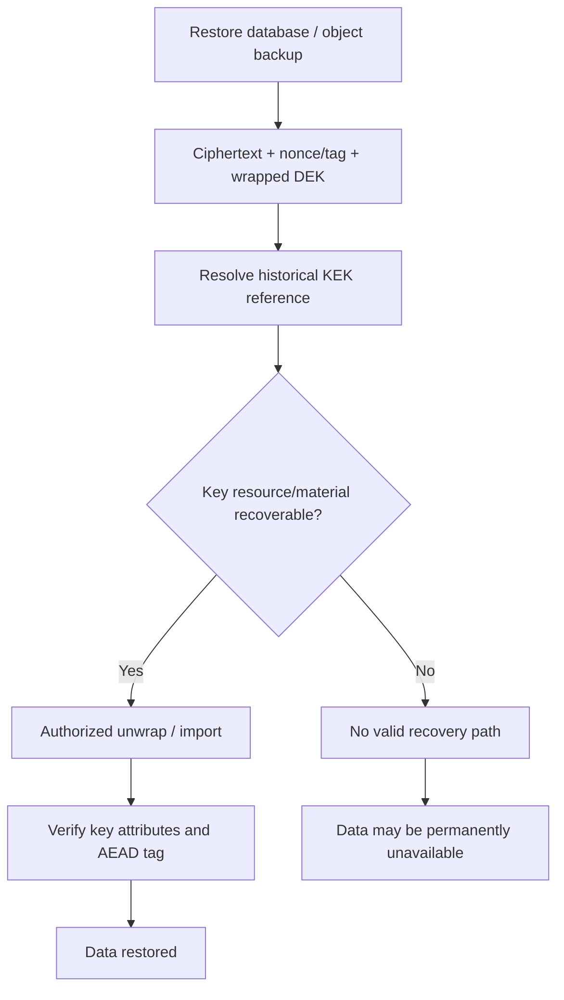
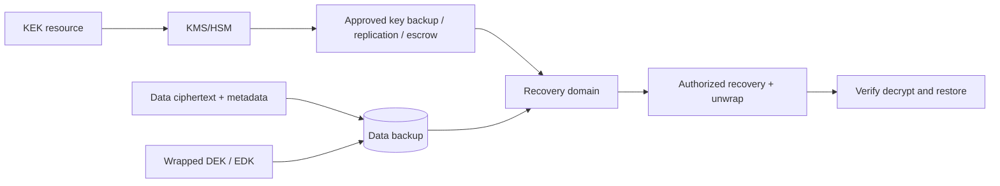
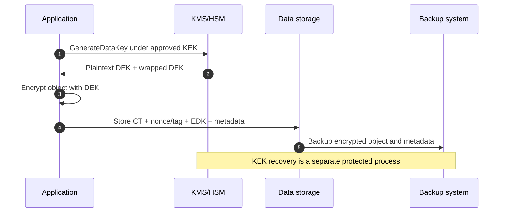
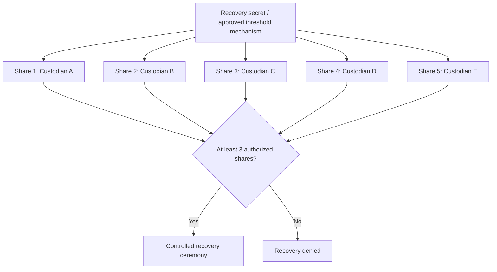
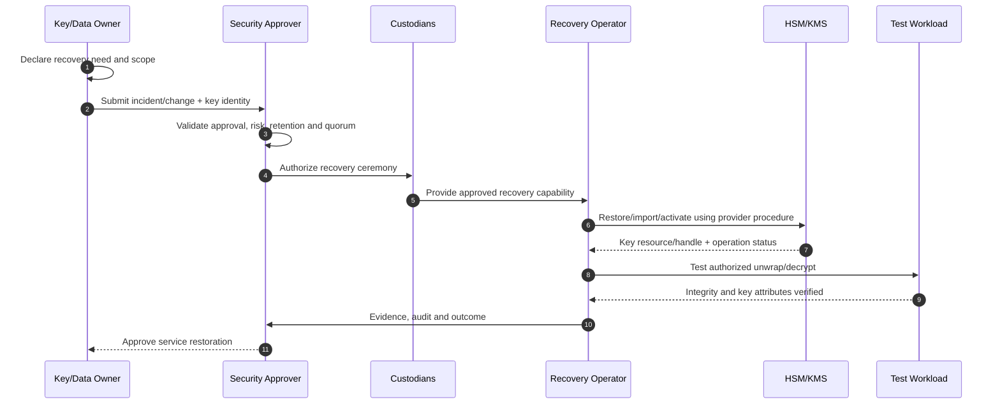
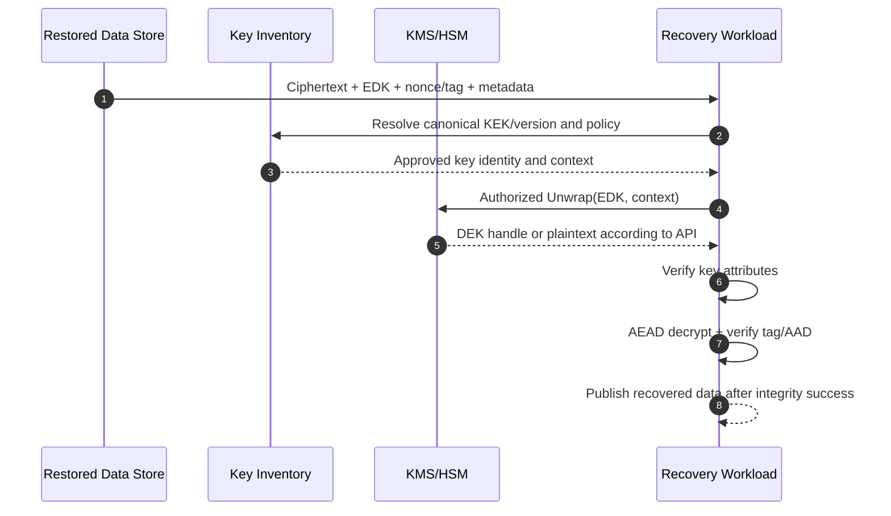

# Key recovery — Khôi phục khóa mật mã an toàn khi mất mát hoặc sự cố

> **Chương:** Backup và recovery  
> **Module:** SECURITY_KEY_MANAGEMENT_FUNDAMENTALS — hiểu vòng đời khóa mật mã từ tạo, cấp phát, lưu trữ, sử dụng, xoay vòng đến thu hồi và hủy; kết nối mật mã đối xứng, bất đối xứng, chữ ký số, KMS/HSM, envelope encryption, kiểm soát truy cập và kiểm toán để thiết kế hệ thống bảo vệ khóa an toàn.

## 1. Mục tiêu học tập

Sau bài học, bạn có thể:

1. Giải thích **key recovery** là gì và phân biệt với khôi phục dữ liệu, khôi phục dịch vụ, key rotation và key re-creation.
2. Xác định dữ liệu nào cần được backup cùng khóa: **ciphertext, wrapped DEK, key references, algorithm parameters, AAD schema, metadata và recovery evidence**.
3. Phân biệt **backup key material, HSM/KMS replication, escrow, key wrapping, key import và recovery từ provider-managed backup**.
4. Thiết kế recovery cho **KEK, DEK, private key, HMAC key, signing key và TLS/session secrets** theo mục đích, không áp dụng một phương án chung.
5. Giải thích vì sao **mất key có thể đồng nghĩa mất dữ liệu vĩnh viễn**, dù backup ciphertext còn nguyên.
6. Đánh giá **non-exportable key, HSM backup domain, KMS multi-region/replication và provider-specific recovery**.
7. Áp dụng **dual control, split knowledge, quorum/M-of-N, separation of duties và recovery ceremony**.
8. Xây dựng kế hoạch **RTO/RPO, recovery inventory, key dependency graph, DR site, offline materials và break-glass access**.
9. Thực hiện recovery theo trình tự có xác thực, phê duyệt, kiểm tra key attributes, thử decrypt và audit.
10. Phân biệt **key loss, key corruption, key compromise, accidental deletion và cryptographic erasure**, chọn phản ứng phù hợp.
11. Thiết kế SQL inventory, Java abstraction, negative tests, DR drills và checklist để chứng minh khả năng phục hồi.
12. Nhận biết khi nào không thể phục hồi và cách thông báo giới hạn đó chính xác, không tạo key giả thay cho key cũ.

## 2. Key recovery là gì?

**Key recovery** là quá trình khôi phục khả năng sử dụng **đúng key material hoặc đúng key resource đã được tạo và bảo vệ trước đó**, sau khi một phần hệ thống key management bị mất, hỏng, unavailable hoặc cần phục hồi trong môi trường DR.

Mục tiêu không chỉ là có một key mới cùng thuật toán. Mục tiêu là lấy lại **đúng khóa lịch sử** khi dữ liệu cũ phụ thuộc vào nó, hoặc khôi phục một đường sử dụng key tương đương theo kiến trúc và policy đã được phê duyệt.

Ví dụ: một database backup chứa ciphertext được mã hóa bằng DEK-X, và DEK-X được bọc dưới KEK-A. Nếu database restore thành công nhưng **KEK-A và mọi đường khôi phục hợp lệ đều mất**, ứng dụng có thể không unwrap được DEK-X. Dữ liệu backup vẫn tồn tại về mặt byte, nhưng không thể giải mã.



### 2.1. Key recovery không giống tạo key mới

Nếu DEK-X bị mất hoàn toàn, tạo DEK-Y không làm DEK-Y giải mã được ciphertext-X:

```text
Ciphertext-X = AEAD_Encrypt(DEK-X, nonce-X, AAD-X, plaintext)

Generate DEK-Y:
  AEAD_Decrypt(DEK-Y, nonce-X, AAD-X, Ciphertext-X)
  -> authentication failure / decryption failure
```

DEK-Y chỉ có thể bảo vệ **dữ liệu mới** hoặc dữ liệu đã được phục hồi bằng một đường hợp lệ rồi mã hóa lại.

### 2.2. Recovery khác với rotation và re-encryption

| Hoạt động | Mục tiêu | Key material cũ có cần không? | Ciphertext cũ |
| --- | --- | --- | --- |
| **Key recovery** | Khôi phục key/resource lịch sử hoặc khả năng sử dụng đã mất | **Có**, nếu phục hồi đúng key | Thường giữ nguyên |
| **Data restore** | Khôi phục ciphertext/database/object từ backup | Chưa chắc | Khôi phục bytes/metadata |
| **Key rotation** | Dùng key mới cho operations tương lai | Không nhất thiết để tạo key mới | Không tự thay đổi |
| **DEK rewrap** | Bọc cùng DEK dưới KEK mới | Cần mở DEK hoặc provider rewrap | Data ciphertext giữ nguyên |
| **Re-encryption** | Mã hóa lại dữ liệu dưới DEK/profile mới | Cần decrypt source bằng key cũ hoặc recovery path | Tạo ciphertext mới |
| **Key re-creation** | Sinh một key mới | Không phục hồi key cũ | Không mở được ciphertext cũ |
| **KMS replication** | Duy trì key resource/availability ở vùng khác | Phụ thuộc provider | Không tự restore mọi dữ liệu |

### 2.3. Ba câu hỏi trước khi bắt đầu recovery

1. **Cần khôi phục cái gì?** Key material, HSM partition, KMS key resource, access policy, DEK wrapper, certificate, hay chỉ một data object?
2. **Dữ liệu nào phụ thuộc vào nó?** Active records, object versions, backups, archives, replicas, recipients và legal holds?
3. **Đường recovery nào được phép?** Provider backup/replication, HSM backup domain, wrapped recovery blob, escrow/quorum hay alternate authorized key recipient?

Nếu chưa trả lời được, đừng bắt đầu import hoặc overwrite key resources.

## 3. Vì sao key recovery quan trọng?

### 3.1. Encryption tạo dependency vào key

Khi một hệ thống encrypt dữ liệu, nó chuyển dependency từ plaintext storage sang **ciphertext + key availability**. Điều đó có nghĩa:

- Backup ciphertext mà không có key recovery path có thể vô dụng.
- KMS/HSM outage có thể làm toàn bộ dữ liệu không đọc được.
- Xóa nhầm KEK có thể ảnh hưởng rất nhiều wrapped DEKs.
- Mất private key giải mã có thể làm các encrypted messages lịch sử không phục hồi.
- Một bản key backup bị compromise có thể tạo thêm đường giải mã ngoài production.

**Khả năng phục hồi là một thuộc tính của toàn bộ key management system**, không phải chỉ là checkbox “đã backup database”.

### 3.2. Availability và confidentiality có thể xung đột

- Lưu quá ít bản recovery key có thể gây **mất dữ liệu**.
- Lưu quá nhiều bản key hoặc escrow quá rộng làm tăng **attack surface**.
- Cho phép một administrator tự phục hồi key có thể phá dual control.
- Khôi phục key cũ đã compromise có thể mở lại đường tấn công.
- Hủy recovery material quá sớm có thể làm backup không thể restore.

Thiết kế cần xác định **ai được phục hồi, trong hoàn cảnh nào, cần bao nhiêu người phê duyệt, key nào được phục hồi, trong bao lâu và mọi thao tác được ghi lại ra sao**.

### 3.3. Key recovery không phải cam kết mọi key đều recoverable

Một số keys được thiết kế **không thể export hoặc backup theo cách thông thường**. Một số session keys có vòng đời ngắn và không cần khôi phục; một số private keys được giữ trong HSM; một số keys được phép hủy vĩnh viễn để thực hiện cryptographic erasure.

Policy phải phân loại rõ:

- **Recoverable by design:** có backup/replication/escrow đã được thử.
- **Re-creatable:** có thể sinh key mới nhưng không giải mã dữ liệu cũ.
- **Non-recoverable by design:** mất key đồng nghĩa mất dữ liệu; được owner chấp thuận.
- **Recoverable only by provider:** phụ thuộc cơ chế DR của KMS/HSM provider.
- **Historical verification only:** private signing key không cần restore, nhưng public key/certificate evidence cần giữ.

## 4. Phân loại khóa và yêu cầu recovery

Không phải mọi loại khóa cần cùng một chiến lược.

| Loại khóa | Chức năng | Recovery cần cân nhắc |
| --- | --- | --- |
| **KEK** | Bọc/unwrap DEKs | Provider backup/replication, HSM backup domain, recovery controls, EDK dependencies |
| **DEK** | Mã hóa dữ liệu trực tiếp | Wrapped DEK, key context, object metadata, authorized unwrap |
| **RSA private decrypt key** | Giải mã encrypted key/message gửi tới public key | Private key backup/restore hoặc giữ historical key version theo retention |
| **Signing private key** | Ký tài liệu/token/code | Recovery chỉ khi cần tiếp tục signing với cùng identity; bảo vệ cực nghiêm ngặt |
| **HMAC key** | Tạo/verify MAC | Recovery nếu cần verify historical records hoặc duy trì protocol; key versioning |
| **TLS server private key** | Xác thực server trong handshake | Certificate/private key recovery hoặc tái cấp certificate theo trust model |
| **TLS traffic/session key** | Bảo vệ traffic của một phiên | Thường không cần restore; protocol tạo lại session keys |
| **KDF master secret** | Dẫn xuất nhiều subkeys | Recovery nếu các child keys không được lưu riêng; blast radius lớn |
| **Recovery/escrow key** | Phục hồi các keys khác | Quorum, split knowledge, offline protection, audit |
| **Password-derived key** | Bảo vệ dữ liệu từ password | Password/KDF metadata/recovery design; không thể suy lại password từ key backup nếu mất |

### 4.1. KEK recovery có blast radius lớn

Một KEK có thể bọc hàng triệu DEKs. Mất KEK có thể làm nhiều objects không đọc được; lộ recovery copy của KEK có thể mở rộng phạm vi giải mã.

Vì vậy KEK recovery cần:

- Owner/custodian xác định.
- Actual key material identity/version.
- Provider/HSM backup method.
- Backup domain độc lập và bảo vệ.
- Recovery approvals và audit.
- Kiểm kê EDKs phụ thuộc.
- Test restore định kỳ.
- Quy trình thay thế nếu key bị compromise thay vì chỉ restore.

### 4.2. DEK recovery thường qua wrapped DEK

Trong envelope encryption, app thường lưu **EDK (encrypted data key)** cùng data ciphertext. Khi cần đọc:

1. Resolve đúng KEK/key version.
2. Authorize workload/tenant/object.
3. Unwrap EDK qua KMS/HSM.
4. Nhận plaintext DEK hoặc key handle theo API.
5. AEAD decrypt/verify bằng đúng nonce/AAD/tag.

Nếu EDK còn nguyên nhưng KEK đã mất và không có recovery path, DEK có thể không khôi phục được.

### 4.3. Signing key và verification key khác nhau

Một signing private key có thể cần bảo vệ để tiếp tục ký dưới cùng identity, nhưng **historical signature verification** thường cần public key, certificate chain, timestamp và revocation evidence, không cần giữ private key để xác minh.

Không phục hồi signing private key chỉ vì cần verify chữ ký cũ. Nếu private signing key bị compromise, khôi phục bản backup cũ có thể đưa lại chính khóa đã bị lộ.

### 4.4. TLS/session keys

Traffic keys thường được dẫn xuất theo handshake/session và key schedule. Thông thường DR không cần phục hồi từng traffic key cũ; cần phục hồi **certificate/private key, trust config, KMS dependencies và khả năng thiết lập session mới** theo giao thức.

Nếu ứng dụng có packet capture/forensic requirement, việc lưu session secrets là một policy khác, có rủi ro riêng và không nên tự bật key logging để hỗ trợ recovery.

## 5. Phân biệt data backup, key backup và key replication

### 5.1. Data backup

Lưu bản sao dữ liệu: ciphertext, EDK, nonce, tag, AAD schema, key references, business metadata, object versions và transaction state.

Data backup **không tự chứa khả năng giải mã**. Nó cần key resources và metadata đúng.

### 5.2. Key backup

Lưu một phương tiện phục hồi cho key material hoặc key resource theo **cơ chế được provider/architecture phê duyệt**. Ví dụ có thể là HSM backup blob được bảo vệ bởi backup key trong một backup domain khác.

Không đồng nhất “export raw key ra file rồi cất USB” với key backup an toàn.

### 5.3. Key replication

Duy trì key/resource ở một vùng hoặc domain khác để tăng availability. Replication có thể đồng bộ key material/state/policy theo semantics provider, nhưng:

- Không nhất thiết là backup độc lập.
- Delete/disable/policy corruption có thể replicate theo.
- Replication không tự bảo vệ khỏi compromised administrator.
- Multi-region aliases có thể có semantics khác nhau.
- Một replica không thay thế offline/immutable recovery nếu threat model cần.

### 5.4. Key escrow

Một bên được ủy quyền giữ recovery material/secret để có thể khôi phục theo điều kiện đã định. Escrow hỗ trợ availability, legal/business continuity nhưng làm tăng số người/đường có thể phục hồi key.

Cần xác định **ai là escrow agent, secret nào được escrow, purpose, conditions, quorum, retention, audit và quy trình destroy**.

### 5.5. Key wrapping

Bảo vệ key material bằng một wrapping key/recipient key. Wrapped key có thể lưu cùng data backup hoặc chuyển qua recovery channel. Nhưng wrapped blob chỉ hữu ích nếu **wrapping key vẫn recoverable** và algorithm/context/key attributes được giữ đúng.



## 6. Backup hierarchy: bảo vệ khóa dùng để bảo vệ khóa

### 6.1. Một tầng backup cần có root of trust

Ví dụ hierarchy:

```text
Provider / HSM root security boundary
  -> HSM backup domain key (provider-managed or approved)
      -> Backup blob for KEK-A
          -> KEK-A wraps DEK-1, DEK-2, DEK-3
              -> DEKs encrypt data objects
```

Nếu backup blob được mã hóa dưới một backup key khác, **backup key đó cũng là một dependency**. Nếu tất cả các lớp đều ở cùng một account/admin/domain, một compromise có thể lấy cả data và recovery path.

### 6.2. Không tự tạo vòng phụ thuộc không thể phá

Ví dụ lỗi:

```text
RecoveryKey-A encrypts BackupKey-B
BackupKey-B encrypts RecoveryKey-A
```

Không có key nào có thể khởi đầu recovery. Mỗi hierarchy cần một **root trust/recovery procedure** rõ, có thể nằm trong HSM/provider-managed boundary hoặc split-knowledge ceremony được phê duyệt.

### 6.3. Backup domain cần tách biệt

Các lựa chọn kiến trúc:

- HSM backup domain riêng.
- Account/subscription/project độc lập.
- Administrative identity tách khỏi production.
- Offline backup media được kiểm soát vật lý.
- Immutable storage/WORM cho backup artifacts.
- Multi-person access và separate audit channel.
- Recovery site khác vùng địa lý theo BCP/DR policy.

Không đặt toàn bộ key backup trong cùng bucket/account mà một compromised production admin có thể xóa.

### 6.4. Backup key không phải master password chung

Một master secret duy nhất mở mọi backup sẽ tạo blast radius rất lớn. Nếu cần root recovery secret, phải có controls như **split knowledge, quorum, hardware protection, rotation, custody và emergency procedures**.

## 7. HSM/KMS: cơ chế recovery phụ thuộc provider

### 7.1. Non-exportable không đồng nghĩa không có recovery

HSM có thể cấm export raw key qua application API nhưng hỗ trợ **backup/restore giữa HSMs cùng security domain** theo cơ chế riêng. Backup blob có thể chỉ restore được trong thiết bị/domain/provider được phép.

KMS cloud có thể quản lý durability/replication nội bộ, nhưng **không phải mọi service cho phép export/import key material hoặc tự restore key đã xóa**.

Phải đọc tài liệu và contract thực tế của provider đang dùng.

### 7.2. Những câu hỏi phải xác minh

- Key có thể export không? Nếu không, provider hỗ trợ backup/restore ra sao?
- Backup blob gắn với HSM model, partition, cluster hay security domain nào?
- Có thể restore sang region/account khác không?
- Replication có replicate delete/disable/policy changes không?
- KMS key deletion có waiting period/cancel window không?
- Imported key material có expiration hoặc import token không?
- Restore có giữ key attributes, usage, extractability và origin không?
- Key ID/version có được giữ nguyên hay tạo resource mới?
- Audit event nào ghi backup/restore/import?
- Provider có hỗ trợ recovery trong trường hợp account/tenant mất quyền truy cập không?
- Service-level availability có được đảm bảo trong DR region?
- Có provider-managed backup key mà khách hàng không thể xem/backup không?

### 7.3. KMS-managed key và imported key khác nhau

Một số KMS cho phép tạo key material trong service; một số cho phép **import external key material**. Imported key có thể có expiry/rotation semantics riêng. Nếu key material hết hạn hoặc bị xóa, key resource có thể còn nhưng không còn khả năng cryptographic operation.

Đừng chỉ kiểm tra `keyId exists`. Cần xác minh **actual key material availability and version**.

### 7.4. Backup/restore HSM key

Các thao tác như clone, backup, restore, replication hoặc key component loading phải theo **provider's security ceremony**. Không dùng lệnh vendor khác, copy file nội bộ HSM hoặc export workaround nếu không có trong approved procedure.

### 7.5. KMS multi-region

Multi-region key có thể hỗ trợ operations ở nhiều vùng, nhưng cần xác minh:

- Replication có đồng bộ actual key material hay tạo replica resource theo mô hình riêng.
- Primary/replica promotion semantics.
- Key policy/IAM replication.
- Grant consistency và audit.
- Disable/delete propagation.
- Recovery khi mất account/region.
- Wrapped ciphertext compatibility và encryption context.

**Alias cùng tên không chứng minh key material giống nhau.**

## 8. Backup và recovery của DEK trong envelope encryption

### 8.1. Data object cần metadata tối thiểu

```text
objectId / tenantId / data classification
ciphertext + authentication tag
nonce / IV
AAD schema and trusted context
data algorithm and parameters
wrapped DEK (EDK)
canonical KEK resource + material version
crypto format version
business revision / object version
retention / backup dependency reference
```

Nếu thiếu nonce/AAD schema/key reference, key có thể còn nhưng dữ liệu không mở được.

### 8.2. Backup data key theo cách phù hợp

Một DEK thường được backup **ở dạng wrapped**, không phải plaintext. Data backup lưu EDK, còn KEK được bảo vệ bởi KMS/HSM và recovery plan.



### 8.3. Vì sao không backup plaintext DEK?

Plaintext DEK trong database backup khiến ai đọc được backup có thể có cả data key. Điều đó phá mục tiêu tách biệt storage access khỏi key usage.

Có thể có ngoại lệ trong một thiết kế key custody được phê duyệt, nhưng **default nên là wrapped DEK** và key material được bảo vệ theo policy.

### 8.4. EDK và encryption context

Một số KMS bind EDK với encryption context/associated metadata. Restore phải cung cấp đúng context theo provider contract. Context thường không bí mật nhưng có thể **phải khớp chính xác** để unwrap.

Không đổi `tenantId`, `purpose` hoặc `objectType` trong DB rồi kỳ vọng unwrap vẫn thành công.

### 8.5. Một DEK có nhiều wrappers

Một DEK có thể được wrap cho production, DR, legal hold hoặc partner recipient. Backup inventory phải biết **mọi wrappers/recipients**; xóa một EDK không đồng nghĩa xóa mọi recovery paths.

## 9. Key escrow, split knowledge và quorum recovery

### 9.1. Split knowledge là gì?

**Split knowledge** chia một bí mật/recovery capability thành các phần do những custodian khác nhau giữ, sao cho một người riêng lẻ không thể phục hồi secret theo policy.

**Dual control** yêu cầu hai hoặc nhiều người cùng tham gia/ủy quyền cho một thao tác nhạy cảm, kể cả khi họ không trực tiếp giữ các secret shares.

Hai khái niệm có liên quan nhưng không giống nhau:

- Split knowledge: chia nội dung bí mật/recovery material.
- Dual control: chia quyền quyết định/thực hiện.
- Quorum: cần một số thành viên tối thiểu để cho phép recovery.
- Separation of duties: các vai trò quản trị/duyệt/vận hành được tách.

### 9.2. M-of-N threshold

Ví dụ **3-of-5**: hệ thống có 5 custodians, cần ít nhất 3 phần hợp lệ để phục hồi secret theo một cơ chế threshold đã được thẩm định.



Sơ đồ chỉ mô tả nguyên tắc. **Không tự chia raw AES key thành các mảnh bằng cách cắt chuỗi hoặc XOR thủ công** rồi coi đó là Shamir Secret Sharing/threshold cryptography.

### 9.3. Threshold không tự bảo đảm an toàn

Phải xác định:

- Thuật toán chia secret được thẩm định.
- Share integrity/authentication.
- Share ID và version.
- Ai được cấp share, ai phê duyệt.
- Số lượng và phân bố địa lý.
- Custodian replacement/rotation.
- Share backup/expiry.
- Quy trình khi share bị lộ hoặc mất.
- Chống một người giữ nhiều shares.
- Audit, tamper evidence và ceremony record.

### 9.4. Chọn quorum dựa trên risk

- **2-of-2:** mạnh về dual control nhưng một custodian mất share có thể gây mất availability.
- **2-of-3:** cân bằng hơn nhưng hai shares bị compromise có thể mở recovery.
- **3-of-5:** thêm resilience, tăng chi phí vận hành/ceremony.
- **Higher threshold:** giảm khả năng một nhóm nhỏ phục hồi nhưng tăng rủi ro không đủ người khi incident.

Không có tỷ lệ tốt nhất cho mọi tổ chức. Cân nhắc **insider threat, availability, geography, staff turnover, legal requirements và RTO**.

### 9.5. Recovery shares không nên gửi qua email/chat

Share là sensitive recovery material. Dùng kênh custody được phê duyệt, xác thực người nhận, tamper-evident packaging, inventory, controlled access và incident process. Không đưa shares vào ticket/chat/logs để tiện phối hợp.

## 10. Recovery ceremony: quy trình phục hồi có kiểm soát

### 10.1. Các vai trò

| Vai trò | Trách nhiệm | Không nên tự làm |
| --- | --- | --- |
| **Key owner** | Xác nhận business need, scope và quyền | Tự ý export/restore key |
| **Key custodian** | Giữ/duy trì recovery material | Tự phê duyệt một mình |
| **Security approver** | Kiểm tra incident/threat model và controls | Thực hiện thay mọi custodian |
| **Recovery operator** | Chạy provider-approved restore procedure | Đọc/ghi raw keys ra file thường |
| **Data owner** | Xác nhận data scope/retention | Mở quyền cho mọi tenant |
| **Auditor/witness** | Quan sát, ghi bằng chứng và dual control | Nhận raw key không cần thiết |
| **Incident commander** | Điều phối khẩn cấp theo policy | Bỏ qua evidence/approval |
| **Provider support** | Hỗ trợ provider-specific recovery | Không thay customer authorization |

### 10.2. Trình tự recovery



### 10.3. Checklist trước ceremony

- Incident/change ticket có scope và owner.
- Đúng key resource/material version.
- Key state (lost, disabled, pending deletion, corrupted, compromised) được xác nhận.
- Data assets/EDKs phụ thuộc đã xác định.
- Provider procedure/version đúng.
- HSM/KMS destination/domain tương thích.
- Custodian identities và quorum hợp lệ.
- Recovery environment isolated và access logged.
- RTO/RPO/availability impact được chấp nhận.
- Có stop condition nếu key identity/attributes mismatch.
- Không sử dụng production data rộng hơn phạm vi cần test.

### 10.4. Checklist sau ceremony

- Key resource/handle identity đã xác minh.
- Algorithm, key size, usage, extractability, origin, owner và policy đúng.
- Recovery operation có audit event.
- Test unwrap/decrypt thành công bằng representative data.
- Không có plaintext key trong logs/dumps/staging.
- Recovery materials được trả lại/cất giữ/niêm phong theo policy.
- Temporary permissions/sessions được thu hồi.
- Key inventory, dependency graph và DR runbook được cập nhật.
- Owner/Security sign-off.
- Ghi rõ limitations và unresolved dependencies.

### 10.5. Nếu ceremony thất bại

- Dừng, bảo toàn evidence và không thử các biến thể import tùy tiện.
- Không reset/overwrite backup blobs.
- Không đổi key attributes để “ép” import thành công.
- Xác minh provider/domain/version và share integrity.
- Escalate theo provider-approved support path.
- Đánh giá liệu có recovery copy khác đã được phê duyệt.
- Nếu không còn đường hợp lệ, ghi nhận khả năng **permanent data loss** và xử lý theo policy.

## 11. Recovery không đồng nghĩa khôi phục quyền cho production

Một key được phục hồi có thể vẫn cần **quyền rất hẹp**:

- Chỉ decrypt historical objects.
- Chỉ trong isolated recovery environment.
- Chỉ với tenant/object range được duyệt.
- Không encrypt new data.
- Không export raw key.
- Có TTL hoặc time-bound grant.
- Dual control cho break-glass.
- Audit mọi operations.

Không tự cấp lại mọi quyền production chỉ vì key restore thành công.

## 12. RTO, RPO và recovery objectives cho khóa

### 12.1. RTO

**Recovery Time Objective (RTO)** là thời gian mục tiêu để khôi phục một dịch vụ/tính năng sau gián đoạn. Với key recovery, cần xác định RTO riêng cho:

- KMS/HSM availability.
- Khả năng unwrap DEKs.
- Khả năng decrypt historical data.
- Khả năng encrypt new data.
- Khả năng ký/xác thực.
- Recovery ceremony có quorum.

### 12.2. RPO

**Recovery Point Objective (RPO)** là mức dữ liệu/điểm phục hồi tối đa có thể mất theo kế hoạch. Với key state, cần xem:

- Key resource creation/rotation metadata.
- Key grants/policies.
- Imported key material versions.
- Wrapped DEK records.
- Key inventory/dependency graph.
- Nonce/counter state (nếu primitive yêu cầu).
- Audit/recovery journal.

Một database có RPO 15 phút nhưng KMS key/policy state có RPO khác có thể tạo **mismatch** sau restore.

### 12.3. Recovery objectives không chỉ đo uptime

Một KMS endpoint healthy chưa chứng minh dữ liệu đọc được. Recovery test phải xác minh **actual key operations với representative ciphertext**, key attributes và quyền đúng.

### 12.4. Ví dụ ma trận mục tiêu

| Asset | RTO mục tiêu (ví dụ) | RPO / dependency cần xét | Recovery method |
| --- | --- | --- | --- |
| Production KEK | Theo tier dịch vụ | Key material/version và grants | Provider HA/replication hoặc approved HSM recovery |
| Wrapped DEKs | Theo data service | DB/object backup consistency | Restore EDK metadata |
| Data ciphertext | Theo backup policy | Backup point/version | Database/object restore |
| Signing key | Theo business criticality | Key version/certificate chain | HSM recovery hoặc reissue identity theo PKI |
| Recovery shares | Theo ceremony policy | Custodian availability | Quorum, replacement/rotation process |
| Key inventory | Nhanh hơn data restore | Phải cập nhật tới rotation/incident | Independent backup/immutable catalogue |
| Audit evidence | Theo compliance/incident policy | Không mất events quan trọng | Separate immutable logging domain |

Các con số RTO/RPO thực tế phải do owner/business continuity xác định, không lấy ví dụ làm SLA.

## 13. Những tình huống recovery thường gặp

### 13.1. KMS region outage

- Xác định key có multi-region replica hoặc provider DR path không.
- Xác minh actual key material semantics và key policies.
- Chuyển traffic theo approved failover, không tự tạo key cùng tên.
- Kiểm tra EDK/context compatibility.
- Theo dõi IAM grants, audit và rate limits tại region đích.
- Test decrypt/encrypt riêng theo policy.
- Sau khi region phục hồi, reconcile operations và key state.

### 13.2. HSM cluster hoặc partition hỏng

- Xác định cluster/partition, backup domain và vendor procedure.
- Dừng các operations có thể làm hỏng backup state.
- Restore đúng HSM model/security domain khi được hỗ trợ.
- Xác minh key handles, attributes, login roles và audit.
- Chạy test crypto operations trong isolated workload.
- Không dùng raw key export workaround để chuyển sang HSM khác.

### 13.3. KEK bị xóa nhầm

- Xác định key deletion state và provider cancellation/recovery window.
- Nếu pending deletion, chỉ người có quyền mới được cancel theo policy.
- Nếu đã destroy, kiểm tra approved HSM backup/replica/escrow.
- Xác định toàn bộ EDK dependencies.
- Nếu không có material/replica/recovery path, dữ liệu có thể mất vĩnh viễn.
- Không tạo KEK mới rồi gán lại cùng key ID để giả vờ đã phục hồi.

### 13.4. DEK bị mất nhưng EDK còn

- Resolve đúng KEK/version/context.
- Authorize unwrap theo tenant/object.
- Kiểm tra EDK integrity/provider format.
- Unwrap vào trusted boundary.
- Verify AEAD tag/AAD bằng representative ciphertext.
- Nếu KEK unavailable, recovery phụ thuộc KEK path.

### 13.5. HSM recovery share bị mất

- Không tạo share thay thế từ suy đoán.
- Xác định threshold còn đủ không.
- Thực hiện approved share replacement/resharing nếu policy và cryptographic scheme cho phép.
- Nếu không đủ quorum, đánh giá khả năng recovery đã mất.
- Review custodian access, incident và share compromise.

### 13.6. Signing private key bị mất

- Xác định có cần **cùng identity** để ký tiếp không.
- Nếu không còn key recovery, có thể phát hành key pair/certificate mới theo PKI policy.
- Giữ public keys/certificates/timestamps để verify lịch sử.
- Không gắn private key mới vào identity cũ nếu không có enrollment/CA approval.
- Nếu old private key bị compromise, không restore nó cho signing mới.

### 13.7. Key bị compromise nhưng recovery backup sạch

Một bản backup key cũ có thể phục hồi availability, nhưng nếu **cùng material đã bị lộ**, restore lại nó không khắc phục compromise. Phải phân biệt:

- **Key loss:** cần khôi phục cùng material.
- **Key compromise:** cần containment, replacement và đánh giá data exposure.
- **Key corruption:** cần bản backup đã xác minh integrity/provenance.
- **Provider outage:** cần failover/replica.


## 14. Recovery trong envelope encryption: trình tự đầy đủ

Một quy trình phục hồi dữ liệu mã hóa thường:

1. Restore data ciphertext, EDK và metadata từ **cùng một consistent backup point**.
2. Xác thực tenant/object identity và access authorization.
3. Resolve đúng canonical KEK/material version.
4. Xác minh KEK resource được restore trong đúng KMS/HSM account/region/security domain.
5. Authorize recovery workload để Unwrap.
6. Unwrap EDK bằng đúng context/parameters.
7. Verify DEK type/length/usage/attributes.
8. AEAD decrypt với đúng nonce, AAD schema và tag.
9. Chỉ công bố plaintext sau tag verification thành công.
10. Reconcile business revisions, object versions và data integrity.
11. Nếu phải tiếp tục ghi, chọn active target key/version và nonce state an toàn.
12. Audit recovery và thu hồi temporary permissions.



### 14.1. Không trộn backup points

Nếu restore ciphertext từ snapshot T1 nhưng EDK metadata từ T2, chúng có thể không cùng key/nonce/context. Hãy restore **một consistent logical version** hoặc có version mapping chứng minh tương thích.

### 14.2. Wrapped DEK bị corrupt

Nếu EDK bị corrupt hoặc không khớp context, không thử hàng loạt KEKs hoặc bỏ encryption context. Kiểm tra backup versions, key registry, provider audit và corruption evidence. Quarantine object nếu không xác minh được.

### 14.3. Data integrity không chỉ là decrypt thành công

Sau AEAD verification, còn cần business integrity/revision checks nếu hệ thống có yêu cầu anti-rollback, ledger consistency hoặc signed records. Một ciphertext hợp lệ vẫn có thể là **old valid version** được restore.

## 15. Java 17: thiết kế recovery qua provider interface

Ví dụ dưới đây mô tả **abstraction** để khôi phục key resource trong KMS/HSM. Nó cố ý không export/import raw KEK bằng file thường và không giả lập API vendor cụ thể.

```java
import java.security.GeneralSecurityException;
import java.util.Objects;

public final class KeyRecoveryService {
    public record RecoveryRequest(
        String incidentOrChangeId,
        String canonicalKeyRef,
        String expectedMaterialVersion,
        String recoveryDomain,
        String environment,
        String approvedPurpose) {}

    public record RecoveredKey(
        String canonicalKeyRef,
        String materialVersion,
        String algorithm,
        int keySizeBits,
        String origin,
        boolean extractable,
        String lifecycleState) {}

    public interface RecoveryAuthorization {
        void requireQuorumAndApproval(RecoveryRequest request)
            throws GeneralSecurityException;
    }

    public interface ProviderRecovery {
        // Provider-specific restore/replica activation/import.
        // Key material không nhất thiết rời HSM/KMS boundary.
        RecoveredKey restore(RecoveryRequest request) throws Exception;
    }

    public interface RecoveryAudit {
        void record(
            RecoveryRequest request,
            RecoveredKey recovered,
            String outcome);
    }

    private final RecoveryAuthorization authorization;
    private final ProviderRecovery provider;
    private final RecoveryAudit audit;

    public KeyRecoveryService(
        RecoveryAuthorization authorization,
        ProviderRecovery provider,
        RecoveryAudit audit) {
        this.authorization = Objects.requireNonNull(authorization);
        this.provider = Objects.requireNonNull(provider);
        this.audit = Objects.requireNonNull(audit);
    }

    public RecoveredKey recover(RecoveryRequest request)
        throws Exception {

        Objects.requireNonNull(request);
        authorization.requireQuorumAndApproval(request);

        RecoveredKey key = provider.restore(request);
        if (key == null
            || !request.canonicalKeyRef().equals(key.canonicalKeyRef())
            || !request.expectedMaterialVersion().equals(
                key.materialVersion())
            || !"AES".equals(key.algorithm())
            || key.keySizeBits() != 256
            || key.extractable()
            || !"ACTIVE".equals(key.lifecycleState())) {
            audit.record(request, key, "REJECTED_ATTRIBUTE_MISMATCH");
            throw new GeneralSecurityException(
                "Recovered key identity or attributes mismatch");
        }

        audit.record(request, key, "RESTORED_ATTRIBUTES_VERIFIED");
        return key;
    }
}
```

### 15.1. Ý nghĩa của abstraction

- Authorization/quorum diễn ra trước khi provider recovery.
- Provider quyết định cơ chế restore thực tế.
- Caller xác minh canonical key reference và material version.
- Ví dụ giả định key đích là AES-256 non-exportable; production phải chọn attributes theo purpose thật.
- Audit ghi metadata, không ghi raw key material.

### 15.2. Giới hạn

1. `ProviderRecovery` chưa phải API KMS/HSM thực.
2. Một số providers tạo resource/handle mới khi restore, không giữ nguyên key ID; phải thay contract phù hợp.
3. Key state có thể là `DISABLED`/`PENDING_IMPORT` trong recovery; ví dụ `ACTIVE` chỉ là giả định policy.
4. Algorithm/key size không phải attributes duy nhất; cần usage, origin, extractability, residency, context và permissions.
5. `audit.record` cần durable/immutable evidence theo policy và không được làm lộ secrets.
6. Không có provider-specific backup blob, import token, quorum shares hay network/DR logic.
7. Không có test decrypt data thực; recovery chỉ được coi hoàn tất sau operational verification.
8. Không restore key đã compromise chỉ vì backup hợp lệ; cần incident policy.

## 16. SQL: key inventory và recovery dependency

### 16.1. Metadata registry

```sql
CREATE TABLE managed_key_inventory (
    key_ref                 TEXT PRIMARY KEY,
    logical_key_family      TEXT NOT NULL,
    material_version        TEXT NOT NULL,
    key_kind                TEXT NOT NULL,
    algorithm               TEXT NOT NULL,
    key_size_bits           INTEGER,
    provider                TEXT NOT NULL,
    provider_account        TEXT NOT NULL,
    provider_region         TEXT NOT NULL,
    recovery_domain         TEXT,
    lifecycle_state         TEXT NOT NULL,
    owner_team              TEXT NOT NULL,
    custodian_team          TEXT NOT NULL,
    allow_new_use           BOOLEAN NOT NULL,
    historical_use_allowed BOOLEAN NOT NULL,
    last_recovery_test_at   TIMESTAMPTZ,
    CHECK (key_kind IN (
        'KEK', 'DEK_REF', 'ASYMMETRIC_PRIVATE',
        'SIGNING_PRIVATE', 'HMAC'
    )),
    CHECK (lifecycle_state IN (
        'PENDING', 'ACTIVE', 'DECRYPT_ONLY',
        'DISABLED', 'COMPROMISED', 'PENDING_DELETION',
        'DESTROYED'
    ))
);
```

### 16.2. Data dependency catalogue

```sql
CREATE TABLE key_data_dependency (
    dependency_id       UUID PRIMARY KEY,
    key_ref             TEXT NOT NULL
                        REFERENCES managed_key_inventory(key_ref),
    tenant_id           TEXT NOT NULL,
    data_asset_ref      TEXT NOT NULL,
    object_version      TEXT,
    dependency_type     TEXT NOT NULL,
    backup_id           TEXT,
    retention_until     TIMESTAMPTZ,
    recovery_priority   TEXT NOT NULL,
    last_verified_at    TIMESTAMPTZ,
    CHECK (dependency_type IN (
        'WRAPPED_DEK', 'DIRECT_DATA_KEY',
        'BACKUP', 'ARCHIVE', 'RECIPIENT_COPY',
        'SIGNATURE_EVIDENCE'
    )),
    CHECK (recovery_priority IN ('CRITICAL', 'HIGH', 'NORMAL', 'LOW'))
);
```

### 16.3. Recovery test journal

```sql
CREATE TABLE key_recovery_test (
    test_id             UUID PRIMARY KEY,
    key_ref             TEXT NOT NULL,
    test_type           TEXT NOT NULL,
    recovery_domain     TEXT NOT NULL,
    started_at          TIMESTAMPTZ NOT NULL,
    completed_at        TIMESTAMPTZ,
    outcome             TEXT NOT NULL,
    evidence_ref        TEXT,
    approved_by         TEXT NOT NULL,
    CHECK (test_type IN (
        'PROVIDER_RESTORE', 'REPLICA_FAILOVER',
        'WRAPPED_DEK_UNWRAP', 'DATA_DECRYPT',
        'FULL_DR_EXERCISE'
    )),
    CHECK (outcome IN (
        'RUNNING', 'PASSED', 'FAILED',
        'PARTIAL', 'NOT_APPLICABLE'
    ))
);
```

### 16.4. Tìm dependencies của một key

```sql
SELECT key_ref,
       dependency_type,
       COUNT(*) AS dependency_count,
       COUNT(DISTINCT tenant_id) AS tenant_count,
       MAX(retention_until) AS latest_retention
FROM key_data_dependency
WHERE key_ref = :canonical_key_ref
GROUP BY key_ref, dependency_type;
```

Đây là truy vấn inventory, **không chứng minh catalogue đầy đủ** nếu backup/partner/object versions chưa được ingest.

### 16.5. Recovery readiness report

Một key có thể được xem xét là recoverable khi:

- Có approved recovery method.
- Provider/account/region/domain rõ.
- Key material version và attributes được xác minh.
- Quorum/custodian availability phù hợp.
- Recovery test gần nhất đạt theo policy.
- Data dependencies và backup retention được kiểm kê.
- IAM, audit, DR access và RTO phù hợp.
- Không có compromise flag chưa xử lý.

Không tạo một `recoverable=true` duy nhất nếu thiếu evidence chi tiết; nên giữ **method, test time, scope, outcome và limitations**.

## 17. Key recovery và key compromise: không khôi phục nhầm bí mật đã bị lộ

### 17.1. Lost key vs compromised key

| Tình huống | Ưu tiên | Có nên restore cùng key? |
| --- | --- | --- |
| **Key mất, không evidence compromise** | Availability/recovery | Có thể, theo approval và backup integrity |
| **KMS region outage** | Failover/provider recovery | Thường có thể dùng replica/path được phê duyệt |
| **Key resource bị xóa nhầm** | Cancel deletion hoặc restore approved backup | Chỉ nếu material và state còn recoverable |
| **Key material corrupt** | Khôi phục bản backup đã xác minh | Có thể nếu provenance/integrity đạt |
| **Key bị compromise** | Containment và replacement | **Không** restore để tiếp tục new use |
| **Recovery share bị lộ** | Rotate/reshare recovery mechanism | Cần đánh giá liệu key chính đã được recover |
| **Không còn backup hợp lệ** | Xác định khả năng mất dữ liệu | Không thể tạo lại key cũ bằng cách sinh key mới |

### 17.2. Backup có thể là bản sao của compromise

Nếu attacker đã biết key trước thời điểm backup, bản backup chứa **cùng material** không phải một bản sạch. Restore nó chỉ phục hồi availability nhưng tái đưa compromised key vào use.

### 17.3. Khi compromise xảy ra trong recovery ceremony

- Dừng ceremony và cô lập recovery artifacts.
- Đánh giá shares/backup blobs/credentials đã bị lộ.
- Không dùng lại shares không còn tin cậy.
- Thay recovery secret/backup domain theo approved procedure.
- Nếu key chính có thể đã được phục hồi bởi attacker, coi nó compromised.
- Sinh key mới, re-encrypt hoặc migrate data còn kiểm soát theo risk assessment.
- Audit custodians/access và notification theo policy.

### 17.4. Không restore signing key đã bị compromise để verify history

Historical signature verification thường dựa trên **public key/certificate/timestamp/revocation evidence**. Giữ private signing key cũ sau compromise để verify lịch sử là không cần thiết và có thể nguy hiểm.

## 18. Recovery, cryptoperiod và key lifecycle

### 18.1. Backup cũng phải có lifecycle

Recovery materials cần:

- Owner/custodian.
- Creation time/version.
- Cryptoperiod/expiry.
- Rotation/re-sharing.
- Access policy/quorum.
- Integrity/authentication.
- Backup location/domain.
- Last test.
- Destruction/retention policy.

Một recovery blob cũ không được mặc định tin cậy vô thời hạn.

### 18.2. Rotation của recovery key

Nếu recovery/backup wrapping key cần rotate:

1. Xác định mọi backup blobs được bảo vệ dưới key cũ.
2. Chọn provider-supported rewrap/backup migration.
3. Thử restore từ backup mới.
4. Giữ recovery path cũ trong thời gian transition theo policy.
5. Hủy old recovery material khi hết dependencies/retention và được duyệt.

### 18.3. Hết cryptoperiod không tự động hủy khả năng historical recovery

Một KEK có thể không còn được dùng để bọc DEKs mới nhưng vẫn cần để restore old backups. Cần tách:

- New-use period.
- Historical recovery/decrypt period.
- Backup retention period.
- Legal hold.
- Destruction eligibility.

### 18.4. Key recovery sau khi destroy

Một số provider có deletion waiting period/cancel window; một số key material có thể xóa vĩnh viễn ngay sau điều kiện nhất định. **Không giả định mọi deleted keys đều recoverable**.

Trước thao tác destroy, dependency gate phải kiểm tra backups, replicas, wrappers, recipients, retention và approvals. Sau destroy không có recovery path, dữ liệu có thể mất vĩnh viễn.

## 19. Security controls cho recovery materials

### 19.1. Bảo vệ vật lý và logic

- Backup media có inventory và tamper evidence.
- HSM/backup domain ở vị trí/region độc lập phù hợp.
- Custodian identity và access logging.
- Dual control/quorum.
- Separate administrative accounts.
- Immutable audit và offline copy theo policy.
- Encrypt recovery artifacts bằng approved mechanism.
- Key backup không nằm chung production credentials.
- Không lưu shares trong password manager cá nhân nếu không được duyệt.

### 19.2. Chống insider threat

- Người tạo backup không tự phê duyệt restore.
- Người giữ share không tự thu thập đủ quorum.
- Operator không tự sửa audit.
- Emergency access cần time-bound approval và post-incident review.
- Custodian turnover phải có share replacement/resharing.
- Tất cả hoạt động phải có evidence và chain-of-custody.

### 19.3. Recovery material có thể bị copy

Một share/blob được chụp ảnh hoặc copy trái phép có thể tồn tại ngoài kho chính. Vì vậy:

- Không chỉ dựa vào khóa vật lý hoặc niêm phong.
- Có serial/version/holder tracking.
- Rotate/re-share khi custody integrity bị nghi ngờ.
- Audit nơi có quyền truy cập.
- Có quy trình xử lý lost media/device.

### 19.4. Recovery site

Recovery site cần:

- Physical security tương đương risk.
- HSM/provider access đúng region/domain.
- Approved operator workstation.
- Network path có kiểm soát.
- Out-of-band communications.
- Audit độc lập.
- Tested quorum availability.
- Secure cleanup sau ceremony.

## 20. Recovery drills và xác minh dữ liệu

### 20.1. Chỉ test “backup file tồn tại” là chưa đủ

Một drill tốt kiểm tra:

1. Restore một data backup representative.
2. Restore/activate đúng key resource hoặc replica.
3. Khôi phục grants/context/metadata theo approved plan.
4. Unwrap EDK thực.
5. Decrypt ciphertext và verify AEAD tag.
6. So sánh business integrity/revision.
7. Kiểm tra key attributes, owner, purpose, extractability.
8. Test read path của application.
9. Đo RTO/RPO và KMS/DB throughput.
10. Thu hồi temporary access và lưu audit evidence.

### 20.2. Các mức drill

| Mức | Phạm vi | Tần suất |
| --- | --- | --- |
| **Provider health** | Kiểm tra service/replica status | Theo monitoring/provider policy |
| **Key operation test** | Sign/unwrap/decrypt test key | Theo policy |
| **Wrapped DEK recovery** | Mở EDK của synthetic object | Định kỳ |
| **Data restore test** | Restore ciphertext + key dependency | Theo DR schedule |
| **Full recovery ceremony** | Quorum, operator, HSM/KMS, audit | Theo risk/compliance |
| **Region/account loss exercise** | Failover hoặc provider recovery | Theo business continuity plan |

Tần suất do risk, service tier, provider và compliance quyết định; bảng không đặt một lịch bắt buộc.

### 20.3. Không dùng production data tùy tiện trong drills

Ưu tiên synthetic/test data và test keys. Nếu phải test với production-like data, dùng scope tối thiểu, environment cô lập, approval, audit và retention cleanup. Không tạo plaintext copies không cần thiết.

### 20.4. Test key recovery sau key rotation

Một DR drill phải thử ít nhất:

- Current key version.
- Một historical version còn retention.
- EDK được tạo trước lần rotation.
- Backup snapshot cũ.
- Restore ở region/account dự phòng.
- IAM principal khác production nhưng được approved.
- Key disabled/expired semantics theo provider (trong môi trường test).

### 20.5. Tiêu chí PASS

- Key identity/material version đúng.
- Attributes và lifecycle đúng policy.
- Quorum/custodian approvals hợp lệ.
- EDK unwrap thành công.
- AEAD tag verify.
- Business data/revision đúng.
- RTO/RPO đạt target đã duyệt.
- Không raw key/plaintext trong logs.
- Temporary permissions được thu hồi.
- Evidence và limitations được ghi.

## 21. Các anti-pattern trong key recovery

| Anti-pattern | Hậu quả | Cách làm phù hợp |
| --- | --- | --- |
| Backup DB nhưng không backup/replicate key dependency | Ciphertext không decrypt được | Backup data + key dependency plan |
| Export raw KEK ra file thường | Key theft/blast radius | Provider/HSM-approved backup |
| Một admin giữ toàn bộ recovery shares | Bypass split knowledge | Quorum/dual control |
| Gửi shares qua email/chat | Copy ngoài custody | Approved custody channel |
| Tạo key mới cùng tên khi key cũ mất | Không giải mã được ciphertext cũ | Tìm valid recovery path hoặc xác định data loss |
| Restore compromised key | Tái kích hoạt bí mật đã lộ | Containment/replacement |
| Chỉ kiểm tra KMS key ID tồn tại | Có thể mất actual material/version | Verify crypto operation và key attributes |
| Coi replica là backup độc lập | Delete/policy corruption replicate | Immutable/offline recovery path |
| Destroy old KEK khi backups còn | Mất khả năng restore | Dependency/retention gate |
| Restore key rồi cấp mọi quyền production | Blast radius lớn | Scoped recovery grants |
| Dùng HSM model/domain không tương thích | Restore/import fail | Provider-specific test |
| Bỏ qua encryption context | Unwrap thất bại hoặc scope sai | Preserve canonical context |
| Lưu plaintext DEK trong backup | Backup reader có thể decrypt | Wrapped DEK |
| Không giữ AAD/nonce/format | Có key nhưng không decrypt được | Versioned crypto metadata |
| Chỉ test HSM login | Chưa chứng minh key operations | Restore + unwrap + data decrypt |
| Không kiểm tra quorum | Recovery ceremony yếu | Verify identities/shares |
| Không audit ceremony | Không truy vết ai phục hồi | Immutable recovery journal |
| Giữ recovery secret vô thời hạn | Exposure tăng | Lifecycle/rotation/destruction |
| Không xử lý custodian nghỉ việc | Share custody không rõ | Reshare/replace theo policy |
| Recovery drill chỉ chạy happy path | Không phát hiện lost share/DR outage | Fault injection và scenario tests |
| Dùng recovery path để bypass BYOK revoke | Vi phạm quyền/contract | Shared responsibility/approved recovery |
| Hủy evidence sau sự cố | Mất khả năng điều tra | Chain-of-custody và retention |
| Gọi restore compromised key là remediation | Không xử lý exposure | New keys + incident scope |
| Không đối soát backup point | Ciphertext/EDK mismatch | Consistent restore/version mapping |


## 22. Case study: phục hồi dữ liệu hóa đơn sau khi mất KEK region chính

### 22.1. Bối cảnh giả định

Một nền tảng hóa đơn lưu:

- **Invoice API:** mã hóa nội dung hóa đơn.
- **PostgreSQL/Object storage:** ciphertext, EDK và metadata.
- **KMS Region A:** KEK-v1 bảo vệ DEKs.
- **KMS Region B:** replica/recovery resource theo provider design.
- **Backup vault:** data backups và recovery evidence.
- **Key custodians:** quản lý quorum cho recovery domain.
- **SOC/DR team:** phê duyệt, điều phối và kiểm toán.

Mỗi hóa đơn có DEK riêng; DEK được wrap dưới KEK-v1. Một sự cố mất khả năng truy cập Region A khiến API không unwrap được EDKs.

### 22.2. Những gì còn và những gì mất

| Thành phần | Trạng thái giả định |
| --- | --- |
| Data ciphertext/EDK | Có backup và object store copy |
| Nonce/tag/AAD metadata | Có trong cùng versioned envelope |
| KEK-v1 resource ở Region A | Không truy cập được |
| Region B key path | Có thể recover/failover theo provider procedure |
| Key inventory | Bản immutable snapshot còn |
| Custodian quorum | Đủ người theo recovery policy |
| Raw plaintext DEKs | Không được lưu ở DB |
| Provider audit | Có log nhưng có độ trễ |

### 22.3. Recovery plan

1. Incident commander xác nhận outage và scope.
2. Data/key owner gửi recovery request với canonical KEK reference/version.
3. Security approver kiểm tra provider DR semantics và quorum.
4. Custodians tham gia recovery ceremony.
5. Operator kích hoạt approved Region B replica/recovery resource.
6. Xác minh key identity/material version, usage, extractability và policy.
7. Restore representative encrypted invoice backup.
8. Unwrap EDK trong workload được authorize.
9. AEAD decrypt và verify tag/AAD.
10. Đo RTO, ghi audit, mở traffic có kiểm soát.
11. Reconcile Region A khi phục hồi; xử lý key state/replication drift.
12. Thu hồi temporary grants và cập nhật inventory.

### 22.4. Phát hiện một mismatch

Một backup object chứa wrapped DEK tạo dưới key material version v1, nhưng DR service đang resolve alias `invoice-kek-current` tới v2. Alias không bảo đảm v2 có cùng material.

Unwrap thất bại. Đội vận hành **không** sửa metadata row để ghi v2. Họ tra canonical key version và dùng đúng recovery resource theo provider semantics.

### 22.5. Điều kiện mở lại dịch vụ

- Representative decrypt thành công.
- Data integrity và business revision đúng.
- New writes dùng key version/nonce domain được approved.
- Read/write permissions không quá rộng.
- KMS audit và metrics hoạt động.
- Region A/B state được đối soát.
- Recovery temporary access bị thu hồi.
- Owner/SOC sign-off.

### 22.6. Bài học

**Backup ciphertext và recovery key path là một cặp dependency.** Replication giúp availability, nhưng cần test actual decrypt và hiểu provider semantics. Không dùng alias tên giống nhau làm bằng chứng key material tương đương.

## 23. Checklist trước khi tuyên bố key recovery hoàn tất

| Hạng mục | Câu hỏi | Bằng chứng |
| --- | --- | --- |
| **Recovery scope** | Key/resource/version nào cần phục hồi? | Approved request |
| **Owner/custodian** | Đúng người chịu trách nhiệm? | Inventory/RACI |
| **Provider method** | Restore/replica/import có được hỗ trợ? | Provider procedure |
| **Recovery domain** | HSM/account/region đúng? | Domain identity |
| **Quorum** | Đủ shares và dual control? | Ceremony evidence |
| **Key identity** | Canonical ID/material version đúng? | Provider metadata |
| **Attributes** | Algorithm/size/usage/extractability đúng? | Key policy verification |
| **Lifecycle state** | Không restore key compromised để new-use? | Incident/lifecycle decision |
| **Data dependencies** | EDKs/objects/backups đã inventory? | Dependency graph |
| **Crypto metadata** | Nonce/tag/AAD/format có đủ? | Envelope validation |
| **KMS grants** | Workload chỉ có quyền cần thiết? | IAM review |
| **Data test** | Unwrap + decrypt + tag verification đạt? | Representative test |
| **Business integrity** | Object version/revision hợp lệ? | Data reconciliation |
| **RTO/RPO** | Đạt mục tiêu đã duyệt? | DR measurements |
| **Backup consistency** | Data và EDK cùng logical version? | Restore point evidence |
| **Audit** | Ai, khi nào, vì sao, thao tác gì? | Immutable event record |
| **Temporary access** | Đã thu hồi? | IAM post-check |
| **Recovery materials** | Shares/blob đã trả/cất/niêm phong? | Custody log |
| **DR readiness** | Region/site thứ hai đã được test? | Drill report |
| **Unresolved gaps** | Dependencies nào chưa biết? | Explicit limitations |
| **Sign-off** | Owner/security/custodian phê duyệt? | Closure record |

## 24. Negative tests và diễn tập

Tất cả thử nghiệm phải dùng **test keys và synthetic data**, không cố ý làm mất hoặc phá production keys.

| Test | Tình huống | Kết quả mong đợi |
| --- | --- | --- |
| Missing KEK | DB backup còn EDK nhưng KEK unavailable | Recovery path fail rõ ràng, không tạo key giả |
| Wrong material version | Alias resolve v2 thay vì v1 | Identity mismatch/reject |
| Wrong recovery domain | Restore blob vào HSM domain không tương thích | Provider reject, giữ nguyên source |
| Corrupt backup blob | Đổi byte backup artifact | Integrity check fail |
| Lost quorum share | Chỉ còn dưới threshold | Recovery denied, escalation |
| Unauthorized custodian | Người ngoài role tham gia | Ceremony block/audit |
| Single-person recovery | Một người thử bypass dual control | Deny |
| Replay old recovery blob | Dùng blob version cũ đã revoked | Reject theo version/policy |
| Compromised key backup | Backup chứa material đã lộ | Không restore để new-use |
| Wrong key attributes | Key restore thành extractable hoặc wrong usage | Reject |
| Wrong KMS context | EDK unwrap với context khác | Fail closed |
| Data/EDK point mismatch | Ciphertext T1, EDK T2 | Decrypt fail/quarantine |
| Missing nonce/AAD | Metadata backup không đầy đủ | Reject, không đoán |
| AEAD tag tampering | Sửa ciphertext/tag | Không trả plaintext |
| Backup restore only | Restore DB nhưng không key | Readiness test fail |
| Replica delete propagation | Xóa primary key ảnh hưởng replica | DR design phát hiện, alternate recovery |
| Region outage | Failover sang region khác | Restore/unwrap/data test đạt trong RTO |
| Account loss | Production admin account unavailable | Recovery identity độc lập hoạt động |
| Imported key expiry | Material hết hạn | Detect key resource/material mismatch |
| HSM session exhaustion | Nhiều restore calls | Bounded retry/backoff |
| Audit unavailable | Recovery event không ghi được | Stop hoặc approved durable audit fallback |
| Temporary grant leak | Recovery role còn quyền sau ceremony | Post-check/alert phát hiện |
| Old backup retention | Old key có backup dependency | Destroy gate từ chối |
| Key compromise | Khôi phục key đã compromise | Policy chặn new-use |
| Recovery share leak | Một share bị lộ | Rotate/reshare theo policy |
| Custodian turnover | Một người nghỉ việc/mất liên lạc | Quorum replacement process |
| Wrong tenant EDK | Thử mở EDK tenant khác | Authorization/context deny |
| Signing key confusion | Phục hồi signing private key để verify history | Workflow chọn public verification evidence |
| Data restore integrity | Unwrap được nhưng business revision cũ | Freshness/reconciliation phát hiện |
| Full ceremony | Quorum, restore, decrypt, audit, cleanup | End-to-end evidence đạt |

### 24.1. Một key operation thành công chưa phải full recovery

`Unwrap` thành công chỉ chứng minh một operation được chấp nhận. Chưa chứng minh:

- Ciphertext đúng logical backup point.
- Nonce/AAD/tag đúng.
- Key attributes/purpose đúng.
- Business data không bị rollback.
- RTO/RPO đạt.
- Các backups khác vẫn phục hồi.
- Recovery materials an toàn sau ceremony.

### 24.2. Không thử khôi phục production key bằng cách tự export/import

Dùng provider-supported procedure và test domain. Không lấy raw KEK/private key ra để tiện copy giữa regions hoặc HSMs nếu policy không cho phép.

## 25. Bài tập tự kiểm tra

**Câu 1.** Key recovery khác data restore ở đâu?

**Gợi ý:** Data restore khôi phục ciphertext/metadata; key recovery khôi phục đúng key material/resource hoặc đường sử dụng.

**Câu 2.** DB backup có ciphertext và EDK nhưng KEK mất hoàn toàn. Có chắc giải mã được không?

**Gợi ý:** Không; cần valid KEK recovery/alternate wrapper.

**Câu 3.** Tạo một AES-256 key mới có mở được ciphertext dưới AES-256 key cũ không?

**Gợi ý:** Không; cùng algorithm/length không đồng nghĩa cùng key material.

**Câu 4.** Key replication có giống immutable backup không?

**Gợi ý:** Không nhất thiết; delete/policy corruption có thể replicate.

**Câu 5.** HSM non-exportable key có thể có backup/restore không?

**Gợi ý:** Có thể theo provider/security domain procedure, không phải raw export API thông thường.

**Câu 6.** DEK nên thường được backup dạng nào trong envelope encryption?

**Gợi ý:** Wrapped EDK; plaintext DEK không nên nằm trong database backup.

**Câu 7.** Vì sao key backup cũng cần một root recovery trust?

**Gợi ý:** Nếu mất key dùng bảo vệ backup key, không thể khôi phục hierarchy.

**Câu 8.** Split knowledge khác dual control thế nào?

**Gợi ý:** Split knowledge chia bí mật; dual control chia quyền tham gia/phê duyệt thao tác.

**Câu 9.** Một mô hình 3-of-5 có nghĩa gì?

**Gợi ý:** Cần tối thiểu ba shares/custodians hợp lệ theo threshold scheme đã được thẩm định.

**Câu 10.** Có nên cắt raw AES key thành 5 chuỗi rồi yêu cầu 3 người ghép bằng tay?

**Gợi ý:** Không; dùng mechanism split/threshold được thẩm định.

**Câu 11.** Một KEK bọc hàng triệu DEKs bị xóa nhầm. Phải kiểm kê gì?

**Gợi ý:** EDKs, data objects, backups, archives, replicas, recipients và recovery paths.

**Câu 12.** Key bị compromise nhưng backup còn. Có nên restore key đó và tiếp tục encrypt không?

**Gợi ý:** Không; backup cũng chứa compromised material.

**Câu 13.** Signing private key cần để verify chữ ký lịch sử không?

**Gợi ý:** Thường không; cần public key/certificates/timestamp/revocation evidence.

**Câu 14.** KMS key resource còn tồn tại có chứng minh imported key material còn không?

**Gợi ý:** Không; cần xác minh actual material/version/expiry.

**Câu 15.** Vì sao phải giữ nonce/AAD schema cùng ciphertext backup?

**Gợi ý:** AEAD decrypt cần đúng nonce/AAD và format.

**Câu 16.** Khôi phục KMS grants có thể cho service quyền quá rộng. Cần làm gì?

**Gợi ý:** Least privilege, scoped grants, temporary access, audit.

**Câu 17.** Vì sao không giữ DB transaction mở trong lúc gọi HSM/KMS dài?

**Gợi ý:** Lock contention, timeout và availability; dùng workflow/CAS phù hợp.

**Câu 18.** Khi recover key, chỉ kiểm tra key size có đủ không?

**Gợi ý:** Không; cần key identity/version, algorithm, usage, origin, extractability, state, owner và policy.

**Câu 19.** Một replica có cùng alias với primary có chắc cùng key material?

**Gợi ý:** Không; kiểm tra provider-specific replication semantics.

**Câu 20.** Nếu quorum share bị mất và không còn đủ threshold, có thể tự tạo share thay thế không?

**Gợi ý:** Chỉ theo approved resharing/recovery scheme nếu còn đủ điều kiện; nếu không có thể mất khả năng phục hồi.

**Câu 21.** Recovery ceremony thất bại do sai HSM domain. Có nên thử import bằng cách bỏ kiểm tra attributes?

**Gợi ý:** Không; dừng, giữ evidence, xác minh provider/domain.

**Câu 22.** Vì sao backup và key metadata phải ở cùng logical recovery point?

**Gợi ý:** Ciphertext/EDK/nonce/AAD/version có thể không khớp nếu restore từ thời điểm khác.

**Câu 23.** Một DEK plaintext đã cache trong app khi KMS outage có thể giúp service tiếp tục decrypt không?

**Gợi ý:** Có thể về kỹ thuật, nhưng phải nằm trong cache/strict cutoff policy; đây cũng là exposure risk.

**Câu 24.** Recovery xong có nên giữ temporary grants mãi không?

**Gợi ý:** Không; thu hồi và xác minh post-ceremony.

**Câu 25.** RTO đạt nhưng test decrypt không đạt. Recovery có PASS không?

**Gợi ý:** Không; uptime/availability endpoint không chứng minh data recoverability.

**Câu 26.** Key bị destroy vĩnh viễn, không còn backup/replica/escrow. Tạo key mới có phục hồi dữ liệu không?

**Gợi ý:** Không; ciphertext có thể mất khả năng giải mã vĩnh viễn.

**Câu 27.** Vì sao recovery materials cần cryptoperiod và rotation riêng?

**Gợi ý:** Chúng là secrets quan trọng và có thể bị lộ/obsolete theo thời gian.

**Câu 28.** Revoke customer BYOK có cho phép provider dùng recovery key riêng để bypass không?

**Gợi ý:** Không tự ý; phải tuân hợp đồng, owner policy và authorized recovery.

**Câu 29.** Một restore key thành công có chứng minh business data không bị rollback không?

**Gợi ý:** Không; cần business revision/ledger/freshness reconciliation.

**Câu 30.** Bằng chứng tối thiểu để tuyên bố key recovery hoàn tất?

**Gợi ý:** Identity/attributes đúng, authorized ceremony, test unwrap/decrypt/tag, business integrity, audit, cleanup, RTO/RPO và owner sign-off.

## 26. Ghi nhớ và tài liệu tham khảo

### 26.1. Mười nguyên tắc cốt lõi

1. **Key recovery khôi phục đúng key/material/resource**, không phải tạo một key mới cùng tên hay cùng độ dài.
2. **Data backup và key recovery là hai dependency liên kết.** Ciphertext còn nhưng key mất có thể không thể phục hồi.
3. **Wrapped DEK nên được backup cùng nonce/tag/AAD/key version/metadata**, còn KEK được bảo vệ qua KMS/HSM/approved recovery domain.
4. **Replication không mặc nhiên là backup độc lập.** Delete, policy corruption hoặc compromised admin có thể ảnh hưởng cả replica.
5. **Non-exportable key vẫn có thể có provider-approved backup/restore**, nhưng phải đúng HSM/KMS security domain và semantics.
6. **Split knowledge, dual control và quorum** giảm rủi ro một người phục hồi/chiếm key; phải dùng scheme được thẩm định và test.
7. **Recovery ceremony cần owner, approver, custodians, operator, audit và cleanup**; không mở quyền production rộng chỉ vì restore thành công.
8. **Lost key khác compromised key.** Backup key đã bị lộ không phải một bản sạch để tiếp tục sử dụng.
9. **Recovery phải kiểm tra actual unwrap/decrypt, AEAD tag, business integrity, RTO/RPO và historical dependencies**, không chỉ kiểm tra file backup hoặc key ID.
10. **Nếu không còn key material hoặc đường recovery hợp lệ, dữ liệu có thể mất vĩnh viễn.** Không được tuyên bố đã phục hồi bằng cách tạo key mới.

### 26.2. Tài liệu tham khảo

- **NIST SP 800-57 Part 1 — Recommendation for Key Management: General:** key backup, recovery, compromise, cryptoperiod, archival và destruction.
- **NIST SP 800-57 Part 2 — Best Practices for Key Management Organizations:** key owner/custodian, governance, procedures và recovery responsibilities.
- **NIST SP 800-130 — A Framework for Designing Cryptographic Key Management Systems:** key hierarchy, security domains, recovery và CKMS design.
- **NIST SP 800-152 — A Profile for U.S. Federal Cryptographic Key Management Systems:** profile/controls cho CKMS trong phạm vi áp dụng.
- **NIST SP 800-88 — Guidelines for Media Sanitization:** xử lý media khi retire/destroy recovery materials và thiết bị.
- **NIST SP 800-34 — Contingency Planning Guide for Federal Information Systems:** contingency planning và recovery objectives.
- **NIST SP 800-53 — Security and Privacy Controls:** backup, contingency, access control, audit và separation of duties.
- **FIPS 140-3 — Security Requirements for Cryptographic Modules:** security requirements và assurance cho cryptographic modules.
- **RFC 3394 / RFC 5649 — AES Key Wrap / Key Wrap with Padding:** bảo vệ key material dưới wrapping key.
- **RFC 5116 — An Interface and Algorithms for Authenticated Encryption:** AEAD interface, nonce và integrity.
- **OWASP Key Management Cheat Sheet:** backup, storage, recovery, rotation, revocation và destruction.
- **OWASP Cryptographic Storage Cheat Sheet:** DEK/KEK hierarchy và data protection.
- **Java Platform SE JCA/JCE Documentation:** key interfaces, provider behavior và cryptographic operations.
- **Tài liệu KMS/HSM provider đang sử dụng:** backup/restore, replication, import, deletion windows, recovery domains, quorum và audit semantics.
- **Tài liệu business continuity/DR của tổ chức:** RTO/RPO, recovery site, owners, escalation và incident communications.

**Lưu ý:** Các ví dụ Java, SQL, sơ đồ, key IDs và quorum trong bài phục vụ học tập. Recovery thật phải tuân theo **provider-approved procedures, key custody policy, HSM/KMS capabilities, data classification, legal hold, retention, threat model và business continuity plan**. Không export raw keys hoặc tự chế recovery shares để thay cơ chế đã được phê duyệt. Đây là nội dung STEP 4; QA chuyên môn và kiểm thử tích hợp thuộc giai đoạn tiếp theo.


