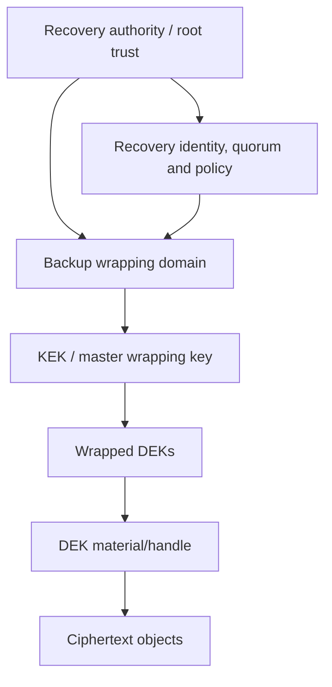

# Key restore: Khôi phục khóa mật mã an toàn để phục hồi dữ liệu và dịch vụ

> **Chương:** Backup và recovery  
> **Bài học:** Key restore  
> **Module:** `SECURITY_KEY_MANAGEMENT_FUNDAMENTALS` — hiểu vòng đời khóa mật mã từ tạo, cấp phát, lưu trữ, sử dụng, xoay vòng đến thu hồi và hủy; kết nối mật mã đối xứng, bất đối xứng, chữ ký số, KMS/HSM, envelope encryption, kiểm soát truy cập và kiểm toán để thiết kế hệ thống bảo vệ khóa an toàn.

## 1. Tình huống: Có bản backup dữ liệu nhưng không thể mở khóa để khôi phục

Một nền tảng lưu trữ chứng từ có ba thành phần:

- Object storage giữ ciphertext của hóa đơn và bản sao lưu.
- Mỗi object dùng một **Data Encryption Key (DEK)**; DEK được bọc bởi **Key Encryption Key (KEK)** trong KMS.
- Private signing key của dịch vụ được giữ trong HSM để ký manifest và chứng từ.

Một sự cố trung tâm dữ liệu khiến HSM partition chính không hoạt động. Đội vận hành tìm thấy bản backup ciphertext mới nhất, nhưng:

1. Bản backup chỉ có ciphertext và wrapped DEK.
2. KEK cần để unwrap DEK vẫn nằm trong security domain của HSM bị mất.
3. Bản backup HSM cũ hơn không có manifest cho biết nó chứa key versions nào.
4. Người giữ một phần backup credential đang nghỉ phép; người khác có quyền restore nhưng không có quyền phê duyệt.
5. Bản backup mới chưa từng được restore thử trong một môi trường độc lập.

Dữ liệu vẫn tồn tại, nhưng hệ thống không chứng minh được khả năng giải mã. Đây là **key recovery failure**: backup dữ liệu không đủ nếu thiếu key material hoặc đường truy cập khóa hợp lệ.

> **Nguyên tắc:** Backup chỉ có giá trị phục hồi khi có thể khôi phục **đúng key version, đúng metadata, đúng quyền và đúng trust context**, rồi chứng minh bằng phép kiểm tra thực tế rằng dữ liệu cần thiết có thể được decrypt/verify.

### Mục tiêu học tập

Sau bài này, bạn có thể:

1. Phân biệt backup key material, backup ciphertext, wrapped DEK, key metadata, KMS replication và key escrow.
2. Thiết kế key backup/restore theo key type, custody boundary, provider và yêu cầu RTO/RPO.
3. Hiểu vì sao backup raw key không mã hóa hoặc để chung với ciphertext có thể phá toàn bộ key protection.
4. Xác định thứ tự phục hồi key hierarchy: root/wrapping key, KEK, DEK và data.
5. Thiết kế quorum, split knowledge, dual control và separation of duties.
6. Khôi phục key trong KMS/HSM mà không giả định mọi provider cho phép export/import giống nhau.
7. Kiểm tra tính toàn vẹn, provenance, version, algorithm, key attributes và dependency metadata trước khi restore.
8. Xử lý tình huống key bị mất, HSM hỏng, KMS account/region unavailable, backup corrupt hoặc key bị compromise.
9. Đọc ví dụ Java 17 kiểm tra chữ ký manifest và digest của backup artifact trước khi chuyển sang quy trình restore chuyên dụng.
10. Lập runbook, DR drill, audit evidence và acceptance criteria để chứng minh key restore thực sự hoạt động.

---

## 2. Key restore là gì?

**Key restore** là quy trình khôi phục khả năng sử dụng một key hoặc key hierarchy đã được backup/replicate/escrow theo chính sách, trong một môi trường và quyền truy cập được phê duyệt.

Mục tiêu có thể là:

- Khôi phục **cùng key material** để decrypt ciphertext lịch sử.
- Khôi phục một HSM key object cùng attributes/permissions cần thiết.
- Khôi phục metadata và wrapping path để unwrap DEKs.
- Khôi phục trusted public key/certificate để verify chữ ký.
- Chuyển key sang HSM/KMS recovery boundary theo cơ chế được provider hỗ trợ.
- Khôi phục quyền truy cập key sau khi credential hoặc grant bị mất.

**Restore không nhất thiết tạo key mới.** Nếu cần material mới vì old key compromise, đó là key replacement/rotation và migration; restore old compromised key có thể làm tăng rủi ro.

### 2.1. Những gì có thể phải khôi phục

| Thành phần | Vai trò | Ví dụ |
|---|---|---|
| Key material | Bytes hoặc key object cần cho crypto operation. | AES KEK, RSA private key, HSM object. |
| Key identity/version | Chọn đúng key lịch sử. | Immutable KMS key ID, material version. |
| Key attributes | Giới hạn usage và export. | Sign, Decrypt, Wrap, non-exportable. |
| Wrapping hierarchy | Mở lớp key được bảo vệ. | Backup wrapping key/security domain. |
| Envelope metadata | Liên kết ciphertext với key. | Wrapped DEK, key ID, algorithm, AAD version. |
| Certificates/trust | Verify identity/signatures. | Certificate chain, public key, trust anchor. |
| IAM/grants/policies | Cho đúng workload/operator dùng key. | KMS key policy, HSM role, restore permission. |
| Provenance/audit | Chứng minh nguồn gốc và hành động. | Backup manifest, approval, restore event. |
| Configuration | Khôi phục key routing và provider integration. | Alias mapping, region, partition, endpoint policy. |

Khôi phục key material nhưng bỏ qua key attributes có thể tạo ra key quá rộng quyền. Khôi phục ciphertext nhưng thiếu AAD schema/version có thể khiến AEAD verification thất bại.

### 2.2. Restore khác backup, replication và recovery

- **Backup:** tạo bản sao được bảo vệ để dùng khi bản gốc hỏng/mất.
- **Replication:** duy trì bản sao ở hệ khác/region khác; có thể sao chép cả lỗi hoặc thao tác xóa.
- **Escrow:** lưu giữ key hoặc recovery capability dưới cơ chế custody riêng, thường có kiểm soát truy cập và quorum.
- **Restore:** dùng bản backup/replica/escrow để phục hồi khả năng sử dụng.
- **Disaster recovery (DR):** toàn bộ quy trình khôi phục dịch vụ, dữ liệu, identity, network, metadata và key dependencies.
- **Key replacement:** tạo key material mới và chuyển các operation/dependencies; không đồng nghĩa restore cùng key cũ.

Một replica đang online không tự chứng minh có backup độc lập. Nếu ransomware hoặc compromised admin xóa cả primary và replica, bản sao đó có thể không giúp khôi phục.

### 2.3. Restore có thể thất bại dù file backup tồn tại

Một backup artifact hợp lệ về bytes vẫn có thể không dùng được vì:

- Backup wrapping key bị mất.
- HSM backup domain không tương thích.
- Material version không được provider hỗ trợ.
- Key attributes bị restore sai.
- KMS principal không có quyền unwrap.
- Envelope metadata hoặc AAD version bị mất.
- Certificate/trust chain đã hết hiệu lực hoặc bị revoke.
- Backup corrupt, incomplete hoặc bị thay thế.
- Quorum custodians không thể tập hợp.
- Bản backup quá cũ so với RPO.

Do đó, **file tồn tại ≠ key recoverable ≠ service recoverable**.

---

## 3. Key backup không phải một thao tác giống nhau cho mọi loại key

### 3.1. Phân loại theo key purpose

| Key type | Nội dung cần backup/restore | Rủi ro đặc biệt |
|---|---|---|
| Symmetric DEK | Material hoặc encrypted/wrapped DEK, object mapping. | Raw DEK lộ làm lộ dữ liệu tương ứng. |
| Symmetric KEK | HSM/KMS protected key hoặc provider-supported recovery. | Blast radius lớn, có thể bảo vệ nhiều DEKs. |
| Root/wrapping key | Recovery domain/backup key/escrow theo thiết kế. | Mất root có thể làm mọi backup phía dưới không dùng được. |
| Asymmetric private key | Protected private key object hoặc HSM backup. | Export trái phép phá non-exportability/custody. |
| Public key | Public material, key ID, issuer binding và metadata. | Trust substitution, sai issuer/version. |
| CA private key | HSM backup/ceremony và recovery controls nghiêm ngặt. | Có thể ảnh hưởng toàn bộ PKI. |
| HMAC secret | Protected secret backup và phân phối tới verifiers. | Bên verify cũng có khả năng tạo MAC. |
| TLS private key | Keystore/HSM recovery và certificate mapping. | Endpoint impersonation khi lộ. |
| Derived keys | Master key/derivation context hoặc cách tái tạo có kiểm soát. | Thiếu salt/info/version làm không derive đúng. |
| Password-derived keys | Password verifier/salt/parameters hoặc encrypted data key scheme. | Không phải mọi derived key đều có thể khôi phục nếu mất password. |

Không backup mọi key theo một policy chung. Một public key có thể lưu trong repository được kiểm soát; một KEK không exportable cần cơ chế backup riêng của HSM/KMS.

### 3.2. DEK backup và KEK backup khác nhau

Trong envelope encryption:

```text
Plaintext
  |
  | AEAD Encrypt with DEK-A
  v
Ciphertext ------------------------------+
                                         |
DEK-A -- Wrap with KEK-v5 --> Wrapped DEK|
                                         v
                               Envelope metadata
```

Nếu backup ciphertext và wrapped DEK nhưng **mất KEK-v5**, ứng dụng có thể không unwrap được DEK-A.

Nếu backup KEK nhưng mất wrapped DEK hoặc mapping giữa object/version và DEK, cũng có thể không khôi phục được object.

**Cần backup cả quan hệ phụ thuộc**, không chỉ bytes của từng thành phần.

### 3.3. Derived key không nhất thiết cần lưu từng bản

Một key dẫn xuất bằng HKDF có thể được tái tạo nếu còn:

- Master key/IKM được bảo vệ.
- Salt (nếu cần).
- `info`/domain separation.
- Algorithm/parameter version.
- Context/tenant/resource binding.

Nhưng nếu master key bị mất hoặc compromise, các derived keys liên quan bị ảnh hưởng. Không ghi master key hoặc password vào manifest để “giúp restore”.

### 3.4. Public key và private key có nhu cầu backup khác nhau

Public key thường có thể được lưu nhiều nơi để verification. Private key cần custody/backup nghiêm ngặt. Nếu private key không exportable, restore có thể yêu cầu **HSM-native backup/replication** thay vì xuất PEM.

Không được giả định private key restore từ HSM backup có thể chuyển sang bất kỳ vendor/model nào.

---

## 4. Nguyên tắc an toàn cho key backup

### 4.1. Bảo vệ backup key độc lập với dữ liệu

Một thiết kế yếu:

```text
backup.zip
  ├── encrypted-data.tar
  └── plaintext-kek.bin
```

Ai lấy backup có thể mở cả data lẫn key.

Một thiết kế có separation:

```text
Encrypted data backup  -> storage backup domain
Key backup artifact    -> separate protected key backup domain
Recovery authority     -> independent custodians/quorum
Restore credentials    -> separate identity and approval system
```

Mục tiêu là không để một compromise đơn lẻ có đủ **ciphertext + key + quyền restore**.

### 4.2. Least privilege và separation of duties

Các quyền cần tách:

- Người yêu cầu restore.
- Người phê duyệt restore.
- Người quản lý backup artifact.
- Người kiểm soát HSM/KMS recovery domain.
- Người vận hành target service.
- Người kiểm toán evidence.

Một operator có quyền restore không nên mặc nhiên được export key hoặc tự phê duyệt thao tác của mình.

### 4.3. Split knowledge và quorum

Một số recovery workflows chia quyền kiểm soát giữa nhiều custodians:

```text
Custodian A: share A
Custodian B: share B
Custodian C: share C

Policy: 2-of-3 approval/shares required
```

**Split knowledge** nhằm tránh một người nắm toàn bộ bí mật/quyền. **Quorum** quy định số người cần tham gia. Đây không tự động có nghĩa mọi key backup đều dùng Shamir Secret Sharing.

Cần phân biệt:

- Multi-person approval (nhiều người phê duyệt).
- Split knowledge (mỗi người giữ một phần thông tin/secret).
- Threshold cryptography (nhiều bên cùng tính toán mà không tái tạo toàn bộ secret ở một nơi).
- Secret sharing (chia secret thành shares theo scheme cụ thể).

Chọn đúng cơ chế theo HSM/provider và threat model. Không tự chia raw key thành các mảnh bằng cách cắt chuỗi bytes.

### 4.4. Offline/immutable copies

Đối với key backup có blast radius lớn, cân nhắc:

- Bản backup offline hoặc logically isolated.
- WORM/immutable retention phù hợp.
- Credentials tách biệt với production IAM.
- Malware/ransomware-resistant access path.
- Periodic integrity scan và restore rehearsal.
- Vị trí địa lý độc lập theo yêu cầu DR.

Offline backup cũng cần kiểm soát vật lý, chain of custody và khả năng truy cập khi disaster xảy ra.

### 4.5. Integrity, authenticity và confidentiality là ba thuộc tính riêng

- **Confidentiality:** attacker không đọc được key backup.
- **Integrity:** backup không bị sửa/corrupt.
- **Authenticity/provenance:** biết backup đến từ hệ thống/key owner nào và đã được phê duyệt.

Mã hóa backup không tự chứng minh nó chưa bị thay thế. Hash không bí mật và không xác thực nguồn gốc nếu attacker có thể thay cả blob lẫn hash. Dùng authenticated manifest/signature/MAC dưới trust key độc lập.

---

## 5. Backup, replication, escrow và provider-native recovery

### 5.1. Bảng so sánh

| Cơ chế | Điểm mạnh | Điểm yếu/cần kiểm |
|---|---|---|
| Offline protected backup | Tách khỏi online compromise, hỗ trợ DR. | Restore chậm, phụ thuộc custody/quorum. |
| Immutable backup vault | Khó sửa/xóa trong retention. | Admin/control plane có thể vẫn bị compromise nếu không tách. |
| Cross-region replication | Failover nhanh. | Có thể replicate corruption/deletion và không độc lập. |
| HSM-native backup | Giữ key trong protected domain theo vendor design. | Thường phụ thuộc model/vendor/security domain. |
| KMS multi-region/replica | Hỗ trợ availability theo provider. | Semantics, key identity, region restrictions khác nhau. |
| Escrow | Recovery khi primary custodian/domain mất. | Custody, legal control và access governance phức tạp. |
| Re-derivation | Không cần lưu mọi derived key. | Phụ thuộc master, salt, info, version và deterministic scheme. |

### 5.2. KMS provider-managed key material

Một số KMS không cho export raw key material. Backup/recovery có thể do provider quản lý, thông qua:

- Service durability/replication.
- Multi-region key features.
- Key material import/reimport workflows.
- Pending deletion/cancellation windows.
- Account-level recovery/administrative controls.

Các cơ chế này **không giống nhau giữa providers** và không nên suy đoán từ tên API. Đọc đúng contract về key type, region, imported material, deletion và restore. Nếu provider không cho khôi phục key sau deletion, phải coi deletion là rủi ro không đảo ngược.

### 5.3. HSM-native backup

HSM có thể hỗ trợ backup/restore key objects theo security domain, backup key hoặc thiết bị backup riêng. Cần biết:

- Key object nào được phép backup.
- `sensitive`/`extractable`/usage attributes.
- Backup domain identity và compatibility.
- Firmware/model/vendor restrictions.
- Backup media encryption và authentication.
- Quorum custodians/backup tokens.
- Restore target có cùng security domain không.
- Audit/attestation và tamper response.

Không mặc định một HSM backup blob có thể restore lên một HSM khác hãng.

### 5.4. Escrow không phải nơi lưu key tùy tiện

Escrow cần:

- Custodian/owner xác định.
- Trigger được phép truy cập.
- Mục đích và thời hạn.
- Quorum và approval.
- Encryption/wrapping và independent trust root.
- Audit và post-recovery rotation.
- Legal/compliance terms phù hợp.

Một bản escrow không được kiểm soát có thể trở thành **single point of compromise**.

### 5.5. Khi provider không hỗ trợ key export

Không tìm cách bypass non-exportability bằng cách dump memory hoặc trích xuất raw key từ HSM. Thiết kế recovery bằng provider-native replication/backup hoặc giữ old key service hoạt động trong DR architecture; nếu không khả thi, ghi rõ limitation và tạo migration plan trước khi mất nguồn.

---

## 6. Key hierarchy và thứ tự khôi phục

### 6.1. Khôi phục từ trên xuống

Một hierarchy minh họa:



Thứ tự thực tế tùy provider, nhưng cần khôi phục **quyền tin cậy và wrapping path** trước khi unwrap các data keys phụ thuộc.

### 6.2. Một restore chain có thể gồm

1. Recovery operator identity và MFA/hardware authentication.
2. Approval/quorum và incident/change reference.
3. Network/DNS/region/provider endpoint cần thiết.
4. Backup manifest và trust/signature verification.
5. HSM security domain hoặc KMS recovery authority.
6. Root/backup wrapping key.
7. KEK hoặc key object.
8. Wrapped DEK/envelope metadata.
9. Application resource registry và AAD schema.
10. Data ciphertext/backup.
11. Application services và workload grants.
12. End-to-end decrypt/verify tests.

Nếu khôi phục object data trước khi có key path, bạn vẫn có ciphertext nhưng chưa có khả năng sử dụng.

### 6.3. Không khôi phục quá nhiều quyền cùng lúc

Khi DR, đừng cấp một global admin credential cho mọi service để nhanh chóng làm dữ liệu đọc được. Tách recovery role và runtime role; quyền break-glass có scope, TTL, audit và được revoke sau khi hoàn thành.

### 6.4. Restore order cần được ghi thành dependency graph

Một file README liệt kê các lệnh restore không thay được graph biểu diễn key dependencies. Với mỗi node cần owner, source backup, target, version, prerequisite, RTO/RPO, verification và rollback.

---

## 7. Backup key metadata và manifest

### 7.1. Vì sao manifest quan trọng?

Một encrypted key backup blob có thể không tự cho biết:

- Nó thuộc key ID nào.
- Được tạo từ HSM nào/security domain nào.
- Dùng backup format/version nào.
- Có key attributes nào.
- Backup time và policy version.
- Cần restore bằng quorum nào.
- Phụ thuộc wrapping key nào.
- Có được phép restore vào tenant/region này không.

Manifest giúp chọn đúng procedure và xác minh lineage trước khi restore.

### 7.2. Trường manifest gợi ý

| Field | Ví dụ | Lưu ý |
|---|---|---|
| `backupId` | `keybackup-opaque-2026-11-28-01` | ID duy nhất. |
| `immutableKeyId` | `kms-key-opaque-381` | Không chỉ alias. |
| `keyType/purpose` | `AES_KEK / KEY_WRAP` | Không nhầm purpose. |
| `algorithm/parameters` | `AES-256` | Theo provider metadata. |
| `materialVersion` | `v4` | Version cụ thể. |
| `sourceProvider/sourceHsm` | `provider-ref-a` | Provenance. |
| `securityDomainId` | `hsm-domain-prod-a` | Không log secret domain credential. |
| `backupFormatVersion` | `vendor-format-3` | Compatibility. |
| `createdAtUtc` | UTC timestamp | Freshness/retention. |
| `backupObjectRef` | opaque URI/reference | Path phải được authorize. |
| `payloadDigest` | SHA-256 digest | Integrity check, không thay signature. |
| `manifestSignerKeyId` | trusted signer ref | Authenticity. |
| `policyVersion/approvalRef` | policy version/ticket ref | Governance. |
| `restoreConstraints` | region/domain/target class | Restrict target. |
| `retentionUntil` | UTC timestamp | Lifecycle. |

Không đưa raw key, plaintext share, recovery token, HSM PIN hoặc bearer credential vào manifest.

### 7.3. Hash, MAC và signature

- Hash như SHA-256 phát hiện thay đổi khi expected digest đến từ nguồn tin cậy.
- MAC xác thực bằng secret key; verifier cũng có khả năng tạo MAC nếu giữ cùng secret.
- Digital signature cho phép verifier kiểm chữ ký bằng public key, trong khi signer giữ private key.
- Signature/manifest trust key phải được backup/recover **độc lập** với key backup đang được xác thực, nếu không có circular dependency.

### 7.4. Không dùng chính key đang khôi phục làm trust anchor duy nhất

Nếu muốn xác thực backup của KEK-v5 nhưng chữ ký manifest chỉ verify bằng một key cũng được bọc bởi KEK-v5, khi KEK-v5 mất bạn không thể xác minh manifest để khôi phục KEK-v5. Đây là **circular recovery dependency**.

Dùng trust anchor/manifest signing key và recovery domain được quản trị riêng, hoặc cơ chế provider có authenticity được xác thực độc lập.

---

## 8. Quorum, split knowledge và custody khi restore

### 8.1. Mô hình 2-of-3 minh họa

```text
Recovery action:
  Custodian A ── approval/share ─┐
  Custodian B ── approval/share ─┼──> authorized restore ceremony
  Custodian C ── approval/share ─┘

Policy requires any 2 of 3
```

Mô hình trên chỉ minh họa quorum; share thực tế phải được tạo và xử lý theo scheme/provider được phê duyệt. Không tự tạo ba bản copy của cùng một PIN rồi gọi là split knowledge.

### 8.2. Separation of duties

Có thể phân vai:

| Vai trò | Quyền |
|---|---|
| Incident commander | Phê duyệt lý do/impact và thời điểm restore. |
| Key custodian A/B | Tham gia quorum/custody ceremony. |
| HSM/KMS operator | Thực hiện provider operation trong scope. |
| Storage operator | Cung cấp backup artifact. |
| Application owner | Xác minh consumer/resource mapping. |
| Auditor/observer | Quan sát, đối soát evidence. |

Người tạo backup không nên một mình có thể sửa manifest, lấy backup, giải mã key và phê duyệt restore.

### 8.3. Recovery credential phải được kiểm soát riêng

- MFA/hardware token.
- Time-bound privileged access.
- Network path có allowlist.
- Session recording/audit phù hợp.
- Credential vault độc lập với production domain.
- Rotate/revoke temporary credentials sau restore.
- Không đưa PIN/token vào shell history, log hoặc ticket.

### 8.4. Custodian không sẵn sàng

Nếu quorum không đủ, không bỏ kiểm soát để “khôi phục nhanh”. Dùng alternate custodians đã được phê duyệt trong kế hoạch DR. Nếu không có, đó là **recovery design gap** cần được xử lý sau sự cố.

---

## 9. Quy trình key restore an toàn

### 9.1. Pha 1 — Xác nhận trigger và quyền restore

- Incident/DR/change ID.
- Key owner, key purpose, immutable key ID/version.
- Tình trạng old key: lost, damaged, unavailable, compromised hay chỉ provider outage.
- Restore target: account, region, HSM, security domain, tenant.
- Người yêu cầu, người phê duyệt và quorum.
- RTO/RPO, data class, legal hold.

Nếu key bị **compromise**, không mặc định restore để đưa nó trở lại hoạt động. Có thể chỉ restore trong forensic/isolated environment hoặc bỏ hẳn key cũ và thay thế.

### 9.2. Pha 2 — Chọn nguồn backup đáng tin

- Lấy backup artifact từ immutable/offline vault hoặc provider-supported source.
- Kiểm source identity, timestamp, retention, object version.
- Kiểm signature/MAC/digest manifest theo trust anchor độc lập.
- Kiểm backup format và target compatibility.
- Kiểm không có dấu hiệu sửa/xóa trái phép.
- Ghi chain of custody và attempt ID.

Không dùng file chỉ vì tên `latest-backup.bin`.

### 9.3. Pha 3 — Khôi phục recovery domain

- Tập hợp quorum/custodians.
- Xác minh backup security domain và target HSM/KMS.
- Khởi tạo recovery session bằng privileged identity.
- Kiểm firmware/model/provider compatibility.
- Khôi phục backup wrapping authority nếu workflow yêu cầu.
- Không export raw key ra máy operator nếu HSM-native restore có thể giữ boundary.

### 9.4. Pha 4 — Restore key object/material

- Dùng exact provider procedure/API.
- Kiểm immutable key identity/material version và attributes.
- Xác nhận `Sign/Decrypt/Wrap/Unwrap` permissions đúng.
- Kiểm `sensitive`/`extractable` hoặc equivalent attributes.
- Không tự cấp lại wildcard grants.
- Không kích hoạt key nếu chưa qua verification và approval.

### 9.5. Pha 5 — Restore metadata và dependencies

- Key inventory record và alias history.
- Envelope/key ID mappings.
- AAD schema/version và algorithm parameters.
- Certificate/public-key trust mapping.
- KMS grants/IAM theo least privilege.
- Region/tenant/environment routing.
- Application config và key version selectors.

Không sửa metadata cũ để giả vờ ciphertext đã dùng key mới. Giữ lineage chính xác.

### 9.6. Pha 6 — Verify trong môi trường kiểm soát

- Kiểm public-key fingerprint hoặc provider check mechanism.
- Thử KAT/known-answer fixture phù hợp, không log secrets.
- Unwrap một test DEK fixture và kiểm authenticated operation.
- Decrypt/verify representative backup object versions.
- Kiểm expected AAD/context và resource identity.
- Kiểm provider audit, key state và grants.
- Xác minh negative cases cũng bị deny.

### 9.7. Pha 7 — Cutover và giám sát

- Cho một recovery workload/tenant canary dùng key đã restore.
- Theo dõi decrypt/verify errors, KMS latency và audit.
- Mở rộng theo từng scope.
- Giữ primary/secondary path theo DR policy.
- Thu hồi temporary restore privileges.
- Ghi RTO/RPO thực tế và residual limitations.

### 9.8. Pha 8 — Closeout

- Evidence backup source, manifest, approvals, provider operation IDs.
- Key version/attributes readback.
- Object/signature restore tests.
- Dependency reconciliation.
- Backup inventory cập nhật.
- Temporary credentials/grants revoked.
- Follow-up cho gaps.
- Nếu restore không thành công, báo `FAILED/UNKNOWN`, không tự coi backup đã recoverable.

---

## 10. Restore key trong KMS: Những điều phải xác minh theo provider

### 10.1. KMS logical key và key material

Một KMS có thể quản lý một logical key resource, material versions nội bộ và metadata. Provider có thể giữ durability/replication và không cung cấp raw key export.

**Không giả định** mọi KMS cho “download backup key rồi import lại”. Recovery semantics phụ thuộc provider, key type, imported/generated material, region, account, deletion state và product feature.

### 10.2. Những câu hỏi phải trả lời trước DR

1. Key có provider-managed durability không?
2. Có multi-region/replica key feature không?
3. Replica dùng cùng logical identity hay key resource khác?
4. Key material generated hay imported?
5. Imported material có expiration/reimport deadline không?
6. Khi schedule deletion, có pending window và cancellation không?
7. Sau deletion có recovery path nào được bảo đảm?
8. Key grants/policies có replicate không?
9. Encryption context/AAD có phụ thuộc account/region/resource?
10. Backup/restore có ảnh hưởng audit/rotation history?

Các câu trả lời phải dựa trên **contract/documentation và configuration của provider thực tế**; không suy từ một cloud sang cloud khác.

### 10.3. Alias không phải backup

Alias chỉ là tên trỏ tới key resource. Backup alias text không backup material, key policy, grants, versions hay dependencies.

Lưu alias history để routing, nhưng ciphertext/envelope cần immutable key reference/version.

### 10.4. Key deletion và pending deletion

Một số provider có deletion scheduling/cancellation window; một số key types có semantics khác. Không coi pending deletion là backup. Nếu key đã xóa vĩnh viễn và provider không có restore, chỉ còn recovery/escrow path đã chuẩn bị từ trước.

### 10.5. Provider outage

Nếu KMS region unavailable nhưng key material vẫn tồn tại, giải pháp có thể là failover sang replica/region theo thiết kế. Đừng restore backup hay generate new key vội nếu việc đó tạo ra key khác và làm ciphertext không thể decrypt.

---

## 11. Restore key trong HSM

### 11.1. HSM key object không phải file PEM thông thường

HSM có thể giữ private/symmetric key object bên trong security boundary. Backup có thể là protected blob gắn với vendor security domain hoặc backup appliance.

Các attributes quan trọng gồm:

- Key type và size.
- `CKA_SENSITIVE`/`CKA_EXTRACTABLE` theo PKCS#11 semantics.
- `CKA_SIGN`, `CKA_DECRYPT`, `CKA_WRAP`, `CKA_UNWRAP`, `CKA_DERIVE`.
- Label/object ID, token/session scope.
- Vendor-specific policy/usage constraints.
- Backup/export wrapping policy.

### 11.2. Restore target compatibility

Xác minh:

- HSM model/firmware/vendor và backup format.
- Security domain/backup key compatibility.
- Quorum/backup tokens.
- Partition/slot/tenant identity.
- Key attributes sau restore.
- Certificate association/public key fingerprint.
- Audit events và tamper alarms.

Không mặc định restore HSM backup từ model A lên model B được.

### 11.3. Không hạ thấp key attributes để restore cho dễ

Nếu key cũ `non-extractable`, không thay bằng một bản software-exportable để “đọc được dữ liệu”. Cần giữ security boundary tương đương hoặc có change/risk approval rõ ràng.

### 11.4. Root/CA keys cần ceremony riêng

Root CA private key hoặc top-level wrapping key có thể cần:

- Offline HSM.
- M-of-N custodians.
- Two-person rule.
- Controlled ceremony room/recording.
- Tamper-evident media.
- Signed ceremony records.
- Independent witness/audit.

Đây là quy trình governance và custody, không chỉ là thao tác import key.

---

## 12. Restore envelope encryption: Phải khôi phục cả DEK, KEK và metadata

### 12.1. Các lớp phụ thuộc

```text
Object ciphertext
  + nonce/tag
  + expected AAD schema/context
  + wrapped DEK
  + immutable KEK ID/version
  + KMS/HSM permissions
  + trusted tenant/object mapping
```

Thiếu bất kỳ thành phần bắt buộc nào có thể làm decrypt thất bại hoặc tạo nguy cơ cross-tenant.

### 12.2. Restore theo thứ tự

1. Restore trusted object manifest/registry.
2. Restore hoặc failover KEK theo provider-supported method.
3. Restore workload identity/grants.
4. Resolve wrapped DEK đúng key ID/version.
5. Unwrap DEK qua authorized operation.
6. AEAD decrypt với expected AAD đã tính từ trusted data.
7. Verify tag trước khi release plaintext.
8. Kiểm object generation và business authorization.
9. Ghi audit outcome.

### 12.3. Không dùng AAD từ ciphertext metadata không đáng tin

Ví dụ metadata khai:

```json
{"tenant":"tenant-42","object":"invoice-7821"}
```

chưa chứng minh object thuộc tenant-42. Lấy expected identity từ registry/business authorization; sau đó tạo AAD canonical. AEAD xác thực bytes đã bind, không quyết định caller được phép đọc object.

### 12.4. Restore wrapped DEK không phải restore plaintext DEK

Wrapped DEK là ciphertext của key material. Nó vẫn cần KEK và correct context để unwrap. Không lưu plaintext DEK trong backup manifest để “đảm bảo restore”.

### 12.5. Rewrap sau recovery

Nếu KEK được restore từ backup, có thể dùng tạm để mở old wrapped DEKs rồi rewrap sang new KEK sau khi DR ổn định. Đây là **recovery plus planned migration**, không phải bắt buộc trong mọi trường hợp. Nếu old KEK compromise, không coi rewrap cùng DEKs là remediation đầy đủ.

---

## 13. Restore asymmetric signing key và certificates

### 13.1. Private key và public trust

Để tiếp tục ký, cần private key hoặc HSM key object. Để verify, cần public key/certificate chain và trust policy. Backup public key có thể dễ hơn nhưng không thay backup private key.

### 13.2. Restore private signing key

- Verify source backup/manifest.
- Restore đúng key pair/version vào HSM/provider.
- Verify public key fingerprint khớp trusted registry/certificate.
- Kiểm `Sign` usage, algorithm và IAM.
- Dùng test payload domain-separated để Sign/Verify.
- Không export private key để so sánh.
- Audit operation và approvals.

### 13.3. Nếu signing key bị compromise

**Không restore old compromised private key để tiếp tục production signing.** Có thể restore vào isolated forensic environment nếu cần và được phê duyệt, nhưng normal trust phải chuyển sang new pair và xử lý forged artifacts/session.

### 13.4. Historical verification

Public key/certificate cũ có thể cần cho historical signatures. Tùy nghiệp vụ, giữ:

- Public key.
- Certificate chain.
- Trust policy version.
- Trusted timestamp evidence.
- Revocation status/validation time.
- Signature format/version.

Không nhầm **giữ public key để validate lịch sử** với **khôi phục quyền Sign của private key cũ**.

### 13.5. CA root/intermediate recovery

CA private key mất có thể đòi khôi phục PKI hoặc tạo hierarchy mới. Không chỉ restore một key file: phải xem certificate issuance, CRL/OCSP, trust anchors, serial number database, audit/issuance logs và cross-signing dependencies.

---

## 14. Restore HMAC secrets, passwords và derived keys

### 14.1. HMAC shared secret

Restore HMAC key phải đảm bảo producer/verifier dùng đúng version, issuer/domain và algorithm. Vì verifier cũng nắm secret có thể tạo MAC, hạn chế access rộng.

Nếu secret bị compromise, không khôi phục nó về active production; tạo fresh secret và chuyển acceptance theo incident policy.

### 14.2. Password không giống key backup

Không backup plaintext passwords. Password verifier thường gồm salt, hash/KDF algorithm và cost parameters; restore verifier database khác với restore encryption key.

Nếu ứng dụng derive encryption key trực tiếp từ password, phải hiểu scheme (KDF, salt, parameters, version) và nguy cơ password reset làm dữ liệu không giải mã được. Không thể tái tạo password đã mất bằng backup hash.

### 14.3. Derived key recovery

Nếu key được derive từ master secret bằng HKDF:

```text
K = HKDF(
  IKM = masterSecret,
  salt = recordedSalt,
  info = purpose || tenant || version,
  length = requiredLength
)
```

Restore cần đúng IKM, salt, `info`, algorithm và version. `info`/domain separation phải canonical và authenticated. Không thay đổi derivation label rồi mong key cũ tái tạo giống hệt.

### 14.4. Derived key có thể không cần backup riêng

Nếu scheme deterministic và master/context được recoverable, có thể derive lại. Nhưng cần test **known-answer vectors** và xác minh key version; không dùng derivation để che giấu việc master key backup thiếu.

---

## 15. Restore identity, IAM và grants

### 15.1. Có key material nhưng không có quyền dùng

Một HSM key object restore thành công vẫn có thể không usable nếu:

- Application workload identity chưa được tạo.
- KMS key policy không cho principal.
- HSM partition/user role chưa được provision.
- Grants không tồn tại hoặc sai constraints.
- Network endpoint/private connectivity chưa hoạt động.
- Region/account mapping không khớp.

### 15.2. Không khôi phục quyền quá rộng

Tránh:

```text
kms:*
all keys
all tenants
all regions
permanent admin
```

Chỉ restore grants cần thiết theo operation, key ID, tenant, environment và expiry. Runtime role, migration role và recovery administrator phải tách.

### 15.3. Recovery identity độc lập

Nếu production IdP bị compromise hoặc unavailable, recovery identity phải có đường xác thực độc lập được thiết kế trước (ví dụ hardware-backed emergency access). Không lưu tất cả credentials trong cùng backup domain hoặc cùng cloud account bị ảnh hưởng.

### 15.4. Temporary access cleanup

Sau restore:

- Revoke break-glass sessions/grants.
- Rotate recovery credentials nếu có exposure.
- Close approval window.
- Verify remaining permissions.
- Audit who accessed key and when.
- Restore normal workload identity with least privilege.

---

## 16. Recovery objectives: RTO, RPO và key availability

### 16.1. Định nghĩa

- **RTO (Recovery Time Objective):** thời gian mục tiêu để khôi phục dịch vụ/khả năng sử dụng.
- **RPO (Recovery Point Objective):** mức mất dữ liệu hoặc trạng thái theo thời gian mà tổ chức chấp nhận.
- **Key recovery time:** thời gian khôi phục key material/access và dependency chain.
- **Crypto availability:** khả năng thực hiện đúng operation với đúng key/version/policy.

Một hệ có RTO database 30 phút nhưng key recovery mất 8 giờ thì **RTO ứng dụng thực tế ít nhất bị chi phối bởi key recovery** nếu cần key để decrypt dữ liệu.

### 16.2. RTO/RPO phải đo end-to-end

```text
RTO effective =
  time until identity + key + metadata + data + application
  can perform required verified operations
```

Đây là cách nhìn dependency; không phải công thức cộng thời gian độc lập nếu các bước có thể chạy song song.

RPO key state có thể khác data state. Ví dụ ciphertext backup mới hơn key inventory/manifest, hoặc KMS policy snapshot cũ hơn grants. Cần consistency và recovery point rõ cho từng dependency.

### 16.3. Phân loại workload

| Tier | Ví dụ | Recovery expectation |
|---|---|---|
| Tier 0 | Root/CA, top-level KEK, identity recovery. | Ceremony, quorum, isolated backup, tested recovery. |
| Tier 1 | Payment signing/decryption KEKs. | DR path có thời gian đo, restricted access. |
| Tier 2 | Application DEKs/tenant KEKs. | Inventory, backup/replica và batch restore. |
| Tier 3 | Test/dev keys. | Có thể tái tạo nếu dữ liệu không cần giữ. |

Tiering phải phản ánh business impact và retention, không chỉ giá trị key.

### 16.4. Không đặt RTO bằng thời gian thao tác KMS duy nhất

Cần tính quorum assembly, approval, provider support, DNS/network, HSM initialization, manifest verification, metadata restore, app deployment, test và audit.

---

## 17. Recovery failure modes và cách xử lý

| Failure | Triệu chứng | Hành động |
|---|---|---|
| Wrong backup version | Key ID/material version không khớp. | Stop, tìm manifest/source đúng. |
| Backup corrupt | Digest/signature/tag fail. | Không restore; chọn immutable verified copy. |
| Backup signer key unavailable | Không verify manifest. | Dùng independent trust recovery path; không bypass. |
| HSM domain mismatch | Restore target reject. | Khôi phục đúng domain/target theo vendor procedure. |
| Quorum incomplete | Không đủ custodians. | Kích hoạt alternate custodians đã phê duyệt. |
| KMS key deleted | Provider không còn material. | Kiểm pending deletion/replica/escrow; nếu irrecoverable báo rõ. |
| Imported key expired | Reimport deadline qua. | Kiểm provider recovery contract; có thể cần replacement/data migration. |
| Attributes drift | Restored key cho phép Export/Sign sai. | Disable trước, sửa attributes qua approved process, verify readback. |
| IAM/grant missing | Key tồn tại nhưng access denied. | Restore least-privilege policy; không cấp wildcard. |
| Envelope metadata missing | Không biết KEK/AAD version. | Rebuild từ trusted inventory/manifest; không đoán. |
| Wrong AAD | AEAD tag failure. | Kiểm schema/context và object identity; không bỏ tag. |
| Backup too old | New objects dùng key version chưa có trong backup. | Restore newer backup hoặc recover dependencies riêng. |
| Region unavailable | Provider API timeout. | DR region/provider-supported failover. |
| Restore succeeds but app fails | Wrong alias, provider, format or permissions. | End-to-end trace và config reconciliation. |
| Key compromised | Restored key usable nhưng unsafe. | Không đưa production; isolate, replace/revoke. |
| Audit sink unavailable | Không ghi evidence. | Theo policy pause/high-risk restore or protected local evidence then reconcile; never silently skip. |

---

## 18. Java 17: Xác minh backup manifest trước khi restore

Ví dụ dưới đây chỉ xác minh **manifest và encrypted backup blob** trước khi chuyển artifact tới quy trình restore KMS/HSM chuyên dụng. Nó không giải mã hay export key material.

Các kiểm tra:

1. Manifest có chữ ký Ed25519 từ một **trusted manifest signer** độc lập.
2. Key ID, backup domain và signer ID khớp yêu cầu restore.
3. Backup format nằm trong allowlist.
4. Timestamp có thể parse và không ở tương lai.
5. SHA-256 của encrypted backup blob khớp manifest.
6. Chỉ sau khi mọi kiểm tra thành công mới trả `VALIDATED_FOR_PROVIDER_RESTORE`.

```java
import java.nio.charset.StandardCharsets;
import java.security.GeneralSecurityException;
import java.security.KeyPair;
import java.security.KeyPairGenerator;
import java.security.MessageDigest;
import java.security.PublicKey;
import java.security.Signature;
import java.time.Instant;
import java.util.Base64;
import java.util.HexFormat;
import java.util.Set;

public final class KeyBackupManifestDemo {

    record BackupManifest(
            String backupId,
            String immutableKeyId,
            String keyType,
            String purpose,
            String backupFormat,
            String backupDomainId,
            String sourceHsmId,
            String payloadSha256,
            String createdAtUtc,
            String signerKeyId) {

        byte[] canonicalBytes() {
            // Production: use a canonical, versioned serialization
            // with strict field escaping and schema validation.
            String canonical = String.join("\n",
                    backupId,
                    immutableKeyId,
                    keyType,
                    purpose,
                    backupFormat,
                    backupDomainId,
                    sourceHsmId,
                    payloadSha256,
                    createdAtUtc,
                    signerKeyId);
            return canonical.getBytes(StandardCharsets.UTF_8);
        }
    }

    record SignedManifest(
            BackupManifest manifest,
            String signatureBase64) {}

    static String sha256Hex(byte[] bytes)
            throws GeneralSecurityException {
        byte[] digest = MessageDigest.getInstance("SHA-256")
                .digest(bytes);
        return HexFormat.of().formatHex(digest);
    }

    static String signManifest(
            BackupManifest manifest,
            java.security.PrivateKey trustedSignerPrivateKey)
            throws GeneralSecurityException {

        Signature signer = Signature.getInstance("Ed25519");
        signer.initSign(trustedSignerPrivateKey);
        signer.update(manifest.canonicalBytes());
        return Base64.getEncoder().encodeToString(signer.sign());
    }

    static void validateBeforeRestore(
            SignedManifest signed,
            byte[] encryptedBackupBlob,
            PublicKey trustedManifestSigner,
            String expectedSignerKeyId,
            String expectedImmutableKeyId,
            String expectedBackupDomainId,
            Instant now) throws GeneralSecurityException {

        BackupManifest m = signed.manifest();

        if (!m.signerKeyId().equals(expectedSignerKeyId)) {
            throw new SecurityException("Untrusted manifest signer ID");
        }
        if (!m.immutableKeyId().equals(expectedImmutableKeyId)) {
            throw new SecurityException("Unexpected key identity");
        }
        if (!m.backupDomainId().equals(expectedBackupDomainId)) {
            throw new SecurityException("Wrong backup security domain");
        }
        if (!Set.of("HSM_WRAPPED_BLOB_V1",
                    "PROVIDER_BACKUP_PACKAGE_V1")
                .contains(m.backupFormat())) {
            throw new SecurityException("Unsupported backup format");
        }
        if (!Set.of("AES_KEK", "RSA_PRIVATE", "HMAC_SECRET")
                .contains(m.keyType())) {
            throw new SecurityException("Unexpected key type");
        }

        Instant createdAt = Instant.parse(m.createdAtUtc());
        if (createdAt.isAfter(now)) {
            throw new SecurityException("Backup timestamp is in future");
        }

        Signature verifier = Signature.getInstance("Ed25519");
        verifier.initVerify(trustedManifestSigner);
        verifier.update(m.canonicalBytes());

        byte[] signatureBytes =
                Base64.getDecoder().decode(signed.signatureBase64());

        if (!verifier.verify(signatureBytes)) {
            throw new SecurityException("Manifest signature invalid");
        }

        String actualDigest = sha256Hex(encryptedBackupBlob);
        byte[] expected = HexFormat.of().parseHex(m.payloadSha256());
        byte[] actual = HexFormat.of().parseHex(actualDigest);

        if (!MessageDigest.isEqual(expected, actual)) {
            throw new SecurityException("Backup blob digest mismatch");
        }

        // This only validates the package metadata and bytes.
        // A provider-specific restore ceremony is still required.
    }

    public static void main(String[] args)
            throws Exception {

        KeyPairGenerator generator =
                KeyPairGenerator.getInstance("Ed25519");
        KeyPair manifestSigner = generator.generateKeyPair();

        // Simulated encrypted backup bytes; this is NOT a real key backup.
        byte[] encryptedBlob = new byte[] {
                0x12, 0x23, 0x34, 0x45, 0x56, 0x67
        };

        BackupManifest manifest = new BackupManifest(
                "backup-2026-11-28-001",
                "immutable-kms-key-381",
                "AES_KEK",
                "KEY_WRAP",
                "HSM_WRAPPED_BLOB_V1",
                "backup-domain-prod-a",
                "hsm-partition-prod-2",
                sha256Hex(encryptedBlob),
                "2026-11-28T01:30:00Z",
                "manifest-sign-v2");

        SignedManifest signed = new SignedManifest(
                manifest,
                signManifest(manifest, manifestSigner.getPrivate()));

        validateBeforeRestore(
                signed,
                encryptedBlob,
                manifestSigner.getPublic(),
                "manifest-sign-v2",
                "immutable-kms-key-381",
                "backup-domain-prod-a",
                Instant.parse("2026-11-28T02:00:00Z"));

        System.out.println("VALIDATED_FOR_PROVIDER_RESTORE");
    }
}
```

### 18.1. Kết quả dự kiến

```text
VALIDATED_FOR_PROVIDER_RESTORE
```

Đây là kết quả theo logic ví dụ, không phải xác nhận đã chạy trên HSM/KMS thật.

### 18.2. Vì sao dùng signer độc lập?

Manifest signer public key phải được tin cậy từ một trust root độc lập với key material đang được restore. Nếu không, attacker có thể thay cả backup và signer key rồi tạo một manifest giả hợp lệ theo chính key mới.

### 18.3. Giới hạn demo

- Blob chỉ là byte array mô phỏng, không chứa key thật.
- Code chưa thực hiện vendor HSM/KMS restore.
- Không có quorum, MFA, approval workflow, network isolation hoặc audit backend.
- Canonical serialization minh họa bằng newline; production cần schema version và encoding chuẩn, tránh newline/escaping ambiguity.
- Digest xác minh blob so với manifest đã được ký; không thay provider authentication hoặc restore verification.
- Timestamp mới chỉ kiểm tra không ở tương lai; production còn phải enforce age, retention và trusted time policy.
- Không kiểm HSM attributes sau restore; phải readback từ provider.
- Không ghi private key vào manifest/log; signer private key của demo chỉ tồn tại trong memory.
- Không dùng code này để tự xử lý/export raw HSM key.

### 18.4. Sau validation vẫn phải kiểm tra provider

```text
manifest signature valid
payload digest valid
backup source/domain/version expected
        |
        v
approved quorum + provider restore ceremony
        |
        v
read back key identity and usage attributes
        |
        v
known-answer and representative decrypt/verify tests
        |
        v
restricted service canary + audit
```

---

## 19. Known-answer tests và kiểm chứng sau restore

### 19.1. Tại sao file restore success chưa đủ?

Một API có thể trả success nhưng key object được restore với:

- Wrong key ID/label.
- Wrong attributes.
- Wrong algorithm parameters.
- Wrong HSM partition.
- Wrong KMS account/region.
- Wrong material version.
- Missing trust/certificate association.

Cần chứng minh key làm đúng công việc cần thiết.

### 19.2. Known-answer test (KAT)

Một KAT dùng vector test đã biết: input, algorithm, key/test fixture và expected output. Với key production, không được đưa raw secret vào test report; có thể thực hiện phép thử trong HSM/KMS và chỉ ghi result/operation ID.

### 19.3. Public key fingerprint

Với asymmetric key, có thể so fingerprint public key/certificate đã pin với expected trusted value. Phải canonicalize public key encoding/algorithm parameters trước khi hash.

### 19.4. Symmetric key verification

Không tạo “key fingerprint” bằng cách log raw key hoặc dùng một input dễ đoán cho một oracle công khai. Có thể dùng provider key-check mechanism, authenticated test fixture trong isolated environment hoặc validation key độc lập theo policy.

### 19.5. Data-level restore test

Chọn representative object generations:

- Current version.
- Noncurrent version.
- Archive/backup tier.
- Tenant khác nhau theo test scope.
- Region/replica.
- Data encrypted trước và sau một số rotation versions.

Thực hiện authorized decrypt, verify AEAD tag/AAD và kiểm object identity. Không cần đọc toàn bộ customer plaintext ra màn hình; kiểm bằng checksum/semantic assertions được thiết kế an toàn.

---

## 20. DR drill: Kiểm tra key recovery thường xuyên

### 20.1. Drill phải mô phỏng dependency failure thật

Các kịch bản:

- Primary HSM partition unavailable.
- KMS region unavailable.
- KMS key scheduled for deletion.
- Backup wrapping key unavailable.
- Manifest signer/trust anchor recovery.
- Custodian/quorum unavailable.
- Identity provider unavailable.
- Corrupt latest backup.
- Lost envelope metadata.
- Old key compromised (không được restore vào production).
- Cross-account/region recovery.

### 20.2. Không chỉ diễn tập “restore file”

Một drill đầy đủ:

```text
declare DR scenario
authorize recovery and quorum
obtain independent backup
verify manifest and artifact integrity
restore provider key/domain
restore metadata and IAM
run KAT and data-level decrypt/verify
start restricted application canary
measure RTO/RPO and error rate
audit and revoke temporary access
```

### 20.3. Restore drill trong isolated environment

Dùng test keys/data hoặc isolated recovery account/partition. Không thử xóa production KEK hoặc vô hiệu hóa root CA production để kiểm runbook.

### 20.4. Frequency dựa trên risk

Root/CA keys và top-level KEKs có thể cần rehearsal nghiêm ngặt hơn application test keys. Tần suất cụ thể phải do policy/impact/industry requirement quyết định, không đặt một con số chung cho mọi key.

### 20.5. Drill phải có fail criteria

Ví dụ:

- Không đủ quorum trong RTO.
- Manifest không xác minh.
- Wrong key attributes.
- Không decrypt được historical fixture.
- Restore path cần quyền wildcard.
- Audit missing.
- Temporary grants không revoke.
- Unknown critical dependencies.

Một drill thất bại là phát hiện hữu ích, không được sửa report thành PASS chỉ vì cuối cùng operator dùng tay khôi phục được.

---

## 21. Runbook production: Key restore

### Pha A — Kích hoạt

- Xác định incident/DR/change ID.
- Xác định key type, purpose, immutable ID/version.
- Phân loại lost/unavailable/corrupt/compromised.
- Chỉ định incident commander, custodian, operator và auditor.
- Đánh giá business impact, RTO/RPO, data retention.
- Chọn target region/account/HSM domain.
- Kiểm restore có thể làm key compromise quay lại production không.

### Pha B — Bảo toàn và xác minh nguồn

- Bảo toàn forensic evidence.
- Chọn backup theo manifest và trusted inventory.
- Kiểm digest/signature/authenticity, timestamp, retention.
- Kiểm format/provider compatibility.
- Lập chain of custody.
- Không lấy backup qua một endpoint/identity chưa xác thực.

### Pha C — Approval và recovery ceremony

- Tập hợp quorum theo policy.
- Xác minh hardware-backed credentials/MFA.
- Ghi approval/role separation.
- Mở time-bound recovery session.
- Đảm bảo operator không tự approve chính mình.
- Nếu quorum thiếu: kích hoạt alternate custodian đã định trước hoặc báo blocker.

### Pha D — Restore provider key/domain

- Khôi phục security domain/backup authority theo provider.
- Restore đúng key object/material version.
- Read back key identity/attributes.
- Giữ key disabled/restricted cho tới khi kiểm tra xong.
- Không export key nếu HSM-native path đáp ứng yêu cầu.

### Pha E — Restore dependencies

- Inventory/manifest/aliases.
- KEK references và wrapped DEK mappings.
- Certificates/public keys/trust stores.
- IAM/grants/workload identities.
- AAD/envelope schema/algorithm config.
- Network/region/provider endpoints.

### Pha F — Verification

- Manifest signature/digest.
- Key identity/fingerprint/check mechanism.
- Key usage attributes.
- KAT/test fixtures.
- Representative decrypt/verify.
- Tenant/object binding và AEAD tag.
- Negative access test.
- Audit completeness.

### Pha G — Cutover

- Canary workload/tenant.
- Theo dõi latency, errors, KMS quotas, audit.
- Tăng scope theo approved rollout.
- Revoke temporary restore credentials.
- Không restore compromised key vào normal production use.

### Pha H — Closeout

- RTO/RPO thực tế.
- Key version and state readback.
- Backup source, approvals, provider request IDs.
- Data-level recovery evidence.
- Remaining UNKNOWN/FAILED dependencies.
- Retention/legal hold status.
- Lessons learned và backup/restore design changes.

---

## 22. Failure handling: Restore không thành công thì sao?

### 22.1. Không thể xác minh backup

Không bỏ signature/digest check chỉ để tiếp tục. Chọn một verified copy khác, hoặc báo `BLOCKER: BACKUP_AUTHENTICITY_UNVERIFIED`.

### 22.2. Không đủ quorum

Không dùng credential cá nhân khác để vượt quy trình. Báo `BLOCKER: RECOVERY_QUORUM_UNAVAILABLE`, kích hoạt alternate custodian plan đã được duyệt.

### 22.3. Key restore được nhưng attributes sai

Giữ key disabled/restricted, ghi evidence, sửa theo approved process hoặc restore lại đúng backup. Không đưa key có `extractable=true` vào production khi policy yêu cầu non-exportable.

### 22.4. Key restore được nhưng data decrypt thất bại

Kiểm lần lượt:

- Đúng immutable key ID/material version?
- Đúng DEK wrapped blob và wrapping context?
- AAD schema/canonicalization có đúng?
- Ciphertext/tag/nonce có bị corrupt?
- Object generation/tenant mapping có đúng?
- KMS grants và region có đúng?
- Có rotation/migration trước đó chưa được restore?

Không brute-force keys hoặc bỏ AEAD verification.

### 22.5. Key bị phát hiện compromised trong quá trình restore

Dừng cutover production, isolate restored key, preserve evidence, rotate/revoke theo incident plan. Có thể giữ bản restore ở forensic environment theo approval, không đưa nó thành active key.

### 22.6. RTO vượt mục tiêu

Báo đúng số đo và nguyên nhân; không sửa timestamp. Cập nhật dependency architecture, quorum availability, provider contract, automation và DR capacity.

---

## 23. Common mistakes

| Sai lầm | Hậu quả | Cách xử lý |
|---|---|---|
| Backup ciphertext nhưng không backup/recover KEK | Data tồn tại nhưng không decrypt. | Backup key dependency chain. |
| Backup raw key plaintext cạnh ciphertext | Ai lấy backup có cả data lẫn key. | Separate protected backup domain. |
| Coi replication là backup | Delete/corruption có thể lan sang replica. | Immutable/offline independent copy. |
| Chỉ lưu alias, không lưu immutable key ID | Không resolve old ciphertext. | Versioned key inventory. |
| Backup key nhưng thiếu attributes | Restore key quyền quá rộng/sai purpose. | Readback và policy validation. |
| Dùng key đang restore làm manifest trust anchor duy nhất | Circular dependency. | Independent signing trust root. |
| Bỏ signature check khi DR gấp | Restore malicious/tampered backup. | Verified alternate copy hoặc fail closed. |
| Một operator nắm tất cả shares/approval | Single-person compromise. | Quorum/split knowledge/SoD. |
| Tự cắt raw key thành nhiều mảnh | Không phải threshold scheme an toàn. | Provider-approved secret sharing/custody. |
| Restore HSM blob sang vendor khác không kiểm | Không tương thích hoặc attributes sai. | Provider/model/firmware validation. |
| Import lại material đã compromise | Đưa key lộ trở lại production. | Fresh independent key và replacement. |
| KMS key deleted, giả định có thể download lại | Permanent data loss. | Test deletion semantics/provider recovery. |
| Restore KEK nhưng thiếu envelope metadata | Không unwrap đúng DEK. | Backup manifests and registry. |
| Restore data trước key hierarchy | Có ciphertext nhưng chưa usable. | Dependency-aware restore order. |
| Cấp `kms:*` cho DR role | Blast radius lớn. | Scoped time-bound grants. |
| Không test backup/restore thật | Backup corrupt/không tương thích tới lúc disaster mới biết. | Scheduled isolated DR drills. |
| Chỉ test current object | Old versions/archive vẫn không đọc được. | Representative historical restore tests. |
| Log raw key trong restore evidence | Backup process tự tạo thêm exposure. | Secret-safe audit. |
| Dùng digest không ký làm authenticity | Attacker thay cả blob và digest. | Signed/MACed manifest với trust độc lập. |
| Không revoke temporary grants | Recovery access tồn tại lâu dài. | Cleanup/reconciliation. |
| Coi restore success là service recovery | IAM, network, metadata/app vẫn lỗi. | End-to-end decrypt/verify test. |
| Restore compromised key vào production | Tái kích hoạt attacker capability. | Isolate, replace/revoke. |
| Destroy old key sau restore new key mà chưa check dependencies | Historical ciphertext mất khả năng decrypt. | Dependency/deletion gate. |
| Không lưu RTO/RPO thật | Không biết DR có đạt mục tiêu. | Time measurements and post-drill review. |

---

## 24. Checklist production: Key restore

### Thiết kế trước disaster

- [ ] Inventory mọi key ID/version, purpose, owner, provider và dependencies.
- [ ] Phân loại key tier, RTO/RPO, retention và blast radius.
- [ ] Có provider-native backup/replication/escrow strategy.
- [ ] Key backup tách khỏi data backup và production IAM.
- [ ] Có offline/immutable copy khi risk yêu cầu.
- [ ] Manifest có signature/authenticity và digest.
- [ ] Trust anchor của manifest độc lập với key đang backup.
- [ ] HSM/KMS restore format/domain/region compatibility được ghi.
- [ ] Split knowledge/quorum/custodian alternates được kiểm.
- [ ] Có runbook, emergency contacts và isolated DR environment.
- [ ] Backup và restore được test, không chỉ backup job success.

### Trong restore

- [ ] Incident/DR/change ID và lý do rõ.
- [ ] Key không bị compromise hoặc được isolate đúng cách.
- [ ] Source backup, timestamp, manifest, digest/signature được verify.
- [ ] Quorum, MFA/hardware auth và SoD được thực hiện.
- [ ] Target HSM/KMS/security domain đúng.
- [ ] Key ID/version/material và attributes readback.
- [ ] Không export raw key trái policy.
- [ ] Restore metadata, wrapped DEKs, AAD schema, certificates/trust, IAM.
- [ ] Grants least privilege và time-bound.
- [ ] Key vẫn restricted cho đến khi validation pass.

### Xác minh sau restore

- [ ] Public key fingerprint hoặc provider check mechanism khớp.
- [ ] KAT/known-answer fixtures pass.
- [ ] Representative current/historical objects decrypt/verify.
- [ ] AEAD tag/AAD và object identity được kiểm.
- [ ] Tenant isolation/negative authorization tests pass.
- [ ] HSM/KMS provider audit và application audit đối soát.
- [ ] Cross-region/backup restore path được thử.
- [ ] Temporary credentials/grants bị revoke.
- [ ] RTO/RPO thực tế và residual risks được ghi.
- [ ] Không có critical UNKNOWN/FAILED bị báo nhầm PASS.

### Sau DR drill

- [ ] Ghi duration từng dependency stage.
- [ ] Cập nhật inventory/manifest và backup retention.
- [ ] Khắc phục quorum/custodian/identity gaps.
- [ ] Xử lý old/compromised keys theo replacement policy.
- [ ] Lập follow-up owner/deadline và chạy lại test khi cần.

---

## 25. Câu hỏi tự kiểm tra

**Câu 1.** Vì sao backup ciphertext mà thiếu KEK có thể không phục hồi được dữ liệu?

**Gợi ý:** wrapped DEK vẫn cần KEK để unwrap.

**Câu 2.** Backup, replication và escrow khác nhau thế nào?

**Gợi ý:** bản sao độc lập, bản sao đồng bộ/khả dụng, và custody recovery riêng.

**Câu 3.** Vì sao backup raw KEK cạnh encrypted data nguy hiểm?

**Gợi ý:** một compromise có thể lấy cả ciphertext và key.

**Câu 4.** Key restore có nhất thiết tạo key material mới không?

**Gợi ý:** không; restore có thể khôi phục cùng material. Tạo fresh material là replacement.

**Câu 5.** Tại sao phải backup immutable key ID/version thay vì alias?

**Gợi ý:** alias có thể trỏ sang key khác theo thời gian.

**Câu 6.** HSM-native backup có luôn restore được sang HSM khác vendor không?

**Gợi ý:** không; phụ thuộc backup format, security domain, model và provider.

**Câu 7.** Vì sao key backup manifest cần trust anchor độc lập?

**Gợi ý:** tránh circular dependency khi key đang restore cũng là key duy nhất xác minh manifest.

**Câu 8.** SHA-256 digest có tự chứng minh backup đến từ nguồn tin cậy không?

**Gợi ý:** không nếu attacker thay được cả blob và digest; cần signature/MAC/trusted source.

**Câu 9.** Split knowledge và threshold cryptography có giống nhau không?

**Gợi ý:** không; một cái phân chia quyền/secret, một cái cho phép threshold computation theo scheme.

**Câu 10.** Có nên tự chia PIN/key bytes thành ba đoạn rồi yêu cầu hai đoạn để restore?

**Gợi ý:** không; dùng scheme/provider được thiết kế và đánh giá.

**Câu 11.** Vì sao phải restore root/wrapping domain trước DEKs?

**Gợi ý:** các wrapped DEKs phụ thuộc lớp key phía trên.

**Câu 12.** Restore key thành công nhưng application Decrypt AccessDenied. Cần kiểm gì?

**Gợi ý:** IAM/grants, workload identity, region, key state, policy.

**Câu 13.** Nếu restored key có `extractable=true` nhưng policy yêu cầu non-exportable thì sao?

**Gợi ý:** giữ disabled/restricted, sửa/restore đúng attributes, không đưa vào production.

**Câu 14.** Nếu key bị compromise, có nên restore nó về active production để giảm downtime?

**Gợi ý:** không; isolate/forensic nếu cần, tạo fresh key và revoke trust.

**Câu 15.** Vì sao manifest signer không nên phụ thuộc duy nhất vào KEK đang restore?

**Gợi ý:** nếu KEK mất, không thể xác minh artifact dùng để khôi phục chính nó.

**Câu 16.** Restore wrapped DEK có giống restore plaintext DEK không?

**Gợi ý:** không; cần KEK và context đúng để unwrap.

**Câu 17.** Vì sao AAD cần lấy từ trusted registry?

**Gợi ý:** metadata do attacker khai không chứng minh tenant/object ownership.

**Câu 18.** Key restore có thể làm sống lại dữ liệu đã mất key hoàn toàn không?

**Gợi ý:** chỉ khi có backup/escrow/recovery path hợp lệ; fresh key không giải mã old ciphertext.

**Câu 19.** Vì sao cần restore test cho noncurrent object versions?

**Gợi ý:** old versions có thể dùng DEK/KEK cũ.

**Câu 20.** RTO ứng dụng có thể bị key restore chi phối thế nào?

**Gợi ý:** DB/data có thể lên nhanh nhưng không decrypt/verify được.

**Câu 21.** KMS replication có phải backup độc lập không?

**Gợi ý:** không mặc định; deletion/corruption có thể propagate.

**Câu 22.** Khi nào cần M-of-N quorum?

**Gợi ý:** high-impact/root keys và thao tác recovery/export/destruction theo risk policy.

**Câu 23.** Vì sao phải revoke temporary restore grants sau DR?

**Gợi ý:** tránh emergency access trở thành permanent privilege.

**Câu 24.** Nếu backup digest đúng nhưng manifest signature sai, có restore không?

**Gợi ý:** không; integrity hash không thay authenticity.

**Câu 25.** Một HSM key non-exportable có thể backup không?

**Gợi ý:** có thể qua provider/vendor native protected backup, nhưng semantics tùy module.

**Câu 26.** Tại sao replication objects thành công chưa chứng minh DR decrypt được?

**Gợi ý:** còn key hierarchy, grants, metadata, AAD và trust.

**Câu 27.** Nếu KMS region outage nhưng key material vẫn còn, có nên tạo key mới ngay không?

**Gợi ý:** không mặc định; failover/replica theo thiết kế có thể giữ khả năng decrypt old ciphertext.

**Câu 28.** Vì sao cần ghi RTO/RPO thực tế sau drill?

**Gợi ý:** xác minh mục tiêu và phát hiện dependency chưa được thiết kế.

---

## 26. Tổng kết: Key restore là phục hồi cả key, quyền, metadata và đường tin cậy

Key restore không chỉ là “lấy file backup rồi import key”. Một quy trình có thể phục hồi dữ liệu phải đồng thời khôi phục:

```text
trusted recovery authority
+ authenticated backup artifact
+ correct key material/version
+ provider security domain and attributes
+ key hierarchy and wrapped DEKs
+ envelope metadata and AAD schema
+ IAM/grants and workload identities
+ certificates/public trust
+ data versions and backup objects
+ verification, audit and recovery evidence
```

Những điểm cần nhớ:

1. **Backup ciphertext không đủ nếu thiếu key dependency chain.**
2. **Key backup phải được bảo vệ độc lập** với data backup và production credentials.
3. **Backup, replication, escrow và restore khác nhau**; replica có thể replicate cả lỗi/xóa.
4. **Provider KMS/HSM semantics khác nhau:** không giả định raw key export/import hoặc cross-vendor restore.
5. **Key hierarchy cần restore theo dependency order**, bắt đầu từ trust/recovery authority và wrapping path.
6. **Manifest cần integrity và authenticity**, với trust anchor độc lập để tránh circular recovery.
7. **Quorum/split knowledge/SoD** bảo vệ thao tác high-impact; không tự chia raw key bằng thao tác thủ công.
8. **Khôi phục key material chưa đủ:** attributes, IAM, grants, AAD, envelope metadata và application mapping cũng cần chính xác.
9. **Compromised key không nên được restore active vào production**; cần containment và fresh replacement.
10. **Known-answer và data-level tests** mới chứng minh key phục hồi có thể làm đúng công việc.
11. **RTO/RPO phải đo end-to-end**, gồm identity, key, metadata, data và service.
12. **DR drill định kỳ và failure criteria rõ ràng** mới chứng minh backup có thể dùng khi disaster.
13. **UNKNOWN không phải PASS**; thiếu quorum, archive chưa test hoặc key version chưa đối soát phải chặn destructive decisions.
14. **Audit và cleanup temporary access** là một phần của restore, không phải việc phụ.

Một hệ thống key management chỉ thực sự recoverable khi tổ chức có thể chứng minh rằng **đúng key, đúng version, đúng quyền, đúng dữ liệu và đúng trust context** được khôi phục trong thời gian đã cam kết.

### Tài liệu nền

- **NIST SP 800-57 Part 1**, *Recommendation for Key Management* — key lifecycle, backup, recovery, protection và compromise.
- **NIST SP 800-130**, *A Framework for Designing Key Management Systems* — key management architecture, roles, backup/recovery và governance.
- **NIST SP 800-53 Rev. 5**, *Security and Privacy Controls for Information Systems and Organizations* — contingency planning, access control, audit và system protection.
- **NIST SP 800-34 Rev. 1**, *Contingency Planning Guide for Federal Information Systems* — contingency/DR planning và recovery testing.
- **NIST SP 800-88 Rev. 1**, *Guidelines for Media Sanitization* — xử lý media chứa key backup và dữ liệu nhạy cảm.
- **FIPS 140-3**, *Security Requirements for Cryptographic Modules* — key protection, roles/services và module security boundary.
- **PKCS #11 (Cryptoki)** — key objects, usage attributes, wrap/unwrap và HSM interactions.
- **NIST SP 800-38D**, *GCM and GMAC* — authenticated encryption và nonce requirements.
- **NIST SP 800-38F**, *Methods for Key Wrapping* — AES Key Wrap/KWP.
- **RFC 8446**, *The Transport Layer Security (TLS) Protocol Version 1.3* — certificate/key usage và protocol recovery context.
- **Java SE 17 JCA/JCE documentation** — `MessageDigest`, `Signature`, `KeyPairGenerator`, provider abstractions.
- **OWASP Key Management Cheat Sheet** — key backup, storage, recovery, rotation và destruction.
- **OWASP Cryptographic Storage Cheat Sheet** — envelope encryption, DEK/KEK và data recovery.
- **OWASP Logging Cheat Sheet** — audit evidence và không ghi key material vào logs.
