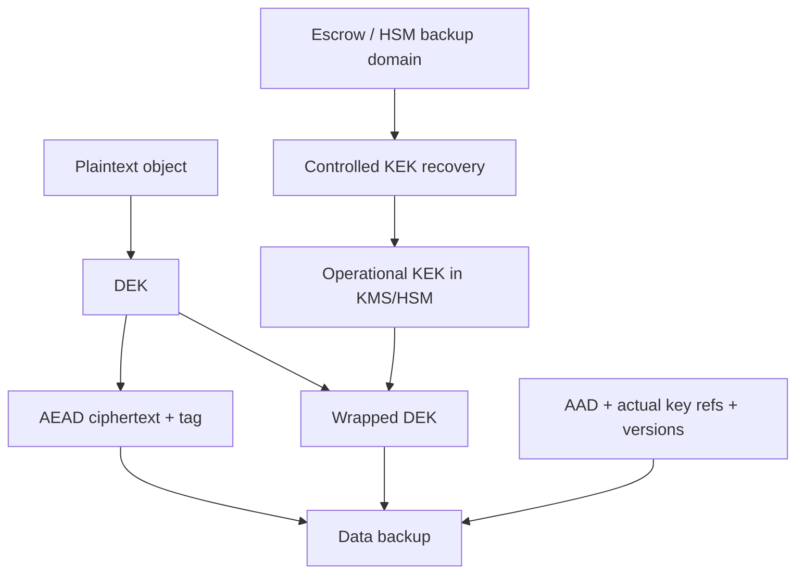
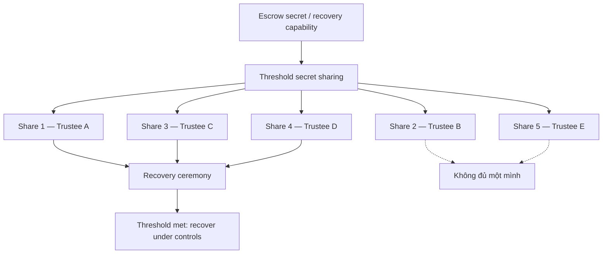
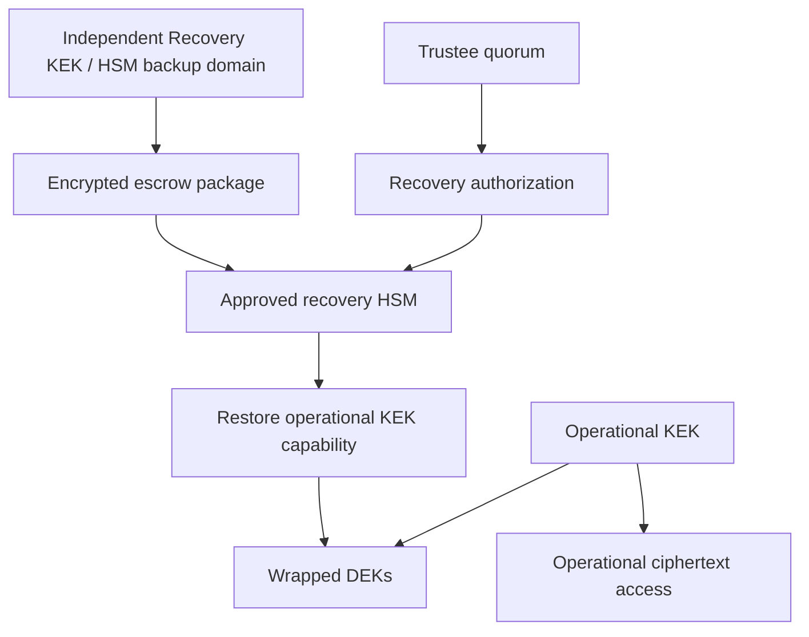
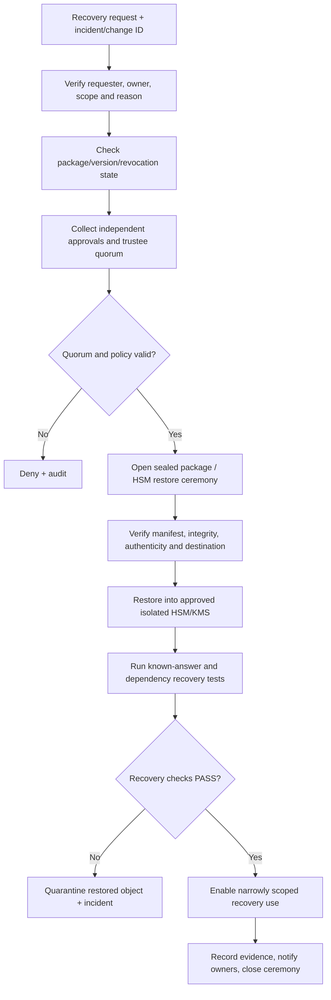

# Key escrow — Lưu ký và khôi phục khóa mật mã có kiểm soát

Trong chương **Backup và recovery** của module **SECURITY_KEY_MANAGEMENT_FUNDAMENTALS**, **key escrow** là cơ chế **lưu giữ có kiểm soát vật liệu khóa hoặc phương tiện khôi phục khóa**, để một tổ chức có thể khôi phục khả năng giải mã, xác minh hoặc vận hành khi người quản lý mất quyền truy cập, thiết bị hỏng, hệ thống KMS/HSM gặp sự cố hoặc cần đáp ứng một quy trình khôi phục đã được phê duyệt.

Key escrow tạo ra một lựa chọn có chủ đích: tổ chức giữ một con đường phục hồi khóa trong điều kiện bình thường khóa vẫn được bảo vệ nghiêm ngặt. Đổi lại, **bất kỳ con đường escrow nào cũng trở thành một phần của bề mặt tấn công**. Nếu người không được phép lấy đủ shares, chiếm escrow account, lạm dụng quyền của trustee hoặc vượt qua quy trình phê duyệt, họ có thể khôi phục khóa và truy cập dữ liệu hay tạo chữ ký ngoài ý muốn.

Ví dụ, một hệ thống hóa đơn sử dụng **DEK (Data Encryption Key)** riêng cho từng object. DEK được bọc bởi **KEK (Key Encryption Key)** trong KMS/HSM. Nếu chỉ backup ciphertext và wrapped DEK nhưng mất vĩnh viễn KEK cùng mọi phương tiện khôi phục, dữ liệu có thể không còn giải mã được. Một thiết kế escrow phù hợp có thể bảo vệ **khả năng phục hồi KEK hoặc HSM backup domain** bằng cơ chế quorum, đồng thời giữ nguyên việc sử dụng khóa thường ngày trong KMS/HSM.

**Key escrow không có nghĩa là đặt một bản raw key trong thư mục backup.** Nó phải xác định rõ: khóa nào được escrow, ai được giữ, điều kiện nào cho phép mở, cần bao nhiêu người phê duyệt, cách xác minh tính toàn vẹn, nơi khôi phục, cách kiểm thử và thời điểm hủy bản escrow. Đối với nhiều hệ thống, **escrow một khóa cấp cao hoặc backup domain được bảo vệ** sẽ hợp lý hơn việc tạo thêm bản sao raw của mọi DEK.

Bài học kết nối key escrow với **backup/recovery, envelope encryption, KMS/HSM, phân quyền, separation of duties, quorum control, kiểm toán và vòng đời khóa** từ tạo, cấp phát, lưu trữ, sử dụng, xoay vòng đến thu hồi và hủy.

## 1. Mục tiêu học tập

Sau bài này, bạn có thể:

1. Giải thích **key escrow** và phân biệt escrow với backup dữ liệu, key backup và quy trình recovery.
2. Xác định **loại khóa nào phù hợp hoặc không phù hợp** để escrow dựa trên mục đích, tác động và yêu cầu trust.
3. Thiết kế escrow cho **DEK/KEK** trong envelope encryption mà không tạo thêm bản raw key không cần thiết.
4. Phân biệt **HSM-native backup/restore**, encrypted key package, **M-of-N secret sharing**, split knowledge và threshold cryptography.
5. Xây dựng **quorum, dual control, separation of duties, custody records** và điều kiện phê duyệt recovery.
6. Thiết kế một **escrow package** có metadata, integrity, authenticity, version và dependency references.
7. Thực hiện recovery ceremony có kiểm soát, khôi phục vào HSM/KMS phù hợp và kiểm thử dữ liệu lịch sử.
8. Đánh giá rủi ro khi escrow **private signing key, HMAC secret, CA key, KEM/session key** và các loại secret khác.
9. Thiết lập **RPO/RTO, recovery drill, audit evidence, trustee rotation và escrow destruction**.
10. Đọc ví dụ **Java 17** kiểm tra quorum/phê duyệt recovery và nhận biết vì sao code đó không tự khôi phục hay bảo vệ key material.

## 2. Key escrow giải quyết vấn đề gì?

### 2.1. Nguy cơ mất khóa cũng là nguy cơ mất dữ liệu

Với mã hóa đối xứng, dữ liệu đã mã hóa thường không thể phục hồi nếu mất khóa giải mã và không còn bản sao hợp lệ. Một tổ chức có thể vẫn giữ đủ ciphertext, database, backup và application code nhưng không còn khả năng mở dữ liệu.

Những tình huống thường gặp:

- Người giữ khóa nghỉ việc, mất thiết bị hoặc không còn khả năng phê duyệt.
- HSM bị hỏng, mất toàn bộ thiết bị trong một site hoặc security domain.
- KMS account bị đóng, quyền quản trị bị mất hoặc cấu hình recovery không còn hiệu lực.
- Root/KEK bị xóa nhầm, bị disable không thể khôi phục hoặc hết khả năng restore.
- Backup data còn tồn tại nhưng wrapped DEK phụ thuộc vào KEK đã mất.
- Môi trường DR được phục hồi nhưng thiếu key material, key metadata, grants hoặc quyền truy cập.
- Một tổ chức cần phục hồi dữ liệu lịch sử theo retention, audit hoặc nghĩa vụ hợp đồng.

**Backup ciphertext mà không có đường khôi phục khóa không phải một kế hoạch backup hoàn chỉnh.**

### 2.2. Escrow cũng giải quyết bài toán kiểm soát quyền truy cập khẩn cấp

Không phải mọi recovery đều xuất phát từ hỏng phần cứng. Có thể cần khôi phục khi:

- Key Owner hoặc primary custodian không sẵn sàng.
- Cần phục hồi sau incident khiến tài khoản vận hành bị khóa.
- Tổ chức thay đổi nhà cung cấp hoặc di chuyển HSM.
- Cần khôi phục dữ liệu lưu trữ dài hạn sau nhiều năm.
- Cần thực hiện quy trình break-glass được phê duyệt.

Escrow tạo ra **đường phục hồi có điều kiện**, có thể yêu cầu nhiều người độc lập, nhiều yếu tố xác thực và audit trước/sau thao tác.

### 2.3. Escrow tạo thêm rủi ro gì?

Escrow làm tăng số nơi hoặc số người có thể tham gia khôi phục khóa. Rủi ro gồm:

- Escrow package bị đánh cắp hoặc sao chép.
- Đủ số shares bị tập hợp trái phép.
- Trustee bị lừa, bị ép buộc hoặc thông đồng.
- Recovery approval giả mạo hoặc không ràng buộc đúng key/version.
- Escrow metadata cũ bị replay để khôi phục khóa đã thu hồi.
- Backup domain key hoặc recovery KEK bị mất, tạo ra một vòng phụ thuộc mới.
- Một quy trình recovery hợp lệ bị lạm dụng để đọc dữ liệu ngoài scope.

**Escrow giảm rủi ro mất khóa nhưng tăng rủi ro truy cập trái phép qua con đường phục hồi.** Phải đánh giá cả hai phía trong threat model.

## 3. Phân biệt escrow, backup và recovery

Ba thuật ngữ liên quan nhưng có vai trò khác nhau.

| Khái niệm | Mục đích | Câu hỏi chính |
| --- | --- | --- |
| **Key escrow** | Lưu ký vật liệu khóa hoặc phương tiện khôi phục dưới điều kiện được kiểm soát. | Ai có thể khôi phục khóa, theo quorum và approval nào? |
| **Key backup** | Tạo bản sao bảo vệ của key object/material hoặc trạng thái HSM/KMS cần cho restore. | Bản backup có toàn vẹn, tương thích và còn dùng được không? |
| **Data backup** | Giữ bản sao ciphertext, metadata và dữ liệu cần phục hồi. | Có thể khôi phục object/database/backup set không? |
| **Recovery** | Quy trình sử dụng các bản backup/escrow/identity/policy để phục hồi dịch vụ hoặc dữ liệu. | Có thể khôi phục đúng, đủ và trong RTO/RPO không? |
| **Key archival** | Giữ khóa cũ để xử lý dữ liệu/chữ ký lịch sử theo policy. | Khóa có cần tồn tại để decrypt/verify trong retention không? |

Một tổ chức có thể **backup key trong HSM** mà không dùng escrow trustee bên ngoài. Ngược lại, escrow có thể giữ các shares hoặc một recovery capability nhưng chưa đủ để restore ứng dụng nếu thiếu ciphertext, AAD, schema, KMS configuration hay IAM.

### 3.1. Ví dụ: có data backup nhưng không có key recovery

```text
Backup:
  invoices.db.enc
  wrapped-DEK records
  object metadata
  application binaries

Missing:
  KEK/HSM backup domain
  recovery authorization
  compatible HSM/KMS restore path

Result:
  ciphertext còn nguyên
  nhưng không unwrap được DEK
  -> data recovery FAIL
```

### 3.2. Ví dụ: có escrow nhưng không có data backup

```text
Escrow:
  KEK recovery package + quorum approvals

Missing:
  encrypted database snapshot
  object versions
  application metadata

Result:
  khôi phục được khả năng dùng KEK
  nhưng không có ciphertext cần phục hồi
  -> data recovery vẫn FAIL
```

**Recovery chỉ thành công khi cả key path và data path được phục hồi**, cùng metadata, identity, permissions và phần mềm tương thích.

## 4. Loại khóa nào nên được escrow?

Không có một chính sách escrow áp dụng giống nhau cho mọi khóa. Quyết định cần xét **mục đích, mức ảnh hưởng nếu mất, hậu quả nếu bị khôi phục trái phép, khả năng tái tạo khóa mới và yêu cầu xác minh lịch sử**.

| Loại khóa | Cân nhắc escrow | Lý do và lưu ý |
| --- | --- | --- |
| **KEK bảo vệ dữ liệu** | Có thể phù hợp nếu cần khôi phục dữ liệu lâu dài. | Bảo vệ escrow rất chặt; cân nhắc HSM-native backup hoặc recovery domain. |
| **DEK theo object** | Thường không cần escrow raw từng DEK nếu có wrapped DEK và KEK recovery đáng tin cậy. | Escrow toàn bộ DEK làm tăng quy mô secret inventory; giữ encrypted DEK cùng data backup. |
| **DEK theo batch/tenant** | Tùy mức phụ thuộc và khả năng tái tạo. | Scope rộng; mất khóa ảnh hưởng nhiều object, lộ khóa cũng ảnh hưởng nhiều dữ liệu. |
| **Private signing key** | Thường cần thận trọng hơn nhiều; không mặc định escrow. | Recovery có thể cho phép tạo chữ ký giả và làm suy yếu attribution/non-repudiation. |
| **HMAC secret** | Chỉ khi có nhu cầu business rõ và kiểm soát tất cả bên cùng giữ secret. | Bên khôi phục có thể tạo MAC hợp lệ; cần rotate phối hợp với peers. |
| **CA/root private key** | Chỉ theo quy trình PKI/ceremony rất nghiêm ngặt nếu policy cho phép. | Trust impact cực rộng; offline HSM, quorum và dual control thường quan trọng. |
| **KEM/long-term agreement key** | Phụ thuộc protocol, retention và recovery requirements. | Có thể ảnh hưởng khả năng xử lý ciphertext lịch sử; cần đánh giá forward secrecy. |
| **Ephemeral session key** | Thường không escrow. | Thiết kế forward secrecy dựa trên việc secret phiên không được lưu giữ dài hạn. |
| **Public key/certificate** | Không cần escrow bí mật. | Public material có thể được backup/publish; cần bảo vệ authenticity và trust metadata. |
| **Password verifier/hash** | Không escrow password gốc. | Dùng password reset/re-enrollment; không thiết kế khả năng lấy lại plaintext password. |

### 4.1. DEK và KEK: ưu tiên bảo vệ tầng khóa phù hợp

Trong envelope encryption:



Một thiết kế thường gặp:

1. Ứng dụng tạo hoặc yêu cầu KMS tạo **DEK**.
2. DEK mã hóa payload.
3. KMS/HSM dùng **KEK** để wrap DEK.
4. Ciphertext, wrapped DEK và metadata được backup.
5. **Escrow/recovery bảo vệ khả năng phục hồi KEK hoặc HSM backup domain**, theo provider capability và policy.
6. Khi recovery, khôi phục KEK capability rồi unwrap wrapped DEK để giải mã dữ liệu lịch sử.

Như vậy không nhất thiết phải tạo một bản raw escrow riêng cho từng DEK. Tuy nhiên, **phải kiểm tra chính xác semantics của KMS/HSM**: có provider giữ key material non-exportable, có provider chỉ cho backup/restore trong một security domain, và có provider không cho tổ chức tự export material. Không tự giả định có thể lấy raw KEK ra để escrow.

### 4.2. Signing key khác encryption key

Với encryption key, việc khôi phục có thể cần thiết để đọc dữ liệu đã lưu. Với private signing key, khôi phục có thể tạo ra khả năng **ký mới như chính chủ thể cũ**.

Do đó:

- Giữ **public key/certificate** lịch sử để verify thường không đòi hỏi escrow private key.
- Khi signer mất private key, có thể tạo key pair mới và cập nhật trust cho chữ ký mới.
- Nếu business bắt buộc khôi phục private signing key cũ, cần đánh giá hậu quả với non-repudiation, attribution, legal policy và signer authorization.
- CA/root key cần ceremony và quorum theo PKI policy, không dùng chung quy trình khôi phục với DEK thông thường.

**Không escrow private signing key chỉ vì “để phòng mất khóa” mà không phân tích khả năng giả mạo chữ ký.**

### 4.3. Session keys và forward secrecy

Trong giao thức có forward secrecy, ephemeral session secrets được thiết kế để tồn tại trong thời gian ngắn. Escrow chúng có thể phá mục tiêu bảo vệ traffic lịch sử nếu recovery repository bị xâm nhập. Thông thường cần bảo vệ **long-term identity keys và quy trình khôi phục hệ thống**, không tạo kho escrow cho mọi ephemeral session key.

## 5. Các mô hình key escrow phổ biến

### 5.1. HSM-native backup/restore

HSM hoặc dịch vụ KMS có thể hỗ trợ backup key object bằng **backup key/domain** riêng. Bản backup thường được mã hóa và chỉ có thể restore trong thiết bị hoặc security domain tương thích, theo chính sách nhà cung cấp.

Đặc điểm:

- Key material có thể không bao giờ xuất hiện dạng plaintext bên ngoài HSM.
- Backup package có thể bị ràng buộc với vendor, firmware, partition hoặc domain.
- Restore có thể yêu cầu quorum/operator cards hoặc thao tác dual control.
- Cần backup các metadata cần thiết và xác minh compatibility.
- Phải thử restore thực tế vào HSM dự phòng được hỗ trợ.

**Không suy từ nhãn “non-exportable” rằng key đã có backup.** Non-exportable có thể bảo vệ key khỏi export nhưng không tự tạo đường phục hồi nếu HSM bị mất.

### 5.2. Encrypted key escrow package

Một mô hình khác là xuất một key object **chỉ khi provider/policy cho phép**, sau đó mã hóa package dưới một **recovery KEK** hoặc public key của escrow recipient. Package được lưu tại vị trí độc lập, có integrity, authenticity và access control.

Nguyên tắc:

- Không ghi raw key vào filesystem, source code, email hoặc ticket.
- Recovery KEK phải độc lập với key đang được escrow, tránh phụ thuộc vòng tròn.
- Chỉ tạo package qua API/export mechanism được provider phê duyệt.
- Ràng buộc package với key ID/version, algorithm, purpose, owner và recovery context.
- Bảo vệ recovery private key bằng HSM hoặc threshold controls.
- Có kiểm tra integrity/authenticity trước khi import/restore.
- Giới hạn quyền đọc package; ciphertext escrow vẫn là tài sản nhạy cảm.

### 5.3. M-of-N secret sharing

**Secret sharing** chia một secret thành nhiều shares, trong đó cần tối thiểu **M trong N shares** để khôi phục secret. Ví dụ minh họa: chính sách 3-of-5 yêu cầu ba shares hợp lệ từ năm trustees được chỉ định.



Các điểm cần hiểu:

- Một share riêng lẻ không được đủ để tái tạo secret trong một scheme threshold đúng.
- Shares phải được phân phối tới **trustees độc lập**, không để một người hoặc một hệ thống kiểm soát đủ M shares.
- Phải xác minh nguồn gốc, tính toàn vẹn, danh tính và version của từng share.
- Cần bảo vệ shares khỏi mất mát, sao chép trái phép và thay thế.
- Threshold M-of-N phải cân bằng khả năng phục hồi với rủi ro thông đồng.
- Việc khôi phục phải được audit và có thể yêu cầu approval theo incident/purpose.

**Không tự triển khai một thuật toán secret sharing mới.** Dùng scheme đã được đánh giá, thư viện/thiết bị được chấp thuận và quy trình kiểm chứng. Ví dụ Shamir Secret Sharing là một họ kỹ thuật threshold phổ biến, nhưng cách triển khai, field parameters, encoding, share authentication và key handling vẫn phải được đánh giá.

### 5.4. Secret sharing khác threshold cryptography

Hai khái niệm liên quan nhưng không giống nhau:

- **Secret sharing:** M shares được dùng để khôi phục secret gốc, thường tại một recovery ceremony.
- **Threshold cryptography:** nhiều participants cùng tham gia thực hiện một phép toán mật mã mà không nhất thiết tái tạo private key đầy đủ tại một nơi.

Ví dụ, một threshold signing protocol có thể tạo chữ ký từ nhiều participants mà không reconstruct private signing key thành một bản đầy đủ. Điều đó có thể giảm việc tập trung secret, nhưng cần protocol, implementation và governance riêng.

### 5.5. Split knowledge và dual control

- **Split knowledge:** không một cá nhân nào nắm toàn bộ thông tin cần để khôi phục.
- **Dual control:** một hành động nhạy cảm cần ít nhất hai người/role độc lập cùng tham gia.
- **M-of-N:** một ngưỡng số lượng participants/shares.
- **Threshold cryptography:** nhiều parties phối hợp thực hiện phép toán.

Một quy trình “hai người cùng bấm nút” không tự động là secret sharing. Một key được chia thành hai file bằng cách tự nghĩ ra cách XOR cũng không tự động an toàn; cách tạo, phân phối, xác thực, lưu và tái hợp phải được thiết kế đúng.

## 6. Chọn M-of-N và phân bố trustees

### 6.1. Ý nghĩa của M và N

- **N:** tổng số trustees/shares được thiết lập.
- **M:** số shares/approvals tối thiểu để recovery.
- **M phải lớn hơn 1** trong các trường hợp cần tránh single-person recovery, trừ khi threat model có lý do được phê duyệt khác.
- M quá thấp làm giảm chống thông đồng.
- M quá cao tăng nguy cơ không đủ người sẵn sàng khi thảm họa xảy ra.

Ví dụ 3-of-5 chỉ để minh họa cơ chế. Không có cấu hình M-of-N mặc định phù hợp cho mọi tổ chức.

### 6.2. Chọn trustees độc lập

Có thể phân bố theo vai trò/đơn vị:

| Trustee | Vai trò minh họa | Kiểm soát |
| --- | --- | --- |
| **Security Custodian A** | Giữ share/approval của Security. | Danh tính mạnh, thiết bị riêng, audit. |
| **Key Owner B** | Xác nhận quyền sở hữu và mục đích phục hồi. | Không tự thay đổi policy hoặc tự phê duyệt đủ quorum. |
| **Compliance C** | Xác nhận nghĩa vụ retention/approval. | Kiểm tra change/incident scope. |
| **Operations D** | Thực hiện recovery trong HSM/KMS. | Không tự quyết định data access. |
| **Independent Trustee E** | Dự phòng nhân sự/quorum. | Custody độc lập, quy trình thay thế. |

**Không để tất cả shares nằm trong cùng một vault hoặc dưới cùng một administrator** rồi gọi đó là M-of-N độc lập. Nếu một tài khoản admin có thể đọc mọi shares, quorum chỉ tồn tại trên giấy.

### 6.3. Địa lý và miền lỗi

Trustees nên phân bố sao cho một sự kiện đơn lẻ khó làm mất hoặc chiếm đủ quorum:

- Không cùng một văn phòng hoặc site vật lý.
- Không cùng một cloud account/administrator domain nếu threat model yêu cầu độc lập.
- Không cùng một thiết bị backup hoặc identity provider duy nhất.
- Có phương án thay trustee khi nghỉ việc/mất thiết bị.
- Có kiểm soát chống thông đồng và quy trình báo mất share.
- Có khả năng liên lạc và phối hợp trong DR.

Độc lập địa lý không đủ nếu mọi trustee đều dùng chung một tài khoản đăng nhập hoặc một người có thể impersonate tất cả.

## 7. Governance: ai sở hữu, giữ, phê duyệt và kiểm toán?

Key escrow là **quy trình quản trị**, không chỉ là một file hoặc API.

| Vai trò | Trách nhiệm |
| --- | --- |
| **Key Owner** | Xác định mục đích, phạm vi, cryptoperiod, retention và nhu cầu recovery. |
| **Escrow Custodian/Trustee** | Giữ share hoặc recovery credential; bảo vệ custody và tham gia đúng quorum. |
| **Recovery Approver** | Xác nhận điều kiện kích hoạt, phạm vi và mục đích recovery. |
| **KMS/HSM Administrator** | Quản trị thiết bị, backup domain, key objects và grants theo approval. |
| **Recovery Operator** | Thực hiện restore/import/unwrap trong môi trường được kiểm soát. |
| **Data Owner** | Xác nhận dữ liệu cần khôi phục và quyền truy cập nghiệp vụ. |
| **Security Incident Lead** | Điều phối khi recovery liên quan compromise hoặc break-glass. |
| **Auditor/Compliance** | Kiểm tra evidence, separation of duties, custody và retention. |

### 7.1. Separation of duties

Tùy policy, các hoạt động sau nên được tách:

- Người yêu cầu recovery không tự phê duyệt request.
- Người giữ share không tự quyết định data scope.
- Người quản trị HSM không tự tạo quorum giả.
- Người có quyền import/restore không tự xóa audit.
- Người tạo escrow package không tự kiểm duyệt toàn bộ việc tạo package.
- Người phê duyệt destruction không chỉ dựa trên người đề nghị destruction.

**Một người có thể giữ nhiều vai trò trong tổ chức nhỏ**, nhưng phải nhận diện xung đột và có kiểm soát bù trừ được phê duyệt. Không tuyên bố SoD đạt nếu cùng một administrator có thể tự cấp danh tính, tự lấy shares và tự khôi phục.

### 7.2. Điều kiện kích hoạt escrow

Một request recovery nên xác định:

1. Incident/change/business case ID.
2. Key ID, version, material lineage và loại khóa.
3. Mục đích cụ thể: restore database, DR, migration hoặc forensic.
4. Phạm vi tenant/object/region và thời hạn.
5. Người yêu cầu, approvers, trustees và recovery operator.
6. M-of-N/quorum cần thiết.
7. Nơi khôi phục, HSM/KMS destination và policy áp dụng.
8. Điều kiện hết hiệu lực, đóng request và kiểm tra sau recovery.

Không chấp nhận request chung chung kiểu **“mở escrow key để phòng khi cần”** mà không có scope, owner, approval và audit.

## 8. Escrow package cần chứa gì?

Một escrow package phải đủ thông tin để khôi phục **đúng key object**, nhưng không làm lộ raw key trong metadata.

### 8.1. Thành phần gợi ý

| Thành phần | Mục đích |
| --- | --- |
| **Encrypted key backup/blob** | Bản key object được bảo vệ bằng HSM backup domain hoặc recovery wrapping scheme. |
| **Key identity** | Actual key ID, version, material lineage hoặc provider reference. |
| **Algorithm/profile** | Key type, size/curve, mode, allowed operations và usage policy. |
| **Wrapping metadata** | Recovery KEK ID, wrapping algorithm, parameters, encryption context/AAD. |
| **Integrity/authenticity manifest** | Digest/signature của package, creator, timestamp và revision. |
| **Ownership/governance** | Key Owner, trustees, approval policy, recovery contacts. |
| **Dependency references** | Wrapped DEKs, data sets, backups, certificates hoặc consumers phụ thuộc. |
| **Provider compatibility** | HSM/KMS vendor, firmware/domain/version requirements nếu cần. |
| **Lifecycle metadata** | Created/activated/deactivated, cryptoperiod, retention, revocation state. |
| **Recovery instructions** | Quy trình restore, quorum, validation, test vectors và failure handling. |
| **Audit references** | Change ID, ceremony ID, operation IDs, custody evidence. |

### 8.2. Manifest không phải nơi ghi secret

Manifest có thể chứa:

```json
{
  "escrowPackageId": "escrow-billing-kek-v4",
  "actualKeyId": "kms/billing/kek-v4",
  "keyVersion": 4,
  "keyType": "AES-256-KEK",
  "purpose": "wrap-data-keys",
  "provider": "approved-kms-or-hsm-domain",
  "backupFormatVersion": 2,
  "wrappingProfile": "provider-approved-backup-profile",
  "owner": "billing-security",
  "policyVersion": 12,
  "createdAt": "2026-11-28T00:00:00Z",
  "retentionUntil": "2031-11-28T00:00:00Z",
  "quorumPolicy": "3-of-5",
  "encryptedBlobRef": "offline-vault/object-8841",
  "integrityManifestRef": "signed-manifest-8841",
  "dependencyInventoryRef": "inventory-snapshot-8841"
}
```

Đây là schema minh họa, không phải schema KMS tiêu chuẩn. **Không thêm raw key, HMAC secret, recovery share, plaintext DEK hoặc credential vào manifest.**

### 8.3. Integrity, authenticity và anti-rollback

Một checksum đơn giản chỉ giúp phát hiện một số thay đổi ngoài ý muốn; nó không chứng minh package đến từ nguồn đáng tin nếu attacker có thể thay cả blob lẫn checksum.

Cần cân nhắc:

- Manifest được ký bởi identity/quy trình đáng tin.
- Blob được bảo vệ bằng authenticated encryption hoặc cơ chế integrity của provider.
- Package ID/version và revision được quản lý từ registry tin cậy.
- Recovery kiểm tra package không bị thay bằng version cũ đã revoked.
- Key ID, algorithm, purpose, owner và context được ràng buộc với package.
- Audit ghi ai tạo, ai lưu, ai truy cập và ai xác minh.

**Escrow package cũ có thể hợp lệ về mặt chữ ký nhưng không còn được phép phục hồi.** Cần kiểm tra revocation/retirement state ở nguồn tin cậy.

## 9. Bảo vệ escrow key và tránh phụ thuộc vòng tròn

Một thiết kế lỗi phổ biến là **dùng chính KEK đang escrow để mã hóa bản escrow của nó**. Khi KEK đó mất, tổ chức cũng không mở được escrow package.

### 9.1. Tách các miền khóa

Ví dụ:



Recovery KEK/backup domain cần có:

- Owner và lifecycle riêng.
- HSM/KMS hoặc trust boundary phù hợp.
- Backup/restore độc lập.
- Quorum/dual control.
- Policy riêng và audit.
- Kế hoạch rotation/renewal.
- Phương án phục hồi khi recovery KEK hoặc trustee system gặp sự cố.

### 9.2. Không tạo một “master escrow key” không có recovery plan

Nếu mọi escrow package đều được bọc bởi một recovery key duy nhất, recovery key đó trở thành **single point of failure và single point of compromise**. Phải có cách backup/restore/reconstitute chính recovery domain và kiểm thử định kỳ.

### 9.3. Provider-managed key material

Nếu KMS/HSM giữ key non-exportable, escrow có thể là **provider-supported backup/restore, HSM cloning trong security domain hoặc recovery capability** thay vì raw key export. Cần xác minh:

- Backup có được mã hóa và ràng buộc domain nào?
- Có thể restore sang HSM khác hay chỉ cùng vendor/model/domain?
- Firmware/partition/backup key compatibility ra sao?
- Provider có thể khôi phục account/tenant hay tổ chức phải tự giữ backup?
- Quorum/approval được enforce ở đâu?
- Key attributes, grants, policy và audit có được restore cùng không?
- Có thể test restore mà không làm thay đổi production key state không?

**Không hứa khả năng export/restore mà provider không hỗ trợ.** Nếu không có API hoặc quy trình khôi phục phù hợp, đó là dependency cần được xử lý trong kiến trúc và hợp đồng vận hành.

## 10. Recovery ceremony: quy trình mở escrow có kiểm soát

Một recovery ceremony là chuỗi thao tác được ghi nhận từ lúc yêu cầu đến khi key capability được phục hồi.

### 10.1. Trình tự đề xuất



### 10.2. Các bước chi tiết

1. **Mở request:** ghi incident/change ID, key ID/version, purpose, data scope, requester và deadline.
2. **Xác minh danh tính:** dùng identity mạnh, xác thực bổ sung cho trustee/operator, không chỉ email hoặc chat.
3. **Xác minh trạng thái khóa:** key có bị compromised/revoked/destroyed không; package có còn hợp lệ?
4. **Kiểm tra quorum:** đủ trustees độc lập và roles bắt buộc; mỗi approval ràng buộc đúng request, key và package digest.
5. **Kiểm tra custody:** share/package còn nguyên niêm phong, vị trí và người giữ khớp inventory.
6. **Mở/khôi phục:** thực hiện trên thiết bị/partition/region được phê duyệt, với quyền tối thiểu và audit.
7. **Xác minh integrity:** manifest signature, backup blob, key attributes, algorithm, purpose và key identity.
8. **Kiểm thử chức năng:** khôi phục một canary object hoặc test vector, kiểm tra decrypt/unwrap/verify đúng.
9. **Cấp quyền có giới hạn:** chỉ cấp operation cần thiết, tenant/region/object scope và thời hạn.
10. **Ghi nhận và đóng ceremony:** operation IDs, người tham gia, thời gian, kết quả, exceptions, key state mới.
11. **Thu hồi quyền tạm thời:** đóng sessions, revoke temporary grants, thu hồi break-glass credentials.
12. **Review sau recovery:** xác minh monitoring, data integrity, old-key dependencies và nhu cầu rewrap/rotation tiếp theo.

### 10.3. Không dùng recovery để bỏ qua incident policy

Nếu key bị compromise, việc khôi phục nó có thể **khôi phục cả khả năng attacker đã có**. Recovery team cần biết đây là:

- **Loss-only event:** mất thiết bị/quyền nhưng chưa có dấu hiệu secret bị lộ.
- **Availability event:** key service không sẵn sàng, cần restore.
- **Compromise event:** có khả năng attacker biết hoặc sử dụng key.
- **Forensic recovery:** cần bảo toàn evidence và giữ nguyên một bản để điều tra theo approval.

Với compromise, thường phải **contain, revoke hoặc thay key** theo incident policy; không tự động restore key cũ rồi đưa vào production.

## 11. Khôi phục dữ liệu envelope encryption bằng escrow

### 11.1. Các thành phần phải có đồng thời

Để giải mã một object envelope, thường cần:

- Ciphertext và authentication tag.
- Nonce/IV và thuật toán/profile.
- AAD hoặc encryption context chính xác.
- Wrapped DEK.
- KEK hoặc capability unwrap được khôi phục.
- Key ID/version thực tế và mapping tới provider.
- IAM/grants và authorization cho object/tenant.
- Schema/version tương thích để đọc metadata.

**Khôi phục KEK một mình chưa đủ** nếu thiếu wrapped DEK, context hoặc ciphertext. Tương tự, có ciphertext và wrapped DEK nhưng không có KEK recovery thì vẫn không giải mã được.

### 11.2. Ví dụ đường recovery

```text
Backup snapshot:
  invoice-42.ciphertext
  invoice-42.nonce + tag
  invoice-42.dataAAD
  invoice-42.wrappedDEK
  invoice-42.actualKEKRef = billing/kek-v4

Escrow recovery:
  quorum 3-of-5 approved
  restore KEK-v4 capability into recovery HSM
  verify key ID, algorithm, policy and provenance

Data recovery:
  unwrap DEK using correct wrap context
  decrypt payload using correct data AAD
  verify GCM tag
  compare trusted object/version metadata
```

### 11.3. Khôi phục theo thứ tự dependency

1. Khôi phục **identity, KMS/HSM control plane và trust** cần thiết.
2. Khôi phục backup key/KEK capability.
3. Khôi phục wrapped DEKs và metadata.
4. Khôi phục ciphertext/object/database snapshots.
5. Khôi phục application schema và AAD canonicalization.
6. Khôi phục IAM/grants ở scope nhỏ.
7. Thực hiện canary decrypt và integrity checks.
8. Mở rộng recovery theo batch, ghi audit và reconciliation.

Không khôi phục quyền admin rộng trước khi có kiểm soát cần thiết. **Recovery không được biến thành một lần cấp quyền đọc toàn bộ dữ liệu không giới hạn.**

## 12. Escrow cho DEK và KEK: chọn phương án theo kiến trúc

### 12.1. Per-object DEK

Nếu mỗi object có một DEK riêng:

- Wrapped DEK được lưu cùng object hoặc metadata store.
- KEK có thể bảo vệ hàng triệu wrapped DEKs.
- Escrow **KEK/HSM recovery domain** có thể khôi phục nhiều object.
- Cần bảo vệ escrow KEK vì phạm vi ảnh hưởng rộng.
- Không nhất thiết lưu raw DEK riêng biệt trong escrow.

### 12.2. Per-batch hoặc per-tenant DEK

Nếu một DEK bảo vệ nhiều object:

- Mất DEK có thể làm nhiều dữ liệu không thể đọc.
- Lộ DEK có thể ảnh hưởng toàn bộ object trong batch/tenant.
- Cần inventory chính xác và backup dependency.
- Có thể cần escrow/recovery trực tiếp theo risk, hoặc giữ KEK recovery path đủ tin cậy.
- Khi khôi phục, kiểm tra scope theo tenant và quyền data owner.

### 12.3. KEK backup có thể phụ thuộc vào provider

Một số dịch vụ cloud KMS quản lý key material trong service boundary và không cung cấp raw key export. Khi đó:

- Kiểm tra provider backup/restore, account recovery và regional resilience.
- Lưu key IDs, policies, grants, encryption context và resource metadata.
- Xác minh key material version history được hỗ trợ trong backup/restore.
- Xem xét khả năng migration/exit strategy trước khi phụ thuộc lâu dài.
- Có test restore bằng cơ chế provider hỗ trợ.
- Không tạo một bản “escrow raw KEK” bằng cách vi phạm non-exportable policy.

### 12.4. Escrow không thay thế key inventory

Inventory phải nối:

```text
KEK identity / version / material lineage
  -> wrapped DEK records
  -> object IDs / content versions
  -> backup snapshots / replicas / archive
  -> owners / retention / recovery priority
```

Thiếu dependency graph, recovery team có thể restore đúng KEK nhưng vẫn bỏ sót một nhóm backup hoặc ứng dụng lịch sử.

## 13. Escrow private signing key và HMAC secret

### 13.1. Private signing key

Escrow private signing key cần được xem là **khả năng tạo danh tính/chữ ký**, không chỉ là khả năng khôi phục dữ liệu.

Rủi ro:

- Người khôi phục có thể tạo chữ ký mà verifier tin là từ signer cũ.
- Attribution/non-repudiation có thể bị tranh chấp.
- Private key có thể được dùng ký token/artifact ngoài business workflow.
- Một escrow compromise có thể ảnh hưởng mọi issuer/verifier tin key đó.

Ưu tiên cân nhắc:

1. Giữ public verification key/certificate lịch sử để xác minh.
2. Nếu private key mất, tạo key pair mới và cập nhật trust/issuer.
3. Nếu phải backup private key vì continuity, giới hạn purpose, quorum, thời gian và người được phép dùng.
4. Có thể dùng threshold signing thay vì reconstruct private key đầy đủ, nếu protocol/provider phù hợp.
5. Tách recovery của signing key khỏi recovery của encryption KEK.

**Không dùng một escrow package cho encryption và signing keys chỉ vì cả hai đều là “key material”.**

### 13.2. HMAC secret

Mọi bên giữ HMAC secret có thể tạo MAC. Escrow cho phép trustee hoặc operator khôi phục khả năng giả mạo message nếu không có kiểm soát bổ sung.

Cần:

- Xác định mọi partner/service giữ secret.
- Xác định MAC domain, message format và key version.
- Quorum + business approval trước khi khôi phục.
- Overlap dual-verify có thời hạn.
- Replay defense và audit.
- Rotate secret sau recovery nếu có nghi vấn material exposure.
- Không khẳng định MAC hợp lệ chứng minh chính xác bên gửi khi nhiều bên cùng biết secret.

### 13.3. CA/root key

Nếu escrow CA/root private key:

- Dùng HSM/PKI ceremony và trust policy chuyên biệt.
- Phân tách trustees, approvers và certificate operators.
- Kiểm soát offline, quorum và physical custody.
- Có trust-anchor backup, certificate database, revocation/CRL/OCSP state và recovery docs.
- Thử khôi phục trên môi trường PKI cô lập.
- Không dùng recovery để ký chứng chỉ mới nếu chưa có approval và scope.

## 14. Mất hoặc compromise escrow shares

Escrow repository cũng có lifecycle và incident response riêng.

### 14.1. Một share bị mất

Nếu scheme M-of-N còn đủ shares hợp lệ:

- Ghi nhận share bị mất và custodian.
- Đánh giá liệu share có thể bị sao chép/đọc trái phép.
- Thay trustee/device và **refresh/re-share** theo scheme được hỗ trợ.
- Thu hồi identity/access của custodian cũ.
- Xác minh quorum mới và test recovery.
- Không mặc định một share mất đồng nghĩa secret gốc đã lộ nếu scheme threshold đúng; cũng không bỏ qua khả năng share copy.

### 14.2. Có đủ M shares bị lộ hoặc nghi bị tập hợp

Xem như **escrow recovery capability bị compromise**:

- Cô lập repository, trustee accounts và recovery HSM.
- Dừng các recovery không được phê duyệt.
- Xác định attacker có thể đã tái tạo key nào và package versions nào.
- Nếu key có khả năng đã bị khôi phục trái phép, đánh giá rotate/re-encrypt/revoke trust tương ứng.
- Tạo escrow generation mới với shares/recovery material mới.
- Thu hồi shares, tokens và approvals cũ; kiểm tra cache/copies.
- Giữ evidence và audit trước khi thay đổi state không thể đảo ngược.

### 14.3. Trustee nghỉ việc hoặc đổi vai trò

- Thu hồi quyền truy cập, device certificates, accounts và physical access.
- Thay share/trustee theo thủ tục.
- Kiểm kê bản sao/backup và xác minh custody.
- Kiểm tra quorum mới không bị giảm ngoài policy.
- Ghi audit về transfer/destruction của share cũ.
- Không chỉ đổi tên trustee trong spreadsheet mà giữ nguyên credential cũ.

## 15. Kiểm thử escrow và recovery trước production

Một thiết kế escrow không được xem là hoàn tất chỉ vì package đã được tạo. Phải chứng minh **có thể khôi phục khi cần và không thể khôi phục ngoài điều kiện được phép**.

### 15.1. Test matrix

| ID | Kiểm thử | Kết quả mong đợi |
| --- | --- | --- |
| E01 | Escrow package được tạo từ key test-only. | Blob được bảo vệ, manifest đúng key/version/purpose. |
| E02 | Trustee đơn lẻ yêu cầu recovery trong M-of-N. | DENY; không tiết lộ secret/capability. |
| E03 | Đủ M trustees độc lập và role bắt buộc. | Cho phép ceremony theo scope. |
| E04 | Hai approval cùng một trustee identity. | Chỉ tính một người; không đủ quorum. |
| E05 | Approval gắn sai key ID/package digest. | DENY. |
| E06 | Approval đã hết hạn hoặc request bị đóng. | DENY. |
| E07 | Escrow blob bị sửa. | Integrity/authenticity verification FAIL. |
| E08 | Package bị thay bằng revision cũ đã revoked. | Anti-rollback check DENY. |
| E09 | Restore vào HSM/security domain không tương thích. | Fail an toàn, audit rõ, không xuất raw key. |
| E10 | Restore key thành công nhưng grants thiếu. | Data operation không mở rộng quyền ngoài policy. |
| E11 | Khôi phục KEK và unwrap wrapped DEK test. | Đúng context, đúng key version. |
| E12 | Decrypt ciphertext lịch sử sau restore. | Tag/AAD PASS, plaintext đối chiếu đúng. |
| E13 | Wrong tenant/object context. | DENY, không trả plaintext. |
| E14 | Backup data thiếu wrapped DEK hoặc metadata. | Recovery report chỉ rõ dependency thiếu; không báo PASS giả. |
| E15 | Recovery KEK bị unavailable. | Không có đường fallback bí mật không kiểm soát. |
| E16 | Trustee nghỉ việc/mất share. | Quorum update/re-share được audit và test. |
| E17 | M shares có dấu hiệu bị lộ. | Escrow capability incident được kích hoạt. |
| E18 | Recovery request không có owner approval. | DENY. |
| E19 | Operator vừa requester vừa approver trái SoD. | DENY hoặc exception theo policy đã duyệt. |
| E20 | KMS outage ở primary, restore qua DR. | Recovery theo RTO/RPO đã phê duyệt. |
| E21 | Restore xong còn raw DEK trong temporary buffer. | Cleanup/zeroization control được kiểm tra trong phạm vi platform. |
| E22 | Recovery hoàn tất nhưng temporary grants chưa revoke. | Post-recovery check phát hiện và đóng quyền. |
| E23 | Key bị compromised nhưng requester muốn restore vào production. | Incident policy chặn hoặc yêu cầu recovery-forensics riêng. |
| E24 | Escrow package cũ thuộc key đã destroy. | Không restore cho production use nếu policy cấm. |
| E25 | HSM backup restore nhưng firmware/domain không tương thích. | Fail an toàn, không đánh dấu recovery thành công. |
| E26 | Backup snapshot có data nhưng thiếu KMS context. | Recovery FAIL hoặc partial rõ ràng; không báo full restore. |

### 15.2. Positive và negative tests đều bắt buộc

- **Positive:** đúng requester, đúng purpose, đủ quorum, package toàn vẹn, HSM tương thích, key restore đúng, data canary decrypt đúng.
- **Negative:** thiếu trustee, duplicate identity, wrong package digest, revoked version, wrong tenant/context, expired request, unauthorized operator, provider unavailable.

**Expected DENY là test PASS** khi chính sách yêu cầu từ chối. Không đánh đồng mọi lỗi API với một kiểm soát bảo mật thành công; phải xác nhận đúng lý do từ chối.

## 16. Java 17: mô phỏng kiểm tra quorum cho recovery request

Ví dụ dưới đây chỉ kiểm tra **policy authorization** cho một recovery ceremony. Nó không tạo, chia, lưu, tái hợp hoặc giải mã key material. Việc xác minh chữ ký/identity của approval phải do **identity/approval service đáng tin cậy** thực hiện trước khi approval được đưa vào policy gate.

### 16.1. Mục tiêu của demo

- Recovery request có ID, key ID, package digest, purpose, thời gian tạo và hết hạn.
- Policy xác định trustee IDs/roles được phép.
- Mỗi approval phải ràng buộc đúng request, key và package digest.
- Chỉ tính **trustee identity duy nhất**; gửi hai approval từ cùng một người không tăng quorum.
- Có thể yêu cầu ít nhất một số role độc lập.
- Không cho request hết hạn hoặc approval nằm ngoài thời gian request.
- Demo không cho một approval tự khai role; role lấy từ policy registry.

```java
import java.time.Instant;
import java.util.HashSet;
import java.util.List;
import java.util.Map;
import java.util.Objects;
import java.util.Set;

public final class EscrowRecoveryApprovalDemo {

    record RecoveryRequest(
            String requestId,
            String keyId,
            String packageDigest,
            String purpose,
            Instant createdAt,
            Instant expiresAt) {

        RecoveryRequest {
            Objects.requireNonNull(requestId);
            Objects.requireNonNull(keyId);
            Objects.requireNonNull(packageDigest);
            Objects.requireNonNull(purpose);
            Objects.requireNonNull(createdAt);
            Objects.requireNonNull(expiresAt);

            if (requestId.isBlank()
                    || keyId.isBlank()
                    || packageDigest.isBlank()
                    || purpose.isBlank()
                    || !createdAt.isBefore(expiresAt)) {
                throw new IllegalArgumentException("Invalid request");
            }
        }
    }

    // Chỉ tạo đối tượng này sau khi signature và identity
    // đã được kiểm chứng bởi một approval service đáng tin cậy.
    record VerifiedApproval(
            String requestId,
            String trusteeId,
            String keyId,
            String packageDigest,
            Instant approvedAt) {

        VerifiedApproval {
            Objects.requireNonNull(requestId);
            Objects.requireNonNull(trusteeId);
            Objects.requireNonNull(keyId);
            Objects.requireNonNull(packageDigest);
            Objects.requireNonNull(approvedAt);
        }
    }

    record RecoveryPolicy(
            Map<String, String> trusteeRoles,
            int minimumApprovals,
            Set<String> requiredRoles) {

        RecoveryPolicy {
            trusteeRoles = Map.copyOf(trusteeRoles);
            requiredRoles = Set.copyOf(requiredRoles);

            if (minimumApprovals < 2
                    || minimumApprovals > trusteeRoles.size()) {
                throw new IllegalArgumentException(
                        "Invalid quorum threshold");
            }
        }
    }

    static void authorize(
            RecoveryRequest request,
            RecoveryPolicy policy,
            List<VerifiedApproval> approvals,
            Instant now) {

        Objects.requireNonNull(request);
        Objects.requireNonNull(policy);
        Objects.requireNonNull(approvals);
        Objects.requireNonNull(now);

        if (now.isBefore(request.createdAt())
                || !now.isBefore(request.expiresAt())) {
            throw new SecurityException("Recovery request expired/invalid");
        }

        Set<String> distinctTrustees = new HashSet<>();
        Set<String> approvedRoles = new HashSet<>();

        for (VerifiedApproval approval : approvals) {
            if (!approval.requestId().equals(request.requestId())
                    || !approval.keyId().equals(request.keyId())
                    || !approval.packageDigest()
                            .equals(request.packageDigest())) {
                throw new SecurityException(
                        "Approval does not match recovery request");
            }

            if (approval.approvedAt().isBefore(request.createdAt())
                    || approval.approvedAt().isAfter(now)
                    || !approval.approvedAt().isBefore(
                            request.expiresAt())) {
                throw new SecurityException(
                        "Approval outside request window");
            }

            String role = policy.trusteeRoles()
                    .get(approval.trusteeId());

            if (role == null) {
                throw new SecurityException("Unknown trustee");
            }

            if (!distinctTrustees.add(approval.trusteeId())) {
                throw new SecurityException(
                        "Duplicate trustee cannot increase quorum");
            }

            approvedRoles.add(role);
        }

        if (distinctTrustees.size() < policy.minimumApprovals()) {
            throw new SecurityException("Insufficient quorum");
        }

        if (!approvedRoles.containsAll(policy.requiredRoles())) {
            throw new SecurityException(
                    "Required independent roles missing");
        }
    }

    static void expectDenied(Runnable action, String label) {
        try {
            action.run();
            throw new AssertionError(label + " was accepted");
        } catch (SecurityException expected) {
            System.out.println(label + ": DENIED as expected");
        }
    }

    public static void main(String[] args) {
        Instant created = Instant.parse("2026-11-28T08:00:00Z");
        Instant expires = Instant.parse("2026-11-28T10:00:00Z");
        Instant now = Instant.parse("2026-11-28T09:00:00Z");

        RecoveryRequest request = new RecoveryRequest(
                "recovery-req-42",
                "kms/billing/kek-v4",
                "sha256:example-package-digest",
                "restore-invoice-backup",
                created,
                expires);

        RecoveryPolicy policy = new RecoveryPolicy(
                Map.of(
                        "trustee-security", "SECURITY",
                        "trustee-owner", "KEY_OWNER",
                        "trustee-ops", "OPERATIONS",
                        "trustee-audit", "AUDIT"),
                3,
                Set.of("SECURITY", "KEY_OWNER"));

        VerifiedApproval security = new VerifiedApproval(
                request.requestId(), "trustee-security",
                request.keyId(), request.packageDigest(),
                Instant.parse("2026-11-28T08:15:00Z"));

        VerifiedApproval owner = new VerifiedApproval(
                request.requestId(), "trustee-owner",
                request.keyId(), request.packageDigest(),
                Instant.parse("2026-11-28T08:20:00Z"));

        VerifiedApproval operations = new VerifiedApproval(
                request.requestId(), "trustee-ops",
                request.keyId(), request.packageDigest(),
                Instant.parse("2026-11-28T08:25:00Z"));

        authorize(request, policy,
                List.of(security, owner, operations), now);
        System.out.println("Valid 3-of-4 quorum: PASS");

        expectDenied(() -> authorize(
                request, policy, List.of(security, owner), now),
                "Insufficient quorum");

        expectDenied(() -> authorize(
                request, policy,
                List.of(security, security, operations), now),
                "Duplicate trustee");

        VerifiedApproval wrongPackage = new VerifiedApproval(
                request.requestId(), "trustee-owner",
                request.keyId(), "sha256:wrong-digest",
                Instant.parse("2026-11-28T08:20:00Z"));

        expectDenied(() -> authorize(
                request, policy,
                List.of(security, wrongPackage, operations), now),
                "Wrong package digest");

        Instant afterExpiry =
                Instant.parse("2026-11-28T10:01:00Z");
        expectDenied(() -> authorize(
                request, policy,
                List.of(security, owner, operations), afterExpiry),
                "Expired recovery request");
    }
}
```

Đầu ra dự kiến:

```text
Valid 3-of-4 quorum: PASS
Insufficient quorum: DENIED as expected
Duplicate trustee: DENIED as expected
Wrong package digest: DENIED as expected
Expired recovery request: DENIED as expected
```

### 16.2. Demo chứng minh điều gì?

- Quorum tính theo **trustee IDs duy nhất**.
- Approval phải khớp **request ID, key ID và package digest**.
- Role bắt buộc được lấy từ policy registry.
- Request/approval hết hạn bị từ chối.
- Một approval lặp không được tăng số người tham gia.

### 16.3. Demo không chứng minh điều gì?

1. Approval signature là thật — giả định đã được xác minh upstream.
2. Trustee identity không bị chiếm — cần MFA, device assurance, identity governance.
3. Shares được tạo theo secret sharing an toàn.
4. Escrow package được mã hóa/tamper-proof.
5. KMS/HSM thực sự enforce dual control hoặc quorum.
6. Không có administrator bypass.
7. Key material được restore đúng hoặc không export ra plaintext.
8. Audit log chống sửa và có đầy đủ coverage.
9. Quorum có tính độc lập về tổ chức/địa lý.
10. Recovery request được data owner phê duyệt theo business scope.

**Không dùng đoạn code này thay cơ chế authorization của KMS/HSM.** Nó minh họa logic kiểm tra điều kiện trước recovery; production cần identity, signature, transaction, policy store, audit và provider integration thật.

## 17. RPO, RTO và lịch kiểm thử recovery

### 17.1. RPO cho key escrow

**RPO (Recovery Point Objective)** của dữ liệu không tự động là RPO của key inventory hoặc escrow. Cần xác định:

- Key versions mới nhất nào đã được backup/escrow?
- Wrapped DEKs và ciphertext có cùng thời điểm snapshot không?
- Escrow package có bao phủ các key versions cần để mở backup đó không?
- Metadata AAD/encryption context và key references có được backup đồng bộ?
- Trustee roster/quorum policy có phiên bản tương ứng?
- Key revoked/compromised có được đánh dấu để tránh restore nhầm?

Nếu backup data ở thời điểm T nhưng escrow package chỉ có KEK tới T-30 ngày, dữ liệu mới hơn có thể không phục hồi được.

### 17.2. RTO cho key recovery

**RTO (Recovery Time Objective)** phải tính cả:

- Tìm package và xác minh custody.
- Liên lạc đủ quorum/trustees.
- Khôi phục HSM/KMS control plane và backup domain.
- Phê duyệt, restore/import và kiểm tra key attributes.
- Khôi phục IAM/grants/encryption context.
- Unwrap DEKs, đọc dữ liệu canary và đối chiếu integrity.
- Mở rộng recovery sang production theo scope.
- Audit, revoke quyền tạm thời và đóng ceremony.

Một quy trình M-of-N quá khó gọi người có thể có bảo mật tốt trên giấy nhưng RTO không đáp ứng nghiệp vụ. Ngược lại, recovery quá nhanh với một admin duy nhất có thể phá quorum.

### 17.3. Diễn tập định kỳ

Tổ chức nên xác định tần suất theo risk, regulatory requirements, change rate và RTO/RPO. Nội dung diễn tập:

- Restore HSM backup vào thiết bị/domain dự phòng.
- Dùng quorum trustees thật theo quy trình.
- Phục hồi một mẫu wrapped DEK và decrypt dữ liệu test.
- Kiểm tra backup ở region khác khi primary offline.
- Thay trustee, mất share và re-share.
- Kiểm tra key package cũ/revoked bị từ chối.
- Đo thời gian từng bước và cập nhật runbook.
- Xác minh quyền tạm thời đã được thu hồi.

**Chỉ xác minh file backup tồn tại không phải một recovery drill thành công.** Phải restore thực sự bằng đường được phê duyệt và kiểm tra dữ liệu/metadata.

## 18. Rotation và retirement của escrow material

Escrow cũng cần rotation và lifecycle riêng.

### 18.1. Khi trustee thay đổi

- Cập nhật trustee roster và approval policy.
- Re-share hoặc tạo lại shares theo scheme hỗ trợ.
- Thu hồi credential/device cũ.
- Xác minh quorum mới đủ và độc lập.
- Ghi nhận share generation, version và custody transfer.
- Hủy shares cũ theo thủ tục và xác minh không còn bản sao không được kiểm soát.

### 18.2. Khi recovery KEK thay đổi

Nếu recovery KEK bảo vệ nhiều escrow packages:

- Tạo recovery KEK mới theo policy.
- Rewrap/re-encrypt escrow blobs nếu format/provider hỗ trợ.
- Xác minh package mới mở được qua test recovery.
- Giữ package cũ trong thời gian migration nếu policy yêu cầu.
- Ngăn rollback về package/key đã revoked.
- Chỉ destroy recovery KEK cũ sau khi mọi dependencies và backup được kiểm kê.

### 18.3. Khi operational key bị compromise

Escrow package của key cũ **không tự động còn hợp lệ cho production recovery**. Cần phân biệt:
- Restore để forensic hoặc giải mã dữ liệu lịch sử theo approval.
- Restore để tiếp tục sử dụng key cũ cho new operations.
- Restore để migrate/rewrap/re-encrypt sang key mới.

Nếu key đã compromised, mục tiêu thường là **contain và migrate**, không tái kích hoạt old key như chưa có sự cố.

### 18.4. Hủy escrow package

Chỉ hủy khi:
- Không còn dữ liệu/backup cần khóa.
- Retention/legal hold được xử lý.
- Key đã được migrate hoặc không còn cần khôi phục.
- Recovery package replicas, shares và offline copies đã được kiểm kê.
- Có approval độc lập và evidence destruction.
- Có xác nhận không vô tình xóa recovery path duy nhất cho một backup còn hiệu lực.

## 19. Incident response khi escrow bị lạm dụng hoặc mất quorum

### 19.1. Escrow package bị lấy

- Xác định package nào, revision nào, key nào và loại wrapping.
- Đánh giá attacker có recovery KEK, đủ shares hoặc quyền HSM restore không.
- Thu hồi access, sessions, share credentials và approval tokens.
- Kiểm tra audit/physical custody/backup copies.
- Xem xét reconstitute/re-share và rotate recovery domain.
- Đánh giá các operational keys có thể đã được phục hồi trái phép.
- Không giả định package encrypted là vô hại nếu attacker có thể lấy đủ recovery material.

### 19.2. Quorum bị compromise

Nếu có bằng chứng hoặc khả năng đủ M shares/approvals bị chiếm:

- Tạm dừng recovery ceremony không thiết yếu.
- Cô lập trustee accounts/devices và repository.
- Bảo toàn audit và chain of custody.
- Đánh giá keys/packages có thể đã được reconstruct.
- Rotate/revoke recovery capability và re-share.
- Với operational key bị ảnh hưởng, thực hiện compromise response theo key type.
- Thông báo data owners/PKI/Legal/Compliance theo policy.

### 19.3. Không đủ quorum trong thảm họa

Nếu mất quá nhiều trustees hoặc shares:

- Kích hoạt succession/alternate trustee process đã phê duyệt.
- Dùng backup quorum/secondary escrow domain nếu đã thiết kế.
- Không cho một admin tự bypass quorum chỉ vì khẩn cấp.
- Nếu không thể khôi phục, đánh giá data loss, key replacement và thông báo business owner.
- Cập nhật RTO assumptions; tạo corrective action cho governance.

**Không có cách kỹ thuật an toàn để tự động “bỏ qua M-of-N” mà vẫn giữ nguyên bảo đảm quorum.** Bất kỳ emergency override nào phải là một cơ chế khác được thiết kế và phê duyệt trước, với rủi ro được chấp nhận rõ.

## 20. Tình huống thực tế: khôi phục KEK để mở backup hóa đơn

Một nền tảng hóa đơn có hai region và dùng envelope encryption:

```text
Operational:
  KMS-A / billing-kek-v4
  DEK per invoice
  wrapped DEK stored with object metadata

Backup:
  ciphertext + wrapped DEK + AAD + actual key reference
  copied to immutable storage in region B

Escrow:
  provider-supported HSM backup package
  independent recovery domain
  trustees under 3-of-5 policy
```

### 20.1. Sự cố

Primary region A bị sự cố nghiêm trọng, KMS control plane không truy cập được. Region B có data backup nhưng không thể unwrap DEKs vì operational KEK chưa được khôi phục.

### 20.2. Quy trình

1. Incident Commander mở recovery request với incident ID và scope tenant/invoice.
2. Key Owner xác nhận cần khôi phục KEK-v4 để mở backup.
3. Security và Compliance kiểm tra policy, key state và không có compromise indicator.
4. Ba trustees độc lập xác thực và phê duyệt đúng package digest.
5. Recovery operator restore HSM backup vào HSM/domain được hỗ trợ tại region B.
6. Xác minh key ID/version/algorithm/attributes và provider audit.
7. Cấp grants tạm thời chỉ cho recovery service và tenant/object scope cần thiết.
8. Unwrap DEK của một invoice canary bằng đúng context.
9. Decrypt payload, kiểm tra GCM tag và đối chiếu object version.
10. Nếu canary PASS, mở rộng theo batch và giám sát.
11. Thu hồi quyền recovery tạm thời, cập nhật inventory/DR state và đóng ceremony.
12. Khi primary phục hồi, reconcile key versions, grants, alias và tránh hai writer domains cùng hoạt động ngoài kế hoạch.

### 20.3. Điều kiện không được bỏ qua

- HSM backup package có tương thích với thiết bị/firmware/domain ở B không?
- KEK-v4 có bị compromised/revoked hay chỉ unavailable?
- Backup snapshot có wrapped DEKs và AAD đầy đủ không?
- Key state/cryptoperiod có cho phép historical unwrap không?
- Recovery grants có bị giới hạn và hết hạn không?
- Có thể audit ai đã tham gia và thao tác nào đã chạy không?
- Sau failback, có tránh split-brain hoặc duplicate writers không?

Nếu key bị nghi compromise, **không restore nó làm operational key thông thường**. Có thể cần forensic recovery trong môi trường cách ly, sau đó rewrap/re-encrypt hoặc chuyển sang key mới theo incident policy.

## 21. Sai lầm thường gặp khi thiết kế key escrow

| Sai lầm | Hậu quả | Cách làm đúng |
| --- | --- | --- |
| Backup ciphertext nhưng không có key recovery. | Dữ liệu không thể decrypt khi mất KEK. | Kiểm thử data + key recovery end-to-end. |
| Gọi mọi file backup là escrow. | Không có quorum, custody hoặc release conditions. | Phân biệt key backup, escrow và recovery. |
| Lưu raw key trong file hoặc email. | Escrow trở thành nơi lộ secret. | HSM-native backup hoặc encrypted package có controls. |
| Escrow mọi DEK raw. | Secret inventory và blast radius tăng mạnh. | Đánh giá escrow KEK/recovery domain phù hợp. |
| Dùng chính KEK để mã hóa backup của nó. | Circular dependency, không mở được khi KEK mất. | Recovery domain độc lập. |
| Một admin giữ đủ M shares. | Quorum giả, single point of compromise. | Trustee independence và dual control. |
| Shares nằm cùng một vault/account. | Một lần compromise có thể lấy đủ quorum. | Phân tách identity, location và admin domain. |
| Chỉ test tạo package, không restore. | Không phát hiện package hỏng/incompatible. | Recovery drill thực tế. |
| Dùng Shamir code tự viết chưa review. | Có thể lỗi scheme, encoding, randomness hoặc share integrity. | Dùng implementation được đánh giá. |
| Nhầm secret sharing với threshold signing. | Có thể reconstruct private key không cần thiết. | Chọn đúng mô hình theo mục tiêu. |
| Escrow private signing key như DEK. | Trustee có thể ký giả danh signer cũ. | Tránh escrow nếu không cần; nếu cần, governance nghiêm ngặt. |
| Giữ HMAC secret cũ vô thời hạn. | Bên giữ secret vẫn có thể tạo MAC hợp lệ. | Overlap có thời hạn và rotate đồng bộ. |
| Không lưu key ID/version/context. | Restore nhầm key hoặc unwrap thất bại. | Manifest và dependency inventory. |
| Không kiểm tra package anti-rollback. | Khôi phục key cũ đã revoked/compromised. | Trusted revision/revocation state. |
| Dùng checksum không xác thực. | Attacker có thể thay blob và checksum. | Signed manifest + authenticated protection. |
| Quorum approvals không gắn package digest. | Approval có thể bị replay cho package khác. | Bind request, key, package revision và purpose. |
| Trustee nghỉ việc nhưng giữ credential/share. | Quorum và custody không còn đúng. | Revoke, rotate/re-share và audit. |
| Restore key compromised vào production. | Khôi phục cả khả năng attacker đã có. | Incident recovery/forensics và migration riêng. |
| Hủy escrow khi backup còn phụ thuộc. | Mất khả năng restore dữ liệu lịch sử. | Dependency/retention review trước destruction. |
| Cho recovery operator quyền đọc mọi tenant. | Recovery mở rộng thành đường exfiltration. | Scope hẹp, time-bound grants, object authorization. |
| Coi non-exportable là đã backup. | Mất HSM có thể mất luôn khả năng khôi phục. | Xác minh provider backup/restore semantics. |
| Chỉ backup shares nhưng mất trustee identity registry. | Không xác minh được người/role và quorum. | Backup governance metadata và succession plan. |
| Không diễn tập RTO/RPO. | Quy trình có thể quá chậm khi sự cố thật. | Recovery drills và đo thời gian thực. |
| Không audit temporary grants. | Quyền break-glass tồn tại sau recovery. | Revoke và post-ceremony review. |

## 22. Checklist triển khai key escrow

1. **Business need:** có yêu cầu khôi phục cụ thể và owner chịu trách nhiệm?
2. **Key classification:** khóa nào được escrow, loại nào không nên escrow?
3. **Purpose separation:** encryption, signing, HMAC, CA và session keys có policy riêng?
4. **Envelope architecture:** có thể bảo vệ KEK/recovery domain thay vì escrow từng DEK?
5. **Provider capability:** KMS/HSM có hỗ trợ backup/restore thực tế? Có ràng buộc vendor/domain?
6. **Non-exportability:** có vô tình giả định export raw key khi provider cấm?
7. **Recovery domain:** recovery KEK/backup domain có độc lập với operational key?
8. **Circular dependency:** không dùng chính key cần khôi phục để bảo vệ duy nhất escrow package?
9. **M-of-N:** threshold phù hợp threat model và RTO?
10. **Trustees:** danh tính/địa lý/admin domains có đủ độc lập?
11. **Separation of duties:** requester, approver, custodian và operator được phân tách?
12. **Identity:** MFA, device assurance, certificate và account lifecycle của trustees?
13. **Escrow package:** có key ID/version, algorithm, purpose, provider, context và dependency refs?
14. **Integrity:** package có authenticated protection và signed manifest?
15. **Anti-rollback:** package cũ/revoked có bị từ chối?
16. **Custody:** vị trí, niêm phong, người giữ, bản sao và lịch sử truy cập?
17. **Recovery request:** có incident/change ID, reason, scope, deadline và approval?
18. **Quorum binding:** approvals gắn đúng request/key/package digest?
19. **Restore target:** HSM/KMS destination tương thích và được phê duyệt?
20. **Least privilege:** grants recovery giới hạn operation, tenant, object, region và thời hạn?
21. **Canary:** có test unwrap/decrypt/verify trước mở rộng?
22. **Data backup:** ciphertext, wrapped DEK, AAD, schema và version được backup đồng bộ?
23. **Signing keys:** đã đánh giá non-repudiation và khả năng giả mạo nếu escrow?
24. **HMAC:** đã xem xét mọi partner cùng giữ secret và overlap?
25. **CA/root:** có ceremony PKI riêng, trust/CRL/OCSP và offline HSM?
26. **Shares:** mất share, trustee thay đổi, đủ quorum bị compromise có runbook?
27. **RPO/RTO:** mục tiêu bao gồm cả key inventory, escrow, IAM và data dependencies?
28. **DR:** đã restore thực tế khi primary offline?
29. **Audit:** lưu participant, operation IDs, key versions, result và evidence?
30. **Temporary access:** grants/tokens/session có được thu hồi sau recovery?
31. **Rotation:** escrow/recovery key và trustee shares có lifecycle/rotation riêng?
32. **Destruction:** đã kiểm kê backup/legal hold/dependencies trước hủy?
33. **Incident:** có phân biệt loss-only, availability event và key compromise?
34. **Review:** security/compliance/data owner kiểm tra định kỳ policy và evidence?

## 23. Câu hỏi tự kiểm tra

1. **Key escrow** khác gì **key backup** và **data backup**?
2. Vì sao backup ciphertext nhưng không có khả năng khôi phục KEK có thể dẫn đến mất dữ liệu?
3. Trong envelope encryption, tại sao escrow KEK/recovery domain thường hợp lý hơn escrow raw mọi DEK?
4. Key escrow làm giảm rủi ro nào và đồng thời tăng bề mặt tấn công nào?
5. Vì sao private signing key cần policy escrow khác encryption key?
6. Tại sao public verification key lịch sử có thể được giữ mà không cần escrow private signing key?
7. HMAC secret compromise ảnh hưởng gì đến khả năng xác định bên tạo message?
8. Tại sao ephemeral session keys thường không nên được escrow trong giao thức có forward secrecy?
9. **M-of-N secret sharing** có ý nghĩa gì? 3-of-5 khác 2-of-5 thế nào?
10. Secret sharing khác threshold cryptography ra sao?
11. Split knowledge, dual control và quorum có phải một khái niệm không?
12. Tại sao 5 shares trong cùng một cloud account dưới một admin không tạo độc lập thực sự?
13. Recovery KEK có nên được bảo vệ bằng chính operational KEK đang escrow không? Vì sao?
14. HSM key non-exportable có đồng nghĩa đã có backup/restore không?
15. Những thuộc tính nào của HSM backup package cần xác minh trước khi chọn thiết bị restore?
16. Escrow package cần những metadata nào để không restore nhầm key version?
17. Vì sao checksum đơn giản không đủ chứng minh package authenticity?
18. Tại sao approval phải ràng buộc package digest và request ID?
19. Nếu một trustee nghỉ việc nhưng share chưa được thu hồi, rủi ro là gì?
20. Khi có đủ M shares bị lộ, vì sao phải xử lý cả escrow capability lẫn operational keys?
21. Sau khi khôi phục KEK, những thành phần nào khác cần có để decrypt một invoice envelope?
22. RPO của data backup và RPO của key escrow có thể khác nhau như thế nào?
23. Recovery ceremony cần kiểm tra gì trước, trong và sau khi restore?
24. Vì sao phải chạy canary decrypt trong môi trường được kiểm soát trước khi mở rộng recovery?
25. Nếu operational KEK bị compromised, có nên restore nó để tiếp tục hoạt động không?
26. Key escrow có thể làm suy yếu non-repudiation của chữ ký số theo cách nào?
27. Khi nào nên dùng provider-native HSM backup thay vì export một encrypted key package?
28. Tại sao recovery operator không nên có quyền đọc mọi tenant/object?
29. Làm thế nào chứng minh DR có thể khôi phục khi primary KMS offline?
30. Vì sao chỉ kiểm tra escrow file tồn tại không chứng minh recovery RTO đã đạt?
31. Nếu chỉ mất một share trong M-of-N, khi nào cần re-share và khi nào cần đánh giá compromise?
32. Hãy thiết kế escrow cho **KEK bảo vệ DEK hóa đơn**, gồm trustee roles, quorum, package metadata, recovery ceremony và DR test.
33. Hãy giải thích tại sao bạn không escrow **JWT signing private key** theo cùng cách với KEK, và mô tả phương án continuity thay thế.
34. Hãy xây test plan gồm positive/negative cases để chứng minh escrow vừa phục hồi được khi hợp lệ vừa từ chối truy cập trái phép.

**Ghi nhớ:** **Key escrow là khả năng phục hồi khóa dưới điều kiện được kiểm soát**, không phải một bản raw key để ở nơi khác. Thiết kế cần xác định đúng loại khóa, bảo vệ recovery domain độc lập, quorum/trustees, separation of duties, package integrity, anti-rollback, recovery ceremony và DR test. Với envelope encryption, thường cần khôi phục **KEK/HSM capability** để mở wrapped DEKs; **rewrap không thay DEK**, và escrow private signing/HMAC/CA key có thể tạo khả năng giả mạo nghiêm trọng. Một escrow chỉ đáng tin khi vừa **khôi phục thành công đúng scope** vừa **từ chối recovery ngoài policy**, có audit và được kiểm thử định kỳ.
