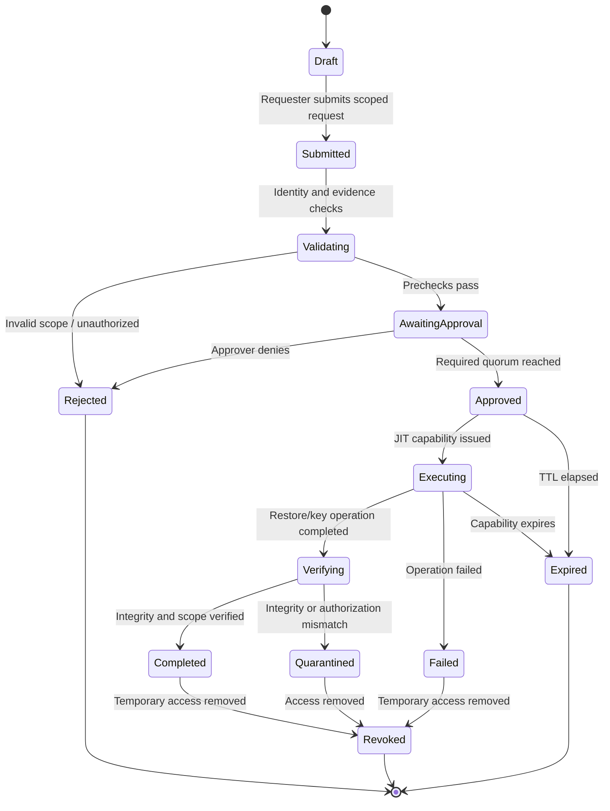

# Recovery authorization: kiểm soát ai được khôi phục khóa và dữ liệu

> **Chương:** Backup và recovery  
> **Module:** SECURITY_KEY_MANAGEMENT_FUNDAMENTALS

Một dịch vụ lưu trữ hồ sơ khách hàng bằng **envelope encryption**. Dữ liệu được mã hóa bởi DEK, DEK được bọc bởi KEK trong KMS/HSM. Sau sự cố ở region chính, đội vận hành cần khôi phục database và key access tại region DR. Nếu bất kỳ operator nào có quyền tải backup, khôi phục KEK, cấp quyền Decrypt và đọc toàn bộ dữ liệu, recovery có thể trở thành **đường truy cập đặc quyền vượt qua tenant isolation**. Ngược lại, nếu mọi thao tác đều cần một người duy nhất đang không sẵn sàng, hệ thống có thể không phục hồi trong RTO đã cam kết.

**Recovery authorization** là tập hợp chính sách, danh tính, phê duyệt và kiểm soát kỹ thuật quyết định **ai được phép khởi tạo, phê duyệt, thực hiện, xác minh và kết thúc một hoạt động khôi phục**, với **tài nguyên, phạm vi dữ liệu, key material, môi trường đích, mục đích và thời hạn cụ thể**. Quyền khôi phục backup không mặc nhiên là quyền sử dụng key; quyền phục hồi key không mặc nhiên là quyền đọc plaintext; quyền vận hành DR không mặc nhiên là quyền truy cập mọi tenant.

Trong module **SECURITY_KEY_MANAGEMENT_FUNDAMENTALS**, recovery authorization gắn với vòng đời khóa **tạo → cấp phát → lưu trữ → sử dụng → xoay vòng → thu hồi → hủy**. Nó kết nối backup/recovery với **mật mã đối xứng, bất đối xứng, chữ ký số, KMS/HSM, envelope encryption, IAM, key custody, separation of duties và audit**. Mục tiêu là phục hồi đúng dịch vụ và dữ liệu được phép, đồng thời không tạo ra lối tắt để đọc dữ liệu ngoài thẩm quyền.

Sau bài học, bạn có thể:

- Phân biệt **backup authorization, key recovery authorization, key-use authorization và data/object authorization**.
- Xác định **ai yêu cầu, ai phê duyệt, ai thực hiện, ai xác minh** một recovery, và vì sao các vai trò cần được phân tách.
- Thiết kế scope của recovery request theo **incident, backup set, tenant, data class, key purpose, key version, region, target environment và TTL**.
- Áp dụng **M-of-N approval, dual control, split knowledge, break-glass và just-in-time access** đúng mục đích.
- Đánh giá danh tính, thiết bị, session, workload identity, approver independence và nguy cơ collusion.
- Kiểm tra backup provenance/integrity, chống rollback và phục hồi metadata cần thiết để sử dụng ciphertext.
- Phân biệt **restore key object, restore key material, re-enable key, import/unwrap recovery key, replicate KMS key và rewrap DEK** theo semantics của provider.
- Xây quy trình recovery cho **KEK/DEK, private signing key, HMAC secret, KEM recipient key và HSM backup**.
- Dùng **Java 17 decision workflow** minh họa authorization có giới hạn và fail-closed; không gọi API khôi phục/xóa khóa thật.
- Lập runbook, negative tests, audit evidence, case studies và checklist để kiểm chứng recovery an toàn.

## 1. Recovery authorization giải quyết vấn đề gì?

Backup bảo vệ **khả năng có lại bản dữ liệu hoặc cấu hình** sau mất mát. Cryptography bảo vệ **bí mật, toàn vẹn và tính xác thực** của dữ liệu/khóa. Recovery authorization quyết định **ai được nối các khả năng đó lại thành quyền sử dụng thực tế**.

Một backup có thể chứa ciphertext, wrapped DEKs, tenant IDs, data classes, AAD schema và immutable key references. Operator có quyền restore storage có thể khôi phục ciphertext mà không cần đọc plaintext. Key custodian có thể khôi phục key service nhưng không nên tự có quyền xem dữ liệu của mọi khách hàng. Application workload chỉ nên Decrypt object mà principal của nó được phép đọc. **Các quyền đó cần được quyết định độc lập.**

### 1.1. Bốn quyền khác nhau

| Quyền | Cho phép | Không tự cho phép |
|---|---|---|
| **Backup restore** | Khôi phục backup artifact vào target được duyệt | Dùng KEK, unwrap DEK hoặc đọc plaintext |
| **Key recovery** | Khôi phục key object/material/replica hoặc recovery capability theo provider | Decrypt mọi record được bảo vệ bởi key |
| **Key use** | Gọi Encrypt/Decrypt/Wrap/Unwrap/Sign/Verify theo operation scope | Đọc mọi object hoặc tenant |
| **Data/object access** | Đọc/ghi object theo ACL và business purpose | Thay đổi key policy, export raw KEK hoặc phục hồi root key |

### 1.2. “Có thể restore” khác “được phép restore”

Một backup kỹ thuật có thể đọc được nhưng vẫn không được phép phục hồi vào production vì nó chứa dữ liệu tenant khác; retention/legal hold không cho phép; snapshot có policy/key state đã bị revoke; backup không có provenance đáng tin; requester không có thẩm quyền; hoặc target không đáp ứng residency, isolation và security controls.

**Khả năng kỹ thuật là điều kiện cần, không phải authorization.** Recovery có thể tác động confidentiality, integrity, availability và auditability cùng lúc.

## 2. Threat model của recovery

| Threat | Kịch bản | Kiểm soát chính |
|---|---|---|
| **Privileged insider** | Operator restore backup tenant A rồi tự cấp quyền đọc | SoD, scoped approval, audit độc lập |
| **Compromised admin account** | Attacker dùng break-glass role để phục hồi key/backup | Strong identity, phishing-resistant MFA, JIT, dual control |
| **Ransomware** | Malware xóa backup, sửa retention hoặc key policies | Immutable/offline backup, separate admin domain |
| **Rollback attack** | Snapshot cũ làm sống lại revoked grants hoặc key bị compromise | Monotonic epochs, signed manifests, reconciliation |
| **Cross-tenant restore** | Khôi phục dữ liệu A vào môi trường B hoặc cấp nhầm DEK | Tenant-bound scope, object authorization, isolation tests |
| **Key substitution** | Thay recovery key bằng key do attacker kiểm soát | Authenticated key registry, fingerprints, custody ceremony |
| **Approval collusion** | Hai approver cùng identity domain bị chiếm | Independent identities, role diversity, SoD |
| **Emergency bypass** | Break-glass role không expire hoặc không có audit | TTL, alerting, post-use review, auto-revoke |
| **Backup poisoning** | Backup chứa malware, altered ciphertext hoặc malicious config | Provenance, integrity, scanning, isolated restore |
| **Evidence tampering** | Operator sửa log hoặc approval record | Append-only audit, external log sink, signed evidence |

### 2.1. Trust boundaries

- **Identity boundary:** xác thực người, service account và approver.
- **Control plane:** IAM, KMS/HSM policy, backup catalog và approval workflow.
- **Data plane:** backup bytes, ciphertext, wrapped DEKs và plaintext.
- **Recovery environment:** isolated staging/clean room hoặc DR production.
- **Audit boundary:** nơi lưu bằng chứng ngoài quyền sửa của operator thực hiện.

Nếu cùng một admin account có thể **thay backup catalog, cấp quyền KMS, đọc plaintext và xóa audit**, recovery authorization gần như không còn ý nghĩa.

### 2.2. Phân biệt sự cố cần phục hồi

| Sự cố | Câu hỏi authorization |
|---|---|
| Mất database | Ai được restore dataset và vào environment nào? |
| Mất KMS availability | Ai được chuyển sang replica/provider/region khác? |
| Key bị disable nhầm | Ai được re-enable và ai xác minh trạng thái? |
| Key bị compromise | Có được phục hồi key cũ không, hay phải tạo key mới? |
| HSM mất thiết bị/partition | Ai có quyền tham gia ceremony/restore backup? |
| Ransomware phá backup | Bản immutable nào được phép dùng, ai xác thực clean point? |
| Tenant yêu cầu khôi phục | Ai xác minh tenant owner, retention và object scope? |

## 3. Recovery authorization theo nguyên tắc least privilege

Một request nên được ràng buộc với **một mục đích cụ thể** và phạm vi nhỏ nhất đủ để phục hồi.

### 3.1. Thuộc tính của recovery scope

| Thuộc tính | Ví dụ | Mục đích |
|---|---|---|
| Incident/request ID | `DR-2026-041` | Liên kết lý do và evidence |
| Requester identity | `oncall-storage-prod` | Xác định người khởi tạo |
| Tenant/data owner | `tenant-A` | Chống phục hồi xuyên tenant |
| Backup set/snapshot | `orders-db-snap-2026-11-27T02` | Giới hạn artifact |
| Data class | `CONFIDENTIAL` | Chọn mức bảo vệ/approval |
| Key purpose | `DATA_KEY_WRAP` | Không nhầm key Encrypt với key Sign |
| Key reference/version | `orders-kek-v7` | Xác định đúng key material |
| Source region/account | `region-1/prod-account` | Provenance và residency |
| Target environment | `dr-prod-isolated` | Tránh restore nhầm môi trường |
| Operations | `RESTORE_BACKUP, UNWRAP_DEK` | Giới hạn API/operation |
| Object/dataset scope | `orders/tenant-A/partition-7` | Tránh quyền rộng toàn hệ thống |
| Purpose | `service-recovery` | Phân biệt DR, forensic, legal hold |
| Validity window | 30 phút theo policy | Giảm thời gian quyền đặc biệt |
| Approval set | data owner + key custodian + security | Kiểm soát đa bên |

### 3.2. Không dùng một cờ `recoveryApproved=true` cho mọi hành động

Phê duyệt restore backup không đồng nghĩa phê duyệt **Unwrap DEK**. Có thể cần approval riêng cho:

1. Khôi phục encrypted snapshot vào isolated staging.
2. Sử dụng key version cụ thể để verify/decrypt records được chọn.
3. Promote dữ liệu đã xác minh vào production.
4. Thay đổi key policy/replication nếu recovery cần điều chỉnh control plane.

Việc tách approval giúp giảm quyền thừa và tạo audit trail rõ ràng.

### 3.3. Scope phải bất biến sau phê duyệt

Nếu request đã được duyệt cho `tenant-A`, `snapshot-17`, `DR-STAGING`, operator không thể tự đổi sang `tenant-B`, `snapshot-18`, `PRODUCTION`. Thay đổi quan trọng phải tạo **request/version mới và xin phê duyệt lại**. Dùng immutable request ID, content digest hoặc signed approval record để phát hiện thay đổi.

## 4. Vai trò, separation of duties và dual control

| Vai trò | Trách nhiệm | Không mặc định có |
|---|---|---|
| **Requester / Incident Commander** | Mở request, nêu incident, business impact và scope | Quyền tự restore key hoặc đọc mọi plaintext |
| **Data owner** | Xác nhận quyền khôi phục dữ liệu, tenant, retention và mục đích | Quyền export KEK/HSM root |
| **Key custodian** | Xác minh key ID/version, custody và khả năng recovery | Quyền tự quyết định data access |
| **Security approver** | Đánh giá threat, integrity, blast radius và ngoại lệ | Quyền sửa evidence |
| **Compliance/legal** | Xác minh legal hold, residency, contractual duties | Quyền dùng key cho mục đích khác |
| **Recovery operator** | Thực hiện thao tác đã duyệt theo scope | Quyền thay đổi scope hoặc tự approve |
| **Verifier/auditor** | Kiểm tra kết quả, evidence và authorization | Raw key/plaintext không cần thiết |
| **KMS/HSM administrator** | Quản lý key resource, policies và provider integration | Quyền đọc mọi application object |

### 4.1. Separation of duties (SoD)

SoD ngăn một người vừa tạo request, vừa tự approve, thực hiện rồi tự xác nhận thành công. Với recovery rủi ro cao, cần **ít nhất hai vai trò độc lập**. Tách tên tài khoản chưa đủ nếu credentials do cùng một người hoặc automation kiểm soát; cần xét identity provider, device/session, administrative group, approval channel và organizational independence.

### 4.2. Dual control

Dual control yêu cầu hai người độc lập cùng tham gia thao tác nhạy cảm. Ví dụ, một người khởi tạo khôi phục HSM backup, người khác xác minh backup set và cùng tham gia ceremony. Dual control không có nghĩa hai người chia sẻ một password.

### 4.3. M-of-N approval và threshold

Với key root, HSM backup hoặc recovery có blast radius lớn, tổ chức có thể yêu cầu **M trong N custodians** phê duyệt/tham gia. Mỗi approver phải có identity và credential riêng; không dùng nhiều danh tính của một người để đủ quorum; có quy trình thay thế approver; approval có scope, expiry, purpose và audit.

**M-of-N approval không đồng nghĩa mọi hệ thống đều cần chia raw key thành M-of-N shares.** Threshold cryptography, split knowledge và approval quorum là các cơ chế khác nhau.

### 4.4. Split knowledge

Split knowledge đảm bảo một cá nhân không biết/không giữ toàn bộ thông tin cần thiết để khôi phục secret. Recovery material có thể được bảo vệ bằng cơ chế chia phần theo quy trình HSM/custody được đánh giá. **Không tự chia byte của AES key thành các mảnh tùy ý** rồi tuyên bố an toàn; phải dùng cơ chế threshold/split-knowledge phù hợp và có kiểm chứng.

## 5. Xác thực danh tính và điều kiện của approver

Recovery có thể cấp quyền tạm thời rất mạnh. Vì vậy **xác thực requester và approver** phải đủ tin cậy cho mức rủi ro, không chỉ dựa trên việc người đó đăng nhập được vào một dashboard.

### 5.1. Các lớp kiểm tra identity

- **Human identity:** tài khoản nhân viên đang hoạt động, vai trò và quan hệ với service/data owner.
- **Phishing-resistant MFA:** xác thực mạnh theo policy; tránh chỉ dựa vào OTP dễ bị phishing cho thao tác root/high-impact.
- **Device/session posture:** thiết bị quản trị được quản lý, session có tuổi và risk phù hợp, không có dấu hiệu token bị chiếm.
- **Workload identity:** service account có issuer, audience, subject và environment ràng buộc; không dùng long-lived shared credentials tùy tiện.
- **Approver independence:** requester không tự phê duyệt; các approvers không dùng chung credential/session hoặc cùng một automation identity.
- **Re-authentication:** thao tác khôi phục root key/HSM backup có thể cần xác thực lại ngay trước execution.

### 5.2. Approval phải gắn với nội dung request

Approver cần nhìn thấy **đúng backup, tenant, key reference/version, target environment, operation và TTL**. Một nút “Approve recovery” không có scope cụ thể không đủ để tạo authorization có ý nghĩa.

Approval record nên chứa:

| Trường | Mục đích |
|---|---|
| Request ID + version | Liên kết request bất biến |
| Request digest | Phát hiện nội dung bị sửa sau phê duyệt |
| Approver identity/role | Xác định người phê duyệt |
| Approval decision | Approve/deny/conditional |
| Approved scope | Backup, tenant, key version, operations, target |
| Valid-from / expires-at | Giới hạn thời gian |
| Authentication context | MFA/device/session evidence theo policy |
| Reason/comment | Lý do và ngoại lệ |
| Timestamp + signature/audit ID | Chứng minh thời điểm và provenance |

### 5.3. Không cho phép đổi scope bằng cách sửa request sau approval

Nếu người thực hiện đổi backup ID, tenant, region hoặc key version, digest không còn khớp. Workflow phải **từ chối**, yêu cầu request version mới và approval lại. Không cho phép operator tự “sửa lỗi nhỏ” sau khi approver đã duyệt.

### 5.4. Approval hết hạn

Approval có thể hết hiệu lực khi:

- TTL đã qua.
- Incident chuyển trạng thái hoặc scope ảnh hưởng thay đổi.
- Key bị đánh dấu compromised sau thời điểm duyệt.
- Backup catalog/manifest thay đổi.
- Target environment hoặc region khác với request.
- Một approver bị revoke hoặc session bị đánh dấu rủi ro.

**Approval cũ không phải giấy phép vô thời hạn.** Trước execution, kiểm tra trạng thái hiện tại và yêu cầu phê duyệt mới nếu điều kiện đã thay đổi.

## 6. Break-glass và emergency recovery

Break-glass là cơ chế **truy cập khẩn cấp có kiểm soát** khi quy trình thông thường không đáp ứng tình huống nghiêm trọng hoặc hệ thống identity/approval chính bị gián đoạn. Nó không phải một tài khoản admin luôn hoạt động và không bị kiểm toán.

### 6.1. Khi nào có thể cần break-glass?

- Region identity provider chính bị outage, không thể hoàn tất luồng approval bình thường.
- Sự cố làm gián đoạn toàn bộ dịch vụ và cần khôi phục key access để đáp ứng RTO.
- HSM/KMS control plane bị lỗi, cần chuyển sang recovery site/replica theo plan đã thử.
- Incident Commander xác định chậm trễ của quy trình thường tạo nguy cơ lớn hơn, trong phạm vi emergency policy cho phép.

### 6.2. Điều kiện bắt buộc của break-glass

1. **Eligibility:** chỉ người/role đã được chỉ định trước mới được sử dụng.
2. **Strong authentication:** xác thực lại, thiết bị/kênh quản trị tin cậy và kiểm tra session.
3. **Bounded scope:** chỉ key, backup, tenant, environment và operations cần thiết.
4. **Short TTL:** quyền tự hết hạn; không cấp permanent admin.
5. **Independent alert:** thông báo SOC/IC/owner qua kênh ngoài phiên break-glass.
6. **Session recording/audit:** ghi hành động và request IDs, không ghi raw key/plaintext.
7. **Post-use review:** người độc lập kiểm tra mục đích, phạm vi, actions và revoke quyền.
8. **Credential rotation:** thay/revoke credential break-glass nếu có dấu hiệu bị lộ hoặc theo policy.

### 6.3. Break-glass không bỏ qua mọi approval

Một số sự cố cần action ngay, nhưng có thể thiết kế **emergency quorum**, ví dụ IC + key custodian, rồi hoàn tất legal/security review sau theo policy. Cần định nghĩa trước ai có thẩm quyền, giới hạn nào được bypass, giới hạn nào không, và bằng chứng hậu kiểm bắt buộc.

### 6.4. Không dùng một break-glass account chung

Tài khoản dùng chung làm mất khả năng quy trách nhiệm. Nên dùng **named identities**, emergency credentials có custody, checkout/rotation, alert và kiểm soát hai người nếu yêu cầu. Không gửi mật khẩu break-glass trong chat hoặc tài liệu runbook.

## 7. Quyền khôi phục dữ liệu và quyền khôi phục key phải tách biệt

Đây là ranh giới cốt lõi của recovery authorization.

### 7.1. Restore encrypted backup không cần plaintext access

Recovery operator có thể:

1. Lấy encrypted backup theo đúng scope.
2. Kiểm tra signature/checksum/manifest và provenance.
3. Restore ciphertext, wrapped DEKs và metadata vào **isolated recovery environment**.
4. Chạy integrity/consistency checks không cần mở dữ liệu nhạy cảm.
5. Chuyển yêu cầu riêng tới key custodian để kiểm tra key availability.

Chỉ khi business/service validation cần đọc dữ liệu, **application principal có quyền trên object** mới thực hiện Decrypt. Operator không tự dùng quyền root để mở toàn bộ database.

### 7.2. Khôi phục key không đồng nghĩa cấp quyền đọc dữ liệu

Một key custodian có thể phục hồi key service hoặc replica, nhưng sau đó:

- IAM grants vẫn phải được kiểm tra.
- Application identities phải được xác thực lại.
- Tenant/object ACL vẫn phải có hiệu lực.
- Key usage phải đúng purpose và encryption context.
- Không tự cấp quyền Decrypt cho người thực hiện ceremony.

### 7.3. Restore sang clean room

Với ransomware hoặc suspected compromise, ưu tiên **isolated clean room**:

- Môi trường có identity/network/policy tách biệt.
- Không tự động nối với production hoặc gửi traffic ra ngoài.
- Backup được kiểm tra malware/configuration và provenance.
- Key access giới hạn vào các key/version cần thiết.
- Dữ liệu nhạy cảm không được export ra workstation của operator.
- Có approval riêng trước khi promote về production.

### 7.4. Không dùng recovery để bypass data retention

Restore một snapshot cũ có thể làm sống lại records đã xóa, consent đã rút, grants đã revoke hoặc user đã offboard. Sau restore cần **reconcile với authoritative current state**: deletion tombstones, access revocations, tenant status, retention và legal holds. Bản backup không được phép tự khôi phục những quyền đã bị thu hồi.

## 8. KMS/HSM recovery: hiểu đúng semantics của key material

Không phải mọi KMS key đều có thể “download backup rồi import lại”. Một số provider quản lý key material trong HSM; một số hỗ trợ imported key material, external key store, replica hoặc key backup theo quy trình riêng.

### 8.1. Những thao tác không được đánh đồng

| Thao tác | Ý nghĩa | Recovery authorization cần xác minh |
|---|---|---|
| **Re-enable key** | Mở lại key đang disabled nếu provider cho phép | Ai có quyền, vì sao disable, có compromise không |
| **Restore key object/metadata** | Khôi phục resource/configuration/reference | Policy, aliases, grants và key material có thật sự tồn tại? |
| **Restore HSM backup** | Nạp backup partition/key objects theo ceremony | Backup provenance, quorum, HSM domain, custodian |
| **Replicate KMS key** | Tạo/khôi phục replica theo provider | Region, material semantics, policy và key version |
| **Import key material** | Nạp material bên ngoài vào key resource | Origin, integrity, import wrapping key, expiry và custody |
| **Recover external key store** | Khôi phục hệ thống giữ material bên ngoài KMS | External HSM/vendor availability và trust |
| **Rewrap DEK** | Bọc lại DEK dưới KEK khác | Quyền trên đúng DEK/object, context và target key |
| **Reencrypt data** | Mã hóa lại dữ liệu bằng DEK mới | Data authorization, source/target key use và atomic migration |

### 8.2. Key material không phải metadata

Một backup của **key policy, alias, key ID hoặc IAM configuration** không khôi phục được raw key material. Ngược lại, có key material mà thiếu metadata (algorithm, key usage, version, context, owner, lifecycle) có thể khiến hệ thống không dùng được key an toàn.

### 8.3. HSM backup và key ceremony

HSM backup/recovery có thể yêu cầu:

- HSM model/firmware/partition tương thích.
- Backup encryption/wrapping key và custody.
- M-of-N custodians, dual control và split knowledge theo vendor procedure.
- Kiểm tra tamper/attestation và chain of custody.
- Ghi audit ceremony, participants, backup identifier và kết quả.

Không tự dùng file backup HSM như file dữ liệu thường hoặc tự tái tạo quy trình split knowledge ngoài hướng dẫn đã đánh giá.

### 8.4. Provider-managed key và giới hạn khôi phục

Một KMS provider có thể **không cho export hoặc restore key material**. Khả năng recovery có thể là re-enable, restore replica, support case, hoặc dùng key mới và reencrypt dữ liệu. Cần kiểm tra **provider contract/API và integration tests**, không hứa rằng mọi key đã xóa đều phục hồi được.

### 8.5. Compromised key không nên tự động restore lại

Nếu key bị nghi compromise, restore nguyên key material cũ có thể khôi phục luôn khả năng attacker đã biết. Phải xác định mục đích:

- **Availability recovery:** key chỉ bị disable nhầm, chưa có compromise evidence.
- **Security recovery:** key bị lộ/lạm dụng, cần thay key và reencrypt/rewrap.
- **Forensic preservation:** giữ evidence/key reference trong môi trường cô lập, không đưa lại vào active production use.

Khôi phục một key cũ vào production chỉ vì nó làm dữ liệu mở được là quyết định nguy hiểm nếu compromise chưa được giải quyết.

## 9. Backup provenance, integrity và anti-rollback

Authorization chỉ trả lời **ai được phép dùng backup**. Nó không chứng minh backup là bản hợp lệ, không bị sửa và phù hợp để phục hồi.

### 9.1. Xác minh backup trước khi restore

Trước khi đưa backup vào môi trường phục hồi, xác minh:

- **Origin:** backup được tạo bởi service/account/region được phép.
- **Manifest:** backup ID, timestamp, dataset, tenant, schema và key references khớp catalog.
- **Integrity:** checksum/hash/signature theo thiết kế được kiểm tra.
- **Authenticity:** manifest/signature được xác minh bằng trust anchor đáng tin, không lấy public key từ chính backup chưa xác thực.
- **Completeness:** tất cả chunks/objects cần thiết đều có, không bị thiếu hoặc trộn phiên bản.
- **Consistency:** database snapshot, object store, transaction log và key metadata thuộc cùng recovery point.
- **Malware/configuration safety:** backup được scan/validate trong môi trường cô lập nếu threat model yêu cầu.

### 9.2. Checksum không thay thế chữ ký hoặc nguồn tin cậy

Hash/checksum có thể phát hiện lỗi ngẫu nhiên hoặc thay đổi nếu digest được bảo vệ. Nếu attacker có thể thay cả backup lẫn checksum, checksum không chứng minh nguồn gốc. Dùng **signed manifest, protected catalog, append-only audit hoặc authenticated storage metadata** theo threat model.

### 9.3. Chống rollback

Một snapshot cũ có thể hợp lệ về mật mã nhưng đã lỗi thời về trạng thái quyền:

- User đã bị offboard.
- Tenant đã revoke quyền chia sẻ.
- Key đã bị compromise và bị cấm dùng.
- Grant đã hết hạn.
- Data đã được xóa theo retention.
- Signing certificate đã bị revoke.

Sau restore, cần so sánh với **authoritative current state** và áp dụng các tombstones/revocations mới hơn. Không để backup cũ tự làm sống lại quyền.

### 9.4. Monotonic epoch và signed recovery manifest

Một manifest có thể lưu:

```json
{
  "backupId": "orders-snapshot-2026-11-27T02",
  "tenantId": "tenant-A",
  "dataset": "orders",
  "createdAt": "2026-11-27T02:00:00Z",
  "schemaVersion": 18,
  "policyEpoch": 42,
  "keyReferences": [
    "kms://prod/tenant-A/orders/kek-v7"
  ],
  "integrity": {
    "algorithm": "SHA-256",
    "digest": "<digest-from-protected-manifest>"
  },
  "manifestSignature": "<signature-reference>"
}
```

Đây là ví dụ định dạng, không phải chuẩn chung. **Policy epoch** giúp phát hiện snapshot được tạo trước một thay đổi quyền; chữ ký chỉ có giá trị khi verifier key/trust source được xác thực độc lập. Không dùng manifest để thay thế object ACL.

## 10. Recovery của envelope encryption: từ backup tới plaintext có kiểm soát

Một encrypted record thường có:

```text
plaintext
   | AES-GCM with DEK
   v
ciphertext + nonce + tag + AAD

DEK
   | Wrap with KEK in KMS/HSM
   v
wrapped DEK + immutable KEK reference
```

Để phục hồi dữ liệu, cần cả **data ciphertext**, **wrapped DEK**, **key reference/version**, **AAD schema**, **nonce/tag** và quyền thích hợp. Khôi phục riêng database mà thiếu metadata hoặc key access có thể không đủ.

### 10.1. Recovery sequence theo lớp quyền

1. **Backup operator** restore encrypted bytes và metadata vào isolated target.
2. **Integrity verifier** xác thực manifest, chunk hashes, schema và snapshot consistency.
3. **Key custodian** xác nhận KEK object/version/replica có thể dùng theo provider semantics.
4. **Security approver** xác nhận key state không bị compromised và operation scope đúng.
5. **Application identity** được cấp quyền tạm thời, đúng tenant/object/purpose để Unwrap/Decrypt.
6. **Data verifier** kiểm tra AEAD authentication tag, AAD và business consistency.
7. **Promotion approver** duyệt đưa dữ liệu đã kiểm chứng vào production.

Không một bước nào tự động trao cho operator toàn quyền.

### 10.2. AAD và context phải giữ nguyên

Nếu AES-GCM record ban đầu dùng AAD gồm tenant ID, object ID, data class, purpose và revision, restore phải tái tạo **đúng canonical AAD**. Không được bỏ AAD hoặc thử nhiều biến thể cho tới khi tag pass. Nếu metadata không khớp, quarantine và điều tra.

### 10.3. KMS encryption context là một ràng buộc authorization bổ sung

Một số KMS hỗ trợ encryption context/associated metadata để ràng buộc cryptographic operation. Ví dụ logic:

```text
tenantId = tenant-A
objectId = order-771
purpose = ORDER_DATA_KEY_WRAP
backupSet = snapshot-2026-11-27
```

Chỉ dùng các context fields đã được provider hỗ trợ và được policy kiểm tra. **Encryption context thường không bí mật** và không thay thế authorization của application trên object. Context không đúng phải fail closed.

### 10.4. Rewrap trong recovery

Nếu KEK cũ còn dùng được nhưng không nên tiếp tục ở DR, có thể:

- Unwrap DEK theo quyền recovery đã duyệt.
- Wrap lại dưới KEK của recovery domain hoặc KEK mới.
- Ghi wrapped DEK mới, immutable keyRef, context và record revision atomically.
- Xác minh DEK mới unwrap được và ciphertext gốc decrypt/verify được.

Nếu raw DEK bị nghi lộ, **rewrap cùng DEK không đủ**; phải đánh giá reencrypt bằng DEK mới.

### 10.5. Không xuất raw KEK để “đơn giản hóa restore”

Recovery operator không nên tải KEK root ra workstation hoặc file share. Ưu tiên provider-supported replica/restore, HSM ceremony, scoped Unwrap hoặc broker service. Nếu một mô hình bắt buộc import/export key material, cần **custody procedure riêng**, protected transport, split knowledge, approvals và evidence theo chuẩn nội bộ/provider.

## 11. Recovery authorization theo tenant, data class và region

Một recovery request toàn hệ thống thường quá rộng. Scope nên giữ các ranh giới dữ liệu như lúc vận hành bình thường.

### 11.1. Tenant isolation

- Tenant A chỉ được phục hồi dữ liệu A vào target đã được phê duyệt.
- Operator dùng shared platform role không mặc nhiên có quyền đọc plaintext của mọi tenant.
- KMS context/key scope phải khớp tenant và purpose.
- Backup catalog phải chống việc thay tenant ID hoặc object mapping.
- Sau restore phải áp dụng current tenant state, revocations và deletion tombstones.

### 11.2. Data class ảnh hưởng mức phê duyệt

| Data class minh họa | Recovery controls có thể cần |
|---|---|
| **PUBLIC** | Provenance/integrity và change control cơ bản |
| **INTERNAL** | Workload identity, scoped operator, audit |
| **CONFIDENTIAL** | Data-owner approval, tenant scope, key custodian, isolated staging |
| **RESTRICTED** | Dual control/quorum, stronger identity, HSM custody, explicit promotion approval |

Taxonomy này là ví dụ. Tổ chức phải dùng chính sách thực tế; nhãn data class không tự cấp hoặc thu hồi quyền.

### 11.3. Region và data residency

Restore sang region khác có thể làm thay đổi:

- Nơi lưu backup bytes và plaintext.
- KMS/HSM key resource, replicas và key material provenance.
- Quyền của operator/processor tại region đích.
- Residency, contractual controls và legal hold.
- Audit location và khả năng cross-region evidence.

Không giả định copy key ID sang region DR là có cùng material hoặc được phép dùng. Cần provider-supported replication hoặc migration được phê duyệt.

### 11.4. Môi trường đích là một phần của authorization

Restore vào **isolated staging**, **forensic clean room** và **production** có rủi ro khác nhau. Request phải định danh target, network boundary, identity realm, encryption policy và ai có thể đọc plaintext. Thay target sau approval là thay scope, cần phê duyệt lại.

## 12. Recovery authorization cho các loại key khác nhau

| Key purpose | Recovery cần bảo vệ | Những điều phải xác minh |
|---|---|---|
| **KEK** | Key object/material/replica bảo vệ DEKs | Provider semantics, key version, IAM, wrapped DEK dependencies |
| **DEK** | Data key hoặc wrapped DEK cho một object | Object scope, AAD, nonce/tag, raw DEK exposure |
| **Private signing key** | Khả năng Sign hoặc giữ bằng chứng lịch sử | HSM custody, signer identity, certificate status, trust/incident |
| **Public verification key** | Khả năng Verify signatures | Authenticity, certificate chain, historical trust evidence |
| **HMAC secret** | Generate/Verify MAC | Producer/consumer scope, shared-secret custody, replay |
| **KEM/RSA recipient key** | Mở envelopes đã gửi tới recipient | Private key custody, package inventory, offline copies |
| **KDF root/master secret** | Tái tạo derived keys | Derivation context/version, descendant inventory, purpose separation |
| **Backup encryption key** | Mở backup archives | Backup set, recovery key custody, restore test, retention |

### 12.1. Không restore signing key chỉ để đọc chữ ký

Chữ ký bất đối xứng thường Verify bằng public key. Nếu private signing key đã bị compromise hoặc bị hủy, **không cần khôi phục private key chỉ để xác minh chữ ký lịch sử**; cần public verification material và trust evidence phù hợp.

### 12.2. HMAC và shared secret

Nếu cần xác minh message cũ, HMAC verifier có thể vẫn cần shared secret. Tuy nhiên, khôi phục HMAC secret cũng khôi phục khả năng tạo MAC cho principal được cấp secret. Cân nhắc **bounded verification service** thay vì cấp raw secret cho operator hoặc user.

### 12.3. KDF root và descendant keys

Khôi phục root/master secret có thể tái tạo nhiều derived keys. Authorization phải bao gồm **derivation context, version, salt/labels, descendant scope và purpose**. Không cấp root key chỉ để phục hồi một DEK nếu có đường recovery hẹp hơn.

## 13. Recovery authorization lifecycle: request → approve → execute → verify → expire

Một recovery authorization nên có **trạng thái rõ ràng**, không chỉ một ticket đang mở.



### 13.1. Các trạng thái cần phân biệt

| Trạng thái | Ý nghĩa |
|---|---|
| **DRAFT** | Requester đang tạo yêu cầu, chưa có hiệu lực |
| **SUBMITTED** | Đã gửi với scope/version xác định |
| **VALIDATING** | Kiểm tra identity, evidence, policy và backup provenance |
| **AWAITING_APPROVAL** | Đang chờ các approvers độc lập |
| **APPROVED** | Quorum đạt, nhưng chưa cấp quyền thực thi |
| **EXECUTING** | JIT capabilities được cấp trong thời gian giới hạn |
| **VERIFYING** | Restore/crypto operations đã xong, đang kiểm chứng |
| **COMPLETED** | Scope, integrity, data/key access và audit được xác minh |
| **QUARANTINED** | Có mismatch hoặc rủi ro, giữ dữ liệu cô lập |
| **FAILED** | Thao tác thất bại, phải thu hồi quyền và xử lý |
| **EXPIRED/REVOKED** | Quyền tạm thời đã hết hạn hoặc bị rút |

### 13.2. Approval không tự cấp credential dài hạn

Sau khi request được duyệt, workflow nên cấp **JIT role/session/capability** cho đúng resource và operation, với TTL ngắn. Khi kết thúc hoặc thất bại, thu hồi quyền; không để recovery role tồn tại vô thời hạn.

### 13.3. Thay đổi trạng thái incident có thể làm approval mất hiệu lực

Nếu key bị xác định compromised sau approval, request phục hồi key cũ phải quay lại **security review**. Nếu backup catalog phát hiện snapshot bị sửa, request phải bị block/quarantine. Authorization là quyết định theo **state tại thời điểm thực hiện**, không chỉ tại thời điểm phê duyệt.

### 13.4. Idempotency và retry

Recovery có thể bị retry do timeout. Cần operation ID/idempotency key và expected resource version để tránh restore lặp lại làm ghi đè dữ liệu mới, tạo nhiều bản key resource ngoài dự kiến, cấp nhiều JIT sessions không được revoke hoặc promote snapshot cũ sau khi request đã bị hủy. Retry phải đọc lại **current authorization state và target state**, không mặc định dùng lại approval cũ.

## 14. Ràng buộc authorization với retention, legal hold và deletion tombstones

Khôi phục một snapshot cũ có thể làm sống lại dữ liệu hoặc quyền đã bị xóa. Recovery cần biết **dữ liệu nào được phép tồn tại và ai còn quyền truy cập tại thời điểm hiện tại**.

### 14.1. Restore không được rollback chính sách dữ liệu

Sau khi restore:

- Áp dụng **deletion tombstones** được ghi sau thời điểm backup.
- Đối chiếu tenant status, user offboarding và consent/revocation.
- Reconcile key grants, IAM policies, object ACL và data sharing grants.
- Kiểm tra retention/legal hold theo **authoritative current register**.
- Ngăn snapshot cũ tái tạo user/service accounts hoặc credentials đã revoke.

### 14.2. Legal hold có thể cho phép lưu nhưng không cho phép mọi người đọc

Một hồ sơ có legal hold có thể cần được bảo toàn, nhưng điều đó không tự cấp quyền Decrypt cho recovery operator. Cần **custodian/forensic role** và process riêng, audit chặt, purpose giới hạn và không promote dữ liệu vào luồng business bình thường.

### 14.3. Right to delete và crypto-erasure

Nếu một object đã được xóa theo policy, restore snapshot cũ phải áp dụng lại tombstone hoặc deletion workflow. Không được bỏ qua vì backup còn ciphertext. Nếu thiết kế dùng DEK per-object và crypto-erasure, cần bảo đảm **không còn raw DEK/wrapped DEK/recovery copy** có thể phục hồi ngoài phạm vi được phép.

### 14.4. Data residency và third-party processing

Nếu backup thuộc region A nhưng DR ở region B, authorization phải xét **vị trí plaintext và key operations**, không chỉ vị trí file backup. Nếu target là provider/processor khác, cần đánh giá hợp đồng, custody và subprocessor permissions.

## 15. Audit và evidence của recovery authorization

Một quy trình recovery có thể được review sau nhiều tháng phải chứng minh được **ai yêu cầu, ai phê duyệt, ai thực hiện, trên phạm vi nào, dựa trên bằng chứng nào và kết quả ra sao**.

### 15.1. Audit event tối thiểu

```json
{
  "eventType": "KEY_RECOVERY_AUTHORIZATION",
  "requestId": "DR-2026-041",
  "requestVersion": 3,
  "timestamp": "2026-11-28T04:15:00Z",
  "requester": "oncall-storage-prod",
  "approvers": [
    "data-owner-tenant-A",
    "key-custodian-prod",
    "security-approver"
  ],
  "tenantId": "tenant-A",
  "backupSet": "orders-snapshot-2026-11-27T02",
  "targetEnvironment": "dr-prod-isolated",
  "keyReference": "kms://prod/tenant-A/orders/kek-v7",
  "operations": ["RESTORE_BACKUP", "VERIFY_DECRYPT"],
  "policyEpoch": 42,
  "approvalDigest": "<signed-request-digest>",
  "ttlSeconds": 1800,
  "result": "APPROVED"
}
```

Đây là **schema minh họa**, không phải định dạng chuẩn của KMS. Key reference, tenant ID và approver identities có thể là metadata nhạy cảm; cần kiểm soát quyền đọc và retention.

### 15.2. Evidence bundle

- Incident/request ID, purpose và risk assessment.
- Backup manifest, provenance, integrity results và snapshot timestamp.
- Immutable key references/material versions, key state và provider capability.
- Request digest, approvals, approver identity context và TTL.
- JIT role/session grant, operations và provider request IDs.
- Restore target, environment isolation và network policy.
- AEAD/tag/manifest validation và business consistency checks.
- Post-restore reconciliation của revocations/tombstones/retention.
- Temporary permission revocation và completion/failed status.

### 15.3. Audit phải độc lập với operator

Không để recovery operator có thể sửa/xóa cùng lúc **approval record, KMS logs và restore evidence**. Dùng append-only/immutable log sink hoặc hệ thống audit tách quyền. Chữ ký số cho evidence cần trust key và retention phù hợp; không ghi raw key để chứng minh key use.

### 15.4. Không log plaintext hoặc key material

Audit chỉ nên chứa **key ID/version, operation, principal, scope, context reference, timestamps, result và evidence ID**. Raw DEK/KEK, private key, HMAC secret, recovery shares và plaintext không thuộc audit log.

## 16. Metrics và cảnh báo

| Tín hiệu | Ý nghĩa cần điều tra |
|---|---|
| Recovery request ngoài incident/change window | Có thể là misuse hoặc quy trình sai |
| Một approver approve quá nhiều request khẩn cấp | Collusion/approval fatigue |
| Break-glass role hoạt động lâu hơn TTL | Quyền khẩn cấp không được thu hồi |
| Request đổi tenant/backup/keyRef sau approval | Scope tampering |
| Recovery vào production thay vì isolated target | Bypass promotion gate |
| Restore snapshot cũ làm grants sống lại | Rollback/reconciliation failure |
| KMS Unwrap từ recovery principal ngoài scope | Excessive privilege |
| Backup manifest/signature mismatch | Backup poisoning hoặc corruption |
| Key recovery từ region/device chưa phê duyệt | Custody/replication risk |
| Không có post-restore audit event | Evidence pipeline bị gián đoạn |
| JIT session không expire | Recovery access còn tồn tại |
| Một người vừa requester vừa approver | SoD violation |

### 16.1. Metrics không thay thế kiểm tra từng request

Dashboard có thể cho biết recovery count, approval latency và restore success rate, nhưng mỗi recovery vẫn cần **scope, purpose, identity, approval và evidence**. Tỷ lệ thành công cao không chứng minh authorization an toàn.

## 17. Java 17: decision workflow cho recovery authorization

Ví dụ mô phỏng **đánh giá request trước khi cấp quyền thực thi**. Nó không gọi KMS/HSM, không đọc backup, không khôi phục key và không tạo credentials.

```java
import java.time.Clock;
import java.time.Instant;
import java.util.List;
import java.util.Set;

public final class RecoveryAuthorizationDemo {
    enum Role { DATA_OWNER, KEY_CUSTODIAN, SECURITY_APPROVER }
    enum KeyState { ACTIVE, COMPROMISED, DESTROYED, UNKNOWN }
    enum Verdict { BLOCK, AUTHORIZED_FOR_SCOPED_EXECUTION }
    record Scope(String tenant, String backup, String keyRef,
                 String target, String purpose) {
        String canonical() {
            return tenant + "|" + backup + "|" + keyRef + "|"
                    + target + "|" + purpose;
        }
    }
    record Approval(String id, Role role, String scope,
                    Instant expiresAt, boolean strongAuth) {}
    record Evidence(boolean identity, boolean backupIntegrity,
                    boolean isolated, boolean retentionClear,
                    boolean revocationsReconciled, boolean keyCustody,
                    boolean incidentAuthorized, KeyState keyState) {}
    record Request(String requester, Scope scope, String digest,
                   Instant expiresAt, List<Approval> approvals,
                   Evidence evidence) {}

    static Verdict evaluate(Request r, Clock clock) {
        Instant now = clock.instant();
        if (r.scope() == null || r.evidence() == null
                || r.expiresAt() == null || !r.expiresAt().isAfter(now)) {
            return Verdict.BLOCK;
        }
        Evidence e = r.evidence();
        if (!e.identity() || !e.backupIntegrity() || !e.isolated()
                || !e.retentionClear() || !e.revocationsReconciled()
                || !e.keyCustody() || !e.incidentAuthorized()) {
            return Verdict.BLOCK;
        }
        if (e.keyState() == KeyState.COMPROMISED
                || e.keyState() == KeyState.DESTROYED
                || e.keyState() == KeyState.UNKNOWN) return Verdict.BLOCK;
        if (!r.scope().canonical().equals(r.digest())) return Verdict.BLOCK;

        Set<Role> required = Set.of(
                Role.DATA_OWNER, Role.KEY_CUSTODIAN, Role.SECURITY_APPROVER);
        var approved = new java.util.HashSet<Role>();
        var identities = new java.util.HashSet<String>();
        for (Approval a : r.approvals()) {
            if (a.id() == null || a.id().equals(r.requester())
                    || !identities.add(a.id())
                    || !r.scope().canonical().equals(a.scope())
                    || a.expiresAt() == null || !a.expiresAt().isAfter(now)
                    || !a.strongAuth()) return Verdict.BLOCK;
            approved.add(a.role());
        }
        return approved.containsAll(required) && identities.size() >= 3
                ? Verdict.AUTHORIZED_FOR_SCOPED_EXECUTION : Verdict.BLOCK;
    }

    public static void main(String[] args) {
        Clock clock = Clock.fixed(
                Instant.parse("2026-11-28T05:00:00Z"),
                java.time.ZoneOffset.UTC);
        Instant now = clock.instant();
        Scope scope = new Scope("tenant-A", "snapshot-17",
                "kms://tenant-A/orders/kek-v7", "dr-staging",
                "disaster-recovery");
        Evidence evidence = new Evidence(
                true, true, true, true, true, true, true, KeyState.ACTIVE);
        List<Approval> approvals = List.of(
                new Approval("owner-1", Role.DATA_OWNER, scope.canonical(),
                        now.plusSeconds(600), true),
                new Approval("custodian-2", Role.KEY_CUSTODIAN, scope.canonical(),
                        now.plusSeconds(600), true),
                new Approval("security-3", Role.SECURITY_APPROVER, scope.canonical(),
                        now.plusSeconds(600), true));
        Request request = new Request("requester-9", scope,
                scope.canonical(), now.plusSeconds(300), approvals, evidence);
        System.out.println(evaluate(request, clock));
        Scope changed = new Scope("tenant-A", "snapshot-17",
                "kms://tenant-A/orders/kek-v7", "production",
                "disaster-recovery");
        Request tampered = new Request("requester-9", changed,
                scope.canonical(), now.plusSeconds(300), approvals, evidence);
        System.out.println(evaluate(tampered, clock));
    }
}
```

### 17.1. Kết quả mong đợi

```text
AUTHORIZED_FOR_SCOPED_EXECUTION
BLOCK
```

### 17.2. Giới hạn của demo

- `Scope.canonical()` chỉ minh họa serialization; production cần canonical encoding, digest mật mã và chữ ký approval được xác minh.
- `Evidence` là dữ liệu giả lập; production lấy từ backup catalog, KMS/HSM, identity provider, legal register và audit sources có provenance.
- Demo không xác minh organizational independence, thiết bị, MFA, HSM attestation hoặc provider recovery semantics.
- Demo không cấp JIT credentials và **không thực hiện restore/Decrypt**. Kết quả chỉ là precheck, không phải lệnh cho phép truy cập plaintext.
- Không dùng boolean trong request body do client gửi làm bằng chứng approval; phải xác minh approval độc lập, scope, expiry và signer identity.

## 18. Policy-as-code cho recovery authorization

YAML sau mô tả ý định kiểm soát, không phải cú pháp của một KMS provider:

```yaml
schemaVersion: 1
policyId: "production-key-recovery-v2"
request:
  requireIncidentReference: true
  requireImmutableScope: true
  maxApprovalAgeMinutes: 30
  maxExecutionTtlMinutes: 30
  requesterMayApprove: false
scope:
  required: [tenantId, backupSetId, keyReference, keyPurpose,
             sourceRegion, targetEnvironment, operations]
  rejectScopeChangeAfterApproval: true
  rejectUnknownKeyVersion: true
approvals:
  requiredRoles: [DATA_OWNER, KEY_CUSTODIAN, SECURITY_APPROVER]
  requireDistinctIdentities: true
  requireStrongAuthentication: true
  requireScopeDigestMatch: true
preconditions:
  requireBackupProvenance: true
  requireBackupIntegrity: true
  requireTargetIsolation: true
  requireRetentionAndLegalReview: true
  requireCurrentRevocationReconciliation: true
  requireKeyCustodyVerification: true
  blockCompromisedKeyRestore: true
  rejectUnknownEvidence: true
execution:
  useJustInTimeAccess: true
  requireShortLivedSession: true
  separateBackupRestoreFromKeyUse: true
  separateKeyUseFromDataRead: true
  requirePostRestoreVerification: true
  requireTemporaryGrantRevocation: true
  allowAutomaticRootKeyExport: false
breakGlass:
  namedIdentitiesOnly: true
  requireIndependentAlert: true
  requirePostUseReview: true
  requireAutomaticExpiry: true
audit:
  appendOnly: true
  recordRequestDigest: true
  recordApprovalsAndScope: true
  recordProviderOperationIds: true
  neverLogRawKeyMaterial: true
```

### 18.1. Policy không tự cưỡng chế quyền

Các trường như `requireBackupIntegrity: true` chỉ có ý nghĩa khi workflow lấy evidence từ backup catalog/manifest và xác minh chữ ký/checksum. `separateBackupRestoreFromKeyUse: true` cần IAM roles, KMS policies và API boundaries tương ứng.

### 18.2. Deny-by-default

Nếu không biết key version, target environment, tenant owner, approval state hoặc backup provenance, request phải **BLOCK/QUARANTINE**. Không dùng giá trị mặc định như “tenant chung”, “region hiện tại” hoặc “key alias current” để tự suy ra scope.

## 19. Ma trận kiểm thử recovery authorization

| Tình huống | Kết quả mong đợi |
|---|---|
| Request thiếu incident ID hoặc requester identity | **BLOCK** |
| Requester tự approve hoặc approver trùng identity | **BLOCK** |
| Approval hết hạn hoặc scope digest mismatch | **BLOCK** |
| Backup manifest/provenance không xác thực | **QUARANTINE** |
| Key state UNKNOWN hoặc COMPROMISED | **BLOCK normal recovery** |
| Key đã DESTROYED và provider không hỗ trợ restore | **BLOCK** |
| Target là production trong khi approval chỉ cho staging | **BLOCK** |
| Tenant A request nhưng backup chứa tenant B | **BLOCK** |
| Legal hold chưa được kiểm tra | **BLOCK** |
| Snapshot cũ có grants đã revoke | Quarantine, reconcile current state |
| Backup restore được nhưng không có quyền Unwrap | Restore ciphertext; key operation **DENY** |
| Key custodian phục hồi key service nhưng không có object ACL | Không được đọc plaintext |
| KMS Unwrap context không khớp tenant/object | **DENY** |
| JIT session còn hoạt động sau TTL | Revoke + alert |
| Restore thành công nhưng AEAD tag fail | **QUARANTINE**, không promote |
| Restore staging đã verify nhưng chưa có promotion approval | Không promote production |
| Audit sink không khả dụng | Dừng hoặc dùng fallback audit đã duyệt |

### 19.1. Positive tests

- Request đúng scope, backup provenance/integrity hợp lệ và đủ approvers được chuyển tới **scoped execution**.
- Backup operator restore ciphertext nhưng không có Decrypt grant phải bị từ chối ở bước key use.
- Key custodian phục hồi key service nhưng không có data ACL không được đọc object.
- JIT permission hết hạn và bị thu hồi; request mới phải approval lại.
- Clean-room restore giữ tenant isolation, revocations và audit evidence.

### 19.2. Integration tests

Unit tests với boolean giả lập không chứng minh IAM thực tế. Cần test identities/roles, KMS/HSM test keys và backup fixtures; kiểm tra direct API calls, inherited grants, impersonation, session expiry và cross-tenant denial.

## 20. Case study A: ransomware phá database và tìm cách chiếm recovery path

Một nền tảng đơn hàng bị ransomware làm hỏng database production. Backup gần nhất còn nguyên trong immutable storage. DEKs được wrap bởi KEK trong KMS. Attacker cũng đã chiếm một tài khoản admin của application platform và đang tìm cách xóa backup hoặc cấp quyền Decrypt rộng.

### 20.1. Request và kiểm soát

Incident Commander mở request với dataset orders của tenant A, snapshot trước thời điểm ransomware, target clean room ở DR region, KEK version đã xác minh và TTL ngắn. Operations chỉ gồm restore encrypted backup và verify integrity; quyền đọc plaintext cần approval riêng.

1. Security cô lập compromised admin identity và xác minh không còn session/grants tương ứng.
2. Backup operator lấy snapshot immutable, kiểm tra signed manifest, provenance và clean point.
3. Data owner xác nhận tenant/dataset/retention; key custodian xác minh key state/material version.
4. Security approver kiểm tra key không bị compromise và request scope bất biến.
5. Quorum phê duyệt trước khi cấp JIT access.
6. Restore ciphertext vào clean room; không nối production network.
7. Application identity chỉ Unwrap/Decrypt object cần xác minh; operator không đọc toàn bộ dữ liệu.
8. Reconcile grants, deletion tombstones và IAM state mới hơn snapshot.
9. Verifier kiểm tra AEAD tags, business consistency và malware/configuration.
10. Promotion vào production cần approval riêng và revoke mọi recovery grants sau đó.

### 20.2. Bài học

Restore snapshot cũ vào production ngay có thể làm sống lại **service accounts, users, grants hoặc credentials đã revoke**. Recovery hoàn tất khi đúng backup, tenant, target, key version, integrity, revocations và audit đều được xác minh.

## 21. Case study B: KMS region chính mất khả năng phục vụ

Một ứng dụng thanh toán dùng KMS ở region chính. Region gặp outage kéo dài; ciphertext và backups vẫn truy cập được nhưng workload không thể Unwrap DEKs. Hệ thống có kế hoạch DR dùng replica/key service ở region thứ hai.

### 21.1. Các quyết định authorization

- Ai xác nhận outage và cho phép kích hoạt DR?
- Replica có cùng key material semantics/provider guarantee không?
- Principal nào được dùng replica, ở region/account nào?
- Data residency có cho phép plaintext xử lý ở region DR không?
- Backup metadata và key references có khớp replica/version không?
- Có cần rewrap DEKs dưới recovery KEK hay chỉ chuyển endpoint?
- Khi region chính hoạt động lại, làm sao tránh split-brain hoặc rollback key policy?

### 21.2. Quy trình an toàn

1. IC xác nhận incident và mở DR request có scope/epoch.
2. Key custodian kiểm tra provider status, replica state, key version và recovery capability.
3. Data owner/legal xác nhận region đích phù hợp.
4. Security approver kiểm tra IAM, target isolation và blast radius.
5. Quorum cấp quyền JIT cho workload identity tại DR.
6. Restore/verify bằng test objects và selected production data theo scope.
7. Theo dõi KMS operations, latency, failures và access patterns.
8. Khi failback, dùng cutover epoch, drain writers và reconcile key versions/grants trước khi đổi route.

### 21.3. Bài học

Một key reference có cùng tên ở hai region có thể trỏ tới material khác hoặc resource khác. Chỉ provider-supported replica/verified material mapping mới chứng minh khả năng tương thích. Operator không cần được cấp plaintext access chỉ vì họ điều phối failover.

## 22. Runbook recovery authorization

Runbook dưới đây là quy trình tham khảo cho recovery có kiểm soát. Từng bước KMS/HSM/backup phải điều chỉnh theo provider, key type, kiến trúc và policy của tổ chức.

### Phase A — Mở request và xác định scope

1. Tạo **incident/request ID** và xác định người chịu trách nhiệm điều phối.
2. Xác thực requester, vai trò và session/device theo risk policy.
3. Xác định tenant/data owner, backup set, data class, key purpose, keyRef/version.
4. Ghi source account/region, target environment, operations và mục đích.
5. Xác định yêu cầu RTO/RPO và lý do cần recovery.
6. Đóng băng scope bằng request version/digest; không cho thay đổi âm thầm.

**Gate A:** thiếu identity, scope, purpose hoặc key reference → **BLOCK**.

### Phase B — Xác minh backup và key custody

7. Lấy manifest/catalog từ nguồn đáng tin.
8. Xác minh provenance, signature/checksum, completeness và snapshot consistency.
9. Kiểm tra malware/configuration trong clean room nếu threat model yêu cầu.
10. Xác minh key object/material version, provider semantics, key state và custody.
11. Xác định key có bị compromise/retired/destroyed hay không.
12. Kiểm tra legal hold, retention, residency và tenant ownership.

**Gate B:** backup không tin cậy, key state UNKNOWN/COMPROMISED hoặc legal check chưa đạt → **BLOCK/QUARANTINE**.

### Phase C — Thu thập approval độc lập

13. Data owner xác nhận quyền khôi phục dữ liệu và tenant.
14. Key custodian xác nhận key version/custody/recovery capability.
15. Security approver xác nhận threat, target isolation, key use và blast radius.
16. Legal/compliance tham gia khi có retention, legal hold hoặc nghĩa vụ đặc biệt.
17. Kiểm tra requester không tự approve; approvers có identity/role riêng.
18. Xác minh scope digest, approval expiry và strong authentication.

**Gate C:** thiếu quorum hoặc scope mismatch → **BLOCK**.

### Phase D — Cấp quyền và thực hiện trong môi trường cô lập

19. Cấp **JIT role/session** với TTL và operations tối thiểu.
20. Restore encrypted backup vào isolated staging/clean room.
21. Chạy integrity, schema, malware/configuration và consistency checks.
22. Nếu cần Decrypt, cấp quyền riêng cho application identity và object scope đã duyệt.
23. Dùng đúng key version/context/AAD; không export raw KEK hoặc plaintext DEK ngoài custody policy.
24. Ghi provider request IDs, operation result và audit events.

**Gate D:** KMS context/AEAD/tag mismatch hoặc target isolation thất bại → **QUARANTINE**, không promote.

### Phase E — Verify, reconcile và promote

25. Xác minh dữ liệu phục hồi theo test/business invariants.
26. Reconcile deletion tombstones, grants/revocations, tenant status và policy epochs mới hơn backup.
27. Kiểm tra key usage/IAM không mở rộng quyền ngoài scope.
28. Data owner và promotion approver duyệt đưa dữ liệu vào production.
29. Thực hiện cutover/failback có fencing, tránh split-brain hoặc stale writers.
30. Thu hồi JIT sessions/grants và xác minh quyền đã hết hiệu lực.

**Gate E:** chưa có promotion approval hoặc current-state reconciliation → không đưa vào production.

### Phase F — Kết thúc và hậu kiểm

31. Ghi completion/failure/quarantine state, timestamps và evidence references.
32. Auditor độc lập đối chiếu request, approvals, provider operations và data verification.
33. Đóng break-glass session, rotate emergency credentials nếu cần.
34. Cập nhật inventory, DR runbook, RTO/RPO metrics và lessons learned.
35. Xác nhận residual risk và owner của các hành động còn lại.

### 22.1. Điều kiện hoàn tất

Recovery chỉ được đánh dấu **COMPLETED** khi backup provenance/integrity PASS; đúng tenant, data class, key version và target đã được phục hồi; key use và object authorization được kiểm tra độc lập; current revocations/tombstones/retention đã reconcile; dữ liệu đã verify; JIT permissions đã revoke; audit evidence và independent verification đầy đủ.

### 22.2. Điều kiện dừng

Dừng hoặc chuyển QUARANTINED nếu requester/approver identity không xác thực được; scope thay đổi sau approval; backup manifest hoặc key provenance không hợp lệ; key bị compromise nhưng request muốn restore vào active production; legal hold/residency/tenant ownership chưa rõ; key reference/material version không khớp; AEAD tag/AAD/signature verification thất bại; hoặc không thể ghi audit/revoke temporary permissions.

## 23. Anti-pattern trong recovery authorization

| Anti-pattern | Rủi ro | Cách làm đúng |
|---|---|---|
| Một admin có quyền restore, Unwrap và đọc mọi tenant | Recovery thành đường exfiltration | Tách backup, key use và object access |
| Request chỉ có cờ approved | Không biết ai duyệt, scope nào | Approval identity + request digest + expiry |
| Requester tự phê duyệt | Self-authorization | SoD và quorum độc lập |
| Dùng shared break-glass account | Không truy trách nhiệm | Named identities, TTL, alert, post-review |
| Restore thẳng vào production | Backup poisoning/rollback | Isolated staging và promotion gate |
| Tin checksum lưu cùng backup | Attacker có thể thay cả hai | Signed manifest/protected catalog |
| Tin backup mới nhất luôn sạch | Ransomware có thể đã nằm trong snapshot | Clean-point analysis, scanning và restore tests |
| Restore snapshot cũ rồi bỏ qua tombstones | User/grants đã revoke sống lại | Reconcile authoritative current state |
| Key custodian tự đọc plaintext | Custody vượt thành data access | Application identity + object ACL |
| Khôi phục key bị compromise vào active | Khôi phục cả khả năng attacker biết key | Security recovery, replace key, reencrypt |
| Coi key policy backup là key material backup | Không thể dùng key sau restore | Phân biệt metadata/material/provider capability |
| Copy key ID sang region DR rồi giả định cùng material | Decrypt thất bại hoặc dùng sai key | Provider-supported replica/verified mapping |
| Cấp permanent recovery role | Quyền đặc biệt tồn tại lâu dài | JIT/short TTL/auto-revoke |
| Thay target/tenant sau approval | Approval không còn bao phủ hành động | Immutable scope và approval lại |
| Dùng backup restore approval cho KMS Decrypt | Quyền quá rộng | Approval riêng theo operation |
| Không kiểm tra legal hold/retention | Vi phạm nghĩa vụ hoặc phục hồi dữ liệu đã xóa | Legal/data-owner review |
| Dùng HSM backup như file thường | Mất custody/tamper boundary | Vendor ceremony, M-of-N, audit |
| Chia key bytes tùy ý thành shares | Không có threshold security được chứng minh | Cơ chế split-knowledge/threshold đã đánh giá |
| Không ghi lại JIT session và provider request IDs | Không audit được recovery | Append-only evidence |
| Cho operator sửa/xóa audit | Che giấu misuse | Audit sink tách quyền/immutable |
| Retry restore bằng approval cũ vô hạn | Replay/stale authorization | Idempotency, expiry, revalidate state |
| Promote dữ liệu chỉ vì decrypt thành công | Có thể sai schema/tenant/business state | Data validation và promotion approval |
| Cấp raw KEK cho operator để dễ DR | Tăng blast radius | KMS/HSM replica, scoped unwrap, broker |
| Restore signing private key chỉ để Verify | Mở quyền Sign không cần thiết | Public verification key/trust archive |
| Không revoke break-glass sau recovery | Emergency access thành permanent backdoor | Revoke + credential rotation + review |

## 24. Checklist trước, trong và sau recovery

**A. Request và scope**

- [ ] Incident/request ID, requester identity và purpose được xác minh.
- [ ] Tenant/data owner, backup set, data class, key purpose và immutable keyRef/version rõ.
- [ ] Source region/account, target environment và operations được giới hạn.
- [ ] Scope digest/version được khóa; thay đổi phải xin approval mới.
- [ ] TTL/RTO/RPO và lý do recovery được ghi.

**B. Identity và approvals**

- [ ] Requester/approvers dùng named identities, strong authentication và session/device phù hợp.
- [ ] Requester không tự approve; approvers độc lập theo SoD.
- [ ] Data owner, key custodian, Security và Legal/Compliance khi áp dụng đã duyệt đúng phần việc.
- [ ] Approval gắn đúng scope digest, keyRef, target, operation và expiry.
- [ ] Break-glass có eligibility, TTL, independent alert và post-use review.

**C. Backup và key integrity**

- [ ] Backup provenance, manifest signature/checksum, completeness và consistency PASS.
- [ ] Backup/target được kiểm tra malware/configuration trong isolated environment khi cần.
- [ ] Key material/version/custody/provider recovery semantics được xác minh.
- [ ] Key compromised/disabled/destroyed được phân loại; không tự động restore key cũ.
- [ ] AAD, encryption context, nonce/tag và key references được bảo toàn.

**D. Execution và data access**

- [ ] Backup restore, key recovery, key use và data read là quyền riêng.
- [ ] JIT permissions có TTL, operation/resource scope tối thiểu.
- [ ] Restore vào isolated staging/clean room trước promotion.
- [ ] KMS/HSM operations có đúng principal, keyRef, context và tenant.
- [ ] Operator không nhận raw KEK/plaintext ngoài custody policy.
- [ ] AEAD/signature/integrity và business checks được thực hiện.

**E. Post-restore**

- [ ] Current revocations, deletion tombstones, tenant status và retention đã reconcile.
- [ ] Region/residency và data processor permissions phù hợp.
- [ ] Promotion có approval riêng.
- [ ] Temporary roles/grants/sessions đã revoke và xác minh.
- [ ] Audit evidence append-only, không chứa raw keys/plaintext.
- [ ] Independent verifier xác nhận kết quả và residual risk.

## 25. Câu hỏi tự kiểm tra

**1. Recovery authorization là gì?**  
Là chính sách xác định ai được yêu cầu, phê duyệt, thực hiện và xác minh recovery trong scope, purpose, target và thời hạn cụ thể.

**2. Quyền restore backup có đồng nghĩa quyền Decrypt không?**  
Không. Restore có thể chỉ đưa ciphertext về storage; Decrypt cần key-use authorization và object ACL riêng.

**3. Quyền phục hồi key có đồng nghĩa quyền đọc mọi dữ liệu không?**  
Không. Key custodian quản lý key custody; application identity vẫn cần quyền trên từng object/tenant.

**4. Vì sao recovery là hành động đặc quyền?**  
Nó có thể mở dữ liệu, khôi phục quyền đã revoke, thay key policies và ảnh hưởng confidentiality lẫn availability.

**5. Recovery scope cần những thuộc tính nào?**  
Incident ID, requester, tenant, backup set, data class, keyRef/version, purpose, operations, source/target region, TTL và approvals.

**6. Separation of duties ngăn điều gì?**  
Ngăn một người tự tạo request, tự approve, thực hiện rồi tự xác nhận kết quả.

**7. Dual control khác split knowledge thế nào?**  
Dual control yêu cầu nhiều người tham gia thao tác; split knowledge phân tách thông tin/secret để một cá nhân không nắm toàn bộ.

**8. M-of-N approval có luôn là threshold cryptography không?**  
Không. Approval quorum và threshold key material là hai cơ chế khác nhau.

**9. Break-glass có nên là tài khoản admin chung không?**  
Không. Dùng named identities, scope giới hạn, TTL, alert, audit và hậu kiểm.

**10. Khi nào cần restore vào clean room?**  
Khi có ransomware, suspected compromise, backup poisoning hoặc cần kiểm tra snapshot trước khi nối production.

**11. Vì sao cần kiểm tra backup provenance?**  
Để biết backup đến từ nguồn tin cậy, đúng dataset/tenant và chưa bị thay thế.

**12. Checksum có đủ chứng minh backup authenticity không?**  
Không nếu attacker có thể thay cả backup và checksum. Cần manifest/signature/catalog được bảo vệ.

**13. Rollback attack trong recovery là gì?**  
Khôi phục snapshot cũ khiến grants, credentials, users hoặc policies đã revoke sống lại.

**14. Sau restore cần reconcile những gì?**  
Deletion tombstones, tenant status, user offboarding, consent, IAM grants, object ACL, key state và retention.

**15. KMS key ID giống nhau ở hai region có chứng minh cùng key material không?**  
Không. Cần provider-supported replica hoặc verified material mapping.

**16. Backup key policy có đủ để phục hồi key không?**  
Không. Policy/alias/metadata không phải key material.

**17. Provider-managed KMS có luôn cho export/restore key material không?**  
Không. Có thể chỉ hỗ trợ replica/re-enable/provider recovery; phải kiểm tra semantics cụ thể.

**18. Vì sao không tự khôi phục key đã compromised?**  
Vì attacker có thể vẫn biết raw material hoặc có thể tiếp tục sử dụng capability cũ.

**19. Khôi phục private signing key có cần thiết để Verify chữ ký lịch sử không?**  
Thường không; Verify dùng public key và trust evidence phù hợp.

**20. Vì sao recovery request cần immutable scope?**  
Để operator không thể đổi tenant, backup, key version hoặc target sau khi được duyệt.

**21. Approval digest dùng để làm gì?**  
Ràng buộc approval với nội dung request; sửa scope làm digest không khớp.

**22. JIT access có lợi ích gì?**  
Chỉ cấp quyền trong thời gian và phạm vi cần thiết, sau đó tự thu hồi.

**23. Vì sao legal hold cần kiểm tra trước restore?**  
Nó có thể yêu cầu bảo toàn dữ liệu nhưng không tự cấp quyền đọc plaintext cho mọi operator.

**24. Restore snapshot cũ có thể sai privacy deletion thế nào?**  
Nó có thể khôi phục record đã xóa; phải áp dụng lại tombstones và deletion workflow.

**25. Encryption context có thay thế object authorization không?**  
Không. Context ràng buộc crypto operation; application vẫn phải authorize caller trên object.

**26. Nếu AEAD tag fail sau restore, có nên bỏ AAD để mở dữ liệu không?**  
Không. Quarantine và điều tra metadata/key/context; không bỏ integrity protection.

**27. Audit recovery cần ghi gì?**  
Request/scope, approvers, keyRef, operations, provider request IDs, target, result và evidence references; không ghi raw key/plaintext.

**28. Khi nào được promote staging lên production?**  
Sau integrity/business checks, current-state reconciliation, tenant isolation tests và promotion approval riêng.

**29. Nếu JIT session còn hiệu lực sau recovery thì sao?**  
Đó là residual privileged access; revoke, alert và kiểm tra quyền đã bị dùng ngoài scope chưa.

**30. Nguyên tắc cốt lõi của recovery authorization là gì?**  
**Chỉ cấp đúng người, đúng quyền, đúng backup/key/data scope, đúng môi trường và đúng thời hạn; tách restore, key use và plaintext access; mọi bước phải có evidence và được xác minh.**

## 26. Thuật ngữ nhanh và kết luận

| Thuật ngữ | Ý nghĩa |
|---|---|
| **Recovery authorization** | Quyền có điều kiện để yêu cầu/phê duyệt/thực hiện/xác minh recovery |
| **Backup restore** | Đưa backup artifact trở lại storage/target |
| **Key recovery** | Khôi phục key object/material/replica hoặc recovery capability |
| **Key use** | Encrypt/Decrypt/Wrap/Unwrap/Sign/Verify theo scope |
| **Data/object authorization** | Quyền đọc/ghi object theo tenant, owner và purpose |
| **SoD** | Separation of Duties, phân tách quyền |
| **Dual control** | Hai người độc lập cùng kiểm soát thao tác |
| **M-of-N** | Quorum gồm M trong N custodians/approvers |
| **Split knowledge** | Phân tách thông tin/secret giữa các custodian |
| **Break-glass** | Quyền khẩn cấp có scope, TTL và audit |
| **JIT access** | Quyền được cấp tạm thời theo nhu cầu |
| **Clean room** | Môi trường cô lập để phục hồi/kiểm tra |
| **Provenance** | Nguồn gốc và chuỗi custody của backup/key |
| **Anti-rollback** | Ngăn snapshot cũ khôi phục state/quyền đã bị thu hồi |
| **Deletion tombstone** | Bằng chứng record đã bị xóa, cần áp dụng lại sau restore |
| **Envelope encryption** | Mã hóa data bằng DEK, bọc DEK bằng KEK |
| **KMS/HSM** | Dịch vụ/thiết bị bảo vệ key material và thực hiện crypto operations |
| **Immutable scope** | Scope không thể bị thay sau approval mà không xin duyệt lại |
| **Promotion approval** | Phê duyệt riêng trước khi đưa dữ liệu staging vào production |
| **Evidence bundle** | Hồ sơ request, approvals, integrity, provider actions và verification |

**Recovery authorization là ranh giới giữa khả năng phục hồi và quyền sử dụng tài sản được phục hồi.** Một operator có thể được phép khôi phục ciphertext nhưng không được đọc plaintext; key custodian có thể phục hồi key service nhưng không được truy cập mọi tenant; application workload chỉ được Unwrap/Decrypt các object đúng ACL và purpose.

Trong vòng đời **tạo → cấp phát → lưu trữ → sử dụng → xoay vòng → thu hồi → hủy**, backup/recovery phải giữ nguyên các ranh giới về key purpose, tenant, data class, region và custody. Hãy xác thực backup provenance/integrity, chống rollback, dùng approval scope bất biến, SoD/dual control, JIT access và audit độc lập. Với KMS/HSM, luôn xác minh provider semantics thay vì giả định key material có thể export, restore hoặc replicate theo cách giống nhau.

Một quy trình an toàn kết thúc khi **đúng backup đã được xác minh, đúng key version được dùng trong đúng scope, dữ liệu được kiểm tra, revocations/retention được reconcile, quyền tạm thời bị thu hồi và evidence được lưu độc lập**. Recovery không phải một lối tắt để cấp quyền rộng hơn; đó là một thao tác đặc quyền cần được chứng minh từ đầu đến cuối.
