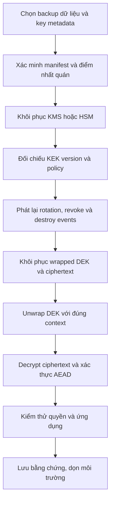

# Kiểm thử restore

Một bản backup chỉ có giá trị khi tổ chức có thể khôi phục nó đúng lúc, đúng phạm vi và vẫn bảo vệ được bí mật mật mã. Trong hệ thống quản lý khóa, kiểm thử restore phải chứng minh nhiều thành phần hoạt động cùng nhau: key material hoặc key object trong KMS/HSM, metadata và chính sách truy cập, khóa dữ liệu được bọc (DEK), ciphertext, cấu hình ứng dụng và trạng thái vòng đời của khóa. Chỉ xác nhận rằng tệp backup tồn tại hoặc lệnh backup trả về thành công chưa chứng minh hệ thống có thể giải mã dữ liệu sau sự cố.

Kiểm thử restore là hoạt động phục hồi có kiểm soát từ một bản backup đã chọn vào môi trường được phép, sau đó xác minh tính toàn vẹn, khả năng sử dụng và các ràng buộc bảo mật. Hoạt động này nối trực tiếp với toàn bộ vòng đời khóa: tạo và cấp phát khóa, lưu trữ trong KMS/HSM, sử dụng để mã hóa hoặc ký, rotation, revocation, thu hồi quyền và hủy vật liệu khóa. Mục tiêu là khôi phục dịch vụ khi cần mà không vô tình đưa một khóa hết hạn, đã thu hồi hoặc bị compromise trở lại trạng thái hoạt động.

## 1. Vì sao phải kiểm thử restore?

Backup có thể bị thiếu, hỏng, mã hóa bằng một khóa không còn truy cập được, hoặc không đồng bộ với dữ liệu đã backup. Một HSM có thể phục hồi được key object nhưng thiếu cấu hình phân quyền; một kho dữ liệu có thể phục hồi ciphertext nhưng không còn phiên bản KEK dùng để unwrap DEK; một KMS có thể khôi phục key material nhưng alias trong ứng dụng lại trỏ đến phiên bản khác. Những lỗi này thường chỉ xuất hiện khi thực sự thực hiện quy trình phục hồi.

Kiểm thử restore giúp trả lời các câu hỏi vận hành quan trọng:

- Có thể lấy đúng bản backup và xác minh nguồn gốc, tính toàn vẹn của nó không?
- Người có thẩm quyền có thể khôi phục khóa qua quy trình quorum hoặc dual control không?
- Khóa được phục hồi có đúng phiên bản, thuật toán, mục đích và trạng thái vòng đời không?
- DEK có thể được unwrap và dữ liệu có thể được giải mã với đúng AAD hoặc context không?
- Dịch vụ có phục hồi trong RTO và RPO đã cam kết không?
- Các lệnh thu hồi, sự kiện compromise và yêu cầu hủy xảy ra sau thời điểm backup có được áp dụng lại không?
- Hệ thống có tiếp tục từ chối thao tác trái phép sau khi restore không?

Một bài kiểm thử tốt phải xác minh cả đường đi thành công lẫn các trường hợp cần bị từ chối. Nếu khóa đã bị thu hồi mà sau restore vẫn có thể ký hoặc mã hóa dữ liệu mới, bài kiểm thử đã phát hiện một lỗi bảo mật nghiêm trọng dù thao tác giải mã mẫu thành công.

## 2. Xác định chính xác phạm vi cần backup và restore

Không có một tệp duy nhất đại diện cho toàn bộ trạng thái quản lý khóa. Trước khi lập kế hoạch, cần liệt kê các thành phần và quan hệ phụ thuộc.

| Thành phần | Nội dung cần bảo vệ hoặc tái tạo | Điểm cần kiểm tra khi restore |
|---|---|---|
| Key material hoặc key object | Khóa đối xứng, private key, key object trong KMS/HSM, hoặc tham chiếu đến khóa bên ngoài | Đúng phiên bản, đúng security domain, đúng thuật toán và trạng thái; không giả định mọi khóa đều có thể export |
| Metadata khóa | `key_id`, version, fingerprint, mục đích, cryptoperiod, owner, custodian, quan hệ cha/con | Không nhầm alias với định danh phiên bản; giữ được liên kết tới ciphertext và workload |
| Chính sách truy cập | IAM, role, grant, policy, quorum và quyền quản trị | Khôi phục theo baseline hiện tại đã duyệt; tránh phục hồi quyền cũ đã bị thu hồi |
| Cấu hình KMS/HSM | Partition, backup domain, provider reference, cấu hình cluster và kết nối cần thiết | Tương thích với cơ chế backup/restore của nhà cung cấp; xác minh trạng thái phần cứng và security domain |
| DEK và wrapped DEK | DEK lưu trong vùng bảo vệ hoặc DEK được bọc bằng KEK | Có thể unwrap đúng DEK; context, tenant và phiên bản KEK khớp |
| Dữ liệu mã hóa | Ciphertext, nonce/IV, tag, AAD, định dạng và metadata của bản ghi | Dữ liệu và key version được phục hồi từ các điểm nhất quán |
| PKI và chữ ký số | CA key, certificate database, serial number, CRL/OCSP state, trust chain và timestamp evidence | Khôi phục được quan hệ khóa/chứng thư và trạng thái thu hồi; không làm sống lại chứng thư đã bị thu hồi |
| Nhật ký và sự kiện | Audit log, rotation, revocation, compromise, destroy và phê duyệt | Có thể phát lại hoặc đối chiếu các sự kiện phát sinh sau thời điểm backup |
| Cấu hình ứng dụng | Key reference, alias mapping, endpoint, thuật toán và định dạng ciphertext | Ứng dụng gọi đúng key version và xử lý lỗi an toàn khi khóa chưa sẵn sàng |

Phạm vi thay đổi theo kiến trúc. Dịch vụ KMS được quản lý có thể cung cấp tính sẵn sàng, replication hoặc cơ chế phục hồi nội bộ; người dùng có thể không được export key material. Với HSM tự quản lý, backup có thể phụ thuộc vào backup domain, thiết bị tương thích và quy trình nhiều người giữ phần bí mật. Với external key manager, cần kiểm thử cả đường kết nối tới hệ thống giữ khóa bên ngoài. Hãy dùng cơ chế được nhà cung cấp hỗ trợ và xác minh giới hạn cụ thể của sản phẩm; không mặc định rằng một bản snapshot máy chủ có thể thay thế backup mật mã của HSM.

### 2.1. Phân biệt backup khóa với backup dữ liệu

Backup dữ liệu thường lưu ciphertext cùng nonce, tag và metadata cần thiết để đọc dữ liệu. Backup khóa lưu hoặc bảo vệ khả năng truy cập tới key material và key object. Hai loại backup phải có liên kết phiên bản rõ ràng. Nếu backup dữ liệu tham chiếu KEK `v12` nhưng backup khóa chỉ có `v11`, quá trình restore có thể không unwrap được DEK.

Với envelope encryption, ứng dụng thường mã hóa dữ liệu bằng DEK, sau đó bọc DEK bằng KEK. Có thể lưu wrapped DEK cùng ciphertext, nhưng KEK cần thiết để unwrap vẫn phải được bảo vệ độc lập. Nếu chỉ có ciphertext và wrapped DEK mà mất KEK, dữ liệu vẫn không thể giải mã. Nếu chỉ phục hồi KEK mà thiếu wrapped DEK, nonce, tag hoặc AAD, cũng không thể tái tạo đầy đủ thao tác giải mã.

### 2.2. Bảo vệ backup của chính khóa

Không lưu key material dạng rõ trong backup thông thường, log, kho mã nguồn hoặc hệ thống ticket. Nếu cần backup key material, phải sử dụng cơ chế bảo vệ được thiết kế cho loại khóa đó, chẳng hạn secure backup của HSM, wrapping bằng khóa backup độc lập hoặc quy trình escrow có kiểm soát. Khóa dùng để bảo vệ backup phải có miền tin cậy và kế hoạch phục hồi riêng; mã hóa backup bằng chính khóa duy nhất đang được backup tạo ra một phụ thuộc vòng tròn.

Với khóa gốc hoặc khóa backup quan trọng, có thể áp dụng dual control, split knowledge và M-of-N quorum. Không một cá nhân nào được tự ý lấy đủ các thành phần cần thiết để khôi phục. Các phần bí mật phải được phân phối, lưu giữ và kiểm kê theo quy trình; việc kiểm thử quorum cần dùng người giữ phần bí mật thực tế hoặc quy trình diễn tập được phê duyệt, không ghi các phần bí mật vào biên bản.

## 3. Đặt mục tiêu RPO và RTO cho khóa và dữ liệu

RPO (Recovery Point Objective) là mức mất dữ liệu hoặc trạng thái có thể chấp nhận, tính theo thời gian. RTO (Recovery Time Objective) là khoảng thời gian mục tiêu để khôi phục dịch vụ. Không nên dùng một con số chung cho toàn bộ hệ thống nếu các thành phần có mức quan trọng khác nhau.

| Thành phần | Câu hỏi để đặt RPO | Câu hỏi để đặt RTO |
|---|---|---|
| KMS/HSM và key metadata | Có thể chấp nhận mất bao nhiêu sự kiện tạo, rotation, grant hoặc thay đổi trạng thái? | Bao lâu phải phục hồi được thao tác mã hóa/giải mã hoặc ký? |
| Revocation và audit events | Có chấp nhận bỏ sót một sự kiện thu hồi hay compromise không? | Bao lâu phải tái áp dụng được trạng thái chặn và bằng chứng kiểm toán? |
| Wrapped DEK và ciphertext | Có thể mất bao nhiêu giao dịch hoặc bản ghi mới nhất? | Bao lâu phải đọc hoặc ghi lại được dữ liệu? |
| PKI và chữ ký số | Có thể mất bao nhiêu thay đổi chứng thư, serial hoặc trạng thái thu hồi? | Bao lâu phải phục hồi xác minh chữ ký hoặc hoạt động CA theo quyền được duyệt? |
| IAM và cấu hình | Có thể phục hồi từ phiên bản policy nào mà vẫn đáp ứng kiểm soát hiện hành? | Bao lâu phải khôi phục quyền tối thiểu cho dịch vụ? |

RPO của sự kiện thu hồi thường cần chặt hơn RPO của một cấu hình thông thường. Nếu backup được tạo trước khi một khóa bị compromise hoặc bị thu hồi, restore snapshot đó mà không phát lại sự kiện mới có thể đưa trạng thái nguy hiểm trở lại. Vì vậy phải bảo vệ nhật ký sự kiện và có cách đối chiếu trạng thái hiện tại độc lập với snapshot.

RTO cần tính cả thời gian xin phê duyệt, tập hợp quorum, chuẩn bị HSM, phục hồi metadata, áp dụng policy, kiểm tra giải mã và khôi phục ứng dụng. Đừng chỉ đo thời gian một lệnh import hoặc restore chạy xong. RPO/RTO phải được đo trong diễn tập và điều chỉnh khi kiến trúc, số lượng khóa, khối lượng dữ liệu hoặc quy trình phê duyệt thay đổi.

## 4. Chuẩn bị một bài kiểm thử restore

Trước khi thực hiện, xác định mục tiêu kiểm thử, phạm vi, người chịu trách nhiệm, môi trường, điểm backup và tiêu chí đạt. Bản kế hoạch cần đủ chi tiết để một nhóm khác có thể lặp lại và đánh giá kết quả.

Các điều kiện chuẩn bị quan trọng:

1. **Phê duyệt và phân vai:** xác định người yêu cầu, người vận hành, người giữ quorum, người xác minh độc lập và người chấp nhận rủi ro. Không để một người vừa khôi phục vừa tự phê duyệt kết quả nhạy cảm.
2. **Môi trường cô lập:** dùng tài khoản, mạng, HSM partition hoặc KMS project dành cho recovery test. Chặn kết nối không cần thiết tới production; không cho ứng dụng thử nghiệm ghi đè dữ liệu hoặc policy thật.
3. **Bản backup đã chọn:** ghi ID, thời điểm, vùng lưu trữ, loại backup, chuỗi incremental nếu có, phiên bản công cụ và trạng thái lưu giữ. Chọn bản đại diện cho kịch bản thực tế, bao gồm cả một điểm backup cũ nếu cần kiểm tra point-in-time recovery.
4. **Bằng chứng toàn vẹn:** xác minh manifest, chữ ký hoặc checksum theo thiết kế. Manifest cần liên kết bản backup với key version, dữ liệu, thời điểm và phiên bản schema.
5. **Bộ dữ liệu kiểm thử:** chuẩn bị ciphertext mẫu, nonce/IV, tag, AAD và kết quả mong đợi. Dùng dữ liệu tổng hợp hoặc đã được phê duyệt; không đưa plaintext nhạy cảm vào log hay môi trường không được phép.
6. **Quy trình khôi phục quyền:** chuẩn bị danh sách quyền tối thiểu và người phê duyệt. Không phục hồi toàn bộ quyền quản trị cũ chỉ để làm bài kiểm thử chạy nhanh.
7. **Tiêu chí dừng:** xác định điều kiện dừng ngay, ví dụ phát hiện backup không đúng nguồn, sai security domain, key fingerprint không khớp, lệnh restore có thể tác động production hoặc phát hiện bí mật bị lộ.
8. **Kế hoạch dọn dẹp:** xác định cách vô hiệu hóa và hủy key object thử nghiệm, xóa dữ liệu tạm và thu hồi credential sau khi hoàn tất.

Không dùng một bài kiểm thử restore để thử nghiệm tùy tiện trên production. Nếu cần diễn tập failover production, phải có runbook riêng, phê duyệt, giới hạn tác động và cơ chế quay lại đã được kiểm chứng.

## 5. Quy trình kiểm thử restore từng bước

### Bước 1: Ghi nhận trạng thái ban đầu

Lưu mã bài kiểm thử, người tham gia, phạm vi, thời điểm bắt đầu, mục tiêu RPO/RTO, key ID/version, provider, backup ID và các phụ thuộc. Ghi trạng thái vòng đời hiện tại từ nguồn quản trị có thẩm quyền. Việc này giúp so sánh trạng thái trước và sau, đồng thời phát hiện các thay đổi phát sinh trong khi bài kiểm thử đang chạy.

### Bước 2: Chọn và xác minh bản backup

Đọc manifest và xác minh chữ ký hoặc checksum bằng trust anchor độc lập với vùng lưu backup. Kiểm tra backup thuộc đúng hệ thống, đúng tenant hoặc security domain, đúng thời điểm và đúng chuỗi incremental. Xác minh rằng bản backup chưa bị thay thế hoặc hết hạn lưu giữ.

Checksum giúp phát hiện thay đổi dữ liệu khi giá trị tham chiếu được bảo vệ. Một checksum không có xác thực có thể bị kẻ tấn công thay cùng với backup. Vì vậy, manifest quan trọng nên được ký hoặc xác thực bằng khóa độc lập và được lưu trong vùng có kiểm soát. Kết quả xác minh phải ghi lại mã tham chiếu và trạng thái, không đưa bí mật vào log.

### Bước 3: Chuẩn bị miền phục hồi và quorum

Khởi tạo HSM/KMS recovery environment theo hướng dẫn của provider. Xác minh phiên bản firmware, phần mềm, backup domain, partition và cấu hình tương thích. Nếu cần nhiều người giữ phần bí mật, thực hiện quy trình quorum và ghi nhận ai đã tham gia, thời điểm và kết quả phê duyệt mà không lưu các phần bí mật.

Không hạ thấp ngưỡng quorum hoặc tạm bỏ dual control để rút ngắn RTO. Nếu thiếu người giữ phần bí mật hoặc thiết bị tương thích, ghi nhận đây là một lỗi về khả năng phục hồi và xử lý theo kế hoạch dự phòng đã duyệt.

### Bước 4: Phục hồi key object và metadata

Khôi phục key object hoặc kết nối tới key service theo cơ chế được hỗ trợ. Đối chiếu định danh phiên bản, fingerprint hoặc public key, thuật toán, mục đích, thời điểm tạo và trạng thái. Khóa vừa được phục hồi nên ở trạng thái bị giới hạn hoặc cách ly cho đến khi hoàn tất đối chiếu policy và sự kiện vòng đời.

Không dựa vào alias làm bằng chứng duy nhất. Alias có thể đã được trỏ sang phiên bản mới sau khi backup được tạo. Inventory phải ánh xạ được alias, key ID và version cụ thể. Nếu provider cấp một resource reference mới sau restore, lưu ánh xạ giữa reference mới và định danh logic cũ theo quy ước của tổ chức.

### Bước 5: Áp dụng policy và danh tính hiện hành

Phục hồi metadata chính sách từ backup để tham khảo, sau đó đối chiếu với baseline IAM và policy đang có hiệu lực. Cấp quyền tối thiểu cho các thao tác cần kiểm thử; phân biệt quyền quản trị key object với quyền sử dụng khóa. Kiểm tra các grant cũ, service account đã nghỉ, role tạm thời và credential có thể đã bị thu hồi.

Policy từ backup có thể chứa quyền đã bị loại bỏ sau thời điểm backup. Không áp dụng nguyên trạng nếu chưa so sánh với trạng thái hiện tại. Kiểm thử cả quyền được phép và quyền phải bị từ chối, chẳng hạn một workload chỉ có quyền decrypt dữ liệu thuộc tenant của nó và không có quyền export key material.

### Bước 6: Phát lại các sự kiện sau thời điểm backup

Đối chiếu snapshot với audit log hoặc event ledger độc lập. Tìm các sự kiện xảy ra sau điểm backup: rotation, suspend, revoke, compromise, thay đổi owner, thu hồi grant, yêu cầu destroy hoặc thay đổi trust anchor. Áp dụng lại các sự kiện theo thứ tự và quy tắc xử lý đã định nghĩa.

Đây là bước đặc biệt quan trọng. Một snapshot trước khi thu hồi có thể chứa khóa ở trạng thái `ACTIVE`. Nếu khóa đã bị thu hồi sau snapshot, restore không được làm nó hoạt động trở lại. Một snapshot trước khi hủy cũng có thể chứa bản sao key material đã được chủ đích xóa để thực hiện crypto-erasure. Tombstone hoặc sự kiện hủy có thẩm quyền phải ngăn bản sao cũ được tái sử dụng trái chính sách.

### Bước 7: Phục hồi dữ liệu và các quan hệ phụ thuộc

Khôi phục ciphertext, nonce/IV, tag, AAD, wrapped DEK và metadata cần thiết từ điểm nhất quán đã chọn. Xác minh mỗi wrapped DEK tham chiếu đúng KEK version. Nếu dữ liệu và key metadata được backup ở các thời điểm khác nhau, phải chứng minh các phiên bản vẫn tương thích; không đoán key version từ alias hiện tại.

Với PKI, phục hồi cơ sở dữ liệu chứng thư, số serial, trạng thái CRL/OCSP, chain và thông tin timestamp theo quy trình của CA. Cần xác minh rằng việc phục hồi không làm mất các chứng thư đã thu hồi sau snapshot. Với chữ ký số, phân biệt khả năng ký mới bằng private key và khả năng xác minh chữ ký lịch sử bằng public key cùng bằng chứng thời gian.

### Bước 8: Chạy kiểm tra mật mã

Thực hiện các kiểm tra phù hợp với loại khóa:

- **Khóa đối xứng:** giải mã một ciphertext kiểm thử đã biết, cung cấp đúng nonce/IV, tag và AAD; so sánh kết quả với giá trị mong đợi hoặc digest của plaintext kiểm thử.
- **Khóa AEAD:** ngoài trường hợp thành công, thay đổi một bit trong ciphertext, tag hoặc AAD và xác nhận thao tác bị từ chối. Không được trả về plaintext không xác thực.
- **Cặp khóa bất đối xứng:** dùng private key đã phục hồi để ký một thông điệp kiểm thử, rồi xác minh bằng public key tương ứng; đối chiếu fingerprint và certificate chain.
- **Khóa bọc:** unwrap một DEK kiểm thử trong đúng context; xác nhận context khác tenant hoặc khác mục đích bị từ chối.
- **HSM:** kiểm tra self-test, trạng thái partition, thuộc tính non-extractable và các giới hạn sử dụng theo cấu hình. Dùng cơ chế xác minh của nhà cung cấp; không export raw key chỉ để so sánh.
- **Quyền truy cập:** xác nhận principal hợp lệ có thể thực hiện đúng thao tác và principal không hợp lệ bị từ chối.

Một KCV (Key Check Value) hoặc fingerprint có thể hỗ trợ phát hiện nhầm khóa, nhưng không thay thế kiểm tra giải mã, xác minh chữ ký và policy. Không tiết lộ giá trị kiểm tra theo cách tạo điều kiện suy luận về key material; lưu chúng theo chính sách metadata và audit.

### Bước 9: Kiểm tra tích hợp ứng dụng và đo RTO/RPO

Khởi động workload thử nghiệm với key reference đã phục hồi. Kiểm tra luồng nghiệp vụ ở mức cần thiết: đọc dữ liệu cũ, ghi dữ liệu mới bằng phiên bản khóa hiện hành, xử lý lỗi KMS/HSM, retry, timeout và cache. Đo thời gian từ lúc bắt đầu quy trình phục hồi đến khi đạt tiêu chí dịch vụ, không chỉ đo thời gian restore key object.

Đối chiếu dữ liệu phục hồi với điểm backup đã chọn để xác định RPO thực tế. Ghi rõ số bản ghi hoặc sự kiện bị thiếu, nếu có. Nếu một thao tác chỉ thành công nhờ dùng quyền quản trị quá rộng, bài kiểm thử không đạt tiêu chí bảo mật dù ứng dụng chạy được.

### Bước 10: Cô lập, dọn dẹp và lưu bằng chứng

Sau khi kiểm thử, vô hiệu hóa hoặc hủy key object thử nghiệm theo kế hoạch, thu hồi credential tạm, xóa dữ liệu kiểm thử và xác minh không còn đường truy cập từ môi trường thử nghiệm tới production. Nếu cần giữ lại bằng chứng, chỉ lưu metadata, log đã lọc bí mật, kết quả test, manifest reference và phê duyệt. Không lưu plaintext, raw key, recovery share hoặc token trong báo cáo.

## 6. Các phép kiểm tra mật mã cần có

Kiểm thử restore không nên dừng ở việc provider báo `SUCCESS`. Cần kiểm tra từng thuộc tính theo mục tiêu.

| Phép kiểm tra | Cách thực hiện | Điều kiện đạt |
|---|---|---|
| Nguồn gốc backup | Xác minh chữ ký manifest hoặc MAC bằng trust anchor độc lập | Manifest hợp lệ, đúng hệ thống và đúng backup ID |
| Tính toàn vẹn | Kiểm tra checksum/hash của các thành phần và chuỗi backup | Không có thành phần thiếu hoặc sai lệch ngoài dự kiến |
| Đúng phiên bản khóa | Đối chiếu key ID, version, fingerprint hoặc public key | Khớp với inventory và tham chiếu của dữ liệu |
| Giải mã mẫu | Decrypt ciphertext kiểm thử cùng nonce, tag và AAD | Plaintext hoặc digest khớp kết quả đã biết |
| Xác thực AEAD | Thử sai tag hoặc AAD | Thao tác thất bại và không trả plaintext chưa xác thực |
| Cặp khóa ký | Sign bằng private key, verify bằng public key | Chữ ký hợp lệ và certificate chain đúng |
| Quyền hạn | Thử principal được cấp và principal không được cấp quyền | Đúng thao tác được phép; thao tác trái quyền bị từ chối |
| Trạng thái vòng đời | Kiểm tra khóa đã revoked, compromised hoặc destroyed | Không bị chuyển về trạng thái hoạt động trái phép |
| Khả năng phục hồi dịch vụ | Chạy smoke test qua ứng dụng | Luồng nghiệp vụ đạt tiêu chí và RTO/RPO |

Test vector phải được quản lý như dữ liệu kiểm thử nhạy cảm. Nên tạo vector bằng quy trình được kiểm soát, giữ expected result độc lập với backup đang kiểm tra và tránh dùng dữ liệu production thật. Khi test yêu cầu decrypt một mẫu dữ liệu cũ, phải ghi rõ key version, context và chính sách cho phép sử dụng khóa đó.

## 7. Khôi phục hệ thống dùng envelope encryption

Envelope encryption tạo ra chuỗi phụ thuộc: dữ liệu được mã hóa bằng DEK; DEK được bọc bằng KEK; ứng dụng cần metadata để biết cách tìm KEK và context cần dùng để unwrap. Restore phải kiểm tra toàn bộ chuỗi này.



Giả sử một bản ghi có ciphertext được mã hóa bằng `DEK-42`, còn DEK này được bọc bởi `KEK-7`. Backup dữ liệu lưu ciphertext, nonce, tag, AAD và wrapped DEK; backup KMS/HSM phải cho phép phục hồi hoặc truy cập hợp lệ tới `KEK-7`. Nếu tổ chức đã rotation sang `KEK-8`, inventory cần cho biết `KEK-7` còn được phép unwrap trong phạm vi nào. Nếu `KEK-7` bị compromise hoặc đã bị hủy, không thể tự động cho phép unwrap chỉ vì bản backup cũ còn tồn tại.

Khi chỉ KEK thay đổi và DEK vẫn an toàn, có thể rewrap DEK sang KEK mới mà không cần mã hóa lại toàn bộ ciphertext. Khi DEK bị compromise, rewrap DEK cũ không loại bỏ rủi ro; cần tạo DEK mới và mã hóa lại dữ liệu theo kế hoạch. Bài kiểm thử nên phân biệt hai trường hợp này để chứng minh recovery không làm sai chính sách bảo vệ dữ liệu.

## 8. Xử lý revocation, compromise và crypto-erasure khi restore

Restore là thời điểm dễ làm sống lại trạng thái cũ. Cần xử lý riêng ba tình huống.

**Khóa đã bị thu hồi sau thời điểm backup:** phục hồi key object vào trạng thái cách ly, đọc event ledger mới nhất và áp dụng lại trạng thái `REVOKED` hoặc trạng thái tương ứng. Nếu chính sách cho phép giải mã dữ liệu cũ trong giai đoạn chuyển đổi, chỉ cấp quyền decrypt/unwrap đúng phạm vi và thời hạn. Không tự động cấp lại quyền encrypt/sign.

**Khóa bị compromise:** không đưa bản sao khóa đó trở lại hoạt động bình thường. Bản backup có thể chứa cùng bí mật đã bị lộ nên bản thân backup cũng phải được xem là có khả năng bị ảnh hưởng. Cần khôi phục dịch vụ bằng khóa mới, đánh giá DEK/KEK và ciphertext liên quan, thu hồi credential, điều tra phạm vi truy cập và chỉ dùng bản sao khóa cũ trong môi trường điều tra hoặc recovery đặc biệt nếu được phê duyệt. Nếu cần giải mã dữ liệu để chuyển đổi, phải có quyết định rủi ro, giới hạn truy cập và audit riêng.

**Khóa đã bị hủy có chủ đích:** nếu việc hủy nhằm thực hiện crypto-erasure hoặc đáp ứng yêu cầu xóa dữ liệu, không được phục hồi bản sao key material cũ để làm dữ liệu có thể đọc lại. Event ledger hoặc tombstone phải ngăn snapshot cũ đảo ngược quyết định hủy. Nếu việc hủy là nhầm lẫn và tổ chức có quyền phục hồi, phải xử lý như một ngoại lệ được phê duyệt, kiểm tra yêu cầu lưu giữ và ghi nhận đầy đủ lý do.

Một cách triển khai là duy trì nhật ký sự kiện vòng đời chỉ được bổ sung, có sequence hoặc chữ ký xác thực, nằm độc lập với snapshot. Sau restore, hệ thống lấy snapshot làm điểm khởi đầu rồi đối chiếu các sự kiện mới hơn. Nguồn sự kiện có thẩm quyền và quy tắc giải quyết xung đột phải được định nghĩa trước khi có sự cố.

## 9. Các kịch bản kiểm thử nên diễn tập

| Kịch bản | Mục tiêu | Bằng chứng cần thu |
|---|---|---|
| Mất một key version | Khôi phục đúng phiên bản và đọc được dữ liệu phụ thuộc | Key fingerprint/version, kết quả decrypt, thời gian phục hồi |
| Mất một HSM hoặc partition | Phục hồi bằng secure backup hoặc thiết bị dự phòng theo quorum | Quorum record, HSM self-test, trạng thái partition, test sign/decrypt |
| Xóa nhầm key object | Khôi phục hoặc tái tạo theo cơ chế provider cho phép | Event xóa, backup ID, mapping resource reference, policy sau phục hồi |
| Mất một region hoặc KMS endpoint | Chuyển sang vùng phục hồi và kiểm tra ứng dụng | Endpoint, quyền, độ trễ, RTO/RPO và kết quả smoke test |
| Backup bị hỏng hoặc thiếu incremental | Phát hiện trước khi sử dụng và chọn bản hợp lệ khác | Manifest verification, lỗi checksum, backup chain và quyết định chọn bản |
| Mất credential quản trị | Dùng break-glass và quorum có kiểm soát | Phê duyệt, danh tính tham gia, thời gian cấp/thu hồi quyền |
| Snapshot cũ hơn sự kiện revoke | Chứng minh restore không tái kích hoạt khóa | Event replay, trạng thái cuối, negative test cho encrypt/sign |
| Snapshot cũ hơn sự kiện destroy | Ngăn phục hồi khóa đã hủy có chủ đích | Tombstone, event sequence, bằng chứng khóa không được tái sử dụng |
| Nghi ngờ compromise | Khôi phục bằng khóa mới và giữ khóa cũ cách ly | Incident link, policy deny, key replacement, kiểm tra dữ liệu ảnh hưởng |
| Khôi phục CA hoặc signing key | Phục hồi khả năng ký/xác minh và trạng thái chứng thư | Key pair match, certificate database, CRL/OCSP và test signature |
| Backup dữ liệu và backup khóa lệch thời điểm | Kiểm tra tương thích version và tính nhất quán | Manifest thời điểm, dependency map, kết quả decrypt mẫu |
| Ransomware hoặc xóa backup online | Phục hồi từ bản immutable/offline và xác minh nguồn | Bằng chứng immutability, quyền truy cập, signature manifest và restore test |

Không cần chạy mọi kịch bản trong mỗi lần diễn tập. Xây dựng lịch theo mức độ quan trọng và rủi ro; các kịch bản compromise, revocation và phục hồi quyền gốc cần được diễn tập định kỳ vì chúng dễ bị bỏ sót trong bài kiểm tra backup thông thường.

## 10. Ví dụ kế hoạch kiểm thử

Ví dụ dưới đây mô tả metadata của một bài test. Các tên, ID và giá trị chỉ mang tính minh họa; không chứa key material hay credential.

```yaml
restore_test:
  test_id: KMS-RESTORE-DRILL-07
  scope:
    service: customer-data-encryption
    provider: kms-hsm-recovery-environment
    key_id: customer-data-kek
    key_version: "v8"
    data_set: synthetic-customer-records
  backup:
    backup_id: backup-2026-11-20T020000Z
    created_at: "2026-11-20T02:00:00Z"
    manifest_signature_check: required
    consistency_point: snapshot-2026-11-20-0200
  objectives:
    rpo_minutes: 60
    rto_minutes: 120
  controls:
    isolated_environment: true
    quorum_required: true
    production_network_access: false
    apply_latest_revocation_events: true
    restore_keys_disabled_until_verified: true
  tests:
    - verify_backup_manifest
    - restore_key_version
    - reconcile_lifecycle_events
    - unwrap_test_dek
    - decrypt_known_ciphertext
    - reject_modified_aad
    - verify_access_denied_for_unapproved_principal
    - application_smoke_test
  acceptance:
    key_version_matches: true
    crypto_tests_pass: true
    revoked_keys_remain_blocked: true
    measured_rto_within_target: true
    measured_rpo_within_target: true
  cleanup:
    disable_test_key_objects: true
    revoke_temporary_credentials: true
    remove_test_data: true
```

Trường `restore_keys_disabled_until_verified` là quy ước của kế hoạch minh họa, không phải thuộc tính có sẵn trong mọi KMS. Cách thực thi thực tế phụ thuộc provider, HSM và kiến trúc ứng dụng. Tương tự, `apply_latest_revocation_events` cần được hỗ trợ bởi một event source có thẩm quyền, không phải chỉ là một cờ trong tệp cấu hình.

## 11. Ví dụ luồng xác minh sau restore

Giả mã sau minh họa thứ tự kiểm tra. Các hàm là tên trừu tượng, không phải API của một KMS/HSM cụ thể.

```text
function verifyRestore(plan):
    assert plan.environment.isolated
    assert verifySignedManifest(plan.backup.manifest)

    restored = restoreKeyObjects(plan.backup, restrictedState=true)
    assert matchKeyVersions(restored, plan.expectedKeyVersions)

    events = loadAuthoritativeEventsAfter(plan.backup.consistencyPoint)
    applyLifecycleEvents(restored, events)
    applyCurrentAccessBaseline(restored)

    assert revokedAndCompromisedKeysRemainBlocked(restored)

    dek = unwrapTestDek(
        restored.keyVersion,
        plan.testVector.wrappedDek,
        plan.testVector.context
    )
    plaintext = decryptAead(
        dek,
        plan.testVector.ciphertext,
        plan.testVector.nonce,
        plan.testVector.tag,
        plan.testVector.aad
    )
    assert digest(plaintext) == plan.testVector.expectedDigest

    assert modifiedAadIsRejected(dek, plan.testVector)
    assert unauthorizedPrincipalIsDenied(restored)
    result = runApplicationSmokeTests(plan.application)

    recordEvidence(plan, restored, events, result)
    cleanupRecoveryEnvironment(plan)
    return evaluateRpoRtoAndAcceptance(plan, result)
```

Trong triển khai thật, phải xử lý lỗi ở từng bước, bảo đảm cleanup luôn chạy khi test thất bại, kiểm tra quyền gọi, chống replay và ghi nhận trạng thái từng thành phần. Không để hàm xác minh vô tình log plaintext hoặc secret. Nếu restore một key version thất bại, dừng các bước phụ thuộc vào nó và ghi rõ phạm vi chưa thể xác minh.

## 12. Đánh giá kết quả và bằng chứng kiểm toán

Một bài kiểm thử cần có kết luận rõ ràng: `PASS`, `FAIL` hoặc `PARTIAL`, cùng tiêu chí nào đạt và tiêu chí nào chưa đạt. Không đánh dấu `PASS` chỉ vì lệnh restore trả về thành công.

Bằng chứng nên bao gồm:

- Test ID, phạm vi, người tham gia, phê duyệt và thời điểm thực hiện.
- Backup ID, manifest reference, kết quả xác minh chữ ký/checksum và consistency point.
- Key ID/version, fingerprint hoặc public key reference, provider response và trạng thái HSM/KMS.
- Kết quả replay lifecycle events, policy reconciliation và negative authorization tests.
- Kết quả decrypt, AEAD tamper test, sign/verify hoặc phép kiểm tra phù hợp với loại khóa.
- RTO/RPO đo được, lỗi phát sinh, số lần retry và thời gian chờ quorum.
- Bằng chứng cleanup, thu hồi credential tạm và xác nhận không còn key object thử nghiệm.
- Hành động khắc phục, owner, thời hạn và kết quả kiểm thử lại.

Không đưa raw key, recovery share, password, token, plaintext nhạy cảm hoặc dữ liệu cá nhân vào evidence. Dùng ID tham chiếu, digest, log đã lọc và kết quả kiểm tra. Lưu bằng chứng ở nơi có quyền truy cập, thời hạn lưu giữ và audit phù hợp.

Các chỉ số hữu ích gồm tỷ lệ bài test đạt, thời gian phục hồi thực tế so với RTO, độ lệch RPO, tỷ lệ backup có manifest hợp lệ, tỷ lệ key version có dependency mapping đầy đủ, số lượng consumer chưa đồng bộ và số lỗi do quorum hoặc credential. Một bài test thất bại vẫn có giá trị nếu lỗi được ghi nhận, gán owner và kiểm thử lại sau khi khắc phục.

## 13. Lỗi thường gặp và cách khắc phục

- **Chỉ kiểm tra backup tồn tại:** thêm restore thực tế và crypto test với dữ liệu mẫu đã biết.
- **Backup khóa và dữ liệu không cùng điểm nhất quán:** tạo manifest liên kết key version, wrapped DEK và data snapshot; kiểm tra tương thích trước khi mở dịch vụ.
- **Mất khóa dùng để mở backup:** thiết kế recovery root độc lập, quorum và diễn tập phục hồi chính khóa backup.
- **Phục hồi policy cũ:** so sánh với baseline hiện tại, chỉ cấp quyền tối thiểu và kiểm thử principal bị từ chối.
- **Dùng alias thay cho version:** lưu định danh bất biến và kiểm tra fingerprint hoặc public key reference.
- **Không phát lại revocation:** dùng event ledger độc lập, đối chiếu sự kiện mới hơn snapshot và xác minh khóa vẫn bị chặn.
- **Đưa khóa compromise trở lại hoạt động:** cách ly bản sao cũ, tạo khóa thay thế và đánh giá lại DEK, ciphertext, credential cùng dữ liệu phụ thuộc.
- **Khôi phục khóa đã crypto-erase:** dùng tombstone hoặc sự kiện destroy có thẩm quyền để ngăn snapshot cũ hồi sinh key material.
- **Bỏ qua AAD hoặc context:** lưu đầy đủ metadata cần thiết và kiểm tra sai tenant, sai purpose hoặc sai resource bị từ chối.
- **Chỉ thử đường đi thành công:** bổ sung negative test cho tag/AAD sai, principal không hợp lệ và thao tác trên key version đã thu hồi.
- **Không đo RTO/RPO:** đo toàn bộ quy trình, bao gồm quorum, phê duyệt, policy, kiểm tra và ứng dụng.
- **Không dọn môi trường:** thu hồi credential, hủy key object thử nghiệm và xác minh đường kết nối tới production đã đóng.
- **Bằng chứng chứa bí mật:** lọc log, chỉ lưu reference và kết quả xác minh, kiểm tra quyền truy cập vào evidence store.

## 14. Tình huống thực tế: khôi phục dịch vụ đọc dữ liệu sau sự cố vùng

Một dịch vụ lưu hồ sơ khách hàng dùng DEK riêng cho từng nhóm dữ liệu. Các DEK được bọc bằng KEK trong KMS của một vùng. Dữ liệu và wrapped DEK được backup định kỳ sang vùng dự phòng; key metadata, policy và audit events được sao lưu theo cơ chế riêng. Khi vùng chính gặp sự cố, nhóm vận hành phải khôi phục khả năng đọc dữ liệu tại vùng dự phòng.

Nhóm bắt đầu bằng việc xác minh backup manifest và consistency point, sau đó phục hồi key service theo quy trình của provider. Các key version được nạp trong trạng thái giới hạn. Inventory cho biết KEK `v5` đã rotation sang `v6` trước thời điểm sự cố, còn `v5` chỉ được phép unwrap một số DEK cũ trong thời gian chuyển đổi. Audit event độc lập cho biết một grant quản trị đã bị thu hồi sau snapshot. Nhóm áp dụng lại rotation và grant revocation trước khi cấp quyền cho workload.

Tiếp theo, nhóm khôi phục ciphertext và wrapped DEK từ cùng consistency point, xác minh context cho từng tenant, rồi chạy decrypt test với dữ liệu tổng hợp. Một test vector có AAD bị sửa phải thất bại; một service account của tenant khác cũng phải bị từ chối khi unwrap. Cuối cùng, ứng dụng đọc được các bản ghi mẫu, ghi dữ liệu mới bằng phiên bản KEK hiện hành, và không có thao tác nào dùng `v5` để tạo dữ liệu mới.

Kết quả chỉ được chấp nhận khi thời gian phục hồi và lượng dữ liệu mất nằm trong RTO/RPO, các grant đã thu hồi vẫn bị chặn, và evidence không chứa key material. Nếu một trong các kiểm tra này thất bại, nhóm có thể giữ dịch vụ ở chế độ hạn chế trong khi xử lý sai lệch; không nên mở toàn bộ traffic chỉ vì KMS đã sẵn sàng.

## 15. Checklist trước khi kết thúc một bài kiểm thử

- [ ] Có mục tiêu, phạm vi, owner, người xác minh và phê duyệt rõ ràng.
- [ ] Đã chọn đúng backup ID, consistency point và chuỗi backup cần thiết.
- [ ] Manifest được xác minh bằng trust anchor độc lập; không có thành phần thiếu hoặc sai lệch.
- [ ] Môi trường phục hồi được cô lập và không thể ghi đè production.
- [ ] Quorum, dual control và recovery credential được thực hiện đúng quy trình.
- [ ] Key ID, version, fingerprint, thuật toán và mục đích khớp inventory.
- [ ] Policy hiện hành đã được áp dụng; quyền cũ và credential đã thu hồi không bị phục hồi.
- [ ] Sự kiện rotation, revoke, compromise và destroy sau snapshot đã được đối chiếu hoặc phát lại.
- [ ] Wrapped DEK, KEK version, ciphertext, nonce, tag và AAD khớp cùng context.
- [ ] Decrypt, sign/verify hoặc phép kiểm tra mật mã phù hợp đã thành công.
- [ ] Negative tests xác nhận tag/AAD sai và principal không hợp lệ bị từ chối.
- [ ] Khóa bị compromise hoặc crypto-erased không bị đưa trở lại trạng thái hoạt động.
- [ ] Ứng dụng đạt smoke test và RTO/RPO đo được nằm trong mục tiêu.
- [ ] Credential tạm, key object và dữ liệu kiểm thử đã được dọn dẹp.
- [ ] Evidence không chứa key material, recovery share, token hoặc plaintext nhạy cảm.
- [ ] Mọi lỗi có owner, thời hạn khắc phục và lịch kiểm thử lại.

Kiểm thử restore chỉ hoàn tất khi chứng minh được cả ba điều: tổ chức có thể phục hồi đúng khóa và dữ liệu cần thiết, các trạng thái bảo mật mới nhất vẫn được tôn trọng, và dịch vụ trở lại trong giới hạn thời gian đã cam kết. Lặp lại bài kiểm thử theo lịch và sau những thay đổi lớn của KMS/HSM, key hierarchy, policy hoặc quy trình backup để bảo đảm khả năng phục hồi luôn còn hiệu lực.
