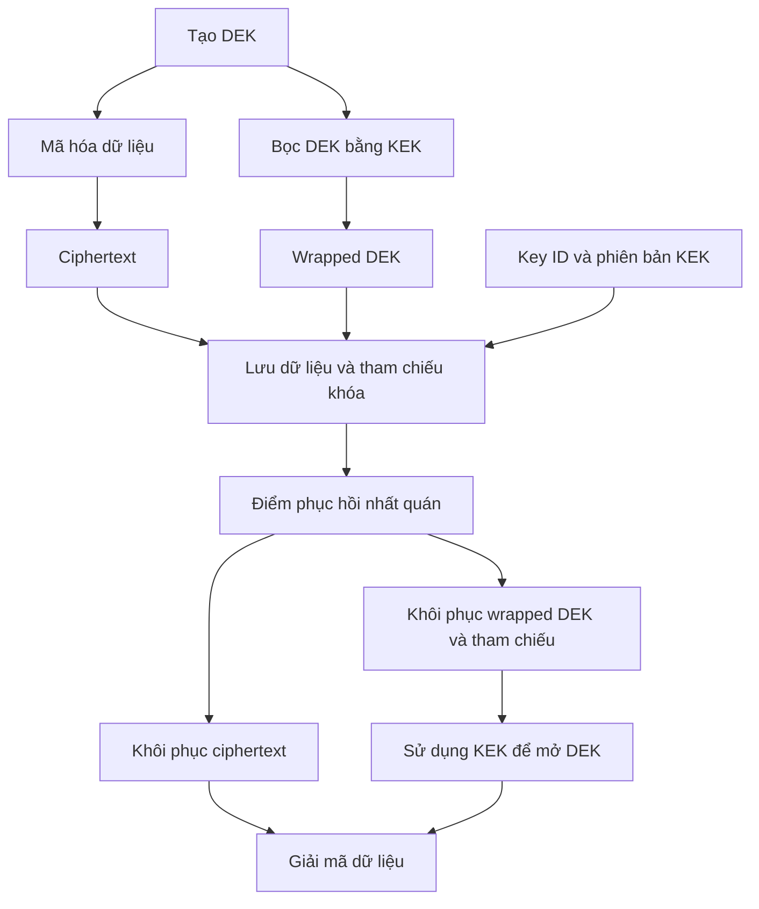

# RPO của key material

Trong chương **Backup và recovery** của module `SECURITY_KEY_MANAGEMENT_FUNDAMENTALS`, bài học này giải thích Recovery Point Objective (RPO) khi bảo vệ và phục hồi key material. RPO giúp xác định tổ chức có thể chấp nhận mất bao nhiêu thay đổi về khóa khi xảy ra sự cố. Với hệ thống mật mã, một khoảng mất mát ngắn vẫn có thể khiến dữ liệu không thể giải mã, chữ ký không thể xác minh hoặc dịch vụ không thể tiếp tục hoạt động. Vì vậy, mục tiêu RPO phải được thiết kế cùng cách tạo, lưu trữ, sao lưu, nhân bản và sử dụng khóa.

## 1. RPO là gì?

**Recovery Point Objective (RPO)** là điểm phục hồi mục tiêu: mức dữ liệu hoặc thay đổi gần nhất mà tổ chức yêu cầu phải có thể khôi phục sau một sự cố. RPO thường được diễn đạt thành một khoảng thời gian tối đa có thể mất tính ngược từ thời điểm sự cố về trạng thái phục hồi gần nhất.

Ví dụ, một hệ thống gặp sự cố lúc 14:30. Bản phục hồi nhất quán gần nhất được tạo lúc 14:20. Nếu các thay đổi sau 14:20 không thể khôi phục, khoảng mất mát là 10 phút. RPO thực tế của lần phục hồi đó là 10 phút. Nếu chính sách đặt RPO mục tiêu là 5 phút, hệ thống đã không đạt mục tiêu.

Đối với key material, RPO cần trả lời câu hỏi: **Sau sự cố, tổ chức phải giữ được đến thời điểm nào các khóa và trạng thái liên quan để dữ liệu, ứng dụng và quy trình mật mã tiếp tục hoạt động đúng?** Phạm vi có thể bao gồm key material, phiên bản khóa, thông tin wrapping, tham chiếu khóa và trạng thái quản lý khóa cần thiết để phục hồi.

RPO bằng 0 có nghĩa là không chấp nhận mất các thay đổi đã được xác nhận là bền vững trong phạm vi đã định nghĩa. Điều này thường đòi hỏi ghi đồng bộ, sao chép đồng bộ hoặc một cơ chế xác nhận bền vững tương đương. RPO bằng 0 không có nghĩa dịch vụ không gián đoạn hoặc khôi phục tức thì; thời gian đưa hệ thống hoạt động trở lại thuộc mục tiêu RTO.

RPO là mục tiêu thiết kế. **RPO thực tế** chỉ được xác định sau khi kiểm tra bản phục hồi, xác minh tính nhất quán và xác định mốc thay đổi gần nhất có thể sử dụng an toàn. Thời điểm snapshot mới nhất không nhất thiết là điểm phục hồi hợp lệ nếu snapshot hỏng, thiếu phụ thuộc hoặc không thể mở bằng khóa bảo vệ tương ứng.

## 2. Vì sao RPO của key material cần được xác định riêng?

RPO dữ liệu và RPO khóa có liên quan chặt chẽ, nhưng chúng không tự động giống nhau. Dữ liệu đã mã hóa có thể được sao lưu đầy đủ trong khi khóa giải mã mới nhất chưa được sao lưu. Ngược lại, khóa có thể được giữ nguyên nhưng ciphertext hoặc wrapped DEK tương ứng đã mất.

Một số đặc điểm làm cho RPO của khóa đặc biệt quan trọng:

- **Khóa thường không thể tái tạo từ ciphertext.** Nếu một khóa được tạo ngẫu nhiên rồi mất trước khi được lưu hoặc backup bền vững, dữ liệu được mã hóa bằng khóa đó có thể không còn giải mã được.
- **Mỗi phiên bản khóa có thể bảo vệ một tập dữ liệu khác nhau.** Khôi phục phiên bản cũ trong khi dữ liệu đã được mã hóa bằng phiên bản mới có thể làm dữ liệu không đọc được.
- **Khóa có các trạng thái bảo mật.** Một khóa có thể được kích hoạt, vô hiệu hóa, thu hồi, lên lịch xóa hoặc đánh dấu bị compromise. Phục hồi một trạng thái cũ có thể làm sống lại quyền sử dụng nguy hiểm.
- **Khóa có các phụ thuộc.** Backup wrapping key, backup domain của HSM, metadata, quyền truy cập và bản ghi tham chiếu có thể cần thiết để mở hoặc sử dụng key material.
- **Một khóa có thể bảo vệ rất nhiều dữ liệu.** Mất một KEK hoặc khóa gốc có thể ảnh hưởng đến nhiều DEK và nhiều đối tượng dữ liệu cùng lúc.

Vì vậy, chính sách RPO cần xem xét cả tính sẵn sàng và tính liên tục của trạng thái bảo mật. Mục tiêu không chỉ là khôi phục được một chuỗi byte của khóa, mà còn phải khôi phục được khóa đúng phiên bản, đúng mục đích và đúng trạng thái được phép sử dụng.

## 3. Xác định phạm vi RPO cho key material

Trước khi đặt con số RPO, cần xác định chính xác đối tượng nào được đo. Một phạm vi phục hồi khóa thường gồm các thành phần sau:

| Thành phần | Vì sao ảnh hưởng đến điểm phục hồi |
|---|---|
| Key material | Cung cấp bí mật mật mã thực tế. Mất khóa không thể tái tạo có thể làm dữ liệu không thể giải mã hoặc làm gián đoạn thao tác ký |
| Key ID và phiên bản | Liên kết dữ liệu, ứng dụng và bản ghi vận hành với đúng khóa |
| Thuộc tính khóa | Thuật toán, độ dài, mục đích sử dụng, quyền export và cấu hình liên quan giúp xác minh khóa được phục hồi đúng chức năng |
| Trạng thái vòng đời | Trạng thái tạo, kích hoạt, vô hiệu hóa, thu hồi và xóa ảnh hưởng trực tiếp đến việc có được phép sử dụng khóa hay không |
| Wrapping key và thông tin wrapping | Cần thiết để mở bản backup hoặc wrapped DEK |
| Metadata và tham chiếu dữ liệu | Cho biết đối tượng dữ liệu nào dùng khóa hoặc phiên bản nào |
| Cấu hình và miền phục hồi KMS/HSM | Cung cấp quyền, thiết bị, miền bảo mật và điều kiện để khôi phục khóa |
| Bản ghi kiểm toán và sự kiện bảo mật | Giúp xác định thay đổi nào đã xảy ra, ai thực hiện và trạng thái nào phải được giữ lại sau phục hồi |

Không phải tất cả thành phần đều là key material. Tuy nhiên, nếu thiếu chúng thì key material có thể không thể phục hồi hoặc không thể sử dụng đúng cách. Khi thiết kế RPO, cần ghi rõ thành phần nào nằm trong phạm vi đo, thành phần nào có cơ chế phục hồi độc lập và cách đồng bộ giữa chúng.

Ví dụ, nếu KMS lưu key material nhưng ứng dụng lưu key ID và phiên bản trong cơ sở dữ liệu riêng, một lần khôi phục KMS không bảo đảm ứng dụng có thể tìm thấy đúng khóa. Hai hệ thống cần có quy tắc nhất quán và điểm phục hồi tương thích.

## 4. RPO khác nhau theo loại khóa

Không nên gán một RPO duy nhất cho mọi khóa trong tổ chức. Mục tiêu phải phản ánh khả năng tái tạo, mức độ ảnh hưởng khi mất và thời gian dữ liệu còn phụ thuộc vào khóa.

| Loại khóa | Rủi ro khi mất thay đổi mới nhất | Cách xem xét RPO |
|---|---|---|
| Root key hoặc KEK | Không mở được các khóa được bọc bên dưới; phạm vi ảnh hưởng có thể rất rộng | Thường cần điểm phục hồi rất chặt, bản sao độc lập và kiểm tra khả năng phục hồi của chính khóa bảo vệ backup |
| DEK dùng mã hóa dữ liệu lưu trữ | Ciphertext có thể tồn tại nhưng không thể giải mã nếu DEK hoặc wrapped DEK bị mất | RPO phải khớp với thời điểm dữ liệu và wrapped DEK được ghi bền vững |
| Khóa riêng dùng ký số | Có thể mất khả năng ký theo danh tính hoặc phiên bản khóa; khôi phục trạng thái cũ có thể làm sai chuỗi tin cậy | Xác định yêu cầu duy trì danh tính ký, phiên bản, chứng thư và trạng thái thu hồi |
| Khóa riêng dùng giải mã | Có thể không giải mã được thông điệp hoặc dữ liệu lưu trữ trước đây | Cần xét thời gian lưu trữ dữ liệu và nghĩa vụ giải mã về sau |
| Khóa phiên ngắn hạn | Thường có thể tạo khóa mới cho phiên mới; phiên cũ có thể kết thúc | Có thể không cần backup nếu không có dữ liệu cần giải mã lại bằng khóa phiên đó |
| Khóa dẫn xuất | Có thể tạo lại nếu đầu vào gốc và tham số dẫn xuất còn nguyên, được bảo vệ | Đánh giá RPO của đầu vào gốc và trạng thái cần thiết để tái tạo một cách xác định |
| Khóa công khai và chứng thư | Mất có thể ảnh hưởng việc xác minh chữ ký hoặc chuỗi tin cậy, dù khóa công khai không cần giữ bí mật | Bảo đảm tính toàn vẹn, phiên bản và khả năng tra cứu; đồng bộ với trạng thái chứng thư và thu hồi |

Các nhóm trên chỉ giúp phân tích. RPO cụ thể phải dựa trên yêu cầu nghiệp vụ, kiến trúc và khả năng của KMS/HSM đang sử dụng. Không có một con số mặc định phù hợp cho mọi hệ thống.

## 5. Cách đo RPO thực tế

Để đo RPO, cần xác định thời điểm xảy ra sự cố và điểm phục hồi nhất quán gần nhất có thể sử dụng. Có thể biểu diễn đơn giản như sau:

\[
RPO_{actual} = T_{incident} - T_{latest\ recoverable\ state}
\]

Trong đó:

- \(T_{incident}\) là thời điểm hệ thống mất khả năng sử dụng trạng thái khóa đang hoạt động hoặc thời điểm thảm họa được xác định.
- \(T_{latest\ recoverable\ state}\) là thời điểm gần nhất mà toàn bộ thành phần trong phạm vi phục hồi có thể được khôi phục và xác minh nhất quán.

Ví dụ, sự cố xảy ra lúc 16:00. Bản backup KMS mới nhất được tạo lúc 15:55, nhưng bản đó tham chiếu đến một wrapping key chỉ có trong thiết bị đã hỏng. Bản backup lúc 15:40 mới là bản có thể mở và xác minh. Điểm phục hồi thực tế là 15:40, do đó RPO thực tế là 20 phút, không phải 5 phút.

Khi đo, cần xác minh ít nhất các điều kiện sau:

1. Bản backup hoặc replica có thể đọc và vượt qua kiểm tra tính toàn vẹn.
2. Có đủ wrapping key, backup domain key và quyền cần thiết để phục hồi.
3. Key ID, phiên bản và metadata khớp với các tham chiếu của ứng dụng và dữ liệu.
4. Trạng thái vòng đời và sự kiện bảo mật mới nhất đã được áp dụng đúng.
5. Có thể thực hiện thao tác mật mã cần thiết trong môi trường phục hồi, chẳng hạn giải mã mẫu ciphertext hoặc xác minh chữ ký thử nghiệm.

Nếu chỉ kiểm tra thời gian snapshot mà không thực hiện các bước này, số liệu RPO sẽ lạc quan hơn khả năng phục hồi thực tế.

## 6. Tần suất backup, độ trễ replication và RPO

Tần suất backup ảnh hưởng đến RPO, nhưng không quyết định toàn bộ RPO. Nếu snapshot được tạo mỗi 15 phút, khoảng cách giữa các snapshot có thể tạo ra cửa sổ mất mát gần 15 phút. Tuy nhiên, RPO thực tế còn phụ thuộc thời gian hoàn tất ghi, độ trễ sao chép, lỗi backup, khả năng mở bản sao và việc các thành phần phụ thuộc có cùng điểm phục hồi hay không.

### Backup định kỳ

Backup định kỳ tạo các điểm phục hồi theo lịch. Cách này phù hợp khi tổ chức có thể chấp nhận mất một khoảng thay đổi nhất định và có cơ chế lưu giữ nhiều phiên bản. Để đáp ứng RPO, lịch backup phải tính cả thời gian tạo snapshot, thời gian xác minh và các thay đổi phát sinh trong lúc backup.

Ví dụ, job backup bắt đầu mỗi 5 phút nhưng một lần chạy mất 4 phút và chỉ được đánh dấu thành công sau khi manifest, dữ liệu và wrapping dependency đều được lưu bền vững. Khi đó, cần đo thời điểm hoàn tất thành công; chỉ nhìn lịch bắt đầu job không đủ để xác định điểm phục hồi.

### Replication đồng bộ

Replication đồng bộ chỉ xác nhận một thay đổi đã hoàn tất sau khi dữ liệu được ghi bền vững tại các vị trí hoặc miền lưu trữ theo thiết kế. Nó có thể hỗ trợ RPO rất thấp cho các thao tác khóa quan trọng, nhưng có thể làm tăng độ trễ và phụ thuộc vào khả năng liên lạc giữa các miền.

Ngay cả khi replication đồng bộ key material, cần bảo đảm metadata, phiên bản, trạng thái và tham chiếu của ứng dụng cũng được đồng bộ theo cách nhất quán. Đồng bộ riêng key material không giải quyết được trường hợp ứng dụng mất bản ghi chứa key ID hoặc wrapped DEK.

### Replication bất đồng bộ

Replication bất đồng bộ thường cho phép hệ thống chính tiếp tục ghi mà không cần chờ mọi replica nhận thay đổi. Đổi lại, replica có thể chậm hơn hệ thống chính. Nếu vùng chính bị mất trước khi thay đổi mới được sao chép, các thay đổi đó có thể mất khi chuyển sang vùng dự phòng.

Độ trễ replication cần được theo dõi liên tục và so sánh với RPO mục tiêu. Một chỉ số lag thấp tại thời điểm bình thường không chứng minh rằng mọi thao tác quan trọng đều đã được sao chép bền vững.

### Snapshot và replica có vai trò khác nhau

Replica thường giúp duy trì hoạt động hoặc chuyển vùng khi một thành phần gặp sự cố. Snapshot backup có phiên bản giúp quay lại một điểm trong quá khứ khi dữ liệu hoặc trạng thái hiện tại đã bị xóa nhầm, hỏng hoặc thay đổi độc hại. Thiết kế phục hồi thường cần phối hợp cả hai cơ chế.

## 7. Liên kết RPO của khóa với RPO của dữ liệu

Hệ thống mã hóa dữ liệu cần bảo đảm dữ liệu và khóa có thể phục hồi tại các điểm tương thích. Nếu RPO dữ liệu là 5 phút nhưng RPO của wrapped DEK là 30 phút, hệ thống có thể khôi phục ciphertext mới hơn mà không có khóa dữ liệu tương ứng. Ngược lại, giữ được khóa mà mất ciphertext vẫn không giúp khôi phục nội dung.

Với envelope encryption, một luồng xử lý điển hình gồm:

1. Tạo DEK.
2. Mã hóa plaintext bằng DEK để tạo ciphertext.
3. Dùng KEK trong KMS/HSM để bọc DEK thành wrapped DEK.
4. Lưu ciphertext, wrapped DEK, key ID và phiên bản cần thiết.
5. Chỉ xác nhận dữ liệu đã được lưu thành công sau khi các thành phần cần cho phục hồi đã đạt điều kiện bền vững của hệ thống.

Trong thực tế, KMS và kho dữ liệu thường là hai hệ thống riêng, không có một giao dịch nguyên tử bao trùm cả hai. Ứng dụng có thể dùng trạng thái xử lý, thao tác idempotent, hàng đợi hoặc cơ chế đối soát để phát hiện bản ghi chưa hoàn tất. Điều quan trọng là không báo thành công cho nghiệp vụ trước khi ciphertext và thông tin cần thiết để mở DEK đã được lưu bền vững theo chính sách.

Ví dụ, một ứng dụng tạo DEK lúc 10:08, mã hóa tệp và lưu ciphertext thành công. Tuy nhiên, bản ghi wrapped DEK chưa được sao chép sang vùng dự phòng. Vùng chính gặp sự cố lúc 10:10; vùng dự phòng chỉ có ciphertext và wrapped DEK đến 10:05. Dù RPO dữ liệu nhìn trên kho tệp có thể là 2 phút, dữ liệu mới lúc 10:08 không thể giải mã. Với đối tượng này, điểm phục hồi nhất quán chỉ đến 10:05 và RPO thực tế là 5 phút.

Vì vậy, tổ chức cần đo RPO của cả chuỗi dữ liệu và khóa. RPO hữu ích của một đối tượng được quyết định bởi thành phần thiết yếu có điểm phục hồi cũ nhất hoặc không thể phục hồi.

## 8. RPO và vòng đời khóa

Các sự kiện vòng đời khóa có tác động khác nhau đến RPO:

### Tạo khóa

Sau khi tạo một khóa mới, cần xác định thời điểm key material và metadata trở nên bền vững. Nếu ứng dụng bắt đầu sử dụng khóa trước khi bản sao phục hồi được ghi nhận, một sự cố ngay sau đó có thể làm mất khóa trong khi dữ liệu đã được mã hóa bằng nó.

Đối với khóa không thể tái tạo, có thể yêu cầu backup hoặc replication hoàn tất trước khi đưa khóa vào sử dụng cho dữ liệu quan trọng. Với khóa phiên có thể tạo mới và không cần giải mã lại, chính sách có thể chọn không backup.

### Rotate khóa

Rotation tạo ra một phiên bản khóa mới hoặc chuyển ứng dụng sang khóa khác. Cần bảo đảm phiên bản mới được phục hồi bền vững trước khi xóa hoặc ngừng giữ phiên bản cũ. Dữ liệu đã mã hóa trước thời điểm rotation có thể vẫn cần phiên bản cũ trong nhiều năm.

Nếu hệ thống khôi phục trạng thái trước rotation nhưng dữ liệu mới vẫn tồn tại, ứng dụng có thể thiếu phiên bản cần thiết. Vì vậy, điểm phục hồi phải bao gồm cả sự kiện rotation và các tham chiếu phiên bản được cập nhật.

### Vô hiệu hóa, thu hồi và xóa

Đây là các thay đổi trạng thái bảo mật. Nếu khôi phục snapshot cũ, hệ thống có nguy cơ kích hoạt lại khóa đã bị vô hiệu hóa hoặc bị thu hồi. Do đó, trạng thái thu hồi, xóa và sự kiện compromise cần có nguồn ghi nhận bền vững, độc lập hoặc được phát lại sau khi phục hồi.

Không được dùng mục tiêu RPO để biện minh cho việc khôi phục một khóa đã bị compromise vào trạng thái hoạt động. Trong tình huống đó, cần giữ lại sự kiện bảo mật mới nhất, cô lập khóa, thu hồi hoặc vô hiệu hóa theo chính sách và tạo khóa thay thế.

### Thay đổi chính sách và quyền truy cập

Quyền sử dụng khóa, chính sách export, danh sách principal và cấu hình phê duyệt cũng ảnh hưởng đến khả năng phục hồi. Khôi phục key material nhưng áp dụng một policy cũ có thể mở quyền quá rộng hoặc làm ứng dụng không thể truy cập khóa. Cần xác định các thay đổi policy nào nằm trong phạm vi điểm phục hồi và cách kiểm tra chúng sau restore.

## 9. Phân biệt RPO với RTO

RPO và Recovery Time Objective (RTO) đo hai khía cạnh khác nhau của khả năng phục hồi:

| Chỉ tiêu | Câu hỏi | Ví dụ với key material |
|---|---|---|
| RPO | Có thể mất tối đa bao nhiêu thay đổi? | Tối đa 5 phút thay đổi khóa và metadata được chấp nhận mất |
| RTO | Có thể mất bao lâu để khôi phục dịch vụ? | KMS/HSM và ứng dụng phải hoạt động lại trong vòng 45 phút |

Một hệ thống có thể đạt RPO 0 nhờ ghi đồng bộ nhưng cần nhiều giờ để thay thiết bị HSM và hoàn tất quy trình phê duyệt restore. Khi đó RPO tốt nhưng RTO dài. Ngược lại, một replica sẵn sàng có thể giúp chuyển vùng nhanh nhưng nếu replica bị trễ, RPO có thể không đạt yêu cầu.

RPO và RTO cần được thống nhất với chủ sở hữu nghiệp vụ. RPO xác định trạng thái gần nhất cần giữ; RTO xác định thời gian tối đa để đưa khả năng sử dụng khóa trở lại.

## 10. Thiết kế để đạt RPO mục tiêu

Một phương án thực tế thường kết hợp nhiều biện pháp:

1. **Phân loại khóa theo tác động.** Xác định khóa nào không thể tái tạo, khóa nào có thể tạo lại và dữ liệu nào còn phụ thuộc vào từng phiên bản.
2. **Xác định điểm commit.** Quy định rõ lúc nào một thao tác tạo khóa, rotation hoặc ghi wrapped DEK được xem là hoàn tất và bền vững.
3. **Chọn cơ chế lưu trữ phù hợp.** Dùng backup định kỳ, replication đồng bộ hoặc bất đồng bộ, snapshot phiên bản hay cơ chế phục hồi riêng của KMS/HSM theo RPO đã đặt.
4. **Bảo vệ cả khóa bảo vệ backup.** Backup của key material không hữu ích nếu wrapping key hoặc backup domain key không thể phục hồi.
5. **Đồng bộ metadata và tham chiếu.** Giữ key ID, phiên bản, trạng thái và bản ghi dữ liệu nhất quán với key material.
6. **Giữ sự kiện bảo mật độc lập.** Bảo đảm trạng thái thu hồi, compromise và xóa không bị đảo ngược khi phục hồi snapshot cũ.
7. **Theo dõi độ trễ và kết quả backup.** Cảnh báo khi replication lag vượt ngưỡng, backup không hoàn tất hoặc điểm phục hồi được xác minh quá cũ.
8. **Diễn tập phục hồi.** Khôi phục vào môi trường tách biệt, đo điểm phục hồi thực tế và kiểm tra thao tác mật mã của ứng dụng.

Với khóa quan trọng, có thể yêu cầu hai bản backup ở các miền lỗi khác nhau, dùng immutable storage, dual control và phê duyệt nhiều bên khi restore. Các biện pháp này phải được cân bằng với độ phức tạp vận hành để quy trình vẫn có thể thực hiện trong sự cố.

## 11. Ví dụ lựa chọn RPO theo tình huống

### Hệ thống lưu trữ hồ sơ dài hạn

Hồ sơ được mã hóa bằng DEK riêng, mỗi DEK được bọc bằng KEK trong KMS. Hồ sơ có thể phải đọc lại sau nhiều năm. RPO cần bảo đảm rằng mọi ciphertext được xác nhận lưu thành công đều có wrapped DEK và KEK phiên bản tương ứng có thể phục hồi. Việc chỉ backup KMS hằng ngày có thể không đáp ứng nếu mỗi ngày phát sinh nhiều DEK mới.

Một lựa chọn là lưu wrapped DEK và metadata cùng bản ghi hồ sơ trong kho dữ liệu có replication phù hợp, đồng thời bảo đảm KEK được bảo vệ và có đường phục hồi độc lập. RPO cần đo trên điểm nhất quán của cả hai hệ thống.

### Dịch vụ ký giao dịch

Dịch vụ sử dụng khóa riêng trong HSM để ký giao dịch. Mất phiên bản khóa mới có thể làm gián đoạn ký hoặc khiến hệ thống không thể tiếp tục đúng danh tính. RPO cần bao gồm phiên bản khóa, trạng thái kích hoạt, chứng thư và trạng thái thu hồi. Khi khôi phục sau sự cố, cần kiểm tra chuỗi tin cậy và đảm bảo các khóa đã bị thu hồi không được kích hoạt lại.

### Khóa phiên cho kết nối ngắn hạn

Khóa phiên chỉ bảo vệ dữ liệu trong một kết nối và không cần giải mã sau khi phiên kết thúc. Nếu kết nối bị gián đoạn, hệ thống có thể thiết lập phiên mới và tạo khóa mới. Tổ chức có thể quyết định không backup key material của khóa phiên, miễn là không có dữ liệu hoặc yêu cầu kiểm toán nào cần dùng lại khóa đó.

## 12. Kiểm thử và chỉ số vận hành

RPO phải được kiểm chứng định kỳ. Một cuộc diễn tập nên tạo tình huống mất vùng, mất thiết bị, lỗi snapshot hoặc chậm replication; sau đó thực hiện restore theo runbook và ghi nhận mốc thay đổi gần nhất có thể sử dụng.

Các chỉ số nên theo dõi gồm:

- Tuổi của bản backup gần nhất đã hoàn tất và vượt qua kiểm tra.
- Thời điểm phục hồi gần nhất đã được diễn tập thành công.
- Độ trễ replication của key material, metadata và sự kiện trạng thái.
- Số thao tác tạo khóa hoặc rotation chưa được xác nhận lưu bền vững ở miền phục hồi.
- Số bản ghi dữ liệu có wrapped DEK hoặc key reference chưa được sao chép.
- Số lỗi mở backup, xác minh manifest hoặc khôi phục vào KMS/HSM.
- RPO thực tế đo được trong từng cuộc diễn tập và mức chênh lệch so với RPO mục tiêu.

Không nên chỉ đo tỷ lệ job backup thành công. Một job có thể báo thành công trong khi không bao gồm phiên bản khóa mới, thiếu wrapping dependency hoặc không thể restore trên thiết bị dự phòng. Chỉ số cuối cùng cần quan tâm là khả năng phục hồi đã được xác minh.

## 13. Những sai lầm thường gặp

- **Dùng RPO dữ liệu làm đại diện cho RPO khóa.** Hai hệ thống có thể có lịch backup và độ trễ replication khác nhau.
- **Đồng nhất lịch backup với RPO.** Thời gian bắt đầu snapshot không chứng minh bản sao có thể phục hồi tại thời điểm đó.
- **Chỉ backup key material.** Thiếu wrapping key, metadata, key ID hoặc quyền cần thiết có thể khiến restore thất bại.
- **Bỏ qua khóa mới tạo.** Ứng dụng đã dùng khóa để mã hóa dữ liệu nhưng bản sao phục hồi chưa có khóa đó.
- **Không giữ phiên bản cũ sau rotation.** Dữ liệu cũ có thể vẫn cần phiên bản đã ngừng dùng.
- **Khôi phục trạng thái bảo mật cũ.** Snapshot có thể làm sống lại khóa đã bị thu hồi hoặc bị compromise nếu sự kiện mới hơn không được áp dụng lại.
- **Cho rằng replication thay thế backup.** Xóa nhầm hoặc thay đổi độc hại có thể lan sang replica.
- **Không diễn tập restore.** Hệ thống chỉ phát hiện backup thiếu phụ thuộc khi đã xảy ra sự cố thật.

## 14. Checklist xây dựng chính sách RPO cho key material

Trước khi phê duyệt thiết kế, hãy xác nhận:

- [ ] Đã kiểm kê các loại khóa, chủ sở hữu và dữ liệu phụ thuộc vào từng khóa.
- [ ] Đã phân biệt khóa cần backup với khóa có thể tạo lại hoặc không cần giữ sau phiên.
- [ ] Đã đặt RPO theo từng nhóm khóa và nêu rõ phạm vi thay đổi được đo.
- [ ] Đã xác định thời điểm một thao tác tạo khóa, rotation hoặc lưu wrapped DEK được xem là bền vững.
- [ ] Đã kiểm tra RPO của key material, metadata, wrapping key và dữ liệu có tương thích không.
- [ ] Đã có cơ chế giữ sự kiện thu hồi, compromise và xóa mới nhất khi restore.
- [ ] Đã bảo vệ bản backup trong miền lỗi và miền quyền hạn phù hợp.
- [ ] Đã đo replication lag và tuổi của điểm phục hồi đã xác minh.
- [ ] Đã diễn tập restore và ghi nhận RPO thực tế.
- [ ] Đã xác định người phê duyệt và người thực hiện phục hồi theo nguyên tắc phân quyền.

RPO của key material xác định mức thay đổi khóa mà tổ chức có thể chấp nhận mất khi xảy ra sự cố. Để đạt mục tiêu, cần phối hợp backup, replication, metadata, wrapping dependency và trạng thái vòng đời khóa; đồng thời kiểm tra điểm phục hồi bằng một quy trình restore thực tế. Khi dữ liệu được mã hóa phụ thuộc vào khóa, RPO chỉ có ý nghĩa khi cả dữ liệu và toàn bộ chuỗi khóa liên quan có thể được khôi phục nhất quán và an toàn.
