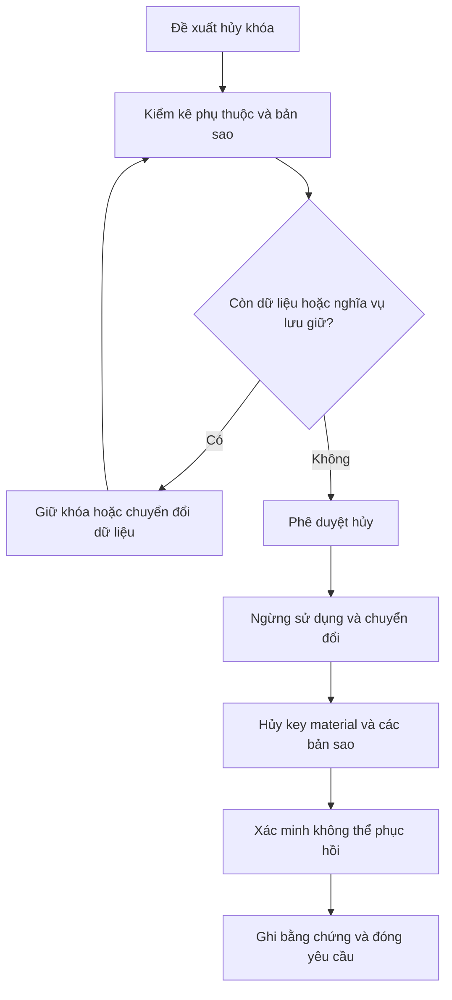

# Key destruction là gì

Trong chương **Key destruction** của module `SECURITY_KEY_MANAGEMENT_FUNDAMENTALS`, bài học này giải thích việc hủy khóa mật mã khi khóa không còn cần thiết hoặc phải bị loại bỏ vì lý do bảo mật. Quản lý khóa an toàn không kết thúc ở việc tạo, lưu trữ và sử dụng khóa. Tổ chức còn phải bảo đảm khóa được ngừng sử dụng đúng lúc, được thu hồi khi cần và cuối cùng bị hủy theo cách phù hợp với mức độ nhạy cảm, yêu cầu lưu giữ và các phụ thuộc của hệ thống.

## 1. Key destruction là gì?

**Key destruction** là quá trình loại bỏ key material và mọi bản sao có thể khôi phục nó, khiến khóa không còn khả năng được sử dụng cho mục đích mật mã ban đầu. Việc hủy có thể được thực hiện bằng cách xóa an toàn key material trong phần mềm, zeroize thiết bị hoặc miền bảo mật trong HSM, hủy các bản sao được bọc, hoặc phá hủy phương tiện lưu trữ theo quy trình được phê duyệt.

Mục tiêu là chấm dứt khả năng sử dụng khóa một cách có kiểm soát. Khi một khóa đã hết thời hạn sử dụng, bị thay thế, bị xâm phạm hoặc dữ liệu không còn cần được giải mã, tiếp tục giữ khóa có thể làm tăng bề mặt tấn công. Người có được khóa cũ vẫn có thể giải mã dữ liệu đã mã hóa bằng khóa đó, tạo chữ ký giả mạo hoặc giả danh một hệ thống, tùy chức năng của khóa.

Hủy khóa không chỉ là xóa một bản ghi trong cơ sở dữ liệu. Một khóa có thể tồn tại trong HSM, KMS, bản backup, bản replica, bản export đã bọc, thiết bị dự phòng, bộ nhớ tạm hoặc hệ thống escrow. Nếu một bản sao có thể phục hồi vẫn còn, khóa có thể chưa thực sự bị hủy.

## 2. Vì sao cần hủy khóa?

Hủy khóa đúng lúc giúp giảm rủi ro và giới hạn tác động khi xảy ra sự cố:

- **Giảm bề mặt tấn công:** mỗi khóa còn tồn tại là một tài sản cần bảo vệ. Loại bỏ khóa không còn cần thiết làm giảm số bí mật mà kẻ tấn công có thể tìm cách lấy cắp.
- **Ngăn sử dụng khóa đã hết hạn:** khóa cũ không còn được phép ký, mã hóa hoặc xác thực có thể bị dùng nhầm nếu vẫn tồn tại và còn quyền hoạt động.
- **Ứng phó khi khóa bị compromise:** hủy hoặc vô hiệu hóa key material bị lộ giúp ngăn việc tiếp tục sử dụng khóa đó, sau khi đã xử lý các phụ thuộc cần thiết.
- **Thực hiện chính sách lưu giữ:** khi dữ liệu hết thời hạn lưu giữ và không còn nghĩa vụ pháp lý phải giữ, hủy khóa có thể giúp dữ liệu mã hóa không thể được truy cập lại.
- **Thu hẹp phạm vi ảnh hưởng của hệ thống cũ:** khi ngừng một ứng dụng, tenant, thiết bị hoặc môi trường, các khóa chỉ phục vụ môi trường đó cần được xử lý theo kế hoạch kết thúc vòng đời.
- **Đáp ứng yêu cầu kiểm toán và quản trị:** quy trình hủy có phê duyệt, bằng chứng và nhật ký giúp chứng minh tổ chức đã thực hiện đúng chính sách.

Hủy quá sớm cũng có thể gây thiệt hại. Nếu dữ liệu còn phải lưu trữ, điều tra, kiểm toán hoặc giải mã theo yêu cầu hợp pháp, hủy khóa có thể khiến dữ liệu mất khả năng truy cập vĩnh viễn. Vì vậy, quyết định hủy phải dựa trên kiểm kê dữ liệu, thời hạn lưu giữ, legal hold và xác nhận của chủ sở hữu nghiệp vụ.

## 3. Phân biệt disable, revoke, delete và destroy

Các thao tác này có liên quan nhưng không đồng nghĩa. Một số KMS dùng tên trạng thái hoặc API khác nhau, vì vậy cần xem tài liệu của nền tảng cụ thể.

| Khái niệm | Ý nghĩa | Key material còn tồn tại? | Có thể khôi phục hoặc sử dụng lại? |
|---|---|---|---|
| Disable / Deactivate | Tạm thời ngăn sử dụng khóa qua dịch vụ hoặc policy | Thường còn | Có thể bật lại nếu policy cho phép |
| Revoke | Thu hồi sự tin cậy hoặc quyền sử dụng khóa, thường trong PKI/chứng thư hoặc quy trình bảo mật | Có thể còn | Khóa không còn được tin cậy cho mục đích bị thu hồi; key material có thể vẫn còn để điều tra hoặc giải mã theo chính sách |
| Delete | Yêu cầu xóa một đối tượng khóa hoặc bản ghi khóa khỏi dịch vụ | Tùy nền tảng và thời gian chờ xóa | Có thể còn trong thời gian chờ, backup hoặc replica; một số dịch vụ cho phép hủy yêu cầu xóa trước hạn |
| Destroy | Loại bỏ key material và mọi bản sao có thể phục hồi theo phạm vi đã xác định | Không còn bản sao có thể phục hồi trong phạm vi kiểm soát | Không thể tái sử dụng khóa cũ; phải tạo khóa mới nếu cần tiếp tục chức năng |

Ví dụ, disable một khóa trong KMS có thể ngăn ứng dụng gọi thao tác giải mã nhưng không xóa key material. Một lệnh schedule deletion có thể chỉ bắt đầu thời gian chờ; khóa chỉ bị xóa vĩnh viễn khi hết thời hạn và dịch vụ hoàn tất xử lý. Vì vậy, trạng thái `Disabled` hoặc `Pending deletion` chưa đủ bằng chứng để kết luận khóa đã bị hủy.

Đối với khóa ký số, revoke chứng thư có thể khiến bên xác minh không còn tin cậy chữ ký mới từ khóa đó, nhưng không đồng nghĩa khóa riêng đã bị xóa khỏi HSM. Ngược lại, phá hủy khóa riêng không tự động cập nhật trạng thái thu hồi trong hệ thống PKI. Hai hành động có mục đích riêng và cần phối hợp.

## 4. Khi nào nên hủy khóa?

Thời điểm hủy phụ thuộc loại khóa, mục đích và yêu cầu lưu giữ:

| Tình huống | Hướng xử lý thường dùng |
|---|---|
| Khóa hết cryptoperiod | Ngừng dùng để tạo dữ liệu hoặc chữ ký mới; giữ để giải mã/xác minh dữ liệu cũ nếu còn yêu cầu, sau đó hủy khi hết nhu cầu |
| Khóa đã được rotate | Giữ phiên bản cũ trong thời gian dữ liệu còn phụ thuộc; hủy sau khi re-encrypt/rewrap hoặc hết thời hạn giải mã |
| Khóa bị compromise | Cô lập, disable hoặc revoke ngay theo quy trình sự cố; thay thế và đánh giá dữ liệu bị ảnh hưởng; hủy key material cũ sau khi bảo toàn bằng chứng cần thiết |
| Ứng dụng hoặc tenant ngừng hoạt động | Kiểm tra dữ liệu, backup, legal hold và phụ thuộc; hủy các khóa riêng của phạm vi đó sau khi được phê duyệt |
| Hết thời hạn lưu trữ dữ liệu | Xác nhận không còn nghĩa vụ lưu giữ, sau đó hủy các khóa cần thiết để truy cập dữ liệu theo chính sách |
| Khóa thử nghiệm hoặc khóa tạm thời | Hủy sau khi kết thúc thử nghiệm hoặc phiên sử dụng và xác nhận không còn dữ liệu phụ thuộc |

Không phải mọi khóa đều cần được backup trước khi hủy. Một khóa phiên ngắn hạn có thể không có nhu cầu phục hồi; một khóa giải mã hồ sơ lưu trữ dài hạn có thể phải được giữ nhiều năm. Chính sách cần phân loại từng nhóm khóa và xác định thời hạn lưu giữ cụ thể.

## 5. Những gì phải được hủy

Để hủy một khóa thực sự, cần xác định toàn bộ nơi key material hoặc bản sao có thể phục hồi tồn tại. Phạm vi có thể gồm:

| Vị trí hoặc thành phần | Việc cần kiểm tra |
|---|---|
| KMS chính | Xác nhận trạng thái cuối cùng và kết quả xóa key material |
| HSM hoặc security domain | Xác định khóa có thể xóa riêng hay cần zeroize theo phạm vi thiết bị/miền; kiểm tra bản sao trong cluster |
| Replica và vùng dự phòng | Xác nhận thay đổi hủy đã được truyền tới các vùng hoặc xử lý độc lập theo hướng dẫn dịch vụ |
| Bản backup | Tìm bản backup chứa key material hoặc bản export được bọc; hủy hoặc hết hạn chúng theo chính sách |
| Backup wrapping key | Đánh giá phụ thuộc: nếu khóa này bảo vệ nhiều backup khác, không được hủy trước khi xử lý các bản sao còn cần thiết |
| Escrow và bản sao ngoại tuyến | Thu hồi và hủy các bản lưu do custodian hoặc đơn vị được ủy quyền giữ |
| Cache, bộ nhớ tạm và tiến trình | Xác định nơi key material có thể được nạp trong bộ nhớ; dừng tiến trình và xóa theo khả năng của nền tảng |
| Bản export và phương tiện lưu trữ | Kiểm tra thiết bị, tệp tạm, bản sao ngoài hệ thống và phương tiện đã chuyển giao |
| Khóa dẫn xuất hoặc bản sao phụ thuộc | Xác định khóa con có thể tái tạo từ đầu vào gốc hay không và xử lý theo chính sách |

Không được ghi key material dạng plaintext vào log hoặc tài liệu kiểm toán để chứng minh rằng nó đã bị xóa. Bằng chứng nên chứa key ID, phiên bản, phạm vi, thời điểm, người phê duyệt, thao tác thực hiện và kết quả xác minh, không chứa bí mật.

## 6. Các phương pháp hủy khóa

Phương pháp phù hợp tùy thuộc vào cách khóa được tạo, lưu trữ và bảo vệ.

### 6.1. Xóa an toàn key material trong phần mềm

Với khóa được quản lý trong phần mềm và có thể truy cập ở dạng export, quy trình có thể xóa bản lưu mã hóa, bản export và các bản sao trong kho lưu trữ theo chính sách. Ứng dụng cũng cần loại bỏ key material khỏi cấu hình, bộ nhớ tạm và các vị trí lưu trữ mà nó kiểm soát.

Xóa tệp thông thường không phải lúc nào cũng bảo đảm dữ liệu đã biến mất khỏi thiết bị. Filesystem journal, snapshot, SSD wear-leveling, bản backup và hệ thống đồng bộ có thể vẫn giữ dữ liệu. Vì vậy, nên dùng cơ chế sanitization được nền tảng lưu trữ hỗ trợ, mã hóa ngay từ đầu bằng khóa bảo vệ phù hợp, hoặc phá hủy phương tiện theo quy trình đã phê duyệt khi cần mức bảo đảm cao.

### 6.2. Zeroization trong HSM

**Zeroization** là thao tác làm mất key material trong thiết bị hoặc miền bảo mật bằng cơ chế được thiết kế cho mục đích đó. HSM có thể hỗ trợ xóa một đối tượng khóa, xóa một nhóm đối tượng hoặc zeroize toàn bộ thiết bị/security domain.

Zeroize toàn bộ HSM có thể phá hủy nhiều khóa cùng lúc và làm gián đoạn dịch vụ. Trước khi thực hiện cần xác định chính xác phạm vi, thiết bị, cluster, backup domain, các ứng dụng phụ thuộc và điều kiện khôi phục. Một thao tác sai có thể khiến tổ chức mất khả năng giải mã dữ liệu hoặc phục hồi các dịch vụ khác.

Với khóa không thể export, cần dùng API, công cụ quản trị và quy trình được nhà cung cấp HSM hỗ trợ. Không giả định rằng xóa object trong một giao diện quản trị đã loại bỏ mọi bản sao bên trong cluster hoặc backup.

### 6.3. Xóa khóa trong KMS

KMS thường cung cấp thao tác disable, schedule deletion hoặc delete. Một số dịch vụ có thời gian chờ xóa để giảm rủi ro xóa nhầm. Trong thời gian này, khóa có thể vẫn tồn tại và yêu cầu xóa có thể được hủy theo điều kiện của dịch vụ.

Runbook phải ghi rõ:

- Trạng thái nào chỉ ngăn sử dụng và trạng thái nào xác nhận key material đã bị xóa.
- Thời gian chờ xóa và thời điểm xóa thực sự hoàn tất.
- Khả năng phục hồi từ backup hoặc replica sau khi xóa.
- Ảnh hưởng tới dữ liệu, wrapped DEK và các dịch vụ đang tham chiếu khóa.
- Bằng chứng mà KMS cung cấp để xác nhận kết quả cuối cùng.

Không thể suy ra một hành vi chung cho mọi KMS. Một số khóa do nhà cung cấp quản lý có chính sách vòng đời riêng và không cho phép người dùng trực tiếp xóa key material. Cần xác minh theo loại khóa và tài liệu dịch vụ.

### 6.4. Cryptographic erasure

**Cryptographic erasure (crypto-erasure)** là cách làm cho dữ liệu đã mã hóa không thể truy cập bằng cách hủy khóa cần thiết để giải mã dữ liệu đó. Phương pháp này có thể hữu ích khi dữ liệu được lưu trên nhiều bản sao hoặc thiết bị mà việc xóa từng bản vật lý khó thực hiện.

Ví dụ, mỗi khách hàng có một KEK riêng. DEK mã hóa dữ liệu của khách hàng được bọc bằng KEK đó. Khi kết thúc thời hạn lưu giữ, tổ chức hủy KEK và mọi bản sao có thể phục hồi của nó. Nếu không còn bản DEK plaintext, wrapped DEK không thể được mở bằng khóa khác, bản export hoặc đường giải mã thay thế, dữ liệu tương ứng sẽ không thể giải mã.

Crypto-erasure chỉ có hiệu lực nếu tất cả đường dẫn giải mã đã bị loại bỏ. Cần kiểm tra:

- Không còn bản sao của KEK trong KMS, HSM, backup, replica hoặc escrow.
- Không còn DEK plaintext hoặc khóa thay thế có thể giải mã dữ liệu.
- Không còn bản export hay backup wrapping key có thể khôi phục KEK.
- Dữ liệu không tồn tại ở dạng plaintext trong cache, log, bản xuất hoặc hệ thống downstream.
- Các bản sao lưu và snapshot đều phụ thuộc vào khóa đã bị hủy.

Nếu một bản backup của KEK vẫn còn và có thể phục hồi, crypto-erasure chưa hoàn tất. Hủy khóa gốc trong KMS nhưng giữ bản backup mở được bằng một backup wrapping key khác không làm dữ liệu trở nên không thể giải mã.

### 6.5. Hủy phương tiện lưu trữ

Khi key material được lưu trên thiết bị hoặc phương tiện vật lý, có thể cần quy trình sanitization hoặc phá hủy phương tiện. Phương pháp phải phù hợp với loại thiết bị, công nghệ lưu trữ, mức độ nhạy cảm và chính sách của tổ chức. Việc tháo thiết bị khỏi hệ thống hoặc format lại không tự động chứng minh dữ liệu đã bị loại bỏ không thể phục hồi.

## 7. Quy trình hủy khóa an toàn

Một quy trình hủy có thể được tổ chức theo các bước sau:

1. **Đề xuất hủy.** Chủ sở hữu khóa hoặc nhóm vận hành nêu key ID, phiên bản, lý do, phạm vi và thời điểm dự kiến.
2. **Kiểm kê phụ thuộc.** Xác định ứng dụng, dữ liệu, ciphertext, wrapped DEK, chứng thư, backup, replica, escrow và khóa khác có quan hệ với khóa cần hủy.
3. **Kiểm tra yêu cầu lưu giữ.** Xác nhận thời hạn lưu dữ liệu, legal hold, điều tra bảo mật, kiểm toán và yêu cầu giải mã dài hạn đã được giải quyết.
4. **Đánh giá tác động.** Xác định thao tác nào sẽ thất bại sau khi hủy, dữ liệu nào sẽ mất khả năng giải mã và dịch vụ nào cần chuyển sang khóa mới.
5. **Phê duyệt độc lập.** Người có thẩm quyền xác nhận phạm vi và hậu quả. Với khóa nhạy cảm, dùng dual control hoặc M-of-N theo chính sách.
6. **Ngừng sử dụng và chuyển đổi.** Disable hoặc revoke theo trường hợp; chuyển ứng dụng sang khóa thay thế, re-encrypt hoặc rewrap dữ liệu nếu cần.
7. **Hủy các bản sao.** Thực hiện xóa/zeroize theo cơ chế KMS, HSM, kho backup, replica, escrow và phương tiện lưu trữ liên quan.
8. **Xác minh kết quả.** Kiểm tra trạng thái cuối cùng, bản sao còn tồn tại, đường dẫn phục hồi và khả năng sử dụng khóa. Chỉ dùng các phép thử an toàn, tránh tiết lộ key material.
9. **Ghi bằng chứng.** Lưu người yêu cầu, người phê duyệt, người thực hiện, key ID, phiên bản, phạm vi, thời gian, kết quả và tham chiếu audit log.
10. **Đóng yêu cầu.** Cập nhật kiểm kê và policy, xác nhận không còn ứng dụng hoặc dữ liệu hợp lệ tham chiếu đến khóa đã hủy.

Nếu phát hiện một bản sao không thể hủy ngay, yêu cầu chưa nên được đóng. Cần ghi nhận vị trí, người chịu trách nhiệm, thời hạn xử lý và biện pháp kiểm soát tạm thời; sau đó xác minh lại khi hoàn tất.

## 8. Hủy khóa theo từng loại khóa

### Khóa mã hóa dữ liệu (DEK)

Trước khi hủy DEK, xác định ciphertext nào còn phụ thuộc vào nó. Nếu dữ liệu phải tiếp tục được sử dụng, cần giải mã và mã hóa lại bằng DEK mới hoặc bảo đảm có thể mở wrapped DEK theo kiến trúc. Khi dữ liệu hết thời hạn lưu giữ, hủy DEK và các bản sao wrapped/backup có thể khôi phục nó theo chính sách.

### Khóa mã hóa khóa (KEK)

KEK có thể bảo vệ nhiều DEK. Trước khi hủy, phải xác định mọi DEK đã được bọc bằng KEK đó. Nếu còn dữ liệu cần truy cập, cần rewrap các DEK bằng KEK mới và kiểm tra khả năng mở chúng trước khi loại bỏ KEK cũ. Hủy KEK quá sớm có thể làm mất quyền truy cập vào một lượng lớn dữ liệu.

### Khóa riêng dùng ký số

Khi khóa riêng hết hạn hoặc bị thay thế, có thể cần giữ bằng chứng công khai như khóa công khai, chứng thư, dấu thời gian và trạng thái thu hồi để xác minh chữ ký lịch sử. Khóa riêng có thể được hủy khi không còn nhu cầu ký hoặc phục hồi theo chính sách. Việc hủy khóa riêng không có nghĩa phải xóa khóa công khai đã công bố.

Nếu khóa riêng bị compromise, cần revoke chứng thư hoặc cập nhật trạng thái tin cậy theo PKI, ngừng ký bằng khóa đó và bảo toàn bằng chứng phục vụ điều tra. Hủy key material là một bước trong xử lý sự cố, không thay thế việc thông báo và cập nhật trạng thái thu hồi cho bên xác minh.

### Khóa riêng dùng giải mã

Khóa riêng có thể cần được giữ để giải mã dữ liệu hoặc thông điệp đã lưu trước đây. Trước khi hủy, phải xác định thời hạn lưu trữ, nhu cầu pháp lý và khả năng chuyển đổi dữ liệu. Nếu không còn nghĩa vụ giải mã, có thể hủy khóa và các bản backup có thể phục hồi.

### Khóa gốc và khóa miền HSM

Đây là những khóa có thể bảo vệ nhiều khóa khác hoặc toàn bộ miền bảo mật. Hủy chúng có thể khiến toàn bộ hệ thống không thể phục hồi. Cần xác nhận tất cả khóa con, backup domain, thiết bị dự phòng và kế hoạch kết thúc dịch vụ đã được xử lý. Không thực hiện zeroize toàn bộ miền chỉ dựa trên một yêu cầu xóa một khóa đơn lẻ.

## 9. Quản lý thời gian chờ và thứ tự hủy

Một số thao tác hủy có thể được trì hoãn để tạo cơ hội phát hiện sai sót. Thời gian chờ xóa trong KMS, quy trình phê duyệt nhiều bên hoặc lịch hủy phương tiện đều cần được ghi trong chính sách.

Trong thời gian chờ, khóa phải được bảo vệ và kiểm soát quyền sử dụng. Nếu policy yêu cầu ngừng sử dụng ngay, có thể disable trước rồi mới thực hiện deletion sau khi hoàn tất kiểm tra. Cần tránh trường hợp một khóa vẫn hoạt động bình thường chỉ vì lệnh hủy đang chờ hết thời hạn.

Thứ tự hủy rất quan trọng. Ví dụ, nếu KEK bọc các DEK còn cần dùng, cần chuyển hoặc hủy các DEK phụ thuộc trước khi hủy KEK. Nếu backup wrapping key bảo vệ nhiều bản backup, phải xử lý các bản backup đó trước khi hủy wrapping key. Lập dependency graph giúp xác định thứ tự phù hợp và tránh phá hủy nhầm một thành phần gốc.

## 10. Xác minh và bằng chứng hủy khóa

Không thể chứng minh việc hủy chỉ bằng cách nhìn thấy một đối tượng biến mất khỏi giao diện quản trị. Cần kết hợp bằng chứng từ nền tảng, kiểm tra bản sao và xác nhận các đường phục hồi đã bị loại bỏ.

Bằng chứng có thể bao gồm:

- Key ID, phiên bản, loại khóa và phạm vi hệ thống được xử lý.
- Người yêu cầu, người phê duyệt và người thực hiện.
- Thời điểm disable, revoke, schedule deletion và thời điểm destruction hoàn tất.
- Kết quả từ API hoặc audit log của KMS/HSM.
- Kết quả zeroization hoặc sanitization của thiết bị nếu áp dụng.
- Xác nhận xử lý backup, replica, escrow và bản export.
- Kết quả kiểm tra không còn đường dẫn phục hồi được phép.
- Ngoại lệ chưa xử lý, người chịu trách nhiệm và thời hạn hoàn tất.

Với khóa trong HSM, có thể dựa vào audit record và trạng thái đối tượng do thiết bị cung cấp. Với crypto-erasure, cần kiểm tra toàn bộ bản sao của khóa giải mã và các khóa có thể mở bản sao đó. Với phương tiện vật lý, cần lưu chứng từ sanitization hoặc phá hủy theo quy trình của tổ chức.

Không nên thử khôi phục một khóa đã bị hủy từ bản sao không được phép chỉ để chứng minh việc hủy. Việc xác minh phải tuân theo quy trình kiểm soát và không tạo ra thêm bản sao bí mật.

## 11. Những sai lầm thường gặp

- **Nhầm disable với destruction:** khóa bị vô hiệu hóa vẫn có thể tồn tại và được bật lại.
- **Nhầm yêu cầu xóa với xóa hoàn tất:** trạng thái pending deletion có thể còn thời gian chờ và khả năng hủy yêu cầu.
- **Chỉ xóa khóa trong KMS chính:** bản backup, replica hoặc escrow vẫn có thể phục hồi khóa.
- **Hủy KEK trước khi xử lý DEK:** dữ liệu vẫn còn nhưng không còn khả năng mở các khóa dữ liệu.
- **Hủy khóa giải mã quá sớm:** dữ liệu lưu trữ, hồ sơ kiểm toán hoặc bằng chứng có thể không còn truy cập được.
- **Bỏ qua khóa đã bị compromise trong snapshot cũ:** restore có thể làm khóa bị thu hồi hoạt động trở lại.
- **Dùng xóa tệp thông thường làm bằng chứng sanitization:** dữ liệu có thể còn trong snapshot, journal hoặc vùng lưu trữ khác.
- **Zeroize sai phạm vi HSM:** có thể phá hủy nhiều khóa và làm gián đoạn hệ thống ngoài dự kiến.
- **Không lưu bằng chứng:** tổ chức không thể chứng minh ai đã phê duyệt, thao tác nào đã chạy và bản sao nào đã được xử lý.

## 12. Ví dụ thực tế: kết thúc lưu trữ dữ liệu khách hàng

Một nền tảng lưu trữ hồ sơ dùng DEK để mã hóa từng nhóm dữ liệu. Các DEK được bọc bằng KEK riêng cho từng khách hàng trong KMS. Khi khách hàng chấm dứt dịch vụ, nhóm vận hành cần hủy dữ liệu theo thời hạn lưu giữ đã thỏa thuận.

Quy trình có thể thực hiện như sau:

1. Chủ sở hữu dữ liệu xác nhận thời hạn lưu giữ đã kết thúc và không có legal hold hoặc yêu cầu điều tra đang mở.
2. Hệ thống kiểm kê toàn bộ ciphertext, wrapped DEK, key ID và phiên bản KEK của khách hàng.
3. Các bản dữ liệu cần giữ theo nghĩa vụ pháp lý được chuyển sang phạm vi lưu trữ riêng với quyền truy cập và thời hạn xác định; phần còn lại được đưa vào quy trình xóa.
4. Hệ thống xác nhận bản backup, replica, export và bản lưu escrow có liên quan đã được xử lý theo chính sách.
5. KEK riêng của khách hàng được disable trong giai đoạn kiểm tra, sau đó yêu cầu xóa theo cơ chế KMS và chờ tới khi dịch vụ xác nhận destruction hoàn tất.
6. Nhóm vận hành xác minh không còn bản KEK có thể phục hồi và ghi nhận kết quả vào audit log.

Nếu một bản backup ngoại tuyến vẫn chứa KEK được bọc và backup wrapping key còn tồn tại, dữ liệu có thể vẫn phục hồi được. Khi đó yêu cầu hủy chưa hoàn tất; cần xử lý bản backup và khóa bảo vệ nó theo dependency graph trước khi đóng yêu cầu.

## 13. Checklist trước khi đóng yêu cầu destruction

- [ ] Đã xác định đúng key ID, phiên bản, chủ sở hữu và lý do hủy.
- [ ] Đã xác nhận không còn dữ liệu, legal hold hoặc nhu cầu giải mã hợp lệ.
- [ ] Đã kiểm kê ứng dụng, ciphertext, wrapped DEK, khóa con và các phụ thuộc.
- [ ] Đã xác định mọi vị trí chứa key material hoặc bản sao có thể phục hồi.
- [ ] Đã phê duyệt độc lập và đánh giá tác động của thao tác hủy.
- [ ] Đã chuyển ứng dụng sang khóa thay thế hoặc kết thúc chức năng phụ thuộc.
- [ ] Đã xử lý KMS, HSM, replica, backup, escrow và bản export theo đúng thứ tự.
- [ ] Đã chờ trạng thái deletion hoàn tất nếu nền tảng có thời gian chờ.
- [ ] Đã xác minh không còn đường phục hồi được phép.
- [ ] Đã lưu bằng chứng và cập nhật kiểm kê khóa.

Key destruction là bước cuối cùng có kiểm soát trong vòng đời khóa. Một khóa chỉ được xem là đã hủy khi key material và mọi bản sao có thể phục hồi trong phạm vi quản lý đã được loại bỏ, các phụ thuộc dữ liệu đã được xử lý và kết quả có bằng chứng kiểm chứng. Thực hiện đúng thời điểm và đúng thứ tự giúp giảm bề mặt tấn công mà vẫn bảo vệ khả năng truy cập dữ liệu, tính toàn vẹn của bằng chứng và hoạt động của hệ thống.
