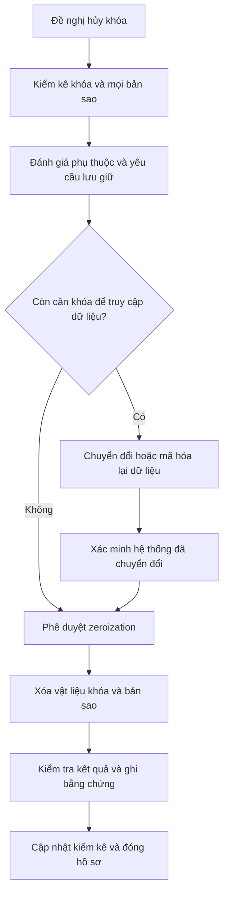

# Zeroization

**Zeroization** là quá trình đưa vật liệu khóa mật mã về trạng thái không còn có thể sử dụng hoặc khôi phục được trong phạm vi mô hình đe dọa và yêu cầu bảo đảm đã xác định. Với khóa đối xứng, khóa riêng, khóa dẫn xuất và các bí mật trung gian, mục tiêu là loại bỏ mọi bản sao có thể tiếp tục hỗ trợ giải mã, ký, xác thực hoặc thực hiện thao tác mật mã trái phép.

Zeroization là một phần của giai đoạn kết thúc vòng đời khóa. Một khóa hết hạn, bị thay thế, bị lộ hoặc không còn cần thiết phải được xử lý theo chính sách đã phê duyệt. Chỉ xóa tên khóa khỏi ứng dụng hoặc xóa bản ghi trong cơ sở dữ liệu chưa chứng minh rằng vật liệu khóa đã biến mất.

## 1. Mục tiêu và phạm vi

Vật liệu cần zeroize không chỉ là một tệp chứa khóa. Nó có thể tồn tại trong bộ nhớ của tiến trình, vùng đệm của thư viện mật mã, bộ nhớ của thiết bị HSM, bản sao được xuất ra, khóa dẫn xuất, bản sao lưu hoặc bản chụp máy ảo. Một thao tác xóa chỉ tác động lên một vị trí sẽ không xử lý được những bản sao còn lại.

Zeroization thường nhằm đạt các mục tiêu sau:

- Ngăn khóa đã hết hạn hoặc bị thu hồi tiếp tục được dùng để mã hóa, giải mã, ký hoặc xác thực.
- Giảm khả năng khôi phục khóa từ RAM, thiết bị lưu trữ, bản sao tạm và dữ liệu chẩn đoán.
- Loại bỏ khóa cũ sau khi dữ liệu đã được chuyển sang khóa mới, hoặc làm cho dữ liệu không thể giải mã khi tổ chức chủ động hủy dữ liệu.
- Giới hạn tác động của sự cố bằng cách xóa khóa phiên, khóa dẫn xuất và bí mật tạm ngay sau khi hoàn thành công việc.
- Tạo bằng chứng kiểm toán cho thấy việc hủy khóa đã được thực hiện đúng đối tượng, đúng thẩm quyền và đúng quy trình.

Phạm vi phải được xác định theo từng loại khóa. Khóa mã hóa dữ liệu (DEK), khóa mã hóa khóa (KEK), khóa riêng dùng ký số, khóa phiên và khóa xác thực có thời gian lưu giữ, mức độ quan trọng và hậu quả khi hủy khác nhau. Hủy nhầm một KEK có thể làm mất khả năng truy cập vào nhiều DEK; hủy nhầm một khóa ký có thể ảnh hưởng đến khả năng xác minh hoặc duy trì chuỗi tin cậy.

## 2. Phân biệt zeroization với các thao tác xóa khác

Các thuật ngữ dưới đây có liên quan nhưng không thể thay thế cho nhau. Cách triển khai cụ thể còn phụ thuộc loại thiết bị, hệ điều hành, thư viện mật mã và tiêu chuẩn mà tổ chức áp dụng.

| Thao tác | Điều thực sự xảy ra | Giới hạn cần hiểu |
|---|---|---|
| Xóa logic | Xóa tham chiếu, tên, bản ghi hoặc mục lục của khóa | Dữ liệu khóa có thể vẫn còn trong bộ nhớ, vùng lưu trữ, bản sao hoặc bản sao lưu |
| Ghi đè | Ghi dữ liệu khác lên vùng lưu trữ cũ | Có thể không chạm tới các khối dự phòng, vùng remap, snapshot hoặc bản sao do thiết bị quản lý |
| Zeroization | Xóa vật liệu khóa khỏi vùng nhớ hoặc kho khóa theo cơ chế được thiết kế cho mục đích đó | Phải xác định mọi bản sao và xác minh cơ chế có tác dụng trên đúng loại bộ nhớ |
| Crypto-erasure | Hủy khóa cần thiết để giải mã vật liệu đã được mã hóa, khiến các bản sao ciphertext còn lại không thể sử dụng | Chỉ hiệu quả nếu không còn bản sao khóa giải mã, khóa bọc hoặc đường khôi phục tương đương |
| Phá hủy vật lý | Làm hỏng phương tiện hoặc linh kiện lưu khóa bằng quy trình phù hợp | Thường là biện pháp cuối cùng; phải bảo đảm đúng phương tiện và có hồ sơ xác nhận |

Ví dụ, xóa một hàng trong bảng `keys` có thể chỉ xóa metadata. Nếu giá trị khóa vẫn nằm trong bản sao lưu hoặc trong bộ nhớ của tiến trình đang chạy, khóa vẫn có thể được sử dụng. Tương tự, đánh dấu khóa trong KMS là `DISABLED` thường chỉ ngăn thao tác mới; trạng thái này không tự chứng minh rằng vật liệu khóa đã bị hủy.

## 3. Những nơi vật liệu khóa có thể còn tồn tại

Trước khi xóa, cần lập bản đồ các vị trí mà khóa đã đi qua. Các vị trí thường bị bỏ sót gồm:

| Khu vực | Ví dụ về bản sao hoặc dấu vết |
|---|---|
| Bộ nhớ tiến trình | Heap, stack, thanh ghi CPU, vùng đệm của thư viện, cache và bộ nhớ dùng chung |
| Bộ nhớ hệ điều hành | Swap/pagefile, hibernation image, core dump, crash dump và dữ liệu chẩn đoán |
| Ứng dụng | Đối tượng khóa, bản sao mảng byte, biến tạm, cache khóa, hàng đợi và dữ liệu debug |
| Nền tảng ảo hóa | Snapshot máy ảo, memory snapshot, image và bản sao môi trường kiểm thử |
| Lưu trữ | Tệp cấu hình, cơ sở dữ liệu, volume, thiết bị flash, vùng dự phòng và bản sao lưu |
| Hạ tầng phân tán | Replica, node dự phòng, vùng địa lý khác, cache của dịch vụ và bản sao tại hệ thống DR |
| Hệ thống mật mã | Khóa dẫn xuất, khóa được bọc, bản xuất từ HSM/KMS và bản sao trong thiết bị dự phòng |

Không phải mọi vị trí đều chứa khóa ở dạng rõ. Một DEK có thể chỉ xuất hiện dưới dạng đã được bọc bằng KEK. Tuy vậy, bản sao đã bọc vẫn có thể khôi phục được nếu KEK hoặc một bản sao tương đương còn tồn tại. Vì vậy, việc kiểm kê phải xét cả quan hệ giữa khóa gốc, khóa dẫn xuất và khóa bảo vệ khóa.

## 4. Các cách thực hiện zeroization

### 4.1. Xóa vật liệu khóa trong bộ nhớ

Ứng dụng nên giữ khóa trong bộ nhớ trong khoảng thời gian ngắn nhất có thể, giới hạn số bản sao và xóa vùng đệm ngay sau khi thao tác mật mã kết thúc. Nên dùng API xóa an toàn do nền tảng hoặc thư viện mật mã cung cấp. Một lệnh ghi số 0 thông thường có thể bị trình biên dịch hoặc runtime tối ưu bỏ nếu vùng nhớ được xem là không còn được sử dụng; do đó cần chọn primitive được thiết kế để không bị loại bỏ và kiểm tra bảo đảm của nền tảng.

Các nguyên tắc triển khai quan trọng:

- Tránh chuyển khóa thành chuỗi văn bản hoặc đưa khóa vào log, exception, tracing, telemetry hay thông báo lỗi.
- Không sao chép khóa nếu không cần thiết; nếu phải sao chép, ghi nhận nơi tạo bản sao và thời điểm xóa.
- Xóa cả dữ liệu khóa và khóa dẫn xuất hoặc bí mật tạm khi chúng không còn cần thiết.
- Hạn chế quyền đọc bộ nhớ tiến trình; kiểm soát quyền tạo heap dump, core dump và snapshot.
- Cân nhắc cơ chế khóa trang bộ nhớ hoặc cấu hình chống swap khi nền tảng hỗ trợ và yêu cầu bảo mật đòi hỏi. Các cơ chế này chỉ giảm một số đường rò rỉ, không thay thế zeroization.

**Lưu ý với Java:** Java quản lý bộ nhớ bằng garbage collector, nên ứng dụng không kiểm soát chính xác thời điểm một đối tượng bị thu hồi. Với mảng byte do ứng dụng quản lý, có thể xóa vùng đệm trong `finally` để giảm thời gian tồn tại của bản sao đó:

```java
import java.util.Arrays;

byte[] encodedKey = keyProvider.loadKeyMaterial();
try {
    // Chỉ sử dụng encodedKey trong phạm vi cần thiết.
    performCryptographicOperation(encodedKey);
} finally {
    Arrays.fill(encodedKey, (byte) 0);
}
```

Đoạn mã chỉ xóa mảng `encodedKey` mà ứng dụng đang giữ. Nó không chứng minh rằng provider, thư viện, JVM hoặc hệ điều hành không tạo bản sao khác. Một số lớp khóa có thể sao chép dữ liệu đầu vào; `getEncoded()` cũng có thể trả về một bản sao mới. Không nên lưu khóa trong `String` vì chuỗi là bất biến và ứng dụng không thể chủ động ghi đè nội dung của nó. Khi dùng `Destroyable`, chỉ dựa vào thao tác `destroy()` nếu implementation thực tế hỗ trợ và tài liệu provider xác nhận hành vi; cần xử lý trường hợp hủy không thành công. Với khóa quan trọng, ưu tiên thao tác qua handle của KMS/HSM để ứng dụng không phải xuất vật liệu khóa ra heap.

### 4.2. Zeroization trong KMS và HSM

KMS thường quản lý trạng thái, quyền sử dụng và quan hệ giữa các phiên bản khóa. HSM có thể giữ vật liệu khóa trong vùng bảo vệ phần cứng và cung cấp lệnh xóa khóa hoặc zeroize thiết bị. Cần đọc rõ ngữ nghĩa của từng thao tác:

- `Disable` hoặc `Deactivate` có thể chỉ ngăn sử dụng khóa, trong khi vật liệu vẫn được giữ lại.
- `Schedule deletion` có thể đặt thời gian chờ hoặc giai đoạn khôi phục trước khi hủy thực sự.
- `Destroy` hoặc `Zeroize` có thể hủy một đối tượng khóa, một miền bảo mật hoặc toàn bộ vật liệu khóa trên thiết bị; phạm vi phụ thuộc sản phẩm.

Trước khi thực hiện, phải xác định chính xác đối tượng và phạm vi ảnh hưởng, kiểm tra bản sao dự phòng, yêu cầu phê duyệt và cơ chế khôi phục. Lệnh zeroize toàn thiết bị có thể xóa nhiều khóa không liên quan, vì vậy chỉ người có thẩm quyền và theo quy trình kiểm soát kép mới được thực hiện. Sau thao tác, cần kiểm tra trạng thái thiết bị, kết quả lệnh và nhật ký kiểm toán theo tài liệu của nhà cung cấp.

### 4.3. Xử lý khóa đã lưu trên thiết bị và bản sao lưu

Ghi đè tệp khóa có thể phù hợp với một số phương tiện, nhưng không nên mặc định rằng ghi đè một lần sẽ xóa mọi bản sao trên SSD hoặc thiết bị flash. Wear leveling, over-provisioning, remapping, snapshot, replication và backup có thể giữ dữ liệu ngoài vùng mà hệ điều hành nhìn thấy.

Với dữ liệu đã được mã hóa từ đầu, crypto-erasure có thể là phương án phù hợp: hủy khóa giải mã hoặc khóa bọc cần thiết để khiến ciphertext còn lại không thể giải mã. Phương án này chỉ đáng tin cậy khi tổ chức đã kiểm kê và xử lý tất cả bản sao của khóa liên quan, gồm bản sao xuất ra, backup, replica, khóa dự phòng và bản sao trong môi trường DR. Nếu không đáp ứng được điều kiện đó, cần dùng quy trình sanitization hoặc phá hủy phương tiện phù hợp với loại thiết bị và chính sách áp dụng.

## 5. Quy trình zeroization có kiểm soát

Một quy trình vận hành tốt cần kết hợp quyết định nghiệp vụ, xử lý kỹ thuật và bằng chứng kiểm toán.

1. **Xác định đối tượng:** tra cứu định danh khóa, phiên bản, loại khóa, chủ sở hữu, mục đích sử dụng, vị trí lưu và các khóa hoặc dữ liệu phụ thuộc. Không đưa giá trị khóa thô vào phiếu yêu cầu hay nhật ký.
2. **Đánh giá tác động:** xác định hệ thống nào còn cần khóa để giải mã dữ liệu cũ, xác minh chữ ký, khôi phục backup hoặc xử lý giao dịch. Kiểm tra yêu cầu lưu giữ, legal hold và thời hạn khôi phục.
3. **Ngừng cấp quyền sử dụng mới:** chặn workload tạo thêm bản sao hoặc gọi khóa. Nếu khóa bị lộ, thực hiện quy trình ứng phó sự cố và thu hồi khẩn cấp tương ứng.
4. **Chuyển đổi khi cần:** tạo hoặc chọn khóa thay thế, mã hóa lại dữ liệu hoặc bọc lại DEK theo thiết kế. Xác minh dữ liệu mới có thể được đọc và các hệ thống phụ thuộc đã chuyển đổi trước khi hủy khóa cũ.
5. **Thực hiện zeroization:** xóa vật liệu trong KMS/HSM, bộ nhớ ứng dụng, vùng đệm và các bản sao đã xác định. Xử lý backup, replica, snapshot và phương tiện lưu trữ theo chính sách.
6. **Xác minh:** kiểm tra kết quả của từng hệ thống, trạng thái khóa, phạm vi bản sao và khả năng sử dụng lại khóa. Ghi nhận ngoại lệ hoặc bản sao chưa thể xử lý cùng thời hạn và người chịu trách nhiệm.
7. **Đóng hồ sơ:** cập nhật kiểm kê khóa, trạng thái vòng đời, lý do hủy, người phê duyệt, người thực hiện, thời điểm, kết quả và tham chiếu bằng chứng.



Không được bỏ qua bước đánh giá tác động. Nếu hủy khóa duy nhất có thể giải mã dữ liệu đang được lưu giữ, dữ liệu có thể mất vĩnh viễn. Đây có thể là mục tiêu khi xử lý dữ liệu cần hủy, nhưng phải là quyết định có chủ đích và được phê duyệt.

## 6. Zeroization trong envelope encryption

Trong envelope encryption, dữ liệu được mã hóa bằng DEK; DEK được bảo vệ bằng KEK do KMS/HSM quản lý. Mô hình này cho phép thay KEK hoặc bọc lại DEK mà không cần giải mã và mã hóa lại toàn bộ dữ liệu.

Giả sử một hệ thống cần thay KEK cũ nhưng vẫn phải giữ dữ liệu:

1. Tạo hoặc chọn KEK mới trong KMS.
2. Dùng quy trình được kiểm soát để bọc lại từng DEK bằng KEK mới.
3. Kiểm tra mọi bản ghi, replica và backup cần thiết đều có thể khôi phục DEK bằng KEK mới.
4. Chuyển workload sang phiên bản bọc mới và xóa cache hoặc bản sao tạm liên quan.
5. Chỉ sau khi xác minh đầy đủ mới zeroize KEK cũ và các bản sao của nó theo chính sách.

Nếu mục tiêu là làm cho dữ liệu không thể giải mã, tổ chức có thể hủy DEK hoặc KEK tương ứng. Tuy nhiên, hủy KEK chỉ tạo ra crypto-erasure nếu không còn bản sao KEK, bản xuất, bản backup hoặc một khóa khác có thể mở DEK đã bọc. Nếu DEK từng được lưu ở dạng rõ hoặc được bọc bằng KEK khác, ciphertext vẫn có thể giải mã. Vì vậy, phải xét toàn bộ cây khóa và đường khôi phục trước khi kết luận dữ liệu đã bị xóa an toàn.

## 7. Xác minh và bằng chứng kiểm toán

Không có một phép kiểm tra đơn lẻ nào chứng minh tuyệt đối rằng không thể khôi phục khóa trong mọi điều kiện. Mức bảo đảm phải gắn với loại thiết bị, cơ chế xóa, tiêu chuẩn áp dụng và mô hình đe dọa. Tổ chức cần thu thập bằng chứng đủ để một người kiểm toán độc lập có thể xác định thao tác đã tác động lên đúng đối tượng.

Hồ sơ nên có tối thiểu:

- Định danh khóa và phiên bản; không ghi giá trị khóa thô hoặc bí mật có thể dùng để khôi phục khóa.
- Lý do hủy, chủ sở hữu, người yêu cầu, người phê duyệt và người thực hiện.
- Thời điểm, hệ thống hoặc thiết bị thực hiện, phạm vi đối tượng bị xóa và kết quả trả về.
- Trạng thái backup, replica, snapshot, bản xuất và các bản sao liên quan.
- Kết quả kiểm tra sau thao tác, ngoại lệ còn tồn tại và hành động khắc phục.
- Nhật ký KMS/HSM, mã giao dịch, chứng nhận sanitization hoặc hồ sơ phá hủy vật lý nếu có.

Kiểm tra thực tế có thể bao gồm xác nhận khóa không còn xuất hiện trong danh mục đang hoạt động, thao tác mật mã bằng định danh khóa cũ bị từ chối, thiết bị báo trạng thái zeroized theo tài liệu, và các bản sao dự phòng đã được xử lý. Một trạng thái `DISABLED`, một phản hồi API thành công hoặc việc không tìm thấy tên khóa trong giao diện quản trị riêng lẻ chưa đủ để kết luận zeroization hoàn tất.

## 8. Lỗi thường gặp

| Lỗi | Hậu quả | Cách kiểm soát |
|---|---|---|
| Chỉ xóa metadata hoặc alias | Vật liệu khóa vẫn còn và có thể được truy cập qua bản sao khác | Xác minh trạng thái hủy vật liệu và các bản sao |
| Chỉ xóa một mảng byte trong ứng dụng | Bản sao trong provider, heap dump, cache hoặc tiến trình khác vẫn tồn tại | Giảm sao chép, dùng handle KMS/HSM và kiểm soát vùng dump |
| Coi `DISABLED` là đã hủy | Khóa có thể vẫn được kích hoạt lại hoặc dùng bởi đường quản trị khác | Phân biệt rõ disable, revoke và destroy trong quy trình |
| Bỏ quên backup và DR | Khóa có thể được phục hồi cùng bản sao dữ liệu | Theo dõi vòng đời backup, replica và khóa bảo vệ backup |
| Hủy KEK trước khi chuyển đổi dữ liệu | Dữ liệu cần lưu giữ trở nên không thể giải mã | Rewrap hoặc mã hóa lại, sau đó xác minh trước khi hủy |
| Không xác minh kết quả thiết bị | Lệnh có thể thất bại, chỉ xóa một phần hoặc có phạm vi khác dự kiến | Kiểm tra phản hồi, trạng thái, log và bằng chứng độc lập |
| Ghi khóa vào log hoặc chuỗi bất biến | Bí mật có thể tồn tại lâu và lan sang hệ thống log | Không log bí mật; lọc dữ liệu nhạy cảm và giới hạn quyền truy cập |

## 9. Nguyên tắc vận hành

Zeroization cần được thiết kế từ đầu trong quy trình quản lý khóa. Mỗi loại khóa nên có chủ sở hữu, mục đích, thời hạn sử dụng, nơi lưu, quy tắc sao lưu, điều kiện hủy và người có quyền phê duyệt. Hệ thống cần ghi nhận việc tạo bản sao và phụ thuộc giữa các khóa để khi đến thời điểm hủy có thể tìm được toàn bộ phạm vi liên quan.

Với khóa phiên và khóa dẫn xuất ngắn hạn, hãy xóa ngay sau khi hoàn tất công việc và giới hạn việc ghi chúng ra đĩa. Với khóa dài hạn trong KMS/HSM, hãy dùng quy trình hủy có phê duyệt, thời gian chờ nếu chính sách yêu cầu và kiểm soát kép cho thao tác có ảnh hưởng lớn. Với khóa bảo vệ dữ liệu lưu trữ hoặc backup, hãy đánh giá khả năng khôi phục trước khi hủy và lưu bằng chứng theo chính sách kiểm toán.

Một quy trình zeroization đáng tin cậy trả lời được bốn câu hỏi: **đã hủy khóa nào, ở những nơi nào, bằng cơ chế nào và dựa trên bằng chứng gì để xác nhận**. Nếu chưa trả lời được một trong các câu hỏi này, hồ sơ hủy khóa chưa đủ cơ sở để đóng.
