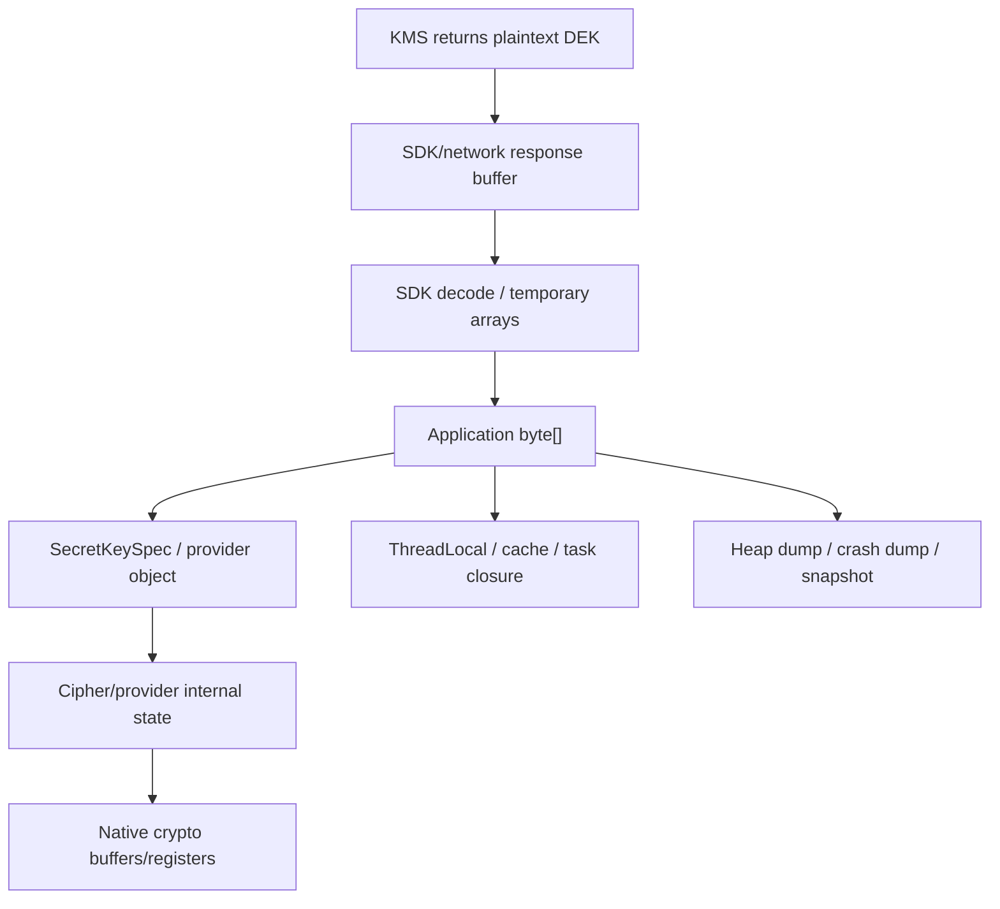

# Xóa key khỏi memory: Giảm thời gian tồn tại của khóa bí mật trong bộ nhớ

> **Chương:** Key destruction  
> **Bài học:** Xóa key khỏi memory  
> **Module:** `SECURITY_KEY_MANAGEMENT_FUNDAMENTALS` — hiểu vòng đời khóa mật mã từ tạo, cấp phát, lưu trữ, sử dụng, xoay vòng đến thu hồi và hủy; kết nối mật mã đối xứng, bất đối xứng, chữ ký số, KMS/HSM, envelope encryption, kiểm soát truy cập và kiểm toán để thiết kế hệ thống bảo vệ khóa an toàn.

## 1. Tình huống: Đã xóa biến nhưng secret vẫn xuất hiện trong heap dump

Một Java service nhận DEK từ KMS để giải mã một object. Sau khi xử lý xong, lập trình viên gọi:

```java
key = null;
```

và nghĩ rằng key đã được xóa khỏi memory.

Một tháng sau, heap dump của tiến trình được gửi tới hệ thống hỗ trợ. Trong dump vẫn tìm thấy dữ liệu nhạy cảm liên quan tới key. Điều tra cho thấy:

- Raw key từng được chuyển thành `String` để debug.
- `SecretKeySpec` đã tạo bản sao từ mảng bytes đầu vào.
- Một helper giữ reference trong `ThreadLocal`.
- Provider mật mã có thể giữ bản sao nội bộ trong Java hoặc native memory.
- Crash reporter lưu heap dump ở vùng mà nhiều operator có quyền đọc.
- Garbage collector chưa thu hồi object cũ; kể cả khi object được thu hồi, ứng dụng không có bảo đảm rằng mọi bản sao vật lý đã được ghi đè.

Vấn đề không nằm ở việc thiếu một lệnh `null`. Vấn đề là **key material đã đi qua nhiều vùng nhớ và có thời gian tồn tại dài hơn cần thiết**.

> **Nguyên tắc:** Xóa reference không đồng nghĩa xóa bytes. Zeroization phải giảm các bản sao mà ứng dụng kiểm soát, rút ngắn thời gian key tồn tại trong memory, hạn chế khả năng dump/đọc memory và ưu tiên thao tác trong KMS/HSM khi không cần export raw key.

### Mục tiêu học tập

Sau bài này, bạn có thể:

1. Phân biệt xóa reference, giải phóng object, overwrite memory, zeroization, revoke key, destroy key và cryptographic erasure.
2. Giải thích vì sao key có thể xuất hiện trong heap, native memory, direct buffer, thread-local, register, swap, core dump hoặc snapshot.
3. Thiết kế vòng đời memory cho DEK, KEK, HMAC secret, private key, derived key và TLS session secret.
4. Viết Java 17 giảm bản sao secret, dùng `byte[]`, `try/finally` và kiểm tra hỗ trợ `Destroyable` đúng cách.
5. Hiểu giới hạn của `Arrays.fill`, garbage collector, JIT, provider và JVM khi muốn xóa key vật lý.
6. Phân biệt xử lý key bytes trong ứng dụng với key handle non-exportable trong HSM/KMS.
7. Kiểm soát heap dump, core dump, swap/pagefile, hibernation, container snapshot và crash reporting.
8. Tránh rò rỉ secret qua log, exception, tracing, metrics, debugger và diagnostic endpoint.
9. Thiết kế concurrency, cache và thread lifecycle để không giữ key quá lâu.
10. Xây kiểm thử, monitoring và runbook cho sự cố key material xuất hiện trong memory.

---

## 2. “Xóa key khỏi memory” nghĩa là gì?

**Memory zeroization** là quá trình ghi đè hoặc làm cho key material không còn khả năng được sử dụng/khôi phục từ vùng nhớ mà hệ thống kiểm soát, theo một cơ chế được thiết kế cho runtime/platform cụ thể.

Trong thực tế, ứng dụng thường có thể kiểm soát một số buffers/arrays của chính nó. Ứng dụng thường **không thể tự chứng minh đã xóa mọi bản sao** do JVM, JIT, crypto provider, native library, kernel, hypervisor hoặc thiết bị lưu trữ tạo ra.

### 2.1. Các hành động thường bị nhầm

| Hành động | Điều thực sự xảy ra | Có bảo đảm raw key bytes bị xóa không? |
|---|---|---|
| `key = null` | Bỏ một reference từ biến. | Không. |
| Object unreachable | GC có thể thu hồi object sau này. | Không. |
| `System.gc()` | Chỉ gợi ý GC chạy. | Không. |
| `Arrays.fill(bytes, (byte) 0)` | Ghi số 0 vào mảng Java đang nắm. | Chỉ tác động mảng đó; không xóa copies khác. |
| `ByteBuffer.clear()` | Đặt lại position/limit. | Không ghi đè nội dung. |
| `ByteBuffer.put(zeros)` | Ghi đè vùng buffer được ghi. | Không bảo đảm xóa copies khác hoặc buffer đã được provider copy. |
| `Destroyable.destroy()` | Yêu cầu object triển khai cơ chế destroy của nó. | Tùy implementation/provider và semantics. |
| Logout/close HSM session | Đóng session hoặc xóa trạng thái session theo provider. | Không đồng nghĩa hủy key object trên token. |
| Revoke KMS grant | Chặn quyền gọi operation theo policy/provider. | Không xóa raw bytes đã export. |
| Disable/destroy key ở KMS/HSM | Thay trạng thái hoặc hủy key object/material theo provider. | Không xóa bản sao đã exfiltrate ngoài provider. |
| Crypto-shredding | Làm mất key cần thiết để giải mã dữ liệu theo threat model. | Không xóa plaintext/copies đã lấy trước đó. |

### 2.2. Ba mục tiêu cần tách

1. **Memory hygiene:** giảm thời gian tồn tại và số bản sao của key trong RAM.
2. **Access containment:** ngăn actor tiếp tục truy cập hoặc dùng key thông qua identity, session, grant hay API.
3. **Key destruction/cryptographic erasure:** chấm dứt khả năng dùng key ở các boundary được kiểm soát, theo lifecycle policy.

Một ứng dụng có thể zeroize buffer mà key vẫn active trong KMS. Ngược lại, KMS key bị disable nhưng raw DEK đã export vẫn có thể nằm trong heap dump.

### 2.3. Zeroization là defense in depth

Zeroization hữu ích khi kết hợp với:

- Không export key nếu có thể dùng HSM/KMS handle.
- Giới hạn scope và lifetime của secret.
- Hạn chế heap/core dumps.
- Mã hóa swap/pagefile và bảo vệ snapshot.
- Least privilege và process isolation.
- Secret-safe logging/telemetry.
- Rotation/revocation khi có exposure.
- Kiểm thử và audit memory handling.

Không dùng một lệnh overwrite để thay thế các controls còn lại.

---

## 3. Key có thể xuất hiện ở đâu trong memory?

### 3.1. Luồng dữ liệu của một DEK



Một thao tác decrypt có thể tạo nhiều representation của cùng key:

- HTTP response body.
- JSON/base64 decoded bytes.
- SDK object.
- Application array.
- `SecretKey` implementation.
- Crypto provider state.
- Native library state.
- Debug/test copies.
- Heap/core dump.

Xóa mảng của ứng dụng không tự xóa những vùng khác.

### 3.2. Java heap

Heap có thể chứa:

- `byte[]` key material.
- `char[]` hoặc `String` nếu secret bị chuyển thành text.
- Key spec/provider wrapper objects.
- Buffers trong object graph.
- Temporary arrays do `clone`, `copyOf`, serialization hoặc decoder tạo.
- Lambda captures, futures và task objects.

Heap dump có thể giữ cả object còn reachable và object đã tồn tại tại thời điểm dump tùy công cụ/cấu hình.

### 3.3. Native memory và provider

Crypto provider có thể dùng:

- Native allocation.
- OpenSSL hoặc thư viện native khác.
- Provider-specific key handles.
- Internal copies trong cipher context.
- Native thread-local storage.
- Memory mapping.

Java code không có API portable để tìm và overwrite mọi vùng này. Cần xem provider documentation và security guarantees.

### 3.4. Stack, registers và CPU state

Key bytes hoặc derived values có thể tạm xuất hiện trong:

- Stack frame.
- CPU registers.
- Vector registers.
- CPU caches.
- Temporary operands của thuật toán.

Ứng dụng thông thường không thể trực tiếp chứng minh mọi bản sao ở các vị trí này đã được xóa. Crypto libraries chuyên dụng có thể có biện pháp riêng; kiểm tra claims của implementation thay vì tự suy đoán.

### 3.5. OS, hypervisor và storage-backed memory

RAM có thể được ghi ra hoặc chụp lại qua:

- Swap/pagefile.
- Hibernation image.
- Core dump.
- Process dump.
- VM snapshot.
- Container host diagnostics.
- Cloud crash collection.
- Endpoint detection/forensics tooling.

Vì vậy, memory security không dừng ở code Java. Phải quản lý cả host, VM, container runtime, cloud account và diagnostic pipeline.

---

## 4. Vì sao `null` không xóa key?

### 4.1. Reference và object là hai thứ khác nhau

Ví dụ:

```java
byte[] key = loadKey();
byte[] anotherReference = key;

key = null;
```

`anotherReference` vẫn trỏ tới cùng array. Dù không có reference nào, GC chỉ thu hồi khi phù hợp; nó không hứa overwrite nội dung bằng zero trước khi tái sử dụng memory.

### 4.2. Copy làm phát sinh nhiều object độc lập

```java
byte[] key = loadKey();
byte[] copy = key.clone();

Arrays.fill(key, (byte) 0);
```

`copy` vẫn chứa key material. Mọi `clone`, `Arrays.copyOf`, `ByteBuffer.get`, decode base64 hoặc serializer có thể tạo thêm bản sao.

### 4.3. String là lựa chọn xấu cho raw key

`String` immutable. Ứng dụng không thể ghi đè nội dung của một String bằng API công khai thông thường.

Không làm:

```java
String keyText = new String(keyBytes);
```

Không đưa key vào:

- URL/query parameter.
- JSON log.
- Exception message.
- Debug print.
- Metrics label.
- Trace attribute.

Nếu giao thức trả key dưới dạng base64, decode trực tiếp sang buffer bytes được kiểm soát và tránh giữ text representation.

### 4.4. Interning và string pooling

String có thể được intern hoặc giữ reference bởi thư viện/logging framework. Không dùng `String.intern()` cho secret. Việc tạo một chuỗi mới rồi set biến về null không xóa các bản sao hoặc reference khác.

### 4.5. Garbage collector không phải secure memory manager

GC tối ưu quản lý object lifetime và throughput/latency. GC không phải API zeroization:

- Có thể trì hoãn thu hồi.
- Có thể di chuyển object.
- Có thể để lại bytes cũ trong vùng heap chưa tái sử dụng.
- Có thể có copies do runtime/provider.
- Không bảo đảm mọi page/snapshot đã được xóa.

Không gọi `System.gc()` như một control bảo mật.

---

## 5. Những representation của key và cách giảm bản sao

| Representation | Ví dụ | Rủi ro/kiểm soát |
|---|---|---|
| Raw bytes | `byte[]` DEK | Dùng scope nhỏ, clear best effort trong `finally`. |
| Text | `String`, base64 | Tránh chuyển raw secret thành immutable text. |
| Key specification | `SecretKeySpec` | Constructor có thể copy bytes; không kiểm soát mọi internal copy. |
| Provider key object | `SecretKey`/`PrivateKey` | Semantics phụ thuộc provider; kiểm tra `Destroyable`. |
| HSM handle | Token/object reference | Không export raw key; đóng session theo provider. |
| Direct buffer | `ByteBuffer.allocateDirect` | `clear()` không zeroize; native cleanup phụ thuộc runtime. |
| Derived key | HKDF output | Xóa output buffers khi xong; master/temporary inputs có lifetime riêng. |
| Wrapped DEK | Ciphertext của DEK | Không phải plaintext key, nhưng vẫn nhạy cảm metadata và cần access control. |
| Public key | Public verification material | Không bí mật như private key, nhưng cần integrity/trust protection. |

### 5.1. Giữ key bytes trong `byte[]` khi phải export

Nếu API bắt buộc trả raw key bytes, `byte[]` cho phép ứng dụng ghi đè buffer của chính nó. Điều đó vẫn chỉ là **best effort**.

Không giữ secret trong:

- Static field.
- Singleton dùng chung toàn app.
- Long-lived cache.
- ThreadLocal không có cleanup.
- Session object tồn tại lâu.
- Request context bị lưu lại.
- Async task closure sau khi request hoàn tất.

### 5.2. Tránh copy không cần thiết

- Truyền buffer hiện có khi API cho phép.
- Không clone chỉ để “an toàn” nếu không có lý do.
- Tránh serialize key material.
- Tránh convert bytes → String → bytes.
- Tránh giữ bản copy trong DTO hoặc record.
- Không dùng immutable collection để chứa raw key.
- Giới hạn key trong lexical scope nhỏ.

### 5.3. Không tối ưu bằng cách chia sẻ raw key toàn process

Một global cache giảm KMS calls nhưng kéo dài lifetime và mở rộng blast radius. Nếu caching là yêu cầu hiệu năng, phải có policy rõ: TTL, eviction, concurrency, memory hygiene, audit và response khi revoke.

---

## 6. Java 17: Zeroize buffer do ứng dụng sở hữu

Ví dụ sau minh họa cách xóa **một số buffers mà ứng dụng sở hữu** sau operation. Nó không chứng minh `SecretKeySpec`, `Cipher`, JCA provider, native library hoặc JVM đã xóa mọi copy.

```java
import java.security.GeneralSecurityException;
import java.security.SecureRandom;
import java.util.Arrays;
import javax.crypto.Cipher;
import javax.crypto.SecretKey;
import javax.crypto.spec.GCMParameterSpec;
import javax.crypto.spec.SecretKeySpec;

public final class BestEffortKeyMemoryDemo {

    record Encrypted(byte[] nonce, byte[] ciphertext) {}

    static void wipeOwnedBuffer(byte[] value) {
        if (value != null) {
            Arrays.fill(value, (byte) 0);
        }
    }

    static Encrypted encryptAndClear(
            byte[] keyMaterialFromKms,
            byte[] plaintextFromCaller)
            throws GeneralSecurityException {

        byte[] plaintextCopy = plaintextFromCaller.clone();
        byte[] nonce = new byte[12];
        SecretKey keyObject = null;

        try {
            new SecureRandom().nextBytes(nonce);

            // SecretKeySpec copies the supplied key bytes.
            // Clearing keyMaterialFromKms will not clear that copy.
            keyObject = new SecretKeySpec(
                    keyMaterialFromKms, "AES");

            Cipher cipher = Cipher.getInstance("AES/GCM/NoPadding");
            cipher.init(
                    Cipher.ENCRYPT_MODE,
                    keyObject,
                    new GCMParameterSpec(128, nonce));

            byte[] ciphertext = cipher.doFinal(plaintextCopy);

            // Nonce and ciphertext are returned as output;
            // the caller now owns their lifecycle.
            return new Encrypted(nonce.clone(), ciphertext);

        } finally {
            // Best effort for buffers owned by this method.
            wipeOwnedBuffer(keyMaterialFromKms);
            wipeOwnedBuffer(plaintextCopy);

            // This does not prove provider/Cipher copies are erased.
            // SecretKeySpec does not provide a portable guarantee
            // that its internal key bytes can be zeroized.
        }
    }

    public static void main(String[] args)
            throws GeneralSecurityException {

        byte[] key = new byte[32];
        byte[] plaintext =
                "non-production demonstration".getBytes();

        new SecureRandom().nextBytes(key);

        Encrypted result = encryptAndClear(key, plaintext);

        System.out.println(
                "Ciphertext length: " + result.ciphertext().length);

        // The caller still owns the original plaintext array.
        wipeOwnedBuffer(plaintext);
    }
}
```

### 6.1. Điều code làm được

- Giới hạn raw key trong một method.
- Dùng `byte[]` thay vì `String`.
- Xóa buffer key do caller chuyển quyền sở hữu cho method.
- Xóa plaintext copy trong `finally`, kể cả khi crypto operation ném exception.
- Không in key bytes hoặc plaintext.
- Trả nonce/ciphertext là output không phải raw secret.

### 6.2. Điều code không làm được

- `SecretKeySpec` tạo bản sao key bytes; code không có API portable để overwrite bản sao nội bộ đó.
- `Cipher` và provider có thể giữ state/copies trong heap hoặc native memory.
- JVM/GC/JIT không cam kết secure erasure mọi bản sao.
- `plaintextFromCaller` gốc vẫn tồn tại cho tới khi caller xóa hoặc hết reference.
- Ciphertext/nonce output cần lifecycle riêng.
- Không có KMS/HSM, IAM, audit, key rotation hoặc session management thật.
- `Arrays.fill` chỉ ghi đè array cụ thể, không phải bằng chứng memory-wide zeroization.

**Không dùng đoạn code này làm chứng cứ rằng key đã được xóa hoàn toàn khỏi process.** Nó chỉ minh họa cách giảm một số bản sao nằm trong quyền kiểm soát của application code.

---

## 7. `Destroyable` và provider-specific key objects

### 7.1. `Destroyable` là contract, không phải lời hứa phổ quát

Java có `javax.security.auth.Destroyable`. Một số key/provider implementations có thể hỗ trợ `destroy()`; implementation khác có thể không hỗ trợ hoặc có thể báo `DestroyFailedException`.

Có thể kiểm tra capability:

```java
import javax.security.auth.Destroyable;
import javax.security.auth.DestroyFailedException;
import java.security.Key;

static void destroyIfSupported(Key key)
        throws DestroyFailedException {

    if (key instanceof Destroyable destroyable) {
        destroyable.destroy();
    }
}
```

Nhưng cần đọc semantics của implementation:

- Object bị đánh dấu destroyed hay bytes được overwrite?
- Có bản sao native/provider còn tồn tại không?
- Destroy có ảnh hưởng token object trong HSM không?
- Có thể khôi phục/đọc lại object sau đó không?
- Operation đang chạy có bị ảnh hưởng không?

### 7.2. Không gọi `destroy()` mù quáng trên HSM handle

Một provider có thể ánh xạ thao tác destroy tới việc **xóa key object thật trên token**, chứ không chỉ xóa session memory. Điều này có thể phá dữ liệu vĩnh viễn.

Không gọi `Destroyable.destroy()` trên provider key object nếu chưa xác minh contract và authorization. Với HSM, phân biệt:

- Logout/close session.
- Release Java wrapper/handle.
- Destroy token object.
- Schedule key deletion.
- Revoke permission.

Đây là các hành động có hậu quả khác nhau.

### 7.3. Hủy session và đóng resource

Dùng `try-with-resources` cho resource hỗ trợ `AutoCloseable`, session và stream. Nhưng đóng session không tự đảm bảo key object trong HSM bị destroy; key có thể vẫn được lưu trên token.

### 7.4. Provider documentation là bắt buộc

Đối với KMS/HSM provider, xác định:

- Key material có exportable không?
- Operation chạy trong HSM hay được provider đưa bytes ra JVM?
- Java wrapper giữ handle hay raw bytes?
- Session close/logout làm gì?
- `Destroyable` có hỗ trợ không và semantics?
- Native buffers được clear ra sao?
- Audit event nào chứng minh operation?

Không suy luận từ interface `SecretKey`/`PrivateKey` đơn thuần.

---

## 8. Ưu tiên HSM/KMS handle để tránh đưa raw key vào JVM

### 8.1. Hai mô hình

**Export raw DEK:**

```text
KMS GenerateDataKey
    -> plaintext DEK enters application memory
    -> application encrypts object
    -> application tries to wipe DEK
```

**Non-exportable/provider-side operation:**

```text
Application -> HSM/KMS key handle
             -> crypto operation inside protected boundary
             -> ciphertext/result returns
```

Mô hình thứ hai có thể giảm exposure của raw key trong JVM nếu provider/API thực sự giữ material trong boundary. Tuy nhiên, không phải mọi KMS hỗ trợ mọi operation (ví dụ bulk data encryption) theo cách đó.

### 8.2. Envelope encryption và memory

Một ứng dụng thường cần plaintext DEK để mã hóa payload lớn cục bộ. Nếu provider có streaming/crypto service hoặc HSM operation phù hợp, có thể giữ key material trong boundary; nếu không, giảm scope/lifetime và xử lý buffers có kiểm soát.

Wrapped DEK vẫn là sensitive metadata/ciphertext cần bảo vệ, nhưng không tương đương raw DEK.

### 8.3. Non-exportable không loại bỏ key-use risk

Một key không thể export vẫn có thể bị lạm dụng qua API:

- Signing oracle.
- Decryption oracle.
- MAC generation oracle.
- Wrap/unwrap quyền quá rộng.

Cần authentication, authorization, tenant/resource binding, key usage policy và audit trước từng operation.

### 8.4. Java provider handle minh họa

Một service có thể dùng `PrivateKey` handle từ PKCS#11 provider để gọi `Signature`, không gọi `getEncoded()` để lấy private bytes:

```java
Signature signer = Signature.getInstance("Ed25519", hsmProvider);
signer.initSign(hsmPrivateKeyHandle);
signer.update(canonicalApprovedMessage);
byte[] signature = signer.sign();
```

Tên algorithm/provider và cách lấy handle phụ thuộc HSM. `getEncoded()` có thể trả `null` với non-exportable key; không tìm cách bypass bằng reflection hoặc memory dump.

### 8.5. Handle cũng có lifecycle

- Giới hạn session và handle scope.
- Đóng/logout session theo provider.
- Không để key handle trong global mutable state nếu không cần.
- Thu hồi grant/session khi identity bị compromise.
- Không nhầm release handle với destroy key object.

---

## 9. Java `String`, `char[]` và password-derived key

### 9.1. Password input

Một số API UI/framework chỉ cung cấp `String`; khi đó secret đã tồn tại dưới dạng immutable object. Nếu có thể, dùng API nhận `char[]` và xóa array sau khi derive/verify.

Ví dụ:

```java
char[] password = obtainPasswordChars();

try {
    // Run approved password KDF with salt and parameters.
    // Avoid creating new String(password).
} finally {
    Arrays.fill(password, '\0');
}
```

Đây vẫn là best effort: UI toolkit, decoder, KDF provider hoặc framework có thể tạo copies.

### 9.2. Password KDF output

Sau PBKDF2/Argon2/scrypt/HKDF, derived key bytes cũng là secret. Đừng chỉ xóa password input mà giữ output trong cache vô thời hạn.

### 9.3. Salt không phải secret

Salt thường không cần giữ bí mật, nhưng phải được lưu chính xác để derive lại. Phân biệt salt/public context với password/master secret/derived key.

### 9.4. Không chuyển key thành String để serialize

Dùng protected binary format/wrapping API nếu cần lưu key. Base64 chỉ là encoding, không phải encryption. Nếu base64 string chứa raw key, nó vẫn là secret và có thêm một bản sao trong memory.

---

## 10. Off-heap và direct buffers

### 10.1. `ByteBuffer.allocateDirect`

Direct buffer có thể cấp memory ngoài Java heap, nhưng:

- `clear()` chỉ reset position/limit.
- `flip()` chỉ đổi view.
- `compact()` chỉ di chuyển phần còn lại.
- `ByteBuffer` không có portable secure-zeroization guarantee.
- Native allocation cleanup phụ thuộc runtime/GC/provider.
- Một số API có thể copy dữ liệu vào heap/native buffer khác.

### 10.2. Nếu phải dùng direct buffer

- Giới hạn capacity.
- Ghi đè toàn bộ vùng chứa secret mà code sở hữu trước khi release.
- Không dùng slice/duplicate lâu dài.
- Quản lý lifecycle và ownership rõ.
- Kiểm provider copies và native cleanup.
- Không dùng internal `Unsafe`/Cleaner API như một bảo đảm portable.
- Test trên đúng JDK/vendor/runtime đang triển khai.

### 10.3. Không tự xây allocator secure memory

Secure allocator cần xử lý alignment, page locking, guard pages, swap, dump, concurrency, compiler behavior và zeroization. Tự viết allocator chỉ để tránh heap có thể tạo thêm lỗi khó kiểm chứng.

Dùng thư viện/platform đã được đánh giá nếu yêu cầu thực sự cần native secure memory; tài liệu hóa giới hạn.

---

## 11. Native code: `memset` không luôn là secure zeroization

### 11.1. Compiler có thể tối ưu thao tác ghi không quan sát được

Trong native C/C++, một lệnh:

```c
memset(key, 0, key_len);
```

ngay trước khi free có thể bị compiler tối ưu nếu nó chứng minh vùng nhớ không được đọc lại. Vì vậy các platform/library cung cấp primitive chuyên dụng như:

- `memset_s` khi implementation hỗ trợ Annex K.
- `explicit_bzero` trên các hệ hỗ trợ.
- `sodium_memzero` trong libsodium.
- Secure-memory APIs của crypto library/provider.

Không giả định mọi tên hàm tồn tại trên mọi OS/compiler.

### 11.2. `volatile` không phải giải pháp chung

Tự cast pointer thành `volatile` hoặc viết loop thủ công không tự bảo đảm xóa mọi copies, registers, stack spill, cache hay snapshot. Dùng primitive được document cho compiler/platform cụ thể.

### 11.3. FFI/JNI boundary

Khi Java gọi JNI/native crypto:

- Java array có thể được pin hoặc copy tùy JNI API/runtime.
- `GetByteArrayElements` có thể trả pointer tới copy.
- `ReleaseByteArrayElements` semantics phụ thuộc mode.
- Native library có thể tạo internal copy.
- JNI code phải clear buffer do nó sở hữu trước khi release khi cần.
- Cần review native source, build flags và implementation.

Không tuyên bố Java array đã clear thì native pointer copy cũng clear.

---

## 12. OS và runtime controls: Ngăn memory bị lưu ra nơi khác

### 12.1. Heap dump và core dump

Heap/core dump có thể chứa raw key, plaintext và provider state. Kiểm soát:

- Tắt dump khi không cần hoặc hạn chế theo policy.
- Nếu cần diagnostic dump, yêu cầu approval/incident context.
- Bảo vệ storage, encryption, access logging và retention.
- Không tải dump lên SaaS support channel công khai.
- Xóa/retire dump theo retention policy sau khi giữ đủ forensic evidence.
- Kiểm soát ai có quyền attach debugger/JMX/diagnostic tools.

### 12.2. Swap/pagefile

Nếu RAM pages được swap ra disk, key có thể xuất hiện trong swap/pagefile. Các lựa chọn:

- Mã hóa swap/pagefile với key custody phù hợp.
- Tắt swap khi workload/threat model cho phép và vận hành chấp nhận.
- Giới hạn quyền đọc disk/host.
- Bảo vệ hibernation image.
- Xem cloud host/managed runtime semantics.

Tắt swap không tự giải quyết core dump, VM snapshot hay provider memory.

### 12.3. VM snapshot và container

Container không phải security boundary độc lập khỏi host root. VM snapshots/checkpoints có thể capture memory state. Cần:

- Hạn chế snapshot khi secret đang resident hoặc mã hóa snapshot.
- Bảo vệ snapshot management plane.
- Không clone production VM chứa raw key sang môi trường test.
- Hạn chế container exec/host ptrace.
- Bảo vệ crash collector và node diagnostics.
- Xóa test artifacts/ephemeral volumes theo policy.

### 12.4. Debugger/JMX/attach API

Quyền attach vào JVM có thể đọc heap và thread state. Quản lý:

- `jcmd`, `jmap`, JMX, remote debug.
- Kubernetes exec/ephemeral debug containers.
- Cloud serial console/instance diagnostics.
- Host root and ptrace capabilities.
- Production support access.

### 12.5. Process isolation

Một workload xử lý raw DEK nên có:

- Identity riêng.
- Minimal OS privileges.
- Không chạy chung process với plugin không tin cậy.
- Hạn chế file/network access.
- Không chia sẻ heap với tenant workloads.
- Resource cleanup và restart strategy phù hợp.
- HSM/KMS boundary cho key material quan trọng.

---

## 13. Thread, concurrency, cache và asynchronous tasks

### 13.1. Một key có thể sống lâu do task giữ reference

```java
executor.submit(() -> decrypt(keyBytes, ciphertext));
```

Lambda có thể capture `keyBytes`; nếu task queue backlog, key tồn tại lâu hơn request. Nếu task bị cancel nhưng không chạy cleanup, reference có thể còn trong queue hoặc future.

### 13.2. Không dùng ThreadLocal mà thiếu cleanup

Thread pool tái sử dụng thread. Nếu `ThreadLocal<byte[]>` giữ key:

- Request tiếp theo có thể chạy trên cùng thread.
- Key cũ có thể tồn tại nhiều giờ.
- Exception path có thể bỏ quên `remove()`.
- InheritableThreadLocal có thể lan sang child thread.

Nếu dùng ThreadLocal cho state nhạy cảm, phải có lifecycle và `remove()` trong `finally`; tốt nhất không cache raw keys ở đó.

### 13.3. Shared mutable key buffers

Nếu hai thread cùng dùng array và một thread wipe trong lúc thread kia encrypt, operation có thể fail hoặc có hành vi không mong muốn. Cần ownership/lifetime rõ ràng; không dùng zeroization như một thay thế cho synchronization.

### 13.4. Cancel không bảo đảm cleanup

`Future.cancel(true)` chỉ yêu cầu interrupt; code phải xử lý interruption và chạy `finally`. Không giả định cancel task đã xóa key khỏi stack/heap.

### 13.5. Cache TTL

Nếu cache key là cần thiết:

- TTL ngắn và có policy.
- Bound size và eviction.
- Không log value.
- Không persist raw key trong distributed cache.
- Invalidate khi revoke/rotate.
- Ghi audit access ở mức phù hợp.
- Không trả key qua debug endpoint.

Eviction khỏi map chỉ xóa reference; buffer thực tế cần được clear theo ownership trước khi drop.

---

## 14. Key lifecycle theo thuật toán và mục đích

### 14.1. Symmetric DEK

DEK có thể được load cho một object, dùng encrypt/decrypt, sau đó buffer của app được clear. Nhưng `Cipher`/provider có thể còn state. Hạn chế cache DEK raw; dùng per-object/per-operation scope nếu thiết kế cho phép.

### 14.2. KEK

KEK thường nên ở KMS/HSM, không đưa raw material vào JVM. Ứng dụng dùng key ID/handle và operation `Wrap/Unwrap`/provider operation.

### 14.3. Asymmetric private key

Private key có thể được giữ dưới dạng provider handle. Tránh `getEncoded()` và PEM/String conversions. Nếu key exportable theo policy, bảo vệ buffer/serialization và xóa best effort sau operation.

### 14.4. Public key

Public key không cần zeroization như private key, nhưng vẫn cần integrity/trust. Có thể để public key cache theo TTL, miễn kiểm issuer/key ID và nguồn tin cậy.

### 14.5. HMAC secret

HMAC key là secret symmetric. Cả producer và verifier đều có khả năng tạo MAC nếu nắm key. Giảm số service giữ secret và thời gian resident.

### 14.6. Derived key và ephemeral ECDH

Derived keys/session secrets có thể được tạo liên tục. Cần xóa intermediate outputs khi có thể, không lưu secret vào trace, và dùng provider/library có secret lifecycle được đánh giá.

### 14.7. Password-derived keys

Không giữ password, KDF intermediate và derived key lâu hơn cần thiết. Lưu salt/parameters/version, không lưu password hoặc raw intermediate trong metadata.

---

## 15. Streaming và multipart crypto

### 15.1. Key không chỉ nằm trong một method

Một stream encrypt/decrypt có thể sống hàng phút/giờ. Key state trong cipher context tồn tại suốt stream. Cần:

- Giới hạn thời lượng và kích thước stream.
- Đóng stream/cipher resource.
- Xóa app-owned buffers sau mỗi chunk.
- Không phát plaintext chưa được xác thực.
- Có cancellation cleanup.
- Ghi outcome và key ID, không ghi raw key.

### 15.2. Buffer pool

Buffer pool giảm allocation nhưng có thể giữ bytes cũ giữa các request. Nếu pool chứa secret, phải clear trước khi trả buffer về pool và khi evict; không trả buffer có dữ liệu nhạy cảm cho tenant khác.

### 15.3. Backpressure

Backpressure có thể giữ plaintext/key-associated buffers trong queue. Hạn chế queue depth, memory size và timeout. Không giữ DEK raw trong message queue; chỉ gửi opaque reference/handle theo policy.

### 15.4. Authenticated decryption

Với AEAD, không release plaintext ra consumer trước khi tag verification hoàn tất theo semantics của API/mode. Nếu streaming API chỉ xác minh cuối stream, phải buffer hoặc thiết kế chunked authenticated format.

---

## 16. Logging, tracing, metrics và exception hygiene

### 16.1. Những nơi secret có thể bị ghi

- `toString()` của key object hoặc request DTO.
- HTTP wire logging.
- SDK debug logging.
- Exception cause/stack locals qua debugger.
- APM span attributes.
- Metrics labels.
- Structured log context/MDC.
- Audit payload.
- Crash dump/heap dump.
- Test assertion failure output.

### 16.2. Không ghi những gì?

Không log:

- Raw DEK/KEK/private key/HMAC secret.
- Password/passphrase/PIN.
- Plaintext object.
- Bearer token hoặc import/export token.
- Full KMS response có plaintext data key.
- Key buffer hex/base64.
- Debug serialization của provider object có secret material.

### 16.3. Ghi gì thay thế?

Có thể ghi:

```text
operationId
immutableKeyId (nếu policy cho phép)
keyVersion
keyPurpose
providerRef
operation = DECRYPT
result = SUCCESS / DENIED / FAILED
reasonCode
principalRef
tenantRef
duration
```

Key ID/tenant metadata cũng có thể nhạy cảm; áp dụng access controls và retention.

### 16.4. Exception message an toàn

Không viết:

```java
throw new RuntimeException("Failed with key " + toHex(keyBytes));
```

Dùng error code và correlation ID; chi tiết điều tra lưu trong hệ thống được kiểm soát.

### 16.5. Secret scanning

Quét repository, build artifacts, logs, support bundles và test fixtures. Secret scanning chỉ phát hiện một số pattern; không chứng minh không còn secret trong memory hoặc snapshot.

---

## 17. Zeroization và các khái niệm vòng đời liên quan

| Khái niệm | Phạm vi | Ví dụ |
|---|---|---|
| Memory zeroization | Bytes trong vùng nhớ cụ thể. | Overwrite app-owned `byte[]`. |
| Reference cleanup | Bỏ liên kết object. | `key = null`, `ThreadLocal.remove()`. |
| Session close/logout | Phiên provider/identity. | HSM logout. |
| Access revocation | Ngăn principal gọi operation. | Revoke KMS grant. |
| Key disable | Ngăn dùng key theo provider state. | Disable KMS key. |
| Key destruction | Hủy key object/material theo provider. | HSM object deletion. |
| Key replacement | Tạo material mới và chuyển dependencies. | DEK-B thay DEK-A. |
| Crypto-shredding | Làm mất key cần để giải mã dữ liệu. | Destroy unique DEK và mọi bản sao hợp lệ. |

### 17.1. Xóa memory không thu hồi key ở KMS

Nếu ứng dụng clear `byte[]` DEK nhưng KMS vẫn có KEK active, dữ liệu vẫn có thể decrypt lại qua một request hợp lệ. Zeroization chỉ giảm exposure trong process.

### 17.2. Revoke KMS grant không clear heap

Nếu raw DEK đã được trả về JVM, revoke grant ngăn lần gọi mới nhưng không xóa buffer đang có. Cần memory cleanup, process containment và incident assessment.

### 17.3. Destroy provider key không xóa bản sao đã export

Nếu key bytes từng được ghi vào crash dump, xóa key object trên HSM không xóa dump. Cần xử lý artifact copies và credential access.

### 17.4. Crypto-shredding không xóa plaintext đã bị lấy

Attacker đã có plaintext không bị ảnh hưởng bởi việc xóa key. Không tuyên bố zeroization/crypto-shredding đảo ngược exposure.

---

## 18. Memory handling cho KMS/HSM operations

### 18.1. Ưu tiên operation không export

Nếu provider hỗ trợ, dùng key handle và thao tác bên trong protected boundary. Không lấy raw KEK về chỉ để gọi một thư viện AES trong app nếu KMS/HSM có operation phù hợp và threat model yêu cầu giữ key trong module.

### 18.2. `GenerateDataKey` là điểm raw DEK đi vào app

Một số API trả cả plaintext DEK và encrypted DEK. Nếu app cần plaintext để mã hóa payload:

- Giới hạn scope và thời gian giữ.
- Không đưa vào object model lâu dài.
- Clear app-owned buffers trong `finally`.
- Kiểm SDK/provider copies.
- Hạn chế heap dump/crash diagnostics.
- Không log response object.
- Xem xét streaming/provider-side encryption.

### 18.3. Unwrap/Decrypt

Sau unwrap, raw DEK có thể tồn tại trong heap. Kiểm quyền trước call, dùng đúng immutable key ID/context, chỉ trả plaintext tới recipient được phép, và clear buffers theo ownership.

### 18.4. HSM key handles

Private key non-exportable có thể được sử dụng qua handle. Handle không phải raw key, nhưng có thể là capability nhạy cảm. Bảo vệ access tới handle, session và provider credentials; không chia sẻ cho tenant không tin cậy.

### 18.5. Provider operation lifecycle

Đọc contract về:

- Session lifetime.
- Handle validity.
- Provider object destruction.
- Internal buffer cleanup.
- Native allocation behavior.
- Thread safety.
- Logout semantics.
- Audit events.

Không suy diễn từ một API JCA rằng provider đã zeroize internal state.

---

## 19. OS/process hardening cho secret memory

### 19.1. Process privileges

- Chạy service dưới user riêng, không root nếu không cần.
- Hạn chế ptrace/attach/debug.
- Hạn chế đọc `/proc`/process memory theo OS.
- Không cấp privileged container nếu không cần.
- Hạn chế host admin và node shell.
- Tách workload có mức tin cậy khác nhau.

### 19.2. Dump và diagnostics

- Tắt automatic heap dump on OOM nếu không có protected pipeline.
- Hạn chế core dump.
- Nếu dump cần cho incident, ghi rõ approval, encryption, retention và access.
- Xóa diagnostic bundle theo policy sau khi bảo toàn evidence.
- Kiểm vendor/cloud support data collection.

### 19.3. Swap và hibernation

Mã hóa pagefile/swap và hibernation image theo khả năng OS. Nếu tắt swap, kiểm tác động vận hành và vẫn quản lý crash dumps/snapshots.

### 19.4. VM snapshots

Snapshot có thể chứa toàn bộ process memory. Bảo vệ snapshot control plane, encrypt snapshot, giới hạn restore/clone, retention và cross-account access.

### 19.5. Container orchestration

- Hạn chế `kubectl exec`, ephemeral containers, privileged mode.
- Không mount host `/proc`/debug sockets không cần thiết.
- Hạn chế core dump volume.
- Bảo vệ node diagnostics và crash collector.
- Không snapshot/clone pod memory vào môi trường test.

### 19.6. Host compromise

Nếu attacker có root/hypervisor control, application-level zeroization có thể không đủ. Đánh giá trust boundary: host isolation, confidential computing nếu phù hợp, HSM/KMS boundary và incident response.

---

## 20. Kiểm thử zeroization: Kiểm được gì và không kiểm được gì?

### 20.1. Unit tests cho buffer ownership

Có thể test rằng:

- Hàm cleanup ghi zero vào `byte[]` mà nó sở hữu.
- Cleanup chạy khi exception.
- `ThreadLocal` được remove.
- Buffer pool không trả lại bytes cũ.
- Logging không chứa test key fixture.

Ví dụ:

```java
byte[] testSecret = new byte[] { 1, 2, 3, 4 };

try {
    useSecret(testSecret);
} finally {
    Arrays.fill(testSecret, (byte) 0);
}

for (byte value : testSecret) {
    if (value != 0) {
        throw new AssertionError("Buffer was not cleared");
    }
}
```

Đây chỉ chứng minh **mảng test cụ thể** đã được ghi zero.

### 20.2. Không thể chứng minh mọi bản sao JVM đã bị xóa bằng unit test

Một test kiểm tra `byte[]` sau `Arrays.fill` không kiểm tra:

- SecretKeySpec internal copy.
- Provider native state.
- Stack/register/cache.
- Heap compaction remnants.
- Swap/core/VM snapshot.
- Dump đã được gửi tới hệ thống khác.

Không ghi raw test key vào một heap dump để chứng minh không tìm thấy nó rồi tạo thêm artifact nhạy cảm.

### 20.3. Integration tests

- Kiểm provider supports/destroy semantics.
- Kiểm session close/logout.
- Kiểm HSM key không exportable theo provider policy.
- Kiểm KMS raw data key handling.
- Kiểm heap/core dump configuration trên runtime thật.
- Kiểm logs/traces không chứa fixture secrets.
- Kiểm buffer pool/thread-local cleanup.
- Kiểm revoke giữa request và operation behavior.

### 20.4. Static analysis/code review

Tìm:

- `new String(secretBytes)`.
- `toString()`/hex/base64 logging.
- Static key fields.
- `ThreadLocal` không remove.
- Cache raw key.
- Unbounded futures/queues giữ secret.
- Unnecessary `clone`/copy.
- Dump/debug config.
- `getEncoded()` trên private keys.
- Secret trong exception/metrics.

### 20.5. Provider/platform claims

Nếu tổ chức tuyên bố “key material is zeroized”, phải chỉ ra:

- Cụ thể key bytes nào.
- Boundary nào.
- API/provider/OS nào.
- Implementation version/configuration.
- Threats nào được bao phủ và loại trừ.
- Evidence/test/attestation.
- Ai xác nhận và thời điểm.

Dùng từ **best-effort clearing** khi chỉ overwrite buffer do application sở hữu; không nâng thành “securely erased from all memory”.

---

## 21. Incident response khi phát hiện key trong memory dump

### 21.1. Phân loại sự cố

Xác định:

- Dump chứa raw key hay chỉ opaque handle/key ID?
- Key thuộc tenant/environment nào?
- Dump có được upload/chia sẻ/backup không?
- Ai có thể đọc artifact?
- Dump tồn tại từ khi nào?
- Key có còn active không?
- Có ciphertext/other data copy nào bị truy cập không?
- KMS/HSM audit có unauthorized operation không?

### 21.2. Containment

- Chặn quyền truy cập dump/artifact.
- Dừng đường tạo dump mới nếu đang tiếp tục lộ.
- Thu hồi/rotate credential hoặc key theo impact.
- Hạn chế process/host access.
- Bảo toàn forensic evidence trong kho được kiểm soát.
- Không dán raw key vào incident ticket/chat.

### 21.3. Nếu raw DEK lộ

- Xác định object versions được DEK bảo vệ.
- Đánh giá attacker có ciphertext copy không.
- Tạo fresh DEK và re-encrypt dữ liệu cần bảo vệ theo policy.
- Revoke old usage path.
- Xử lý dump/backup copies.
- Không tuyên bố attacker đã mất plaintext/ciphertext đã lấy.

### 21.4. Nếu private signing key lộ

- Revoke old signing capability/trust theo incident policy.
- Tạo fresh key pair.
- Kiểm HSM Sign events và artifacts trong exposure window.
- Invalidate token/session hoặc trust cũ khi cần.
- Sửa memory/dump leak path.
- Không chỉ xóa dump rồi coi incident đã khép.

### 21.5. Nếu chỉ có unauthorized access tới process

Có thể chưa chứng minh raw key đã được đọc, nhưng process memory access là khả năng exposure đáng kể. Đánh giá threat model, process privileges, audit gaps và credential/key rotation theo risk; không kết luận “không có lộ” chỉ vì chưa thấy evidence.

---

## 22. Runbook production: Xử lý key trong memory

### Pha A — Trước khi triển khai

- Inventory key material có thể được export vào app.
- Ghi rõ owner/lifetime của từng buffer.
- Xác định API/provider có tạo copies.
- Tắt secret logging và kiểm diagnostics.
- Hạn chế dump, ptrace, heap inspection và snapshot.
- Thiết kế cleanup path cho success, failure, timeout và cancellation.
- Xác định key nào có thể dùng HSM handle thay raw bytes.

### Pha B — Khi dùng key

- Authenticate/authorize trước operation.
- Resolve immutable key reference.
- Lấy raw key chỉ khi cần.
- Đặt key trong scope nhỏ nhất.
- Tránh String/serialization/copy.
- Không capture key vào async task không cần thiết.
- Không cache raw key nếu không có policy.
- Không expose key qua exception/debug endpoint.

### Pha C — Khi kết thúc operation

- Đóng stream/cipher/session/resource theo provider.
- Clear app-owned key/plaintext buffers trong `finally`.
- Clear temporary derived keys và chunk buffers.
- Remove ThreadLocal/request context.
- Return pooled buffers sau khi clear.
- Revoke temporary grants/credentials nếu workflow yêu cầu.
- Ghi audit metadata, không ghi secret.

### Pha D — Khi phát hiện exposure

- Preserve controlled evidence.
- Restrict dump/process access.
- Stop ongoing leak.
- Assess raw material exposure vs unauthorized use.
- Revoke/replace keys và credentials theo impact.
- Migrate/re-encrypt affected data khi cần.
- Review backup, snapshot, crash collector and log copies.
- Verify fix bằng negative tests và monitoring.

### Pha E — Closeout

- Evidence cleanup path, provider semantics và platform controls.
- Ghi giới hạn không thể chứng minh zeroization toàn process.
- Record old/new key IDs, operation outcomes và residual risks.
- Revoke emergency access.
- Add regression tests/secret scanning.
- Đưa bài học vào key handling standard.

---

## 23. Common mistakes

| Sai lầm | Vì sao nguy hiểm? | Cách xử lý |
|---|---|---|
| `key = null` rồi coi đã xóa | Chỉ bỏ một reference. | Clear buffer ownership + quản lý copies. |
| Gọi `System.gc()` | GC không bảo đảm overwrite. | Không dựa vào GC cho zeroization. |
| Chuyển raw key sang `String` | Immutable và khó clear. | Dùng bytes/secret API. |
| `Arrays.fill` một array rồi báo toàn bộ key đã xóa | Provider/copies vẫn có thể tồn tại. | Ghi rõ scope/boundary của zeroization. |
| `ByteBuffer.clear()` | Chỉ reset position/limit. | Overwrite content theo capacity/ownership. |
| Cache raw DEK trong singleton | Lifetime dài và blast radius rộng. | Operation scope hoặc bounded cache policy. |
| ThreadLocal không remove | Thread pool giữ secret qua requests. | Cleanup trong `finally`. |
| Log base64 key | Encoding không phải encryption. | Opaque refs và audit metadata. |
| Dump heap khi debug production tùy tiện | Dump có thể chứa raw key/plaintext. | Approval, protected pipeline, retention. |
| HSM key handle gọi `destroy()` không hiểu semantics | Có thể xóa token key thật. | Kiểm provider contract; phân biệt close/destroy. |
| Export private key để test HSM | Phá non-exportability. | Test Sign/Verify qua provider. |
| Chỉ clear input array sau `SecretKeySpec` | Constructor/provider có thể copy. | Hạn chế export; ghi nhận best-effort boundary. |
| Xóa DEK khỏi app nhưng để crash dump | Artifact vẫn giữ secret. | Quản lý dump/snapshot/backup. |
| Clear buffer khi thread khác còn dùng | Race, lỗi hoặc use-after-clear logic. | Ownership/concurrency protocol. |
| Cancel async task và nghĩ cleanup xong | Interrupt không đảm bảo task kết thúc. | `finally`, cancellation handling và queue cleanup. |
| Dùng direct memory để mặc định an toàn hơn heap | Native memory vẫn có copies/dumps. | Kiểm API/provider/OS semantics. |
| `memset` rồi free trong C | Compiler có thể tối ưu overwrite. | Secure zeroization primitive phù hợp platform. |
| Chỉ tắt swap | Core dump/snapshot vẫn còn. | Defense in depth trên host/runtime. |
| Revoke KMS grant rồi nghĩ heap đã clear | Raw bytes đã export vẫn tồn tại. | Memory cleanup + artifact response. |
| Destroy KMS key rồi nghĩ attacker quên plaintext | Không đảo ngược exfiltration. | Incident response và scope assessment. |
| Gọi `Destroyable.destroy()` trên mọi key object | Semantics provider có thể xóa key object thật. | Check capability/contract/approval. |
| Dùng zeroization thay rotation/revocation | Không chặn lần dùng tiếp theo. | Phân biệt memory, access và lifecycle controls. |
| Báo “zeroized everywhere” không có evidence | Overclaim security property. | Claim theo boundary/test được xác nhận. |

---

## 24. Checklist production: Xóa key khỏi memory

### Thiết kế API và ownership

- [ ] Xác định key material nào thực sự phải đi vào process.
- [ ] Ưu tiên KMS/HSM handles khi provider hỗ trợ operation cần thiết.
- [ ] Mỗi buffer secret có owner và lifetime rõ.
- [ ] Không chuyển raw key sang `String`, JSON hoặc URL.
- [ ] Hạn chế clone/copy và serializer.
- [ ] Không lưu raw keys trong static fields, singleton hoặc unbounded cache.
- [ ] Async task/ThreadLocal/request context có cleanup path.

### Java/JVM/provider

- [ ] `byte[]` app-owned được clear trong `finally` best effort.
- [ ] Plaintext/derived-key temporary buffers được xử lý tương tự.
- [ ] `Destroyable` được dùng chỉ sau khi xác minh semantics.
- [ ] `SecretKeySpec`/Cipher/provider copies được ghi nhận trong threat model.
- [ ] HSM private key không gọi `getEncoded()`/export trái policy.
- [ ] Session close/logout không bị nhầm với token key destruction.
- [ ] Direct/off-heap buffer lifecycle có documented controls.
- [ ] Native FFI copies và JNI release semantics được review.

### OS và diagnostics

- [ ] Heap dump/core dump policy phù hợp.
- [ ] Dump storage encryption, access, retention và audit.
- [ ] Swap/pagefile/hibernation được bảo vệ.
- [ ] VM snapshots/checkpoints có access/retention controls.
- [ ] Debugger/JMX/ptrace/attach permissions hạn chế.
- [ ] Container exec/privileged/debug access được kiểm soát.
- [ ] Crash reporter/support bundles không tự động thu secret.
- [ ] Process isolation và host privilege phù hợp.

### Logging và kiểm thử

- [ ] Không raw keys/plaintext/passphrase trong logs/traces/metrics.
- [ ] Exception messages dùng reason code/correlation ID.
- [ ] Secret scanning bao phủ source, build artifacts, logs và bundles.
- [ ] Unit tests kiểm app-owned buffer clearing trên success/failure.
- [ ] Tests kiểm ThreadLocal/cache/buffer pool cleanup.
- [ ] Provider integration tests xác minh handle/session semantics.
- [ ] Negative tests chứng minh DENY trước KMS/HSM operation.
- [ ] Không tuyên bố zeroization toàn process từ một unit test.
- [ ] Incident runbook có dump exposure, key rotation và artifact cleanup.

---

## 25. Câu hỏi tự kiểm tra

**Câu 1.** Vì sao `key = null` không xóa raw key bytes?

**Gợi ý:** chỉ bỏ một reference; object/copies có thể còn tồn tại.

**Câu 2.** `System.gc()` có bảo đảm overwrite key memory không?

**Gợi ý:** không; chỉ là gợi ý cho GC.

**Câu 3.** Tại sao `String` không phù hợp để giữ raw key?

**Gợi ý:** immutable và không có API public để overwrite nội dung.

**Câu 4.** `Arrays.fill(key, 0)` bảo đảm xóa những gì?

**Gợi ý:** mảng Java cụ thể mà caller nắm; không xóa provider/native copies.

**Câu 5.** `ByteBuffer.clear()` có zeroize buffer không?

**Gợi ý:** không; chỉ reset position/limit.

**Câu 6.** Vì sao `SecretKeySpec` có thể giữ bản sao key sau khi input array đã được clear?

**Gợi ý:** constructor copy bytes; provider còn có thể tạo thêm copies.

**Câu 7.** `Destroyable.destroy()` có semantics giống nhau cho mọi provider key không?

**Gợi ý:** không; phải kiểm implementation/provider contract.

**Câu 8.** Vì sao gọi destroy trên HSM handle có thể nguy hiểm?

**Gợi ý:** có thể xóa token key object thay vì chỉ clear wrapper/session.

**Câu 9.** HSM non-exportable có giúp giảm key trong JVM không?

**Gợi ý:** có nếu operation thực sự chạy trong HSM và private/raw material không export.

**Câu 10.** Non-exportable key có loại bỏ signing oracle không?

**Gợi ý:** không; attacker có thể lạm dụng quyền Sign qua API.

**Câu 11.** Vì sao heap dump là tài sản nhạy cảm?

**Gợi ý:** có thể chứa raw keys, plaintext và provider state.

**Câu 12.** Tắt swap có đủ bảo vệ memory secrets không?

**Gợi ý:** không; còn dump, snapshots, debugger và native memory.

**Câu 13.** Vì sao ThreadLocal có thể giữ key lâu hơn request?

**Gợi ý:** thread pool tái sử dụng thread; thiếu `remove()` giữ reference.

**Câu 14.** `Future.cancel(true)` có đảm bảo finally cleanup đã chạy không?

**Gợi ý:** không; task phải xử lý interruption và hoàn tất cleanup.

**Câu 15.** Tại sao clear input array không đảm bảo `Cipher` đã clear state?

**Gợi ý:** provider có thể giữ copy/internal native state.

**Câu 16.** `memset` trong C có luôn an toàn cho zeroization không?

**Gợi ý:** compiler có thể tối ưu; dùng primitive được platform hỗ trợ.

**Câu 17.** Derived key có cần cleanup như master key không?

**Gợi ý:** có; derived key cũng là secret material.

**Câu 18.** Base64 key có phải không còn là secret?

**Gợi ý:** không; chỉ encoding.

**Câu 19.** Revoke KMS grant có xóa DEK đã export khỏi heap không?

**Gợi ý:** không; revoke ngăn access mới, không clear bytes hiện có.

**Câu 20.** Destroy KMS key có xóa plaintext đã bị attacker tải không?

**Gợi ý:** không; không thể đảo ngược exfiltration.

**Câu 21.** Vì sao buffer pool cần clear trước khi trả buffer?

**Gợi ý:** request/tenant tiếp theo có thể đọc dữ liệu nhạy cảm còn sót.

**Câu 22.** Vì sao không nên log key để debug một lỗi decrypt?

**Gợi ý:** log/trace/SIEM tạo thêm copies và người đọc rộng.

**Câu 23.** Khi nào nên ưu tiên key handle thay raw bytes?

**Gợi ý:** khi KMS/HSM hỗ trợ operation trong protected boundary và policy yêu cầu giảm export.

**Câu 24.** Unit test chứng minh array đã zero có chứng minh toàn JVM zeroized không?

**Gợi ý:** không; chỉ kiểm array đó.

**Câu 25.** Nếu raw DEK xuất hiện trong crash dump, chỉ xóa dump đã đủ chưa?

**Gợi ý:** cần kiểm quyền/copies, xác định data dependencies và rotate/re-encrypt theo impact.

**Câu 26.** Vì sao memory zeroization khác key destruction?

**Gợi ý:** zeroization tác động vùng nhớ; destruction tác động key object/material theo provider lifecycle.

---

## 26. Tổng kết: Xóa đúng buffer, giới hạn đúng boundary và không overclaim

**Xóa key khỏi memory** là một phần của key lifecycle, nhằm giảm khả năng key material bị lấy từ process, runtime hoặc diagnostic artifacts. Nó không phải một lệnh duy nhất và không thể được khẳng định vượt quá boundary mà ứng dụng thực sự kiểm soát.

Những điểm cần nhớ:

1. **Bỏ reference không xóa bytes.** `null`, GC và `System.gc()` không phải zeroization.
2. **`Arrays.fill` chỉ ghi đè array cụ thể.** Các copies trong key spec, provider, native memory hoặc dump có thể còn.
3. **Tránh `String` cho raw secrets.** Dùng buffer có lifecycle và ownership rõ.
4. **Giảm số bản sao và thời gian tồn tại.** Scope nhỏ, cleanup trong `finally`, tránh cache/ThreadLocal/async capture không cần thiết.
5. **Kiểm tra provider semantics.** `Destroyable`, HSM session close và token object destroy là các hành động khác nhau.
6. **Ưu tiên KMS/HSM handle non-exportable** khi operation được hỗ trợ và phù hợp threat model.
7. **Bảo vệ OS/runtime diagnostics.** Heap/core dump, swap, snapshots, debugger và crash reporter đều có thể giữ secret.
8. **Zeroization không thay revoke/rotation/destruction.** Mỗi control xử lý một boundary khác.
9. **Test đúng phạm vi.** Unit test chứng minh app-owned buffer đã clear, không chứng minh toàn bộ RAM/CPU/provider đã xóa.
10. **Không thể đảo ngược exfiltration.** Nếu key đã xuất hiện trong dump có người khác đọc, cần incident assessment và replacement theo impact.
11. **Audit không được chứa key.** Ghi operation ID, key reference, result và reason code.
12. **Nói chính xác mức bảo đảm.** Dùng “best-effort clearing of application-owned buffers” nếu không có evidence cho claim rộng hơn.

Một thiết kế tốt giảm tối đa thời gian raw key nằm trong process, dùng key handle khi có thể, clear những buffer do ứng dụng sở hữu, bảo vệ mọi đường dump/diagnostics và có kế hoạch rotate/revoke khi phát hiện exposure.

### Tài liệu nền

- **NIST SP 800-57 Part 1**, *Recommendation for Key Management* — key lifecycle, protection, compromise và destruction.
- **NIST SP 800-88 Rev. 1**, *Guidelines for Media Sanitization* — xử lý media có thể chứa key material hoặc memory dumps.
- **NIST SP 800-53 Rev. 5**, *Security and Privacy Controls* — access control, audit, system integrity và contingency controls.
- **FIPS 140-3**, *Security Requirements for Cryptographic Modules* — key handling, roles/services và module boundary.
- **PKCS #11 (Cryptoki)** — key object attributes, session và HSM operation semantics.
- **Java SE 17 API documentation**, `javax.security.auth.Destroyable`, `javax.crypto.SecretKey`, `SecretKeySpec`, `Cipher`, `ByteBuffer`, `Arrays` — lifecycle và giới hạn API.
- **Java Cryptography Architecture (JCA) Reference Guide** — provider model, key objects và cryptographic operations.
- **JNI Design Specification** — Java/native array access và release semantics.
- **libsodium documentation**, `sodium_memzero` — secure memory clearing primitive trong native code.
- **OpenBSD `explicit_bzero(3)` / C `memset_s` documentation** — platform/compiler-specific zeroization APIs.
- **OWASP Key Management Cheat Sheet** — key storage, lifecycle, access, backup và destruction.
- **OWASP Secrets Management Cheat Sheet** — secret exposure, rotation, memory/logging hygiene.
- **OWASP Logging Cheat Sheet** — không ghi secret/key material vào log.
