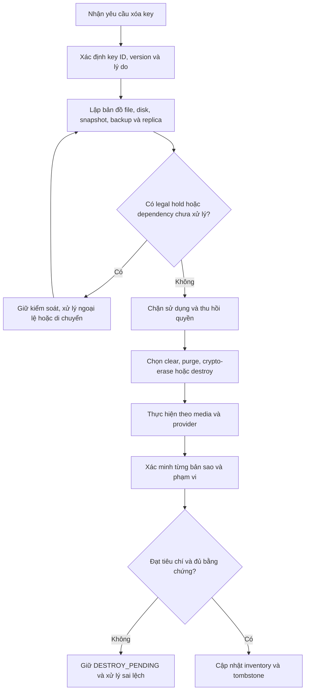

# Xóa key khỏi disk

Xóa một tệp khóa khỏi ổ đĩa không đồng nghĩa với việc bí mật mật mã đã biến mất. Thao tác xóa thông thường thường chỉ loại bỏ tên tệp khỏi thư mục hoặc đánh dấu vùng lưu trữ là có thể tái sử dụng. Nội dung cũ có thể còn trên thiết bị, trong bản sao lưu, snapshot, journal, vùng swap, crash dump hoặc bản sao do hệ thống đồng bộ tạo ra. Với SSD và storage phân tán, việc ghi đè một tệp cũng không bảo đảm ghi đè đúng các ô vật lý từng chứa dữ liệu.

Trong quản lý vòng đời khóa, xóa key khỏi disk là một phần của quy trình key destruction. Mục tiêu là làm cho key material không còn có thể được khôi phục hoặc sử dụng trái phép, đồng thời giữ lại metadata và bằng chứng cần thiết để kiểm toán. Quy trình phải xác định đúng khóa, mọi bản sao và phương tiện lưu trữ, chọn phương pháp sanitization phù hợp, xác minh kết quả và cập nhật inventory. Việc xóa một file đơn lẻ không thể thay thế các bước đó.

## 1. Xóa tệp và hủy key material là hai việc khác nhau

Khi ứng dụng lưu private key hoặc symmetric key thành tệp, hệ điều hành quản lý nội dung tệp qua filesystem và thiết bị lưu trữ. Lệnh xóa tệp thông thường có thể chỉ cập nhật metadata filesystem: tên tệp không còn xuất hiện trong thư mục, còn các block chứa dữ liệu được đánh dấu là có thể tái sử dụng. Cho đến khi các block đó bị ghi đè hoặc thiết bị được sanitization đúng cách, dữ liệu cũ có thể vẫn đọc được bằng công cụ phục hồi phù hợp.

Các khái niệm sau cần được phân biệt:

| Khái niệm | Ý nghĩa | Có bảo đảm key material không thể phục hồi? |
|---|---|---|
| Delete/unlink | Gỡ tên hoặc tham chiếu tới tệp khỏi filesystem | Không |
| Overwrite một tệp | Ghi dữ liệu khác lên các vị trí mà phần mềm nhìn thấy là nội dung tệp | Không phải lúc nào cũng; phụ thuộc filesystem và thiết bị |
| Clear | Làm sạch dữ liệu bằng phương pháp phù hợp với môi trường và mức độ nhạy cảm | Có thể phù hợp cho một số mục tiêu tái sử dụng, nhưng cần xác minh theo loại media |
| Purge/sanitize | Áp dụng phương pháp được thiết kế để làm dữ liệu không thể phục hồi bằng các kỹ thuật phù hợp với mức đe dọa | Có, nếu phương pháp và phạm vi được chọn đúng và được xác minh |
| Destroy media | Phá hủy vật lý thiết bị hoặc thành phần lưu trữ theo quy trình được kiểm soát | Có thể đạt mức đảm bảo cao khi thực hiện đúng; thiết bị không còn sử dụng được |
| Crypto-erasure | Hủy khóa mã hóa duy nhất cần thiết để giải mã dữ liệu đã mã hóa | Có điều kiện; chỉ khi mọi bản sao plaintext và mọi đường giải mã khác đã được loại trừ |

Các thuật ngữ Clear, Purge và Destroy mô tả mức xử lý dữ liệu trên phương tiện. Không nên xem chúng là các nút bấm tương đương trên mọi thiết bị. Phương pháp cụ thể phải dựa trên loại media, firmware, cơ chế remapping, kiến trúc lưu trữ và yêu cầu của tổ chức.

## 2. Vì sao key file có thể còn tồn tại sau khi xóa?

### 2.1. Filesystem và metadata

Filesystem thường lưu dữ liệu tệp trong các block hoặc extent, còn thư mục và metadata giữ ánh xạ tên tệp tới vị trí lưu trữ. Khi xóa tệp, filesystem có thể bỏ ánh xạ đó trước, sau đó mới tái sử dụng block. Một công cụ phục hồi có thể đọc các block chưa bị ghi đè và tái dựng nội dung.

Journal của filesystem, metadata transaction hoặc vùng log có thể lưu dấu vết liên quan đến thay đổi. Một số filesystem dùng copy-on-write (COW): khi thay đổi tệp, hệ thống ghi block mới và giữ block cũ cho tới khi snapshot hoặc tham chiếu cũ không còn. Vì vậy ghi đè nội dung theo đường dẫn hiện tại không nhất thiết chạm tới các block lịch sử.

### 2.2. SSD, flash và wear leveling

SSD dùng flash translation layer (FTL) để ánh xạ địa chỉ logic mà hệ điều hành nhìn thấy tới các trang NAND vật lý. Bộ điều khiển có thể di chuyển dữ liệu để wear leveling, thay block lỗi bằng block dự phòng và duy trì vùng over-provisioning. Một lần ghi đè địa chỉ logic có thể ghi vào trang vật lý mới, trong khi trang cũ vẫn còn cho tới khi bộ điều khiển thu hồi.

Lệnh TRIM hoặc discard thông báo rằng một vùng logic không còn cần dữ liệu. Đây là tín hiệu cho bộ điều khiển quản lý vùng đó; nó không phải bằng chứng rằng mọi trang NAND chứa dữ liệu cũ đã bị xóa ngay lập tức. Vì thế, ghi đè tệp nhiều lần bằng công cụ thông thường không tạo ra bảo đảm tương đương sanitization của toàn thiết bị SSD.

### 2.3. Snapshot, bản sao và tầng lưu trữ

Key file có thể xuất hiện ở nhiều nơi ngoài đường dẫn ban đầu:

- Snapshot filesystem, volume snapshot, bản clone hoặc checkpoint của máy ảo.
- Backup đầy đủ, backup incremental, bản sao offline hoặc bản lưu dài hạn.
- Replication sang vùng khác, object storage, NAS, SAN hoặc hệ thống DR.
- Cache, thư mục tạm, bản export, gói triển khai, artifact build và thư mục đồng bộ.
- Journal, swap/pagefile, hibernation image, crash dump và diagnostic bundle.
- Bản sao trên laptop, thiết bị quản trị, USB hoặc máy của người vận hành.

Xóa bản gốc không xóa các bản sao độc lập. Inventory và data-flow map cần chỉ ra nơi khóa có thể được sao chép, ai có quyền truy cập và chính sách lưu giữ của từng bản.

### 2.4. Bộ nhớ và tiến trình đang chạy

Xóa key file không xóa bản sao key material mà tiến trình đã đọc vào RAM. Thư viện mật mã, runtime, buffer, cache hoặc bản sao tạm trong tiến trình có thể vẫn giữ dữ liệu. Hệ điều hành có thể ghi một phần bộ nhớ ra swap/pagefile hoặc crash dump. Nếu mục tiêu là loại bỏ khả năng sử dụng khóa sau khi hủy, phải dừng workload, thu hồi quyền truy cập và xử lý các bản sao spill theo quy trình phù hợp. Việc ghi đè file trên disk không chứng minh bộ nhớ đã được làm sạch.

## 3. Xác định chính xác khóa và phạm vi xóa

Trước khi xóa, xác định chính xác khóa logic, phiên bản và mọi bản sao vật lý hoặc logic. Không dùng tên tệp hay alias làm định danh duy nhất vì chúng có thể trùng, đổi tên hoặc trỏ sang phiên bản khác.

Inventory tối thiểu nên hỗ trợ tra cứu:

| Trường | Mục đích |
|---|---|
| `key_id` và `version` | Xác định khóa logic và phiên bản cần hủy |
| Fingerprint hoặc public key identifier | Đối chiếu đúng key pair mà không tiết lộ private key |
| Key type, algorithm, purpose | Xác định mức độ nhạy cảm và cách xử lý phù hợp |
| Storage locations | Liệt kê disk, filesystem, volume, snapshot, backup, replica và thiết bị liên quan |
| Owner và custodian | Xác định người chịu trách nhiệm và người kiểm soát phương tiện |
| Wrapping relationship | Xác định khóa nào bọc key material hoặc DEK |
| Copies and dependencies | Xác định workload, cache, archive, DR và các bản sao |
| Lifecycle state | Biết khóa đang active, retired, revoked, compromised hay destroy-pending |
| Retention and legal hold | Xác định nghĩa vụ lưu giữ hoặc hạn chế xóa |
| Destruction evidence | Liên kết lệnh sanitization, kết quả xác minh và biên bản hủy |

Phạm vi phải phân biệt key material dạng rõ với encrypted key blob. Một file có thể chỉ chứa private key đã được mã hóa bằng passphrase hoặc KEK. Xóa encrypted blob có thể loại bỏ một bản sao, nhưng nếu blob vẫn tồn tại trong backup và KEK/passphrase vẫn còn thì key material vẫn có thể được khôi phục. Ngược lại, hủy KEK dùng chung có thể làm mất khả năng truy cập nhiều khóa khác ngoài mục tiêu. Cần đánh giá toàn bộ quan hệ bọc trước khi chọn phương pháp.

## 4. Chọn phương pháp theo loại thiết bị lưu trữ

Không có một phương pháp xóa an toàn áp dụng cho mọi thiết bị. Quyết định cần xét loại media, quyền kiểm soát, số lượng bản sao, khả năng remapping và việc có cần tái sử dụng thiết bị hay không.

| Loại lưu trữ | Rủi ro chính | Hướng xử lý cần xem xét |
|---|---|---|
| HDD từ tính | Block đã xóa có thể còn dữ liệu cho đến khi bị ghi lại; sector lỗi/remapped có thể nằm ngoài vùng ghi thông thường | Overwrite toàn thiết bị theo quy trình được chấp nhận hoặc dùng chức năng sanitize/secure erase của thiết bị; destroy vật lý khi cần mức đảm bảo cao hơn |
| SSD SATA/NVMe | FTL, wear leveling, over-provisioning, block dự phòng và remapping | Dùng lệnh sanitize/secure erase phù hợp model và firmware; xác minh trạng thái hoàn tất; không dựa riêng vào overwrite file hoặc TRIM |
| USB flash/SD card | Bộ điều khiển đơn giản, remapping và lệnh xóa không đồng nhất | Dùng chức năng sanitization đáng tin cậy nếu có; khi không thể xác minh, cân nhắc destroy thiết bị theo chính sách |
| Filesystem COW hoặc có snapshot | Block cũ được giữ bởi snapshot hoặc tham chiếu lịch sử | Liệt kê và xử lý snapshot, clone, checkpoint cùng các bản backup; sanitization thiết bị khi yêu cầu bao trùm mọi block |
| VM disk hoặc virtual volume | Nhiều lớp mapping, thin provisioning và snapshot ở hypervisor/storage backend | Phối hợp với nền tảng ảo hóa và nhà cung cấp để xử lý snapshot, replica, volume và backend; xác minh từng lớp |
| Cloud block/object storage | Nhà cung cấp kiểm soát media vật lý và cơ chế remapping | Dùng API xóa, lifecycle/retention và quy trình sanitization được provider công bố; lấy xác nhận hoặc chứng cứ phù hợp theo hợp đồng |
| NAS/SAN/RAID | Striping, parity, cache controller, snapshot và spare disk | Xác định tất cả member disk, cache và snapshot; phối hợp với quản trị storage để sanitization toàn bộ phạm vi |

Với HDD, ghi đè toàn thiết bị có thể là phương pháp phù hợp trong một số bối cảnh, nhưng phải tính đến sector hỏng, sector đã remap và vùng không truy cập được. Với SSD, việc ghi đè nhiều lần ở cấp tệp không bảo đảm chạm đến mọi trang NAND cũ. Khi thiết bị cung cấp lệnh sanitize, cần xác minh loại lệnh, hỗ trợ của firmware và trạng thái hoàn tất thay vì chỉ ghi nhận lệnh đã được gửi.

## 5. Các phương pháp xóa key khỏi disk

### 5.1. Xóa logic và thu hồi tham chiếu

Xóa logic gồm unlink tệp, xóa object, gỡ key reference hoặc loại bỏ bản ghi. Đây là bước cần thiết để ứng dụng không tiếp tục tìm thấy khóa, nhưng không phải bằng chứng sanitization. Cần thực hiện cùng lúc việc thu hồi quyền đọc, vô hiệu hóa alias, dừng tiến trình sử dụng khóa và cập nhật inventory.

### 5.2. Ghi đè dữ liệu

Overwrite ghi dữ liệu mới vào vị trí lưu trữ mà hệ thống có thể truy cập. Trên một số HDD, ghi đè toàn bộ vùng hoặc thiết bị theo phương pháp được chấp nhận có thể làm dữ liệu cũ khó hoặc không thể khôi phục bằng phương tiện thông thường. Tuy nhiên, overwrite một file trên filesystem COW có thể tạo block mới thay vì ghi lên block cũ. Với SSD, FTL có thể ánh xạ lần ghi mới sang trang khác. Vì vậy phải xác định rõ phương tiện và phạm vi trước khi dựa vào overwrite.

Các công cụ kiểu secure-delete ở cấp tệp không thể tự bảo đảm xóa mọi bản sao trong journal, snapshot, backup hoặc vùng remapped. Không dùng số lần ghi đè lặp lại như một con số thần kỳ áp dụng cho mọi thiết bị. Chọn phương pháp theo hướng dẫn của media và quy định sanitization của tổ chức.

### 5.3. Sanitize hoặc secure erase ở cấp thiết bị

Một số HDD, SSD và NVMe hỗ trợ chức năng sanitize hoặc secure erase. Chức năng này được thiết kế để xử lý dữ liệu ở phạm vi thiết bị theo khả năng của firmware, có thể bao gồm các vùng không nhìn thấy qua filesystem. Tên lệnh và mức đảm bảo khác nhau giữa chuẩn giao tiếp, model và firmware.

Trước khi sử dụng, phải xác minh:

- Thiết bị và firmware có hỗ trợ đúng phương pháp được chọn hay không.
- Phạm vi lệnh bao gồm namespace, partition, vùng dự phòng và các namespace liên quan như thế nào.
- Có thể kiểm tra trạng thái tiến trình và kết quả hoàn tất bằng công cụ tin cậy hay không.
- Thiết bị có bị khóa, lỗi hoặc ở trạng thái khiến lệnh không thể hoàn tất hay không.
- Sau sanitization, có còn snapshot, replica hoặc bản backup độc lập nào cần xử lý không.

Lệnh sanitize có thể làm mất toàn bộ dữ liệu trên thiết bị. Chỉ người được ủy quyền mới thực hiện trên đúng serial/resource đã xác minh, sau khi hoàn tất phê duyệt và kiểm tra phụ thuộc. Không dùng một lệnh thiết bị không rõ nguồn gốc hoặc không tương thích chỉ vì tên có chữ “secure”.

### 5.4. Crypto-erasure

Crypto-erasure làm dữ liệu mã hóa không thể giải mã bằng cách hủy khóa cần thiết để giải mã. Phương pháp này có thể phù hợp với volume hoặc object storage được mã hóa từ đầu, nếu thuật toán, quản lý khóa và toàn bộ bản sao được thiết kế để hỗ trợ. Với key file, crypto-erasure có thể là hủy KEK hoặc wrapping key đang bảo vệ các bản sao encrypted key blob.

Crypto-erasure chỉ đạt mục tiêu khi:

1. Mọi bản dữ liệu cần xóa đều được mã hóa bằng khóa hoặc chuỗi khóa đã xác định.
2. Không có plaintext, export hoặc bản sao không mã hóa nằm ngoài phạm vi.
3. Không còn bản sao của khóa giải mã, wrapping key, recovery share hoặc credential có thể tái tạo quyền truy cập.
4. Các backup, snapshot, replica và archive đều phụ thuộc vào khóa đã hủy hoặc đã được xử lý riêng.
5. Cache, RAM, swap, crash dump và workload không còn bản sao có thể sử dụng.
6. Hệ thống không có đường khôi phục khóa qua escrow, replication hoặc provider recovery ngoài dự kiến.

Nếu KEK dùng chung để bọc nhiều DEK, hủy KEK có thể làm mất quyền truy cập toàn bộ dữ liệu của nhiều dịch vụ. Nếu chỉ xóa một wrapped DEK mà vẫn còn bản sao của nó, dữ liệu vẫn có thể được giải mã. Cần kiểm tra chính xác phạm vi và quan hệ phụ thuộc trước khi chọn crypto-erasure.

### 5.5. Destroy vật lý

Khi media không thể sanitization đáng tin cậy, chứa dữ liệu có yêu cầu bảo đảm cao hoặc đã hỏng đến mức không thể xác minh, tổ chức có thể cần phá hủy vật lý theo quy trình được phê duyệt. Phương pháp phải phù hợp loại media và được thực hiện bởi nhà cung cấp hoặc đơn vị có năng lực. Việc chỉ đập vỏ thiết bị hoặc bẻ connector không chứng minh các chip nhớ đã bị phá hủy.

Destroy vật lý cần kiểm soát chuỗi bàn giao, nhận dạng thiết bị, người chứng kiến, phương pháp, thời điểm và chứng nhận hoặc bằng chứng của đơn vị xử lý. Nếu thiết bị chứa nhiều dữ liệu ngoài khóa, cần đánh giá ảnh hưởng tới các hệ thống và yêu cầu lưu giữ liên quan.

## 6. Quy trình xóa key khỏi disk

### Bước 1: Tiếp nhận yêu cầu và xác định lý do

Yêu cầu xóa có thể đến từ hết vòng đời, thay thế khóa, thu hồi, compromise, ngừng dịch vụ, yêu cầu xóa dữ liệu hoặc thanh lý thiết bị. Ghi event ID, người yêu cầu, lý do, phạm vi, thời hạn, mức độ khẩn cấp và người phê duyệt. Nếu khóa đang bị điều tra, cần phối hợp với incident response và legal hold trước khi xóa bằng chứng.

### Bước 2: Định danh khóa và các bản sao

Tra cứu `key_id`, version, fingerprint, đường dẫn lưu, loại file, owner, quyền truy cập và các ứng dụng đang dùng. Lập bản đồ mọi vị trí có thể chứa key material: máy chủ, thiết bị người dùng, thư mục tạm, volume, snapshot, backup, replica, archive, swap và crash dump. Phân biệt bản key file dạng rõ với encrypted key blob và xác định khóa bọc tương ứng.

Nếu inventory không thể xác định đầy đủ phạm vi, không được tuyên bố đã xóa hoàn tất. Chuyển trạng thái sang chờ xử lý, gán owner để tìm bản sao và xác định rủi ro còn lại.

### Bước 3: Dừng sử dụng và chặn khả năng truy cập

Chuyển khóa sang trạng thái phù hợp như `DESTROY_PENDING`, thu hồi grant hoặc credential, ngăn ứng dụng tạo phiên sử dụng mới và xác minh không còn workload phụ thuộc chưa được di chuyển. Với key file, dừng tiến trình đang mở file và xử lý các cache hoặc bản sao trong memory theo quy trình vận hành. Nếu khóa đang được dùng cho mã hóa, ký hoặc unwrap, cần có khóa thay thế và kế hoạch cutover trước khi dừng dịch vụ.

Đối với khóa bị compromise, phải ưu tiên containment và thu hồi quyền truy cập. Không trì hoãn việc chặn sử dụng chỉ để chờ hoàn tất quy trình xóa media; đồng thời cần bảo toàn bằng chứng điều tra theo yêu cầu.

### Bước 4: Xử lý bản sao trong ứng dụng và filesystem

Gỡ key reference khỏi cấu hình, secret store, thư mục tạm, artifact và các bản export. Xóa hoặc thay thế bản sao theo chính sách từng hệ thống. Kiểm tra file descriptor hoặc tiến trình còn giữ file, bản sao trong cache, log và công cụ backup agent. Xác định filesystem có journal, COW hoặc snapshot và ghi rõ các bản sao lịch sử cần xử lý.

Nếu key file được lưu trong container image hoặc artifact build, phải tạo bản build sạch và xử lý registry/artifact retention. Nếu khóa từng được commit vào repository, xóa file khỏi nhánh hiện tại không loại bỏ lịch sử commit, fork hoặc cache của repository. Cần quy trình xử lý riêng cho source control và coi khóa đã lộ nếu không thể chứng minh quyền truy cập đã được kiểm soát.

### Bước 5: Chọn phương pháp sanitization

Chọn clear, purge, crypto-erasure hoặc destroy theo loại media, mức độ nhạy cảm, yêu cầu tái sử dụng và khả năng xác minh. Ghi rõ phương pháp, thiết bị, serial/resource ID, firmware hoặc provider, công cụ và người thực hiện. Đối với cloud storage, xác định phần nào do provider chịu trách nhiệm và bằng chứng nào có thể nhận được.

Không áp dụng overwrite cấp tệp như bằng chứng cuối cùng cho SSD, COW filesystem hoặc storage có snapshot. Nếu không thể xác định hoặc kiểm soát media, phải chuyển sang phương pháp có mức đảm bảo phù hợp hơn hoặc ghi nhận giới hạn và rủi ro còn lại.

### Bước 6: Xử lý backup, snapshot và bản sao ngoại tuyến

Đối chiếu retention policy, legal hold, immutable backup và lịch hết hạn. Xóa bản sao theo chính sách khi được phép; nếu backup không thể sửa từng object, ghi nhận thời điểm hết hạn và kiểm soát quyền truy cập trong suốt thời gian lưu giữ. Với crypto-erasure, xác minh backup thực sự phụ thuộc vào khóa đã hủy và không tồn tại bản plaintext hoặc khóa giải mã khác.

Không xóa bản backup bất biến đang nằm trong legal hold hoặc nghĩa vụ lưu giữ khi chưa có quyết định có thẩm quyền. Trạng thái đúng trong trường hợp này là bản sao vẫn còn tồn tại nhưng bị kiểm soát và có thời hạn xử lý, không phải `DESTROYED` cho toàn bộ phạm vi.

### Bước 7: Xác minh kết quả

Xác minh theo phương pháp đã chọn. Với file-level cleanup, kiểm tra đường dẫn và các bản sao đã liệt kê; kết quả này chỉ chứng minh trạng thái logic của file. Với device sanitization, lấy trạng thái hoàn tất từ công cụ hoặc firmware tin cậy và đối chiếu serial/resource ID. Với crypto-erasure, xác minh key hierarchy, bản sao wrapping key, recovery path, backup và replica. Với destroy vật lý, kiểm tra biên bản và bằng chứng chuỗi bàn giao.

Khi phương pháp yêu cầu xác minh bằng cách thử phục hồi, chỉ thực hiện trên bản sao kiểm thử hoặc quy trình không làm lộ key material. Không thử tìm lại private key thật bằng công cụ phục hồi trên thiết bị đã xử lý. Nếu không có cách xác minh độc lập, ghi nhận giới hạn đó thay vì khẳng định chắc chắn dữ liệu đã biến mất.

### Bước 8: Cập nhật inventory và đóng sự kiện

Chỉ chuyển sang `DESTROYED` khi toàn bộ phạm vi được định nghĩa đã đạt tiêu chí và có bằng chứng. Nếu còn bản backup đang trong retention, snapshot chưa xử lý hoặc thiết bị chưa được sanitization, dùng trạng thái như `DESTROY_PENDING` hoặc `PARTIALLY_DESTROYED` theo quy ước nội bộ. Lưu phương pháp, ngày giờ, người thực hiện, người chứng kiến, thiết bị, công cụ/firmware, provider reference, kết quả và ngoại lệ.

Giữ tombstone hoặc metadata lịch sử để ngăn khóa bị tạo lại hoặc phục hồi từ snapshot cũ. Không lưu key material trong bản ghi kiểm toán. Sau khi đóng, xác minh alias, policy và ứng dụng không còn tham chiếu tới khóa đã hủy.

## 7. Luồng xử lý minh họa



Luồng này là mô hình quản trị. Trên thực tế, một số bước có thể được thực hiện song song, nhưng không được bỏ qua việc xác định phạm vi và xử lý các bản sao có thể khôi phục.

## 8. Ví dụ inventory và biên bản hủy

Ví dụ dưới đây mô tả metadata của một key file đã được xử lý trên volume SSD. Đây là cấu trúc minh họa, không phải bằng chứng cho một thiết bị thật.

```yaml
key_destruction:
  event_id: KEY-DESTROY-2026-0081
  key:
    key_id: app-signing-key
    version: "v4"
    key_type: asymmetric-private
    fingerprint: "SHA256:example-public-key-fingerprint"
    purpose: artifact-signing
  storage:
    media_type: nvme-ssd
    resource_id: storage-device-reference-17
    locations:
      - encrypted-key-file
      - temporary-export-directory
      - volume-snapshot-reference
  lifecycle:
    previous_state: RETIRED
    current_state: DESTROY_PENDING
    usage_blocked_at: "2026-11-28T03:00:00Z"
  method:
    selected: device-sanitize
    firmware_reference: "vendor-firmware-reference"
    execution_reference: "sanitize-job-0081"
  verification:
    status: pending
    device_completion: pending
    backup_review: pending
  approval:
    requested_by: key-owner
    approved_by: security-custodian
```

Khi thiết bị và mọi bản sao đã được xử lý, có thể bổ sung kết quả xác minh và chuyển trạng thái theo quy ước. Nếu snapshot vẫn còn trong retention, không được ghi nhận toàn bộ khóa đã bị hủy chỉ dựa trên trạng thái của volume gốc.

Một biên bản hoàn tất có thể lưu các trường sau:

| Trường bằng chứng | Nội dung cần lưu |
|---|---|
| Event ID | Mã yêu cầu hủy và mã incident/change nếu có |
| Key identity | `key_id`, version, fingerprint hoặc public key reference |
| Media identity | Serial number hoặc resource ID của thiết bị/volume |
| Scope | Các file, snapshot, backup, replica và location đã xử lý |
| Method | Phương pháp sanitization và tiêu chuẩn/quy trình nội bộ được áp dụng |
| Execution | Công cụ, phiên bản firmware, provider job ID, thời điểm và kết quả |
| Witness/approval | Người thực hiện, người chứng kiến và người phê duyệt |
| Exceptions | Bản sao còn trong retention, legal hold hoặc giới hạn kỹ thuật |
| Final state | `DESTROYED`, `PARTIALLY_DESTROYED` hoặc `DESTROY_PENDING` theo kết quả |

## 9. Các lỗi thường gặp

- **Cho rằng xóa file là xóa sạch khóa:** unlink thường chỉ gỡ tham chiếu filesystem. Phải chọn phương pháp sanitization theo media và xác minh phạm vi.
- **Dùng overwrite file trên SSD như bằng chứng:** FTL, wear leveling và vùng dự phòng khiến thao tác ở cấp file không kiểm soát mọi trang NAND. Dùng phương pháp device-level phù hợp.
- **Bỏ qua snapshot và backup:** key file có thể vẫn tồn tại trong bản sao lịch sử. Phải lập bản đồ và xử lý retention, replica, archive.
- **Không xử lý swap và crash dump:** tiến trình có thể đã ghi dữ liệu nhạy cảm ra vùng spill. Cần xử lý theo chính sách hệ điều hành và môi trường.
- **Xóa nhầm khóa bọc dùng chung:** có thể làm mất quyền giải mã nhiều dữ liệu ngoài phạm vi yêu cầu. Phải kiểm tra dependency graph trước khi crypto-erase.
- **Nhầm encrypted key blob với key material đã mất:** blob cũ vẫn có thể mở bằng KEK còn tồn tại. Kiểm tra toàn bộ wrapping hierarchy và bản sao.
- **Không chặn sử dụng trước khi xóa:** workload có thể tiếp tục đọc hoặc tạo bản sao mới trong lúc sanitization. Chặn quyền và dừng luồng sử dụng theo runbook.
- **Bỏ qua repository và artifact:** xóa file trong workspace không xóa commit history, fork, build cache hoặc artifact registry.
- **Tin vào lệnh sanitize đã gửi:** cần trạng thái hoàn tất và xác minh đúng thiết bị, đúng firmware, đúng phạm vi.
- **Đánh dấu `DESTROYED` quá sớm:** nếu còn bản sao trong legal hold, backup hoặc thiết bị chưa xử lý, phải ghi nhận trạng thái chưa hoàn tất.
- **Không giữ bằng chứng:** thiếu event ID, serial, phương pháp, người thực hiện và kết quả khiến tổ chức không thể chứng minh quá trình hủy.

## 10. Tình huống thực tế: xóa private key khỏi máy build

Một nhóm phát hành dùng private key để ký artifact. Khóa từng được export dưới dạng encrypted file vào máy build tạm thời. Sau khi chuyển sang HSM signing service, nhóm muốn xóa bản file cũ và chấm dứt khả năng sử dụng nó.

Đầu tiên, nhóm xác định key ID/version và fingerprint của public key tương ứng, sau đó tìm các bản sao trong workspace, thư mục tạm, agent cache, image của máy build, artifact, backup và snapshot. Nhóm xác minh HSM signing service đã hoạt động và certificate/trust chain đang dùng đúng public key dự kiến. Nếu private key cũ có nguy cơ đã lộ, chứng thư và credential liên quan được xử lý theo incident response, không chờ tới khi máy build được sanitization.

Tiếp theo, nhóm dừng agent cũ, thu hồi credential có quyền đọc file, xóa key reference khỏi cấu hình và tạo image build sạch. Nhóm xử lý artifact và snapshot theo retention policy, kiểm tra crash dump và pagefile theo quy trình hệ điều hành, rồi sanitization volume tạm theo khả năng của nền tảng. Nếu máy build là VM trên cloud, nhóm dùng quy trình của provider để xử lý disk, snapshot và image thay vì chỉ xóa file trong guest OS.

Cuối cùng, nhóm xác minh không còn workload hoặc pipeline nào tham chiếu key version cũ, thu thập provider/device evidence và cập nhật inventory. Nếu một bản backup bất biến còn trong thời hạn lưu giữ, trạng thái được ghi rõ là còn bản sao có kiểm soát cho đến khi hết retention hoặc được xử lý theo phê duyệt. Chỉ khi toàn bộ phạm vi đạt tiêu chí mới đóng sự kiện hủy.

## 11. Checklist trước khi xác nhận xóa key khỏi disk

- [ ] Có yêu cầu, lý do, event ID, owner và phê duyệt hợp lệ.
- [ ] Đã xác định đúng `key_id`, version và fingerprint/public key reference.
- [ ] Đã phân biệt key material dạng rõ với encrypted key blob và wrapping key.
- [ ] Đã lập bản đồ file, disk, volume, snapshot, backup, replica, archive và thiết bị ngoại tuyến.
- [ ] Đã đánh giá legal hold, retention và các phụ thuộc nghiệp vụ.
- [ ] Đã chặn workload, thu hồi quyền và xử lý cache/memory theo quy trình.
- [ ] Đã chọn phương pháp phù hợp với HDD, SSD, flash, VM hoặc cloud storage.
- [ ] Không dùng unlink hoặc overwrite cấp tệp làm bằng chứng duy nhất cho media không phù hợp.
- [ ] Đã xử lý swap, pagefile, crash dump, temp file, artifact và repository theo phạm vi.
- [ ] Crypto-erasure đã kiểm tra mọi bản sao khóa giải mã, wrapping key và recovery path.
- [ ] Đã xác minh kết quả bằng phương pháp đáng tin cậy và đúng resource ID.
- [ ] Bằng chứng hủy có event ID, media identity, method, thời gian, actor và kết quả.
- [ ] Inventory có trạng thái cuối phù hợp; ngoại lệ và bản sao còn lại được ghi rõ.
- [ ] Tombstone hoặc metadata lịch sử ngăn khóa bị phục hồi trái phép.
- [ ] Ứng dụng, alias và pipeline không còn sử dụng key version đã hủy.

Xóa key khỏi disk là một bài toán về dữ liệu tồn dư và khả năng khôi phục trên toàn bộ đường đi của key material. Khi xác định được mọi bản sao, chọn đúng phương pháp cho từng media, chặn việc sử dụng, xác minh kết quả và lưu bằng chứng, tổ chức mới có thể chứng minh khóa đã được hủy theo chính sách và không bị tái sử dụng từ một bản sao cũ.
