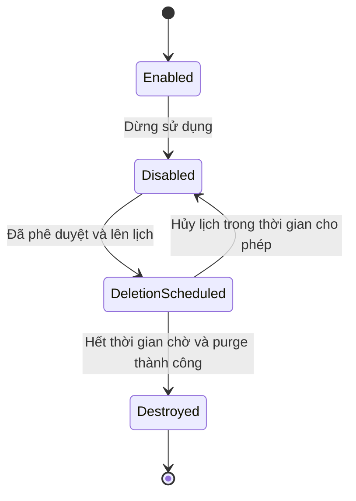
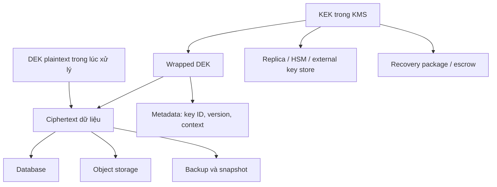
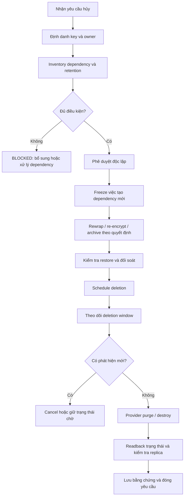

# Destroy key trong KMS

## Mục tiêu học tập

Sau bài học này, bạn có thể:

- Giải thích `destroy key` trong Key Management Service (KMS) có ý nghĩa gì đối với key material, metadata và dữ liệu đã được mã hóa.
- Phân biệt disable, revoke, schedule deletion, cancel deletion, destroy và rotate key.
- Xác định những phụ thuộc có thể khiến việc hủy khóa chưa thực sự làm mất khả năng giải mã, như replica, backup, bản xuất, key cache và DEK đã được unwrap.
- Lập kế hoạch hủy khóa có kiểm soát, có phê duyệt, có thời gian chờ và có bằng chứng kiểm toán.
- Thiết kế quy trình xác minh trước và sau khi KMS xác nhận khóa đã bị hủy.

## 1. Vì sao hủy khóa là một thao tác đặc biệt

KMS quản lý khóa mật mã để ứng dụng có thể yêu cầu mã hóa, giải mã, ký, xác minh hoặc bọc khóa dữ liệu mà không cần trực tiếp nắm giữ key material lâu dài. Trong suốt vòng đời, một khóa có thể được tạo, cấp quyền, sử dụng, xoay vòng, tạm ngừng, thu hồi và cuối cùng bị hủy.

Hủy khóa là điểm kết thúc có chủ đích của vòng đời. Khi key material cần thiết cho một phép giải mã bị loại bỏ trên toàn bộ các vị trí có thể sử dụng, ciphertext tương ứng có thể trở nên không thể giải mã về mặt thực tế. Đây là một cơ chế quan trọng trong crypto-erasure: dữ liệu được giữ ở dạng ciphertext, còn khả năng khôi phục bị loại bỏ bằng cách hủy bí mật mật mã bảo vệ dữ liệu.

Tuy nhiên, một lệnh xóa tài nguyên trong giao diện KMS chưa đủ để chứng minh dữ liệu đã được crypto-erase. Key material có thể còn trong replica, bản backup, thiết bị HSM khác, external key store, gói recovery hoặc bộ nhớ của ứng dụng. Một DEK đã được unwrap trước đó cũng có thể tiếp tục giải mã dữ liệu trong thời gian nó còn tồn tại ở dạng plaintext. Vì vậy, hủy khóa phải được xem là một quy trình quản trị có kiểm soát, bao gồm phân tích phụ thuộc, di chuyển dữ liệu, phê duyệt, chờ, hủy và xác minh.

Một quyết định hủy khóa có thể ảnh hưởng đến nhiều hệ thống hơn dịch vụ đã tạo khóa. Ví dụ, một KEK của tenant có thể bọc hàng triệu DEK; các DEK này lại bảo vệ bản ghi giao dịch, tệp đính kèm, bản sao lưu và dữ liệu lưu trữ dài hạn. Hủy KEK quá sớm có thể làm toàn bộ dữ liệu lịch sử mất khả năng khôi phục, dù ciphertext vẫn còn nguyên vẹn.

## 2. Thuật ngữ và phạm vi cần phân biệt

| Thuật ngữ | Ý nghĩa | Kết quả chính |
|---|---|---|
| Disable | Tắt khả năng sử dụng khóa qua KMS | Các thao tác mới bị từ chối theo chính sách provider; key material thường vẫn tồn tại |
| Revoke access | Thu hồi quyền của principal, grant hoặc workload | Chủ thể bị thu hồi không còn quyền gọi thao tác được cấp |
| Retire | Đánh dấu khóa không còn được dùng cho mục đích tạo dữ liệu mới | Có thể vẫn giữ quyền giải mã dữ liệu cũ |
| Rotate | Chuyển hoạt động sang key version hoặc khóa mới | Khóa cũ có thể vẫn cần để đọc dữ liệu cũ |
| Schedule deletion | Đăng ký ý định hủy và bắt đầu thời gian chờ | Khóa đi vào trạng thái chờ hủy; chưa thể kết luận key material đã bị xóa |
| Cancel deletion | Hủy lịch hủy trong khoảng thời gian provider cho phép | Khóa có thể được phục hồi về trạng thái có thể quản lý hoặc sử dụng theo semantics của provider |
| Destroy / purge | Hủy key material theo semantics của KMS/HSM hoặc hệ thống giữ khóa bên ngoài | Khả năng sử dụng key material bị loại bỏ theo phạm vi đã xác minh |
| Delete metadata | Xóa alias, label hoặc bản ghi quản trị | Không chứng minh key material đã bị hủy |

Các từ trên không có semantics hoàn toàn giống nhau giữa mọi nhà cung cấp. Một số KMS có thao tác schedule deletion và thời gian chờ bắt buộc; một số hệ thống có soft-delete và purge protection; một số HSM yêu cầu ceremony hoặc quorum riêng. Khi triển khai, phải đối chiếu API, trạng thái, giới hạn và cam kết của đúng provider, đúng loại khóa và đúng cấu hình region.

Trong bài này, `destroy key` là kết quả cuối cùng mà tổ chức muốn đạt được: key material thuộc phạm vi đã phê duyệt không còn khả năng được khôi phục hoặc sử dụng từ bất kỳ bản sao được quản lý nào. `Schedule deletion` chỉ là một bước trong quy trình đó.

## 3. Hủy khóa không đồng nghĩa xóa dữ liệu

KMS thường không lưu ciphertext nghiệp vụ. Lệnh hủy một khóa trong KMS không tự động xóa bản ghi trong database, object trong storage, log, snapshot hay backup. Nó tác động đến khả năng thực hiện các phép toán mật mã cần key material.

Giả sử dữ liệu `P` được mã hóa thành ciphertext `C` bằng khóa `K`:

```text
C = Encrypt(K, P)
P = Decrypt(K, C)
```

Nếu `K` thực sự không còn tồn tại ở mọi nơi có thể sử dụng và không có bí mật tương đương nào khác, người giữ `C` sẽ không thể thực hiện phép giải mã thông thường để thu lại `P`. Nhưng nếu có bản sao `K'` giống `K`, một DEK plaintext đã được cache, hoặc một bản backup có thể khôi phục `K`, thì dữ liệu vẫn có thể khôi phục.

Do đó, cần tách ba câu hỏi:

1. **Key material đã bị hủy chưa?** Xét tất cả phiên bản, replica, backup, HSM, external store và recovery package.
2. **Dữ liệu nào phụ thuộc vào khóa?** Xét ciphertext, DEK được bọc, metadata, bản sao lưu, bản xuất và hệ thống downstream.
3. **Có đường giải mã thay thế không?** Xét plaintext đã lưu, key cache, bản sao key material, khóa dự phòng, escrow và bản export.

Hủy một alias hoặc xóa một record trong catalog chỉ giải quyết quản lý metadata. Nó không trả lời được câu hỏi về key material.

## 4. Đối tượng có thể bị hủy trong KMS

Trước khi thao tác, cần xác định chính xác đối tượng và phạm vi hủy. Các KMS có thể mô hình hóa khóa theo nhiều cách:

- **Logical key resource:** tài nguyên khóa có ID ổn định, policy, alias và cấu hình usage.
- **Key version:** một phiên bản key material thuộc logical key, thường xuất hiện khi rotate hoặc import phiên bản mới.
- **Regional replica:** bản sao khóa được đồng bộ hoặc quản lý tại region khác.
- **Imported key material:** key material do tổ chức tự tạo rồi import vào KMS; vòng đời có thể khác khóa do KMS sinh.
- **External key:** khóa được giữ trong hệ thống bên ngoài, còn KMS đóng vai trò proxy hoặc điều phối thao tác.
- **HSM object:** đối tượng vật lý hoặc logic được quản lý bên trong HSM, có thể có quy trình hủy riêng.

Hủy một key version có thể khác hủy toàn bộ logical key. Xóa alias có thể chỉ loại bỏ tên thân thiện. Xóa một replica có thể không xóa bản primary. Xóa bản ghi liên kết trong ứng dụng không ảnh hưởng tài nguyên KMS. Không được suy ra phạm vi hủy chỉ từ tên nút hoặc tên API.

Inventory trước khi hủy phải ghi nhận ít nhất provider, account/project, partition, region, key ID, version ID, loại khóa, algorithm, usage, origin, trạng thái, replica, alias và resource policy. Với khóa imported hoặc external, cần thêm vị trí nguồn và người chịu trách nhiệm tại hệ thống giữ key material.

## 5. Mô hình trạng thái của quy trình hủy

Một vòng đời tổng quát có thể biểu diễn như sau. Tên trạng thái thực tế phụ thuộc provider.



`Enabled` cho phép các thao tác theo policy. `Disabled` thường ngăn các thao tác mật mã mới nhưng vẫn giữ key material. `DeletionScheduled` thể hiện ý định hủy đã được ghi nhận và có thể đi kèm một khoảng thời gian chờ. `Destroyed` là trạng thái cuối cùng theo cam kết của provider.

Trong hệ thống quản trị nội bộ, nên mô hình hóa thêm các trạng thái nghiệp vụ để tránh nhầm lẫn:

| Trạng thái nghiệp vụ | Ý nghĩa | Điều kiện chuyển tiếp |
|---|---|---|
| `REQUESTED` | Có yêu cầu hủy | Đã xác định người yêu cầu và lý do |
| `ASSESSED` | Đã đánh giá phạm vi và phụ thuộc | Inventory, retention, legal hold và impact được duyệt |
| `APPROVED` | Đã có phê duyệt cần thiết | Đạt dual control hoặc quorum |
| `FROZEN` | Ngăn workload tạo phụ thuộc mới | Alias, policy hoặc application routing đã được khóa theo kế hoạch |
| `MIGRATED` | Dữ liệu cần giữ đã được chuyển khóa hoặc xử lý | Kiểm tra dữ liệu, backup và restore đạt yêu cầu |
| `SCHEDULED` | KMS đã nhận lịch hủy | Lưu provider request ID và thời điểm dự kiến |
| `CANCELED` | Lịch hủy bị hủy | Có lý do, người thực hiện và bằng chứng |
| `DESTROYED` | Provider xác nhận hủy cuối cùng | Đã xác minh đúng key/version/region |
| `BLOCKED` | Có điều kiện không cho phép tiếp tục | Cần xử lý dependency, hold, lỗi hoặc phê duyệt |

Trạng thái nghiệp vụ giúp theo dõi toàn bộ quy trình, trong khi trạng thái provider phản ánh khả năng của tài nguyên trong KMS. Không nên ghi `DESTROYED` trong hệ thống nội bộ chỉ vì API schedule deletion trả về thành công.

## 6. Disable, revoke và destroy giải quyết các vấn đề khác nhau

Disable là biện pháp ngăn sử dụng tạm thời hoặc trong giai đoạn chờ. Nếu một workload vẫn có quyền gọi KMS nhưng key đã disabled, yêu cầu có thể bị từ chối. Key material thường vẫn tồn tại nên có thể enable lại nếu policy và trạng thái provider cho phép.

Revoke access thu hồi quyền của principal hoặc grant. Đây là kiểm soát danh tính và ủy quyền. Nếu một principal khác vẫn được cấp quyền, key vẫn có thể sử dụng. Thu hồi quyền cũng không xóa key material hoặc plaintext đã được lấy trước đó.

Destroy loại bỏ khả năng sử dụng key material theo phạm vi đã định. Đây là thao tác kết thúc vòng đời và thường không thể đảo ngược sau khi hoàn tất.

| Nhu cầu | Biện pháp phù hợp | Lý do |
|---|---|---|
| Tạm dừng workload đang gọi nhầm key | Disable hoặc policy deny | Có thể điều tra rồi khôi phục |
| Một service không còn được phép dùng key | Revoke grant/IAM | Thu hẹp quyền của principal |
| Dừng tạo ciphertext mới bằng key cũ nhưng vẫn đọc dữ liệu cũ | Retire hoặc policy chỉ cho phép decrypt/unwrap | Giữ khả năng đọc lịch sử |
| Chuyển dữ liệu sang key mới | Re-encrypt hoặc rewrap tùy kiến trúc | Tách dữ liệu khỏi key cũ |
| Loại bỏ key material đã hết thời hạn và không còn dependency | Schedule deletion rồi destroy | Kết thúc vòng đời |
| Xử lý key compromise | Incident response, revoke, rotate/rekey, đánh giá dữ liệu và destroy theo kế hoạch | Destroy đơn lẻ không vô hiệu hóa bản sao đã lộ |

Nếu khóa bị nghi ngờ lộ, không nên chờ hết deletion window mới bắt đầu containment. Cần chặn sử dụng, thu hồi quyền, thay khóa, đánh giá phạm vi dữ liệu và điều tra các bản sao. Việc hủy key material cũ có thể là một bước sau đó, nhưng không làm cho ciphertext đã bị sao chép hoặc plaintext đã bị lấy trước đó trở nên an toàn trở lại.

## 7. Điều kiện để crypto-erasure có hiệu lực

Crypto-erasure dựa trên giả định rằng ciphertext chỉ có thể được giải mã bằng key material bị hủy hoặc bằng một bí mật tương đương. Cần kiểm tra các điều kiện sau:

1. Dữ liệu đã được mã hóa bằng thuật toán và cấu hình phù hợp; khóa có entropy đủ và không bị tái sử dụng sai cách.
2. Mọi bản sao key material thuộc phạm vi hủy đã được xác định, bao gồm replica, backup, export, escrow và hệ thống external.
3. Không còn plaintext DEK, KEK hoặc khóa tương đương trong cache, process, crash dump, swap, file tạm hay thiết bị ứng dụng.
4. Không có key version khác, recovery key hoặc đường dẫn giải mã dự phòng có thể mở cùng dữ liệu.
5. Backup và archive cũng phụ thuộc vào khóa đã được hủy, hoặc đã được xử lý theo chính sách lưu giữ riêng.
6. Metadata cần để chứng minh phạm vi đã được lưu lại mà không lưu key material.

Nếu thiếu một điều kiện, kết luận phải được giới hạn. Ví dụ, có thể xác nhận KMS primary key đã bị hủy nhưng chưa thể khẳng định crypto-erasure của toàn bộ dữ liệu nếu chưa xác minh bản backup ngoài KMS.

Crypto-erasure cũng không thay thế yêu cầu xóa dữ liệu theo luật hoặc hợp đồng. Nếu tổ chức cần xóa ciphertext vật lý, xóa index, xóa replica dữ liệu hoặc xóa metadata định danh, những công việc đó phải được thực hiện theo quy trình data deletion riêng. Ngược lại, trong một số mô hình lưu trữ, giữ ciphertext vô danh sau khi hủy khóa có thể là một phần của thiết kế; quyết định này cần được pháp chế, bảo mật và chủ sở hữu dữ liệu chấp thuận.

## 8. Đồ thị phụ thuộc của khóa

Một khóa thường có nhiều phụ thuộc trực tiếp và gián tiếp. Ví dụ với envelope encryption:



Đồ thị này cho thấy hủy KEK có thể làm mất khả năng unwrap nhiều DEK. Nhưng nếu DEK đã được lưu ở dạng plaintext trong một hệ thống khác, hủy KEK không loại bỏ DEK đó. Nếu backup chứa wrapped DEK, backup vẫn không thể giải mã sau khi KEK bị hủy, trừ khi có bản KEK hoặc DEK khác.

Trước khi hủy, cần truy vết tối thiểu các mối quan hệ:

- Ciphertext nào dùng key trực tiếp, key version nào và algorithm nào?
- DEK nào được bọc bởi KEK, và wrapped blob nằm ở đâu?
- Ứng dụng nào có thể unwrap hoặc cache DEK?
- Backup, snapshot, archive, data lake, CDC log và bản sao vùng nào chứa ciphertext hoặc wrapped key?
- Có key export, escrow, recovery kit hoặc bản HSM backup không?
- Có dịch vụ downstream nào dùng key cho signing, MAC, token, certificate hoặc xác thực dữ liệu?

Nếu inventory không đủ để trả lời, trạng thái đúng là `BLOCKED` cho đến khi chủ sở hữu hệ thống hoàn thiện dữ liệu. Không nên coi việc không tìm thấy dependency là bằng chứng rằng dependency không tồn tại.

## 9. Envelope encryption và rủi ro hủy KEK

Trong envelope encryption, ứng dụng tạo hoặc yêu cầu KMS tạo DEK. DEK mã hóa dữ liệu; KEK trong KMS bọc DEK để lưu trữ an toàn.

```text
DEK = GenerateDataKey()
Ciphertext = Encrypt(DEK, Plaintext)
WrappedDEK = KMS.EncryptOrWrap(KEK, DEK)

Khi đọc:
DEK = KMS.DecryptOrUnwrap(KEK, WrappedDEK)
Plaintext = Decrypt(DEK, Ciphertext)
```

Hủy KEK khiến ứng dụng không thể unwrap những DEK chỉ được bảo vệ bởi KEK đó. Điều này có thể làm mất khả năng giải mã lượng lớn dữ liệu mà không cần xóa bất kỳ ciphertext nào.

Có hai hướng di chuyển phổ biến:

**Rewrap DEK:** dùng KEK cũ unwrap DEK rồi bọc cùng DEK bằng KEK mới. Ciphertext dữ liệu không đổi. Phương án này giảm chi phí xử lý dữ liệu lớn, nhưng DEK vẫn giữ nguyên và có thể không phù hợp khi chính DEK bị nghi ngờ lộ hoặc policy yêu cầu thay key material mã hóa dữ liệu.

**Tạo DEK mới và mã hóa lại dữ liệu:** giải mã bằng DEK cũ, tạo DEK mới, mã hóa lại plaintext và lưu wrapped DEK mới. Phương án này thay key bảo vệ dữ liệu nhưng cần xử lý tính nhất quán, dung lượng, downtime, transaction và backup.

Không được hủy KEK cũ cho đến khi đã xác minh toàn bộ wrapped DEK cần giữ đã được rewrap hoặc dữ liệu đã được re-encrypt. Với dữ liệu lưu trữ dài hạn, cần kiểm tra cả archive và backup offline.

## 10. Các bản sao khóa và vị trí thường bị bỏ sót

Một cuộc hủy chỉ có hiệu lực trong phạm vi đã kiểm soát. Những vị trí sau thường bị bỏ sót:

| Vị trí | Câu hỏi cần xác minh |
|---|---|
| Multi-region replica | Replica đã bị xóa hoặc hủy theo semantics provider chưa? Có replication lag không? |
| HSM cluster | Các partition/node có cùng object hoặc backup object không? Ceremony hủy đã hoàn tất chưa? |
| Imported key material | Có bản gốc tại nơi tạo khóa, file import hoặc thiết bị trung gian không? |
| External key store | KMS chỉ mất kết nối hay key material tại external manager đã bị hủy thật? |
| Backup KMS/HSM | Có thể restore key object hoặc key material từ backup không? Ai giữ quyền restore? |
| Escrow/recovery kit | Có share, recovery package hoặc bản sao được phân tán cho trustee không? |
| Secret manager/configuration | Có key bytes, wrapping key hoặc credential có thể truy cập key không? |
| Application memory | DEK plaintext có còn trong cache, heap dump, crash dump hoặc process đang chạy không? |
| CI/CD và máy quản trị | Có file export, artifact, biến môi trường hoặc bản ghi debug chứa key material không? |
| DR site và archive | Có bản sao ngoài region, ngoài tài khoản hoặc ngoài tổ chức vận hành chính không? |

Không phải mọi metadata đều là key material. Key ID, fingerprint, algorithm, creation time và audit event thường cần được giữ để truy vết. Ngược lại, raw key bytes, wrapped recovery secret hoặc bản backup có thể khôi phục key phải được quản lý như tài sản bí mật.

## 11. Key cache và plaintext đã được giải phóng khỏi KMS

KMS có thể kiểm soát việc unwrap hoặc giải mã, nhưng sau khi ứng dụng nhận plaintext DEK, KMS không thể tự động xóa bản plaintext đó khỏi bộ nhớ của ứng dụng. Vì vậy, lệnh destroy có thể ngăn các lần unwrap tiếp theo nhưng không nhất thiết ngăn process đang chạy tiếp tục giải mã.

Thiết kế ứng dụng nên:

- Giới hạn thời gian sống của DEK trong memory và kích thước cache.
- Xóa entry cache khi nhận sự kiện disable/revoke hoặc khi key version bị ngừng sử dụng.
- Không ghi key bytes vào log, trace, exception, metrics label, crash report hoặc telemetry.
- Hạn chế heap dump, core dump, swap và quyền truy cập debugger trên workload nhạy cảm.
- Dừng hoặc restart workload theo runbook khi cần chắc chắn các plaintext key trong memory không còn được sử dụng.
- Dùng key ID/version rõ ràng trong cache key để không nhầm DEK giữa tenant hoặc version.

Các runtime managed memory có thể không bảo đảm zeroization tuyệt đối vì garbage collector, copy-on-write hoặc bản sao nội bộ. Nếu yêu cầu xóa khỏi RAM là trọng yếu, cần chọn thư viện, runtime và nền tảng có cam kết phù hợp; đồng thời ghi nhận giới hạn còn lại. Không nên tuyên bố KMS destroy đã xóa mọi bản plaintext trong bộ nhớ của mọi client.

## 12. Backup, archive và khả năng khôi phục

Backup có thể chứa ciphertext, wrapped DEK, key metadata hoặc cả gói recovery. Cần phân biệt:

- Backup dữ liệu đã mã hóa: vẫn tồn tại sau khi hủy key; khả năng giải mã phụ thuộc khóa.
- Backup key metadata: có thể cần để xác định key ID, version và context; không nên chứa raw key material.
- HSM/KMS backup có khả năng khôi phục key material: có thể làm mất hiệu lực crypto-erasure nếu vẫn còn khả năng restore.
- Escrow/recovery package: có thể là đường khôi phục hợp lệ được phê duyệt; phải được xử lý rõ ràng trong quyết định hủy.

Nếu tổ chức tuyên bố hủy khóa để làm cho backup không thể khôi phục, phải xác minh không còn bản backup khóa hoặc escrow có thể phục hồi key material. Nếu chính sách yêu cầu giữ dữ liệu trong thời hạn nhất định, cần bảo đảm khả năng đọc trong thời hạn đó trước khi hủy. Hai mục tiêu “xóa không thể khôi phục” và “giữ khả năng phục hồi” có thể xung đột; chủ sở hữu dữ liệu phải quyết định và ghi nhận.

Một restore drill nên kiểm tra cả trường hợp tích cực và tiêu cực: dữ liệu cần giữ vẫn restore được bằng key mới; dữ liệu đã được phê duyệt crypto-erase không thể giải mã bằng đường khôi phục được quản lý. Không thực hiện thử nghiệm phá hủy trên production key hoặc backup duy nhất.

## 13. Điều kiện nghiệp vụ, retention và legal hold

Trước khi hủy, chủ sở hữu dữ liệu phải xác nhận:

- Dữ liệu đã hết thời hạn lưu giữ hoặc đã được di chuyển theo chính sách.
- Không có legal hold, điều tra, tranh chấp, kiểm toán hoặc yêu cầu bảo toàn chứng cứ đang áp dụng.
- Các hợp đồng, SLA và cam kết khôi phục cho phép hủy khóa.
- Các bản sao, archive, log và dữ liệu dẫn xuất đã được đánh giá.
- Đơn vị sở hữu nghiệp vụ chấp nhận hậu quả không thể khôi phục.

Một key có thể phục vụ nhiều mục đích. Ví dụ, key signing có thể ký token còn hiệu lực, key HMAC có thể xác thực webhook lịch sử, key encryption có thể bảo vệ backup cần giữ. Hủy chỉ vì một ứng dụng đã ngừng sử dụng có thể phá vỡ các consumer khác.

Với khóa đa tenant, cần xác định ranh giới tenant. Không được hủy khóa dùng chung nếu còn tenant khác phụ thuộc, trừ khi đã di chuyển và có xác nhận cho tất cả bên liên quan. Metadata tenant và key mapping phải được kiểm tra trước khi chạy batch.

## 14. Quyền hạn và phê duyệt

Destroy là thao tác đặc quyền cao. Tài khoản tạo yêu cầu không nên đồng thời là người tự phê duyệt và người thực hiện purge cuối cùng. Một mô hình kiểm soát thường gồm:

- **Key owner:** chịu trách nhiệm mục đích sử dụng, dependency và quyết định nghiệp vụ.
- **Key custodian:** quản lý thao tác kỹ thuật trong KMS/HSM và bằng chứng vận hành.
- **Security approver:** xác nhận đánh giá rủi ro, kiểm soát truy cập và phạm vi hủy.
- **Data owner:** xác nhận dữ liệu và retention.
- **Compliance/legal:** tham gia khi có nghĩa vụ lưu giữ hoặc chứng cứ.
- **Operator:** thực hiện thao tác theo phê duyệt; không tự thay đổi phạm vi.

Tùy mức độ quan trọng, tổ chức có thể yêu cầu dual control, M-of-N approval hoặc quorum của HSM. Phê duyệt phải gắn với một key ID/version cụ thể, account, region, lý do, phạm vi dữ liệu, thời điểm và kế hoạch phục hồi trong deletion window. Không dùng một phê duyệt chung cho một danh sách khóa chưa được cố định.

IAM nên tách quyền xem metadata, disable, schedule deletion, cancel deletion, purge, quản lý replica và khôi phục backup. Quyền purge cuối cùng cần giới hạn cho role chuyên biệt, có điều kiện và có audit. Không cấp quyền destroy rộng cho runtime workload.

## 15. Thời gian chờ và cửa sổ hủy

Nhiều KMS cung cấp deletion window để tổ chức có thời gian phát hiện nhầm lẫn và hủy lịch trước khi key material bị purge. Khoảng thời gian tối thiểu, tối đa, trạng thái API và quyền cancel khác nhau theo provider.

Deletion window có giá trị khi tổ chức dùng nó để hoàn tất kiểm tra và quan sát. Trong khoảng này cần:

1. Xác minh key ID, version, region và account trong request.
2. Theo dõi workload còn gọi Encrypt, Decrypt, Sign, Verify, Wrap hoặc Unwrap.
3. Kiểm tra các job batch, scheduled task và restore workflow có thể chưa chạy trong kỳ quan sát.
4. Xác minh migration và backup restore test đã hoàn tất.
5. Kiểm tra event, metric và cảnh báo cho lỗi truy cập key.
6. Cho phép chủ sở hữu yêu cầu cancel khi phát hiện dependency hoặc thay đổi retention.

Thời gian chờ không thay thế inventory. Một workload chỉ chạy theo quý có thể không tạo request trong vài ngày; vì vậy, thời gian quan sát phải dựa trên chu kỳ sử dụng dài nhất và dữ liệu lineage, không chỉ dựa vào việc không thấy request trong log gần đây.

## 16. Quy trình hủy khóa đầu-cuối

Quy trình sau là mẫu tổng quát. Cần ánh xạ sang trạng thái và API cụ thể của provider.



### Bước 1: Nhận yêu cầu và cố định định danh

Yêu cầu phải nêu lý do, owner, loại key, key ID, version, account/project, region, mục đích, dữ liệu liên quan và thời điểm mong muốn. Dùng immutable ID thay vì alias đơn lẻ vì alias có thể được trỏ sang key khác.

### Bước 2: Thu thập inventory và dependency

Đối chiếu KMS inventory với catalog ứng dụng, database, object storage, backup, archive, data pipeline, HSM và external key manager. Ghi nhận mọi consumer, wrapped DEK, replica và recovery path. Nếu không xác định được dependency, chuyển trạng thái `BLOCKED`.

### Bước 3: Đánh giá retention và khả năng khôi phục

Chủ sở hữu dữ liệu xác nhận thời hạn lưu giữ, legal hold, SLA và yêu cầu khôi phục. Chọn rõ một trong các kết quả: giữ dữ liệu bằng key mới, giữ ciphertext không thể giải mã, xóa dữ liệu theo quy trình riêng hoặc trì hoãn hủy.

### Bước 4: Phê duyệt

Gắn phê duyệt với bản inventory đã chốt. Nếu dependency thay đổi sau phê duyệt, phải đánh giá lại. Approval không nên chỉ xác nhận “đồng ý xóa key”; phải thể hiện người duyệt đã hiểu phạm vi dữ liệu và hậu quả không thể khôi phục.

### Bước 5: Freeze việc tạo dependency mới

Chuyển writer sang key mới, cập nhật routing hoặc policy để workload không tạo ciphertext mới bằng key sắp hủy. Giữ khả năng đọc dữ liệu cũ trong giai đoạn migration nếu kế hoạch yêu cầu. Đối với key dùng chung, phải chuyển toàn bộ producer trước khi tiếp tục.

### Bước 6: Di chuyển dữ liệu cần giữ

Thực hiện rewrap hoặc re-encrypt. Với rewrap, xác minh wrapped DEK mới có thể unwrap và giải mã ciphertext mẫu. Với re-encrypt, xác minh bản ghi, checksum, nonce, authentication tag và metadata được cập nhật nguyên tử. Kiểm tra archive, snapshot và bản sao lưu.

### Bước 7: Kiểm tra restore và đối soát

Khôi phục thử dữ liệu cần giữ từ bản backup đại diện bằng key mới. Đối soát số lượng object, version, checksum và trạng thái migration. Xác minh không còn consumer hợp lệ phụ thuộc key cũ.

### Bước 8: Schedule deletion

Người vận hành có quyền phù hợp gọi API schedule deletion trên đúng immutable key ID/version. Lưu request ID, thời điểm, deletion window, actor, approval ID và response. Đọc lại trạng thái từ KMS để xác nhận lịch đã được ghi nhận.

### Bước 9: Theo dõi deletion window

Theo dõi request bị từ chối, job lỗi, restore, batch chưa hoàn tất và phản hồi từ owner. Có runbook cancel rõ ràng. Nếu có dependency mới, không tiếp tục chỉ vì lịch đã được tạo; cần cancel hoặc chuyển `BLOCKED`.

### Bước 10: Xác minh destroy và đóng yêu cầu

Sau thời điểm purge, đọc lại trạng thái từ provider. Kiểm tra từng replica và external key manager theo phạm vi đã phê duyệt. Lưu bằng chứng không chứa key material. Chỉ đánh dấu `DESTROYED` khi mọi điều kiện của phạm vi đã được xác minh; nếu một hệ thống ngoài phạm vi chưa xác nhận, ghi rõ phần chưa thể kết luận.

## 17. Thiết kế API và tự động hóa an toàn

Tự động hóa hủy khóa cần có guardrail để tránh nhầm key, chạy lặp hoặc vượt qua phê duyệt. Một workflow có thể dùng các bước logic sau:

```text
request = loadDeletionRequest(requestId)
assert request.status == APPROVED
assert request.approval.keyId == request.keyId
assert request.inventoryVersion == currentInventory.version
assert request.legalHold == false
assert request.dependenciesResolved == true

key = kms.getKey(request.provider, request.account, request.region, request.keyId)
assert key.id == request.keyId
assert key.versionScope == request.versionScope
assert key.status in request.allowedPreDeletionStates

freezeNewUsage(request.keyId)
verifyMigrationAndRestore(request.migrationEvidence)
scheduleDeletion(key.id, request.deletionWindow)
recordProviderRequestAndReadBack()
```

Đây là pseudocode mô tả các guardrail, không phải API dùng trực tiếp cho một provider. Tên hàm, state và khả năng schedule/cancel phải được thay bằng SDK/API chính thức.

Các nguyên tắc triển khai:

- **Idempotency:** một request ID chỉ được schedule một lần về mặt nghiệp vụ; retry phải đọc trạng thái trước khi gọi lại.
- **Compare-and-set:** kiểm tra phiên bản inventory và trạng thái key trước khi chuyển bước, tránh chạy theo dữ liệu đã cũ.
- **Immutable target:** phê duyệt gắn với key ID/version/region; không resolve alias tại thời điểm purge mà không xác minh lại.
- **Separation of duties:** người tạo yêu cầu, người duyệt và người purge được phân tách theo policy.
- **Explicit state transition:** chỉ cho phép chuyển trạng thái hợp lệ; không nhảy từ `REQUESTED` thẳng sang `DESTROYED`.
- **Fail closed:** thiếu approval, inventory, legal-hold result hoặc provider readback thì dừng.
- **Rate limit và batch boundary:** chia lô nhỏ, có giới hạn số key, có checkpoint và khả năng dừng.
- **Audit correlation:** request ID nội bộ phải liên kết được với provider operation ID và log của từng replica.

Không nên viết script nhận một danh sách alias rồi xóa hàng loạt. Nếu cần batch, hãy resolve alias thành immutable ID, xuất preview, tính số dependency và tổng hợp approval cho chính danh sách đó trước khi thực thi.

## 18. Xử lý lỗi, retry và race condition

Hủy khóa là thao tác có tác động lớn; retry ngây thơ có thể làm sai trạng thái. Các tình huống cần xử lý:

| Tình huống | Rủi ro | Cách xử lý |
|---|---|---|
| Timeout sau khi schedule | Không biết provider đã nhận request chưa | Readback trạng thái trước khi retry |
| Alias bị đổi đích | Hủy nhầm key | Dùng immutable ID và xác minh mapping tại thời điểm thực hiện |
| Inventory thay đổi sau approval | Bỏ sót dependency mới | So sánh inventory version; yêu cầu đánh giá lại |
| Hai operator cùng chạy | Tạo operation cạnh tranh | Lock hoặc compare-and-set trên request nội bộ |
| Replica đồng bộ chậm | Một vùng vẫn có key | Kiểm tra từng region và trạng thái replication |
| Hết deletion window trong lúc điều tra | Key bị purge trước khi xử lý | Cảnh báo trước deadline, owner trực và quyền cancel được kiểm thử |
| Cancel timeout | Không rõ lịch đã bị hủy chưa | Readback; không giả định cancel thành công |
| Provider API trả trạng thái không rõ | Đóng request sai | Giữ `PENDING_VERIFICATION`, mở incident nếu vượt SLA |

Mỗi thao tác cần ghi lại kết quả riêng: request gửi đi, response nhận được, trạng thái đọc lại và trạng thái nghiệp vụ. Một HTTP 2xx hoặc SDK call không thay thế readback.

## 19. Hủy key version, key ring và multi-region

Với key ring có nhiều version, cần xác định dữ liệu nào dùng từng version. Việc version mới đã được dùng cho writer không có nghĩa version cũ hết dependency. Reader có thể vẫn cần version cũ để giải mã dữ liệu lịch sử.

Một chiến lược an toàn là:

1. Chuyển writer sang version mới.
2. Giữ reader có khả năng chọn đúng version theo metadata của ciphertext.
3. Theo dõi và di chuyển dữ liệu theo từng version.
4. Chỉ hủy version cũ khi không còn ciphertext hoặc wrapped key cần nó.
5. Xác minh alias và policy không còn trỏ đến version cũ.

Trong multi-region, logical key có thể có replica tự động hoặc replica được quản lý độc lập. Cần hiểu thao tác destroy có lan truyền, yêu cầu xóa từng replica hay chỉ xóa primary. Kiểm tra replication status, region bị ngắt kết nối và region phục hồi sau sự cố. Một replica đang offline có thể không nhận được lệnh hủy ngay lập tức.

Nếu provider hỗ trợ multi-region key với material dùng chung, semantics có thể khác mô hình copy độc lập. Hãy dựa trên tài liệu và readback của đúng dịch vụ. Không suy luận rằng xóa một region sẽ xóa mọi region.

## 20. Imported key và external key store

Với imported key material, KMS có thể quản lý metadata và quyền sử dụng nhưng nguồn key material ban đầu có thể còn ở hệ thống của tổ chức. Hủy key trong KMS không tự động hủy file nguồn, bản backup, thiết bị tạo khóa hoặc bản import ở môi trường khác.

Với external key store, KMS có thể gửi thao tác mật mã đến key manager bên ngoài. Có thể tồn tại hai hành động riêng:

- Xóa hoặc ngắt liên kết external key trong KMS.
- Hủy key material thật sự tại external key manager.

Ngắt kết nối có thể khiến KMS không gọi được key, nhưng key material vẫn tồn tại và có thể được dùng qua đường khác. Quy trình cần phối hợp owner của external system, lưu bằng chứng hủy tại nguồn và xác minh không còn bản sao phục hồi.

Với HYOK/BYOK, phải xác định trách nhiệm giữa bên cung cấp dịch vụ và tổ chức sở hữu khóa. Hợp đồng và quy trình vận hành cần chỉ rõ ai có quyền schedule, ai có quyền purge, ai giữ backup và cách chứng minh key material đã bị hủy.

## 21. Các loại khóa có tác động hủy khác nhau

| Loại khóa | Tác động khi hủy | Kiểm tra đặc biệt |
|---|---|---|
| Data Encryption Key (DEK) | Dữ liệu được mã hóa trực tiếp bằng DEK có thể mất khả năng giải mã | Wrapped DEK, cache plaintext, mọi bản sao dữ liệu |
| Key Encryption Key (KEK) | Các DEK được bọc bởi KEK có thể không unwrap được | Toàn bộ wrapped DEK, rewrap, backup và replica |
| Signing private key | Không thể tạo chữ ký mới bằng key đó | Token/chữ ký còn hiệu lực, trust store, timestamp và verification policy |
| HMAC key | Không thể tạo MAC mới hoặc xác minh MAC cũ bằng key đó | Webhook, log integrity, message lịch sử và consumer xác minh |
| TLS/private certificate key | Không thể thiết lập hoặc duy trì một số luồng xác thực dùng key | Certificate lifecycle, endpoint, mTLS, rotation và session |
| Recovery/wrapping key | Có thể mất khả năng phục hồi nhiều key khác | Escrow, HSM backup, split knowledge và DR |

Hủy signing key không làm chữ ký cũ tự động mất hiệu lực về mặt toán học; hệ thống xác minh có thể vẫn kiểm tra được chữ ký bằng public key. Nhưng chính sách tin cậy, certificate status, timestamp và thời hạn token có thể ảnh hưởng việc chấp nhận chữ ký. Hủy private key cũng không thay thế việc revoke certificate hoặc cập nhật trust policy.

Hủy HMAC key có thể khiến hệ thống không xác minh được log hoặc message lịch sử. Nếu cần xác minh lịch sử lâu dài, tổ chức phải thiết kế quy trình chuyển sang cơ chế xác minh khác hoặc lưu bằng chứng độc lập trước khi hủy.

## 22. Hủy khóa khi có sự cố compromise

Khi nghi ngờ key material bị lộ, cần phân loại loại bí mật và khả năng kẻ tấn công đã lấy được bản sao. Destroy trên KMS không thể thu hồi bản key đã bị sao chép ra ngoài. Nếu key bị export, attacker có thể tiếp tục sử dụng bản sao bất kể trạng thái KMS.

Quy trình incident response thường cần:

1. Cô lập workload và principal bị nghi ngờ; revoke credential hoặc grant bị lộ.
2. Disable hoặc chặn key cũ để ngăn các thao tác qua KMS nếu phù hợp.
3. Xác định thời điểm, phạm vi, dữ liệu và thuật toán bị ảnh hưởng.
4. Tạo key mới và chuyển producer/consumer theo kế hoạch khẩn cấp.
5. Re-encrypt dữ liệu hoặc rewrap DEK nếu phù hợp với threat model.
6. Đánh giá chữ ký, token, MAC, certificate, backup và dữ liệu đã được xuất.
7. Hủy key cũ khi không còn dependency và có đủ bằng chứng.
8. Bảo toàn audit log và chứng cứ điều tra theo retention.

Nếu attacker đã có plaintext DEK, rewrap DEK bằng KEK mới không làm DEK đó an toàn trở lại. Khi DEK bị lộ, cần tạo DEK mới và re-encrypt dữ liệu. Nếu KEK bị lộ nhưng DEK chưa bị lộ, vẫn phải đánh giá liệu attacker có thể lấy wrapped DEK và unwrap chúng hay không.

## 23. Audit trail và bằng chứng hủy

Một hồ sơ hủy cần cho phép auditor trả lời: ai yêu cầu, ai duyệt, ai thực hiện, key nào bị hủy, tại sao, dữ liệu nào bị ảnh hưởng, dependency nào đã xử lý, provider xác nhận điều gì và thời điểm nào.

Nên lưu các trường:

- Internal request ID và provider operation ID.
- Immutable key ID, version, account/project, region, key type và purpose.
- Owner, requester, approver, operator và thời điểm từng hành động.
- Lý do, ticket/change reference, retention decision và legal-hold result.
- Inventory version, dependency summary, migration evidence và restore-test result.
- Schedule time, deletion window, cancel event nếu có, final destroy timestamp.
- Provider readback, replica/external confirmation và trạng thái cuối.
- Phạm vi chưa xác minh hoặc giới hạn của kết luận.

Audit record không được chứa raw key material, plaintext DEK, secret share hoặc recovery credential. Có thể lưu fingerprint, key ID và metadata không nhạy cảm nếu policy cho phép. Bản ghi audit cần có kiểm soát chống sửa đổi, quyền đọc hạn chế và retention độc lập với key đang bị hủy.

Không nên xóa audit log cùng lúc với key. Nếu hủy key khiến dữ liệu audit không thể giải mã, hãy chuyển audit sang cơ chế mã hóa/retention phù hợp trước khi hủy.

## 24. Giám sát và cảnh báo

Các metric và alert hữu ích:

| Chỉ số | Mục đích |
|---|---|
| Số key ở trạng thái deletion scheduled | Phát hiện backlog hoặc lịch hủy bất thường |
| Thời gian còn lại đến purge | Cảnh báo trước thời hạn cancel cuối cùng |
| Số request Decrypt/Unwrap sau khi freeze | Phát hiện dependency còn hoạt động |
| Số workload hoặc principal bị deny | Nhận diện consumer chưa chuyển đổi |
| Migration completion và restore test | Đo mức sẵn sàng trước hủy |
| Replica/external confirmation lag | Phát hiện phạm vi hủy chưa đồng bộ |
| Cancel rate và lý do cancel | Tìm vấn đề trong inventory hoặc quy trình phê duyệt |
| Destroy failure hoặc trạng thái không xác định | Kích hoạt xử lý vận hành |

Tránh đưa key ID nhạy cảm, tenant ID hoặc dữ liệu cá nhân vào metric label có cardinality lớn. Có thể dùng request ID nội bộ trong log kiểm soát truy cập và dashboard tổng hợp theo nhóm.

## 25. Ví dụ: hủy KEK của một tenant SaaS

Một nền tảng SaaS dùng một KEK riêng cho mỗi tenant. Mỗi bản ghi có DEK riêng; DEK được bọc bởi KEK của tenant. Tenant A chấm dứt dịch vụ và yêu cầu hủy dữ liệu theo hợp đồng.

Trước khi hủy, nhóm vận hành cần xác định tất cả database shard, object storage, backup, archive, search index và pipeline chứa dữ liệu của tenant A. Sau khi chủ sở hữu dữ liệu xác nhận retention và legal hold, hệ thống đóng khả năng ghi mới, ngừng tạo DEK và chặn workload dùng KEK cũ.

Nếu hợp đồng yêu cầu giữ một số dữ liệu trong thời hạn, nhóm phải di chuyển dữ liệu đó sang vùng lưu trữ và khóa phù hợp với retention. Nếu yêu cầu crypto-erasure toàn bộ dữ liệu tenant, nhóm xác minh không có wrapped DEK nào cần giữ và không có recovery package có thể mở lại KEK. Sau khi phê duyệt độc lập, key được schedule deletion, theo dõi deletion window và cuối cùng purge.

Sau purge, nhóm đọc lại trạng thái key, xác minh replica và hệ thống external, kiểm tra các request unwrap bị từ chối, rồi lưu audit evidence. Ciphertext có thể còn trong backup theo retention, nhưng không còn đường giải mã được quản lý. Báo cáo phải nói rõ backup nào còn tồn tại, thời điểm hết hạn và cơ sở để kết luận không thể khôi phục.

Nếu tenant có một archive cần giữ để tuân thủ, không thể hủy KEK dùng chung với archive đó. Cần tách dữ liệu cần giữ sang key và policy riêng trước khi hủy. Điều này minh họa vì sao quyết định hủy phải dựa trên dependency thực tế, không chỉ trạng thái hợp đồng của tenant.

## 26. Ví dụ pseudocode: điều phối hủy có kiểm soát

Đoạn mã sau minh họa các kiểm tra ở tầng ứng dụng. Các interface là trừu tượng; phần gọi KMS phải được triển khai theo SDK chính thức và policy của provider.

```java
import java.time.Instant;
import java.util.Objects;

record KeyTarget(String provider, String account, String region,
                 String keyId, String versionId) {}

record DeletionApproval(String requestId, KeyTarget target,
                        String inventoryVersion, String approver,
                        Instant approvedAt) {}

record KeySnapshot(String keyId, String versionId, String state,
                   boolean hasReplica, boolean hasExternalCopy) {}

interface KeyInventory {
    String currentVersion(KeyTarget target);
    boolean dependenciesResolved(KeyTarget target);
    boolean legalHoldExists(KeyTarget target);
    boolean migrationAndRestoreVerified(KeyTarget target);
}

interface KmsGateway {
    KeySnapshot describe(KeyTarget target);
    String scheduleDeletion(KeyTarget target, int waitingDays,
                            String idempotencyKey);
}

interface AuditSink {
    void record(String requestId, String event, String detail);
}

final class KeyDestructionCoordinator {
    private final KeyInventory inventory;
    private final KmsGateway kms;
    private final AuditSink audit;

    KeyDestructionCoordinator(KeyInventory inventory,
                              KmsGateway kms, AuditSink audit) {
        this.inventory = Objects.requireNonNull(inventory);
        this.kms = Objects.requireNonNull(kms);
        this.audit = Objects.requireNonNull(audit);
    }

    String schedule(DeletionApproval approval, int waitingDays) {
        KeyTarget target = approval.target();
        if (approval.requestId().isBlank() || approval.approver().isBlank()) {
            throw new IllegalArgumentException("Missing approval identity");
        }
        if (!approval.inventoryVersion().equals(
                inventory.currentVersion(target))) {
            throw new IllegalStateException("Inventory changed; reassess");
        }
        if (inventory.legalHoldExists(target)) {
            throw new IllegalStateException("Legal hold blocks destruction");
        }
        if (!inventory.dependenciesResolved(target)
                || !inventory.migrationAndRestoreVerified(target)) {
            throw new IllegalStateException("Dependencies are not resolved");
        }

        KeySnapshot before = kms.describe(target);
        if (!before.keyId().equals(target.keyId())
                || !Objects.equals(before.versionId(), target.versionId())) {
            throw new IllegalStateException("KMS target mismatch");
        }
        if (before.hasReplica() || before.hasExternalCopy()) {
            throw new IllegalStateException("Replica/external review required");
        }

        String operationId = kms.scheduleDeletion(
                target, waitingDays, approval.requestId());
        audit.record(approval.requestId(), "DELETION_SCHEDULED",
                "providerOperationId=" + operationId
                        + "; keyId=" + target.keyId()
                        + "; versionId=" + target.versionId());
        return operationId;
    }
}
```

Ví dụ cố ý dừng trước thao tác purge cuối cùng. Trong hệ thống thật, bước purge phải là một hành động riêng, yêu cầu readback sau deletion window, kiểm tra approval còn hiệu lực, xác minh trạng thái provider và xử lý replica. Không đưa quyền purge vào constructor hoặc role của workload thông thường.

Các giới hạn của ví dụ:

- Interface không thể thay thế kiểm tra IAM, dual control và provider state.
- `hasReplica`/`hasExternalCopy` cần được mở rộng thành danh sách và trạng thái xác minh theo từng bản sao.
- Cần lock hoặc compare-and-set để ngăn hai request cạnh tranh.
- Cần lưu audit theo cấu trúc có chữ ký hoặc kho append-only; không nối dữ liệu không tin cậy vào log mà không encode.
- Thời gian chờ phải nằm trong giới hạn provider và phù hợp chính sách tổ chức.

## 27. Kiểm thử quy trình hủy

Kiểm thử nên tập trung vào điều kiện chặn, trạng thái và bằng chứng. Không dùng key production hoặc backup duy nhất để thử thao tác phá hủy.

| Kịch bản | Kết quả mong đợi |
|---|---|
| Key còn consumer hoạt động | Không schedule; chuyển `BLOCKED` |
| Có legal hold | Không schedule và lưu lý do |
| Inventory version thay đổi sau approval | Yêu cầu đánh giá/phê duyệt lại |
| Alias trỏ sang key khác | Dừng do immutable ID không khớp |
| Schedule timeout nhưng provider đã nhận | Readback tìm operation hiện hữu, không tạo request mù |
| Cancel trong deletion window | Đọc lại và xác minh lịch đã bị hủy |
| Cancel thất bại | Giữ trạng thái chờ xác minh và cảnh báo owner |
| Replica chưa đồng bộ | Không kết luận đã hủy toàn bộ phạm vi |
| Wrapped DEK còn dùng KEK cũ | Migration check thất bại, không purge |
| Backup restore cần key cũ | Không purge trước khi xử lý retention |
| Key version cũ còn ciphertext | Giữ version hoặc re-encrypt trước |
| Workload còn cache plaintext DEK | Thực hiện cache expiry/restart và đánh giá memory boundary |
| External key chỉ bị disconnect | Không đánh dấu crypto-erasure hoàn tất |
| Destroy thành công và readback xác nhận | Chuyển `DESTROYED` cho đúng phạm vi |
| Audit log chứa key bytes | Kiểm thử thất bại; loại bỏ secret và xử lý incident |

Ngoài unit test, cần kiểm thử integration với sandbox của provider để xác minh semantics schedule, cancel, purge, version, region và quyền IAM. Tài liệu provider cần được cập nhật khi API hoặc cấu hình deletion window thay đổi.

## 28. Những sai lầm thường gặp

1. **Xóa alias rồi cho rằng key đã bị hủy.** Alias là tên tham chiếu; key material có thể còn nguyên.
2. **Đánh dấu destroyed ngay sau schedule.** Schedule chỉ bắt đầu quy trình chờ.
3. **Hủy KEK khi chưa kiểm tra wrapped DEK.** Dữ liệu có thể mất khả năng giải mã hàng loạt.
4. **Bỏ qua backup và archive.** Backup có thể cần key cũ hoặc chứa bản sao có khả năng khôi phục key.
5. **Chỉ kiểm tra request trong vài ngày.** Workload chạy theo tháng/quý có thể chưa xuất hiện trong log.
6. **Tin rằng disable xóa plaintext đã unwrap.** DEK trong memory vẫn có thể hoạt động.
7. **Hủy một replica rồi kết luận mọi region đã sạch.** Phạm vi replica phụ thuộc semantics provider.
8. **Không phân biệt imported và external key.** Bản gốc có thể còn ở hệ thống khác.
9. **Dùng một người yêu cầu, duyệt và purge.** Thiếu separation of duties.
10. **Không có readback sau API.** Timeout hoặc lỗi đồng bộ có thể làm trạng thái không rõ.
11. **Dùng alias trong batch script.** Alias có thể đổi đích giữa preview và execution.
12. **Hủy signing key mà quên certificate/token.** Key lifecycle và trust lifecycle là hai phạm vi liên quan nhưng khác nhau.
13. **Giữ key backup để phòng sự cố nhưng vẫn tuyên bố crypto-erasure.** Recovery copy có thể làm kết luận sai.
14. **Không giữ audit evidence độc lập.** Sau hủy, tổ chức không thể chứng minh phạm vi và người thực hiện.

## 29. Checklist trước khi schedule deletion

- [ ] Đã xác định immutable key ID, version, provider, account và region.
- [ ] Đã phân biệt logical key, key version, alias, replica và external key.
- [ ] Đã xác định owner, purpose, algorithm và usage.
- [ ] Đã hoàn thành inventory consumer và dependency.
- [ ] Đã rà soát wrapped DEK, ciphertext, database, object, snapshot, backup và archive.
- [ ] Đã rà soát HSM backup, imported material, escrow và recovery package.
- [ ] Đã xác định cache, plaintext DEK và workload đang chạy.
- [ ] Đã xác nhận retention, legal hold, SLA và yêu cầu restore.
- [ ] Đã chọn rõ rewrap, re-encrypt, giữ ciphertext hay xóa dữ liệu.
- [ ] Đã hoàn tất migration và restore test cho dữ liệu cần giữ.
- [ ] Đã freeze writer và ngăn tạo dependency mới.
- [ ] Đã có phê duyệt độc lập gắn với đúng target và inventory version.
- [ ] Đã xác minh quyền schedule/cancel/purge và dual control.
- [ ] Đã kiểm tra deletion window và lịch trực trong thời gian chờ.
- [ ] Đã chuẩn bị cảnh báo, runbook cancel và phương án xử lý timeout.

## 30. Checklist xác minh sau destroy

- [ ] Provider xác nhận trạng thái cuối cùng cho đúng key ID/version.
- [ ] Đã kiểm tra tất cả region và replica trong phạm vi.
- [ ] Đã có xác nhận từ external key manager hoặc nguồn imported key nếu áp dụng.
- [ ] Đã xác minh không còn backup/recovery copy có thể khôi phục key material trong phạm vi tuyên bố.
- [ ] Đã xác minh workload không còn unwrap/decrypt bằng key cũ.
- [ ] Đã xử lý cache và plaintext key trong các process theo runbook.
- [ ] Dữ liệu cần giữ vẫn restore được bằng key mới.
- [ ] Dữ liệu thuộc phạm vi crypto-erasure không còn đường giải mã được quản lý.
- [ ] Audit evidence được lưu độc lập, không chứa key material.
- [ ] Báo cáo nêu rõ phần đã xác minh và mọi giới hạn còn lại.

## 31. Câu hỏi tự kiểm tra

**1. Vì sao `ScheduleKeyDeletion` chưa đủ để đánh dấu key đã destroyed?**

Vì thao tác này thường chỉ ghi nhận lịch hủy và bắt đầu deletion window. Key material có thể vẫn tồn tại và có thể còn được sử dụng hoặc cancel theo semantics của provider.

**2. Disable key có tạo ra crypto-erasure không?**

Thông thường không. Disable chặn một số thao tác KMS nhưng key material vẫn còn; plaintext key đã được unwrap cũng có thể còn trong memory.

**3. Xóa alias có xóa key material không?**

Không thể kết luận như vậy. Alias là tham chiếu hoặc tên thân thiện; phải kiểm tra trạng thái của tài nguyên key thực tế.

**4. Điều gì xảy ra nếu hủy KEK khi wrapped DEK vẫn còn?**

Ứng dụng có thể không unwrap được DEK, khiến ciphertext phụ thuộc vào các DEK đó không thể giải mã. Cần rewrap hoặc re-encrypt trước khi hủy nếu dữ liệu phải được giữ.

**5. Rewrap có thay đổi ciphertext dữ liệu không?**

Thông thường không. Rewrap thay lớp bọc của cùng DEK; ciphertext dữ liệu vẫn giữ nguyên. Nếu DEK bị lộ, cần đánh giá re-encrypt bằng DEK mới.

**6. Vì sao phải kiểm tra cache của ứng dụng?**

Ứng dụng có thể tiếp tục dùng plaintext DEK đã lấy từ KMS trước khi key bị disable hoặc destroy. KMS không tự xóa bản sao trong memory của client.

**7. Backup dữ liệu mã hóa có tự biến mất sau khi hủy key không?**

Không. Ciphertext có thể vẫn tồn tại; khả năng giải mã phụ thuộc việc có còn key material hoặc đường khôi phục khác hay không.

**8. Tại sao imported key cần kiểm tra nơi tạo khóa?**

Vì KMS có thể chỉ giữ bản import. Bản gốc hoặc backup ở hệ thống nguồn có thể vẫn tồn tại sau khi KMS xóa bản của nó.

**9. Khi nào phải cancel deletion?**

Khi phát hiện dependency chưa xử lý, legal hold, migration lỗi, approval không còn hợp lệ hoặc phạm vi key bị xác định sai, và provider còn cho phép cancel.

**10. Vì sao không nên dùng alias làm target duy nhất trong batch hủy?**

Alias có thể được đổi đích. Phê duyệt và execution phải gắn với immutable key ID/version đã được xác minh.

**11. Hủy private signing key có làm chữ ký cũ không còn kiểm chứng được không?**

Không nhất thiết. Public key có thể vẫn xác minh chữ ký cũ; trust policy, certificate status và timestamp quyết định hệ thống có chấp nhận chữ ký hay không.

**12. Điều kiện nào cho phép kết luận crypto-erasure đã hoàn tất?**

Phải xác minh key material và mọi bản sao/đường phục hồi trong phạm vi đã bị loại bỏ, không còn plaintext key có thể sử dụng, dữ liệu phụ thuộc đúng vào key đó và không có khóa thay thế.

**13. Vì sao cần separation of duties?**

Vì hủy khóa có thể gây mất dữ liệu không thể phục hồi. Tách người yêu cầu, phê duyệt và thực hiện giúp giảm sai sót và lạm dụng đặc quyền.

**14. Nếu API schedule timeout thì có nên gọi lại ngay không?**

Không. Cần readback trạng thái và operation ID trước để tránh tạo thao tác trùng hoặc xử lý sai trạng thái.

**15. Hủy KEK có xử lý được một KEK đã bị attacker export không?**

Không. Attacker có thể tiếp tục dùng bản sao. Cần incident response, rotate/rekey, đánh giá dữ liệu và hủy bản quản lý sau khi xử lý dependency.

**16. Vì sao cần restore test trước khi hủy?**

Để chứng minh dữ liệu cần giữ có thể phục hồi bằng key mới và backup không còn phụ thuộc vào key cũ.

**17. Một key multi-region có thể được hủy chỉ bằng thao tác ở primary không?**

Chỉ khi semantics provider bảo đảm phạm vi đó và đã được xác minh. Nếu replica độc lập hoặc có region offline, cần xác nhận riêng.

**18. Audit record có nên lưu raw key material để chứng minh key đã tồn tại không?**

Không. Dùng immutable ID, fingerprint và metadata được phép; không lưu raw key, DEK plaintext hoặc recovery secret.

**19. Nếu key được dùng cho cả encryption và signing thì cần làm gì?**

Xác định mọi purpose và consumer, tách key theo mục đích nếu kiến trúc yêu cầu, xử lý dữ liệu và trust lifecycle cho từng purpose trước khi hủy.

**20. Khi nào phải giữ trạng thái `PENDING_VERIFICATION`?**

Khi provider response hoặc trạng thái replica/external chưa rõ, readback thất bại hoặc bằng chứng chưa đủ để kết luận destroy đã hoàn tất.

## 32. Kết luận

Destroy key trong KMS là thao tác kết thúc vòng đời khóa và có thể làm mất vĩnh viễn khả năng giải mã dữ liệu phụ thuộc vào khóa đó. Một quy trình an toàn phải xác định chính xác key và version, lập inventory dependency, xác nhận retention, di chuyển dữ liệu cần giữ, áp dụng phê duyệt độc lập, dùng deletion window có giám sát, xác minh replica và bản sao, rồi lưu audit evidence sau khi provider xác nhận trạng thái cuối cùng.

Chỉ đánh dấu hoàn tất trong phạm vi đã kiểm chứng. Nếu còn external key, backup, cache hoặc replica chưa xác nhận, báo cáo phải nêu rõ giới hạn thay vì khẳng định crypto-erasure toàn diện.
