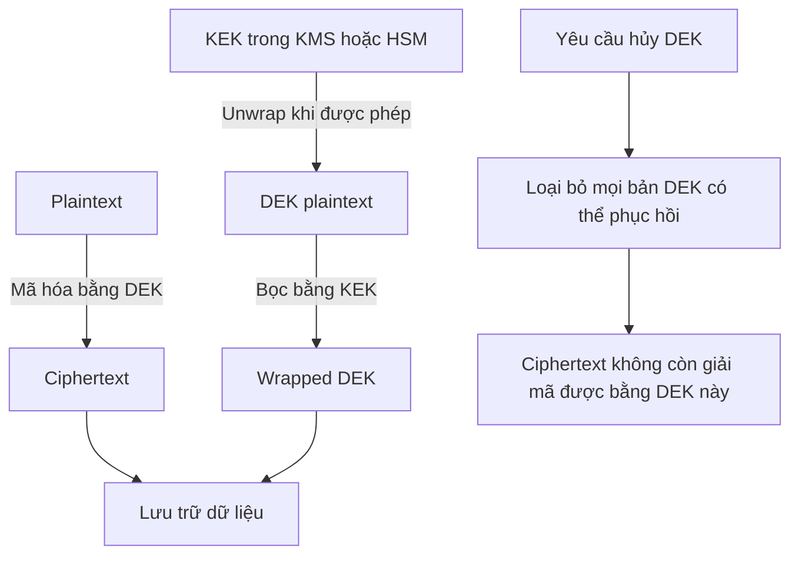
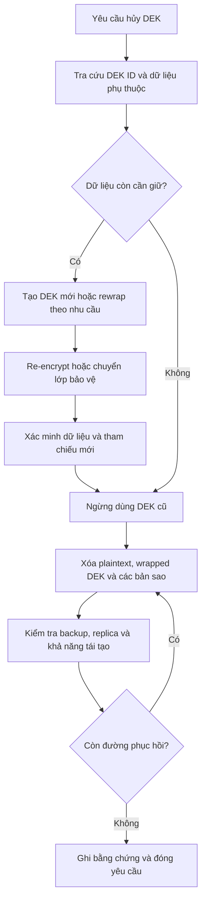

# Destroy DEK

Trong chương **Key destruction** của module `SECURITY_KEY_MANAGEMENT_FUNDAMENTALS`, bài học này giải thích cách hủy Data Encryption Key (DEK) khi khóa dữ liệu không còn cần thiết hoặc phải bị loại bỏ vì lý do bảo mật. DEK thường được dùng để mã hóa dữ liệu trong mô hình envelope encryption, sau đó được bọc bằng Key Encryption Key (KEK) do KMS hoặc HSM quản lý. Vì vậy, hủy DEK cần xử lý cả key material, bản DEK đã bọc, các bản sao trong ứng dụng và mọi cơ chế có thể tạo lại hoặc khôi phục khóa.

## 1. DEK là gì và vì sao cần hủy?

**Data Encryption Key (DEK)** là khóa mật mã trực tiếp thực hiện thao tác mã hóa hoặc giải mã dữ liệu. Trong mã hóa đối xứng, một DEK thường được dùng cho một đối tượng dữ liệu, một nhóm bản ghi, một tệp hoặc một đơn vị dữ liệu theo thiết kế của hệ thống. Việc chia nhỏ phạm vi sử dụng giúp giới hạn tác động nếu một DEK bị lộ hoặc cần hủy.

Trong envelope encryption, ứng dụng tạo DEK, dùng DEK mã hóa plaintext thành ciphertext, rồi dùng KEK trong KMS/HSM để bọc DEK thành wrapped DEK. Ứng dụng lưu ciphertext và wrapped DEK; khi cần đọc dữ liệu, ứng dụng yêu cầu KMS/HSM mở wrapped DEK, nhận DEK plaintext trong phạm vi được kiểm soát và giải mã dữ liệu.

Hủy DEK là việc loại bỏ khả năng sử dụng lại chính khóa đó. Khi không còn bất kỳ bản DEK plaintext hoặc đường phục hồi hợp lệ nào, ciphertext được mã hóa bằng DEK đó sẽ không thể giải mã bằng khóa này. Đây có thể là một phần của crypto-erasure, nhưng chỉ có hiệu lực nếu không còn bản sao, khóa dẫn xuất hoặc cơ chế khác có thể khôi phục DEK.

Các lý do phổ biến để hủy DEK gồm:

- Dữ liệu đã hết thời hạn lưu giữ và không còn nghĩa vụ giải mã.
- Dữ liệu đã được chuyển đổi sang DEK mới, đồng thời mọi bản ghi phụ thuộc khóa cũ đã được xử lý.
- DEK chỉ dùng cho một phiên hoặc tác vụ ngắn hạn đã kết thúc.
- DEK bị nghi ngờ lộ, bị sử dụng sai hoặc nằm trong phạm vi sự cố bảo mật.
- Tổ chức cần thực hiện yêu cầu xóa dữ liệu hoặc kết thúc vòng đời một tenant, tài khoản hay ứng dụng.

Hủy quá sớm có thể làm mất vĩnh viễn khả năng đọc dữ liệu, khôi phục backup hoặc cung cấp bằng chứng theo yêu cầu hợp pháp. Trước khi hủy cần xác nhận chủ sở hữu dữ liệu, thời hạn lưu giữ, legal hold, yêu cầu điều tra và các hệ thống còn phụ thuộc vào DEK.

## 2. Phân biệt hủy DEK với các thao tác liên quan

Không phải thao tác nào làm cho ứng dụng tạm thời không dùng được DEK cũng là hủy khóa.

| Thao tác | Ý nghĩa | DEK có thể được dùng lại hoặc khôi phục không? |
|---|---|---|
| Ngừng sử dụng (retire) | Ứng dụng ngừng chọn DEK cho dữ liệu mới nhưng vẫn có thể giữ khóa để đọc dữ liệu cũ | Có, nếu khóa và đường phục hồi còn tồn tại |
| Disable | Ngăn thao tác sử dụng khóa thông qua policy hoặc dịch vụ quản lý | Thường có; có thể bật lại nếu được phép |
| Revoke | Thu hồi sự tin cậy hoặc quyền sử dụng theo chính sách, tùy hệ thống | Key material có thể vẫn còn; trạng thái thu hồi cần được áp dụng nhất quán |
| Xóa wrapped DEK | Xóa bản DEK đã được bọc khỏi kho lưu trữ | Có thể chưa đủ nếu còn bản DEK plaintext, bản wrapped khác hoặc backup |
| Destroy DEK | Loại bỏ key material và tất cả đường phục hồi trong phạm vi kiểm soát | Không thể sử dụng lại DEK cũ nếu hủy thành công |
| Re-encrypt | Giải mã dữ liệu bằng DEK cũ rồi mã hóa lại bằng DEK mới | DEK cũ chỉ được hủy sau khi xác minh dữ liệu mới và xử lý mọi bản sao còn phụ thuộc |

Trong nhiều kiến trúc, DEK không phải một đối tượng khóa được lưu trực tiếp trong KMS. KMS chỉ giữ KEK và trả về DEK plaintext cùng wrapped DEK. Khi đó, thao tác hủy DEK thường liên quan đến việc xóa các bản DEK plaintext trong ứng dụng và xóa mọi wrapped DEK có thể mở lại. Nếu DEK được lưu như một key object trong HSM hoặc KMS, cần dùng cơ chế destruction tương ứng của nền tảng.

## 3. Kiểm kê toàn bộ dạng tồn tại của DEK

Trước khi hủy, cần lập danh sách nơi DEK có thể tồn tại. Chỉ xóa một bản ghi trong cơ sở dữ liệu không chứng minh rằng khóa đã bị hủy.

| Dạng tồn tại | Rủi ro | Cách xử lý cần xem xét |
|---|---|---|
| DEK plaintext trong bộ nhớ ứng dụng | Có thể bị đọc từ tiến trình, dump hoặc vùng nhớ tạm | Giới hạn thời gian tồn tại, tránh sao chép, dùng API xóa bộ nhớ an toàn nếu nền tảng hỗ trợ và kết thúc tiến trình khi cần |
| Wrapped DEK trong database hoặc object metadata | Có thể được mở lại bằng KEK còn hoạt động | Xóa hoặc làm mất khả năng truy cập bản ghi wrapped DEK theo chính sách; kiểm tra bản sao và lịch sử phiên bản |
| Wrapped DEK trong backup | Có thể được phục hồi sau khi dữ liệu chính đã bị xóa | Áp dụng chính sách xóa backup hoặc hủy đường phục hồi của DEK trong backup |
| Bản sao trong cache hoặc message queue | Có thể tồn tại ngoài kho dữ liệu chính | Xác định TTL, cơ chế purge, dead-letter queue và bản sao trong hệ thống trung gian |
| Log, trace, crash dump hoặc core dump | Có thể vô tình chứa key material hoặc dữ liệu nhạy cảm | Kiểm tra cấu hình ghi log, dump và telemetry; xử lý bản ghi theo chính sách sự cố và lưu giữ |
| Bản export hoặc tệp tạm | Có thể được sao chép sang máy hoặc kho khác | Kiểm kê vị trí, quyền truy cập và bản sao; xử lý phương tiện lưu trữ theo quy trình |
| Replica hoặc vùng dự phòng | Có thể giữ bản wrapped DEK cũ sau khi xóa ở vùng chính | Xác minh trạng thái đồng bộ và chính sách lưu giữ tại từng vùng |
| Escrow hoặc bản sao do bên thứ ba giữ | Có thể phục hồi ngoài hệ thống vận hành chính | Yêu cầu custodian xử lý, xác nhận và cung cấp bằng chứng theo thỏa thuận |
| DEK được dẫn xuất hoặc tái tạo | Có thể tạo lại dù bản hiện tại đã bị xóa | Xác định đầu vào gốc, KDF, salt, context và phiên bản; xử lý khả năng tái tạo theo chính sách |

DEK plaintext thường chỉ nên tồn tại trong bộ nhớ của tiến trình cần mã hóa hoặc giải mã. Không ghi DEK vào source code, biến môi trường lâu dài, cấu hình, log, hệ thống giám sát hoặc ticket vận hành. Việc xóa một biến trong ngôn ngữ có garbage collector không bảo đảm vùng nhớ vật lý đã được ghi đè; cần dùng thư viện và cơ chế quản lý bí mật phù hợp, đồng thời giảm số bản sao được tạo ra.

## 4. Xác định phạm vi dữ liệu phụ thuộc vào DEK

Một DEK có thể mã hóa một tệp, một đối tượng lưu trữ, một partition, một nhóm bản ghi hoặc nhiều khối dữ liệu. Trước khi hủy, phải biết chính xác phạm vi ciphertext đang phụ thuộc vào khóa.

Metadata nên hỗ trợ truy vấn ít nhất các thông tin sau:

- DEK ID hoặc định danh nội bộ không tiết lộ key material.
- Key version, thuật toán, độ dài khóa và mục đích sử dụng.
- Object ID, tenant ID hoặc nhóm dữ liệu được mã hóa.
- KEK ID và phiên bản KEK đã dùng để bọc DEK.
- Vị trí của wrapped DEK, ciphertext và các bản backup liên quan.
- Trạng thái dữ liệu: đang hoạt động, lưu trữ dài hạn, đã chuyển đổi hay hết thời hạn lưu giữ.
- Thời điểm tạo, lần sử dụng gần nhất và trạng thái vòng đời của DEK.

Metadata phải được bảo vệ khỏi sửa đổi và không chứa key material plaintext. Nếu không thể xác định dữ liệu nào dùng DEK, không nên tiến hành hủy cho đến khi phạm vi được làm rõ. Hủy nhầm một DEK dùng chung có thể làm mất quyền truy cập vào nhiều đối tượng dữ liệu ngoài dự kiến.

## 5. Điều kiện trước khi hủy DEK

Trước khi thực hiện, cần xác nhận các điều kiện sau:

1. **Chủ sở hữu xác nhận:** chủ sở hữu dữ liệu và dịch vụ đồng ý với phạm vi hủy.
2. **Không còn nhu cầu lưu giữ:** đã kiểm tra retention policy, legal hold, yêu cầu điều tra và nghĩa vụ giải mã.
3. **Phụ thuộc đã được xử lý:** ciphertext, wrapped DEK, backup và hệ thống downstream đã được kiểm kê.
4. **Có phương án chuyển đổi nếu cần:** nếu dữ liệu vẫn phải sử dụng, đã có kế hoạch re-encrypt hoặc rewrap và kiểm thử.
5. **Đã xác định đường phục hồi:** biết DEK có được backup, replicate, escrow hoặc tái tạo từ đầu vào khác hay không.
6. **Được phê duyệt:** người có thẩm quyền xác nhận thao tác và hậu quả; áp dụng dual control hoặc M-of-N nếu chính sách yêu cầu.
7. **Có kế hoạch xác minh:** xác định bằng chứng nào chứng minh DEK và các bản sao đã bị loại bỏ.

Nếu DEK bị compromise, ưu tiên ngăn sử dụng trái phép bằng cách disable quyền truy cập, cô lập hệ thống và thực hiện quy trình ứng phó sự cố. Việc giữ lại một bản sao phục vụ điều tra phải được kiểm soát riêng, có phê duyệt và thời hạn rõ ràng. Không khôi phục DEK bị compromise vào trạng thái hoạt động chỉ để đáp ứng nhu cầu phục hồi thông thường.

## 6. Quy trình hủy DEK trong envelope encryption

Trong mô hình phổ biến, KMS/HSM quản lý KEK và ứng dụng quản lý ciphertext cùng wrapped DEK. Quy trình hủy cần xử lý các lớp phụ thuộc theo đúng thứ tự.

### Bước 1: Xác định DEK và dữ liệu liên quan

Truy vấn metadata bằng DEK ID, object ID hoặc tenant ID. Liệt kê tất cả ciphertext, wrapped DEK, phiên bản, bản sao lưu và ứng dụng đang tham chiếu. Nếu một DEK mã hóa nhiều đối tượng, phạm vi phải bao gồm toàn bộ đối tượng đó.

### Bước 2: Chuyển dữ liệu nếu vẫn cần giữ

Nếu dữ liệu còn thời hạn sử dụng, tạo DEK mới, mã hóa lại dữ liệu và lưu metadata mới. Nếu chỉ cần thay KEK, có thể mở DEK cũ rồi bọc lại bằng KEK mới (rewrap) mà không phải mã hóa lại toàn bộ ciphertext. Rewrap thay đổi lớp bảo vệ DEK, còn re-encrypt thay đổi khóa trực tiếp bảo vệ dữ liệu.

### Bước 3: Xác minh dữ liệu sau chuyển đổi

Kiểm tra ciphertext mới, wrapped DEK mới, key ID và phiên bản. Thực hiện giải mã thử trong môi trường được kiểm soát và so sánh kết quả theo cơ chế toàn vẹn của ứng dụng. Chỉ chuyển ứng dụng sang bản mới sau khi kiểm tra đạt yêu cầu.

### Bước 4: Ngừng cấp phát và sử dụng DEK cũ

Đánh dấu DEK cũ đã retired hoặc disable theo cơ chế quản lý. Ngăn ứng dụng tạo thêm dữ liệu tham chiếu đến DEK đó. Nếu khóa bị compromise, áp dụng trạng thái khẩn cấp theo quy trình sự cố.

### Bước 5: Xóa mọi bản có thể khôi phục

Xóa wrapped DEK trong kho dữ liệu, phiên bản lịch sử, cache, queue, backup và các bản export theo chính sách. Loại bỏ DEK plaintext khỏi bộ nhớ và các tiến trình có liên quan. Nếu DEK có bản sao trong KMS/HSM, thực hiện deletion hoặc zeroization theo cơ chế được hỗ trợ.

### Bước 6: Xử lý các bản backup còn giữ

Nếu backup dữ liệu vẫn chứa ciphertext và wrapped DEK cũ, cần xác định chính sách xử lý. Có thể xóa chọn lọc wrapped DEK, tạo lại backup đã loại bỏ tham chiếu cũ, hoặc dùng crypto-erasure nếu thiết kế bảo đảm không còn đường giải mã. Không mặc định rằng xóa bản ghi ở production sẽ xóa các bản backup lịch sử.

### Bước 7: Xác minh và đóng yêu cầu

Đối chiếu danh sách bản sao với kết quả xóa; xác nhận không còn DEK plaintext, wrapped DEK có thể mở hoặc cơ chế tái tạo. Lưu bằng chứng, người phê duyệt và kết quả audit.

## 7. DEK, KEK và thứ tự hủy

DEK và KEK có vai trò khác nhau. DEK trực tiếp mã hóa dữ liệu; KEK bọc DEK để key material không phải lưu ở dạng plaintext lâu dài. Hủy một DEK riêng lẻ không đòi hỏi hủy KEK dùng chung.

| Thành phần | Vai trò | Hành động khi hủy một DEK |
|---|---|---|
| DEK plaintext | Mã hóa/giải mã dữ liệu | Loại bỏ khỏi bộ nhớ, tiến trình và mọi nơi lưu tạm có kiểm soát |
| Wrapped DEK | Bản DEK đã được bọc bằng KEK | Xóa hoặc loại bỏ khả năng truy cập ở tất cả kho và bản sao thuộc phạm vi |
| KEK | Bọc nhiều DEK | Thường tiếp tục được giữ nếu còn DEK khác phụ thuộc; không hủy chỉ vì một DEK đã hết hạn |
| Wrapped DEK backup | Bản sao phục hồi của DEK | Xử lý theo retention, backup policy và yêu cầu destruction |
| Ciphertext | Dữ liệu đã mã hóa bằng DEK | Giữ hoặc xóa theo chính sách dữ liệu; sau khi DEK bị hủy hoàn toàn, ciphertext không thể giải mã bằng DEK đó |

Ví dụ, một KEK của tenant có thể bọc hàng nghìn DEK. Khi một khách hàng xóa một tệp, hệ thống chỉ cần hủy DEK của tệp đó và các bản có thể phục hồi tương ứng. Hủy KEK chung sẽ ảnh hưởng đến tất cả tệp khác của tenant. Nếu cần crypto-erasure ở cấp tenant, tổ chức có thể thiết kế KEK riêng cho tenant và chỉ hủy KEK đó sau khi xác nhận không còn dữ liệu nào cần giữ.

Nếu backup wrapping key được dùng để bọc các bản backup của nhiều DEK, cũng không được hủy khóa đó chỉ vì một DEK riêng lẻ đã bị xóa. Cần lập dependency graph để xác định phạm vi và thứ tự hủy.

## 8. Hủy DEK trong KMS và HSM

Không phải mọi kiến trúc đều lưu DEK trong KMS/HSM. Có ba mô hình phổ biến:

| Mô hình | Cách DEK được quản lý | Cách hủy cần xem xét |
|---|---|---|
| Ứng dụng tạo DEK, KMS bọc DEK | KMS trả về hoặc chấp nhận wrapped DEK; ứng dụng dùng plaintext DEK trong bộ nhớ | Xóa wrapped DEK ở kho ứng dụng và backup, xử lý mọi plaintext copy; KEK có thể tiếp tục phục vụ DEK khác |
| DEK là key object trong KMS | KMS giữ key material và cung cấp thao tác mã hóa/giải mã | Dùng API disable/delete/destroy của KMS; xác minh thời gian chờ, replica và khả năng khôi phục |
| DEK nằm trong HSM | HSM giữ key object và thực hiện thao tác mật mã bên trong thiết bị | Xóa object hoặc zeroize theo phạm vi được hỗ trợ; xác minh cluster, security domain và backup của HSM |

KMS có thể dùng thời gian chờ xóa. Trạng thái yêu cầu xóa chưa đồng nghĩa key material đã bị hủy. Cần đợi dịch vụ xác nhận trạng thái cuối cùng và kiểm tra tài liệu của loại khóa đang dùng.

Với HSM, không thực hiện zeroize toàn bộ thiết bị hoặc security domain nếu yêu cầu chỉ liên quan đến một DEK. Hãy dùng thao tác xóa object có phạm vi hẹp nhất được nền tảng hỗ trợ và xác minh các bản sao trong cluster hoặc backup domain.

## 9. DEK có thể được tái tạo hay không?

Xóa bản DEK đang lưu không đủ nếu hệ thống có thể tạo lại chính khóa đó. DEK có thể được tạo bằng bộ sinh số ngẫu nhiên mật mã, được cấp từ KMS hoặc dẫn xuất từ một khóa gốc.

### DEK ngẫu nhiên

DEK được tạo bằng CSPRNG thường không thể tái tạo từ dữ liệu công khai. Tuy nhiên, bản plaintext, wrapped DEK hoặc backup có thể vẫn tồn tại. Cần kiểm kê mọi bản sao và cơ chế khôi phục.

### DEK dẫn xuất

Một số hệ thống dẫn xuất khóa bằng KDF từ master secret, salt, context hoặc định danh đối tượng. Nếu vẫn còn đầu vào gốc và tham số cần thiết, DEK có thể được tạo lại. Khi yêu cầu hủy có nghĩa là không thể khôi phục dữ liệu, cần xem xét việc hủy hoặc thay đổi đầu vào gốc, đồng thời đánh giá ảnh hưởng tới các DEK khác cùng phụ thuộc.

Không phải lúc nào cũng cần hủy master secret. Nếu một master secret tạo ra nhiều khóa con, hủy nó có thể ảnh hưởng toàn bộ dữ liệu trong miền. Thiết kế nên dùng context và phạm vi dẫn xuất rõ ràng để có thể loại bỏ một khóa con mà không phá hủy các khóa độc lập khác.

### DEK được cấp lại từ dịch vụ

Nếu một dịch vụ quản lý khóa có thể cấp lại hoặc khôi phục DEK từ backup, cần xác định chính sách retention, quyền truy cập và điều kiện phục hồi. Một DEK đã bị đánh dấu xóa nhưng vẫn có thể được khôi phục qua quyền quản trị đặc biệt chưa thể xem là đã hủy hoàn toàn.

## 10. Crypto-erasure và giới hạn của việc hủy DEK

Hủy DEK có thể khiến ciphertext không thể giải mã, nhưng kết luận này chỉ đúng trong phạm vi mọi bản sao và đường giải mã đã được loại bỏ. Cần phân biệt:

- **Hủy DEK:** loại bỏ một khóa cụ thể và các bản có thể phục hồi của nó.
- **Crypto-erasure:** dùng việc hủy khóa để làm dữ liệu đã mã hóa không thể truy cập lại.
- **Xóa dữ liệu:** loại bỏ ciphertext, metadata, bản sao và các biểu diễn dữ liệu theo chính sách lưu trữ.

Crypto-erasure không tự động xóa ciphertext. Dữ liệu mã hóa có thể vẫn tồn tại trong backup, snapshot hoặc replica, nhưng không thể giải mã nếu không còn DEK hay bất kỳ đường dẫn thay thế nào. Nếu mục tiêu là loại bỏ cả dữ liệu đã mã hóa khỏi hệ thống, cần áp dụng quy trình data deletion riêng.

Các giới hạn cần đánh giá:

- Plaintext có thể đã được xuất, cache hoặc sao chép trước khi hủy DEK.
- Một bản DEK khác có thể đã mã hóa cùng dữ liệu.
- Một ứng dụng có thể giữ bản DEK trong bộ nhớ hoặc snapshot của tiến trình.
- Bản backup có thể chứa wrapped DEK và vẫn được mở bằng KEK còn tồn tại.
- Một khóa dẫn xuất có thể tái tạo DEK từ đầu vào gốc.
- Bản sao dữ liệu ở hệ thống downstream có thể được mã hóa bằng khóa khác hoặc lưu plaintext.

Do đó, crypto-erasure cần được thiết kế từ đầu với phạm vi khóa rõ ràng, quản lý bản sao và chính sách lưu trữ nhất quán. Không thể khẳng định mọi bản plaintext đã biến mất chỉ dựa trên việc KMS trả về trạng thái xóa thành công cho một DEK.

## 11. Xử lý DEK bị compromise

Nếu DEK bị lộ, cần coi đây là sự cố bảo mật. Kẻ tấn công có thể giải mã ciphertext đã thu thập được bằng khóa đó, tùy thuật toán và dữ liệu. Hủy DEK ngăn việc tiếp tục sử dụng các bản khóa còn kiểm soát, nhưng không thể làm cho ciphertext đã bị giải mã trước đó trở lại bí mật.

Quy trình ứng phó thường gồm:

1. Cô lập ứng dụng, máy chủ hoặc tiến trình có thể đã làm lộ DEK.
2. Xác định phạm vi ciphertext, bản backup và thời gian khóa có thể đã bị truy cập.
3. Ngừng sử dụng DEK, chặn unwrap hoặc thao tác giải mã theo chính sách.
4. Tạo DEK mới và mã hóa lại dữ liệu nếu yêu cầu bảo mật và kiến trúc cho phép.
5. Bảo toàn log và bằng chứng cần thiết mà không tiếp tục phát tán key material.
6. Hủy các bản DEK bị compromise sau khi xử lý yêu cầu điều tra và lưu giữ được phê duyệt.
7. Kiểm tra quyền truy cập, nguồn gốc sự cố và các DEK khác có thể bị ảnh hưởng.

Nếu DEK bị lộ nhưng KEK không bị lộ, chỉ rotate KEK không làm DEK cũ an toàn trở lại. Kẻ tấn công đã có DEK plaintext có thể tiếp tục giải mã ciphertext cũ. Cần tạo DEK mới và re-encrypt dữ liệu cần bảo vệ bằng khóa mới.

## 12. Kiểm thử và bằng chứng hủy DEK

Một yêu cầu hủy chỉ nên được đóng khi có bằng chứng rằng các bản DEK có thể phục hồi đã được xử lý và không còn dữ liệu hoặc ứng dụng hợp lệ phụ thuộc vào khóa đó.

Bằng chứng có thể bao gồm:

- DEK ID, object/tenant scope, thuật toán và phiên bản liên quan.
- Danh sách ciphertext, wrapped DEK, backup, replica và cache đã kiểm tra.
- Người yêu cầu, người phê duyệt, người thực hiện và thời điểm.
- Kết quả xóa bản wrapped DEK, thao tác KMS/HSM hoặc zeroization nếu áp dụng.
- Kết quả xử lý backup, escrow, queue, dump và bản export.
- Xác nhận không còn đường dẫn unwrap hoặc tái tạo DEK được phép.
- Kết quả kiểm tra ứng dụng không còn tham chiếu tới DEK đã hủy.
- Ngoại lệ còn tồn tại, lý do, người chịu trách nhiệm và thời hạn xử lý.

Kiểm thử phải dùng dữ liệu thử nghiệm hoặc cơ chế xác minh không làm lộ khóa. Không cố tình tạo thêm bản DEK plaintext hoặc phục hồi một khóa đã hủy chỉ để chứng minh thao tác. Với crypto-erasure, bằng chứng cần xác nhận cả đường phục hồi từ backup và các đầu vào có thể tái tạo DEK.

## 13. Những sai lầm thường gặp

- **Chỉ xóa wrapped DEK ở database chính:** bản backup hoặc replica vẫn có thể chứa bản sao mở được.
- **Chỉ xóa DEK khỏi một biến:** tiến trình, heap dump, crash dump hoặc bản sao trong bộ nhớ vẫn có thể tồn tại.
- **Hủy KEK dùng chung để xóa một DEK:** gây mất khả năng mở nhiều DEK khác ngoài phạm vi yêu cầu.
- **Hủy DEK trước khi re-encrypt dữ liệu cần giữ:** dữ liệu trở nên không thể truy cập.
- **Rotate KEK sau khi DEK bị lộ và cho rằng đã an toàn:** DEK plaintext cũ vẫn giải mã được ciphertext cũ.
- **Bỏ qua khả năng tái tạo DEK:** KDF hoặc dịch vụ phục hồi có thể tạo lại khóa sau khi bản hiện tại bị xóa.
- **Đánh đồng crypto-erasure với xóa mọi dữ liệu:** ciphertext, plaintext downstream và metadata có thể vẫn còn.
- **Không xác định rõ phạm vi DEK:** một khóa dùng chung có thể bảo vệ nhiều đối tượng hơn dự kiến.
- **Không lưu bằng chứng:** khó chứng minh bản sao nào đã được xử lý và ai chịu trách nhiệm.

## 14. Checklist trước khi hủy DEK

- [ ] Đã xác định DEK ID, phiên bản, thuật toán và phạm vi dữ liệu được mã hóa.
- [ ] Đã xác nhận thời hạn lưu giữ, legal hold và nhu cầu giải mã.
- [ ] Đã liệt kê ciphertext, wrapped DEK, backup, replica, cache và các bản export.
- [ ] Đã xác định DEK có thể được dẫn xuất hoặc cấp lại từ nguồn nào.
- [ ] Đã xác định KEK và backup wrapping key có đang bảo vệ các DEK khác hay không.
- [ ] Đã re-encrypt hoặc rewrap dữ liệu cần tiếp tục sử dụng và xác minh kết quả.
- [ ] Đã ngừng cấp phát hoặc tham chiếu tới DEK cũ.
- [ ] Đã xóa DEK plaintext khỏi bộ nhớ và xử lý các bản sao có thể phục hồi.
- [ ] Đã xử lý wrapped DEK, backup, replica, escrow và bản export theo chính sách.
- [ ] Đã xác minh không còn đường unwrap hoặc tái tạo DEK.
- [ ] Đã ghi audit evidence và cập nhật metadata vòng đời.

Destroy DEK là quá trình loại bỏ khóa trực tiếp bảo vệ dữ liệu cùng mọi đường phục hồi có thể đưa khóa trở lại sử dụng. Trong envelope encryption, điều đó đòi hỏi phối hợp ứng dụng, kho wrapped DEK, KMS/HSM, backup và metadata. Thực hiện đúng thứ tự giúp dữ liệu còn thời hạn sử dụng tiếp tục truy cập được, đồng thời bảo đảm dữ liệu hết hạn hoặc bị xâm phạm không còn có thể giải mã bằng DEK cũ.
