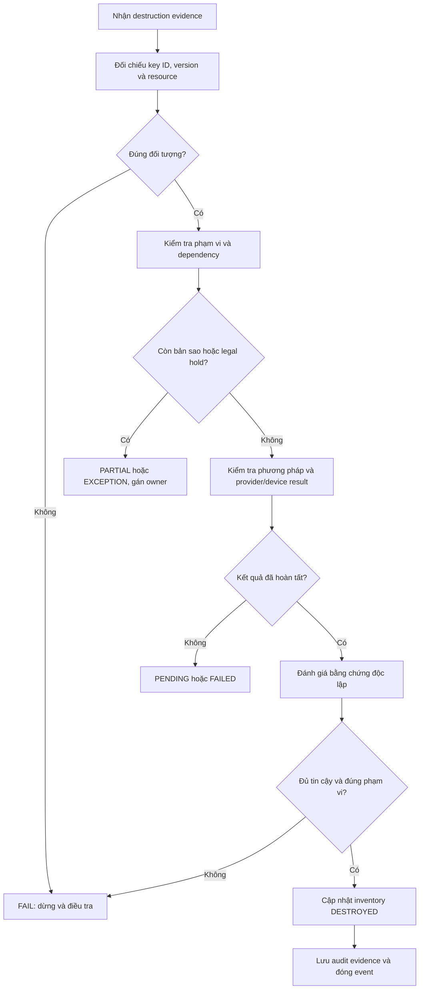

# Xác nhận destruction

Xác nhận destruction là bước chứng minh một khóa mật mã đã được hủy theo đúng phạm vi, phương pháp và chính sách đã phê duyệt. Việc gửi lệnh `DeleteKey`, xóa tệp, nhận phản hồi HTTP thành công hoặc nhìn thấy một key ID không còn trong giao diện quản trị chưa đủ để kết luận key material đã biến mất. Bằng chứng phải cho biết khóa nào được xử lý, bản sao nào nằm trong phạm vi, hệ thống nào thực hiện, kết quả nào đã được xác minh và giới hạn nào vẫn còn.

Trong quản lý vòng đời khóa, destruction thường là bước cuối sau khi khóa đã được retire hoặc revoke, các phụ thuộc đã được di chuyển và yêu cầu lưu giữ đã được giải quyết. Một lần hủy sai có thể làm dữ liệu không thể phục hồi; một lần xác nhận sai có thể khiến tổ chức tin rằng bí mật đã biến mất trong khi bản sao vẫn còn trong HSM backup, snapshot, replica, archive hoặc thiết bị ngoại tuyến. Vì vậy cần tách rõ **yêu cầu hủy**, **thực thi hủy**, **xác minh kết quả** và **đóng hồ sơ destruction**.

## 1. Xác nhận destruction chứng minh điều gì?

Một hồ sơ destruction tốt phải chứng minh được bốn điều:

1. **Đúng đối tượng:** key ID, phiên bản, fingerprint hoặc định danh provider được đối chiếu chính xác; không nhầm alias hay khóa có tên tương tự.
2. **Đúng phạm vi:** key material và các bản sao nằm trong phạm vi đã xác định, gồm bản export, encrypted key blob, backup, snapshot, replica, cache và thiết bị lưu trữ liên quan.
3. **Đúng phương pháp:** phương pháp hủy phù hợp loại khóa, nơi lưu trữ, mức rủi ro và yêu cầu tái sử dụng hoặc thanh lý.
4. **Có bằng chứng đáng tin:** kết quả đến từ nguồn có thẩm quyền, gắn với đúng đối tượng và thời điểm, có người thực hiện/kiểm soát, có thể kiểm toán và không chứa bí mật.

Xác nhận không có nghĩa là phải chứng minh một mệnh đề vật lý tuyệt đối vượt quá khả năng quan sát. Ví dụ, một KMS managed service có thể chỉ cung cấp trạng thái key đã schedule deletion, thời điểm hoàn tất và audit event; khách hàng không trực tiếp quan sát chip lưu trữ của provider. Hồ sơ cần mô tả chính xác bằng chứng mà provider cung cấp và phạm vi trách nhiệm theo dịch vụ, không biến một trạng thái “đã nhận yêu cầu” thành khẳng định “key material đã bị hủy”.

## 2. Phân biệt các trạng thái trong quy trình destruction

Các trạng thái nên phản ánh tiến độ thực tế và có định nghĩa thống nhất trong inventory. Một mô hình tham khảo:

| Trạng thái | Ý nghĩa | Bằng chứng tối thiểu để chuyển tiếp |
|---|---|---|
| `DESTROY_REQUESTED` | Đã nhận yêu cầu hủy | Event ID, người yêu cầu, lý do, phạm vi và thời điểm |
| `DESTROY_PENDING` | Đang kiểm tra phụ thuộc, retention, phê duyệt hoặc chờ thời gian trì hoãn | Kết quả preflight, owner và điều kiện còn mở |
| `DESTROY_AUTHORIZED` | Đã được người có thẩm quyền cho phép | Phê duyệt, phân vai và xác nhận không còn dependency cấm hủy |
| `DESTROY_IN_PROGRESS` | Đã bắt đầu lệnh hủy hoặc sanitization | Execution ID, provider/device reference và thời điểm bắt đầu |
| `DESTROY_SUBMITTED` | Provider đã nhận yêu cầu nhưng chưa xác nhận hoàn tất | Response ID hoặc job ID; phải ghi rõ chưa phải kết quả cuối |
| `DESTROYED` | Phương pháp hủy đã hoàn tất theo tiêu chí đã định nghĩa và có bằng chứng | Provider/device confirmation hoặc biên bản phù hợp, đã kiểm tra phạm vi |
| `PARTIALLY_DESTROYED` | Một phần bản sao đã hủy nhưng còn bản sao hoặc ngoại lệ | Danh sách location đã xử lý và location còn tồn tại |
| `DESTROY_FAILED` | Lệnh hủy thất bại hoặc kết quả không đạt | Error code, nguyên nhân, lần thử và hành động khắc phục |
| `DESTROY_EXCEPTION` | Có ngoại lệ được phê duyệt, chẳng hạn legal hold hoặc bản backup trong retention | Quyết định ngoại lệ, owner, thời hạn và biện pháp kiểm soát |

Không phải mọi nền tảng đều dùng đúng các tên này. Một số provider dùng `PendingDeletion`, `Disabled`, `Deleted` hoặc trạng thái tương tự. Phải ánh xạ trạng thái provider sang trạng thái inventory nội bộ theo ngữ nghĩa thực tế. `Disabled` thường chỉ ngăn sử dụng; `PendingDeletion` có thể còn thời gian khôi phục; `Deleted` ở API có thể chỉ xóa resource reference. Không suy ra rằng key material đã bị sanitization chỉ từ tên trạng thái.

Nên quản lý riêng trạng thái vòng đời, trạng thái vật liệu và trạng thái bản sao. Ví dụ, key version có thể đã bị xóa khỏi KMS primary nhưng backup HSM còn được lưu theo chính sách; hoặc key file đã bị xóa khỏi disk gốc nhưng một immutable backup vẫn tồn tại trong retention. Một trường trạng thái duy nhất không diễn tả được những sự thật này.

## 3. Xác định phạm vi trước khi xác nhận

Trước khi xem xét bằng chứng, phải có danh sách đầy đủ các đối tượng và bản sao thuộc phạm vi destruction. Định danh nên bao gồm:

- `key_id` và version bất biến; alias chỉ là tham chiếu có thể thay đổi.
- Key type, thuật toán, mục đích, trạng thái và cryptoperiod.
- Fingerprint, public key identifier hoặc certificate serial phù hợp để đối chiếu mà không tiết lộ private key.
- Provider, account/project, region, HSM partition/security domain, resource reference và storage location.
- Owner, custodian, người phê duyệt, workload và dữ liệu phụ thuộc.
- Quan hệ wrapping giữa KEK, DEK và encrypted key blob.
- Các bản export, backup, snapshot, replica, archive, cache, swap/pagefile và thiết bị ngoại tuyến.

Với envelope encryption, cần xác định KEK nào bọc DEK nào, wrapped DEK được lưu ở đâu và có bản sao độc lập nào của KEK hay không. Hủy một KEK dùng chung có thể khiến nhiều dịch vụ mất khả năng giải mã. Với khóa bất đối xứng, phải phân biệt private key material với public key, certificate và trust metadata; hủy private key không đồng nghĩa phải xóa public key cần để xác minh chữ ký lịch sử.

Phạm vi cũng phải xét các yêu cầu legal hold, retention, điều tra sự cố và nghĩa vụ lưu trữ. Nếu một bản backup bất biến vẫn phải được giữ, hồ sơ phải ghi rõ bản sao đó còn tồn tại, ai có quyền truy cập và thời điểm xem xét xử lý tiếp theo. Không đánh dấu toàn bộ đối tượng `DESTROYED` khi còn một bản sao nằm ngoài kết quả xác minh.

## 4. Bằng chứng cần thu theo phương pháp hủy

Không có một loại bằng chứng duy nhất phù hợp cho mọi phương pháp. Bằng chứng phải tương ứng với cơ chế đã thực hiện và có khả năng liên kết tới đúng key version hoặc media.

| Phương pháp | Bằng chứng chính | Giới hạn cần ghi nhận |
|---|---|---|
| Xóa key object trong KMS | Provider event/audit record, key ID/version, operation ID, trạng thái cuối và thời điểm | API có thể xóa metadata hoặc resource trước khi mọi bản sao nội bộ hết vòng đời; cần theo ngữ nghĩa provider |
| Hủy key trong HSM | HSM audit log, key object identifier, partition/security domain, operator/quorum record và kết quả lệnh | Phải xác định backup domain, replication và các HSM khác có bản sao hay không |
| Xóa key file khỏi disk | Danh sách path/resource, log thao tác, kiểm tra bản sao và xác nhận sanitization của media nếu yêu cầu | File không còn xuất hiện không chứng minh block vật lý hay snapshot đã bị xóa |
| Device sanitize/secure erase | Serial number, model, firmware, sanitize job/result, trạng thái hoàn tất và người chứng kiến | Lệnh phải bao phủ đúng thiết bị; snapshot hoặc backup độc lập cần xử lý riêng |
| Physical destruction | Asset tag/serial, chain of custody, phương pháp, ảnh/biên bản phù hợp và chứng nhận đơn vị xử lý | Chứng nhận phải mô tả thiết bị và phạm vi thực tế, không chỉ xác nhận đã nhận thiết bị |
| Crypto-erasure | Key hierarchy, bằng chứng hủy tất cả khóa giải mã/wrapping key, inventory replica/backup và kiểm tra không còn recovery path | Chỉ có giá trị nếu mọi dữ liệu mục tiêu được mã hóa và không có plaintext hoặc khóa thay thế |
| Hủy chứng thư/PKI | CA audit event, serial, CRL/OCSP update, key lifecycle event và trạng thái trust store | Thu hồi certificate không tự chứng minh private key đã bị hủy |

Một log cho biết lệnh đã được gọi chỉ chứng minh có yêu cầu. Một phản hồi `202 Accepted` hoặc job ID thường chỉ cho biết tác vụ đã được tiếp nhận. Chỉ dùng trạng thái hoàn tất do nguồn có thẩm quyền xác nhận, kết hợp kiểm tra đối tượng và phạm vi, để chuyển sang `DESTROYED`.

## 5. Xác minh destruction trong KMS và HSM

### 5.1. KMS managed service

Với KMS do nhà cung cấp quản lý, xác minh theo API, audit event và tài liệu ngữ nghĩa của đúng dịch vụ. Cần kiểm tra:

1. Key ID, version hoặc resource reference đúng với yêu cầu đã phê duyệt.
2. Lệnh hủy đã được gọi bởi principal hợp lệ và không phải một principal tạm thời không rõ nguồn.
3. Provider trả về operation ID, request ID hoặc audit record có thể truy vấn độc lập.
4. Trạng thái cuối đạt điều kiện xóa theo dịch vụ; thời gian chờ deletion window hoặc recovery window đã kết thúc nếu có.
5. Alias, grant, policy, replica và các region liên quan không còn cung cấp đường sử dụng trái chính sách.
6. Các bản backup hoặc cơ chế phục hồi mà provider quản lý được mô tả đúng trong phạm vi dịch vụ và hợp đồng.

Nếu provider có thời gian chờ trước khi xóa vĩnh viễn, việc schedule deletion chỉ nên được ghi nhận là `DESTROY_PENDING` hoặc trạng thái tương đương. Trong khoảng thời gian đó, key có thể vẫn khôi phục được hoặc vẫn tồn tại ở trạng thái không hoạt động. Hồ sơ phải có ngày giờ dự kiến hoàn tất và quy trình theo dõi.

### 5.2. HSM tự quản lý

Với HSM, cần kiểm tra key object trong đúng partition hoặc security domain, kết quả lệnh hủy, audit log và danh tính operator. Nếu thao tác yêu cầu quorum hoặc dual control, lưu bằng chứng những người giữ vai trò đã tham gia và quyết định được phê duyệt; không ghi recovery share, PIN hoặc bí mật của từng người vào hồ sơ.

Phải xem xét các bản sao trong HA cluster, HSM backup, secure backup file, disaster recovery device và backup domain. Xóa key object trên một HSM không tự động xóa bản sao đã export hoặc bản backup được bảo vệ ở nơi khác. Nếu HSM có cơ chế backup/restore, xác định liệu key object đã hủy có thể được khôi phục từ backup cũ hay không và cách tombstone hoặc event ledger ngăn việc đó.

### 5.3. Phân biệt xóa key với thu hồi quyền

Thu hồi IAM grant, disable key hoặc xóa alias là biện pháp ngăn sử dụng. Chúng có thể cần thiết trước destruction, nhưng không chứng minh key material đã bị hủy. Ngược lại, xóa key material có thể không xóa metadata, public key hoặc audit record cần giữ lại. Hồ sơ phải ghi riêng thao tác chặn sử dụng, thao tác xóa key material và việc giữ metadata.

## 6. Xác minh destruction trên disk và thiết bị lưu trữ

Với key file, trước tiên cần xác định file chứa raw key hay encrypted key blob. Sau đó đối chiếu danh sách vị trí: filesystem gốc, thư mục tạm, repository, container image, artifact, snapshot, backup, replica, swap/pagefile và crash dump. Nếu chỉ kiểm tra đường dẫn gốc, kết quả chỉ chứng minh tệp không còn ở vị trí đó.

Với HDD, SSD, USB flash hoặc NVMe, bằng chứng phải phản ánh đúng phương pháp media sanitization đã chọn. Ghi nhận serial, model, firmware, công cụ, sanitize job ID, trạng thái hoàn tất và người chứng kiến. Với SSD, không coi overwrite một tệp hoặc TRIM là bằng chứng xóa mọi trang NAND. Với filesystem copy-on-write, phải xử lý snapshot và block lịch sử theo kiến trúc. Với cloud volume, dùng trạng thái và xác nhận do provider cung cấp; khách hàng không tự khẳng định đã kiểm tra trực tiếp media vật lý khi không có quyền quan sát.

Nếu thiết bị không thể sanitization đáng tin cậy hoặc không có cách xác minh, cần áp dụng phương pháp thay thế phù hợp như physical destruction hoặc ghi rõ ngoại lệ và rủi ro. Không được thay bằng một câu xác nhận chung không có nguồn, serial hoặc phạm vi.

## 7. Xác minh crypto-erasure

Crypto-erasure dựa trên việc hủy mọi khóa cần thiết để giải mã dữ liệu. Đây không phải thao tác xóa tệp wrapped key đơn lẻ. Phải chứng minh rằng dữ liệu mục tiêu đã được mã hóa bằng key hierarchy đã xác định và không còn đường giải mã nào khác.

Các bước xác minh nên bao gồm:

- Xác định toàn bộ ciphertext, volume, object, backup và replica nằm trong phạm vi.
- Xác định DEK, KEK, wrapping key, recovery key và các bản export có thể mở dữ liệu.
- Xác minh key material đã bị hủy tại mọi provider, HSM, partition, region và backup domain liên quan.
- Kiểm tra escrow, split-key shares, offline backup, disaster recovery và provider recovery window.
- Xác minh không còn plaintext, export hoặc bản sao không mã hóa ngoài phạm vi.
- Kiểm tra event ledger/tombstone ngăn snapshot cũ phục hồi khóa đã hủy.
- Ghi rõ ngoại lệ, ví dụ bản backup còn trong retention nhưng không thể giải mã do khóa đã hủy.

Một phép thử decrypt thất bại không đủ để chứng minh crypto-erasure: nguyên nhân có thể là sai context, sai quyền, sai endpoint hoặc lỗi mạng. Cần kết hợp bằng chứng hủy key material, xác minh toàn bộ đường phục hồi và test kiểm soát phù hợp trong môi trường an toàn. Không thử khôi phục raw key thật để chứng minh nó không thể khôi phục.

## 8. Chuỗi kiểm soát và tính toàn vẹn của bằng chứng

Bằng chứng destruction có thể bị sửa, thiếu hoặc gắn nhầm thiết bị nếu không có kiểm soát. Mỗi hồ sơ nên có event ID duy nhất và các trường liên kết:

- Request ID, change/incident ID và approval reference.
- Key ID, version, fingerprint hoặc public key reference.
- Provider resource ID, HSM partition, device serial hoặc storage resource.
- Phương pháp, phiên bản công cụ/firmware, execution/job ID.
- Người yêu cầu, người phê duyệt, người thực hiện và người xác minh.
- Thời điểm yêu cầu, thời điểm thực thi, thời điểm provider xác nhận và thời điểm đóng.
- Kết quả, error code, ngoại lệ, phạm vi chưa xử lý và bằng chứng đính kèm.

Log nên được lưu trong hệ thống audit có kiểm soát truy cập, chống sửa đổi hoặc có cơ chế phát hiện sửa đổi. Có thể dùng chữ ký số hoặc hash chain để phát hiện thay đổi, nhưng khóa ký audit phải được quản lý độc lập với key material đang hủy. Nếu dùng một khóa sắp bị hủy để ký bằng chứng destruction của chính nó, sau khi khóa biến mất sẽ khó xác minh hồ sơ; cần trust anchor hoặc signing key độc lập.

Không ghi raw key, private key, recovery share, passphrase, token, PIN hoặc plaintext nhạy cảm vào log. Fingerprint/public key reference và provider request ID thường đủ để liên kết đối tượng. Hạn chế quyền đọc hồ sơ, lưu giữ theo chính sách và ghi lại mọi lần truy cập bằng chứng.

## 9. Quy trình xác nhận destruction end-to-end

### Bước 1: Tiếp nhận và kiểm tra phê duyệt

Kiểm tra event ID, người yêu cầu, lý do, phạm vi, owner, custodian, phê duyệt và điều kiện legal hold. Nếu thiếu phê duyệt hoặc có tranh chấp về retention, giữ trạng thái chờ và chuyển cho người có thẩm quyền.

### Bước 2: Đối chiếu danh tính khóa

So sánh `key_id`, version, fingerprint, provider reference và purpose với inventory. Kiểm tra alias mapping và xác nhận alias hiện tại không trỏ sang một phiên bản khác. Nếu bất kỳ định danh quan trọng nào không khớp, dừng xác nhận và điều tra sai lệch.

### Bước 3: Đối chiếu dependency và bản sao

Kiểm tra workload, DEK/KEK, backup, snapshot, replica, export, cache, archive và storage location. Xác định bản sao đã được hủy, còn trong retention, đang xử lý hay chưa biết trạng thái. Mỗi ngoại lệ cần owner và hạn xử lý.

### Bước 4: Kiểm tra kết quả thực thi

Lấy provider audit event, HSM log, sanitize job result hoặc destruction certificate từ nguồn tin cậy. Đối chiếu operation ID, resource ID, thời gian, actor và trạng thái cuối. Nếu kết quả chỉ là accepted/submitted/pending, không đóng destruction.

### Bước 5: Xác minh độc lập

Một người hoặc hệ thống độc lập kiểm tra bằng chứng và phạm vi. Tùy phương pháp, có thể xác minh provider status qua API read-only, kiểm tra HSM audit log, kiểm tra sanitize result, đối chiếu asset serial hoặc kiểm tra event ledger. Việc xác minh không được yêu cầu tiết lộ key material.

### Bước 6: Đánh giá ngoại lệ và mức độ hoàn tất

Nếu còn bản sao, backup retention, legal hold hoặc provider window, xác định trạng thái `PARTIALLY_DESTROYED`, `DESTROY_PENDING` hoặc `DESTROY_EXCEPTION`. Không chuyển toàn bộ key record sang `DESTROYED` chỉ vì primary object đã biến mất.

### Bước 7: Cập nhật inventory và đóng hồ sơ

Chỉ cập nhật `DESTROYED` khi tiêu chí đã đạt và có đủ bằng chứng. Giữ metadata lịch sử, tombstone và quan hệ với key version thay thế. Đóng event với kết quả, ngoại lệ, người xác minh và thời điểm. Nếu thất bại, giữ error, gán owner và tạo hành động khắc phục.

## 10. Sơ đồ quyết định xác nhận



## 11. Ví dụ hồ sơ xác nhận

Ví dụ YAML dưới đây mô tả một key version được hủy trong KMS. Các giá trị chỉ minh họa cấu trúc, không phải kết quả từ một provider thật.

```yaml
destruction_record:
  event_id: KEY-DESTROY-2026-0142
  request:
    change_id: CHG-2026-0831
    reason: retired-key-after-migration
    requested_by: key-owner
    approved_by: security-custodian
  key:
    key_id: billing-data-kek
    version: "v3"
    provider: cloud-kms
    resource_reference: billing-data-kek-v3
    fingerprint_reference: "provider-key-fingerprint"
  execution:
    method: provider-key-destruction
    operation_id: provider-operation-78421
    submitted_at: "2026-11-28T03:00:00Z"
    completed_at: "2026-11-28T03:12:00Z"
    provider_final_state: DESTROYED
  scope:
    primary_key_object: verified
    aliases_and_grants: verified
    replicas_and_regions: verified
    wrapped_dek_dependencies: migrated
    backups: retention_expired
  verification:
    independent_reviewer: security-operations
    provider_audit_reference: audit-event-5518
    status: PASS
    verified_at: "2026-11-28T03:20:00Z"
  final_state: DESTROYED
```

Trong thực tế, `provider_final_state: DESTROYED` chỉ được ghi khi provider thực sự định nghĩa và xác nhận trạng thái đó. Nếu provider chỉ trả `PendingDeletion`, cần giữ trạng thái chờ và kiểm tra lại sau thời gian trì hoãn. Các trường `backups: retention_expired` hoặc `replicas_and_regions: verified` cần có bằng chứng riêng; không tự điền dựa trên giả định.

Một báo cáo destruction tối thiểu có thể diễn đạt như sau:

```text
Event: KEY-DESTROY-2026-0142
Key: billing-data-kek / v3
Method: Provider key destruction
Provider operation: provider-operation-78421
Final provider state: DESTROYED
Dependency review: PASS
Backup/replica review: PASS
Independent verification: PASS
Exceptions: NONE
Inventory state: DESTROYED
```

Đây là mẫu định dạng báo cáo. Mỗi trường phải được điền từ bằng chứng thật, không dùng các giá trị ví dụ để xác nhận một lần hủy thực tế.

## 12. Các trường hợp không được xác nhận hoàn tất

Các trường hợp sau phải giữ trạng thái chờ, một phần hoặc thất bại:

- Provider mới tiếp nhận lệnh, chưa hoàn tất deletion window hoặc sanitize job.
- Chỉ có log CLI cho biết command exit code 0 nhưng không có resource ID hoặc trạng thái cuối.
- Key object biến mất khỏi UI nhưng chưa kiểm tra API/audit event hoặc replica.
- Alias bị xóa nhưng key version vẫn tồn tại và có thể được gọi bằng resource reference.
- HSM primary đã xóa key nhưng secure backup hoặc HSM DR còn bản sao chưa xử lý.
- Key file không còn ở đường dẫn gốc nhưng chưa kiểm tra snapshot, backup, repository, swap hoặc crash dump.
- Crypto-erasure mới hủy một wrapped blob nhưng KEK hoặc bản sao của DEK vẫn tồn tại.
- Physical destruction certificate không khớp serial/asset tag hoặc chỉ xác nhận đã nhận thiết bị.
- Có legal hold, immutable backup hoặc retention requirement chưa được giải quyết.
- Không xác định được owner, phạm vi hoặc nguồn gốc bằng chứng.

Trong các trường hợp này, ghi rõ điều gì đã hoàn tất, điều gì chưa, ai chịu trách nhiệm và điều kiện để tiếp tục. Trạng thái một phần có giá trị hơn một xác nhận toàn bộ không có căn cứ.

## 13. Lỗi thường gặp khi xác nhận destruction

- **Nhầm `DeleteKey` với hủy vật liệu:** kiểm tra ngữ nghĩa API và trạng thái cuối của provider.
- **Dùng phản hồi accepted làm bằng chứng hoàn tất:** theo dõi operation ID đến trạng thái terminal và lưu audit event.
- **Chỉ kiểm tra primary region:** đối chiếu replica, backup region, HSM DR và các account/project liên quan.
- **Không phân biệt alias và key version:** dùng định danh bất biến, fingerprint hoặc provider resource reference.
- **Không kiểm tra encrypted key blob:** xác minh KEK, passphrase, recovery share và backup có thể mở blob.
- **Không xét retention/legal hold:** ghi ngoại lệ, owner và ngày xem xét; không tuyên bố toàn bộ bản sao đã hủy.
- **Tự xác minh thao tác của chính mình:** yêu cầu reviewer độc lập theo mức rủi ro và separation of duties.
- **Lưu bí mật trong bằng chứng:** chỉ lưu metadata, ID tham chiếu và kết quả; loại bỏ key material, PIN, token và recovery share.
- **Không giữ tombstone:** snapshot cũ hoặc replication replay có thể tạo lại trạng thái active; giữ sự kiện hủy có thẩm quyền.
- **Đánh dấu `DESTROYED` quá sớm:** chỉ chuyển trạng thái sau khi phạm vi và phương pháp đạt tiêu chí.

## 14. Tình huống thực tế: xác nhận hủy KEK sau migration

Một dịch vụ thanh toán đã chuyển các DEK từ KEK `v3` sang KEK `v4`. Nhóm vận hành gửi yêu cầu hủy `v3`. Provider KMS trả về operation ID và trạng thái `PendingDeletion` do dịch vụ có khoảng thời gian chờ trước khi xóa vĩnh viễn.

Trong thời gian chờ, nhóm kiểm tra inventory để xác nhận không còn workload tạo dữ liệu mới bằng `v3`, tất cả wrapped DEK cần giữ đã được rewrap sang `v4`, và dữ liệu có thể giải mã bằng phiên bản mới. Nhóm rà soát backup, replica, region, grant và alias; mọi ngoại lệ retention được ghi lại với owner và thời hạn. Audit event xác nhận ai đã schedule deletion và thời điểm provider tiếp nhận yêu cầu.

Khi hết thời gian chờ, nhóm truy vấn lại provider bằng operation ID và key resource reference. Provider trả trạng thái cuối theo ngữ nghĩa dịch vụ; reviewer độc lập đối chiếu audit record và xác nhận đúng version `v3`. Nhóm kiểm tra các region/replica và cập nhật inventory. Nếu backup có chứa key material `v3` vẫn được giữ theo retention, hồ sơ phải thể hiện chính xác bản sao đó còn được bảo vệ hoặc đã mất khả năng giải mã theo thiết kế; không được xóa ngoại lệ khỏi báo cáo.

Chỉ khi mọi điều kiện trong phạm vi đã đạt, nhóm mới đóng event và chuyển trạng thái theo quy ước. `v4` vẫn tiếp tục hoạt động và có hồ sơ vòng đời riêng; destruction của `v3` không được ảnh hưởng nhầm tới phiên bản thay thế.

## 15. Checklist xác nhận destruction

- [ ] Có event ID, lý do, owner, approver và phạm vi hủy đã được phê duyệt.
- [ ] Key ID, version, fingerprint hoặc resource reference khớp với inventory.
- [ ] Đã phân biệt thao tác disable/revoke/delete alias với hủy key material.
- [ ] Đã xác định KEK/DEK relationship, workload và dữ liệu phụ thuộc.
- [ ] Đã kiểm tra bản export, encrypted key blob, backup, snapshot, replica, archive và DR.
- [ ] Đã xử lý legal hold, retention và các ngoại lệ có phê duyệt.
- [ ] Bằng chứng execution có operation ID/job ID, actor, resource ID và thời gian.
- [ ] Trạng thái cuối được xác nhận bởi nguồn có thẩm quyền, không chỉ là accepted/submitted/pending.
- [ ] Phương pháp hủy phù hợp với KMS/HSM, HDD/SSD, cloud storage hoặc crypto-erasure.
- [ ] Đã xác minh replica, backup domain, region và provider recovery window trong phạm vi.
- [ ] Có reviewer độc lập hoặc kiểm soát bốn mắt theo mức rủi ro.
- [ ] Audit evidence không chứa raw key, private key, recovery share, PIN, token hoặc plaintext.
- [ ] Tombstone và metadata lịch sử ngăn key bị phục hồi hoặc tái kích hoạt trái phép.
- [ ] Inventory phản ánh đúng `DESTROYED`, `PARTIALLY_DESTROYED`, `DESTROY_PENDING` hoặc `DESTROY_EXCEPTION`.
- [ ] Các ngoại lệ có owner, thời hạn và kế hoạch xử lý tiếp theo.

Xác nhận destruction là kết luận dựa trên định danh, phạm vi, phương pháp và bằng chứng. Khi bốn yếu tố này khớp nhau, tổ chức có thể giải thích rõ khóa nào đã được hủy, phần nào còn tồn tại theo ngoại lệ và vì sao trạng thái cuối trong inventory đáng tin cậy. Nếu bằng chứng chưa đủ, tiếp tục giữ trạng thái chờ hoặc một phần cho đến khi hoàn tất xác minh.
