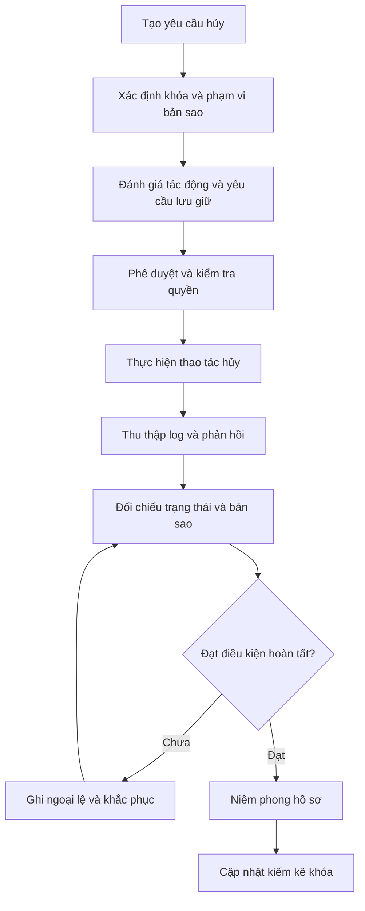

# Destruction evidence

**Destruction evidence** là tập hợp hồ sơ và dấu vết kỹ thuật dùng để chứng minh một yêu cầu hủy khóa đã được phê duyệt, thực hiện trên đúng đối tượng, đạt trạng thái dự kiến và được xử lý đầy đủ trên các vị trí liên quan. Bằng chứng giúp chủ sở hữu khóa, đội vận hành, kiểm toán viên và bên đánh giá độc lập hiểu được khóa nào đã bị hủy, ai thực hiện, khi nào, bằng cơ chế nào và còn ngoại lệ nào.

Trong quản lý vòng đời khóa, hủy khóa là thao tác có thể làm mất vĩnh viễn khả năng giải mã dữ liệu, khôi phục bản sao lưu hoặc sử dụng khóa cho mục đích xác minh. Vì vậy, một thông báo “đã xóa” hoặc một trạng thái `DISABLED` riêng lẻ không đủ để đóng hồ sơ. Bằng chứng phải nối được quyết định nghiệp vụ với thao tác kỹ thuật và kết quả xác minh.

## 1. Vì sao cần bằng chứng hủy khóa?

Bằng chứng hủy khóa phục vụ nhiều mục tiêu:

- **Kiểm soát vận hành:** xác nhận thao tác được thực hiện đúng khóa, đúng phiên bản, đúng phạm vi và đúng quy trình.
- **Trách nhiệm giải trình:** xác định người yêu cầu, người phê duyệt, người thực hiện và người chứng kiến khi cần.
- **Kiểm toán:** cung cấp hồ sơ để đánh giá chính sách lưu giữ, phân tách nhiệm vụ, quản lý quyền truy cập và việc tuân thủ quy trình.
- **Quản lý rủi ro:** phát hiện khóa còn tồn tại trong backup, replica, thiết bị dự phòng, cache hoặc hệ thống phụ thuộc.
- **Ứng phó sự cố:** giúp xác định thời điểm khóa ngừng được sử dụng, phạm vi đã xử lý và những bản sao còn phải điều tra.
- **Chứng minh crypto-erasure:** hỗ trợ đánh giá liệu các bản dữ liệu đã mã hóa còn có thể giải mã bằng bất kỳ bản sao khóa nào hay không.

Hồ sơ tốt không chỉ ghi kết quả cuối cùng. Nó phải cho thấy đường đi từ yêu cầu đến phê duyệt, thực thi, xác minh và đóng hồ sơ. Điều này đặc biệt quan trọng khi hủy khóa của hệ thống sản xuất, khóa gốc, khóa mã hóa khóa (KEK), khóa bảo vệ backup hoặc khóa được dùng chung bởi nhiều ứng dụng.

## 2. Bằng chứng cần trả lời những câu hỏi nào?

Một bộ bằng chứng có thể được đánh giá bằng các câu hỏi sau:

| Câu hỏi | Thông tin cần có |
|---|---|
| Hủy khóa nào? | Định danh khóa, phiên bản, loại khóa, mục đích, hệ thống và phạm vi quản lý |
| Ai cho phép hủy? | Người yêu cầu, chủ sở hữu, người phê duyệt, căn cứ và thời điểm phê duyệt |
| Ai thực hiện? | Danh tính tài khoản hoặc người vận hành, vai trò, hệ thống thực hiện và người chứng kiến nếu cần |
| Thực hiện khi nào? | Thời điểm yêu cầu, phê duyệt, bắt đầu, hoàn tất và thời điểm ghi nhận; nên lưu theo UTC và giữ múi giờ gốc nếu có |
| Hủy bằng cách nào? | Thao tác KMS/HSM, xóa vật liệu trong bộ nhớ, crypto-erasure, sanitization hoặc phá hủy vật lý |
| Phạm vi đã xử lý đến đâu? | Bản chính, phiên bản, replica, backup, snapshot, bản xuất, thiết bị dự phòng và các bản sao dẫn xuất |
| Kết quả được xác minh ra sao? | Phản hồi thao tác, trạng thái sau hủy, nhật ký kiểm toán, kiểm tra độc lập và kết quả kiểm tra sử dụng lại |
| Còn vấn đề gì? | Bản sao đang chờ hết hạn, legal hold, thiết bị ngoại tuyến, lỗi thao tác, ngoại lệ và người chịu trách nhiệm xử lý |

Nếu hồ sơ không xác định được định danh và phiên bản khóa, người đọc có thể nhầm một khóa với khóa khác. Nếu chỉ có phản hồi API mà không có bằng chứng về backup và replica, phạm vi hủy chưa được làm rõ. Nếu không lưu ngoại lệ, hồ sơ dễ tạo ấn tượng rằng công việc đã hoàn tất trong khi một số bản sao vẫn còn.

## 3. Các nhóm bằng chứng

Không có một tệp hoặc một bản ghi duy nhất phù hợp với mọi môi trường. Thông thường cần kết hợp nhiều nhóm bằng chứng có mục đích khác nhau.

### 3.1. Bằng chứng quản trị và phê duyệt

Nhóm này chứng minh việc hủy có căn cứ và đúng thẩm quyền:

- Phiếu yêu cầu hoặc ticket hủy khóa, có mã tham chiếu duy nhất.
- Định danh chủ sở hữu khóa, hệ thống nghiệp vụ và lý do hủy.
- Đánh giá tác động đối với dữ liệu đang lưu, khả năng giải mã, chữ ký số, backup và khôi phục thảm họa.
- Phê duyệt của chủ sở hữu dữ liệu hoặc người có thẩm quyền theo chính sách.
- Bằng chứng phân tách nhiệm vụ hoặc kiểm soát kép đối với thao tác có ảnh hưởng lớn.
- Xác nhận yêu cầu lưu giữ, legal hold và thời hạn khôi phục đã được xem xét.

Phê duyệt phải gắn với đúng định danh khóa và phạm vi thao tác. Một phê duyệt chung như “dọn khóa cũ” không đủ rõ nếu hệ thống có nhiều khóa hoặc nhiều phiên bản.

### 3.2. Bằng chứng thực thi kỹ thuật

Nhóm này cho biết thao tác nào đã được gửi đến hệ thống quản lý khóa hoặc thiết bị:

- Nhật ký sự kiện từ KMS/HSM, gồm mã sự kiện hoặc mã giao dịch.
- Định danh khóa, phiên bản, partition, slot hoặc thiết bị chịu tác động, tùy nền tảng.
- Danh tính principal hoặc tài khoản thực hiện, phương thức xác thực và vai trò được dùng.
- Tên thao tác, tham số không nhạy cảm, thời điểm và kết quả trả về.
- Trạng thái trước và sau thao tác, chẳng hạn đang hoạt động, bị vô hiệu hóa, chờ xóa hoặc đã hủy.
- Nhật ký của ứng dụng hoặc hệ thống điều phối nếu thao tác đi qua một workflow trung gian.

Không ghi giá trị khóa, PIN, mật khẩu quản trị, secret token, recovery share hoặc dữ liệu có thể khôi phục khóa vào ticket hay log. Cần giới hạn quyền đọc hồ sơ vì metadata về hệ thống, người vận hành và cấu trúc khóa cũng có thể nhạy cảm.

### 3.3. Bằng chứng xác minh kết quả

Phản hồi thành công chỉ cho thấy hệ thống đã chấp nhận hoặc xử lý một yêu cầu theo ngữ nghĩa của API. Cần có kiểm tra sau thao tác phù hợp với nền tảng:

- Tra cứu trạng thái khóa bằng API hoặc giao diện quản trị độc lập.
- Xác nhận định danh khóa cũ không còn ở trạng thái có thể sử dụng.
- Thử thao tác được kiểm soát để xác nhận việc dùng khóa cũ bị từ chối, nếu phép thử an toàn và phù hợp.
- Kiểm tra trạng thái zeroize hoặc trạng thái xóa của HSM theo tài liệu thiết bị.
- Đối chiếu bản sao, replica và backup với danh mục kiểm kê.
- Xác nhận workflow xử lý ngoại lệ đã kết thúc hoặc có người chịu trách nhiệm cùng thời hạn cụ thể.

Một phép thử âm tính có giới hạn. Ví dụ, API từ chối thao tác có thể do quyền truy cập bị thu hồi hoặc khóa bị disable, chứ chưa chứng minh vật liệu đã bị xóa. Vì vậy, kết quả cần được đọc cùng log thực thi và bằng chứng trạng thái của hệ thống.

### 3.4. Bằng chứng phạm vi và bản sao

Khóa có thể tồn tại dưới nhiều dạng và ở nhiều vị trí. Bằng chứng phạm vi cần cho thấy tổ chức đã xem xét:

- Bản chính và các phiên bản của khóa trong KMS/HSM.
- Bản xuất hoặc bản sao khóa đã được bọc (wrapped key) ở ứng dụng hay kho dữ liệu.
- Replica đa vùng, node dự phòng, thiết bị HSM dự phòng và môi trường DR.
- Backup, snapshot, image, bản sao cấu hình và bản lưu trữ ngoại tuyến.
- Cache, bộ nhớ tiến trình, dump và vùng đệm nếu vật liệu khóa từng được đưa ra khỏi KMS/HSM.
- Khóa dẫn xuất, khóa phiên hoặc khóa khác có thể tạo lại quyền truy cập tương đương.

Với backup có thời hạn lưu giữ, bằng chứng có thể là lịch hết hạn, chính sách retention, xác nhận xóa theo đợt hoặc hồ sơ hủy phương tiện. Nếu bản sao chưa thể xóa ngay, phải ghi rõ trạng thái còn tồn tại, biện pháp ngăn sử dụng, thời điểm dự kiến xử lý và người chịu trách nhiệm. Không nên đánh dấu toàn bộ hồ sơ là hoàn tất nếu phạm vi hủy chưa đạt điều kiện đã định.

### 3.5. Bằng chứng phá hủy phương tiện

Khi khóa được lưu trên thiết bị hoặc phương tiện vật lý cần sanitization hay phá hủy, hồ sơ có thể bao gồm:

- Mã tài sản, số sê-ri, loại phương tiện và vị trí trước khi bàn giao.
- Người bàn giao, người tiếp nhận, thời điểm và chữ ký trong chuỗi bàn giao.
- Phương pháp sanitization hoặc phá hủy, thiết bị/quy trình được sử dụng và kết quả.
- Người chứng kiến, nhà cung cấp dịch vụ, mã lô và chứng nhận hủy nếu có.
- Ảnh hoặc biên bản hiện trường khi chính sách yêu cầu và việc lưu ảnh không làm lộ thông tin nhạy cảm.
- Đối chiếu số lượng phương tiện đã bàn giao với số lượng được xử lý và số lượng còn thiếu.

Chứng nhận của nhà cung cấp cần chỉ rõ phạm vi tài sản hoặc lô được xử lý. Một giấy chứng nhận chung không có mã tài sản, số sê-ri hay liên kết với danh mục bàn giao sẽ khó chứng minh thiết bị cụ thể đã được hủy.

## 4. Bằng chứng theo từng phương pháp hủy

Loại bằng chứng phải phù hợp với cơ chế thực tế. Không thể dùng cùng một mẫu xác nhận cho thao tác xóa khóa logic trong KMS và phá hủy vật lý thiết bị.

| Phương pháp | Bằng chứng chính | Điều cần kiểm tra thêm |
|---|---|---|
| Hủy khóa trong KMS | Audit event, key ID/version, principal, operation ID, thời điểm và trạng thái sau hủy | Ý nghĩa chính xác của trạng thái, thời gian chờ xóa, replica, backup và quyền khôi phục |
| Zeroize khóa trong HSM | Nhật ký thiết bị, định danh partition/slot hoặc key object, kết quả lệnh và trạng thái thiết bị | Lệnh tác động một khóa hay toàn thiết bị; backup HSM, security domain và bản sao dự phòng |
| Crypto-erasure | Bằng chứng hủy DEK/KEK cần thiết, sơ đồ phụ thuộc khóa và kiểm kê ciphertext | Không còn bản sao khóa, khóa bọc, bản xuất hoặc đường khôi phục khác |
| Xóa vật liệu trong ứng dụng | Log workflow, phiên bản ứng dụng, kết quả xóa vùng đệm và kiểm soát dump/cache | Provider, runtime, heap dump, swap, replica và bản sao do ứng dụng tạo |
| Sanitization/phá hủy phương tiện | Asset inventory, chain of custody, phương pháp, biên bản và chứng nhận xử lý | Đối chiếu đầy đủ tài sản; phương pháp phù hợp loại phương tiện và chính sách |

Với dịch vụ KMS do nhà cung cấp cloud quản lý, khách hàng thường chỉ quan sát được sự kiện và trạng thái qua control plane cùng tài liệu dịch vụ. Khách hàng không nên tuyên bố đã trực tiếp chứng kiến việc xóa vật lý bên trong hạ tầng nhà cung cấp nếu không có bằng chứng tương ứng. Hồ sơ cần nói rõ đâu là bằng chứng do khách hàng thu thập, đâu là xác nhận của nhà cung cấp và phạm vi mà mỗi loại bằng chứng bao phủ.

## 5. Quy trình tạo và đóng hồ sơ bằng chứng

Quy trình dưới đây có thể áp dụng cho cả hủy khóa trong KMS/HSM và xử lý khóa trên phương tiện lưu trữ. Từng tổ chức cần điều chỉnh theo chính sách và khả năng của nền tảng.

1. **Mở hồ sơ:** tạo mã yêu cầu duy nhất, ghi lý do, chủ sở hữu, hệ thống, định danh khóa và phiên bản dự kiến hủy.
2. **Xác nhận phạm vi:** kiểm tra loại khóa, phụ thuộc dữ liệu, bản sao, backup, replica, thiết bị dự phòng và mọi đường khôi phục.
3. **Đánh giá tác động và phê duyệt:** xác định dữ liệu còn cần truy cập, yêu cầu lưu giữ, legal hold, kế hoạch thay thế và người có thẩm quyền.
4. **Chuẩn bị thực thi:** kiểm tra quyền, cửa sổ thay đổi, kiểm soát kép, phương án xử lý lỗi và khả năng phục hồi trước thời điểm hủy.
5. **Thu thập bằng chứng khi thực hiện:** lưu audit event, operation ID, danh tính thực hiện, thời điểm và phản hồi hệ thống. Ghi lại phiên bản công cụ hoặc workflow khi cần tái hiện.
6. **Xác minh sau hủy:** đối chiếu trạng thái khóa, kiểm tra thao tác sử dụng lại, rà soát bản sao và ghi rõ giới hạn của từng phép kiểm tra.
7. **Xử lý ngoại lệ:** mở hành động khắc phục cho bản sao chưa xử lý, thiết bị ngoại tuyến hoặc lỗi xác minh; chỉ đóng khi điều kiện hoàn tất được đáp ứng hoặc ngoại lệ được chấp nhận chính thức theo chính sách.
8. **Niêm phong hồ sơ:** lưu tài liệu, log và chứng nhận vào kho kiểm toán có kiểm soát truy cập; bảo vệ tính toàn vẹn và áp dụng thời hạn lưu giữ.
9. **Cập nhật kiểm kê:** ghi trạng thái vòng đời cuối cùng, thời điểm hủy, tham chiếu hồ sơ và người chịu trách nhiệm.



Điều kiện hoàn tất phải được xác định trước khi thao tác. Ví dụ, một quy trình có thể yêu cầu khóa không còn khả năng sử dụng, tất cả bản sao đang hoạt động đã bị xử lý và backup còn thời hạn đã có lịch hủy được phê duyệt. Nếu chính sách yêu cầu xóa ngay mọi bản sao, một lịch xử lý trong tương lai không đáp ứng điều kiện đó.

## 6. Cấu trúc một bản ghi destruction evidence

Một bản ghi có cấu trúc giúp hệ thống kiểm toán tìm kiếm và đối chiếu nhất quán. Ví dụ dưới đây chỉ minh họa metadata; các giá trị là giả định và không chứa vật liệu khóa:

```json
{
  "evidence_id": "DEST-2026-00421",
  "request_id": "CHG-2026-0187",
  "key_reference": {
    "key_id": "kms://payments/data-key-prod",
    "version": "v7",
    "key_type": "DEK",
    "purpose": "payment-record-encryption"
  },
  "scope": {
    "primary_store": "payments-kms",
    "replicas_reviewed": true,
    "backups": "retention-expiry-confirmed",
    "exported_copies": "none-known"
  },
  "authorization": {
    "requested_by": "user-id-104",
    "approved_by": "owner-id-021",
    "approval_reference": "APR-2026-0098"
  },
  "execution": {
    "performed_by": "service-principal-key-ops",
    "operation": "destroy-key-version",
    "operation_id": "op-8f31c2",
    "started_at": "2026-11-28T02:10:00Z",
    "completed_at": "2026-11-28T02:10:04Z",
    "result": "confirmed-by-provider"
  },
  "verification": {
    "post_operation_state": "destroyed",
    "reuse_check": "rejected",
    "audit_event_reference": "audit-71d90a",
    "verified_by": "auditor-id-008",
    "verified_at": "2026-11-28T02:18:00Z"
  },
  "exceptions": [],
  "evidence_manifest": "vault://audit/DEST-2026-00421/manifest.json"
}
```

Các trường `replicas_reviewed`, `backups` hoặc `exported_copies` phải phản ánh kết quả kiểm kê thực tế. Không điền `none-known` chỉ vì không có thông tin; cần ghi rõ phạm vi đã rà soát và giới hạn hiểu biết. `result: confirmed-by-provider` cũng cần được diễn giải theo cam kết và ngữ nghĩa của dịch vụ, không tự động đồng nghĩa với việc khách hàng đã xác minh mọi bản sao vật lý.

Tùy môi trường, bản ghi có thể bổ sung loại phương tiện, serial number, partition HSM, mã chứng nhận, thời hạn lưu hồ sơ, phân loại dữ liệu và tham chiếu đến log bất biến. Không nên đưa secret, key bytes, mật khẩu, recovery material hoặc nội dung nhạy cảm không cần thiết vào manifest.

## 7. Bảo vệ tính toàn vẹn và chuỗi lưu giữ bằng chứng

Bằng chứng hủy khóa có giá trị khi người đánh giá tin rằng hồ sơ không bị sửa đổi âm thầm sau sự kiện. Một số biện pháp thường dùng:

- Gửi audit log đến kho tập trung có quyền ghi tách biệt với quyền quản trị KMS/HSM.
- Dùng lưu trữ append-only hoặc cơ chế WORM khi yêu cầu lưu giữ và nền tảng hỗ trợ.
- Ghi hash của từng tệp bằng chứng vào manifest để phát hiện thay đổi ngoài dự kiến.
- Ký manifest hoặc biên bản bằng khóa ký kiểm toán độc lập với khóa đang bị hủy.
- Đồng bộ thời gian giữa hệ thống, lưu timestamp có múi giờ rõ ràng và giữ tham chiếu sự kiện gốc.
- Ghi nhận ai đã truy cập, xuất, thay đổi nhãn hoặc chuyển hồ sơ bằng chứng.
- Giới hạn quyền xóa hồ sơ, áp dụng phân tách nhiệm vụ và kiểm tra quyền định kỳ.

Không dùng chính khóa đang được hủy để làm khóa duy nhất ký xác nhận hủy, vì việc hủy khóa đó có thể khiến hồ sơ khó xác minh về sau. Chữ ký hoặc dấu thời gian nên dựa trên cơ chế kiểm toán độc lập, có quy trình quản lý khóa và thời hạn xác minh riêng.

Hash chỉ giúp phát hiện nội dung thay đổi khi giá trị tham chiếu được bảo vệ. Nếu người có quyền có thể thay cả tệp lẫn hash trong cùng một kho, hash đơn lẻ không tạo ra bằng chứng chống sửa đổi. Tương tự, chữ ký số chứng minh nguồn gốc và tính toàn vẹn của tài liệu theo khóa ký, nhưng không tự chứng minh nội dung khai báo là đúng; cần đối chiếu với log nguồn và kiểm tra độc lập.

Chuỗi lưu giữ (chain of custody) đặc biệt quan trọng với thiết bị vật lý. Mỗi lần bàn giao phải ghi người giao, người nhận, thời gian, vị trí, tình trạng niêm phong và mã tài sản. Nếu có khoảng trống trong chuỗi bàn giao, cần ghi nhận và đánh giá ảnh hưởng thay vì tự suy đoán thiết bị vẫn được kiểm soát.

## 8. Những trạng thái không được nhầm với “đã hủy”

Các hệ thống có thể cung cấp nhiều trạng thái trung gian. Tên và ngữ nghĩa cụ thể thay đổi theo nhà cung cấp, vì vậy cần đối chiếu tài liệu sản phẩm và cấu hình thực tế.

| Trạng thái hoặc sự kiện | Có thể kết luận gì? | Cần thêm bằng chứng gì? |
|---|---|---|
| Yêu cầu đã tạo | Quy trình hủy đã được khởi tạo | Phê duyệt và kết quả thực thi |
| Đã phê duyệt | Người có thẩm quyền cho phép thao tác | Nhật ký thực thi và xác minh |
| `DISABLED` hoặc `DEACTIVATED` | Khóa bị chặn sử dụng theo ngữ nghĩa nền tảng | Trạng thái hủy vật liệu và xử lý bản sao |
| `SCHEDULED_FOR_DELETION` | Việc xóa được lên lịch hoặc đang trong thời gian chờ | Thời điểm hoàn tất, khả năng khôi phục và sự kiện destroy cuối cùng |
| API trả về thành công | Hệ thống đã chấp nhận hoặc hoàn tất thao tác theo hợp đồng API | Trạng thái sau thao tác, phạm vi bản sao và audit event |
| `DESTROYED` hoặc `ZEROIZED` | Hệ thống báo đối tượng hoặc phạm vi tương ứng đã bị hủy | Xác nhận ngữ nghĩa, phạm vi, bản sao và bằng chứng độc lập phù hợp |

Một hồ sơ có thể ở trạng thái “đã vô hiệu hóa, chờ hủy” trong một khoảng thời gian. Khi đó, cần ghi rõ trạng thái hiện tại, thời hạn chờ và người theo dõi. Không được đổi nhãn hồ sơ thành “đã hủy” chỉ để phản ánh rằng khóa không còn được dùng trong ứng dụng.

## 9. Ngoại lệ và tình huống khó

### 9.1. Backup chưa hết thời hạn lưu giữ

Một số bản sao lưu không thể xóa riêng một khóa ngay mà không làm hỏng chuỗi backup hoặc vi phạm chính sách lưu giữ. Hồ sơ cần chỉ rõ backup nào còn tồn tại, ai quản lý, khi nào hết hạn, khóa nào bảo vệ backup và biện pháp ngăn sử dụng. Nếu crypto-erasure là mục tiêu, phải đánh giá mọi bản sao của DEK/KEK và mọi bản sao có thể phục hồi khóa. Lịch hết hạn backup tự nó không chứng minh khóa đã bị hủy.

### 9.2. Thiết bị ngoại tuyến hoặc không liên lạc được

Thiết bị HSM dự phòng hoặc phương tiện ngoại tuyến có thể chưa nhận lệnh hủy. Ghi lại định danh thiết bị, vị trí, trạng thái kết nối, người quản lý và kế hoạch xử lý. Khóa chỉ nên được xem là đã hủy trên toàn phạm vi sau khi có bằng chứng phù hợp cho thiết bị đó hoặc khi một cơ chế khác được chứng minh là đã loại bỏ khả năng sử dụng vật liệu khóa.

### 9.3. Khóa bị lộ cần hủy khẩn cấp

Khi khóa bị lộ, ưu tiên ngăn việc sử dụng trái phép: thu hồi quyền, vô hiệu hóa hoặc thay khóa theo quy trình ứng phó sự cố. Thu thập log và bảo toàn bằng chứng trước khi chúng bị xoay vòng hoặc hết hạn lưu trữ. Việc ngăn sử dụng khẩn cấp và việc hủy vật liệu có thể là hai bước khác nhau; hồ sơ phải ghi thời điểm của từng bước để điều tra có thể dựng lại diễn biến.

### 9.4. Nhà cung cấp chỉ trả về xác nhận tổng quát

Nếu nhà cung cấp không cung cấp log chi tiết hoặc chứng nhận vật lý, hãy ghi chính xác bằng chứng khách hàng nhận được, tài liệu dịch vụ làm căn cứ và giới hạn quan sát. Có thể cần bổ sung báo cáo kiểm soát độc lập, điều khoản hợp đồng hoặc xác nhận từ nhà cung cấp theo quy trình tổ chức. Không mở rộng kết luận vượt quá nội dung bằng chứng hiện có.

## 10. Lỗi thường gặp khi lập hồ sơ

| Lỗi | Rủi ro | Cách cải thiện |
|---|---|---|
| Chỉ lưu ảnh chụp màn hình trạng thái | Khó xác định nguồn, thời điểm, định danh và tính toàn vẹn | Lưu audit event gốc, operation ID và tham chiếu hệ thống |
| Không ghi phiên bản khóa | Có thể hủy nhầm hoặc bỏ sót phiên bản | Ghi key ID và version ở mọi bằng chứng liên quan |
| Ghi `DISABLED` là `DESTROYED` | Tạo kết luận sai về trạng thái vật liệu khóa | Dùng trạng thái đúng theo ngữ nghĩa nền tảng |
| Không kiểm kê backup và replica | Khóa có thể được phục hồi hoặc vẫn tồn tại ở nơi khác | Gắn checklist phạm vi và bằng chứng cho từng vị trí |
| Không lưu danh tính người thực hiện | Không truy cứu được trách nhiệm và quyền hạn | Ghi principal, vai trò, nguồn xác thực và mã phiên nếu phù hợp |
| Dùng log có thể sửa mà không có kiểm soát | Bằng chứng có thể bị thay đổi sau sự kiện | Lưu tập trung, append-only, kiểm soát quyền và ký manifest |
| Ghi bí mật vào hồ sơ | Hồ sơ kiểm toán trở thành nguồn rò rỉ khóa | Chỉ lưu metadata cần thiết; rà soát và lọc dữ liệu nhạy cảm |
| Đóng hồ sơ khi còn ngoại lệ | Người đọc hiểu sai rằng mọi bản sao đã được xử lý | Ghi trạng thái mở, chủ sở hữu ngoại lệ và điều kiện đóng |
| Dùng khóa bị hủy để ký hồ sơ duy nhất | Có thể không xác minh được hồ sơ dài hạn | Dùng khóa kiểm toán độc lập và lưu tài liệu xác minh |

## 11. Checklist đóng hồ sơ

Trước khi đánh dấu một yêu cầu hủy khóa là hoàn tất, người phụ trách nên xác nhận các điểm sau:

- [ ] Định danh khóa, phiên bản, loại khóa và hệ thống được ghi chính xác.
- [ ] Lý do hủy, chủ sở hữu, người yêu cầu và phê duyệt có tham chiếu kiểm tra được.
- [ ] Phụ thuộc dữ liệu, chữ ký, backup, replica, snapshot và khóa liên quan đã được đánh giá.
- [ ] Thao tác kỹ thuật có log nguồn, mã giao dịch, danh tính thực hiện và thời điểm.
- [ ] Trạng thái sau hủy được xác minh theo tài liệu và ngữ nghĩa của nền tảng.
- [ ] Bản sao và phương tiện nằm trong phạm vi đã được xử lý hoặc được ghi nhận thành ngoại lệ có kiểm soát.
- [ ] Không có secret hoặc vật liệu khóa thô trong hồ sơ.
- [ ] Tài liệu và log được lưu ở vị trí có kiểm soát truy cập và bảo vệ tính toàn vẹn.
- [ ] Kiểm kê khóa được cập nhật và tham chiếu đến hồ sơ bằng chứng.
- [ ] Người có thẩm quyền xác nhận điều kiện đóng đã đáp ứng.

Nếu một mục chưa đạt, hãy giữ hồ sơ ở trạng thái đang xử lý hoặc ngoại lệ theo quy trình. Không dùng một xác nhận chung để che khuất những phần chưa được kiểm chứng.

## 12. Nguyên tắc thiết kế hệ thống

Muốn tạo bằng chứng đáng tin cậy, hệ thống quản lý khóa nên phát sinh log có cấu trúc ngay từ đầu. Mỗi thao tác vòng đời cần có mã tương quan, định danh khóa và phiên bản, principal thực hiện, thời điểm, kết quả và tham chiếu yêu cầu. Các hệ thống điều phối nên truyền cùng mã tương quan qua KMS/HSM, ứng dụng, hệ thống ticket và kho kiểm toán để người đánh giá nối được các sự kiện.

Quyền quản trị khóa, quyền phê duyệt hủy và quyền sửa hoặc xóa hồ sơ kiểm toán nên được phân tách. Log nên được chuyển ra khỏi miền quản trị của hệ thống tạo log, đồng bộ thời gian và bảo vệ khỏi sửa đổi. Chính sách lưu giữ hồ sơ phải đủ dài để đáp ứng yêu cầu kiểm toán và điều tra, đồng thời tránh lưu bí mật hoặc metadata nhạy cảm quá mức cần thiết.

Với từng loại khóa, tổ chức nên định nghĩa trước điều kiện được xem là “hủy hoàn tất”, bằng chứng bắt buộc, người xác minh và cách xử lý bản sao ngoại tuyến hoặc backup. Khi có thay đổi nhà cung cấp, phiên bản dịch vụ hoặc loại thiết bị, cần xem lại ngữ nghĩa API và mẫu bằng chứng vì một trạng thái có thể đổi ý nghĩa giữa các sản phẩm.

Một bộ destruction evidence có chất lượng cho phép người đánh giá độc lập tái dựng được quyết định, thao tác, phạm vi và kết quả. Nó phải trung thực về những gì đã xác minh, chỉ rõ giới hạn quan sát và giữ lại mọi ngoại lệ cho đến khi được giải quyết theo chính sách.
