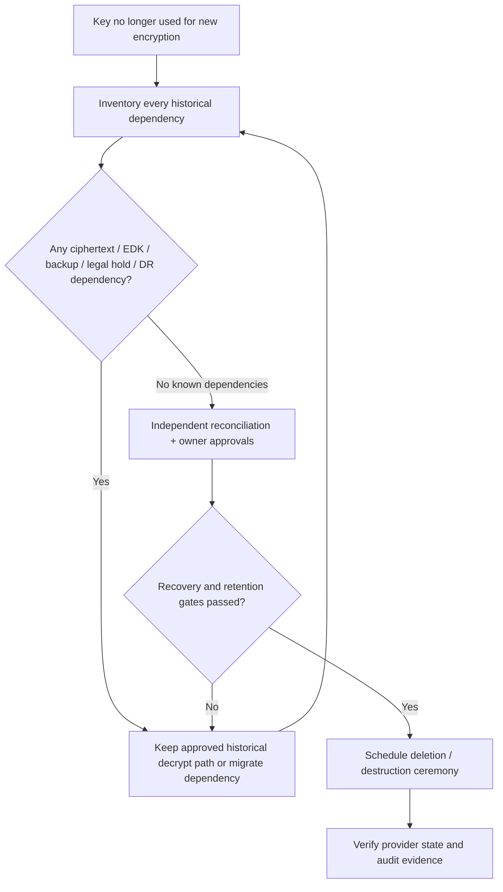
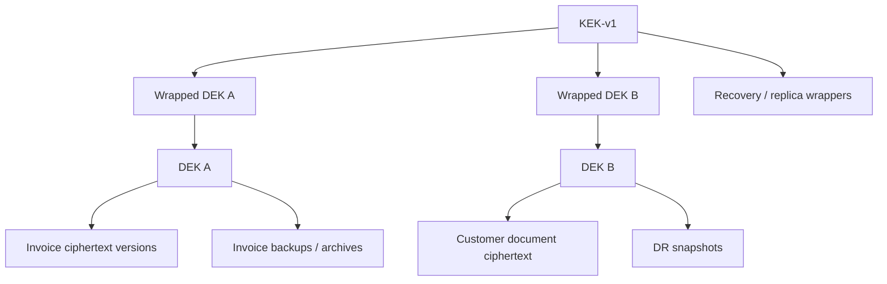
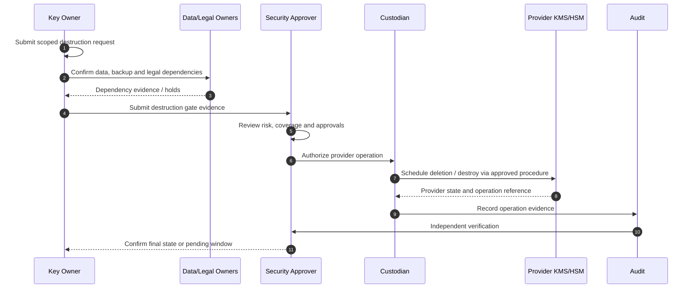

# Không destroy key còn cần decrypt — Kiểm soát phụ thuộc trước khi hủy khóa

> **Chương:** Key destruction  
> **Module:** SECURITY_KEY_MANAGEMENT_FUNDAMENTALS — hiểu vòng đời khóa mật mã từ tạo, cấp phát, lưu trữ, sử dụng, xoay vòng đến thu hồi và hủy, cùng những rủi ro khi quản lý sai khóa. Nội dung kết nối mật mã đối xứng, bất đối xứng, chữ ký số, KMS/HSM, envelope encryption, kiểm soát truy cập và kiểm toán để thiết kế hệ thống bảo vệ khóa an toàn.

## 1. Mục tiêu học tập

Sau bài học, bạn có thể:

1. Giải thích vì sao **không được destroy một key còn là dependency để decrypt, verify, unwrap hoặc phục hồi dữ liệu**.
2. Phân biệt **ngừng encrypt mới, decrypt-only, disable, schedule deletion, destroy key material và cryptographic erasure**.
3. Xác định tất cả phụ thuộc của một key: **ciphertext hiện hành, object versions, wrapped DEKs, backups, archives, replicas, WAL/CDC, legal holds, DR và recipients**.
4. Thiết kế **key-to-data dependency graph** và inventory có thể chứng minh phạm vi trước khi destroy.
5. Tính thời điểm hủy theo **data retention, backup retention, legal hold, recovery objectives, cryptoperiod và business owner approval**.
6. Phân biệt **KEK/DEK dependencies**, kể cả nhiều wrappers, shared DEKs, key material versions và provider aliases.
7. Chọn phương án phù hợp: giữ historical decrypt-only, rewrap DEK, re-encrypt data, migrate backup hoặc chờ retention expiry.
8. Đánh giá **KMS/HSM deletion semantics**, pending deletion, cancellation windows, provider-managed recovery và tính không thể đảo ngược.
9. Xây dựng **destruction gate**, dual control, separation of duties, approval evidence và audit trail.
10. Viết SQL inventory/query và Java policy abstraction để chặn destroy khi còn dependency.
11. Thiết kế DR drills, negative tests và case study để chứng minh key retirement an toàn.
12. Trình bày chính xác giới hạn: **destroy key không xóa ciphertext, plaintext exports hay key copies đã rời trust boundary**.

## 2. Nguyên tắc cốt lõi

Một key chỉ được destroy khi tổ chức đã chứng minh rằng **không còn dữ liệu, bản sao, quy trình hoặc nghĩa vụ nào cần key đó để thực hiện cryptographic operation hợp lệ**, và việc hủy đã được owner/custodian có thẩm quyền phê duyệt.

Một key có thể đã ngừng tạo ciphertext mới nhưng vẫn cần để mở dữ liệu cũ. Ví dụ KEK-v1 không còn được dùng để wrap DEK mới, nhưng backup của quý trước vẫn chứa EDK-v1 được bọc dưới KEK-v1. Nếu destroy KEK-v1 trước khi xử lý backup, dữ liệu có thể không phục hồi được.



**Không destroy key còn cần decrypt.** Đây là một quy tắc về dependency, retention và availability; không phải chỉ là quy tắc “key đã hết cryptoperiod thì xóa”.

### 2.1. Ví dụ đơn giản

```text
Invoice ciphertext v1
  -> encrypted with DEK-17
      -> wrapped under KEK-2024

Production new writes now use:
  DEK-22 -> wrapped under KEK-2026

Nếu backup 2025 vẫn chứa EDK của DEK-17:
  KEK-2024 vẫn là dependency để restore backup đó.
```

Đổi alias sang KEK-2026 không tự rewrap EDK cũ. Việc active database đã chuyển sang key mới cũng không chứng minh archives và backups đã chuyển.

### 2.2. Destroy là hành động có hậu quả khác với disable

- **Disable:** ngăn một số operations qua resource/provider theo semantics cụ thể; key material có thể vẫn tồn tại.
- **Retire:** đưa key ra khỏi luồng sử dụng mới theo policy.
- **Decrypt-only:** giữ khả năng đọc historical data trong phạm vi được phép.
- **Schedule deletion:** yêu cầu provider xóa sau thời gian chờ/cancel window nếu có.
- **Destroy:** xóa key material theo semantics của provider hoặc thiết kế.
- **Cryptographic erasure:** làm dữ liệu không thể giải mã bằng cách loại bỏ mọi key/recovery path trong threat model.

Không suy ra các trạng thái trên tương đương nhau. Provider có thể dùng tên trạng thái khác và có quy tắc riêng.

## 3. Vì sao key cũ còn cần decrypt?

### 3.1. Dữ liệu mã hóa có vòng đời dài hơn luồng ghi mới

Một ứng dụng có thể chỉ ghi bằng DEK-v5 từ hôm nay, nhưng vẫn phải đọc:

- Hóa đơn đã phát hành nhiều năm trước.
- Tệp lưu trữ theo retention.
- Backup trước các lần rotation.
- Bản sao object có version ID cũ.
- Bản ghi CDC hoặc transaction logs được giữ để phục hồi.
- Dữ liệu bị legal hold.
- Bản export do đối tác lưu theo hợp đồng.
- Hồ sơ cần điều tra/audit hoặc xác minh chữ ký.

Nếu những dữ liệu này phụ thuộc key-v1, việc ngừng encrypt mới không xóa dependency.

### 3.2. Khả năng decrypt là một yêu cầu của dữ liệu, không phải của alias

Reader phải dùng đúng key material/version, nonce, AAD, algorithm và envelope metadata của object. Alias `current` chỉ là pointer có thể thay đổi; nó không thay thế canonical historical key reference.

### 3.3. Không phải mọi key cũ đều cần giữ

Một key không còn dependency có thể đủ điều kiện destroy sau khi kiểm kê, đối soát và approval. Mục tiêu không phải giữ mọi key mãi mãi; mục tiêu là **không hủy sớm key vẫn cần thiết** và không giữ key lâu hơn policy cho phép.

## 4. Phân biệt key lifecycle và các thao tác

| Trạng thái/thao tác | New encrypt/wrap | Historical decrypt/unwrap | Key material | Có destroy không? |
| --- | --- | --- | --- | --- |
| **ACTIVE** | Được phép theo policy | Được phép | Còn | Không |
| **RETIRED / no new use** | Bị chặn | Có thể còn | Còn | Không mặc định |
| **DECRYPT_ONLY** | Bị chặn | Được phép trong scope | Còn | Chưa |
| **DISABLED** | Provider/policy từ chối | Thường cũng bị chặn, tùy semantics | Có thể còn | Chưa chắc |
| **PENDING_DELETION** | Theo provider state | Có thể bị chặn hoặc vẫn khả dụng trong grace period | Chưa chắc đã bị xóa | Chưa |
| **DESTROYED** | Không | Không thể dùng key material đã hủy | Đã xóa theo assurance | Đã |
| **COMPROMISED** | Không được tiếp tục new use | Có thể bị cấm hoặc giữ recovery-only theo incident policy | Có thể còn | Quyết định riêng |
| **LOST** | Không | Không thể dùng nếu không có recovery path | Không truy cập được | Không nhất thiết đã destroy |

### 4.1. Expire cryptoperiod không tự động bằng destroy

Cryptoperiod có thể giới hạn thời gian dùng key để **tạo ciphertext mới**. Thời gian cần giữ key cho historical decrypt có thể dài hơn, theo data retention và recovery requirements.

### 4.2. Compromised key là trường hợp khác

Nếu key bị compromise, giữ nó decrypt-only có thể vẫn duy trì một đường tấn công. Incident response có thể yêu cầu disable ngay và chấp nhận dữ liệu historical tạm unavailable, hoặc dùng isolated recovery path được phê duyệt. Không áp dụng dependency gate như lý do tự động giữ một key compromised hoạt động trong production.

### 4.3. Destroy không tự động thu hồi bản key ngoài phạm vi kiểm soát

Nếu raw DEK/KEK đã bị export, copy vào logs, cache, memory dump hoặc đưa cho recipient, việc destroy bản quản lý trong KMS không xóa các bản đó. Báo cáo destruction phải mô tả **scope of control và assurance**, không tuyên bố đã xóa mọi bản sao trên thế giới.

## 5. Key hierarchy và dependency graph

### 5.1. Một key có thể phụ thuộc vào nhiều lớp dữ liệu

Trong envelope encryption:



Destroy KEK-v1 có thể làm mất khả năng unwrap nhiều DEKs, kéo theo nhiều ciphertexts và backups. Phạm vi phải được tính theo **key hierarchy thực**, không chỉ số rows đang active.

### 5.2. DEK dependency và KEK dependency khác nhau

- **DEK:** trực tiếp mã hóa dữ liệu; mọi ciphertext dùng DEK đó phụ thuộc vào DEK.
- **KEK:** bảo vệ DEK; EDKs được wrap dưới KEK phụ thuộc vào khả năng dùng KEK hoặc một rewrap path hợp lệ.
- **Recovery key:** có thể mở backup blob/KEK và do đó nằm phía trên hierarchy.
- **Recipient private key:** có thể mở EDK đã mã hóa cho recipient.
- **KDF master secret:** có thể dẫn xuất nhiều child keys, tạo dependency gián tiếp.
- **Signing key:** historical verification thường cần public key/evidence, không nhất thiết cần private key; nhưng signing private key có thể vẫn cần cho signing mới nếu identity được duy trì.

### 5.3. Multiple wrappers không có nghĩa dependency đã hết

Một DEK có thể có EDK dưới KEK-v1 và một EDK khác dưới KEK-v2. Nếu ứng dụng/backup/partner vẫn dùng wrapper v1, KEK-v1 vẫn là dependency. Việc tồn tại wrapper v2 chỉ giúp có một recovery path khác nếu nó được xác minh và coverage đầy đủ.

### 5.4. Alias không phải key identity

Inventory phải phân biệt:

- Logical key family.
- Canonical provider resource ID/account/region.
- Actual key material version.
- Alias và lịch sử alias target.
- Key usage/purpose.
- Wrapped DEK references.
- Data object versions.
- Backup/recovery domain.

Alias `billing-current` trỏ tới key mới không chứng minh key cũ đã hết phụ thuộc.

## 6. Những dependency thường bị bỏ sót

| Nguồn dữ liệu/phụ thuộc | Vì sao vẫn cần key? | Cách xác minh |
| --- | --- | --- |
| **Active database rows** | Reader vẫn decrypt dữ liệu hiện hành | Quét mọi partitions/tenants |
| **Historical object versions** | Old version vẫn có ciphertext/EDK cũ | Object version inventory |
| **Database snapshots** | Restore point chứa EDK/ciphertext cũ | Backup catalogue + restore test |
| **WAL/redo/transaction logs** | Point-in-time recovery cần replay/đọc record | DB retention/CDC policy |
| **CDC streams/event archive** | Downstream consumer có thể giữ encrypted payload | Topic/consumer inventory |
| **Object archive/cold storage** | Retention nhiều năm | Storage lifecycle inventory |
| **Read replicas/DR regions** | Region khác còn old key references | Multi-region reconciliation |
| **Search/analytics exports** | Data pipeline có thể giữ encrypted fields | Data catalog/lineage |
| **Partner/recipient copies** | Bên nhận có thể giữ EDK hoặc key đã unwrap | Contract/distribution register |
| **Legal hold** | Phải bảo toàn dữ liệu/bằng chứng | Legal owner confirmation |
| **Forensic/eDiscovery copies** | Điều tra cần mở artifact | Case owner sign-off |
| **Offline media** | Tape/USB/backup appliance giữ ciphertext | Physical media inventory |
| **Client/offline downloads** | User/device đã có bản copy | Client/contract policy |
| **KMS/HSM recovery blobs** | Backup key cần mở backup artifact | Recovery domain inventory |
| **Application caches/dumps** | Có thể còn plaintext DEK | Runtime/observability review |
| **Test/staging datasets** | Có thể chứa production ciphertext | Environment/data classification scan |

### 6.1. Active DB không phải toàn bộ dữ liệu

Query trả về 0 rows trong bảng chính chỉ chứng minh **bảng đó** không còn references theo query. Nó không chứng minh không còn backups, old object versions, partner copies hoặc data nằm ngoài inventory.

### 6.2. Backup retention và key retention phải khớp

Nếu backup được giữ 7 năm nhưng KEK bị destroy sau 1 năm, tổ chức có thể không restore được backup trong 6 năm còn lại. Nếu giữ KEK 7 năm, cần giới hạn historical decrypt và quản lý exposure trong toàn thời gian đó.

### 6.3. Legal hold có thể vượt lịch xóa thông thường

Một legal hold/eDiscovery request có thể yêu cầu giữ ciphertext và khả năng truy xuất dữ liệu. Key owner không tự kết luận key đã hết hạn nên có thể destroy. Cần xác nhận từ legal/data owner theo quy trình tổ chức.

## 7. Inventory: nguồn sự thật cho quyết định destroy

### 7.1. Inventory cần nối key với dữ liệu

Một record key inventory nên có:

- Canonical key reference và material version.
- Key kind: KEK, DEK reference, private/signing/HMAC/recovery key.
- Algorithm, key size, usage/purpose và extractability.
- Owner, custodian, environment, account và region.
- Lifecycle state, cryptoperiod và last new-use time.
- Data assets và tenant scopes phụ thuộc.
- EDK/wrapper versions.
- Backup/archive/replica references.
- Retention expiry và legal hold.
- Recovery method, test date và outcome.
- Destruction eligibility, approval và evidence.

### 7.2. Dependency graph có hướng

```text
KEK-v1
  -> EDK-101 -> DEK-101
       -> invoice-1/current
       -> invoice-1/archive-v3
       -> backup-2025-10
  -> EDK-102 -> DEK-102
       -> invoice-2/current
       -> DR-snapshot-region-b
  -> HSM-backup-blob-v1
       -> recovery-domain-key-r
```

Một key chỉ đủ điều kiện khi **mọi path phụ thuộc cần thiết** đã được migrate, hết retention, hoặc có một recovery path thay thế được xác minh và được owner chấp thuận.

### 7.3. Inventory phải có coverage và unknowns

Báo cáo không chỉ ghi số lượng. Cần ghi:

- Data stores đã scan.
- Partitions, regions, tenants và accounts được bao phủ.
- Backup generations và object versions được kiểm kê.
- Partner/recipient copies đã xác minh.
- Legal holds đã xác nhận.
- Unknown/legacy assets.
- Query/scan time và inventory version.
- Exceptions và owner chịu trách nhiệm.

Không dùng một flag `no_dependencies=true` nếu chưa chứng minh coverage.

### 7.4. Nhiều nguồn inventory cần reconciliation

Kết hợp data catalog, DB/object metadata, KMS audit, backup catalogue, DR inventory, key registry, legal hold register và partner agreements. Nếu các nguồn mâu thuẫn, **không destroy** cho đến khi xác định nguyên nhân hoặc có risk exception được phê duyệt.

## 8. Retention, backup và thời điểm đủ điều kiện destroy

### 8.1. Các đồng hồ retention

| Đồng hồ | Mô tả | Ảnh hưởng tới key destruction |
| --- | --- | --- |
| **Data retention** | Thời gian phải giữ dữ liệu | Có thể cần historical decrypt |
| **Backup retention** | Thời gian giữ snapshots/archives | Có thể cần key cũ để restore |
| **Legal hold** | Nghĩa vụ bảo toàn dữ liệu/bằng chứng | Có thể chặn destruction |
| **Contract retention** | Nghĩa vụ với khách hàng/đối tác | Có thể yêu cầu access/recovery |
| **Audit/evidence retention** | Thời gian giữ hồ sơ kiểm toán | Có thể cần verify/decrypt |
| **Key cryptoperiod** | Thời gian được dùng key cho purpose | Chặn new use, không tự xóa dependency |
| **Recovery window** | Thời gian provider cho phép cancel deletion/restore | Giới hạn khả năng đảo ngược |
| **Destruction waiting period** | Thời gian chờ trước khi material bị xóa | Cần quản lý pending state |

### 8.2. Thời điểm destroy phải theo dependency cuối cùng

Ví dụ:

```text
KEK-v1 no longer wraps new DEKs: 2026-01-01
Active DB migration complete: 2026-03-15
Old object versions expire: 2026-12-31
Backups expire: 2027-06-30
Legal hold released: 2027-08-01
DR restore test passed: 2027-08-15

Earliest eligible destroy review:
  after 2027-08-15, subject to owner/security approval
```

Đây là timeline minh họa, không phải một thời hạn tiêu chuẩn. Key có thể cần giữ lâu hơn nếu còn dependency khác hoặc cần điều tra.

### 8.3. Retention expiry chưa đủ nếu backup chưa được purge/reconcile

Một backup catalogue ghi hết hạn nhưng object storage lifecycle chưa thực sự xóa bản sao. Cần evidence về deletion/expiry completion theo provider semantics và verify replicas/archives.

### 8.4. Không tự suy legal hold đã hết

Chỉ người/bộ phận được giao thẩm quyền mới xác nhận release legal hold. Nếu status không rõ, xem như dependency chưa đóng và escalate đúng owner.

## 9. Các lựa chọn trước khi destroy key

### 9.1. Giữ historical decrypt-only

Phù hợp khi dữ liệu cũ vẫn phải đọc/restore, nhưng không còn cần encrypt mới.

Controls:
- Chặn Encrypt/Wrap mới.
- Chỉ cho historical Decrypt/Unwrap trong scope.
- Least privilege, time-bound access và audit.
- Không cho service role dùng key cũ ngoài mục đích.
- Review dependency/retention định kỳ.
- Đặt ngày đánh giá lại.

### 9.2. Rewrap DEK dưới KEK mới

Nếu vấn đề chỉ là KEK rotation, có thể rewrap cùng DEK dưới KEK mới theo provider-supported mechanism.

- Data ciphertext giữ nguyên.
- DEK material không đổi.
- EDK/key reference mới được lưu.
- Phải cập nhật mọi backup/recipient dependencies theo plan.
- Không giải quyết raw DEK compromise.

### 9.3. Re-encrypt data dưới DEK mới

Nếu DEK cũ cần retire/compromise hoặc crypto profile đổi:

1. Decrypt source bằng key cũ trong trusted runtime.
2. Verify AEAD tag/AAD và source provenance.
3. Sinh DEK mới và nonce hợp lệ.
4. Encrypt dữ liệu.
5. Atomic publish new ciphertext + EDK + metadata.
6. Verify readback và backup/DR.
7. Chỉ sau khi mọi dependencies được xử lý mới xem xét destroy old key.

Re-encryption không xóa bản ciphertext/plaintext attacker đã giữ.

### 9.4. Chờ retention hết hạn

Nếu dữ liệu và backups sắp hết retention, việc giữ key historical decrypt-only có thể ít rủi ro và ít phức tạp hơn một migration lớn. Nhưng phải cân nhắc exposure, cryptoperiod, KMS cost, legal obligations và availability.

### 9.5. Không có phương án thay thế hợp lệ

Nếu không thể migrate và vẫn còn dependency, lựa chọn destroy có thể gây **mất dữ liệu có chủ ý**. Đây là một quyết định business/legal/security cấp cao, phải được owner chấp thuận rõ ràng; không được đánh dấu là “dependency-free”.


## 10. Destruction gate: điều kiện bắt buộc trước khi hủy

Một **destruction gate** là tập điều kiện phải được kiểm tra trước khi key chuyển sang pending deletion hoặc destroy. Gate cần **fail closed**: thiếu bằng chứng, lỗi inventory, owner không rõ hoặc nguồn dữ liệu chưa được kiểm tra thì không tự động cho qua.

### 10.1. Các nhóm điều kiện

1. **Identity:** canonical key resource và material version đúng, không nhầm alias.
2. **Usage:** đã ngừng encrypt/wrap mới; không còn workload gọi key cho mục đích hợp lệ.
3. **Data dependencies:** không còn active/historical ciphertext, EDK hoặc object versions cần key.
4. **Backup/DR:** snapshots, archives, replicas và restore points đã hết retention hoặc đã migrate/verified.
5. **Legal/contract:** không còn legal hold, eDiscovery hoặc nghĩa vụ hợp đồng yêu cầu access.
6. **Recovery:** alternate recovery path đã được kiểm chứng nếu policy yêu cầu.
7. **Security:** key không đang thuộc incident/forensic investigation cần bảo toàn.
8. **Approval:** key owner, data owner, custodian, security và legal (khi cần) đã sign-off.
9. **Provider state:** deletion semantics, waiting period và cancellation window được hiểu.
10. **Audit:** evidence đầy đủ, immutable theo policy và có correlation ID.

### 10.2. Gate logic minh họa

```text
eligible_for_destroy =
    canonical_identity_verified
    AND new_use_stopped
    AND active_dependencies == 0
    AND historical_dependencies == 0
    AND backup_dependencies == 0
    AND replica_dependencies == 0
    AND recipient_dependencies == 0
    AND legal_holds == 0
    AND recovery_requirements_satisfied
    AND incident_hold == false
    AND owner_approval == true
    AND security_approval == true
    AND provider_deletion_semantics_verified
    AND inventory_coverage == COMPLETE
```

Nếu một điều kiện không biết, kết quả phải là **NOT_READY** hoặc **REVIEW_REQUIRED**, không tự coi là true.

### 10.3. Zero rows không đủ để pass

Một query DB trả 0 EDK references chỉ có giá trị trong phạm vi DB/table/partitions đã scan. Gate phải đòi coverage evidence cho backup, archives, object versions, external recipients và DR.

### 10.4. Approval phải xác định hậu quả

Người phê duyệt phải biết key/material version nào bị hủy, dữ liệu và backups nào sẽ không thể decrypt, recipients/tenants nào bị ảnh hưởng, recovery path nào còn lại, deletion có reversible window không và nếu quyết định sai có thể phục hồi hay không.

Không dùng approval chung kiểu “approve key cleanup” mà không có scope.

## 11. KMS/HSM deletion semantics

### 11.1. Provider không có cùng một mô hình xóa

Một số KMS dùng trạng thái chờ xóa; một số HSM cần ceremony hoặc xóa key object/partition; một số provider quản lý key durability nội bộ; imported key material có thể có lifecycle khác. Vì vậy:

- Đọc đúng tài liệu provider/service/version.
- Xác định disable và schedule deletion khác nhau thế nào.
- Kiểm tra có cancel deletion không và ai được phép.
- Xác định deletion window, replication và region behavior.
- Biết lúc nào key material thực sự không còn dùng được.
- Lưu provider request/response metadata và audit event.

Không lấy behavior của một cloud KMS áp cho HSM hoặc provider khác.

### 11.2. Pending deletion không phải đã destroy

Trong deletion waiting period:

- Key resource có thể vẫn tồn tại.
- Một số operations có thể đã bị chặn.
- Có thể có cancellation window.
- Replicas/aliases/grants có semantics riêng.
- Một administrator khác có thể vẫn cancel nếu được phép.

Báo cáo phải phân biệt **DELETION_SCHEDULED** với **DESTROYED_VERIFIED**.

### 11.3. Hủy imported key material và xóa key resource

Một provider có thể hỗ trợ xóa/expire imported material trong khi resource metadata còn. Ngược lại, xóa resource có thể làm key không còn sử dụng được theo service contract. Cần xác minh **actual material state**, không chỉ nhìn key object tồn tại hay biến mất.

### 11.4. Replication và deletion propagation

Nếu key được replicate nhiều regions, cần biết destroy ở primary có lan sang replicas không, có thể promote/cancel ở region khác không và có replica nào vô tình giữ key material lâu hơn policy không.

Replication có thể tăng availability nhưng cũng làm deletion scope phức tạp hơn.

### 11.5. HSM ceremony

Một số HSM operations cần multi-person control, backup domain, quorum hoặc physical procedure. Không thay bằng script xóa file, không tự export key để “dọn sạch”, và không bỏ qua witness/audit theo policy.

## 12. Phân biệt destroy, cryptographic erasure và media sanitization

### 12.1. Destroy key

Xóa key material theo semantics của provider/cryptographic module. Ciphertext bytes vẫn có thể còn trong database, backup, archive hoặc attacker copy.

### 12.2. Cryptographic erasure

Làm dữ liệu không thể giải mã bằng cách loại bỏ **mọi key/recovery path cần thiết** theo threat model và assurance được tuyên bố.

Điều kiện cần xem:
- DEKs và KEKs.
- Multiple wrappers/recipients.
- Backup/recovery keys.
- HSM backup blobs.
- Raw keys đã export/cached.
- Key derivation secrets.
- Plaintext copies và exports.
- Provider backup/retention semantics.
- Attacker-held key copies.

Nếu một raw DEK đã rời trust boundary, destroy bản KMS-managed không chứng minh attacker không còn key.

### 12.3. Media sanitization

Xóa hoặc sanitize media chứa ciphertext/backup/logs theo policy. Đây là việc khác với key destruction. Một ổ đĩa đã xóa ciphertext vẫn có thể không đạt media sanitization nếu dữ liệu còn ở snapshots/replicas; ngược lại, ciphertext trên media có thể được giữ nhưng không giải mã được nếu mọi key paths đã bị loại bỏ.

### 12.4. Không tuyên bố rộng hơn evidence

Có thể báo cáo:
- Provider key resource đã ở trạng thái destroyed.
- Những recovery paths do tổ chức quản lý đã được xử lý.
- Dependency inventory trong phạm vi đã kiểm tra không còn references.
- Backups cụ thể đã hết retention/purged theo evidence.

Không tự tuyên bố:
- Mọi bản raw key trên thế giới đã biến mất.
- Attacker không còn key đã sao chép.
- Plaintext exports do recipients giữ đã bị xóa.
- Không còn dependency ngoài inventory chưa được kiểm tra.

## 13. Dual control và destruction ceremony

### 13.1. Tách vai trò

| Vai trò | Trách nhiệm |
| --- | --- |
| **Key owner** | Xác nhận purpose, lifecycle và quyết định hủy |
| **Data owner** | Xác nhận dữ liệu và retention dependencies |
| **Key custodian** | Kiểm tra key identity, custody và provider procedure |
| **Security approver** | Xem threat model, compromise/incident holds và controls |
| **Legal/compliance** | Xác nhận legal hold/contract obligations khi cần |
| **Operator** | Thực hiện provider-supported deletion |
| **Witness/auditor** | Kiểm chứng dual control và lưu evidence |

Không để một người vừa tự xác định không còn dependency, tự duyệt, tự xóa và tự xác nhận audit.

### 13.2. Trình tự destruction ceremony



### 13.3. Trước khi thực hiện

- Xác thực request ID và exact canonical key identity.
- Xác nhận material version/region/account.
- Review inventory snapshot, coverage và unknowns.
- Confirm backup/DR/legal/partner dependencies.
- Confirm alternate wrappers hoặc key recovery paths.
- Verify no new-use operations sau cutoff.
- Kiểm tra incident hold và forensic requirements.
- Kiểm tra provider deletion window/cancel semantics.
- Có approval đủ vai trò và quorum.
- Đặt stop condition nếu provider response khác dự kiến.

### 13.4. Sau khi thực hiện

- Đọc lại provider state qua kênh độc lập.
- Phân biệt scheduled/pending với final destroyed.
- Kiểm tra replicas/aliases/grants theo provider semantics.
- Lưu request/operation IDs, timestamps, approvers và witness.
- Cập nhật key inventory/dependency graph.
- Thu hồi temporary administrative permissions.
- Kiểm tra ứng dụng không còn gọi key.
- Theo dõi decrypt failures/restore errors.
- Thông báo data owners nếu có tác động availability.
- Lưu evidence theo retention.

### 13.5. Nếu ceremony thất bại

- Dừng, bảo toàn evidence và không thử các biến thể import tùy tiện.
- Không reset/overwrite backup blobs.
- Không đổi key attributes để ép import thành công.
- Xác minh provider/domain/version và share integrity.
- Escalate theo provider-approved support path.
- Đánh giá liệu có recovery copy khác đã được phê duyệt.
- Nếu không còn đường hợp lệ, ghi nhận khả năng permanent data loss và xử lý theo policy.

## 14. SQL: inventory và dependency gate

Các schema dưới đây là ví dụ thiết kế. Chúng lưu **metadata**, không lưu raw key material.

### 14.1. Key registry

```sql
CREATE TABLE key_registry (
    key_ref                 TEXT PRIMARY KEY,
    logical_key_family      TEXT NOT NULL,
    material_version        TEXT NOT NULL,
    key_kind                TEXT NOT NULL,
    provider                TEXT NOT NULL,
    provider_account        TEXT NOT NULL,
    provider_region         TEXT NOT NULL,
    lifecycle_state         TEXT NOT NULL,
    allow_new_use           BOOLEAN NOT NULL,
    historical_decrypt      BOOLEAN NOT NULL,
    owner_team              TEXT NOT NULL,
    custodian_team          TEXT NOT NULL,
    last_new_use_at         TIMESTAMPTZ,
    deletion_scheduled_at   TIMESTAMPTZ,
    destroyed_verified_at   TIMESTAMPTZ,
    CHECK (key_kind IN (
        'KEK', 'DEK_REF', 'ASYMMETRIC_PRIVATE',
        'SIGNING_PRIVATE', 'HMAC', 'RECOVERY'
    )),
    CHECK (lifecycle_state IN (
        'ACTIVE', 'RETIRED', 'DECRYPT_ONLY',
        'DISABLED', 'PENDING_DELETION',
        'DESTROYED', 'COMPROMISED'
    ))
);
```

### 14.2. Dependency catalogue

```sql
CREATE TABLE key_dependency (
    dependency_id       UUID PRIMARY KEY,
    key_ref             TEXT NOT NULL REFERENCES key_registry(key_ref),
    tenant_id           TEXT,
    asset_ref           TEXT NOT NULL,
    asset_version       TEXT,
    dependency_type     TEXT NOT NULL,
    storage_location    TEXT NOT NULL,
    retention_until     TIMESTAMPTZ,
    legal_hold          BOOLEAN NOT NULL DEFAULT FALSE,
    owner_team          TEXT NOT NULL,
    last_verified_at    TIMESTAMPTZ,
    dependency_state    TEXT NOT NULL,
    CHECK (dependency_type IN (
        'ACTIVE_CIPHERTEXT', 'HISTORICAL_VERSION',
        'WRAPPED_DEK', 'BACKUP', 'ARCHIVE',
        'REPLICA', 'WAL_CDC', 'RECIPIENT',
        'RECOVERY_BLOB', 'SIGNATURE_EVIDENCE'
    )),
    CHECK (dependency_state IN (
        'ACTIVE', 'MIGRATED', 'EXPIRED',
        'PURGED_VERIFIED', 'EXEMPTED', 'UNKNOWN'
    ))
);
```

### 14.3. Destruction approval journal

```sql
CREATE TABLE key_destruction_request (
    request_id               UUID PRIMARY KEY,
    key_ref                  TEXT NOT NULL REFERENCES key_registry(key_ref),
    inventory_snapshot_ref   TEXT NOT NULL,
    coverage_status          TEXT NOT NULL,
    active_dependency_count  BIGINT NOT NULL,
    backup_dependency_count  BIGINT NOT NULL,
    legal_hold_count         BIGINT NOT NULL,
    unknown_dependency_count BIGINT NOT NULL,
    owner_approved_by        TEXT,
    data_owner_approved_by   TEXT,
    security_approved_by     TEXT,
    custodian_witness        TEXT,
    provider_operation_ref   TEXT,
    request_state            TEXT NOT NULL,
    requested_at             TIMESTAMPTZ NOT NULL,
    completed_at             TIMESTAMPTZ,
    CHECK (coverage_status IN ('COMPLETE', 'PARTIAL', 'UNKNOWN')),
    CHECK (request_state IN (
        'DRAFT', 'REVIEW', 'BLOCKED', 'APPROVED',
        'SCHEDULED', 'PENDING_PROVIDER',
        'DESTROYED_VERIFIED', 'CANCELLED'
    ))
);
```

### 14.4. Query tìm dependencies chưa đóng

```sql
SELECT dependency_type,
       dependency_state,
       COUNT(*) AS dependency_count,
       MAX(retention_until) AS latest_retention
FROM key_dependency
WHERE key_ref = :canonical_key_ref
  AND dependency_state NOT IN ('MIGRATED', 'EXPIRED', 'PURGED_VERIFIED')
GROUP BY dependency_type, dependency_state
ORDER BY dependency_type, dependency_state;
```

Nếu có bất kỳ dependency ACTIVE hoặc UNKNOWN, request không nên được tự động pass.

### 14.5. Query phát hiện legal hold hoặc unknown

```sql
SELECT dependency_id,
       asset_ref,
       dependency_type,
       storage_location,
       retention_until,
       legal_hold,
       dependency_state,
       owner_team
FROM key_dependency
WHERE key_ref = :canonical_key_ref
  AND (
      legal_hold = TRUE
      OR dependency_state = 'UNKNOWN'
      OR (retention_until IS NOT NULL
          AND retention_until > CURRENT_TIMESTAMP)
  );
```

Query này chỉ áp dụng cho các records đã được ingest vào catalogue. Nó không thay thế reconciliation với external systems.

### 14.6. Không dùng một COUNT(*) duy nhất làm destruction approval

Một query có thể trả 0 do inventory chưa ingest archive, alias mapping sai, object versions bị bỏ qua, partition không được scan, external recipients không có record, backup retention metadata thiếu hoặc scan lỗi nhưng bị ghi thành empty result.

Cần lưu **coverage status, scan errors, data sources, snapshot ID, owner và exceptions**.

## 15. Java 17: policy gate chặn destroy khi còn dependency

Ví dụ dưới đây là abstraction để minh họa cách tách inventory, approval và provider deletion. Nó không gọi một KMS/HSM cụ thể.

```java
import java.security.GeneralSecurityException;
import java.util.Objects;

public final class KeyDestructionGate {
    public record KeyIdentity(
        String canonicalKeyRef,
        String materialVersion,
        String provider,
        String account,
        String region) {}

    public record DependencySummary(
        long activeCiphertexts,
        long historicalVersions,
        long wrappedDekReferences,
        long backups,
        long archives,
        long replicas,
        long recipients,
        long recoveryBlobs,
        long legalHolds,
        long unknownDependencies,
        boolean inventoryCoverageComplete) {}

    public record Approval(
        boolean keyOwnerApproved,
        boolean dataOwnerApproved,
        boolean securityApproved,
        boolean custodianWitnessed,
        String requestId) {}

    public interface Inventory {
        DependencySummary inspect(KeyIdentity key) throws Exception;
    }

    public interface ApprovalService {
        void requireValidApproval(
            KeyIdentity key, Approval approval) throws Exception;
    }

    public interface ProviderDeletion {
        String scheduleDeletion(KeyIdentity key, String requestId)
            throws Exception;
    }

    private final Inventory inventory;
    private final ApprovalService approvals;
    private final ProviderDeletion provider;

    public KeyDestructionGate(
            Inventory inventory,
            ApprovalService approvals,
            ProviderDeletion provider) {
        this.inventory = Objects.requireNonNull(inventory);
        this.approvals = Objects.requireNonNull(approvals);
        this.provider = Objects.requireNonNull(provider);
    }

    public String requestDestroy(
            KeyIdentity key, Approval approval) throws Exception {

        Objects.requireNonNull(key);
        Objects.requireNonNull(approval);

        DependencySummary d = inventory.inspect(key);
        if (d == null || !d.inventoryCoverageComplete()) {
            throw new GeneralSecurityException(
                "Inventory coverage incomplete");
        }

        boolean hasDependencies =
            d.activeCiphertexts() > 0
            || d.historicalVersions() > 0
            || d.wrappedDekReferences() > 0
            || d.backups() > 0
            || d.archives() > 0
            || d.replicas() > 0
            || d.recipients() > 0
            || d.recoveryBlobs() > 0
            || d.legalHolds() > 0
            || d.unknownDependencies() > 0;

        if (hasDependencies) {
            throw new GeneralSecurityException(
                "Key still has unresolved dependencies");
        }

        approvals.requireValidApproval(key, approval);
        return provider.scheduleDeletion(key, approval.requestId());
    }
}
```

### 15.1. Ý nghĩa

- Key identity dùng canonical reference/material version, không dựa alias.
- Inventory phải khẳng định coverage complete.
- Bất kỳ dependency nào còn lại đều chặn request.
- Approval tách key owner, data owner, security và witness.
- Provider operation chỉ chạy sau gate.
- Kết quả trả về là operation reference, không tuyên bố key đã destroyed.

### 15.2. Giới hạn cần triển khai trong production

1. Inventory phải quét/đối soát nhiều nguồn, không chỉ một DB.
2. Phải kiểm tra trạng thái key hiện tại và new-use cutoff trước khi destroy.
3. Phải ngăn race: dependency mới xuất hiện sau inventory snapshot nhưng trước schedule deletion. Cần freeze/lease/transactional gate hoặc re-check ngay trước operation.
4. Approval phải ràng buộc với exact key identity, inventory snapshot, request scope và thời hạn.
5. Provider deletion có thể chỉ schedule; cần poll/verify theo contract và không gọi complete quá sớm.
6. Cần xử lý cancellation window, replication, account/region và pending states.
7. Không dùng code này để tự động hủy keys production; nó là ví dụ thiết kế policy gate.
8. Incident/compromise hold cần policy path riêng; dependency gate không được vô hiệu hóa incident containment.
9. Audit phải durable và không được chứa key material.

### 15.3. Race condition: dependency xuất hiện sau scan

Một application cũ có thể vẫn ghi object/EDK dưới KEK-v1 sau khi inventory scan hoàn tất. Nếu worker destroy key ngay sau scan, object vừa tạo sẽ không decrypt được.

Cần:
- Enforce new-use cutoff trước inventory finalization.
- Thu hồi/deny Encrypt/Wrap permissions cũ.
- Drain in-flight operations.
- Theo dõi late writes.
- Scan lại sau cutoff.
- Gắn inventory snapshot với một consistency boundary.
- Chỉ sau đó mới schedule deletion.

## 16. Backup/DR: không destroy trước khi restore requirements đóng

### 16.1. Active data và recovery data khác nhau

Một key có thể không còn cần cho production reads nhưng vẫn cần để restore:
- Snapshot trước rotation.
- Incremental backups cần base backup.
- Point-in-time recovery/WAL.
- Cold archive.
- DR replica lagging.
- Offline recovery media.
- Forensic copy được giữ theo policy.

### 16.2. Ba chiến lược backup

1. **Giữ key lịch sử decrypt-only:** ít thay đổi backup, nhưng duy trì key exposure/operational dependency.
2. **Rewrap DEKs trong backup:** giữ data ciphertext, thay EDK nếu provider/backup format hỗ trợ; cần kiểm tra mọi generations.
3. **Re-encrypt backup contents:** tạo backup mới dưới key mới, verify restore, chờ old backup retention hết rồi destroy key cũ.

Không xóa backup cũ hoặc key cũ trước khi **restore test** chứng minh phương án thay thế.

### 16.3. Base backup và incremental chain

Nếu backup B2 là incremental phụ thuộc B1, không thể chỉ migrate B2 rồi xóa key cần cho B1 nếu restore chain vẫn cần B1. Cần hiểu dependency của backup system và có full/new base backup độc lập trước khi retire key.

### 16.4. Restore test phải dùng bản backup thực tế

Một synthetic object mới mã hóa bằng key mới không chứng minh old backup restore được. Cần chọn sample đại diện của từng backup generation/format, dùng đúng EDK/key context và xác minh AEAD tag/business data.

### 16.5. Legal hold và forensic retention

Không destroy key hoặc purge artifact đang thuộc legal hold/forensic case nếu chưa có release/approval. Nếu cần bảo vệ key khỏi compromise trong thời gian hold, cân nhắc isolated decrypt-only path và custody controls.


## 17. Những tình huống không nên destroy ngay

- Key vẫn unwrap EDK của historical records.
- Backup retention chưa hết và chưa có migration/rewrap được test.
- Có legal hold hoặc litigation notice.
- DR region chưa xác minh key material/restore.
- Partner/recipient chưa xác nhận chuyển đổi hoặc hết retention.
- Inventory thiếu partitions/archives/old object versions.
- Một workload vẫn gọi Encrypt/Wrap dưới key cũ.
- Pending migration/re-encryption còn quarantine records.
- Hệ thống audit/forensic cần key để xác minh evidence.
- Recovery key/backup blob vẫn phụ thuộc key này.
- Có incident chưa xác định scope compromise.
- Provider deletion semantics/cancellation window chưa rõ.
- Alias mapping hoặc key material version đang mâu thuẫn.
- Key bị disable nhưng chưa xác định data restore consequences.

## 18. Case study: KEK cũ vẫn cần cho backup hóa đơn

### 18.1. Bối cảnh giả định

Một nền tảng hóa đơn sử dụng:
- KEK-v1 để wrap DEKs trong giai đoạn 2024–2025.
- KEK-v2 cho new writes từ đầu 2026.
- Per-invoice DEK cho data ciphertext.
- PostgreSQL active records.
- Object storage versioning.
- Backup full hàng tháng và incremental hàng ngày.
- DR region có replica key resource.
- Retention backup 5 năm.

Nhóm vận hành thấy active database không còn EDK dưới KEK-v1 và đề xuất destroy key cũ.

### 18.2. Kết quả inventory

| Nguồn | Kết quả giả định | Ý nghĩa |
| --- | --- | --- |
| Active DB | 0 EDK-v1 | Không còn active dependency trong bảng đã quét |
| Object versions | 12.400 historical EDK-v1 | Vẫn có historical dependencies |
| Full backup 2025 | 12 generations chứa EDK-v1 | Cần restore key cũ |
| Incremental backups | 31 chains phụ thuộc full base 2025 | Không thể purge riêng lẻ tùy tiện |
| DR region | Replica KEK-v1 còn | Có alternate key path |
| Legal hold | 3 invoices | Cần giữ data/key access |
| Partner archive | 1 partner xác nhận đã rewrap | Cần bằng chứng và scope rõ |

### 18.3. Quyết định

Không destroy KEK-v1 ngay. Nhóm chọn:

1. Chặn Encrypt/Wrap mới dưới KEK-v1.
2. Chuyển KEK-v1 sang historical decrypt-only.
3. Giữ grants cho recovery workload có scope và audit.
4. Rewrap/migrate object versions theo từng backup generation nếu format cho phép.
5. Tạo full backup mới dưới KEK-v2, test restore.
6. Chờ retention các backup cũ hết hạn.
7. Giữ legal-hold records theo yêu cầu.
8. Đối soát DR replica và partner evidence.
9. Chỉ sau khi dependency count bằng 0 với coverage hoàn chỉnh mới gửi destruction request.

### 18.4. Một race condition được phát hiện

Một batch worker cũ vẫn dùng cached KEK-v1 để wrap DEK mới sau khi alias đã chuyển sang v2. Inventory ban đầu không thấy new writes này.

Khắc phục:
- Thu hồi Encrypt/Wrap grant cũ.
- Drain workers/in-flight operations.
- Kiểm tra application cache và stale credentials.
- Scan lại EDKs sau cutoff.
- Đặt alert nếu phát hiện late writes.
- Không schedule deletion trước khi new-use gate chứng minh không còn use.

### 18.5. Bằng chứng trước destruction review

- New-use cutoff verified.
- Historical objects đã migrate hoặc retention expired.
- Backup chains cũ đã expire/purge hoặc có recovery strategy mới được test.
- Legal holds được release/giữ theo plan.
- DR replicas đã reconcile.
- Partner dependencies có evidence.
- Inventory coverage complete.
- Owner/data owner/security/custodian approvals.
- Provider pending deletion/cancel semantics được xác nhận.

### 18.6. Bài học

**0 active EDK references không đồng nghĩa 0 dependencies.** Một key chỉ được xem xét destroy khi cả active, historical, backup, DR, legal và recipient paths đã được xử lý.

## 19. Anti-patterns trong key destruction

| Anti-pattern | Hậu quả | Cách làm phù hợp |
| --- | --- | --- |
| Destroy ngay khi hết cryptoperiod | Historical decrypt/restore hỏng | Tách new-use period và historical retention |
| Dựa vào active DB count | Bỏ sót archives/backups | Multi-source dependency graph |
| Coi alias đổi là migration hoàn tất | Old EDK vẫn dùng key cũ | Canonical key/material version |
| Disable rồi gọi là destroyed | Provider material có thể còn | Verify actual provider state |
| Rewrap nhưng tuyên bố DEK đã thay | DEK/ciphertext không đổi | Phân biệt rewrap và re-encryption |
| Không kiểm tra legal hold | Vi phạm nghĩa vụ bảo toàn | Legal owner confirmation |
| Xóa KEK khi incremental chain còn | Backup restore chain hỏng | Test full restore chain |
| Tin replica là backup độc lập | Delete/policy change có thể replicate | Independent recovery domain |
| Không drain stale writers | EDK mới xuất hiện sau scan | Cutoff + drain + rescan |
| Một người tự duyệt và xóa | Insider/error risk | Dual control/separation |
| Schedule deletion nhưng báo destroyed | Báo cáo sai state | Chờ provider verification |
| Không kiểm tra recipient wrappers | Partner vẫn phụ thuộc | Recipient inventory |
| Coi 0 unknown là đúng khi scan lỗi | False confidence | Coverage status fail-closed |
| Destroy key để xử lý compromise mà không incident plan | Mất availability/evidence | Incident response và recovery strategy |
| Giữ key vô hạn vì sợ mất backup | Attack surface tăng | Retention/dependency review |
| Purge ciphertext trước khi verify new backup | Mất data recovery | Restore test và owner approval |
| Tạo key mới cùng alias thay key cũ | Ciphertext cũ không decrypt | Giữ identity/version đúng |
| Bỏ audit destruction ceremony | Không chứng minh ai làm gì | Immutable evidence |
| Không rà app caches | Old operations còn chạy | Revoke grants, invalidate cache, drain |
| Không kiểm tra key material version | Hủy nhầm version | Exact identity binding |

## 20. Checklist quyết định destroy key

| Gate | Câu hỏi | Bằng chứng |
| --- | --- | --- |
| **Identity** | Exact resource/material version? | Provider canonical ID |
| **New use** | Encrypt/Wrap mới đã dừng? | IAM, app metrics, last-use |
| **Historical data** | Còn ciphertext/object versions? | Data inventory |
| **Wrapped DEKs** | EDKs còn dưới KEK? | Dependency scan |
| **Backups** | Full/incremental snapshots còn retention? | Backup catalogue |
| **WAL/CDC** | Recovery/log archives còn? | DB/data pipeline inventory |
| **DR replicas** | Replica/region đã xử lý? | DR reconciliation |
| **Recipients** | Partner/client còn wrapper hoặc key? | Distribution/contract evidence |
| **Legal hold** | Có hold/eDiscovery? | Legal owner sign-off |
| **Incident** | Key có liên quan forensic/compromise? | SOC/incident review |
| **Recovery** | Alternate path có test? | Restore evidence |
| **Migration** | Rewrap/re-encrypt hoàn tất và verify? | Migration report |
| **Coverage** | Mọi source đã scan? | Coverage snapshot |
| **Unknowns** | Unknown dependencies bằng 0? | Exception register |
| **Approvals** | Owner/data/security/custodian? | Approval records |
| **Provider semantics** | Pending deletion/cancel/destroy hiểu đúng? | Provider procedure |
| **Concurrency** | Stale writers/in-flight operations đã dừng? | Cutoff evidence |
| **Audit** | Ceremony và provider operation có log? | Immutable audit reference |
| **Post-check** | Provider state và app behavior đã verify? | Independent readback |

## 21. Negative tests và diễn tập

Dùng **test keys và synthetic data** trong môi trường cô lập. Không thử destroy production key để chứng minh gate.

| Test | Tình huống | Kết quả mong đợi |
| --- | --- | --- |
| Active ciphertext dependency | Một row còn dùng DEK-v1 | Gate chặn |
| Historical object version | Active row mới nhưng old version còn | Gate chặn |
| Backup dependency | Snapshot còn EDK-v1 | Gate chặn |
| Incremental chain | Base backup cần key cũ | Gate chặn |
| Legal hold | Một record đang hold | Gate chặn |
| Unknown dependency | Một source inventory chưa scan | Coverage incomplete, chặn |
| Recipient wrapper | Partner còn EDK cũ | Gate chặn hoặc approved exception |
| Recovery blob | HSM backup blob còn phụ thuộc key | Gate chặn |
| Replica lag | Region B chưa reconcile | Gate chặn |
| Stale writer | Worker dùng cached old key sau cutoff | Detect/stop; không schedule deletion |
| Alias confusion | Alias current trỏ key khác | Exact identity mismatch |
| Material version mismatch | Version được yêu cầu không khớp | Reject |
| Pending deletion | Provider mới schedule | Không báo destroyed |
| Cancel window | Authorized cancellation được gọi | State/audit cập nhật đúng |
| Provider deletion complete | Provider xác nhận final state | Chỉ lúc này mark verified |
| Backup restore | Old generation cần decrypt | Restore phải pass trước destroy |
| Rewrap only | EDK đổi nhưng DEK/ciphertext giữ | Không tính là data re-encryption |
| Re-encrypt | New DEK/ciphertext được verify | Dependency cũ chỉ đóng sau full reconciliation |
| Cache invalidation | App còn cached DEK | Cutoff test phát hiện |
| Dual control | Thiếu approver/witness | Deny |
| Approval scope mismatch | Approval cho key A nhưng request key B | Deny |
| Audit unavailable | Không ghi được destruction event | Stop hoặc approved fallback |
| Race new dependency | EDK tạo sau inventory snapshot | Final re-scan/gate chặn |
| Partial inventory | Archive region không truy cập được | Coverage partial, chặn |
| Key compromised | Incident hold đang mở | Route sang incident decision, không auto-destroy |
| Key lost | Không còn key access nhưng dependency còn | Không gọi dependency-free |
| Data owner missing | Không có owner xác nhận | Review required |
| Backup retention expiry | Expiry date qua nhưng purge chưa xác minh | Chưa đóng dependency |
| Legal hold released | Có release evidence | Chỉ đóng hold cụ thể |
| Post-destroy application | App tiếp tục gọi key | Alert và incident review |

### 21.1. PASS không chỉ là provider trả success

Cần xác minh:
- Provider state cuối cùng.
- Replicas/aliases/material versions theo semantics.
- App không còn new-use calls.
- Historical dependencies đã đóng.
- Restore requirements được đáp ứng.
- Audit/approvals có đầy đủ.
- Destruction scope được mô tả chính xác.

### 21.2. Diễn tập phải bao gồm trường hợp fail

Test các tình huống inventory unavailable, owner không phản hồi, legal hold xuất hiện, provider deletion bị pending, cancel window, stale writer và replica mismatch. Gate phải **chặn an toàn**, không suy diễn thành pass.

## 22. Bài tập tự kiểm tra

**Câu 1.** Vì sao không được destroy key ngay khi hết cryptoperiod?

**Gợi ý:** Cryptoperiod new-use có thể kết thúc trước historical decrypt/backup retention.

**Câu 2.** Active DB không còn EDK-v1. Đã đủ điều kiện destroy KEK-v1 chưa?

**Gợi ý:** Chưa; phải kiểm tra historical versions, backup, archive, DR, legal và recipients.

**Câu 3.** Disable key có đồng nghĩa key material đã destroy không?

**Gợi ý:** Không; provider semantics khác nhau.

**Câu 4.** Pending deletion có được báo là destroyed không?

**Gợi ý:** Không; phải chờ final provider state và verify.

**Câu 5.** Vì sao alias current không đủ để nhận diện key cần destroy?

**Gợi ý:** Alias có thể chuyển target; cần canonical resource/material version.

**Câu 6.** Một KEK bọc 1 triệu DEKs. Hủy KEK có thể gây hậu quả gì?

**Gợi ý:** Mất khả năng unwrap các EDK phụ thuộc, ảnh hưởng nhiều data objects/backups.

**Câu 7.** DEK có hai wrappers, một dưới KEK-v1 và một dưới KEK-v2. Có thể destroy KEK-v1 ngay không?

**Gợi ý:** Chỉ khi mọi dependencies v1 đã đóng và wrapper v2 được xác minh cho mọi data/backup scope.

**Câu 8.** Rewrap DEK có làm thay đổi data ciphertext không?

**Gợi ý:** Không, thường chỉ thay EDK/wrapping layer.

**Câu 9.** Re-encrypt có tự xóa ciphertext cũ trong backups không?

**Gợi ý:** Không; backup versions phải migrate/purge theo retention.

**Câu 10.** Legal hold đang mở. Key hết cryptoperiod thì có destroy được không?

**Gợi ý:** Không tự động; cần legal owner xác nhận obligations và recovery requirements.

**Câu 11.** Backup full và incremental chain còn. Chỉ migrate backup mới nhất có đủ không?

**Gợi ý:** Không; phải hiểu base/chain dependencies và test restore.

**Câu 12.** Replication có thay immutable backup không?

**Gợi ý:** Không nhất thiết; delete/policy corruption có thể replicate.

**Câu 13.** Vì sao cần drain stale writers trước final inventory?

**Gợi ý:** Worker cache key cũ có thể tạo EDK mới sau scan.

**Câu 14.** Inventory scan một region thất bại. Có thể ghi dependency count bằng 0 không?

**Gợi ý:** Không; coverage partial/unknown phải chặn gate.

**Câu 15.** Một key bị compromise nhưng còn backup dependency. Có nên giữ nó hoạt động production decrypt-only?

**Gợi ý:** Không mặc định; cần incident containment và isolated recovery path nếu được duyệt.

**Câu 16.** Key destroy có xóa plaintext export đã tải về không?

**Gợi ý:** Không; ngoài phạm vi key resource.

**Câu 17.** Cryptographic erasure khác media sanitization thế nào?

**Gợi ý:** Một bên loại bỏ key paths, bên kia xử lý media chứa dữ liệu.

**Câu 18.** Vì sao cần dual control khi destroy KEK?

**Gợi ý:** Giảm lỗi/insider risk và tạo kiểm soát độc lập.

**Câu 19.** Một query SQL trả 0 dependencies có đủ bằng chứng không?

**Gợi ý:** Không nếu inventory không bao phủ mọi source.

**Câu 20.** Destruction request cần gắn với những gì?

**Gợi ý:** Exact key identity, inventory snapshot, scope, approvals, provider operation và audit.

**Câu 21.** Nếu provider schedule deletion nhưng có cancel window, trạng thái báo cáo nên là gì?

**Gợi ý:** Pending/scheduled, chưa destroyed.

**Câu 22.** Một HSM recovery blob còn cần key backup domain. Điều đó ảnh hưởng destroy thế nào?

**Gợi ý:** Backup domain/key vẫn là dependency và cần plan riêng.

**Câu 23.** Vì sao không destroy private signing key chỉ vì cần verify signature lịch sử?

**Gợi ý:** Historical verification thường cần public key/certificate/timestamp evidence, không cần private signing key.

**Câu 24.** Nếu partner đã unwrap DEK, xóa EDK bên mình có thu hồi key họ giữ không?

**Gợi ý:** Không; cần recipient/contract lifecycle và có thể re-encrypt new data.

**Câu 25.** Khi nào một dependency có thể được đánh dấu PURGED_VERIFIED?

**Gợi ý:** Có evidence deletion/expiry thực tế theo storage/provider semantics, không chỉ tới ngày expiry.

**Câu 26.** Vì sao cần kiểm tra key material version trước khi destroy?

**Gợi ý:** Một resource/family có thể có nhiều material versions; hủy nhầm version gây mất dữ liệu.

**Câu 27.** Nếu không thể migrate dữ liệu nhưng business muốn destroy key, xử lý thế nào?

**Gợi ý:** Đây là quyết định chấp nhận mất khả năng decrypt, cần owner/legal/security approval và ghi rõ hậu quả.

**Câu 28.** Có nên tự động destroy key khi dependency counter bằng 0?

**Gợi ý:** Không; cần coverage, independent reconciliation, approvals và provider semantics.

**Câu 29.** Một bản backup cũ còn retention nhưng không có người dùng hiện tại. Có thể bỏ qua không?

**Gợi ý:** Không; backup vẫn là recovery dependency.

**Câu 30.** Bằng chứng tối thiểu để tuyên bố key destruction hoàn tất?

**Gợi ý:** Dependency inventory đầy đủ, zero unresolved holds, approvals, provider final state, replica/post-check, audit và scope limitations.

## 23. Ghi nhớ và tài liệu tham khảo

### 23.1. Mười nguyên tắc cốt lõi

1. **Không destroy key còn cần decrypt, unwrap, verify hoặc restore dữ liệu** theo retention và business policy.
2. **Hết cryptoperiod cho encrypt mới không tự động kết thúc historical decrypt requirement.**
3. **Active DB không phải toàn bộ dependency graph.** Backups, archives, object versions, WAL/CDC, DR, legal holds và recipients đều có thể cần key cũ.
4. **KEK và DEK có blast radius khác nhau.** Destroy KEK có thể làm nhiều wrapped DEKs không mở được.
5. **Alias không phải canonical key identity.** Luôn ràng buộc quyết định với exact provider resource/material version.
6. **Rewrap không thay data ciphertext; re-encrypt tạo ciphertext mới.** Chọn đúng migration và verify mọi backup versions.
7. **Replication không mặc nhiên là backup độc lập.** Delete/policy corruption có thể lan sang replicas.
8. **Destruction gate phải fail closed** khi coverage incomplete, unknown dependencies, legal hold hoặc approval thiếu.
9. **Pending deletion không phải destroyed.** Chỉ báo hoàn tất sau khi provider final state và post-check được xác minh.
10. **Key destruction không xóa plaintext/raw key copies ngoài trust boundary.** Báo cáo assurance phải nêu rõ phạm vi và giới hạn.

### 23.2. Tài liệu tham khảo

- **NIST SP 800-57 Part 1 — Recommendation for Key Management: General:** key states, cryptoperiod, archival, recovery, compromise và destruction.
- **NIST SP 800-57 Part 2 — Best Practices for Key Management Organizations:** owner/custodian, policy, separation of duties và procedures.
- **NIST SP 800-130 — A Framework for Designing Cryptographic Key Management Systems:** key hierarchy, lifecycle và CKMS dependency design.
- **NIST SP 800-88 — Guidelines for Media Sanitization:** media sanitization và destruction assurance.
- **NIST SP 800-34 — Contingency Planning Guide for Federal Information Systems:** backup/DR, recovery objectives và continuity.
- **NIST SP 800-53 — Security and Privacy Controls:** backup, contingency, access control, audit, separation of duties.
- **FIPS 140-3 — Security Requirements for Cryptographic Modules:** cryptographic module/key management assurance.
- **RFC 5116 — An Interface and Algorithms for Authenticated Encryption:** AEAD, nonce và integrity.
- **RFC 3394 / RFC 5649 — AES Key Wrap:** key wrapping và dependency giữa KEK/DEK.
- **OWASP Key Management Cheat Sheet:** key lifecycle, backup, archival, revocation, destruction và audit.
- **OWASP Cryptographic Storage Cheat Sheet:** DEK/KEK, storage encryption và key protection.
- **Java Platform SE JCA/JCE Documentation:** key APIs và provider semantics.
- **Tài liệu KMS/HSM provider thực tế:** disable, schedule deletion, cancellation windows, material versions, replication, import và final destruction.
- **Tài liệu backup/object storage/DB provider:** retention, object versioning, immutable backups, WAL/CDC, lifecycle expiry và restore evidence.
- **Tài liệu legal hold/eDiscovery/business continuity của tổ chức:** retention obligations, approvals, RTO/RPO và destruction authorization.

**Lưu ý:** Ví dụ Java, SQL, số liệu và sơ đồ trong bài phục vụ học tập. Destruction thực tế phải dựa trên **provider-specific semantics, key custody policy, inventory coverage, data retention, legal hold, threat model và owner approvals**. Không chạy lệnh destroy production chỉ dựa trên một truy vấn hoặc một alias. Đây là nội dung STEP 4; QA chuyên môn và kiểm thử tích hợp thuộc giai đoạn tiếp theo.


