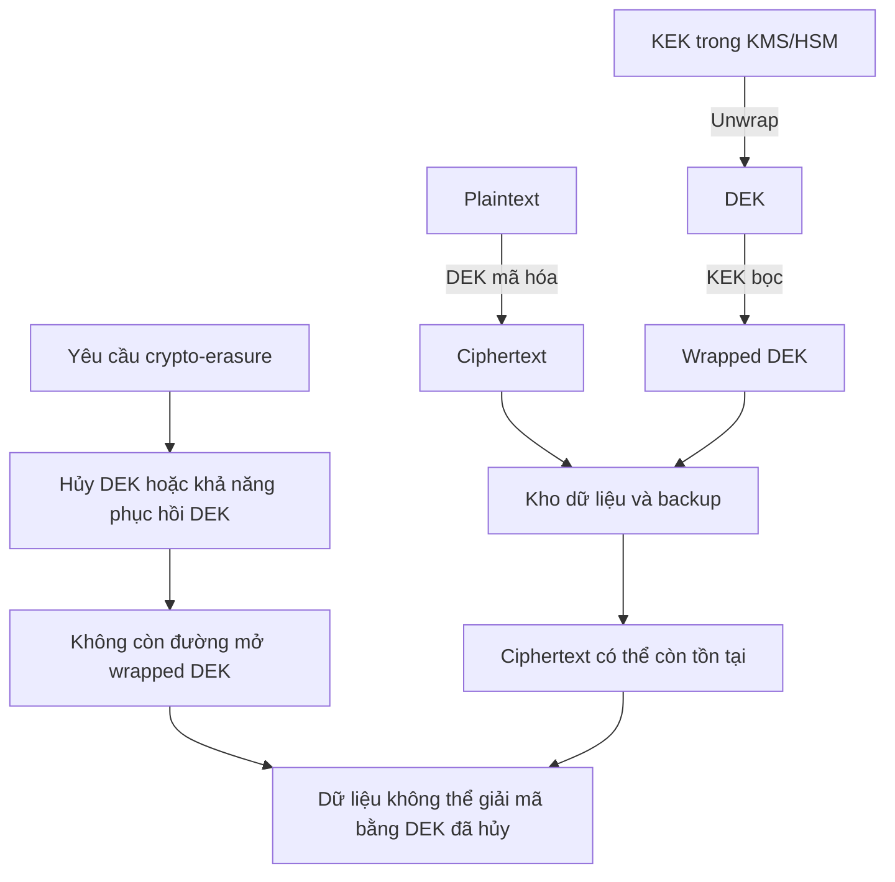
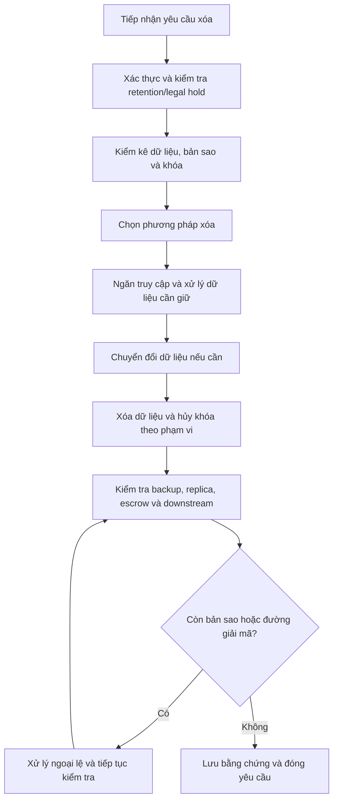

# Data deletion và key destruction

Trong chương **Key destruction** của module `SECURITY_KEY_MANAGEMENT_FUNDAMENTALS`, bài học này giải thích mối quan hệ giữa xóa dữ liệu và hủy khóa mật mã. Xóa một bản ghi hoặc tệp khỏi giao diện ứng dụng chưa chắc đã loại bỏ mọi bản sao dữ liệu. Hủy một khóa cũng chưa chắc làm dữ liệu không thể truy cập nếu vẫn còn plaintext, bản sao khóa hoặc một đường giải mã khác. Một quy trình xóa hoàn chỉnh phải xác định dữ liệu cần xóa, các bản sao và phụ thuộc, phương pháp xóa phù hợp, cùng bằng chứng xác minh.

## 1. Data deletion là gì?

**Data deletion** là quá trình loại bỏ dữ liệu khỏi phạm vi lưu trữ và xử lý theo chính sách, yêu cầu nghiệp vụ hoặc nghĩa vụ pháp lý. Phạm vi có thể bao gồm bản dữ liệu chính, bản sao, metadata, cache, index tìm kiếm, log có chứa dữ liệu, bản export, bản backup và dữ liệu do bên xử lý phụ giữ.

Mục tiêu của data deletion phụ thuộc vào yêu cầu:

- Loại bỏ dữ liệu khỏi kết quả truy vấn hoặc giao diện ứng dụng.
- Ngăn ứng dụng tiếp tục đọc, cập nhật hoặc chia sẻ dữ liệu.
- Loại bỏ các bản sao dữ liệu khỏi hệ thống lưu trữ và xử lý.
- Làm cho dữ liệu mã hóa không thể giải mã bằng cách hủy toàn bộ khóa cần thiết.
- Sanitization hoặc phá hủy phương tiện lưu trữ khi yêu cầu bảo đảm dữ liệu không thể phục hồi từ thiết bị.

Các mục tiêu trên có thể cần nhiều thao tác khác nhau. Xóa một bản ghi khỏi cơ sở dữ liệu thường chỉ là xóa logic. Dữ liệu có thể còn trong transaction log, snapshot, replica, backup, index hoặc thiết bị lưu trữ cho đến khi các cơ chế dọn dẹp hoàn tất.

## 2. Key destruction là gì?

**Key destruction** là quá trình loại bỏ key material và mọi bản sao có thể phục hồi nó, khiến khóa không còn khả năng được sử dụng cho mục đích mật mã ban đầu. Khóa có thể được hủy bằng cơ chế xóa của KMS, xóa object hoặc zeroization trong HSM, loại bỏ bản export và backup, hoặc hủy phương tiện lưu trữ theo quy trình phù hợp.

Key destruction là một biện pháp quan trọng trong quản lý dữ liệu mã hóa. Nếu ciphertext vẫn tồn tại nhưng không còn khóa cần thiết để giải mã, dữ liệu có thể trở nên không thể truy cập bằng các cơ chế mật mã đã thiết kế. Tuy nhiên, điều này chỉ đúng khi không còn bản plaintext, bản sao khóa, khóa dẫn xuất hoặc đường giải mã thay thế.

Một khóa có thể tồn tại trong nhiều nơi: KMS/HSM, bộ nhớ ứng dụng, bản export, backup, replica, escrow, cache hoặc hệ thống khác. Hủy đối tượng khóa ở một nơi không chứng minh mọi bản sao đã bị loại bỏ.

## 3. Phân biệt các khái niệm xóa

Các thuật ngữ dưới đây thường xuất hiện trong quy trình data deletion nhưng có mức bảo đảm khác nhau:

| Khái niệm | Mô tả | Kết quả cần xác minh |
|---|---|---|
| Logical deletion | Đánh dấu bản ghi hoặc đối tượng là đã xóa, ẩn khỏi ứng dụng hoặc loại khỏi truy vấn thông thường | Ứng dụng không còn hiển thị hoặc truy cập theo luồng thông thường; bản lưu vật lý có thể vẫn còn |
| Physical deletion | Loại bỏ dữ liệu khỏi vùng lưu trữ cụ thể theo khả năng của hệ thống | Dữ liệu được xóa khỏi các vị trí và bản sao thuộc phạm vi thao tác |
| Media sanitization | Xử lý phương tiện lưu trữ để dữ liệu trên đó không thể được phục hồi theo mức bảo đảm đã chọn | Kết quả sanitization phù hợp với loại thiết bị và tiêu chuẩn/chính sách áp dụng |
| Cryptographic erasure | Hủy khóa cần thiết để giải mã dữ liệu đã mã hóa | Không còn bất kỳ khóa hoặc đường dẫn nào có thể giải mã dữ liệu trong phạm vi đã xác định |
| Key destruction | Loại bỏ key material và các bản sao có thể phục hồi của khóa | Khóa không thể được phục hồi hoặc sử dụng lại trong phạm vi quản lý |

Logical deletion có thể là bước đầu tiên để ngăn truy cập ngay, nhưng thường chưa đủ cho yêu cầu xóa hoàn chỉnh. Physical deletion và media sanitization phụ thuộc vào công nghệ lưu trữ. Crypto-erasure tận dụng việc quản lý khóa để làm dữ liệu mã hóa không thể giải mã, nhưng chỉ có hiệu lực khi kiến trúc mã hóa và quản lý bản sao đáp ứng các điều kiện cần thiết.

## 4. Mối quan hệ giữa data deletion và key destruction

Data deletion và key destruction là hai quy trình liên quan nhưng có phạm vi khác nhau. Data deletion xử lý dữ liệu và các bản sao của dữ liệu; key destruction xử lý bí mật cho phép truy cập hoặc giải mã dữ liệu.

| Tình huống | Xóa dữ liệu | Hủy khóa | Kết quả |
|---|---|---|---|
| Xóa một bản ghi plaintext | Cần xóa bản ghi và các bản sao của nó | Không liên quan nếu dữ liệu không được bảo vệ bằng khóa riêng | Bản ghi có thể vẫn còn trong log, backup hoặc hệ thống khác |
| Xóa ciphertext, giữ khóa | Loại bỏ ciphertext và bản sao theo chính sách | Có thể giữ khóa vì còn dùng cho dữ liệu khác | Dữ liệu đã xóa có thể không còn trong kho chính, nhưng khóa vẫn hoạt động |
| Giữ ciphertext, hủy khóa duy nhất | Ciphertext vẫn tồn tại | Hủy khóa và mọi đường phục hồi | Có thể đạt crypto-erasure nếu không còn plaintext hoặc đường giải mã khác |
| Xóa ciphertext và hủy khóa | Xử lý cả dữ liệu và khóa | Hủy mọi bản khóa có thể phục hồi | Tạo mức bảo đảm cao hơn nếu các bản sao và phụ thuộc đều được xử lý |
| Hủy KEK dùng chung | Ciphertext có thể còn | Hủy một KEK có thể ảnh hưởng nhiều DEK | Có thể làm mất quyền truy cập ngoài phạm vi dữ liệu cần xóa |

Không phải yêu cầu xóa dữ liệu nào cũng đòi hỏi hủy một khóa dùng chung. Nếu một KEK bảo vệ hàng nghìn DEK, hủy KEK để xóa một hồ sơ có thể phá hủy khả năng truy cập của các hồ sơ khác. Kiến trúc khóa cần xác định phạm vi khóa tương ứng với phạm vi dữ liệu cần xóa.

## 5. Cryptographic erasure hoạt động như thế nào?

**Cryptographic erasure (crypto-erasure)** làm cho dữ liệu đã mã hóa không thể truy cập bằng cách loại bỏ khóa cần thiết để giải mã. Cách tiếp cận này đặc biệt hữu ích khi dữ liệu được sao chép qua nhiều thiết bị hoặc vùng lưu trữ, nơi việc xóa vật lý từng bản sao có thể khó thực hiện hoặc mất nhiều thời gian.

Trong envelope encryption, ứng dụng tạo DEK để mã hóa dữ liệu. KEK trong KMS/HSM bọc DEK thành wrapped DEK. Dữ liệu được lưu dưới dạng ciphertext cùng wrapped DEK và metadata tham chiếu đến KEK.

Sau khi hủy DEK và mọi bản có thể phục hồi, ciphertext có thể vẫn còn trong backup hoặc replica nhưng không thể giải mã bằng DEK đó. Để kết luận crypto-erasure thành công, phải bảo đảm:

- Không còn DEK plaintext trong bộ nhớ, cache, log, dump hoặc bản export.
- Không còn wrapped DEK có thể được mở bằng KEK còn hoạt động.
- Không còn bản backup, replica hoặc escrow chứa DEK có thể phục hồi.
- Không còn khóa dẫn xuất hoặc đầu vào gốc có thể tạo lại cùng DEK.
- Không còn bản plaintext hoặc bản sao dữ liệu đã được giải mã trong hệ thống downstream.
- Không còn khóa thay thế hoặc đường giải mã khác có thể truy cập cùng dữ liệu.

Crypto-erasure không xóa ciphertext về mặt vật lý. Nếu yêu cầu bắt buộc loại bỏ cả ciphertext, metadata và bản sao dữ liệu, cần kết hợp với quy trình xóa dữ liệu ở các lớp lưu trữ.

## 6. Các mô hình mã hóa và phạm vi xóa

Hiệu quả của crypto-erasure phụ thuộc vào cách tổ chức khóa và dữ liệu.

### Một khóa dùng chung cho toàn hệ thống

Nếu nhiều khách hàng hoặc nhiều đối tượng dùng cùng một khóa, hủy khóa có thể làm toàn bộ dữ liệu phụ thuộc không thể giải mã. Mô hình này đơn giản trong vận hành nhưng khó hỗ trợ xóa chọn lọc theo từng khách hàng hoặc từng đối tượng.

### DEK riêng cho từng đối tượng

Mỗi tệp hoặc bản ghi có DEK riêng, còn KEK có thể dùng chung để bọc các DEK. Khi cần xóa một đối tượng, hệ thống có thể hủy DEK tương ứng và các bản sao có thể phục hồi của nó mà không hủy KEK đang bảo vệ các đối tượng khác.

### KEK riêng cho từng tenant

Mỗi tenant có KEK riêng để bọc các DEK của tenant đó. Khi kết thúc vòng đời tenant, có thể hủy KEK để làm các wrapped DEK tương ứng không thể mở. Mô hình này hỗ trợ crypto-erasure theo tenant nếu không còn DEK plaintext, bản sao KEK hoặc đường giải mã thay thế.

### Phân cấp nhiều lớp khóa

Một hệ thống có thể có root key, KEK theo tenant, DEK theo đối tượng và các khóa backup wrapping riêng. Hủy một khóa ở tầng trên có thể ảnh hưởng đến nhiều khóa bên dưới. Cần lập dependency graph để biết khóa nào bảo vệ dữ liệu nào và thao tác hủy ở tầng nào có phạm vi tác động phù hợp.

| Mô hình | Phạm vi hủy thuận tiện | Rủi ro chính |
|---|---|---|
| Khóa dùng chung | Toàn hệ thống hoặc nhóm dữ liệu lớn | Xóa chọn lọc khó; hủy nhầm gây mất dữ liệu diện rộng |
| DEK riêng theo đối tượng | Từng tệp hoặc nhóm bản ghi | Quản lý số lượng lớn khóa và metadata |
| KEK riêng theo tenant | Toàn bộ dữ liệu của một tenant | Phải bảo đảm KEK không bảo vệ dữ liệu ngoài tenant và không còn bản sao |
| Phân cấp nhiều lớp | Linh hoạt theo tầng dữ liệu | Phụ thuộc phức tạp; cần quản lý phiên bản và thứ tự hủy |

## 7. Quy trình data deletion có phối hợp key destruction

Một quy trình hoàn chỉnh cần bắt đầu từ yêu cầu xóa và kết thúc bằng việc xác minh các bản sao cùng đường phục hồi.

### Bước 1: Tiếp nhận và xác thực yêu cầu

Xác định người yêu cầu, chủ sở hữu dữ liệu, đối tượng, tenant, lý do và phạm vi xóa. Kiểm tra quyền yêu cầu, chính sách lưu giữ, legal hold, nghĩa vụ pháp lý và các trường hợp ngoại lệ.

### Bước 2: Kiểm kê dữ liệu và phụ thuộc

Tìm bản dữ liệu chính, ciphertext, plaintext, metadata, index, cache, queue, log, bản export, backup, replica và hệ thống downstream. Xác định DEK, KEK, key ID, phiên bản và wrapping dependency liên quan.

### Bước 3: Xác định phương pháp xóa

Chọn logical deletion, physical deletion, media sanitization, crypto-erasure hoặc kết hợp. Quyết định dựa trên loại dữ liệu, yêu cầu bảo đảm, kiến trúc lưu trữ, chính sách và khả năng của KMS/HSM.

### Bước 4: Ngăn truy cập mới

Ẩn hoặc đánh dấu dữ liệu đã xóa theo ứng dụng, chặn luồng xử lý mới và thu hồi quyền truy cập không còn cần thiết. Nếu có sự cố bảo mật, cô lập dữ liệu và khóa theo quy trình ứng phó.

### Bước 5: Bảo toàn dữ liệu cần giữ hợp lệ

Nếu có legal hold hoặc nghĩa vụ lưu giữ, tách dữ liệu cần giữ vào phạm vi được kiểm soát với quyền truy cập và thời hạn xác định. Không hủy khóa trước khi chủ sở hữu xác nhận dữ liệu không còn cần giải mã.

### Bước 6: Chuyển đổi dữ liệu nếu cần

Nếu một phần dữ liệu cần tiếp tục sử dụng, re-encrypt bằng DEK mới hoặc rewrap DEK bằng KEK mới. Xác minh dữ liệu mới có thể giải mã và toàn vẹn trước khi ngừng dùng khóa cũ.

### Bước 7: Xóa dữ liệu và hủy khóa

Xóa bản dữ liệu theo từng lớp lưu trữ. Hủy DEK hoặc KEK trong phạm vi được phê duyệt, xử lý bản backup, replica, escrow, bản export và các đường dẫn tái tạo. Với KMS có thời gian chờ xóa, chờ tới trạng thái hoàn tất theo tài liệu dịch vụ.

### Bước 8: Xác minh và ghi bằng chứng

Kiểm tra kết quả trên các hệ thống, đối chiếu danh sách bản sao, xác nhận không còn đường giải mã được phép và lưu audit evidence. Ghi rõ ngoại lệ hoặc bản sao chưa thể xử lý cùng thời hạn hoàn tất.

## 8. Xử lý backup, replica và snapshot

Backup và replica là nguồn gây khó khăn phổ biến cho yêu cầu xóa. Một bản dữ liệu đã bị xóa trong hệ thống chính có thể vẫn tồn tại trong snapshot hoặc backup được lưu nhiều tháng.

### Backup có thời hạn lưu giữ cố định

Nếu hệ thống không hỗ trợ xóa chọn lọc trong backup, tổ chức có thể giữ backup đến hết thời hạn lưu giữ đã công bố, với quyền truy cập hạn chế và quy trình ngăn dữ liệu bị khôi phục trở lại hệ thống đang hoạt động. Sau khi backup hết hạn, bản sao phải được xóa hoặc sanitization theo chính sách.

Nếu áp dụng crypto-erasure, cần xác nhận backup không còn đường phục hồi DEK/KEK. Chỉ xóa khóa ở môi trường production trong khi backup wrapping key vẫn mở được bản sao cũ không đáp ứng mục tiêu.

### Replica và đồng bộ xóa

Replica có thể nhận lệnh xóa từ hệ thống chính, nhưng độ trễ hoặc lỗi đồng bộ có thể khiến bản sao còn tồn tại. Cần theo dõi trạng thái xóa ở từng vùng, xử lý replica ngoại tuyến và kiểm tra các bản sao được tạo trong thời gian sự kiện chưa lan truyền.

### Snapshot bất biến

Immutable backup có thể không cho phép sửa hoặc xóa trước thời hạn. Khi có yêu cầu xóa, tổ chức phải áp dụng chính sách và nghĩa vụ lưu giữ phù hợp, hạn chế truy cập và ngăn khôi phục dữ liệu đã xóa vào hệ thống đang hoạt động. Crypto-erasure chỉ có thể được dùng nếu kiến trúc khóa và mọi bản backup đáp ứng đầy đủ điều kiện kỹ thuật và quản trị.

### Phục hồi sau thảm họa

Runbook restore phải có bước áp dụng lại tombstone, danh sách xóa hoặc sự kiện hủy mới hơn snapshot. Nếu chỉ phục hồi dữ liệu và metadata cũ, dữ liệu đã bị xóa có thể xuất hiện trở lại. Trạng thái thu hồi, xóa và compromise của khóa cũng phải được phát lại hoặc đối chiếu để không kích hoạt lại đường giải mã đã bị loại bỏ.

## 9. Xóa dữ liệu trong hệ thống phân tán

Một đối tượng dữ liệu có thể được sao chép qua nhiều dịch vụ: database, object storage, search index, cache, analytics warehouse, data lake, queue, hệ thống báo cáo và nhà cung cấp xử lý dữ liệu. Yêu cầu xóa cần theo dõi được phạm vi xuyên suốt.

Các kỹ thuật thường dùng gồm:

- **Tombstone:** ghi nhận một đối tượng đã bị xóa để replica và tiến trình đồng bộ biết không được phục hồi nó.
- **Deletion event:** phát sự kiện xóa có định danh, phiên bản và phạm vi; consumer xử lý idempotent để tránh bỏ sót hoặc xử lý lặp sai.
- **Propagation tracking:** theo dõi trạng thái tiếp nhận và hoàn tất xóa tại từng hệ thống đích.
- **Retention-aware cleanup:** xóa dữ liệu theo lịch khi hết thời hạn backup, log hoặc snapshot.
- **Access blocking:** chặn truy cập trong khi các bản sao còn chờ xóa vật lý hoặc hết thời hạn lưu giữ.

Ví dụ, khi xóa hồ sơ khách hàng, ứng dụng có thể xóa bản ghi chính ngay và phát `DataDeleted` event. Search index, cache và data warehouse nhận sự kiện để loại bỏ bản sao. Backup có lịch lưu giữ riêng và được theo dõi đến khi hết hạn. Nếu dùng crypto-erasure, hệ thống cũng phải xử lý DEK/KEK và mọi bản sao có thể phục hồi.

Một deletion event cần chứa định danh và trạng thái cần thiết, không chứa plaintext hoặc key material. Event phải được xác thực và lưu dấu vết để có thể chứng minh hệ thống đích đã nhận và xử lý yêu cầu.

## 10. Data deletion trong KMS và HSM

KMS và HSM cung cấp các cơ chế khác nhau để quản lý vòng đời khóa. Không thể giả định mọi dịch vụ có cùng hành vi xóa.

| Thành phần | Khả năng cần xác minh | Điểm cần chú ý |
|---|---|---|
| KMS key object | Disable, schedule deletion, delete, restore hoặc thời gian chờ | Trạng thái yêu cầu xóa có thể chưa phải trạng thái destruction hoàn tất |
| Customer-managed key | Quyền xóa và thời gian lưu giữ do khách hàng cấu hình trong giới hạn dịch vụ | Kiểm tra backup, replica, key policy và các ứng dụng tham chiếu |
| Provider-managed key | Cơ chế xóa có thể do nhà cung cấp quản lý | Xác định trách nhiệm, giới hạn và bằng chứng từ hợp đồng/tài liệu dịch vụ |
| HSM object | Xóa object, zeroize hoặc thao tác quản trị theo security domain | Tránh zeroize rộng hơn phạm vi cần thiết; kiểm tra cluster và backup domain |
| HSM backup | Backup/restore domain và thiết bị tương thích | Bản backup có thể phục hồi khóa sau khi object chính đã bị xóa |

Khi dùng KMS có thời gian chờ xóa, cần phân biệt `Disabled`, `Pending deletion` và trạng thái xóa cuối cùng. Khi dùng HSM, cần xác định thao tác xóa object có ảnh hưởng đến replica hay backup hay không. Bằng chứng từ API hoặc audit log nên được lưu cùng với danh sách các bản sao đã xử lý.

## 11. Quản lý quyền riêng tư và yêu cầu lưu giữ

Yêu cầu data deletion có thể phát sinh từ chính sách nội bộ, hợp đồng, yêu cầu của chủ thể dữ liệu hoặc quy định pháp luật. Tổ chức cần phân biệt:

- Dữ liệu được phép xóa ngay.
- Dữ liệu phải giữ do nghĩa vụ pháp lý hoặc legal hold.
- Dữ liệu có thể giữ dưới dạng đã ẩn danh hoặc tổng hợp nếu đáp ứng điều kiện áp dụng.
- Dữ liệu backup chưa thể xóa chọn lọc nhưng có thời hạn lưu giữ xác định.
- Bằng chứng kiểm toán cần giữ để chứng minh yêu cầu đã được xử lý.

Không nên giữ plaintext hoặc key material chỉ để lưu bằng chứng xóa. Audit evidence nên dùng ID, thời gian, trạng thái, actor, phạm vi và tham chiếu tới log. Cần hạn chế thông tin nhận dạng trong bằng chứng ở mức cần thiết.

Nếu nhà cung cấp hoặc bên xử lý phụ giữ dữ liệu, quy trình cần xác định trách nhiệm thông báo, thời hạn thực hiện, cách xác nhận và ngoại lệ. Một yêu cầu chỉ nên được đánh dấu hoàn tất khi trạng thái của các bên liên quan đã được ghi nhận theo chính sách.

## 12. Xác minh data deletion và key destruction

Không có một phép thử đơn lẻ chứng minh mọi bản dữ liệu đã biến mất. Việc xác minh cần kết hợp kiểm tra kỹ thuật, trạng thái hệ thống, bằng chứng nhà cung cấp và kiểm toán quy trình.

### Bằng chứng về dữ liệu

- Data ID, tenant/object scope và các hệ thống lưu trữ liên quan.
- Trạng thái xóa ở database, object storage, index, cache và hệ thống downstream.
- Trạng thái backup, snapshot, replica và thời hạn lưu giữ còn lại.
- Kết quả sanitization hoặc chứng từ phá hủy phương tiện nếu áp dụng.
- Bản ghi deletion event và xác nhận của consumer hoặc bên xử lý phụ.

### Bằng chứng về khóa

- Key ID, phiên bản, loại khóa và quan hệ với dữ liệu cần xóa.
- Trạng thái disable, revoke, schedule deletion và destruction hoàn tất.
- Kết quả API/audit log của KMS hoặc HSM.
- Xác nhận xử lý wrapped DEK, backup wrapping key, replica và escrow.
- Xác nhận không còn bản plaintext, đường unwrap hoặc khả năng tái tạo được phép.

### Bằng chứng về quy trình

- Người yêu cầu, chủ sở hữu, người phê duyệt và người thực hiện.
- Căn cứ xóa, thời điểm tiếp nhận và thời hạn xử lý.
- Phương pháp xóa được chọn và lý do phù hợp với phạm vi.
- Ngoại lệ, hệ thống chưa hoàn tất, người chịu trách nhiệm và ngày xử lý dự kiến.
- Thời điểm đóng yêu cầu và tham chiếu tới audit evidence.

Với crypto-erasure, cần chứng minh rằng không còn khóa hoặc đường dẫn nào có thể giải mã dữ liệu trong phạm vi. Không thử phục hồi khóa đã hủy từ bản sao không được phép chỉ để kiểm tra; dùng quy trình xác minh được phê duyệt và môi trường thử nghiệm.

## 13. Ví dụ: xóa dữ liệu của một khách hàng

Một nền tảng lưu trữ tài liệu dùng DEK riêng cho mỗi tài liệu. Các DEK được bọc bằng KEK riêng của tenant trong KMS. Khách hàng yêu cầu xóa tài khoản sau khi thời hạn sử dụng dịch vụ kết thúc.

Quy trình có thể thực hiện như sau:

1. Xác thực yêu cầu và xác định tenant, các tài liệu, chủ sở hữu và thời hạn lưu giữ.
2. Kiểm tra legal hold, điều tra đang mở và hồ sơ cần giữ theo nghĩa vụ hợp lệ.
3. Kiểm kê ciphertext, wrapped DEK, KEK, backup, replica, index, cache và bản sao downstream.
4. Xóa dữ liệu không còn cần giữ khỏi ứng dụng và các hệ thống có thể xử lý xóa chọn lọc.
5. Nếu dữ liệu còn phải giữ, chuyển vào phạm vi lưu trữ riêng với quyền hạn và thời hạn rõ ràng.
6. Khi không còn dữ liệu cần truy cập của tenant, hủy KEK riêng và mọi bản sao có thể phục hồi theo quy trình KMS.
7. Theo dõi backup và snapshot đến khi bản sao chứa wrapped DEK hết hạn hoặc được xử lý theo phương án crypto-erasure đã kiểm chứng.
8. Xác minh không còn đường giải mã, cập nhật deletion status và lưu bằng chứng.

Nếu tenant dùng chung KEK với khách hàng khác, không được hủy KEK chung để đáp ứng yêu cầu xóa một tenant. Cần thiết kế hoặc chuyển đổi sang phạm vi khóa riêng phù hợp. Nếu backup ngoại tuyến vẫn chứa KEK hoặc bản DEK có thể phục hồi, yêu cầu chưa thể được xác nhận hoàn tất theo mục tiêu crypto-erasure.

## 14. Những sai lầm thường gặp

- **Đánh đồng logical deletion với xóa hoàn toàn:** bản sao có thể còn trong log, backup hoặc replica.
- **Cho rằng hủy khóa tự động xóa plaintext:** dữ liệu đã giải mã có thể vẫn tồn tại trong cache, export hoặc downstream.
- **Hủy KEK dùng chung để xóa một đối tượng:** làm mất quyền truy cập dữ liệu ngoài phạm vi yêu cầu.
- **Bỏ qua wrapped DEK trong backup:** bản backup vẫn có thể khôi phục đường giải mã.
- **Không xử lý snapshot bất biến:** dữ liệu đã xóa có thể xuất hiện lại sau restore.
- **Không phát lại tombstone hoặc deletion event:** hệ thống phân tán có thể phục hồi bản ghi đã xóa.
- **Không kiểm tra khóa dẫn xuất:** đầu vào gốc còn tồn tại có thể tạo lại DEK.
- **Coi trạng thái pending deletion là destruction hoàn tất:** key material có thể vẫn tồn tại trong thời gian chờ.
- **Không lưu ngoại lệ và bằng chứng:** không thể chứng minh hệ thống hoặc bên xử lý phụ đã hoàn tất yêu cầu.

## 15. Checklist xây dựng quy trình data deletion và key destruction

- [ ] Đã xác thực yêu cầu, chủ sở hữu và phạm vi dữ liệu cần xóa.
- [ ] Đã kiểm tra retention policy, legal hold và nghĩa vụ lưu giữ.
- [ ] Đã kiểm kê plaintext, ciphertext, metadata, index, cache, log và downstream.
- [ ] Đã xác định DEK, KEK, key ID, phiên bản và mọi phụ thuộc.
- [ ] Đã chọn phương pháp logical deletion, physical deletion, sanitization hoặc crypto-erasure phù hợp.
- [ ] Đã đánh giá khóa dùng chung và nguy cơ ảnh hưởng dữ liệu ngoài phạm vi.
- [ ] Đã xử lý backup, replica, snapshot, escrow và bên xử lý phụ.
- [ ] Đã có cơ chế tombstone/deletion event để ngăn dữ liệu quay lại sau restore.
- [ ] Đã xác minh không còn plaintext hoặc đường giải mã ngoài phạm vi cho phép.
- [ ] Đã xác minh trạng thái destruction cuối cùng của KMS/HSM khi áp dụng.
- [ ] Đã ghi bằng chứng, ngoại lệ, người chịu trách nhiệm và thời hạn hoàn tất.

Data deletion xử lý dữ liệu và mọi bản sao của dữ liệu; key destruction loại bỏ khóa và các đường phục hồi cho phép truy cập dữ liệu mã hóa. Crypto-erasure có thể kết nối hai quy trình này, nhưng chỉ đáng tin cậy khi kiến trúc mã hóa, phạm vi khóa, backup, replica và hệ thống downstream được kiểm soát đầy đủ. Thiết kế đúng từ đầu giúp tổ chức xóa dữ liệu theo phạm vi cần thiết mà vẫn giữ được dữ liệu còn nghĩa vụ lưu trữ và không làm ảnh hưởng các đối tượng khác.
