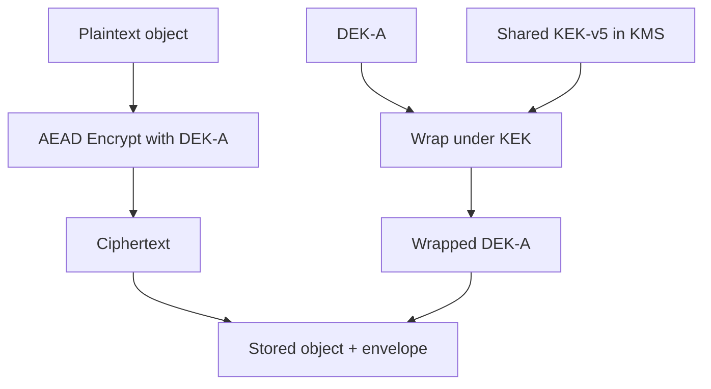
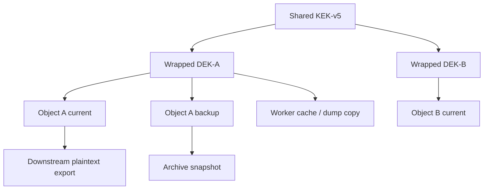
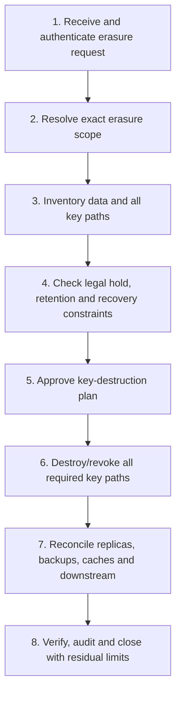

# Crypto erasure: Xóa dữ liệu bằng cách hủy khả năng giải mã thông qua khóa

> **Chương:** Key destruction  
> **Bài học:** Crypto erasure  
> **Module:** `SECURITY_KEY_MANAGEMENT_FUNDAMENTALS` — hiểu vòng đời khóa mật mã từ tạo, cấp phát, lưu trữ, sử dụng, xoay vòng đến thu hồi và hủy; kết nối mật mã đối xứng, bất đối xứng, chữ ký số, KMS/HSM, envelope encryption, kiểm soát truy cập và kiểm toán để thiết kế hệ thống bảo vệ khóa an toàn.

## 1. Tình huống: Xóa object nhưng dữ liệu vẫn nằm trong backup

Một dịch vụ SaaS nhận yêu cầu xóa hồ sơ của một khách hàng. Hồ sơ có mặt trong:

- Object storage chính và các object versions cũ.
- Replica ở hai region.
- Backup snapshot hàng ngày.
- Data lake phục vụ phân tích.
- Cache và temporary files của worker.
- Một bản export được tạo cho hệ thống downstream.
- KMS giữ KEK dùng để bọc các DEK của hồ sơ.

Đội vận hành xóa record trong database và object hiện tại, nhưng ciphertext vẫn tồn tại trong snapshots và archive. Nếu tổ chức giữ ciphertext lâu hơn thời hạn cần thiết, một cách thiết kế có thể là **crypto erasure**: làm cho dữ liệu được mã hóa không còn khả năng giải mã bằng cách hủy đúng key material cần thiết.

Nhưng đội ngũ phát hiện thêm:

1. DEK của hồ sơ được bọc bằng KEK dùng chung cho hàng triệu object.
2. Một worker từng cache plaintext DEK trong memory.
3. Backup của envelope metadata vẫn còn trong một vault khác.
4. Một bản export downstream đã được giải mã thành plaintext.
5. KEK có bản replica và cơ chế recovery mà người vận hành chưa kiểm kê.

Nếu xóa KEK dùng chung, hệ thống có thể làm mất dữ liệu của hàng triệu khách hàng. Nếu chỉ xóa wrapped DEK trong database, một bản backup khác có thể vẫn chứa nó. Nếu hủy key trong KMS, plaintext đã export và raw key đã bị sao chép không biến mất.

**Crypto erasure** không phải thao tác xóa file. Đây là phương pháp làm cho ciphertext không còn khả năng được giải mã bằng cách loại bỏ mọi khả năng khôi phục key material cần thiết, trong một phạm vi và threat model được xác định.

> **Nguyên tắc:** Crypto erasure chỉ có thể được khẳng định khi dữ liệu đã được mã hóa đúng, key cần thiết là độc lập cho phạm vi cần xóa, mọi bản sao hoặc đường tái tạo key đã được xử lý, và không còn plaintext copies nằm ngoài phạm vi kiểm soát. Nếu chưa chứng minh được các điều kiện đó, hãy báo trạng thái `UNKNOWN` hoặc `INCOMPLETE`.

### Mục tiêu học tập

Sau bài này, bạn có thể:

1. Định nghĩa crypto erasure/cryptographic erasure/crypto-shredding và phân biệt với xóa file, xóa database record, revoke, disable, key rotation và media sanitization.
2. Giải thích điều kiện mật mã và vận hành để việc hủy key thực sự làm mất khả năng giải mã.
3. Thiết kế key hierarchy và DEK/KEK để hỗ trợ xóa theo object, tenant hoặc data class.
4. Phân tích vì sao hủy một KEK dùng chung có thể gây mất dữ liệu diện rộng.
5. Kiểm kê key copies, wrapped DEKs, replicas, backups, escrow, caches, derived keys và plaintext exports.
6. Đánh giá giới hạn của KMS/HSM deletion, pending deletion, replication và provider-managed recovery.
7. Phân biệt xóa confidentiality của ciphertext với xóa plaintext đã bị sao chép.
8. Xử lý dữ liệu trong backups, archives, analytics, snapshots, logs và downstream systems.
9. Thiết kế legal hold, retention, authorization, dual control và deletion gates.
10. Đọc ví dụ Java 17 kiểm tra điều kiện đủ trước khi cho phép một workflow crypto erasure.
11. Xây dựng test, audit evidence và runbook chứng minh crypto erasure đúng phạm vi.

---

## 2. Crypto erasure là gì?

**Crypto erasure** (còn gọi là *cryptographic erasure* hoặc *crypto-shredding*) là phương pháp làm cho dữ liệu đã mã hóa trở nên không thể giải mã theo threat model đã xác định bằng cách hủy key material cần thiết để giải mã dữ liệu đó, đồng thời loại bỏ các bản sao/đường recovery có thể khôi phục key.

Dữ liệu ciphertext có thể vẫn nằm trên media sau khi key bị hủy. Mục tiêu là người không còn key hợp lệ không thể lấy plaintext từ ciphertext bằng các phương tiện khả thi theo giả định bảo mật của hệ thống.

### 2.1. Mô hình đơn giản

```text
Plaintext P
   |
   | Encrypt with unique DEK-A
   v
Ciphertext C-A

DEK-A
   |
   | Protected by a dedicated wrapping key / KEK
   v
Wrapped DEK-A

Crypto erasure:
  destroy the only recoverable key path for DEK-A
  remove or govern every other copy/recovery path
```

Nếu attacker chỉ có ciphertext và không có key, một thuật toán mạnh cùng key ngẫu nhiên đủ entropy có thể bảo vệ confidentiality. Khi key duy nhất bị hủy và không thể tái tạo/khôi phục, ciphertext còn lại không còn đường giải mã thực tế theo giả định đó.

### 2.2. Điều crypto erasure không làm

Crypto erasure không tự:

- Xóa bytes ciphertext khỏi disk, object store, tape hoặc backup.
- Xóa plaintext đã được tải về trước đó.
- Xóa raw key đã bị attacker exfiltrate.
- Xóa mọi bản sao DEK trong heap dump, swap, snapshot hoặc log.
- Thu hồi token/session đã được phát hành.
- Vô hiệu hóa chữ ký số đã được tạo.
- Xóa public key/certificate hoặc dữ liệu không được mã hóa bằng key đó.
- Xóa dữ liệu downstream đã được giải mã hoặc transform.
- Chứng minh media đã được sanitization theo tiêu chuẩn vật lý.
- Khôi phục dữ liệu nếu key bị hủy nhầm.

**Không được diễn đạt “dữ liệu đã bị xóa khỏi mọi nơi” nếu thực tế chỉ key path đã bị hủy.** Mô tả chính xác hơn là “khả năng giải mã các ciphertext nằm trong scope đã bị loại bỏ theo điều kiện và giả định đã ghi”.

### 2.3. Crypto erasure và xóa dữ liệu thông thường

| Phương pháp | Tác động | Điều cần kiểm |
|---|---|---|
| Xóa database row | Xóa một bản ghi logic. | Replica, WAL, backup, export. |
| Xóa object hiện tại | Xóa current object/reference. | Versioning, snapshots, archive. |
| Xóa ciphertext | Xóa một bản mã ở một vị trí. | Các bản sao khác và media semantics. |
| Revoke access | Ngăn principal truy cập qua đường đó. | Raw key/ciphertext copies vẫn có thể tồn tại. |
| Disable key | Ngăn operation theo provider state. | Có thể enable lại; provider semantics. |
| Destroy key material | Hủy key theo provider/lifecycle. | Backup, escrow, replicas, exports. |
| Crypto erasure | Loại bỏ mọi đường khôi phục key cần cho ciphertext trong scope. | Key uniqueness, copies, derivation, plaintext và recovery paths. |
| Media sanitization | Xử lý media theo quy trình sanitization. | Physical/logical media và tiêu chuẩn áp dụng. |

### 2.4. Crypto erasure là một claim có điều kiện

Không thể chỉ nhìn thấy KMS báo `PendingDeletion` hoặc `Destroyed` rồi kết luận toàn bộ dữ liệu đã được crypto-erased. Cần bằng chứng rằng:

- Dữ liệu đã được mã hóa trước khi lưu.
- Key phù hợp và độc lập với scope.
- Không có plaintext copies nằm ngoài phạm vi.
- Không có bản sao raw key hoặc wrapped key có thể khôi phục.
- Không còn key derivation path.
- Không còn provider backup/replica/escrow ngoài dự kiến.
- Mọi data copies cần xử lý đã được xác định.
- Provider semantics và deletion state đã được xác minh.

---

## 3. Điều kiện mật mã để crypto erasure có hiệu lực

### 3.1. Dữ liệu phải được mã hóa trước khi lưu

Crypto erasure không thể xóa dữ liệu plaintext bằng cách hủy một key chưa từng bảo vệ dữ liệu đó.

Ví dụ không được bảo vệ:

```text
database stores plaintext
backup stores plaintext
KMS stores an unrelated key
```

Xóa KMS key không tác động tới plaintext trong database/backup.

### 3.2. Key phải có entropy và được sinh đúng cách

Key cần được tạo bằng CSPRNG hoặc cơ chế sinh key đã được phê duyệt, với entropy/độ dài phù hợp thuật toán.

Nếu key được tạo từ password yếu hoặc seed có thể đoán, hủy bản copy hiện tại chưa đủ nếu attacker có thể brute-force hoặc tái tạo key từ nguồn còn lại.

### 3.3. Key phải gắn với phạm vi xóa rõ ràng

Nếu một DEK mã hóa cả hồ sơ cần giữ và hồ sơ cần xóa, hủy DEK sẽ làm mất khả năng giải mã cả hai.

Thiết kế cần xác định granularity:

- Per object.
- Per record hoặc nhóm record có lifecycle giống nhau.
- Per tenant.
- Per data class.
- Per retention partition.

Granularity càng nhỏ thì blast radius khi xóa nhầm càng hẹp, nhưng chi phí key management, metadata và KMS operations có thể tăng.

### 3.4. Phải không còn bản sao key có thể sử dụng

Các bản sao có thể tồn tại ở:

- Raw DEK trong application memory.
- Key object trong KMS/HSM.
- Wrapped DEK trong envelope metadata.
- Backup/replica của wrapped DEK.
- Key escrow.
- HSM backup domain.
- Export/import package.
- Secret manager hoặc local keystore.
- Crash dump, heap dump, swap và VM snapshot.
- Derived key có thể tái tạo từ master secret.
- Một KEK khác có thể unwrap cùng DEK.

Không thể khẳng định crypto erasure nếu một trong các đường này vẫn còn và có thể khôi phục key.

### 3.5. Không còn cách tái tạo key

Nếu key được derive:

```text
DEK = HKDF(masterSecret, salt, info)
```

thì xóa DEK cache không đủ nếu `masterSecret`, `salt` và `info` vẫn còn và có thể chạy lại HKDF.

Nếu muốn crypto-erase riêng một object, không nên dựa vào một master secret còn tồn tại để tái tạo deterministic key cho object đó, trừ khi có thêm một secret per-object được hủy độc lập.

### 3.6. Thuật toán và implementation phải còn an toàn

Crypto erasure giả định ciphertext không thể được giải mã khả thi nếu thiếu key. Nếu thuật toán yếu, key ngắn, nonce reuse nghiêm trọng hoặc implementation có lỗ hổng, việc hủy key không cứu được confidentiality đã bị phá theo một đường khác.

Với AEAD như AES-GCM, cần bảo đảm nonce discipline, tag verification, key separation và AAD binding. Crypto erasure không thay thế thiết kế mã hóa đúng.

---

## 4. Threat model: Ai còn có thể đọc dữ liệu sau khi hủy key?

### 4.1. Phân biệt các đối thủ

| Đối thủ | Có thể còn gì? | Crypto erasure có giúp không? |
|---|---|---|
| Người chỉ giữ ciphertext | Ciphertext copy. | Có thể, nếu không còn key/recovery path và crypto an toàn. |
| Người giữ ciphertext + wrapped DEK | Bản mã và key được bọc. | Có thể, nếu wrapping key duy nhất đã bị hủy và không có bản sao. |
| Người giữ raw DEK | Key plaintext và ciphertext. | Không; destroy KMS object không xóa bản sao của họ. |
| Người giữ plaintext export | Dữ liệu rõ. | Không. |
| Admin có thể restore KMS/HSM backup | Có thể khôi phục key. | Chưa hiệu lực cho tới khi backup/recovery path được xử lý. |
| Attacker kiểm soát host khi DEK resident | Có thể đọc memory/dump. | Không nếu họ đã lấy key trước khi destroy. |
| Operator có quyền re-enable key | Có thể khôi phục operation. | Disable chưa phải irreversible erasure. |
| Downstream system có bản sao plaintext | Dữ liệu đã giải mã. | Không; cần downstream deletion process riêng. |

### 4.2. Xác định thời điểm exposure

Cần xác định:

```text
T_encrypt       = dữ liệu được mã hóa
T_last_plaintext_export
T_last_raw_key_access
T_key_disable
T_key_destroy
T_last_backup/escrow copy eliminated
T_erasure_verified
```

Nếu raw key có thể đã bị lộ trước `T_key_destroy`, việc destroy không đảo ngược exposure. Closure report phải ghi rõ khoảng thời gian và residual risk.

### 4.3. Attacker giữ key từ trước

Giả sử attacker đã tải:

```text
ciphertext-C
raw-DEK-A
```

Tổ chức hủy DEK-A trong KMS ngày hôm nay. Attacker vẫn có thể giải mã ciphertext-C bằng bản DEK-A họ đã lưu.

Vì vậy, crypto erasure chỉ chống việc **khôi phục trong tương lai từ các bản sao còn nằm dưới quyền kiểm soát của tổ chức**, không thu hồi key đã bị exfiltrate.

### 4.4. Threat model cần nêu rõ trust boundary

Một tuyên bố erasure nên chỉ ra có bao gồm hay không:

- Cloud provider internal backup.
- KMS/HSM replication.
- Backup vault và offline escrow.
- Employee/admin privileged access.
- Customer-managed exports.
- End-user devices.
- Third-party processors.
- Forensic/legal evidence.
- Previously exfiltrated data.

Không mở rộng claim vượt quá những nơi tổ chức có thể xác minh.

---

## 5. Key hierarchy quyết định khả năng crypto erasure

### 5.1. Envelope encryption cơ bản



Nếu mọi object dùng cùng một KEK, hủy KEK có thể khiến nhiều wrapped DEKs không thể unwrap. Nhưng điều đó cũng có thể làm mất khả năng đọc **mọi object** phụ thuộc KEK, không chỉ object cần xóa.

### 5.2. Per-object DEK với shared KEK

Mỗi object có DEK riêng:

```text
Object A -> DEK-A -> wrapped by KEK-shared
Object B -> DEK-B -> wrapped by KEK-shared
Object C -> DEK-C -> wrapped by KEK-shared
```

Ưu điểm:

- Ciphertext mỗi object độc lập.
- Có thể re-encrypt từng object.
- Giới hạn blast radius của DEK.
- Có thể thiết kế xóa envelope/DEK path theo object.

Giới hạn:

- Nếu chỉ xóa wrapped DEK-A khỏi primary database nhưng backup vẫn có wrapped DEK-A, key vẫn có thể phục hồi qua KEK-shared.
- Nếu raw DEK-A từng được cache/export, xóa envelope không xóa raw copy.
- Nếu attacker có KEK-shared và bản wrapped DEK-A, họ có thể unwrap.
- Hủy KEK-shared sẽ ảnh hưởng B và C.

### 5.3. Per-object wrapping key

Một mô hình có key hủy độc lập:

```text
Object A -> DEK-A -> wrapped by KEK-A
Object B -> DEK-B -> wrapped by KEK-B
Object C -> DEK-C -> wrapped by KEK-C
```

Hủy duy nhất KEK-A có thể loại bỏ đường unwrap DEK-A nếu:

- KEK-A không có raw copies.
- Không có backup/replica/escrow có thể khôi phục.
- Không có alternate wrapping key cho DEK-A.
- Không có derived path.
- Không có plaintext hoặc raw DEK copies.
- Provider deletion semantics được xác minh.

Chi phí có thể cao nếu mỗi object tạo một KMS key resource riêng. Có thể dùng per-object secret/wrapping layer được quản lý bằng một hierarchy khác, nhưng phải phân tích kỹ khả năng xóa độc lập.

### 5.4. Per-tenant key

```text
Tenant A -> KEK-A -> DEKs for tenant A
Tenant B -> KEK-B -> DEKs for tenant B
```

Hủy KEK-A có thể xóa khả năng giải mã cả tenant A, nhưng không cho phép xóa riêng một record của tenant A nếu DEKs cùng được bọc bởi KEK-A và không có tầng riêng hơn.

### 5.5. Hierarchical key wrapping

Một kiến trúc nhiều tầng:

```text
Root recovery key
   |
   +--> Tenant KEK
           |
           +--> Object wrapping key
                    |
                    +--> Wrapped DEK
                              |
                              +--> Ciphertext
```

Muốn xóa một object, cần hủy object-level key path; không nhất thiết hủy tenant KEK hoặc root recovery key.

Nhưng nếu object wrapping key được backup dưới root và có thể restore, hủy object-level KMS object chưa chắc đủ. Phải tính cả recovery chain.

### 5.6. Chọn granularity theo yêu cầu xóa

| Granularity | Lợi ích | Blast radius khi xóa |
|---|---|---|
| Per record | Xóa rất chi tiết. | Nhỏ nếu key độc lập thật. |
| Per object | Phù hợp object storage. | Một object/generation. |
| Per tenant | Dễ quản lý tenant lifecycle. | Toàn bộ dữ liệu tenant. |
| Per data class | Quản lý theo retention. | Một nhóm dữ liệu lớn. |
| Global KEK | Quản lý đơn giản hơn. | Có thể ảnh hưởng toàn hệ thống. |

Không chọn global key rồi kỳ vọng crypto-shred theo record.

---

## 6. DEK, KEK và wrapped key: Xóa cái nào?

### 6.1. Xóa raw DEK

Nếu DEK chỉ tồn tại trong một key store có khả năng destroy và không có copies khác, hủy DEK có thể loại bỏ khả năng decrypt payload.

Nhưng trong envelope encryption, DEK thường được lưu dưới dạng **wrapped DEK** để có thể mở lại sau này. Khi đó:

- Hủy một object handle chứa DEK nhưng giữ wrapped DEK và KEK có thể cho phép tái tạo DEK.
- Xóa một bản wrapped DEK nhưng backup còn bản khác thì chưa đủ.
- Hủy shared KEK sẽ tác động các wrapped DEKs khác.
- Xóa raw DEK khỏi app memory chỉ giảm một bản copy.

### 6.2. Xóa wrapped DEK

Wrapped DEK là ciphertext của key, không phải raw key. Xóa tất cả bản sao wrapped DEK có thể loại bỏ đường khôi phục trong một thiết kế cụ thể, nếu không có raw DEK hoặc alternate wrap.

Nhưng đây là một claim phụ thuộc inventory: phải tìm được mọi bản sao trong primary, version history, replica, archive, backup, logs, cache và downstream.

### 6.3. Xóa KEK

Hủy KEK có thể khiến toàn bộ wrapped DEKs không mở được. Nếu KEK được dùng chung, blast radius rất lớn.

Trước khi hủy cần:

- Inventory mọi wrapped DEKs.
- Xác định các object còn cần retention.
- Kiểm backup/replica/escrow.
- Xác định key version và provider semantics.
- Có owner approval và DR/legal review.

### 6.4. Hủy root key

Hủy root/master key có thể làm mất khả năng khôi phục cả một hệ hierarchy. Đây là hành động có hậu quả diện rộng, không nên dùng để xóa một object đơn lẻ.

### 6.5. Quy tắc thực tế

Crypto erasure cần loại bỏ **mọi đường giải mã**, không chỉ một loại object cụ thể. Trước khi hành động phải trả lời:

```text
Which exact key material decrypts the target data?
Can that material be reconstructed?
Where are all its copies and wrappers?
Which parent keys can recover it?
Which backups/escrows preserve those parents or wrappers?
Which plaintext copies already escaped?
```

---

## 7. Derived keys và nguy cơ tái tạo sau khi xóa

### 7.1. HKDF và deterministic derivation

Ví dụ:

```text
DEK-A = HKDF(
  IKM  = tenantMasterSecret,
  salt = objectId,
  info = "invoice-encryption-v1",
  L    = 32 bytes
)
```

Nếu chỉ xóa DEK-A cache mà giữ `tenantMasterSecret` và `objectId`, hệ thống có thể derive lại DEK-A.

### 7.2. Xóa salt không nhất thiết xóa khả năng tái tạo

Salt thường không phải secret. Nếu salt được biết hoặc có thể suy ra từ object ID, xóa bản salt khỏi database không làm key không thể tái tạo.

### 7.3. Thiết kế để xóa một object độc lập

Có thể dùng một secret entropy độc lập per object hoặc object wrapping key độc lập, sao cho không thể derive lại từ master còn tồn tại.

Nếu dùng derivation, cần có một secret per-object được bảo vệ và có thể destroy độc lập. Không coi `info`, object ID hoặc salt là key material bí mật.

### 7.4. Master key deletion có blast radius

Nếu mọi tenant/object key được derive từ một master, hủy master có thể làm mất toàn bộ dữ liệu phụ thuộc. Điều này có thể phù hợp khi xóa toàn bộ tenant hoặc data partition, nhưng nguy hiểm nếu chỉ xóa một record.

### 7.5. Derived key inventory

Ghi:

- Master key ID/version.
- KDF/algorithm/version.
- Salt/context schema version.
- `info`/domain separation identifier.
- Scope (tenant/object).
- Có thể derive lại hay không.
- Nguồn recovery của master.
- Các output đã export/cache.

Không ghi IKM/master secret vào metadata.

---

## 8. Kiểm kê mọi bản sao key và dữ liệu

### 8.1. Dependency inventory

Một inventory tối thiểu nên có:

| Thành phần | Câu hỏi |
|---|---|
| Primary ciphertext | Có object/current version nào? |
| Noncurrent versions | Storage versioning có giữ bản cũ không? |
| Wrapped DEK | Bao nhiêu envelopes và ở đâu? |
| Raw DEK | Có từng export ra app/process không? |
| KEK | Immutable ID/version và state? |
| Alternate wraps | DEK có được bọc dưới KEK khác không? |
| KMS/HSM replica | Region/account/partition nào? |
| Backup | Snapshot, archive, offline vault nào? |
| Escrow | Ai giữ recovery capability? |
| Derived keys | Có thể tái tạo từ master không? |
| Memory copies | Heap/core dumps, swap, VM snapshots? |
| Plaintext copies | Export, analytics, cache, downstream? |
| Logs/traces | Có secret hoặc plaintext không? |
| Third parties | Processor nào đã nhận bản giải mã? |
| Legal hold | Có yêu cầu giữ dữ liệu/bản chứng cứ không? |

### 8.2. Dependency graph



Xóa KEK-v5 sẽ ảnh hưởng object A, B, backup và có thể không làm gì với worker dump đã chứa raw DEK-A hoặc downstream plaintext.

### 8.3. `UNKNOWN` phải là trạng thái chính thức

Ví dụ:

```text
dependency=offline-archive-2024
status=UNKNOWN
reason=restore-not-tested
```

Không tự chuyển thành `ERASED` chỉ vì không tìm thấy log truy cập. Archive chưa kiểm tra vẫn có thể giữ wrapped key/ciphertext.

### 8.4. Mẫu số phải bao gồm mọi nơi trong scope

Nếu báo “100% objects erased” nhưng không tính backups, replicas, exports hoặc legal holds, báo cáo gây hiểu nhầm. Ghi rõ scope, excluded systems và lý do.

### 8.5. Inventory không chỉ là một lần quét

Key có thể được tạo/backup/export sau snapshot inventory. Cần freeze hoặc kiểm soát thay đổi trong deletion window, snapshot inventory có timestamp, và reconcile các events phát sinh sau đó.

---

## 9. KMS/HSM: Disable, schedule deletion và destroy

### 9.1. Disable không đồng nghĩa crypto erasure

Disable thường ngăn operation theo trạng thái provider, nhưng:

- Có thể enable lại.
- Key material vẫn tồn tại.
- Backup/replica có thể vẫn có.
- Exported raw key vẫn hoạt động.
- Wrapped key có thể vẫn được unwrap khi re-enable hoặc qua path khác.

Disable có thể là bước containment/validation trước khi destroy, nhưng không nên tự báo crypto-erased.

### 9.2. Pending deletion không phải destroyed

Một số KMS cung cấp trạng thái chờ xóa và khoảng thời gian có thể hủy lịch xóa. Trong thời gian này, key có thể vẫn recoverable hoặc có semantics riêng.

Phải đọc đúng provider contract cho:

- Key type.
- Generated hay imported material.
- Region/account.
- Replica/multi-region behavior.
- Pending deletion window.
- Cancellation semantics.
- Backup/restore/escrow.
- Irreversibility point.

Không suy luận từ một provider sang provider khác.

### 9.3. HSM object deletion

HSM có thể có:

- Key object deletion.
- Partition/session cleanup.
- Backup domain.
- Secure backup/restore package.
- Replicated HSM clusters.
- Vendor-specific zeroization.
- Tamper response.

Xóa object trên một partition chưa chứng minh không còn backup object ở security domain khác.

### 9.4. KMS provider-managed backup

Provider có thể giữ internal durability/replication mà customer không trực tiếp nhìn thấy. Cần xác định chính xác provider tuyên bố điều gì và API cho phép gì.

Nếu provider không cung cấp customer-visible evidence về từng internal copy, report nên ghi giới hạn trust vào provider service boundary, không tự tuyên bố đã kiểm từng physical copy.

### 9.5. Key alias không phải material

Xóa alias hoặc chuyển alias sang key khác không hủy material của old key. Cần thao tác lifecycle trên immutable key resource/material version theo đúng provider semantics.

### 9.6. Customer-managed và provider-managed key

Phân biệt:

- Customer-managed key resource.
- Provider-managed internal key material.
- Imported/BYOK material.
- HSM-generated non-exportable key.
- External key manager reference.

Mỗi loại có deletion/recovery semantics khác nhau. Không dùng chung một runbook “delete key” cho tất cả.

---

## 10. Backup, replica và escrow: Kẻ thù lớn nhất của crypto erasure

### 10.1. Backup có thể giữ key sống sau deletion

Ví dụ:

```text
Day 1: backup wrapped-DEK-A + KEK backup
Day 10: primary KEK destroyed
Day 30: restore old backup package
```

Nếu backup KEK/escrow vẫn có thể restore, key path chưa thực sự biến mất.

### 10.2. Immutable backup

Immutable/WORM backup bảo vệ tính toàn vẹn và chống xóa sớm, nhưng có thể mâu thuẫn với yêu cầu crypto erasure ngay lập tức. Cần thiết kế:

- Per-object/per-tenant key isolation.
- Retention của key backups.
- Legal hold exceptions.
- Backup encryption hierarchy.
- Erasure timing và audit.
- Provider-specific object lock semantics.

### 10.3. Replication có thể nhân bản key path

Cross-region replication có thể copy envelope metadata và wrapped DEKs. Nếu chỉ xóa primary metadata, replica vẫn có đường decrypt.

### 10.4. Escrow và recovery shares

Nếu có M-of-N shares để phục hồi KEK, crypto erasure phải xem các shares/recovery authority có thể reconstruct key hay không. Xóa KMS object nhưng giữ đủ shares để restore có thể không phải erasure.

### 10.5. Backup expiry không tự đồng nghĩa key erasure

Chờ backup hết retention chỉ có ý nghĩa khi:

- Retention enforcement được xác minh.
- Không có copy/export khác.
- Key backup không tồn tại ở vault khác.
- Backup media lifecycle được xử lý.
- Không có legal hold kéo dài.

### 10.6. Recovery design và erasure design phải cùng tồn tại

Backup tốt giúp khôi phục khi disaster, nhưng backup key có thể cản trở crypto erasure. Phải xác định policy theo data class: dữ liệu nào cần recoverability dài hạn, dữ liệu nào cần erasure độc lập, ai được override và audit thế nào.

---

## 11. Plaintext copies: Phần crypto erasure không thể xử lý

### 11.1. Các bản sao plaintext thường bị quên

- API response đã trả cho client.
- Browser cache/download.
- Mobile local storage.
- Search index.
- Analytics warehouse.
- BI extracts.
- Email attachments.
- Temporary export.
- Support ticket.
- Debug logs.
- Crash dumps.
- In-memory cache.
- Third-party processor.
- Printed copy.

### 11.2. Key deletion không tác động plaintext

Nếu một downstream system đã nhận plaintext, xóa DEK không làm dữ liệu đó biến mất. Cần downstream deletion request/contract, audit acknowledgment hoặc media sanitization phù hợp.

### 11.3. Plaintext caches

Cache có thể tồn tại sau khi database record bị xóa. Cần TTL, invalidation, memory cleanup, distributed cache controls và audit.

### 11.4. Memory dumps

Raw DEK có thể tồn tại trong heap/core dump hoặc snapshot. Nếu dump được lưu, key có thể còn recoverable sau khi KMS key bị destroy. Phải xử lý dump artifacts và access.

### 11.5. Derived/aggregated data

Dữ liệu phân tích có thể không còn giữ nguyên record nhưng vẫn chứa thông tin có thể nhận diện/khôi phục. Đánh giá theo data governance/privacy policy; crypto erasure ở tầng object không tự xóa aggregates.

---

## 12. Public-key cryptography và giới hạn của crypto erasure

### 12.1. Private key decrypt dữ liệu

Nếu dữ liệu được mã hóa cho public key và chỉ private key tương ứng có thể giải mã, hủy private key có thể loại bỏ một đường decrypt — nếu không có bản private key khác, escrow hoặc recipient key khác.

### 12.2. Multiple recipients

Một ciphertext có thể được mã hóa key DEK rồi DEK được wrap cho nhiều recipient public keys:

```text
DEK-A
  +--> wrapped for recipient-1
  +--> wrapped for recipient-2
  +--> wrapped for recovery key
```

Hủy một private key không đủ nếu recipient khác hoặc recovery key vẫn mở được DEK.

### 12.3. Public key không phải secret

Xóa public key không làm mất private key, và thường không tạo crypto erasure cho ciphertext. Public key có thể được tái tạo từ private key hoặc vẫn có bản sao rộng rãi.

### 12.4. Signing key không xóa dữ liệu đã ký

Hủy private signing key ngăn ký mới bằng key đó nếu không còn copies, nhưng:

- Không xóa signed document.
- Không làm chữ ký cũ mất khả năng verify.
- Không thu hồi chữ ký đã phát.
- Không xóa public key/certificate.
- Không xóa token đã được ký.

Nếu mục tiêu là vô hiệu hóa authentication token, cần revocation/session controls; đó là bài toán khác với crypto erasure.

### 12.5. Certificate revocation không phải crypto erasure

CRL/OCSP/trust store updates thay đổi quyết định trust. Chúng không hủy key material hoặc ciphertext. Phải tách confidentiality erasure khỏi authenticity/trust revocation.

---

## 13. Crypto erasure theo data lifecycle và retention

### 13.1. Data lifecycle

```mermaid
flowchart LR
    Create["Create data"] --> Encrypt["Encrypt with scoped key"]
    Encrypt --> Store["Store ciphertext + envelope"]
    Store --> Use["Read/decrypt under authorization"]
    Use --> Retain["Retention / archive / backup"]
    Retain --> DeleteRequest["Erasure request / retention expiry"]
    DeleteRequest --> Inventory["Inventory all copies and key paths"]
    Inventory --> Gate["Legal, dependency and recovery gate"]
    Gate --> Destroy["Destroy unrecoverable key path"]
    Destroy --> Verify["Verify scope and record evidence"]
```



### 13.2. Erasure trigger

Có thể là:

- User/customer erasure request.
- Contract termination.
- Retention expiry.
- Data minimization policy.
- Decommission tenant.
- Incident response.
- End of cryptoperiod kết hợp data disposal.

Trigger phải được xác thực, có scope và authorization. Không cho client gửi một `keyId` bất kỳ để tự hủy.

### 13.3. Legal hold và regulatory retention

Nếu có legal hold, litigation, audit hoặc retention requirement, không tự hủy key khiến dữ liệu bắt buộc phải giữ trở nên không thể truy cập.

Cần quyết định:

- Hold áp dụng dữ liệu nào.
- Hold có ngăn crypto erasure hay không.
- Ai có thẩm quyền release hold.
- Dữ liệu/key có được tách sang restricted archive không.
- Khi nào được tiếp tục erasure.

### 13.4. Erasure có thể theo cohort

Một tenant có thể có nhiều data classes với retention khác nhau. Không nhất thiết xóa toàn bộ tenant key khi một record hết hạn. Dùng per-object/per-class key granularity nếu yêu cầu xóa khác nhau.

### 13.5. Data lifecycle phải bao gồm downstream

Erasure request cần xác định controller/processor responsibilities, downstream deletion propagation, backups, analytics và evidence. Không coi một KMS operation là toàn bộ privacy workflow.

---

## 14. Thiết kế crypto-erasure-friendly từ đầu

### 14.1. Key isolation

- DEK unique per object/generation hoặc per erasure unit.
- KEK scope phù hợp tenant/data class.
- Immutable key ID/version trong envelope.
- Không dùng global DEK cho dữ liệu khác retention.
- Không tạo alternate wraps nếu không cần.
- Không để derived key có thể tái tạo từ master còn tồn tại nếu cần xóa độc lập.

### 14.2. Envelope format có version

Ví dụ minh họa:

```json
{
  "formatVersion": 2,
  "objectGenerationId": "record-7821-generation-4",
  "tenantRef": "tenant-42",
  "contentAlgorithm": "AES-256-GCM",
  "contentKeyId": "dek-opaque-981",
  "wrappingKeyId": "kms-immutable-object-wrap-441",
  "wrappedDekRef": "envelope-opaque-77",
  "aadSchemaVersion": 3,
  "erasureUnitId": "erasure-unit-7821"
}
```

Đây là schema minh họa, không phải response của KMS provider. `tenantRef`/`objectGenerationId` phải được kiểm qua trusted registry và authorization, không tin metadata do caller tự cung cấp.

### 14.3. AAD binding

AAD có thể bind:

- Tenant ID.
- Immutable object generation.
- Data purpose.
- Algorithm/version.
- Content key ID.
- Schema version.

Điều này chống substitution/cross-tenant confusion. Nhưng nếu AAD chứa key ID mutable, rewrap có thể làm tag fail. Phân tách content AAD và wrapping context theo protocol.

### 14.4. Không để envelope metadata chứa raw DEK

`wrappedDek` là ciphertext/wrapped material, vẫn cần access control và integrity. Không đưa plaintext DEK vào JSON/manifest/log để thuận tiện restore.

### 14.5. Recovery policy phải có giới hạn

Backup/escrow của per-object wrapping keys có thể phá mục tiêu xóa độc lập. Thiết kế cần nói rõ key nào được backup, thời gian giữ, ai restore, và khi nào không còn recovery path.

### 14.6. Không dùng shared key cho mục tiêu xóa granular

Nếu nhiều objects dùng cùng DEK, xóa một object bằng crypto erasure sẽ kéo theo mọi object khác. Nếu cùng KEK nhưng DEK độc lập, có thể xóa theo DEK path mà không hủy shared KEK — nhưng phải loại bỏ mọi bản sao của DEK/wrapped DEK và không có alternate path.

---

## 15. Quy trình crypto erasure có kiểm soát

### 15.1. Tám pha tổng quát



### 15.2. Pha 1 — Xác thực yêu cầu

- Xác thực requester/tenant owner.
- Xác minh quyền yêu cầu erasure.
- Ghi request ID, purpose và timestamp.
- Chống replay/double execution.
- Không cho phép client tự truyền arbitrary KMS key ID.
- Kiểm quyền legal/compliance và policy.

### 15.3. Pha 2 — Xác định chính xác phạm vi

Ghi:

```text
tenant
subject/object IDs
immutable object generations
data classes
retention partition
regions/accounts
known downstream processors
erasureUnitId
```

Không dùng logical alias hoặc tên file mơ hồ làm định danh duy nhất.

### 15.4. Pha 3 — Inventory toàn bộ key path

Tìm:

- Raw DEK/key objects.
- Wrapped DEK references.
- KEK and parent keys.
- Alternate wrapping keys/recipients.
- Derived-key masters.
- KMS/HSM replicas.
- Backup/escrow packages.
- Heap/core dumps and snapshots.
- Plaintext exports/caches.
- Data lake/search indexes/downstream copies.

### 15.5. Pha 4 — Legal hold, retention và recovery check

- Có legal hold không?
- Backup retention còn bắt buộc không?
- Data có cần lưu để audit nhưng không cần truy cập thường xuyên không?
- Có bản sao plaintext bên downstream không?
- Có customer-owned exports không?
- Key có dùng chung với data cần giữ không?
- Recovery path nào sẽ bị phá hủy?

Nếu chưa rõ, không tự tiến hành destructive operation.

### 15.6. Pha 5 — Approval và separation of duties

- Data owner xác nhận scope.
- Key custodian xác nhận dependency graph.
- Security phê duyệt risk/cryptographic design.
- Legal/compliance xác nhận hold/retention.
- Operator thực hiện thao tác.
- Auditor/independent reviewer kiểm evidence.

Key deletion có blast radius lớn nên yêu cầu dual control/quorum theo policy.

### 15.7. Pha 6 — Destroy đúng key path

- Xác định exact immutable key IDs/material versions.
- Disable/restrict nếu cần để validation.
- Hủy key material theo provider-supported procedure.
- Xóa/revoke alternate wraps và recovery capabilities theo scope.
- Xử lý HSM backup/replica/escrow.
- Không destroy shared KEK nếu chỉ cần erase một object.
- Ghi provider request IDs và actual state readback.

### 15.8. Pha 7 — Reconcile mọi bản sao

- Primary database/object versions.
- Replicas và regional copies.
- Backup snapshots và archive.
- Key escrow/recovery shares.
- Caches, memory, dumps và temporary files.
- Analytics/search/downstream processors.
- External exports/processor acknowledgments.
- Media sanitization khi policy yêu cầu.

Không tự khẳng định mọi physical copy đã biến mất nếu provider không cung cấp evidence đó.

### 15.9. Pha 8 — Verify và closeout

- Key state/deletion evidence từ provider.
- Không còn alternate unwrap/derive path theo inventory.
- Representative ciphertext không còn decrypt được bằng authorized recovery path trong controlled test (không brute-force).
- Không ảnh hưởng data ngoài scope.
- Audit/approval hoàn chỉnh.
- Residual limitations và unknowns được nêu rõ.
- Erasure certificate/report không chứa raw secrets.

---

## 16. KMS/HSM deletion semantics: Điều cần đọc kỹ

### 16.1. Các trạng thái không đồng nghĩa

| Trạng thái | Ý nghĩa thường gặp | Crypto-erasure claim? |
|---|---|---|
| Active | Có thể thực hiện operation theo policy. | Không. |
| Disabled | Operation bị chặn theo provider state. | Chưa. |
| Scheduled/pending deletion | Chờ xóa, có thể có cancellation window. | Chưa. |
| Destroyed/deleted | Provider báo key material/object đã bị hủy theo semantics. | Chỉ là một bằng chứng trong toàn bộ key-path review. |
| Alias removed | Tên logic không còn trỏ key. | Không. |
| Grant revoked | Principal mất quyền theo grant đó. | Không. |
| HSM object deleted | Object bị xóa khỏi boundary cụ thể. | Cần kiểm backup/replica/security domain. |

### 16.2. Provider-specific questions

Trước khi dùng KMS/HSM cho crypto erasure, xác minh:

1. Generated key material có internal backup không?
2. Imported key có reimport/expiration behavior gì?
3. Deletion có pending window không?
4. Có thể cancel deletion không?
5. Multi-region replica có bị xóa cùng không?
6. Key material version cũ có còn được dùng decrypt không?
7. HSM backup blob có thể restore không?
8. External key manager có thể tái cung cấp material không?
9. Audit event nào chứng minh destruction?
10. Provider có cam kết gì về physical media sanitization và giới hạn nào?

### 16.3. Không tự suy đoán internal copies

Với provider-managed KMS, customer có thể không quan sát physical backup copies. Khi đó cần dựa trên provider contract, service controls, deletion confirmation và risk acceptance. Ghi rõ điều gì đã kiểm được và điều gì nằm trong trust boundary của provider.

### 16.4. External key manager

Nếu KMS dùng external key manager/HYOK, phải xem:

- External key service có bản backup riêng không?
- Key material có thể được restore từ HSM khác không?
- Connectivity loss có làm key tạm unavailable hay permanently destroyed?
- Provider cache/cached key material có tồn tại không?
- Erasure request có phải propagate tới external manager không?

### 16.5. Không thử destructive operation trên production

Kiểm provider deletion semantics bằng test key và isolated environment. Không schedule/delete production KEK để “xem có restore được không”.

---

## 17. Backups và immutable retention

### 17.1. Xóa key có thể xung đột với backup retention

Một tổ chức có thể phải giữ encrypted backups nhiều tháng/năm. Crypto erasure có thể làm chúng không còn decrypt được trước khi media retention kết thúc, nếu policy cho phép và key copies được kiểm soát.

### 17.2. Per-object key backup có thể phá erasure

Nếu backup vault lưu per-object KEK hoặc đủ recovery shares, tổ chức có thể restore key sau khi primary key đã bị destroy. Do đó backup design phải quy định:

- Có backup object-level key hay không.
- Backup key retention.
- Key deletion propagation.
- Escrow exceptions.
- Erasure timing.
- Restore authorization và audit.

### 17.3. Immutable ciphertext và mutable key path

Có thể giữ immutable ciphertext để đáp ứng storage retention nhưng destroy key để đạt confidentiality erasure. Tuy nhiên cần chắc chắn không còn đường giải mã và không có plaintext copy.

### 17.4. Backup catalog cũng chứa metadata nhạy cảm

Catalog có thể tiết lộ tenant/object/key references. Cần access control và retention; nhưng không nhầm việc xóa catalog với xóa key material.

### 17.5. Restore sau erasure phải bị chặn

DR restore không được vô tình khôi phục key đã bị xóa hợp lệ. Cần erasure tombstone/denylist hoặc authoritative lifecycle registry được backup độc lập và replay vào recovery environment.

Nếu backup catalog cũ không biết erasure đã xảy ra, restore có thể hồi sinh key path. Đây là một trong những failure mode quan trọng nhất.

---

## 18. Erasure tombstone và chống resurrection

### 18.1. Vấn đề

```text
T0: Backup snapshot contains wrapped DEK-A and key metadata
T1: Crypto erasure completes; key A destroyed
T2: Disaster recovery restores snapshot from T0
T3: Old key reference or backup copy is restored
```

Nếu recovery system không biết erasure đã xảy ra, key/data path có thể sống lại.

### 18.2. Tombstone là gì?

Một **erasure tombstone** là record bất biến/được bảo vệ ghi rằng một erasure unit, key ID hoặc generation đã bị hủy theo policy và không được restore/reactivate.

Có thể chứa:

```text
erasureRequestId
erasureUnitId
tenant/object generation references
old immutable key IDs
scope and policy version
destroy event/provider references
effective time
approval references
restore-deny status
```

Không chứa raw key material.

### 18.3. Tombstone phải nằm ngoài backup bị rollback

Nếu tombstone chỉ ở cùng database snapshot cũ, restore snapshot có thể làm mất tombstone. Cần một registry/audit domain độc lập, versioned/append-only và có thể replay trong DR.

### 18.4. Chặn resurrection trong restore workflow

Trước khi restore key backup:

1. Load authoritative erasure tombstones.
2. Kiểm key ID, object generation và erasure scope.
3. Deny restore/reimport cho key đã bị crypto-erased.
4. Reconcile old backup manifests.
5. Audit denied resurrection attempt.

### 18.5. Tombstone không phải key destruction

Tombstone chặn hệ thống khôi phục key theo policy. Nó không xóa bản raw key attacker đã có và không thay provider deletion. Cần cả hai controls.

---

## 19. Data copies và media sanitization

### 19.1. Crypto erasure và media sanitization bổ sung nhau

Crypto erasure có thể hữu ích khi dữ liệu đã mã hóa và key có thể được hủy độc lập. Media sanitization xử lý media theo phương pháp phù hợp (clear, purge, destroy theo tiêu chuẩn/thiết bị).

Nếu threat model yêu cầu loại bỏ vật lý hoặc provider không thể xác nhận key-copy elimination, media sanitization hoặc data deletion khác có thể vẫn cần.

### 19.2. Không phải mọi media đều có cùng semantics

- HDD.
- SSD/NVMe với wear leveling.
- Tape.
- Object storage nội bộ cloud.
- VM disks/snapshots.
- RAM/hibernation.
- Mobile flash.
- Backup appliance.

Overwrite một logical file không chứng minh mọi physical block đã bị ghi đè, nhất là trên flash và managed storage.

### 19.3. Cloud storage

Customer thường không kiểm soát physical media. Phải dựa trên provider data deletion/sanitization contract, encryption-at-rest design, key management và audit. Không tuyên bố đã physically overwrite sector nếu không có bằng chứng.

### 19.4. Key deletion không thay secure disposal của media

Nếu media có plaintext data, raw key hoặc unencrypted export, crypto erasure của một KEK không xử lý được các nội dung đó. Cần inventory và sanitization phù hợp.

---

## 20. Java 17: Deletion gate trước khi thực hiện crypto erasure

Ví dụ sau mô phỏng một **policy gate** kiểm tra evidence trước khi cho phép workflow gọi provider destroy operation. Code **không thực sự xóa key**.

Các điều kiện được kiểm:

- Dữ liệu đã được mã hóa trước khi lưu.
- Key scope đủ hẹp và không dùng chung ngoài phạm vi.
- Key copies, wrappers, replicas, backups và escrow đã được kiểm kê.
- Không còn alternate derivation path.
- Plaintext copies đã được xử lý theo policy.
- Legal hold/retention đã được giải quyết.
- Dual control/approval đã hoàn tất.
- Provider deletion semantics đã được xác minh.
- Erasure tombstone/restore-deny control đã sẵn sàng.

```java
import java.util.ArrayList;
import java.util.List;
import java.util.Objects;

public final class CryptoErasureGateDemo {

    record ErasureScope(
            String erasureRequestId,
            String erasureUnitId,
            String immutableKeyId,
            String tenantRef,
            String dataClass) {}

    record Evidence(
            boolean encryptedBeforeStorage,
            boolean keyIsUniqueToScope,
            boolean rawKeyCopiesInventoried,
            boolean wrappedKeyCopiesInventoried,
            boolean replicasInventoried,
            boolean backupsAndEscrowReviewed,
            boolean derivedKeyPathEliminated,
            boolean plaintextCopiesHandled,
            boolean legalHoldCleared,
            boolean retentionApproved,
            boolean providerDeletionSemanticsVerified,
            boolean restoreTombstoneReady,
            boolean ownerApproved,
            boolean independentCustodianApproved) {}

    record Decision(boolean permitted, List<String> blockers) {}

    static Decision evaluate(
            ErasureScope scope,
            Evidence evidence) {

        Objects.requireNonNull(scope);
        Objects.requireNonNull(evidence);

        List<String> blockers = new ArrayList<>();

        if (scope.erasureRequestId() == null
                || scope.erasureRequestId().isBlank()) {
            blockers.add("MISSING_ERASURE_REQUEST_ID");
        }
        if (scope.erasureUnitId() == null
                || scope.erasureUnitId().isBlank()) {
            blockers.add("MISSING_ERASURE_UNIT_ID");
        }
        if (scope.immutableKeyId() == null
                || scope.immutableKeyId().isBlank()) {
            blockers.add("MISSING_IMMUTABLE_KEY_ID");
        }

        if (!evidence.encryptedBeforeStorage()) {
            blockers.add("DATA_NOT_PROVEN_ENCRYPTED");
        }
        if (!evidence.keyIsUniqueToScope()) {
            blockers.add("KEY_SCOPE_TOO_BROAD");
        }
        if (!evidence.rawKeyCopiesInventoried()) {
            blockers.add("RAW_KEY_COPIES_UNKNOWN");
        }
        if (!evidence.wrappedKeyCopiesInventoried()) {
            blockers.add("WRAPPED_KEY_COPIES_UNKNOWN");
        }
        if (!evidence.replicasInventoried()) {
            blockers.add("REPLICAS_UNKNOWN");
        }
        if (!evidence.backupsAndEscrowReviewed()) {
            blockers.add("BACKUP_OR_ESCROW_UNRESOLVED");
        }
        if (!evidence.derivedKeyPathEliminated()) {
            blockers.add("KEY_CAN_BE_DERIVED_AGAIN");
        }
        if (!evidence.plaintextCopiesHandled()) {
            blockers.add("PLAINTEXT_COPIES_UNRESOLVED");
        }
        if (!evidence.legalHoldCleared()) {
            blockers.add("LEGAL_HOLD_ACTIVE_OR_UNKNOWN");
        }
        if (!evidence.retentionApproved()) {
            blockers.add("RETENTION_NOT_APPROVED");
        }
        if (!evidence.providerDeletionSemanticsVerified()) {
            blockers.add("PROVIDER_DELETION_SEMANTICS_UNKNOWN");
        }
        if (!evidence.restoreTombstoneReady()) {
            blockers.add("RESTORE_RESURRECTION_NOT_BLOCKED");
        }
        if (!evidence.ownerApproved()) {
            blockers.add("DATA_OWNER_APPROVAL_MISSING");
        }
        if (!evidence.independentCustodianApproved()) {
            blockers.add("INDEPENDENT_CUSTODIAN_APPROVAL_MISSING");
        }

        return new Decision(blockers.isEmpty(), List.copyOf(blockers));
    }

    public static void main(String[] args) {
        ErasureScope scope = new ErasureScope(
                "erase-req-2026-001",
                "tenant-42-object-7821",
                "kms-object-key-opaque-91",
                "tenant-42",
                "CUSTOMER_DOCUMENT");

        Evidence evidence = new Evidence(
                true,  // encrypted before storage
                true,  // key unique to this erasure scope
                true,  // raw key copies inventoried
                true,  // wrapped key copies inventoried
                true,  // replicas inventoried
                true,  // backups and escrow reviewed
                true,  // no derivation path remains
                true,  // plaintext copies handled
                true,  // legal hold cleared
                true,  // retention approved
                true,  // provider semantics verified
                true,  // restore tombstone ready
                true,  // owner approved
                true   // independent custodian approved
        );

        Decision decision = evaluate(scope, evidence);

        if (!decision.permitted()) {
            System.out.println("ERASURE_BLOCKED");
            decision.blockers().forEach(System.out::println);
            return;
        }

        // This demo deliberately stops at authorization.
        // A production controller must call the exact provider
        // destruction workflow, verify its result, reconcile copies,
        // and write an immutable audit/tombstone record.
        System.out.println("ERASURE_ELIGIBLE_FOR_APPROVED_PROVIDER_WORKFLOW");
    }
}
```

### 20.1. Kết quả dự kiến

```text
ERASURE_ELIGIBLE_FOR_APPROVED_PROVIDER_WORKFLOW
```

Đây chỉ là kết quả khi tất cả boolean evidence trong demo là `true`. Nó không chứng minh evidence đó là thật hoặc provider đã xóa key.

### 20.2. Negative case

Nếu `backupsAndEscrowReviewed=false` hoặc `keyIsUniqueToScope=false`, gate trả `ERASURE_BLOCKED` và liệt kê blocker. Không được override bằng cách set mọi boolean thành `true` chỉ để hoàn tất workflow.

### 20.3. Giới hạn của demo

- Boolean evidence được truyền vào; code không tự kiểm KMS/HSM, backup vault hay legal system.
- Không có authenticated actor, RBAC/ABAC, signature hoặc approval backend.
- Không thực hiện `DeleteKey`, `Destroyable.destroy()` hoặc crypto operation nào.
- Không xử lý race giữa inventory snapshot và key creation/backup mới.
- Không có distributed transaction/tombstone replication.
- Không chứng minh không có plaintext copies ngoài hệ thống.
- Production cần signed evidence references, timestamps, source identity và provider readback.

### 20.4. Tại sao gate chỉ trả “eligible”?

Authorization và thực thi deletion là hai bước khác nhau. Một controller production phải revalidate ngay trước destructive call, dùng idempotency/operation ID, kiểm actual key state sau call và reconcile tombstone. Không nên cho một kết quả kiểm tra cũ tự động xóa key sau nhiều giờ.

---

## 21. Pseudocode workflow crypto erasure

Đoạn sau là **pseudocode** mô tả control flow, không phải API của một cloud provider:

```text
cryptoErase(erasureRequest):

  request = authenticateAndAuthorize(erasureRequest)
  scope = resolveImmutableErasureScope(request)

  freezeNewWritesOrKeyReferencesForScope(scope)
  inventory = snapshotAllDataAndKeyDependencies(scope)

  assert noUnknownCriticalDependencies(inventory)
  assert noLegalHoldOrRetentionConflict(scope)
  assert keyPathIsUniqueToErasureUnit(scope, inventory)
  assert allPlaintextCopiesHandled(scope, inventory)
  assert noReDerivationOrAlternateWrapPath(scope, inventory)
  assert ownerAndIndependentCustodianApproved(scope)

  revalidateInventoryAndKeyState(scope)

  for each exact key material/version in approvedDestroySet:
      invokeProviderSupportedDestroy(keyId, operationId)
      readBackProviderState(keyId)
      recordProviderEvidence(keyId)

  publishImmutableErasureTombstone(scope, inventory, evidence)
  propagateTombstoneToAllRecoveryDomains()
  reconcileBackupsReplicasArchivesAndDownstreamSystems()

  assert noAuthorizedRecoveryPathRemains(scope)
  assert noRestoreWorkflowCanResurrectDestroyedKeys(scope)

  closeWithExplicitScopeAndResidualLimitations()
```

### 21.1. Freeze writes và key references

Nếu vẫn có worker tạo object/envelope mới trong lúc inventory, deletion có thể bỏ sót dependency vừa sinh. Có thể dùng lifecycle state `ERASURE_IN_PROGRESS`, chặn writes mới và chặn key reference creation trong scope.

### 21.2. Revalidate ngay trước destructive action

Giữa inventory và destroy có thể có:

- New wrapped DEK.
- New replica.
- Backup snapshot.
- New escrow package.
- Legal hold.
- Restore operation đang chạy.

Cần revalidate và serialize destructive lifecycle changes theo scope.

### 21.3. Idempotency và retry

Provider timeout không có nghĩa destroy thất bại; có thể provider đã thực hiện nhưng response bị mất. Dùng operation ID, readback state và reconciliation trước retry. Không lặp blind destructive call.

### 21.4. Tombstone phải được commit an toàn

Nếu destroy key thành công nhưng tombstone write thất bại, DR có thể restore backup cũ và hồi sinh key path. Cần thiết kế durable/independent tombstone store và recovery procedure xử lý trạng thái partial failure.

---

## 22. Audit evidence và erasure report

### 22.1. Sự kiện cần ghi

```text
ERASURE_REQUEST_RECEIVED
REQUESTER_AUTHENTICATED
ERASURE_SCOPE_RESOLVED
DATA_AND_KEY_INVENTORY_SNAPSHOTTED
LEGAL_HOLD_CHECKED
RETENTION_APPROVED
KEY_SCOPE_AND_DERIVATION_VALIDATED
OWNER_APPROVED
INDEPENDENT_CUSTODIAN_APPROVED
DESTRUCTION_STARTED
PROVIDER_DESTROY_RESULT
PROVIDER_STATE_READBACK
TOMBSTONE_COMMITTED
TOMBSTONE_PROPAGATED
BACKUP_AND_REPLICA_RECONCILED
DOWNSTREAM_ACKNOWLEDGED
ERASURE_VERIFICATION_COMPLETED
ERASURE_CLOSED_WITH_LIMITATIONS
```

### 22.2. Trường metadata

| Field | Mục đích |
|---|---|
| `erasureRequestId` | Correlation. |
| `erasureUnitId` | Scope logic. |
| `tenant/objectGenerationRefs` | Data lineage. |
| `immutableKeyIds/materialVersions` | Key identity. |
| `keyPurpose/algorithm` | Crypto context. |
| `inventorySnapshotRef` | Bằng chứng dependency. |
| `legalHold/retentionDecisionRef` | Governance. |
| `actor/approver/custodian` | Accountability. |
| `providerOperationId/state` | Kết quả provider. |
| `tombstoneVersion` | Anti-resurrection. |
| `backupReplicaReconciliation` | Coverage. |
| `downstreamAcknowledgmentRefs` | External systems. |
| `scope/exclusions/unknowns` | Giới hạn claim. |
| `completedAtUtc` | Thời điểm. |

Không ghi raw DEK/KEK, private key, HSM PIN, recovery shares hoặc plaintext data vào erasure report.

### 22.3. Report phải mô tả scope và exclusions

Ví dụ:

```text
Erasure status: VERIFIED_WITH_SCOPE_LIMITS
Scope: object generation g4 for tenant-42
Key path: object wrapping key v1 destroyed; no alternate wrap found
Primary/replica/backup inventory: reconciled
Downstream plaintext exports: processor acknowledgments received
Provider internal physical media: governed by provider service contract
Previously exfiltrated copies: cannot be technically recalled
```

Không ghi `COMPLETE_EVERYWHERE` nếu không có khả năng kiểm chứng mọi copy.

### 22.4. Không dùng hash của key làm bằng chứng xóa

Hash fingerprint của key có thể hỗ trợ inventory nhưng không chứng minh key đã bị hủy. Đặc biệt, nếu key entropy thấp, hash có thể hỗ trợ brute-force. Dùng immutable IDs/provider evidence và protected audit, không log raw key hash một cách mặc định.

---

## 23. Failure modes và cách xử lý

| Failure | Hậu quả | Hành động |
|---|---|---|
| Key dùng chung ngoài scope | Hủy key làm mất dữ liệu khác. | Block; thiết kế lại granularity hoặc migrate trước. |
| Backup giữ wrapped DEK | Key có thể phục hồi. | Reconcile backup/escrow hoặc chờ retention/approved deletion. |
| Raw DEK đã export | Destroy KMS object không xóa copy. | Incident response; đánh giá exposure. |
| Derived key tái tạo được | Key xuất hiện lại sau erasure. | Hủy derivation root/secret per-object và mọi copies. |
| KMS key disabled nhưng re-enable được | Chưa phải irreversible erasure. | Dùng lifecycle destroy theo provider semantics. |
| Pending deletion còn cancelable | Recovery path còn tồn tại. | Chờ trạng thái final, verify. |
| Replica không nhận tombstone | DR có thể resurrect key. | Propagate/reconcile trước close. |
| Legal hold đang active | Erasure có thể vi phạm retention. | Block và escalate. |
| Plaintext export tồn tại | Confidentiality không bị xóa. | Downstream deletion/processor process. |
| HSM backup domain giữ key | Restore lại được. | Xử lý backup domain theo policy. |
| Inventory stale | Bỏ sót key copy mới. | Freeze writes và revalidate snapshot. |
| Destroy call timeout | Không biết provider đã xóa chưa. | Readback/reconcile bằng operation ID. |
| Tombstone write fail | Backup restore có thể hồi sinh key. | Block closure, commit tombstone qua recovery path. |
| Backup restore bỏ qua tombstone | Key/data path resurrect. | Enforce denylist trước import/restore. |
| Erasure scope mơ hồ | Xóa nhầm dữ liệu. | Immutable object IDs và owner approval. |
| AEAD design yếu | Ciphertext có thể bị đọc dù key bị xóa. | Đánh giá algorithm/nonce/key strength và residual risk. |
| KMS provider không xác nhận physical copies | Không thể claim physical erasure. | Ghi trust boundary/provider contract. |
| Downstream processor không phản hồi | Không xác nhận plaintext deletion. | `UNKNOWN`, theo dõi/contract escalation. |
| Analytics aggregate còn dữ liệu cá nhân | Erasure object không xóa aggregate. | Data governance assessment và deletion path. |
| Restore key bị compromise | Tái kích hoạt attacker capability. | Không restore active; replace/revoke. |
| Hủy root key quá rộng | Mất dữ liệu nhiều tenant. | Block, dual control, blast-radius review. |

---

## 24. Case study A: Crypto-erase một hồ sơ trong object storage

### 24.1. Thiết kế

Mỗi object generation có:

- DEK riêng.
- Object-level wrapping key hoặc recovery path có thể xóa độc lập.
- Immutable object generation ID.
- Authenticated envelope và AAD.
- Key inventory record.
- Tombstone store độc lập.

### 24.2. Quy trình

1. Xác thực erasure request.
2. Resolve mọi object generations và downstream copies.
3. Kiểm legal hold/retention.
4. Freeze writes cho erasure unit.
5. Inventory raw/wrapped DEKs, KEK, backups, replicas, escrow.
6. Xác minh object-level key path không dùng chung.
7. Approve destruction theo dual control.
8. Destroy đúng object-level key path.
9. Commit tombstone vào authoritative recovery registry.
10. Propagate tombstone vào DR/backup restore workflows.
11. Reconcile downstream plaintext copies.
12. Ghi report scope/exclusions.

### 24.3. Nếu dùng shared KEK

Không hủy shared KEK để xóa một object. Phải loại bỏ unique DEK recovery path của object đó và mọi bản sao của wrapped DEK/raw DEK, hoặc thiết kế lại key hierarchy để hỗ trợ erasure độc lập.

---

## 25. Case study B: Xóa toàn bộ tenant

### 25.1. Bối cảnh

Tenant A kết thúc hợp đồng và yêu cầu xóa dữ liệu. Hệ thống dùng tenant-specific KEK bọc DEKs cho tất cả objects của tenant.

### 25.2. Điều kiện

- KEK-A không dùng chung với tenant khác.
- Không có raw KEK-A export.
- Mọi DEK chỉ được wrap theo key path thuộc tenant A.
- Backup/escrow/replicas được kiểm kê.
- Không có legal hold.
- Plaintext exports/downstream đã được xử lý.
- Tombstone tenant-level được lưu độc lập.

### 25.3. Hành động

Destroy tenant KEK-A có thể là crypto-erasure cho toàn bộ ciphertext phụ thuộc KEK-A, nếu không còn đường recovery nào. Phải xác minh key isolation và provider deletion semantics.

### 25.4. Residual risk

- Plaintext đã tải xuống trước đó vẫn có thể tồn tại.
- Ciphertext có thể còn trên backup.
- Provider internal media deletion có thể theo service contract.
- Legal/audit records có thể cần giữ metadata.
- Customer-owned copies nằm ngoài control của service.

---

## 26. Case study C: Derived key từ master secret

### 26.1. Bối cảnh

Ứng dụng derive DEK bằng HKDF từ tenant master secret và object ID. Không lưu DEK lâu dài.

### 26.2. Lỗi thiết kế

Đội ngũ xóa derived key cache và salt record nhưng vẫn giữ tenant master. Vì object ID là public, DEK có thể được derive lại.

### 26.3. Cải tiến

- Dùng independent per-object secret hoặc wrapping key.
- Hoặc nếu xóa toàn tenant, hủy tenant master và mọi bản recovery.
- Đánh giá impact lên tất cả objects derive từ master.
- Không coi salt/`info` là secret.
- Có inventory mapping từ master version tới data dependencies.

### 26.4. Bài học

Không thể xóa độc lập một derived key trong khi vẫn giữ đầy đủ inputs bí mật để tái tạo nó.

---

## 27. Negative tests và acceptance criteria

| Test | Tình huống | Expected |
|---|---|---|
| `CE-01` | Object dùng shared KEK với data ngoài scope. | Destruction gate block. |
| `CE-02` | Backup còn wrapped DEK. | `UNKNOWN/INCOMPLETE`; block. |
| `CE-03` | Raw DEK từng export, chưa xử lý dump. | Không claim crypto-erased. |
| `CE-04` | HKDF master vẫn còn và derive lại được key. | Block erasure claim. |
| `CE-05` | Legal hold active. | Block destructive action. |
| `CE-06` | Pending deletion vẫn cancelable. | Chưa báo complete. |
| `CE-07` | HSM replica còn key object. | Block/continue reconciliation. |
| `CE-08` | Restore snapshot trước erasure. | Tombstone ngăn key resurrection. |
| `CE-09` | Destroy call timeout. | Readback/reconcile, không blind retry. |
| `CE-10` | Client truyền arbitrary key ID. | Deny; resolve scope từ trusted registry. |
| `CE-11` | DEK được wrap cho recipient thứ hai. | Block tới khi alternate path xử lý. |
| `CE-12` | Downstream plaintext export chưa được xác nhận xóa. | Report `INCOMPLETE/UNKNOWN`. |
| `CE-13` | Tombstone store unavailable. | Không close erasure workflow. |
| `CE-14` | Inventory snapshot stale, có write mới. | Revalidate/freeze; block. |
| `CE-15` | KMS key disabled nhưng có thể enable. | Không coi là destroyed. |
| `CE-16` | Public signing key bị xóa, private key còn. | Không claim confidentiality erasure. |
| `CE-17` | Private signing key bị destroy, signed document còn. | Không claim document erased. |
| `CE-18` | Ciphertext đã được export cùng raw DEK. | Ghi residual exposure; không claim attacker copy unreadable. |

### 27.1. Test không được destructive trên production

Dùng test key/object và isolated backup domain. Không hủy production KEK để thử xem data có decrypt được không.

### 27.2. Kiểm thử không chỉ là “Decrypt fail”

Một decrypt failure có thể do KMS outage, IAM deny, wrong AAD, corrupt ciphertext hoặc wrong key ID. Cần phân biệt:

- Provider confirms key destroyed.
- No approved alternate key path.
- Backup/replica/escrow reconciled.
- Tombstone enforced.
- Test path fails for the expected reason.

Không brute-force hay thử key tùy tiện.

### 27.3. Kiểm tra không ảnh hưởng ngoài scope

Với key hierarchy shared, test các object/tenant ngoài scope vẫn decrypt được trước khi đóng workflow. Đây là control chống xóa nhầm hàng loạt.

---

## 28. Runbook production: Crypto erasure

### Pha A — Intake và xác thực

- Nhận erasure request và xác thực requester.
- Ghi request ID, tenant, data subject/object scope.
- Resolve immutable object generations.
- Kiểm business/legal authority.
- Phân loại data classes và retention.

### Pha B — Inventory

- Freeze new writes/key references cho scope.
- Snapshot key dependency graph.
- Inventory DEKs, KEKs, wrapping keys, root/derived keys.
- Inventory raw/wrapped copies, replicas, backups, escrow.
- Inventory plaintext exports, cache, logs, analytics và downstream processors.
- Ghi `UNKNOWN` cho nơi chưa xác minh.

### Pha C — Approval

- Data owner approval.
- Key custodian verification.
- Security review of blast radius.
- Legal/compliance retention decision.
- Independent approver/quorum.
- Confirm recovery/DR consequences.

### Pha D — Execute

- Revalidate inventory/key state.
- Disable/restrict theo staged policy nếu cần.
- Destroy exact key path qua provider-supported workflow.
- Verify provider state.
- Process all required copies/recovery paths.
- Commit immutable tombstone.
- Propagate tombstone to recovery systems.

### Pha E — Reconcile

- Primary, replica, backup, archive.
- HSM/KMS security domains.
- Derived-key inputs.
- Memory dumps/snapshots.
- Downstream processors and plaintext exports.
- Restore workflow anti-resurrection.
- Media sanitization where required.

### Pha F — Verify and close

- Confirm no approved recovery path remains in declared scope.
- Verify data outside scope remains available.
- Record provider operation evidence.
- Record exclusions, unknowns and residual risks.
- Revoke temporary credentials/grants.
- Issue erasure report/certificate theo policy.

---

## 29. Checklist production: Crypto erasure

### Thiết kế

- [ ] Dữ liệu được mã hóa trước khi lưu.
- [ ] Key được sinh từ nguồn entropy/algorithm đã duyệt.
- [ ] Key granularity đáp ứng erasure scope.
- [ ] Không dùng chung DEK cho dữ liệu có retention khác nhau.
- [ ] Key hierarchy không có alternate recovery path không kiểm soát.
- [ ] Derived-key design có thể xóa đúng scope.
- [ ] Envelope lưu immutable IDs, versions và authenticated context.
- [ ] Backup/escrow strategy tương thích erasure policy.
- [ ] Tombstone store độc lập với snapshot có thể rollback.

### Trước khi xóa

- [ ] Erasure request được authenticate/authorize.
- [ ] Immutable object generations và tenant scope đã resolve.
- [ ] Inventory raw/wrapped keys, KEKs, replicas, backups, escrow.
- [ ] Memory dumps, swap, snapshots và caches được xét.
- [ ] Plaintext exports/downstream copies được kiểm.
- [ ] Legal hold/retention được clear hoặc exception được phê duyệt.
- [ ] Shared key blast radius được đánh giá.
- [ ] Owner và independent custodian phê duyệt.
- [ ] Inventory được revalidate ngay trước destructive call.

### Thực hiện và xác minh

- [ ] Exact provider key IDs/material versions được destroy.
- [ ] Provider semantics/pending deletion window được kiểm.
- [ ] KMS/HSM actual state readback.
- [ ] Backup/replica/escrow recovery path đã reconcile.
- [ ] Derived key không thể tái tạo từ secret còn tồn tại.
- [ ] Tombstone được commit và propagate.
- [ ] Restore workflow chặn resurrection.
- [ ] Downstream plaintext deletion có acknowledgment hoặc residual status.
- [ ] Data ngoài scope vẫn decrypt/verify được.
- [ ] Audit không chứa raw key/plaintext.
- [ ] Report nêu scope, exclusions, unknowns và provider trust boundary.

---

## 30. Câu hỏi tự kiểm tra

**Câu 1.** Crypto erasure là gì?

**Gợi ý:** hủy mọi đường khôi phục key cần thiết để ciphertext trong scope không còn decryptable theo threat model.

**Câu 2.** Crypto erasure có xóa ciphertext khỏi backup không?

**Gợi ý:** không; ciphertext có thể còn nhưng không có key hợp lệ.

**Câu 3.** Nếu attacker đã lấy raw DEK và ciphertext, destroy KMS key có thu hồi được bản copy không?

**Gợi ý:** không; không đảo ngược exfiltration.

**Câu 4.** Vì sao key phải unique theo erasure scope?

**Gợi ý:** shared key làm xóa nhầm dữ liệu ngoài scope hoặc không thể xóa granular.

**Câu 5.** Per-object DEK được bọc bằng shared KEK có đủ để xóa riêng object không?

**Gợi ý:** chỉ nếu mọi bản sao DEK/wrapped DEK và recovery path của object được xử lý; không hủy shared KEK.

**Câu 6.** Vì sao xóa một wrapped DEK khỏi primary DB chưa đủ?

**Gợi ý:** backup, replica, archive, alternate wrap hoặc raw DEK copies có thể còn.

**Câu 7.** Vì sao hủy shared KEK có blast radius lớn?

**Gợi ý:** nhiều DEKs/objects phụ thuộc nó.

**Câu 8.** HKDF-derived DEK có thể tái tạo khi nào?

**Gợi ý:** khi master IKM và inputs/context còn.

**Câu 9.** Xóa salt có đủ ngăn derive lại không?

**Gợi ý:** thường không; salt không phải secret và có thể được lưu/rebuild.

**Câu 10.** Disable KMS key có phải crypto erasure không?

**Gợi ý:** không; có thể re-enable hoặc còn key copies/recovery.

**Câu 11.** Pending deletion có nghĩa key đã irreversibly destroyed chưa?

**Gợi ý:** không nhất thiết; semantics/window phụ thuộc provider.

**Câu 12.** Vì sao cần erasure tombstone?

**Gợi ý:** chặn backup restore hồi sinh key đã bị xóa hợp lệ.

**Câu 13.** Tombstone có thay thế provider key destruction không?

**Gợi ý:** không; nó chặn restore theo policy nhưng không xóa key material.

**Câu 14.** Vì sao tombstone phải nằm ngoài snapshot cũ?

**Gợi ý:** restore snapshot có thể rollback mất tombstone.

**Câu 15.** Crypto erasure có xóa plaintext downstream không?

**Gợi ý:** không; cần downstream deletion process.

**Câu 16.** Destroy private signing key có xóa signed document không?

**Gợi ý:** không; chữ ký vẫn có thể verify bằng public key.

**Câu 17.** Xóa public key có làm ciphertext không decryptable không?

**Gợi ý:** không; private key mới là khả năng decrypt trong mô hình public-key encryption.

**Câu 18.** Vì sao cần kiểm multiple recipients trong public-key envelope?

**Gợi ý:** recipient khác có thể vẫn unwrap cùng DEK.

**Câu 19.** Media sanitization khác crypto erasure như thế nào?

**Gợi ý:** một bên xử lý media; bên kia loại bỏ khả năng giải mã bằng key destruction.

**Câu 20.** Vì sao legal hold có thể chặn crypto erasure?

**Gợi ý:** key destruction có thể làm dữ liệu bắt buộc lưu giữ không thể truy cập.

**Câu 21.** KMS provider không công khai physical backup copies thì báo cáo nên nói gì?

**Gợi ý:** nêu provider trust boundary/contract và giới hạn evidence, không overclaim.

**Câu 22.** Nếu inventory còn `UNKNOWN`, có được báo complete không?

**Gợi ý:** không; unknown critical dependencies chặn claim.

**Câu 23.** Vì sao cần freeze writes trong lúc inventory?

**Gợi ý:** tránh tạo key/envelope dependency mới sau snapshot.

**Câu 24.** Destroy timeout thì nên retry ngay không?

**Gợi ý:** không; readback/reconcile theo operation ID trước.

**Câu 25.** Một key có thể restore từ escrow sau khi KMS object bị destroy. Crypto erasure đã hoàn tất chưa?

**Gợi ý:** chưa, nếu escrow còn khả năng phục hồi key.

**Câu 26.** Tại sao phải kiểm data ngoài scope sau khi destroy?

**Gợi ý:** xác minh key granularity và tránh collateral data loss.

**Câu 27.** Vì sao không dùng global KEK để crypto-shred từng record?

**Gợi ý:** hủy key có thể làm mất khả năng decrypt mọi record dùng KEK đó.

**Câu 28.** Nếu object ciphertext còn trong immutable backup, crypto erasure có thể vẫn đạt không?

**Gợi ý:** có thể theo threat model nếu mọi key/recovery path đã bị hủy và không có plaintext/raw key copies; phải nêu rõ scope và retention.

---

## 31. Tổng kết: Crypto erasure là xóa khả năng giải mã, không phải phép màu xóa mọi bản sao

Crypto erasure có thể là một công cụ mạnh để xử lý dữ liệu đã mã hóa, đặc biệt khi cần giữ ciphertext trong backup/immutable storage nhưng muốn loại bỏ khả năng truy cập về sau. Tuy nhiên, hiệu lực phụ thuộc hoàn toàn vào thiết kế key hierarchy và khả năng kiểm kê mọi đường recovery.

Những điểm cốt lõi:

1. **Hủy key chỉ hiệu quả khi đó là key path duy nhất** để giải mã dữ liệu trong scope.
2. **Per-object/per-tenant key isolation** quyết định khả năng xóa granular và blast radius.
3. **Revoke, disable, alias removal và pending deletion không đồng nghĩa destroy.**
4. **Wrapped DEK, backup, replica, escrow và derived keys** đều có thể giữ đường khôi phục.
5. **Hủy shared KEK có thể làm mất dữ liệu ngoài scope**; cần dependency graph và dual control.
6. **Plaintext exports, raw key exfiltration và memory dumps không biến mất** khi key trong KMS bị destroy.
7. **Tombstone chống resurrection** giúp DR không khôi phục key đã bị xóa.
8. **Legal hold, retention và downstream processors** phải nằm trong erasure workflow.
9. **Provider KMS/HSM semantics khác nhau**; phải đọc đúng contract và ghi trust boundary.
10. **Media sanitization và crypto erasure bổ sung nhau**, không thay thế nhau trong mọi tình huống.
11. **Test cả negative path và data ngoài scope** để chứng minh không xóa nhầm.
12. **UNKNOWN không phải PASS**; không overclaim khi backup/escrow/downstream chưa được kiểm.

Một quy trình crypto erasure đáng tin cậy trả lời được bốn câu hỏi: **dữ liệu nào được bảo vệ, key nào có thể giải mã, mọi đường khôi phục key nằm ở đâu, và bằng chứng nào chứng minh những đường đó đã bị loại bỏ trong đúng phạm vi?**

### Tài liệu nền

- **NIST SP 800-57 Part 1**, *Recommendation for Key Management* — key lifecycle, protection, compromise, backup và destruction.
- **NIST SP 800-88**, *Guidelines for Media Sanitization* — media sanitization và cryptographic erase khi áp dụng; cần theo revision hiện hành và phạm vi thiết bị.
- **NIST SP 800-130**, *A Framework for Designing Key Management Systems* — key hierarchy, custody, lifecycle và governance.
- **NIST SP 800-53 Rev. 5**, *Security and Privacy Controls for Information Systems and Organizations* — access control, audit, media protection, contingency và data disposal.
- **FIPS 140-3**, *Security Requirements for Cryptographic Modules* — HSM boundary, key handling và roles/services.
- **NIST SP 800-38D**, *Recommendation for Block Cipher Modes of Operation: GCM and GMAC* — AEAD, nonce và authentication.
- **NIST SP 800-38F**, *Methods for Key Wrapping* — bảo vệ key material khi wrapping.
- **PKCS #11 (Cryptoki)** — HSM key object attributes và lifecycle operations.
- **Java SE 17 JCA/JCE documentation** — key objects, `Destroyable`, provider operations.
- **OWASP Key Management Cheat Sheet** — key storage, lifecycle, backup, rotation và destruction.
- **OWASP Cryptographic Storage Cheat Sheet** — DEK/KEK, envelope encryption và data protection.
- **OWASP Secrets Management Cheat Sheet** — secret lifecycle, access và exposure.
- **OWASP Logging Cheat Sheet** — audit evidence và tránh ghi key/plaintext vào logs.
