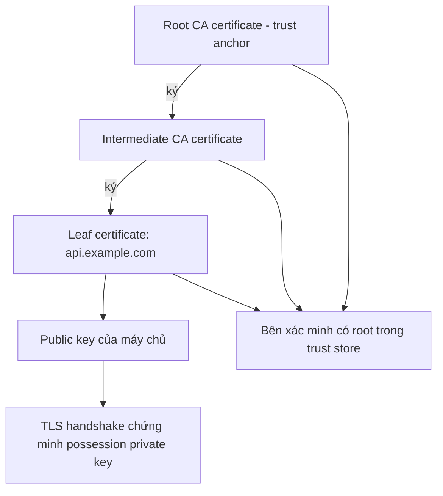
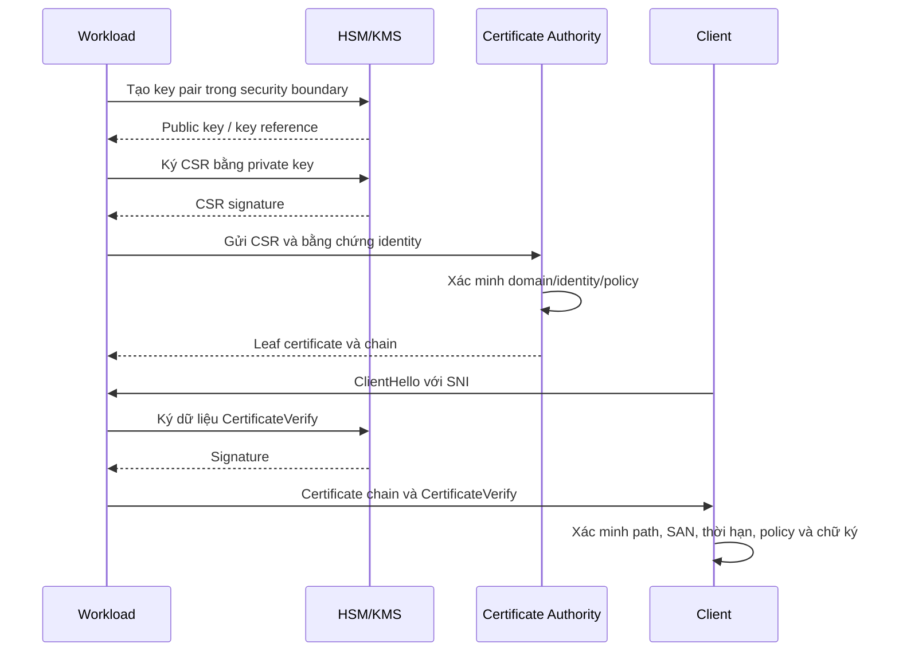

# Public key certificate

Public key certificate (chứng thư khóa công khai) là một cấu trúc dữ liệu được ký số, dùng để liên kết một public key với một danh tính hoặc một phạm vi sử dụng đã được xác định. Trong PKI (Public Key Infrastructure), certificate giúp bên nhận kiểm tra rằng public key đang được sử dụng thuộc về đúng máy chủ, tổ chức, người dùng hoặc dịch vụ mà họ định giao tiếp. Chữ ký của CA (Certificate Authority) cho phép bên xác minh kiểm tra nguồn gốc và tính toàn vẹn của liên kết đó.

Certificate không làm cho public key tự nhiên trở nên đáng tin. Bên xác minh vẫn phải xây dựng và kiểm tra chuỗi chứng thư tới một trust anchor đã được cấu hình, xác minh tên hoặc danh tính cần thiết, thời hạn, mục đích sử dụng, chính sách thuật toán và trạng thái thu hồi. Certificate cũng không chứa private key tương ứng; private key phải được giữ bí mật và quản lý theo vòng đời riêng, thường trong KMS/HSM hoặc kho khóa được bảo vệ.

Trong quản lý khóa mật mã, certificate là lớp metadata có chữ ký kết nối danh tính với public key. Nó hỗ trợ TLS, chữ ký số, xác thực thiết bị, xác thực người dùng và các hệ thống PKI nội bộ. Quản lý certificate đúng cách đòi hỏi kiểm soát cả public key, private key, CA key, trust store, quy trình cấp phát, gia hạn, thu hồi và bằng chứng kiểm toán.

## 1. Certificate giải quyết vấn đề gì?

Mật mã khóa công khai cho phép hai bên sử dụng một cặp khóa có quan hệ toán học. Một public key có thể được phân phối rộng rãi, nhưng người nhận cần biết public key đó thuộc về ai và có được phép dùng cho mục đích hiện tại hay không. Nếu kẻ tấn công thay public key của máy chủ bằng public key của họ, kết nối mã hóa vẫn có thể hoạt động về mặt toán học nhưng người dùng có thể đang giao tiếp với sai đối tượng.

Certificate giải quyết phần liên kết danh tính bằng cách để một CA hoặc tổ chức có thẩm quyền ký vào các thông tin như subject, Subject Alternative Name (SAN), public key, thời hạn và các giới hạn sử dụng. Bên xác minh kiểm tra chữ ký CA và các điều kiện liên quan trước khi chấp nhận public key.

Ví dụ, khi trình duyệt kết nối tới `https://api.example.com`, máy chủ gửi certificate có SAN chứa tên `api.example.com`. Trình duyệt kiểm tra certificate có thể xây dựng chuỗi tin cậy tới một root CA trong trust store, tên máy chủ khớp SAN, thời gian hiện tại nằm trong thời hạn hiệu lực, mục đích cho phép xác thực máy chủ và các kiểm tra chính sách khác đều đạt. Sau đó TLS handshake chứng minh phía máy chủ sở hữu private key tương ứng với public key trong certificate.

Certificate vì vậy hỗ trợ hai câu hỏi khác nhau:

- **Public key này gắn với danh tính nào?** Certificate và quy trình xác minh danh tính của CA cung cấp câu trả lời.
- **Bên đang kết nối có sở hữu private key tương ứng không?** Giao thức như TLS yêu cầu bằng chứng sở hữu trong handshake; chỉ gửi một certificate chưa chứng minh người gửi đang giữ private key.

## 2. Phân biệt public key, private key, certificate và CSR

Các đối tượng thường xuất hiện cùng nhau nhưng có vai trò khác nhau.

| Đối tượng | Nội dung | Có phải bí mật? | Vai trò |
|---|---|---|---|
| Public key | Thành phần công khai của cặp khóa bất đối xứng | Không | Xác minh chữ ký hoặc mã hóa/thiết lập khóa tùy thuật toán |
| Private key | Thành phần bí mật tương ứng với public key | Có | Ký, giải mã hoặc thực hiện thao tác riêng tư theo thuật toán |
| Public key certificate | Public key cùng thông tin danh tính, thời hạn, extension và chữ ký của issuer | Bản thân certificate không phải bí mật | Cho phép xác minh liên kết danh tính-public key và chính sách sử dụng |
| CSR (Certificate Signing Request) | Yêu cầu cấp certificate, thường gồm public key, subject, extension được đề nghị và chữ ký của người yêu cầu | Thường không, nhưng có thể chứa metadata nội bộ | Gửi public key và yêu cầu tới CA; chứng minh người tạo CSR kiểm soát private key tương ứng tại thời điểm ký |
| Trust store | Danh sách trust anchor và cấu hình tin cậy của ứng dụng/hệ điều hành | Không phải key material bí mật; cần bảo vệ tính toàn vẹn | Xác định CA nào được chấp nhận làm gốc tin cậy |

CSR không phải certificate. Subject hoặc SAN trong CSR là dữ liệu người yêu cầu đề xuất; CA phải xác minh quyền kiểm soát tên miền, danh tính hoặc quyền cấp phát theo chính sách trước khi đưa chúng vào certificate. Chữ ký CSR chứng minh possession của private key tại thời điểm tạo yêu cầu, nhưng không chứng minh người yêu cầu có quyền sở hữu tên miền hoặc danh tính ghi trong CSR.

Certificate cũng không phải nơi lưu private key. Một tệp PEM có thể chứa certificate, public key, private key hoặc nhiều khối nối tiếp; phải xem nhãn và nội dung định dạng trước khi phân loại. File có tên `server.pem` không tự cho biết nó có chứa bí mật hay không.

## 3. Cấu trúc cơ bản của X.509 certificate

X.509 là định dạng certificate phổ biến trong PKI Internet và nhiều PKI doanh nghiệp. X.509 certificate phiên bản 3 (v3) có phần `TBSCertificate` (to-be-signed certificate), thuật toán chữ ký và chữ ký của issuer. `TBSCertificate` chứa các trường nhận dạng và extension được CA ký.

| Trường X.509 | Ý nghĩa | Cách sử dụng khi xác minh |
|---|---|---|
| Version | Phiên bản cấu trúc, thường là v3 khi có extensions | Xác định cách diễn giải các trường và extension |
| Serial Number | Số định danh certificate do issuer cấp | Kết hợp issuer để tra cứu, thu hồi và audit |
| Signature Algorithm | Thuật toán CA dùng để ký certificate | Kiểm tra thuật toán và tham số có được chính sách cho phép |
| Issuer | Danh tính CA phát hành | Xây dựng đường dẫn tới certificate issuer phù hợp |
| Validity | `notBefore` và `notAfter` | Kiểm tra thời điểm xác minh nằm trong thời hạn |
| Subject | Danh tính được certificate mô tả | Thông tin định danh; với TLS hiện đại, tên máy chủ cần kiểm tra ở SAN |
| Subject Public Key Info (SPKI) | Thuật toán và public key | Lấy public key để xác minh hoặc dùng trong giao thức |
| Extensions | Ràng buộc CA, mục đích, SAN, policy, thông tin thu hồi và quan hệ khóa | Áp dụng các điều kiện sử dụng và xây dựng path |
| Signature Value | Chữ ký của issuer trên `TBSCertificate` | Xác minh nội dung certificate không bị sửa và được issuer ký |

Certificate được mã hóa theo ASN.1 DER; PEM thường là DER được Base64 và bao quanh bởi dòng đánh dấu. PEM là cách biểu diễn văn bản, không phải một loại certificate hay thuật toán khác.

### 3.1. Những extension cần biết

Extension trong X.509 v3 cung cấp ràng buộc quan trọng. Một extension có cờ critical mà ứng dụng không hiểu phải khiến certificate bị từ chối theo quy tắc xử lý; bỏ qua một ràng buộc critical có thể làm sai quyết định tin cậy.

| Extension | Ý nghĩa | Ví dụ áp dụng |
|---|---|---|
| Basic Constraints | Chỉ ra certificate có phải CA hay không; có thể đặt `pathLenConstraint` | Intermediate CA có `CA:TRUE`; leaf TLS thường `CA:FALSE` |
| Key Usage (KU) | Giới hạn thao tác mật mã được phép | `digitalSignature`, `keyEncipherment`, `keyCertSign`, `cRLSign` tùy vai trò |
| Extended Key Usage (EKU) | Mục đích sử dụng ở mức ứng dụng | `serverAuth`, `clientAuth`, `codeSigning`, `emailProtection` |
| Subject Alternative Name (SAN) | Tên DNS, IP, URI, email hoặc định danh khác | `DNS:api.example.com`, `IP:192.0.2.10` |
| Subject Key Identifier (SKI) | Định danh public key trong certificate | Hỗ trợ nhận diện khóa và xây dựng path |
| Authority Key Identifier (AKI) | Gợi ý định danh khóa của issuer | Hỗ trợ chọn đúng issuer khi có nhiều CA cùng tên |
| Name Constraints | Giới hạn namespace mà CA con được phép cấp | Intermediate chỉ được cấp cho một miền DNS hoặc namespace xác định |
| Certificate Policies | OID và thông tin chính sách áp dụng | Phân biệt chính sách PKI hoặc mức đảm bảo của certificate |
| CRL Distribution Points | Vị trí lấy Certificate Revocation List | Tải CRL để kiểm tra trạng thái thu hồi |
| Authority Information Access (AIA) | Thông tin truy cập issuer hoặc OCSP responder | Tải intermediate hoặc truy vấn OCSP theo cấu hình |

KU và EKU có thể cùng xuất hiện. Ứng dụng cần kiểm tra cả hai theo chính sách, thay vì chỉ nhìn thấy một EKU phù hợp rồi bỏ qua KU. Ví dụ, certificate dành cho TLS server cần được cấp đúng EKU server authentication và có KU phù hợp với thuật toán/giao thức đang dùng.

### 3.2. Subject và SAN

Subject thường biểu diễn danh tính theo Distinguished Name (DN), với các thành phần như Common Name (CN), Organization (O), Organizational Unit (OU), Country (C) và các thuộc tính khác. DN là một cấu trúc định danh; không nên suy ra rằng mọi trường đều đã được CA xác minh ở cùng mức độ.

Đối với xác minh tên máy chủ TLS, SAN là nơi chứa các định danh DNS hoặc IP cần đối chiếu. Không nên dựa vào CN fallback như một quy tắc chung. Wildcard SAN như `*.example.com` có phạm vi khớp theo quy tắc hostname của ứng dụng và không đại diện cho mọi subdomain nhiều cấp. Địa chỉ IP phải được biểu diễn và xác minh dưới dạng IP SAN; một chuỗi trông giống IP trong DNS SAN không tương đương.

## 4. Vai trò của CA, intermediate và trust anchor

Certificate Authority (CA) là thực thể chịu trách nhiệm cấp certificate theo chính sách và quy trình xác minh. CA dùng private key của mình để ký certificate. Bên xác minh dùng public key trong CA certificate hoặc trust anchor đã được cấu hình để kiểm tra chữ ký.

PKI thường tổ chức thành nhiều tầng:

- **Root CA:** trust anchor được phân phối và cấu hình tin cậy độc lập. Root private key thường được bảo vệ rất nghiêm ngặt, có thể chỉ được kích hoạt trong ceremony hoặc HSM.
- **Intermediate CA:** certificate được CA cấp cao hơn ký; dùng để cấp certificate cho CA thấp hơn hoặc leaf certificate. Intermediate giúp tách root key khỏi hoạt động cấp phát thường xuyên.
- **Leaf/end-entity certificate:** certificate của máy chủ, người dùng, thiết bị, ứng dụng hoặc dịch vụ; thường không được phép ký certificate khác.



Trong thực tế, chain được gửi thường gồm leaf và intermediate certificate; root thường không cần gửi vì bên xác minh đã phải có trust anchor độc lập. Việc certificate tự ký (self-signed) không tự làm nó đáng tin. Root CA thường là self-signed, nhưng chỉ được tin vì trust anchor đã được cài đặt hoặc phân phối qua một kênh quản trị đáng tin.

Một issuer name khớp với subject name của certificate trước đó chưa đủ để chứng minh quan hệ ký. Bên xác minh phải kiểm tra chữ ký bằng public key của issuer và áp dụng các ràng buộc path. AKI/SKI hỗ trợ tìm issuer nhưng không thay thế xác minh chữ ký.

## 5. Chuỗi chứng thư và path validation

Certificate path là đường dẫn từ leaf certificate qua một hoặc nhiều intermediate tới trust anchor được chấp nhận. Path validation là quá trình kiểm tra xem đường dẫn đó có hợp lệ theo tiêu chuẩn và chính sách của ứng dụng hay không.

Một quy trình xác minh thường cần các bước sau:

1. **Chọn trust anchor:** lấy từ trust store hoặc cấu hình tin cậy đã được quản trị; không tự tin một root chỉ vì máy chủ gửi kèm.
2. **Xây dựng path:** tìm issuer phù hợp cho từng certificate, xét tên issuer/subject, AKI/SKI, chữ ký và các lựa chọn cross-signing nếu có.
3. **Xác minh chữ ký:** kiểm tra chữ ký từng certificate bằng public key của issuer tương ứng.
4. **Kiểm tra thời hạn:** thời điểm xác minh phải phù hợp với `notBefore` và `notAfter`, đồng thời xử lý clock skew theo chính sách.
5. **Kiểm tra Basic Constraints:** CA trung gian phải có quyền CA; áp dụng path length và các ràng buộc CA.
6. **Kiểm tra Name Constraints và policy:** bảo đảm certificate nằm trong namespace và chính sách được phép.
7. **Kiểm tra KU/EKU:** mục đích certificate phải phù hợp thao tác hiện tại.
8. **Kiểm tra danh tính đích:** với TLS, đối chiếu hostname hoặc IP dự kiến với SAN; với client certificate, đối chiếu identity mapping theo chính sách ứng dụng.
9. **Kiểm tra thuật toán và tham số:** từ chối thuật toán, kích thước khóa hoặc tham số không còn được cho phép.
10. **Kiểm tra trạng thái thu hồi:** dùng CRL, OCSP hoặc cơ chế phù hợp với chính sách và loại certificate.
11. **Áp dụng chính sách ứng dụng:** có thể bao gồm certificate pinning, policy OID, trust domain, tenant hoặc yêu cầu bổ sung.

Thứ tự chi tiết có thể thay đổi theo thư viện và chuẩn áp dụng, nhưng các điều kiện phải được đánh giá đầy đủ. Một certificate có chữ ký hợp lệ vẫn có thể bị từ chối vì hết hạn, sai SAN, sai EKU, CA constraint không hợp lệ, thuật toán yếu hoặc đã bị thu hồi.

### 5.1. Xác minh TLS server

Khi client xác minh certificate máy chủ, cần biết chính xác tên mà ứng dụng định kết nối. Các bước quan trọng gồm:

- Nhận certificate chain từ TLS handshake.
- Xây dựng path tới trust anchor được client tin cậy.
- Kiểm tra chữ ký và các ràng buộc của từng certificate.
- Kiểm tra thời hạn và trạng thái thu hồi theo policy.
- So sánh hostname/IP đích với SAN của leaf certificate.
- Kiểm tra EKU/KU và chính sách thuật toán.
- Xác minh handshake chứng minh peer kiểm soát private key tương ứng.

SNI (Server Name Indication) trong TLS giúp máy chủ chọn certificate phù hợp với tên client yêu cầu. SNI không thay thế hostname verification phía client. Client vẫn phải xác minh certificate khớp với tên đích mà ứng dụng muốn truy cập.

### 5.2. Intermediate thiếu hoặc chain không đúng

Một máy chủ có thể gửi leaf certificate nhưng quên gửi intermediate. Một số client có cache hoặc tải intermediate qua AIA nên kết nối vẫn hoạt động, trong khi client khác thất bại. Không nên dựa vào khả năng tải AIA như một giả định phổ quát; máy chủ nên cấu hình chain phù hợp và client cần xử lý path building an toàn.

Cross-signed certificate có thể tạo nhiều đường dẫn tới các trust anchor khác nhau. Một path hợp lệ với hệ điều hành này có thể không được chấp nhận bởi trust store khác do khác root, policy, thời gian hoặc thuật toán. Khi điều tra lỗi, cần ghi nhận chain thực tế, trust store và thư viện xác minh của client.

## 6. Thu hồi certificate: CRL và OCSP

Certificate có thể còn trong thời hạn nhưng không còn được tin cậy trước ngày hết hạn. CA có thể thu hồi certificate do private key bị compromise, cấp sai danh tính, thay đổi quyền, ngừng sử dụng hoặc lý do chính sách khác.

### 6.1. Certificate Revocation List (CRL)

CRL là danh sách do CA ký, chứa serial number của các certificate đã bị thu hồi cùng thông tin thời gian và lý do theo định dạng. Client tải CRL từ vị trí được công bố, xác minh chữ ký, issuer, thời hạn cập nhật và tra serial của certificate cần kiểm tra.

CRL có thể lớn và không cập nhật tức thời. Delta CRL hoặc cơ chế phân phối phù hợp có thể giảm lượng dữ liệu truyền. Client phải kiểm tra freshness theo chính sách; CRL cũ không chứng minh certificate vẫn hợp lệ.

### 6.2. Online Certificate Status Protocol (OCSP)

OCSP cho phép client hỏi trạng thái của một certificate cụ thể qua responder. Responder thường trả trạng thái `good`, `revoked` hoặc `unknown`, kèm thời gian và chữ ký phản hồi. Client cần xác minh chữ ký responder, quyền responder, thời điểm phản hồi và quan hệ với CA.

`good` có nghĩa responder không ghi nhận certificate bị thu hồi trong dữ liệu mà nó có tại thời điểm phản hồi; không phải lời bảo đảm rằng certificate chắc chắn hợp lệ trong mọi khía cạnh. Client vẫn phải kiểm tra path, tên, thời hạn, EKU và policy.

### 6.3. Soft-fail và hard-fail

Khi không thể truy vấn CRL/OCSP, ứng dụng có thể chọn soft-fail (tiếp tục trong một số điều kiện) hoặc hard-fail (từ chối nếu không kiểm tra được). Đây là quyết định cân bằng availability và rủi ro, phải dựa trên loại giao dịch và threat model. Hệ thống xác thực có mức rủi ro cao có thể cần hard-fail hoặc một cơ chế cache/status distribution được kiểm soát. Không nên để timeout mạng tự động biến thành trạng thái `good`.

OCSP stapling cho phép máy chủ gửi kèm một OCSP response đã được ký trong handshake, giảm việc client phải tự truy vấn responder. Client vẫn phải kiểm tra chữ ký và freshness của response theo policy. Stapling không loại bỏ mọi vấn đề thu hồi, đặc biệt nếu response bị cũ hoặc máy chủ không cập nhật.

## 7. Vòng đời public key certificate

Certificate có vòng đời riêng nhưng liên kết chặt với vòng đời private key. Các giai đoạn thường gồm:

1. **Key generation:** tạo cặp khóa trong phần cứng hoặc phần mềm phù hợp. Nếu private key cần non-exportable, tạo trực tiếp trong HSM hoặc dịch vụ KMS hỗ trợ.
2. **CSR creation:** tạo yêu cầu có public key, subject và extension được đề nghị; ký CSR bằng private key tương ứng.
3. **Identity validation:** CA xác minh quyền kiểm soát domain, tổ chức, người dùng, thiết bị hoặc workload theo chính sách.
4. **Issuance:** CA cấp certificate, gán serial, thời hạn, extension và ký bằng CA private key.
5. **Deployment:** cài certificate chain ở đúng endpoint hoặc trust store; liên kết với private key tương ứng mà không export bí mật không cần thiết.
6. **Monitoring:** theo dõi expiry, trạng thái thu hồi, thay đổi CA, thuật toán và cấu hình endpoint.
7. **Renewal/rotation:** gia hạn certificate; có thể giữ nguyên key pair hoặc tạo key pair mới tùy policy và rủi ro.
8. **Revocation:** thu hồi certificate khi cần, cập nhật CRL/OCSP và phân phối trạng thái.
9. **Key retirement/destruction:** xử lý private key theo vòng đời, dependencies, backup và yêu cầu lưu giữ; certificate metadata có thể vẫn được lưu để xác minh lịch sử.

Gia hạn certificate không nhất thiết đồng nghĩa rotation key. Nếu cấp certificate mới cho cùng public key, certificate mới có serial và validity mới nhưng private key vẫn như cũ. Rotation key tạo cặp khóa mới và cần cập nhật certificate, cấu hình, trust mapping và workload. Khi private key bị compromise, chỉ gia hạn certificate trên cùng key pair không giải quyết được compromise; cần tạo key pair mới và thu hồi certificate cũ.

### 7.1. Trạng thái inventory gợi ý

| Trạng thái | Ý nghĩa |
|---|---|
| `REQUESTED` | Đã nhận yêu cầu cấp mới hoặc gia hạn |
| `PENDING_VALIDATION` | Đang xác minh danh tính/quyền kiểm soát |
| `ISSUED` | CA đã cấp certificate |
| `ACTIVE` | Certificate được triển khai và chấp nhận theo policy |
| `RENEWAL_PENDING` | Đang chuẩn bị certificate thay thế |
| `EXPIRED` | Đã quá `notAfter` |
| `REVOKED` | CA đã thu hồi certificate |
| `RETIRED` | Ngừng dùng theo kế hoạch nhưng không nhất thiết bị thu hồi |
| `KEY_COMPROMISED` | Private key tương ứng bị lộ hoặc nghi bị lộ; cần containment và đánh giá certificate |

Đây là từ vựng tham khảo. Nên tách `certificate_status`, `private_key_status`, `deployment_status` và `revocation_status` thay vì gộp tất cả vào một trường. Một certificate có thể còn hạn nhưng private key đã bị compromise; một certificate đã retired có thể không cần CRL revoke nếu không có yêu cầu và chính sách không bắt buộc, nhưng phải ngừng triển khai.

## 8. Liên hệ certificate với KMS và HSM

Certificate là public metadata có chữ ký; private key tương ứng là bí mật cần được bảo vệ. Trong kiến trúc quản lý khóa, có thể tạo key pair trực tiếp trong HSM, giữ private key non-exportable và chỉ xuất public key để tạo CSR. CA cấp certificate cho public key đó. Ứng dụng hoặc TLS endpoint gọi HSM/KMS để ký handshake hoặc thực hiện thao tác cần private key.

Một quy trình điển hình:



Không phải mọi KMS đều quản lý certificate hoặc hỗ trợ mọi thuật toán ký trực tiếp. Cần kiểm tra khả năng của provider, HSM interface, TLS library và cơ chế tích hợp. Một số TLS stack yêu cầu private key handle hoặc PKCS#11 provider; một số dịch vụ managed TLS tự quản lý key material trong phạm vi dịch vụ. Không giả định một key reference bất kỳ có thể được mọi ứng dụng dùng như private key file.

### 8.1. Bảo vệ CA private key

CA private key có quyền ký certificate cho nhiều danh tính, nên compromise có thể ảnh hưởng rộng hơn compromise một leaf key. Root CA thường được giữ offline hoặc chỉ kích hoạt trong ceremony; intermediate CA được bảo vệ bằng HSM, dual control, phân tách nhiệm vụ, audit và giới hạn quyền ký. Việc backup CA key cần có security domain độc lập, quorum và kiểm thử restore theo quy trình.

Không dùng CA private key cho ký tài liệu ứng dụng, ký artifact hoặc mục đích khác. Tách key theo vai trò, thuật toán, CA hierarchy và environment. Mỗi CA phải có policy rõ ràng về ai được yêu cầu cấp, ai được duyệt, ai được ký, thời hạn, profile và cách xử lý compromise.

### 8.2. Private key và certificate trong file store

Một số định dạng và cách lưu trữ thường gặp:

| Định dạng | Nội dung thường gặp | Lưu ý quản lý |
|---|---|---|
| PEM | Văn bản Base64 với marker; có thể chứa certificate, public key hoặc private key | Kiểm tra marker; bảo vệ file nếu có private key |
| DER | ASN.1 binary encoding của certificate hoặc key structure | Không phải định dạng bí mật tự thân; nội dung quyết định mức nhạy cảm |
| PKCS#12 (`.p12`, `.pfx`) | Có thể đóng gói certificate chain và private key, thường được bảo vệ bằng password | Coi như secret nếu có private key; bảo vệ password và backup |
| JKS | Java KeyStore; có thể chứa private key entry và trusted certificate entry | Phân biệt key entry với trusted certificate; quản lý password và access |
| PKCS#11 object | Key/certificate object được truy cập qua token/HSM interface | Quyền và thuộc tính object do token/HSM quản lý; private key có thể non-extractable |

Public certificate thường có thể phân phối công khai. Tuy vậy, tính toàn vẹn và nguồn gốc của nó rất quan trọng: certificate giả hoặc bị thay thế có thể chuyển hướng trust. Keystore có private key phải được bảo vệ như tài sản bí mật; không commit `.p12`, `.pfx`, keystore password hoặc private key vào source control.

## 9. Certificate pinning và trust store

Trust store chứa trust anchor được ứng dụng chấp nhận. Trên hệ điều hành và trình duyệt phổ biến, trust store được cập nhật qua cơ chế phân phối phần mềm hoặc quản trị thiết bị. Trong PKI nội bộ, tổ chức có thể phân phối private root CA qua MDM, configuration management hoặc image đã kiểm soát. Thay đổi trust store là thay đổi trust boundary; phải có phê duyệt, kiểm soát tính toàn vẹn và kế hoạch thu hồi root không còn tin cậy.

Certificate/public key pinning là chính sách yêu cầu certificate hoặc public key của peer khớp một giá trị đã cấu hình. Pinning có thể giảm rủi ro CA issuance sai hoặc trust store bị lạm dụng, nhưng tạo rủi ro availability nếu certificate hoặc key được rotation mà ứng dụng chưa cập nhật pin. Nếu dùng pinning, cần có backup pins, quy trình cập nhật, thời gian overlap và phương án phục hồi. Không triển khai pinning mà không có kế hoạch thay thế khóa và phân phối cấu hình.

Với dịch vụ công khai, Certificate Transparency (CT) giúp phát hiện certificate được cấp cho tên miền trong các log công khai có thể kiểm tra. CT hỗ trợ giám sát issuance bất thường; nó không thay thế path validation, hostname validation hay revocation. CT cũng không áp dụng theo cùng cách cho mọi private PKI hoặc mọi loại certificate.

## 10. Công cụ kiểm tra certificate

OpenSSL có thể giúp đọc thông tin certificate, CSR và kiểm tra chain. Các lệnh dưới đây là ví dụ; option có thể khác giữa phiên bản OpenSSL và môi trường. Chạy trên bản certificate/CSR công khai đã được phép kiểm tra, không in private key hoặc password ra terminal/log.

Đọc nội dung certificate:

```bash
openssl x509 -in server.crt -noout -text
```

Đọc CSR và kiểm tra public key/extension được đề nghị:

```bash
openssl req -in server.csr -noout -text -verify
```

Kiểm tra certificate chain với root CA và intermediate được cung cấp riêng:

```bash
openssl verify \
  -CAfile root-ca.pem \
  -untrusted intermediate-ca.pem \
  -verify_hostname api.example.com \
  server.crt
```

Kết quả `OK` từ lệnh verify chỉ có ý nghĩa trong phạm vi trust anchor, intermediate, thời gian và các tùy chọn được lệnh sử dụng. Ứng dụng thực tế còn có thể cần kiểm tra revocation, EKU, policy OID, trust store riêng hoặc cấu hình thuật toán. Không coi một lệnh verify đơn lẻ là kiểm thử đầy đủ mọi hành vi của production client.

Khi kiểm tra fingerprint, phải xác định fingerprint đang tính trên toàn certificate hay SPKI public key. Hai giá trị có mục đích khác nhau: certificate fingerprint thay đổi khi certificate được cấp lại, còn SPKI fingerprint có thể giữ nguyên nếu public key không đổi.

## 11. Ví dụ metadata inventory

Inventory nên liên kết certificate với key version, CA, deployment, owner và các mốc vòng đời. Không lưu private key trong bản ghi metadata.

```yaml
certificate:
  certificate_id: api-example-com-2026-02
  serial_number: "04A18F29C3"
  subject: "CN=api.example.com,O=Example Services"
  san:
    - "DNS:api.example.com"
    - "DNS:api.internal.example.com"
  issuer: "CN=Example Issuing CA 02,O=Example PKI"
  validity:
    not_before: "2026-11-01T00:00:00Z"
    not_after: "2027-02-01T00:00:00Z"
  public_key:
    algorithm: EC
    curve: P-256
    spki_fingerprint: "SHA256:example-public-key-fingerprint"
  private_key_reference:
    provider: hsm-cluster-a
    key_id: api-example-com-tls
    version: "v6"
    exportable: false
  extensions:
    basic_constraints: "CA:FALSE"
    key_usage:
      - digitalSignature
    extended_key_usage:
      - serverAuth
  lifecycle:
    certificate_status: ACTIVE
    private_key_status: ACTIVE
    renewal_owner: platform-security
  revocation:
    crl_distribution_point: "https://pki.example.com/crl/issuing-ca-02.crl"
    ocsp_responder: "https://ocsp.example.com"
```

Đây là dữ liệu minh họa. `private_key_reference` là tham chiếu đến key object, không phải key material. Trong hệ thống thực, hạn chế lộ thông tin nội bộ trong inventory nếu người đọc không cần biết; bảo vệ endpoint, resource ID và policy metadata theo phân loại của tổ chức.

## 12. Những lỗi thường gặp khi sử dụng certificate

- **Chỉ kiểm tra chữ ký CA:** certificate vẫn có thể sai hostname, hết hạn, sai EKU hoặc đã bị thu hồi.
- **Tin certificate tự ký mặc định:** self-signed không đồng nghĩa trusted; trust phải đến từ cấu hình trust anchor độc lập.
- **Chỉ kiểm tra CN:** xác minh TLS hostname theo SAN và quy tắc của client hiện đại.
- **Nhầm CSR với certificate:** CSR chưa được CA cấp và chưa chứng minh danh tính được CA xác minh.
- **Không kiểm tra KU/EKU:** certificate có thể bị dùng sai mục đích, ví dụ dùng certificate client cho server authentication.
- **Không gửi intermediate:** một số client không thể xây dựng chain và sẽ từ chối kết nối.
- **Tin `OCSP good` là mọi thứ hợp lệ:** vẫn phải xác minh path, tên, thời hạn, policy và freshness của response.
- **Soft-fail không có đánh giá rủi ro:** lỗi truy vấn revocation có thể khiến certificate đã thu hồi vẫn được chấp nhận.
- **Gia hạn nhưng không rotation key khi bị compromise:** cấp certificate mới trên cùng private key bị lộ không loại bỏ rủi ro.
- **Xóa private key nhưng quên backup:** bản backup hoặc export cũ có thể vẫn cho phép sử dụng key pair.
- **Không giám sát expiry:** certificate hết hạn có thể làm gián đoạn TLS, API, mTLS, ký code hoặc xác thực thiết bị.
- **Cài trust root không kiểm soát:** thêm root CA mới làm thay đổi trust boundary và có thể cho phép CA đó cấp danh tính giả trong phạm vi được tin.
- **Pinning không có kế hoạch rotation:** thay key/certificate hợp lệ có thể khiến client cũ không kết nối được.
- **Đưa private key vào PEM/PFX rồi coi file là public:** định dạng không quyết định bí mật; phải kiểm tra chính xác các entry bên trong.

## 13. Tình huống thực tế: thay certificate TLS khi private key bị compromise

Một dịch vụ API dùng certificate `api.example.com` do intermediate CA của tổ chức cấp. Private key của leaf certificate được lưu trong HSM và workload tham chiếu qua key handle. Hệ thống giám sát phát hiện credential của một tài khoản quản trị có thể đã bị lộ, và điều tra cho thấy attacker có khả năng đã truy cập quyền sử dụng private key.

Nhóm ứng phó sự cố không chỉ gia hạn certificate. Họ xác định chính xác key version và certificate serial, chặn quyền ký/handshake bằng key handle cũ, tạo key pair mới trong HSM, tạo CSR mới và xác minh quyền kiểm soát domain. CA cấp certificate mới cho public key mới; nhóm triển khai chain mới lên các endpoint và kiểm tra hostname, thời hạn, EKU, path và handshake. Certificate cũ được thu hồi theo quy trình CA, trạng thái CRL/OCSP được kiểm tra và các client được theo dõi để xác nhận không còn sử dụng phiên bản cũ.

Inventory liên kết certificate cũ với private key version cũ, certificate mới với key version mới, event incident, provider audit và thời điểm cutover. Backup, replica và export của private key cũ được rà soát; bản sao không được dùng lại. Nếu cần bảo toàn key cũ cho điều tra, phải cách ly theo quyết định incident response và giới hạn quyền truy cập. Sau khi hoàn tất, nhóm giữ public certificate và audit metadata theo chính sách, còn private key cũ đi theo quy trình destruction riêng.

## 14. Checklist vận hành certificate

- [ ] Certificate được đối chiếu với đúng `key_id`, version và public key fingerprint.
- [ ] CSR được tạo từ key pair đúng và chữ ký CSR hợp lệ.
- [ ] CA đã xác minh domain/identity và quyền cấp phát theo policy.
- [ ] Subject và SAN đúng với hostname, IP hoặc identity cần xác thực.
- [ ] Issuer, serial, validity, signature algorithm và public key parameters được kiểm tra.
- [ ] Basic Constraints, KU, EKU, Name Constraints và policy extensions phù hợp.
- [ ] Path xây dựng tới trust anchor đã được cấu hình và bảo vệ.
- [ ] Intermediate chain được triển khai đầy đủ; root trust không dựa vào certificate gửi từ peer.
- [ ] Revocation status được kiểm tra theo CRL/OCSP policy; freshness và lỗi truy vấn được xử lý rõ.
- [ ] TLS client thực hiện hostname verification và handshake proof-of-possession.
- [ ] Private key được bảo vệ trong KMS/HSM hoặc kho phù hợp; quyền sử dụng được giới hạn.
- [ ] Certificate expiry, renewal, revocation và CA changes có giám sát/cảnh báo.
- [ ] Renewal và key rotation được phân biệt; key compromise dẫn tới key pair mới.
- [ ] Trust store, pinning và CT monitoring (nếu áp dụng) có quy trình thay đổi.
- [ ] Certificate inventory không chứa private key, password, token hoặc recovery share.
- [ ] Certificate cũ, private key cũ, backup và audit evidence được xử lý theo lifecycle policy.

Public key certificate tạo ra liên kết có thể kiểm tra giữa public key và danh tính, nhưng mức độ tin cậy cuối cùng phụ thuộc vào CA, trust anchor, path validation, policy và cách private key được bảo vệ. Khi certificate inventory gắn với key version và lifecycle event, tổ chức có thể cấp phát, triển khai, gia hạn, thu hồi và thay thế certificate mà vẫn giữ được khả năng kiểm toán và kiểm soát khóa xuyên suốt.
