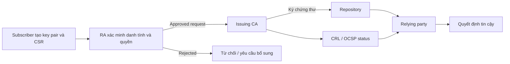
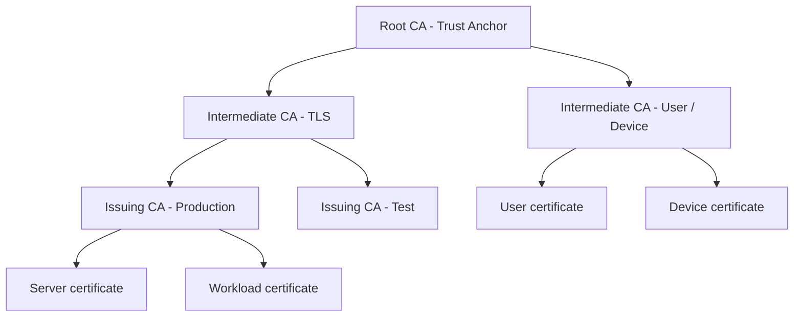
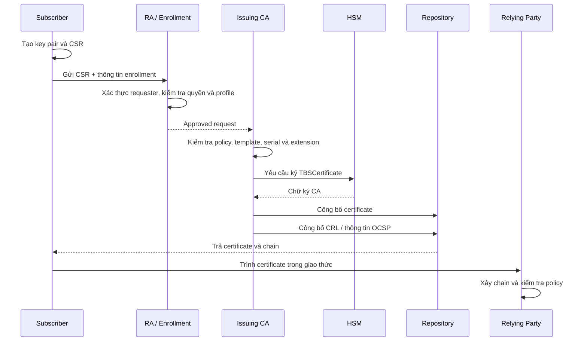
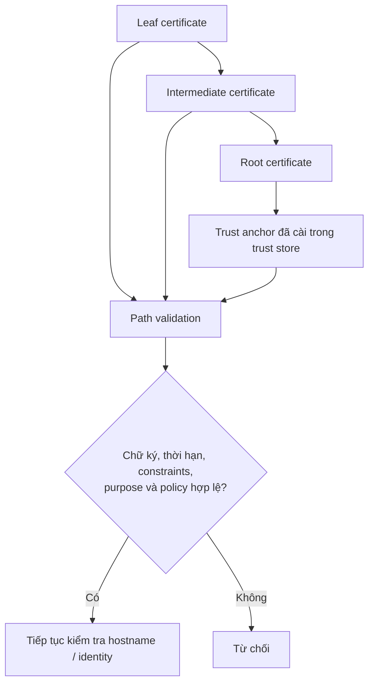

# Certificate Authority

## Mục tiêu học tập

Sau bài học này, bạn có thể:

- Giải thích Certificate Authority (CA) làm gì trong Public Key Infrastructure (PKI) và phân biệt CA với Registration Authority (RA), kho chứng thư và relying party.
- Mô tả kiến trúc CA gốc, CA trung gian, CA phát hành và cách một chuỗi chứng thư liên kết với trust anchor.
- Trình bày quy trình tiếp nhận yêu cầu, xác minh danh tính, kiểm tra quyền cấp phát, ký và công bố chứng thư X.509.
- Nhận diện các extension quan trọng như Basic Constraints, Key Usage, Extended Key Usage, Subject Alternative Name và Name Constraints.
- Giải thích cách relying party xây dựng và xác minh certificate path, kiểm tra tên máy chủ và xử lý trạng thái thu hồi.
- Thiết kế các kiểm soát bảo vệ private key của CA, vận hành HSM, phân quyền, backup, rollover và ứng phó sự cố.

## 1. Certificate Authority là gì?

Certificate Authority (CA), hay cơ quan cấp chứng thư, là một thực thể được tin cậy để phát hành và ký chứng thư số. CA dùng private key của mình để ký dữ liệu chứng thư X.509, qua đó xác nhận rằng một public key được liên kết với danh tính hoặc thuộc tính được mô tả trong chứng thư theo một chính sách xác minh cụ thể.

Chứng thư số thường chứa public key của chủ thể, thông tin định danh, thời hạn hiệu lực, mục đích sử dụng, issuer, serial number và chữ ký của CA. Khi relying party tin cậy CA và xác minh được chữ ký cùng các điều kiện khác, họ có cơ sở chấp nhận mối liên kết giữa public key và danh tính trong chứng thư.

CA không nhìn thấy hay chứng minh rằng người dùng luôn giữ private key an toàn. CA cũng không tự động bảo đảm máy chủ không bị xâm nhập, dịch vụ hoạt động đúng hoặc nội dung do chủ thể ký là trung thực. CA xác nhận các thuộc tính đã được kiểm tra theo policy và ký kết quả đó bằng key của CA.

Trong hệ thống quản lý khóa, CA là một thành phần quan trọng của vòng đời khóa bất đối xứng. Khóa của chủ thể được tạo và bảo vệ; public key được đưa vào CSR; CA xác minh yêu cầu và phát hành chứng thư; relying party dùng chứng thư để xác minh danh tính hoặc chữ ký; khi khóa hay danh tính thay đổi, chứng thư được gia hạn, thay thế hoặc thu hồi.

## 2. CA nằm ở đâu trong PKI?

PKI là tập hợp con người, quy trình, chính sách, phần mềm, phần cứng và dữ liệu giúp tạo, phân phối, xác minh, quản lý và thu hồi chứng thư số. CA chỉ là một thành phần trong hệ thống đó.

Một PKI thường có các thành phần:

| Thành phần | Trách nhiệm |
|---|---|
| Root CA | Gốc tin cậy của một nhánh phân cấp; thường ký chứng thư cho intermediate CA |
| Intermediate CA | Nhận quyền phát hành từ CA cấp trên và ký cho CA cấp dưới hoặc end entity |
| Issuing CA | CA trực tiếp phát hành chứng thư cho máy chủ, người dùng, thiết bị hoặc workload |
| Registration Authority (RA) | Tiếp nhận và xác minh danh tính, quyền yêu cầu; có thể phê duyệt yêu cầu trước khi CA ký |
| Repository | Công bố chứng thư, CRL, metadata và thông tin phục vụ tra cứu |
| OCSP responder | Trả lời trạng thái chứng thư theo giao thức Online Certificate Status Protocol |
| Subscriber / subject | Cá nhân, tổ chức, máy chủ, thiết bị hoặc workload được cấp chứng thư |
| Relying party | Ứng dụng hoặc bên kiểm tra chứng thư và quyết định có tin cậy hay không |
| Policy authority | Định nghĩa chính sách cấp phát, mức xác minh, thuật toán, thời hạn và trách nhiệm |

Trong triển khai nhỏ, một hệ thống có thể gộp RA và CA trong cùng sản phẩm. Trong môi trường lớn, các vai trò thường được tách để giảm quyền tập trung và tạo kiểm soát độc lập. Tên sản phẩm không quyết định ranh giới trách nhiệm; cần xác định ai xác minh danh tính, ai phê duyệt, ai điều khiển CA key và ai vận hành hệ thống phát hành.

## 3. CA, RA và relying party không phải một vai trò

RA xác minh yêu cầu cấp chứng thư theo policy. Ví dụ, RA có thể kiểm tra quyền kiểm soát DNS domain, hồ sơ nhân viên, mã thiết bị, quyền của service owner hoặc bằng chứng sở hữu tài khoản. RA có thể chấp thuận, từ chối hoặc yêu cầu bổ sung thông tin.

CA thực hiện việc phát hành và ký chứng thư. CA phải giới hạn nội dung được ký theo certificate profile và approval đã nhận. Nếu CA tự tin tưởng mọi trường do người gửi CSR cung cấp, kẻ tấn công có thể yêu cầu chứng thư cho danh tính không thuộc quyền kiểm soát của họ.

Relying party xác minh chứng thư khi sử dụng. Việc CA phát hành không buộc mọi ứng dụng phải chấp nhận chứng thư đó. Relying party còn phải kiểm tra chain, thời hạn, purpose, tên máy chủ hoặc danh tính, trạng thái thu hồi và policy cục bộ.



## 4. Chứng thư số liên kết danh tính với public key

Một chứng thư X.509 không chứa private key của subject. Nó chứa public key và thông tin để relying party đánh giá mối liên kết đó.

Ví dụ, một chứng thư TLS có thể thể hiện:

- Subject hoặc Subject Alternative Name (SAN) chứa tên DNS của dịch vụ.
- Subject Public Key Info chứa thuật toán và public key.
- Issuer cho biết CA đã ký chứng thư.
- Validity quy định thời điểm bắt đầu và kết thúc hiệu lực.
- Key Usage và Extended Key Usage giới hạn mục đích sử dụng.
- Basic Constraints xác định chứng thư có đại diện cho CA hay không.
- Serial Number phân biệt chứng thư trong phạm vi issuer.
- Signature Algorithm và chữ ký số bảo vệ nội dung chứng thư.

Relying party dùng public key của issuer để xác minh chữ ký. Nếu chữ ký hợp lệ, nội dung chứng thư không bị thay đổi kể từ khi ký. Nhưng điều đó không tự chứng minh danh tính là đúng; mức độ tin cậy phụ thuộc vào cách CA xác minh subject trước khi phát hành và cách relying party tin cậy CA.

## 5. Mô hình phân cấp: Root CA và Intermediate CA

PKI phổ biến dùng mô hình phân cấp. Root CA nằm ở đỉnh của nhánh tin cậy. Root CA thường tự ký chứng thư của chính nó và được cài đặt làm trust anchor trong hệ điều hành, trình duyệt, ứng dụng hoặc thiết bị. Intermediate CA được root hoặc một CA cấp trên ký; issuing CA có thể được đặt dưới intermediate để phát hành chứng thư cuối.



Ưu điểm của phân cấp là root key có thể được giữ offline và chỉ sử dụng trong các ceremony hiếm. Intermediate CA xử lý phần lớn yêu cầu phát hành hằng ngày. Nếu một issuing CA bị compromise, tổ chức có thể cô lập hoặc thay thế nhánh đó mà không nhất thiết phải thay root, miễn là phạm vi và khả năng tin cậy được kiểm soát đúng.

Một intermediate CA vẫn là tài sản đặc quyền cao. Nó có thể phát hành chứng thư cho các subject trong phạm vi mà constraints và policy cho phép. Việc đặt intermediate dưới root không làm nó vô hại; cần giới hạn purpose, namespace, path length, quyền vận hành và thời hạn chứng thư.

## 6. Vì sao Root CA thường được giữ offline?

Root CA là gốc của trust chain. Nếu private key của root bị lộ, kẻ tấn công có thể tạo CA certificate hoặc chứng thư giả có vẻ hợp lệ đối với các relying party đang tin root đó, tùy phạm vi và policy. Việc khôi phục niềm tin sau root compromise thường tốn kém vì trust anchor phải được thay thế trên các hệ thống phụ thuộc.

Vì vậy, root key thường được:

- Tạo trong HSM hoặc môi trường ceremony được kiểm soát.
- Giữ offline hoặc chỉ kết nối trong cửa sổ vận hành được phê duyệt.
- Bảo vệ bằng dual control hoặc quorum, chẳng hạn M-of-N custodians.
- Dùng chủ yếu để ký intermediate CA, ký CRL hoặc thực hiện tác vụ quản trị được phê duyệt.
- Không dùng để phát hành chứng thư end entity thường xuyên.
- Sao lưu theo quy trình HSM backup có kiểm soát và kiểm thử khôi phục.

Offline không có nghĩa là không có rủi ro. Thiết bị, backup, smart card, token, bản sao vật lý, tài liệu ceremony và quyền của custodian đều cần được bảo vệ. Một root CA offline nhưng backup key không được kiểm soát vẫn có thể bị compromise.

## 7. Intermediate CA và giới hạn quyền phát hành

Intermediate CA giúp phân tách mục đích, môi trường, khu vực, tổ chức hoặc loại subject. Ví dụ, có thể có intermediate riêng cho TLS server, client authentication, user identity, code signing và thiết bị IoT.

Việc tách CA giúp giảm blast radius. Nếu CA chuyên cấp chứng thư cho thiết bị IoT bị compromise, tổ chức có thể tập trung xử lý nhánh đó. Tuy nhiên, nếu cùng một root tin cậy tất cả nhánh, relying party vẫn phải kiểm tra purpose và policy để tránh chứng thư từ nhánh không phù hợp được dùng sai mục đích.

Các extension quan trọng để giới hạn CA gồm:

- `basicConstraints` với `CA:TRUE` để xác định chứng thư CA.
- `pathLenConstraint` để giới hạn số CA trung gian được phép nằm dưới CA đó.
- `keyUsage` chứa `keyCertSign` và thường là `cRLSign` cho CA signing key.
- `nameConstraints` để giới hạn namespace subject hoặc tên được phép cấp.
- Certificate Policies để thể hiện policy OID và phạm vi chứng thư.

Relying party phải thực sự thực thi các constraints. Việc CA phát hành một certificate có extension không có nghĩa mọi client đều xử lý extension đó giống nhau. Cần kiểm tra compatibility và yêu cầu của nền tảng mục tiêu.

## 8. Cross-signing và nhiều trust anchor

Cross-signing xảy ra khi một CA certificate được một CA khác ký, thường để mở rộng khả năng xây dựng đường dẫn tin cậy giữa các hệ thống có trust anchor khác nhau. Một CA có thể có nhiều certificate thể hiện cùng public key hoặc subject nhưng có issuer và đường dẫn chain khác nhau.

Cross-signing hữu ích khi chuyển đổi root, kết nối hai PKI hoặc hỗ trợ thiết bị có trust store khác nhau. Tuy nhiên, nó làm path building phức tạp: client có thể chọn chain khác nhau tùy trust store, certificate có sẵn và thuật toán path building.

Khi thiết kế cross-signing, cần xác định rõ:

- Trust anchor nào được hỗ trợ và trong thời gian bao lâu.
- Các relying party có thể xây dựng chain nào.
- Constraints và policy của cả hai nhánh có tương thích không.
- Khi nào ngừng phát hành hoặc ngừng cung cấp cross-certificate.
- Cách loại bỏ trust cũ và xử lý client không được cập nhật.

Không nên xem cross-signing là cách đơn giản để “kéo dài” một root cũ. Cần có kế hoạch chuyển trust anchor và kiểm thử path validation trên các client đại diện.

## 9. Private key của CA và private key của subject

Hai loại private key này có mục đích và mức độ ảnh hưởng khác nhau.

| Thuộc tính | CA private key | Subject private key |
|---|---|---|
| Mục đích | Ký chứng thư hoặc CRL theo quyền được cấp | TLS, ký số, xác thực client, mã hóa hoặc mục đích được profile cho phép |
| Phạm vi ảnh hưởng | Có thể ảnh hưởng nhiều chứng thư và nhiều subject | Thường ảnh hưởng một subject hoặc một nhóm workload |
| Nơi bảo vệ | HSM/CA service với kiểm soát đặc quyền cao | HSM, TPM, secure enclave, keystore hoặc secret store phù hợp |
| Tạo khóa | Thường trong HSM theo ceremony | Nên tạo gần chủ thể hoặc trong thiết bị bảo vệ khóa |
| Export | Thường bị cấm hoặc cần backup ceremony nghiêm ngặt | Tùy use case; ưu tiên non-exportable nếu không cần export |
| Khi compromise | Có thể cần đình chỉ CA, thu hồi CA certificate và thay cả nhánh | Thu hồi chứng thư subject và cấp key pair/chứng thư mới |

CSR chứa public key của subject và chữ ký tạo bằng private key tương ứng để chứng minh possession. CSR không gửi private key đến CA. Nếu một quy trình yêu cầu người gửi tải private key lên CA để cấp chứng thư, đó là thiết kế có rủi ro cao và cần được xem xét lại.

## 10. Quản lý CA signing key trong HSM

Private key của CA là tài sản có giá trị cao vì nó có thể tạo ra chứng thư được relying party chấp nhận. Tổ chức thường đặt CA signing key trong HSM để thực hiện ký trong ranh giới bảo vệ phần cứng, giảm khả năng export key bytes và áp dụng kiểm soát truy cập độc lập.

Các kiểm soát thường gồm:

- Tạo key pair trong HSM; private key không rời khỏi boundary được bảo vệ.
- Phân quyền theo vai trò: CA operator, security officer, auditor và custodian.
- Dual control hoặc quorum cho thao tác nhạy cảm như activate, backup, restore và destroy.
- PIN, token, smart card hoặc share được phân phối theo quy trình custody.
- Giới hạn key usage và thuật toán ký được phép.
- Kiểm soát kết nối mạng, quản trị HSM, firmware và cập nhật cấu hình.
- Ghi audit cho từng thao tác ký, đăng nhập, thay đổi policy và backup.
- Kiểm thử DR và phục hồi trong môi trường được kiểm soát.

HSM không tự động bảo đảm toàn bộ CA an toàn. Nếu CA application có thể yêu cầu HSM ký bất kỳ nội dung nào mà không kiểm tra approval, attacker có thể lạm dụng signing oracle dù không lấy được private key. Vì vậy, cần bảo vệ cả policy engine, RA, CA database, template, API và quy trình phê duyệt.

## 11. Certificate Signing Request (CSR)

CSR là yêu cầu cấp chứng thư, thường theo định dạng PKCS #10. Nó chứa subject name, public key và có thể chứa các thuộc tính hoặc extension được yêu cầu. CSR được ký bằng private key tương ứng với public key trong yêu cầu.

Chữ ký CSR giúp CA kiểm tra rằng người tạo yêu cầu có quyền sử dụng private key tương ứng tại thời điểm tạo CSR. Nó không chứng minh rằng requester sở hữu domain, là nhân viên của tổ chức hoặc được phép nhận certificate cho tên được yêu cầu.

CA phải kiểm tra nội dung CSR theo profile. Các trường do requester cung cấp như Subject, SAN, EKU, Basic Constraints hoặc policy OID không được tự động chấp nhận. CA cần áp dụng profile được quản trị tập trung và chỉ đưa vào chứng thư những thuộc tính đã được xác minh, cho phép.

Ví dụ, một CSR cho `api.example.internal` có thể chứa SAN đó. RA cần xác minh requester có quyền quản lý domain hoặc service tương ứng. Nếu không, attacker có thể tạo CSR hợp lệ về mặt mật mã nhưng yêu cầu chứng thư cho một hostname không thuộc quyền kiểm soát.

## 12. Xác minh danh tính và quyền yêu cầu

Mức xác minh phụ thuộc loại chứng thư. Một CA công cộng cấp TLS cho domain có thể cần xác minh domain control theo quy tắc hiện hành. CA doanh nghiệp cấp chứng thư cho nhân viên cần xác minh danh tính qua HR/IAM và trạng thái employment. CA thiết bị có thể dựa vào quy trình manufacturing, device attestation hoặc enrollment token.

Một số câu hỏi RA cần trả lời:

1. Requester là ai và được xác thực bằng cơ chế nào?
2. Requester có quyền yêu cầu chứng thư cho subject/SAN/serial/asset này không?
3. Bằng chứng xác minh còn hiệu lực và có thể audit không?
4. Profile được yêu cầu có đúng mục đích sử dụng không?
5. Có phê duyệt của owner hoặc security approver không?
6. Yêu cầu có dấu hiệu bất thường như wildcard, SAN ngoài namespace, thời hạn quá dài hoặc key yếu không?

Không nên dùng một mức xác minh chung cho mọi certificate. Một chứng thư server nội bộ, client mTLS, code signing và user authentication có threat model khác nhau.

## 13. Quy trình cấp chứng thư đầu-cuối



Quy trình có thể tự động hoặc cần phê duyệt thủ công. Dù tự động, các bước xác minh danh tính, authorization, profile selection và issuance policy vẫn phải được thực thi. Tự động hóa chỉ giảm thao tác; nó không làm giảm trách nhiệm của CA.

### Bước 1: Tạo key pair và CSR

Subject tạo key pair trong môi trường phù hợp. Với TLS server, private key có thể nằm trong HSM, TPM, keystore hoặc nền tảng workload. CSR chứa public key và thông tin đề nghị cấp chứng thư.

### Bước 2: Xác thực requester

Enrollment endpoint xác thực danh tính của requester bằng account, workload identity, device identity hoặc cơ chế được policy quy định. Không coi việc biết một URL enrollment là bằng chứng được phép cấp chứng thư.

### Bước 3: Xác minh subject và namespace

RA kiểm tra quyền sử dụng DNS name, user identity, device ID, email hoặc thuộc tính được yêu cầu. Với SAN nhiều giá trị, cần xác minh từng giá trị hoặc dùng một policy chứng minh requester kiểm soát toàn bộ namespace.

### Bước 4: Chọn certificate profile

CA chọn profile theo mục đích, loại subject, thuật toán, key size, thời hạn và extension. Requester không được tự nâng quyền bằng cách yêu cầu `CA:TRUE`, `codeSigning` hoặc EKU khác.

### Bước 5: Kiểm tra và ký

CA xác minh approval, serial number, validity, issuer, extension và thuật toán. CA tạo TBSCertificate và yêu cầu HSM ký bằng CA private key.

### Bước 6: Lưu và công bố

CA lưu certificate cùng metadata trong database/repository, cập nhật serial state và cung cấp chain, CRL distribution point hoặc OCSP responder URL theo profile.

### Bước 7: Trả kết quả và audit

Subscriber nhận certificate, chain và thông tin cần thiết. CA lưu audit event gắn với request ID, requester, approver, profile, serial, issuer, thời điểm và kết quả ký.

## 14. Cấu trúc cơ bản của chứng thư X.509

X.509 certificate v3 gồm phần `TBSCertificate` (to-be-signed certificate), thuật toán chữ ký và chữ ký số. Các trường quan trọng:

| Trường | Ý nghĩa |
|---|---|
| Version | Phiên bản cấu trúc; certificate có extensions thường dùng v3 |
| Serial Number | Số định danh duy nhất trong phạm vi issuer theo yêu cầu của profile/chuẩn áp dụng |
| Signature Algorithm | Thuật toán CA dùng để ký certificate |
| Issuer | Distinguished Name của CA phát hành |
| Validity | Not Before và Not After |
| Subject | Distinguished Name của chủ thể; với TLS, SAN là nơi quan trọng để xác định hostname |
| Subject Public Key Info | Thuật toán và public key của subject |
| Extensions | Basic Constraints, Key Usage, EKU, SAN, policies, AIA, CRL DP và các extension khác |
| Signature Value | Chữ ký của CA trên TBSCertificate |

Relying party xác minh chữ ký trên TBSCertificate bằng public key của issuer. Không được thay đổi extension hoặc trường certificate sau khi ký; thay đổi nội dung cần phát hành chứng thư mới.

## 15. Basic Constraints và phân biệt CA certificate với leaf certificate

`Basic Constraints` là extension quan trọng để xác định một certificate có thể được dùng làm CA hay không.

- `CA:TRUE`: certificate có thể đại diện cho CA, subject key có thể được phép ký chứng thư khác nếu các điều kiện khác cho phép.
- `CA:FALSE` hoặc không có CA capability theo profile: certificate end entity không được dùng làm CA.
- `pathLenConstraint`: giới hạn số CA certificate trung gian được phép xuất hiện bên dưới CA đó trong một certification path.

Relying party phải kiểm tra Basic Constraints khi xây path. Một leaf certificate không được phép trở thành CA chỉ vì requester đưa extension `CA:TRUE` trong CSR. CA profile phải kiểm soát trường này và không cho subject tự chọn.

Ví dụ minh họa một intermediate CA certificate:

```text
X509v3 Basic Constraints: critical
    CA:TRUE, pathlen:0
X509v3 Key Usage: critical
    Certificate Sign, CRL Sign
```

`pathlen:0` giới hạn việc có thêm non-self-issued intermediate CA ở dưới CA đó theo quy tắc path validation. Cần đọc chính xác semantics của pathLenConstraint trong tiêu chuẩn và thư viện sử dụng; không nên diễn giải đơn giản thành “không thể ký leaf”.

## 16. Key Usage và Extended Key Usage

`Key Usage` giới hạn các phép toán mật mã mà public key trong certificate có thể dùng. Các bit thường gặp gồm `digitalSignature`, `contentCommitment` (tên cũ thường thấy là nonRepudiation), `keyEncipherment`, `dataEncipherment`, `keyAgreement`, `keyCertSign` và `cRLSign`.

`Extended Key Usage` (EKU) chỉ rõ mục đích cấp cao hơn, ví dụ:

- `serverAuth`: xác thực máy chủ TLS.
- `clientAuth`: xác thực client TLS.
- `codeSigning`: ký mã.
- `emailProtection`: bảo vệ email.
- `timeStamping`: ký dịch vụ timestamp.
- `OCSPSigning`: ký phản hồi OCSP theo điều kiện tương ứng.

CA certificate thường cần `keyCertSign`, và có thể cần `cRLSign` nếu dùng cùng key để ký CRL. Leaf TLS server thường có `digitalSignature` và EKU `serverAuth`; lựa chọn chính xác phụ thuộc TLS version, cipher suite, profile và nền tảng. Không nên cấp EKU quá rộng nếu subject chỉ cần một mục đích.

Relying party cần kiểm tra purpose của certificate. Một certificate hợp lệ cho `clientAuth` không mặc nhiên được chấp nhận làm `serverAuth`. Một certificate có chữ ký CA hợp lệ nhưng sai EKU vẫn phải bị từ chối cho use case đó.

## 17. Subject Alternative Name và định danh TLS

`Subject Alternative Name` (SAN) chứa các định danh subject như DNS name, IP address, URI hoặc email tùy profile. Với TLS hiện đại, client xác minh hostname dựa trên SAN theo quy tắc của giao thức và nền tảng; không nên dựa vào Common Name như cơ chế thay thế.

Ví dụ SAN:

```text
X509v3 Subject Alternative Name:
    DNS:api.example.internal,
    DNS:api-v2.example.internal
```

Wildcard như `*.example.com` chỉ phù hợp một số quy tắc hostname và không có nghĩa được phép đại diện cho mọi subdomain ở mọi cấp. CA phải xác minh quyền kiểm soát domain và giới hạn wildcard theo policy. SAN URI hoặc IP cũng cần xác minh theo loại định danh tương ứng.

Hostname validation là bước riêng với certificate path validation. Một chain có thể hợp lệ nhưng certificate không chứa hostname mà client đang truy cập. Relying party phải kiểm tra cả hai.

## 18. Name Constraints và Certificate Policies

`Name Constraints` cho phép CA giới hạn namespace mà CA cấp dưới hoặc subject được phép sử dụng, ví dụ một nhánh chỉ cấp cho DNS suffix nội bộ hoặc một tập email domain. Đây là lớp hạn chế quan trọng trong PKI phân cấp.

`Certificate Policies` chứa policy identifier (OID) thể hiện điều kiện hoặc loại chứng thư được phát hành. Policy có thể được dùng để phân biệt chứng thư cho user, server, device hoặc mức xác minh. Relying party cần có logic policy phù hợp; chỉ nhìn thấy OID không tự động có nghĩa là đã thực hiện đầy đủ kiểm tra.

Một số extension có thể được đánh dấu critical. Nếu relying party không hiểu hoặc không thể xử lý một critical extension, nó phải từ chối certificate theo quy tắc X.509/PKIX. CA cần tránh phát hành extension critical ngoài khả năng hỗ trợ của client mục tiêu.

## 19. Serial number, thời hạn và thuật toán ký

Serial number giúp phân biệt certificate trong phạm vi issuer. CA phải quản lý serial sao cho không trùng, không bị rollback khi restore và đáp ứng quy tắc của profile áp dụng. Serial không nên chứa thông tin cá nhân hoặc dữ liệu nghiệp vụ nhạy cảm.

Validity gồm `Not Before` và `Not After`. Thời hạn nên phù hợp mục đích, rủi ro, khả năng tự động gia hạn và policy. Certificate quá dài làm tăng thời gian một key hoặc danh tính bị lạm dụng; certificate quá ngắn có thể gây outage nếu automation hoặc renewal không đáng tin cậy.

Thuật toán chữ ký và kích thước khóa phải đáp ứng baseline hiện hành. Cần tránh thuật toán đã lỗi thời hoặc tham số yếu; kế hoạch algorithm agility phải tính đến CA key, subject key, client compatibility, HSM support và thời gian chuyển đổi. Không chỉ thay thuật toán trên leaf certificate mà bỏ quên CA chain hoặc trust store.

## 20. Xây dựng và xác minh certificate path

Relying party thường nhận leaf certificate và có thể nhận một số intermediate certificate. Nó xây dựng certification path từ leaf đến một trust anchor mà nó đã tin cậy. Trust anchor thường được cấu hình ngoài băng qua trust store, MDM, image hệ điều hành, firmware hoặc cấu hình ứng dụng.



Quá trình path validation thường kiểm tra:

1. Chữ ký của từng certificate trong path.
2. Thời hạn hiệu lực của các certificate.
3. Basic Constraints và path length của CA certificate.
4. Key Usage, EKU và purpose của target certificate.
5. Name Constraints và Certificate Policies nếu áp dụng.
6. Critical extensions có được xử lý hay không.
7. Thuật toán và key strength có đáp ứng security policy không.
8. Trạng thái thu hồi theo chính sách và khả năng kiểm tra của relying party.
9. Trust anchor cuối cùng có nằm trong trust store được chấp nhận không.

Trust anchor là cấu hình tin cậy cục bộ; self-signature của root certificate không tự tạo ra niềm tin. Một root certificate tự ký nhưng không được cài làm trust anchor sẽ không tự động được mọi client tin cậy.

## 21. Path building khác path validation

Path building là quá trình tìm một chuỗi certificate có thể nối leaf với trust anchor. Path validation là quá trình kiểm tra chuỗi đã tìm được theo quy tắc PKIX và policy.

Path building có thể dùng issuer/subject name, Authority Key Identifier (AKI), Subject Key Identifier (SKI), AIA issuer URL, cache hoặc intermediate được gửi kèm. Một leaf có thể có nhiều đường chain khả dĩ do cross-signing hoặc nhiều trust anchor.

Không nên nhầm “đã tìm được chain” với “chain hợp lệ”. Path có thể được xây dựng nhưng thất bại do certificate hết hạn, CA constraints, EKU, policy hoặc trust anchor không được chấp nhận. Ngược lại, thiếu intermediate có thể khiến client không xây được chain dù root đúng đã nằm trong trust store.

## 22. Thu hồi chứng thư: CRL và OCSP

Certificate có thể bị thu hồi trước `Not After` nếu private key bị compromise, subject không còn quyền, domain ownership thay đổi, thiết bị bị mất hoặc certificate được cấp sai. CA cần công bố trạng thái thu hồi theo profile và khả năng của relying party.

**Certificate Revocation List (CRL)** là danh sách do CA ký, chứa serial number của certificate bị thu hồi cùng thông tin thời điểm và lý do theo định dạng. CRL có thời hạn cập nhật và có thể có delta CRL để giảm dung lượng truyền. Relying party tải CRL, xác minh chữ ký, thời hạn và issuer trước khi dùng.

**Online Certificate Status Protocol (OCSP)** cho phép client hỏi trạng thái một certificate cụ thể. Responder trả lời như `good`, `revoked` hoặc `unknown` theo semantics của giao thức. Phản hồi phải được xác minh chữ ký và freshness; `good` không nên bị hiểu thành chứng nhận rằng mọi thuộc tính khác của certificate đều hợp lệ.

| Cơ chế | Ưu điểm | Giới hạn |
|---|---|---|
| CRL | Có thể cache và kiểm tra offline trong thời hạn | Danh sách lớn, độ trễ cập nhật, phải tải và quản lý freshness |
| Delta CRL | Giảm dữ liệu khi chỉ có thay đổi | Client và CA phải hỗ trợ đúng base/delta relationship |
| OCSP | Tra cứu trạng thái theo từng certificate | Phụ thuộc responder, latency, privacy và caching |
| OCSP stapling | Server gửi kèm OCSP response trong TLS handshake | Cần cập nhật response đúng hạn; client vẫn áp dụng policy riêng |

Việc xử lý lỗi revocation cần được quyết định rõ. Fail-open có thể duy trì availability khi responder lỗi nhưng có nguy cơ chấp nhận certificate đã thu hồi. Fail-closed giảm rủi ro chấp nhận chứng thư bị thu hồi nhưng có thể gây outage khi CRL/OCSP không truy cập được. Cần policy theo mức độ rủi ro, loại certificate và khả năng cache.

## 23. Lý do thu hồi và quy trình thu hồi

Các lý do phổ biến gồm:

- Private key bị compromise hoặc nghi ngờ bị lộ.
- Subject không còn kiểm soát domain, tài khoản, thiết bị hoặc tài sản.
- Certificate được cấp sai subject, SAN, EKU hoặc policy.
- Thiết bị bị mất, nhân viên nghỉ việc hoặc workload bị decommission.
- CA key hoặc intermediate CA bị compromise.
- Thay đổi thuật toán, policy hoặc yêu cầu tuân thủ.

Quy trình thu hồi cần xác định requester có quyền, xác minh serial/issuer, phân loại reason, cập nhật CA database, phát hành CRL/OCSP mới, công bố trạng thái, thông báo owner và theo dõi các relying party quan trọng. Với key compromise, phải xử lý key mới và cấp lại certificate; chỉ thu hồi certificate không xóa bản private key đã bị sao chép.

Không được dùng cùng một quy trình đơn giản cho leaf certificate và CA certificate. Thu hồi một intermediate có thể ảnh hưởng toàn bộ certificate bên dưới. Thu hồi root hoặc thay trust anchor cần kế hoạch phân phối trust mới tới các relying party.

## 24. CA key compromise

Nếu private key của issuing CA bị compromise, attacker có thể ký chứng thư giả trong phạm vi mà relying party chấp nhận từ CA đó. Cần coi đây là sự cố PKI nghiêm trọng, ngay cả khi chưa quan sát được chứng thư giả.

Các bước phản ứng tổng quát:

1. Kích hoạt incident response và cô lập CA service, HSM session hoặc đường quản trị có nguy cơ.
2. Dừng phát hành tự động; bảo toàn audit log, CA database, HSM event và bằng chứng hệ thống.
3. Xác định key ID, certificate của CA, thời điểm compromise, phạm vi namespace và relying party bị ảnh hưởng.
4. Thu hồi intermediate/issuing CA certificate thông qua CA cấp trên và công bố trạng thái phù hợp.
5. Tạo CA key mới trong HSM, phê duyệt ceremony và phát hành CA certificate mới.
6. Cấp lại leaf certificate hợp lệ; loại bỏ chứng thư giả hoặc chứng thư có thể bị ảnh hưởng.
7. Cập nhật trust store, chain, CRL/OCSP, monitoring và automation.
8. Đánh giá các chữ ký hoặc xác thực đã diễn ra trong thời gian compromise.

Nếu root key bị compromise, phạm vi xử lý lớn hơn nhiều: tổ chức cần thiết lập root trust mới, phân phối trust anchor mới qua kênh đáng tin cậy, chuyển intermediate và leaf certificate, đồng thời loại bỏ root cũ khỏi trust store theo kế hoạch. Không thể chỉ phát hành một root certificate mới rồi giả định mọi client sẽ tự tin cậy.

## 25. Rollover CA certificate và CA signing key

Rollover có thể thay certificate của CA, thay key pair của CA hoặc cả hai. Đây là các tình huống khác nhau:

- **Renew CA certificate với cùng key pair:** public key không đổi; issuer hoặc validity của CA certificate có thể thay đổi. Phải kiểm tra chain, serial, constraints và policy.
- **Thay CA key pair:** public key và private key thay đổi; cần tạo CA certificate mới, cập nhật chain và xử lý các chứng thư phụ thuộc.
- **Cross-signing:** CA mới hoặc key mới có thể được ký bởi root cũ trong giai đoạn chuyển tiếp để hỗ trợ client chưa cập nhật trust.
- **Root rollover:** cần cập nhật trust anchor trên thiết bị, hệ điều hành, trình duyệt, ứng dụng và thiết bị nhúng.

Kế hoạch rollover nên gồm giai đoạn overlap có kiểm soát, phân phối chain mới, thử nghiệm path building, chuyển issuing CA, ngừng phát hành bằng key cũ, xử lý certificate còn hiệu lực và cuối cùng loại bỏ trust cũ. Không hủy CA key cũ khi vẫn cần ký CRL, hỗ trợ chain cũ hoặc xử lý certificate còn phụ thuộc.

## 26. CA database, backup và khôi phục

CA database thường lưu serial number, certificate đã phát hành, trạng thái thu hồi, request, template/profile, audit và thông tin vận hành. Private key CA có thể nằm trong HSM riêng, còn database nằm trên máy chủ hoặc hệ thống lưu trữ khác.

Khôi phục CA đòi hỏi tính nhất quán giữa CA key, database, serial state, CRL/OCSP state, cấu hình policy và certificate chain. Nếu restore database cũ, CA có thể tái sử dụng serial, quên trạng thái revoked hoặc phát hành chứng thư theo profile đã bị thay đổi.

Kiểm soát backup nên bao gồm:

- Mã hóa backup và tách quyền đọc, ghi, xóa, restore.
- HSM backup hoặc key wrapping theo quy trình của nhà sản xuất.
- Quorum/split knowledge cho material hoặc recovery token nhạy cảm.
- Bản sao độc lập khỏi CA production và quyền quản trị production.
- Manifest, integrity check, thời điểm, phiên bản phần mềm và cấu hình.
- Restore drill định kỳ trong môi trường cô lập.
- Chống rollback đối với serial, revocation state và policy.
- Kiểm soát hủy backup khi CA key hết vòng đời.

Không backup private key CA bằng cách export file plaintext. Nếu kiến trúc yêu cầu backup/restore key, phải dùng chức năng secure backup được HSM hỗ trợ và quản lý ceremony theo policy.

## 27. Certificate lifecycle và tự động hóa

Chứng thư cần được quản lý từ lúc yêu cầu đến khi hết hạn hoặc bị thu hồi. Một inventory tốt cần biết certificate nào tồn tại, owner là ai, nằm ở endpoint nào, được phát hành bởi CA nào, dùng key nào, hết hạn khi nào và trạng thái thu hồi ra sao.

Tự động hóa có thể dùng ACME cho một số use case TLS, SCEP hoặc EST cho enrollment thiết bị, API nội bộ hoặc giao thức enrollment chuyên dụng. Giao thức chỉ là kênh yêu cầu; authorization và validation vẫn phải do policy quyết định.

Các thực hành hữu ích:

- Ưu tiên certificate lifetime ngắn phù hợp năng lực automation.
- Tự động cảnh báo trước expiry theo owner và service.
- Gia hạn trước thời hạn đủ để xử lý lỗi, nhưng không để credential enrollment có quyền vô hạn.
- Tạo private key mới khi policy yêu cầu hoặc khi có nghi ngờ compromise.
- Theo dõi certificate không còn owner, certificate mồ côi và certificate dùng sai profile.
- Tự động thu hồi khi identity hoặc asset bị decommission theo policy.
- Không ghi private key, enrollment secret hoặc token vào log.

ACME không có nghĩa bất kỳ ai cũng được cấp certificate. CA phải xác minh domain control hoặc cơ chế authorization tương ứng, giới hạn order, rate, account và challenge theo policy.

## 28. Certificate Transparency và CA công cộng

Certificate Transparency (CT) là cơ chế ghi nhận công khai các chứng thư TLS được phát hành vào append-only log để giúp phát hiện cấp phát sai hoặc ngoài dự kiến. Trong hệ sinh thái Web PKI, SCT (Signed Certificate Timestamp) là bằng chứng log đã nhận chứng thư theo quy tắc CT áp dụng.

CT tăng khả năng giám sát và phát hiện issuance bất thường. Domain owner có thể theo dõi chứng thư chứa domain của mình và điều tra khi thấy certificate không mong muốn.

CT không thay thế xác minh danh tính, path validation hoặc revocation. Một certificate có SCT hợp lệ vẫn cần được kiểm tra chain, hostname, validity, EKU và trạng thái thu hồi. CT cũng không phải cơ chế bảo vệ private key của CA.

CA công cộng hoạt động theo các baseline requirements, root program requirements và quy tắc của hệ sinh thái tương ứng. CA nội bộ không mặc nhiên phải tuân theo cùng bộ quy tắc, nhưng vẫn cần policy, audit, security controls và quản trị tin cậy rõ ràng.

## 29. PKI công cộng và PKI riêng

| Tiêu chí | PKI công cộng | PKI riêng / enterprise |
|---|---|---|
| Trust anchor | Được phân phối qua root program, OS hoặc browser | Được cài qua MDM, image, agent hoặc cấu hình ứng dụng |
| Đối tượng | Website/dịch vụ cần được nhiều client công cộng tin cậy | Nhân viên, workload, thiết bị và dịch vụ nội bộ |
| Xác minh | Theo yêu cầu CA công cộng và loại certificate | Theo policy nội bộ, identity source và asset inventory |
| Revocation | CRL/OCSP/CT và hành vi client công cộng | Có thể dùng CRL/OCSP hoặc cơ chế nội bộ; client phải được cấu hình |
| Rủi ro | Phạm vi ảnh hưởng lớn, ecosystem đa dạng | Trust distribution và vận hành phụ thuộc tổ chức |
| Quản trị | Root program, audit và yêu cầu ngành | Policy nội bộ, owner, security/compliance và kiểm toán |

PKI riêng không đồng nghĩa có thể bỏ qua bảo mật. Nếu root certificate nội bộ được cài rộng trên máy trạm, nó có thể cho phép kiểm tra TLS hoặc phát hành chứng thư cho namespace nội bộ. Root key và intermediate key cần được bảo vệ theo mức độ ảnh hưởng tương ứng.

## 30. Ví dụ: triển khai CA nội bộ cho mTLS

Một doanh nghiệp muốn các microservice xác thực lẫn nhau bằng mutual TLS. Mỗi workload cần certificate có SAN URI đại diện cho service identity, EKU `clientAuth` và `serverAuth` theo yêu cầu, cùng thời hạn ngắn.

Một kiến trúc hợp lý có thể:

1. Root CA offline được giữ trong HSM và chỉ ký intermediate.
2. Intermediate CA dành riêng cho workload identity.
3. Enrollment service xác thực workload qua cloud/workload identity hoặc orchestrator identity.
4. RA kiểm tra namespace service, environment, owner và quyền của workload.
5. CA profile tự đặt SAN URI, EKU, Key Usage và validity; requester không tự nâng quyền bằng CSR extension.
6. Private key được tạo trong workload hoặc TPM/HSM phù hợp, không gửi về CA.
7. Certificate được phân phối cho workload và tự động renew trước expiry.
8. Service mesh hoặc application xác minh chain, SAN URI, EKU, expiry và policy peer.
9. Khi workload bị decommission hoặc identity compromise, certificate được thu hồi hoặc bị chặn theo cơ chế hỗ trợ.

Điểm quan trọng là certificate chỉ là một phần của xác thực. Authorization của service vẫn phải kiểm tra identity và quyền nghiệp vụ. Một certificate hợp lệ không nên tự động cho phép service gọi mọi API.

## 31. Ví dụ kiểm tra certificate bằng OpenSSL

Các lệnh sau dùng để đọc thông tin certificate, CSR, CRL và kiểm tra chain. Thay đường dẫn và hostname bằng dữ liệu trong môi trường thử nghiệm.

```bash
# Xem nội dung CSR và public key được yêu cầu
openssl req -in service.csr -noout -text -verify

# Xem subject, issuer, serial, thời hạn và extensions của certificate
openssl x509 -in service.pem -noout -subject -issuer -serial -dates -text

# Xác minh leaf certificate bằng root CA và intermediate được cung cấp
openssl verify -CAfile root-ca.pem -untrusted intermediate-ca.pem service.pem

# Xem CRL và thời điểm cập nhật
openssl crl -in issuer.crl -noout -issuer -lastupdate -nextupdate -text
```

`openssl verify` kiểm tra path theo cấu hình được cung cấp; lệnh không tự thay thế việc xác minh hostname trong ứng dụng TLS. Cần dùng tùy chọn hostname/purpose phù hợp với phiên bản OpenSSL hoặc thực hiện hostname verification ở client thực tế. Khi kiểm tra production, phải dùng trust store và revocation policy giống môi trường ứng dụng.

## 32. Ví dụ Java 17: xác minh certification path

Ví dụ sau minh họa xác minh một path X.509 gồm leaf và intermediate certificate dựa trên root certificate được cấu hình làm trust anchor. Trust anchor không được đưa vào danh sách certification path.

```java
import java.io.InputStream;
import java.nio.file.Files;
import java.nio.file.Path;
import java.security.cert.CertPath;
import java.security.cert.CertPathValidator;
import java.security.cert.CertificateFactory;
import java.security.cert.PKIXParameters;
import java.security.cert.TrustAnchor;
import java.security.cert.X509Certificate;
import java.util.List;
import java.util.Set;

public final class CertificatePathCheck {
    private CertificatePathCheck() {}

    public static void main(String[] args) throws Exception {
        X509Certificate leaf = readCertificate(Path.of("service.pem"));
        X509Certificate intermediate = readCertificate(
                Path.of("intermediate-ca.pem"));
        X509Certificate root = readCertificate(Path.of("root-ca.pem"));

        CertificateFactory factory = CertificateFactory.getInstance("X.509");
        CertPath path = factory.generateCertPath(List.of(leaf, intermediate));

        TrustAnchor trustAnchor = new TrustAnchor(root, null);
        PKIXParameters parameters = new PKIXParameters(Set.of(trustAnchor));

        // Demo only: revocation is disabled here and must be configured separately.
        parameters.setRevocationEnabled(false);

        CertPathValidator validator = CertPathValidator.getInstance("PKIX");
        validator.validate(path, parameters);
        System.out.println("Certificate path passed PKIX validation");
    }

    private static X509Certificate readCertificate(Path path) throws Exception {
        CertificateFactory factory = CertificateFactory.getInstance("X.509");
        try (InputStream input = Files.newInputStream(path)) {
            return (X509Certificate) factory.generateCertificate(input);
        }
    }
}
```

Ví dụ này chỉ minh họa PKIX path validation. Trong ứng dụng thực tế cần bổ sung:

- Revocation checking với CRL/OCSP và policy fail-open/fail-closed phù hợp.
- Hostname verification cho TLS server hoặc kiểm tra SAN URI/identity cho workload.
- Purpose/EKU phù hợp với giao thức.
- Algorithm constraints, trust store được quản trị và cập nhật an toàn.
- Xử lý certificate chain thiếu intermediate hoặc có nhiều path khả dĩ.
- Kiểm tra freshness của CRL/OCSP và xử lý lỗi mạng.

Không tắt revocation trong production chỉ vì ví dụ dùng `setRevocationEnabled(false)`. Cần cấu hình `PKIXRevocationChecker` hoặc cơ chế tương đương của nền tảng, đồng thời kiểm thử đúng hành vi khi responder không sẵn sàng.

## 33. Bảo vệ CA service và enrollment endpoint

CA application có quyền yêu cầu HSM ký, vì vậy compromise CA service có thể dẫn tới phát hành chứng thư trái phép mà không cần trích xuất private key. Bảo vệ cần bao phủ toàn bộ control plane:

- Xác thực mạnh cho operator, RA và enrollment client.
- Authorization theo profile, namespace, tenant, environment và owner.
- Approval độc lập cho certificate nhạy cảm như code signing, user authentication hoặc CA certificate.
- Chặn CSR tự chỉ định extension đặc quyền hoặc subject ngoài phạm vi.
- Rate limit, anomaly detection và chống replay enrollment request.
- Cô lập CA service, database, HSM network và management plane.
- Hardening hệ điều hành, runtime, dependency, secrets và pipeline triển khai.
- Quản lý template/profile bằng change control và review độc lập.
- Không để developer hoặc workload thông thường có quyền ký trực tiếp bằng CA key.

Một CA có HSM nhưng enrollment API bị chiếm quyền vẫn có thể phát hành chứng thư giả. Do đó, kiểm soát đầu vào và policy enforcement quan trọng ngang với bảo vệ cryptographic key.

## 34. Audit, giám sát và vận hành

CA cần audit đủ để tái dựng một quyết định cấp phát hoặc thu hồi. Các sự kiện nên bao gồm:

- Enrollment request ID, requester identity và nguồn yêu cầu.
- Bằng chứng xác minh và kết quả RA approval.
- Certificate profile, subject/SAN, issuer, serial, validity và fingerprint.
- HSM key ID, signing operation ID và operator nếu có thao tác thủ công.
- Certificate issue, renew, revoke, CRL publish và OCSP responder events.
- Thay đổi template, policy, trust store, access policy và cấu hình CA.
- Backup, restore, failover, rollover và ceremony events.
- Các request bất thường, bị từ chối hoặc vượt rate threshold.

Không ghi private key, CSR secret, enrollment token, password hoặc dữ liệu nhạy cảm không cần thiết vào audit log. Log cần được bảo vệ khỏi sửa/xóa trái phép, có đồng bộ thời gian và retention phù hợp. Nếu CA bị compromise, audit trail phải còn độc lập với hệ thống bị ảnh hưởng.

Các metric hữu ích gồm số certificate sắp hết hạn, issuance/revocation rate, request bị từ chối, CRL age, OCSP availability/latency, HSM signing failure, số profile thay đổi và số certificate không có owner. Alert nên hướng tới owner có khả năng hành động, không chỉ gửi cảnh báo chung.

## 35. Những sai lầm thường gặp

1. **Coi CSR signature là xác minh danh tính.** Nó chỉ chứng minh possession của private key tương ứng, không chứng minh quyền với domain hay identity.
2. **Dùng root CA để phát hành leaf certificate hằng ngày.** Làm tăng mức độ tiếp xúc và rủi ro cho trust anchor.
3. **Cho requester tự chọn extension.** Có thể dẫn đến cấp sai EKU, SAN hoặc `CA:TRUE`.
4. **Không tách RA và CA khi cần kiểm soát độc lập.** Một người có thể tự xác minh và tự phát hành chứng thư nhạy cảm.
5. **Tin rằng HSM tự ngăn mọi issuance trái phép.** CA service vẫn có thể bị lạm dụng như signing oracle.
6. **Chỉ kiểm tra chữ ký chain.** Còn phải kiểm tra validity, constraints, purpose, hostname, policy và revocation.
7. **Nhầm root self-signed với trust anchor.** Trust anchor phải được relying party cấu hình tin cậy.
8. **Không quản lý intermediate certificate.** Intermediate bị quên có thể còn hiệu lực hoặc có quyền phát hành ngoài dự kiến.
9. **Bỏ qua CRL/OCSP freshness.** Client có thể dùng trạng thái cũ hoặc không xử lý được trạng thái unknown.
10. **Không kiểm thử trust store khi rollover.** Một số client có thể tiếp tục chọn chain cũ hoặc không tin root mới.
11. **Restore CA database cũ mà không đối soát serial và revocation state.** Có thể phát hành trùng serial hoặc làm sống lại certificate đã thu hồi.
12. **Dùng certificate lifetime dài nhưng không có inventory.** Tổ chức không biết certificate nào còn hoạt động và ai chịu trách nhiệm.
13. **Không phân biệt thu hồi leaf và CA.** Thu hồi CA có thể ảnh hưởng cả nhánh chứng thư.
14. **Coi CT là cơ chế thu hồi.** CT giúp phát hiện issuance, không tự vô hiệu hóa certificate.

## 36. Checklist thiết kế và vận hành CA

### Kiến trúc và governance

- [ ] Xác định rõ root, intermediate, issuing CA và mục đích của từng nhánh.
- [ ] Có Certificate Policy (CP) và Certification Practice Statement (CPS) hoặc tài liệu tương đương.
- [ ] Xác định vai trò CA, RA, subscriber, owner, relying party, operator và auditor.
- [ ] Giới hạn namespace, purpose, path length và certificate profile.
- [ ] Phân tách môi trường production, test và các use case có mức tin cậy khác nhau.

### Key protection

- [ ] CA private key được tạo và bảo vệ trong HSM hoặc boundary phù hợp.
- [ ] Root key được giữ offline hoặc chỉ kích hoạt theo ceremony.
- [ ] Dual control/quorum được áp dụng cho thao tác nhạy cảm.
- [ ] Backup/restore key tuân theo secure HSM procedure.
- [ ] Có kiểm soát operator, custodian, firmware, network và management plane.

### Issuance và validation

- [ ] CSR signature được kiểm tra nhưng không bị coi là identity proof.
- [ ] RA xác minh requester và quyền với subject/SAN.
- [ ] Profile đặt extension, EKU, Key Usage, validity và algorithm tập trung.
- [ ] Serial number không trùng và không rollback.
- [ ] Relying party kiểm tra path, trust anchor, hostname/identity, purpose và policy.
- [ ] Critical extension và name constraints được xử lý đúng.

### Revocation và lifecycle

- [ ] Có quy trình revoke, CRL, OCSP và freshness monitoring.
- [ ] Có kế hoạch renew, key rotation, CA rollover và trust anchor distribution.
- [ ] Có inventory certificate, owner, endpoint và expiry.
- [ ] Có incident runbook cho leaf key, intermediate key và root key compromise.
- [ ] Có backup/restore drill, audit retention và kiểm soát anti-rollback.

## 37. Câu hỏi tự kiểm tra

**1. CA xác nhận điều gì khi ký một certificate?**

CA ký xác nhận nội dung certificate theo policy của mình, trong đó public key được liên kết với subject/thuộc tính đã được xác minh. Chữ ký không chứng minh mọi hành vi của subject đều đáng tin.

**2. CSR signature có chứng minh requester sở hữu domain không?**

Không. Nó chứng minh requester có khả năng dùng private key tương ứng với public key trong CSR. Domain control cần được xác minh riêng.

**3. Vì sao root CA thường offline?**

Root key là trust anchor của nhánh PKI. Giảm tần suất sử dụng và giữ offline giúp giảm bề mặt tấn công và hậu quả khi compromise.

**4. Intermediate CA mang lại lợi ích gì?**

Nó phân tách mục đích và phạm vi phát hành, giúp vận hành hằng ngày mà không phải thường xuyên dùng root key và giới hạn blast radius.

**5. HSM có bảo đảm CA không phát hành certificate trái phép không?**

Không. HSM bảo vệ key material và thao tác mật mã; enrollment, RA, authorization và CA policy vẫn có thể bị lạm dụng.

**6. `Basic Constraints CA:TRUE` có ý nghĩa gì?**

Nó đánh dấu certificate có vai trò CA. Relying party còn phải kiểm tra key usage, path constraints và các điều kiện PKIX khác.

**7. `pathLenConstraint:0` có nghĩa gì?**

Nó giới hạn số non-self-issued intermediate CA được phép nằm bên dưới CA đó trong certification path; CA vẫn có thể ký end-entity certificate.

**8. Key Usage và EKU khác nhau thế nào?**

Key Usage giới hạn phép toán mật mã ở mức bit; EKU chỉ rõ mục đích ứng dụng như serverAuth, clientAuth hoặc codeSigning.

**9. Vì sao SAN quan trọng với TLS?**

Client dùng SAN để kiểm tra hostname hoặc định danh theo quy tắc hiện hành. Chain hợp lệ nhưng SAN không khớp vẫn phải bị từ chối.

**10. Trust anchor có nhất thiết là root self-signed certificate không?**

Không nhất thiết. Trust anchor là thông tin tin cậy được cấu hình ngoài băng; root self-signed thường được dùng nhưng chữ ký tự thân không tự tạo niềm tin.

**11. Path building và path validation khác nhau thế nào?**

Path building tìm chuỗi certificate tới trust anchor. Path validation kiểm tra chuỗi đó theo chữ ký, validity, constraints, purpose, policy và các quy tắc khác.

**12. CRL và OCSP khác nhau thế nào?**

CRL là danh sách certificate bị thu hồi do CA ký; OCSP là giao thức hỏi trạng thái của một certificate cụ thể.

**13. OCSP trả `good` có bảo đảm certificate được tin cậy không?**

Không. Nó chỉ cung cấp trạng thái thu hồi theo semantics của responder; client vẫn phải kiểm tra chain, hostname, purpose và policy.

**14. Nếu intermediate CA bị compromise thì cần xử lý gì?**

Ngừng phát hành, bảo toàn chứng cứ, thu hồi intermediate qua CA cấp trên, thay key/CA certificate, cấp lại leaf bị ảnh hưởng và cập nhật relying party.

**15. Root key compromise khác intermediate compromise ở điểm nào?**

Root key có thể làm suy yếu trust anchor của toàn bộ nhánh. Phục hồi thường cần root mới và phân phối trust anchor mới tới các client phụ thuộc.

**16. CA database backup cần bảo vệ dữ liệu nào?**

Serial, certificate issuance, revocation state, request, policy/profile, audit và metadata vận hành. Phải chống rollback và đối soát với HSM key.

**17. Cross-signing giúp ích gì và làm phức tạp điều gì?**

Nó hỗ trợ kết nối trust giữa các PKI hoặc chuyển root, nhưng làm path building và trust-store compatibility phức tạp hơn.

**18. Certificate Transparency thay thế revocation được không?**

Không. CT giúp phát hiện certificate được phát hành; CRL/OCSP và policy của relying party xử lý trạng thái thu hồi.

**19. Khi rollover CA, vì sao phải kiểm thử client?**

Client có trust store, path building và khả năng xử lý extension khác nhau. Nếu không kiểm thử, một số client có thể không xây được chain mới hoặc vẫn tin chain cũ.

**20. Certificate hợp lệ có đồng nghĩa service được phép gọi mọi API không?**

Không. Certificate xác thực public key/identity theo PKI. Authorization nghiệp vụ vẫn phải kiểm tra service identity, role, scope và policy riêng.

## 38. Kết luận

Certificate Authority là thành phần ký và phát hành chứng thư trong PKI, giúp liên kết public key với danh tính hoặc thuộc tính đã được xác minh theo policy. Mức độ tin cậy của chứng thư phụ thuộc vào cách CA xác minh yêu cầu, cách private key CA được bảo vệ, cách giới hạn profile và cách relying party kiểm tra chain, purpose, identity và trạng thái thu hồi.

Một PKI an toàn cần root và intermediate được phân cấp hợp lý, CA key được bảo vệ bằng HSM và kiểm soát nhiều người, quy trình RA rõ ràng, certificate lifecycle có inventory, revocation hoạt động, backup/rollover được kiểm thử và trust anchor được phân phối có kiểm soát. Khi các phần này vận hành đồng bộ, chứng thư mới trở thành cơ sở đáng tin cậy cho TLS, xác thực workload, chữ ký số và các hệ thống dùng public key.
