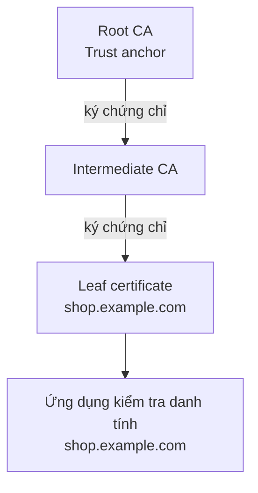
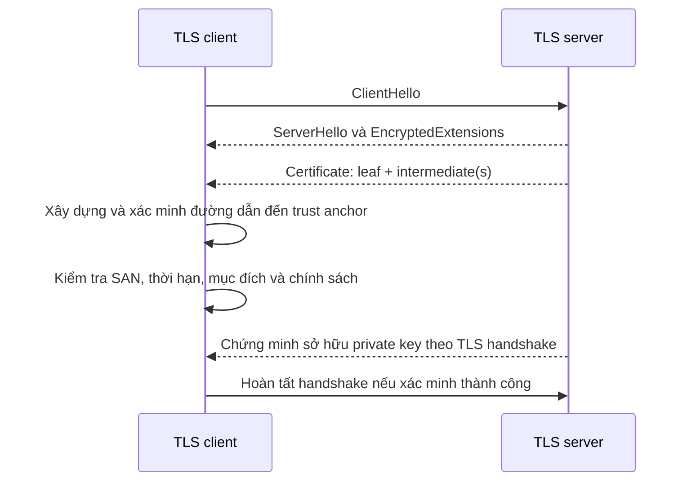

# Certificate chain

Certificate chain (chuỗi chứng chỉ) là đường dẫn gồm nhiều chứng chỉ số X.509 liên kết với nhau bằng chữ ký của các tổ chức cấp chứng chỉ (Certificate Authority, CA). Đường dẫn này giúp bên nhận kiểm tra xem public key trong chứng chỉ đầu cuối có được một CA mà bên nhận tin cậy chứng thực hay không.

Trong module `SECURITY_KEY_MANAGEMENT_FUNDAMENTALS`, certificate chain kết nối quản lý khóa mật mã với PKI và chữ ký số. Khóa riêng của CA dùng để ký chứng chỉ phải được bảo vệ trong suốt vòng đời; chứng chỉ công khai mang public key và thông tin định danh đến các hệ thống cần xác minh. Hiểu chuỗi chứng chỉ giúp phân biệt việc một chữ ký hợp lệ với việc một danh tính thực sự được tin cậy.

## 1. Chuỗi chứng chỉ giải quyết vấn đề gì?

Một chứng chỉ số thường ràng buộc một danh tính với một public key. Ví dụ, chứng chỉ máy chủ có thể xác nhận public key được dùng cho tên miền `shop.example.com`. CA phát hành chứng chỉ bằng cách ký phần dữ liệu chứng chỉ bằng private key của CA. Bên nhận dùng public key tương ứng của CA để kiểm tra chữ ký.

Trong thực tế, thiết bị đầu cuối thường không được cấu hình sẵn public key của mọi CA có thể cấp chứng chỉ cho mọi dịch vụ. Thay vào đó, hệ thống dùng một hệ thống phân cấp:

- **Root CA** là điểm neo tin cậy (trust anchor) được hệ điều hành, trình duyệt hoặc ứng dụng cài đặt và quản lý.
- **Intermediate CA** được CA cấp cao hơn chứng thực và dùng để phát hành chứng chỉ cho CA cấp thấp hơn hoặc cho thực thể đầu cuối.
- **End-entity certificate** (còn gọi là leaf certificate) được cấp cho máy chủ, người dùng, thiết bị hoặc dịch vụ. Chứng chỉ này thường chứa public key được ứng dụng trực tiếp sử dụng.

Ví dụ một đường dẫn phổ biến:



Ứng dụng bắt đầu từ chứng chỉ máy chủ, kiểm tra chữ ký của Intermediate CA, tiếp tục kiểm tra chứng chỉ Intermediate CA bằng public key của Root CA, rồi xác định Root CA đó có nằm trong tập trust anchor được cấu hình hay không. Tập trust anchor được phân phối qua một kênh quản trị đáng tin cậy; việc một chứng chỉ root tự ký không tự động làm cho nó đáng tin.

Chuỗi chứng chỉ giải quyết bài toán **xây dựng đường dẫn tin cậy**. Nó không tự chứng minh máy chủ đang hoạt động an toàn, private key chưa bị lộ hoặc nội dung ứng dụng là đáng tin. Những điều đó cần các kiểm soát riêng.

## 2. Vai trò của từng loại chứng chỉ

| Thành phần | Vai trò | Cách bảo vệ và sử dụng |
|---|---|---|
| Root CA | Điểm neo tin cậy ở đầu đường dẫn | Private key thường được giữ ngoại tuyến hoặc trong HSM với quyền truy cập rất hạn chế; chứng chỉ root được triển khai qua trust store được quản trị |
| Intermediate CA | Phát hành chứng chỉ bên dưới root hoặc intermediate cấp cao hơn | Private key cần được bảo vệ bằng HSM/KMS phù hợp, phân quyền ký và ghi log; có thể thu hồi hoặc thay thế mà không phải thay root trong mọi trường hợp |
| Leaf certificate | Gắn public key với máy chủ, người dùng hoặc thiết bị cụ thể | Private key tương ứng được giữ bởi chủ thể sử dụng; chứng chỉ được cài trên dịch vụ và gia hạn trước khi hết hạn |

Root CA thường không trực tiếp ký hàng loạt chứng chỉ máy chủ. Việc dùng intermediate CA giúp giới hạn phạm vi sử dụng của từng khóa ký, phân tách môi trường hoặc đơn vị vận hành, và cho phép thay thế một CA trung gian khi có sự cố. Đổi lại, mỗi cấp trung gian bổ sung một mắt xích phải được kiểm tra.

## 3. Cách các chứng chỉ liên kết với nhau

Giả sử có ba chứng chỉ:

1. `root-ca.pem`: chứng chỉ Root CA đã được cài trong trust store.
2. `intermediate-ca.pem`: chứng chỉ Intermediate CA do Root CA phát hành.
3. `server.pem`: chứng chỉ máy chủ do Intermediate CA phát hành.

Chứng chỉ `server.pem` chứa public key của máy chủ và chữ ký của Intermediate CA trên phần dữ liệu chứng chỉ. Chứng chỉ `intermediate-ca.pem` chứa public key của Intermediate CA và chữ ký của Root CA. Khi xác minh, hệ thống dùng public key trong chứng chỉ cấp trên để kiểm tra chữ ký của chứng chỉ cấp dưới.

Các trường `Issuer` và `Subject` giúp tìm ứng viên issuer. `Authority Key Identifier` (AKI) và `Subject Key Identifier` (SKI) có thể hỗ trợ ghép đúng khóa cấp và khóa được cấp. Tuy nhiên, tên issuer khớp với tên subject hoặc AKI/SKI khớp **chưa đủ** để chứng minh đường dẫn hợp lệ. Bên xác minh vẫn phải kiểm tra chữ ký và các ràng buộc của chứng chỉ.

Mỗi chứng chỉ trong đường dẫn phải được kiểm tra theo vai trò của nó. Intermediate CA cần được phép hoạt động như CA; một leaf certificate không thể tự biến thành CA chỉ vì nó có chữ ký hợp lệ.

## 4. Các trường X.509 quan trọng khi xác minh chain

| Trường hoặc extension | Ý nghĩa khi kiểm tra |
|---|---|
| `Subject` | Chủ thể được chứng chỉ mô tả; với TLS máy chủ, tên DNS cần được kiểm tra trong SAN |
| `Issuer` | CA được khai báo là bên phát hành chứng chỉ |
| `Subject Public Key Info` | Thuật toán và public key được chứng chỉ ràng buộc với chủ thể |
| `Validity` (`Not Before`, `Not After`) | Khoảng thời gian chứng chỉ có hiệu lực |
| `Basic Constraints` | Xác định chứng chỉ có phải CA hay không (`CA:TRUE`) và có thể đặt `pathLenConstraint` |
| `Key Usage` | Giới hạn mục đích sử dụng khóa, ví dụ `keyCertSign` cho khóa ký chứng chỉ |
| `Extended Key Usage` (EKU) | Giới hạn mục đích cấp cao hơn, ví dụ `serverAuth` hoặc `clientAuth` |
| `Subject Alternative Name` (SAN) | Chứa tên DNS, địa chỉ IP hoặc định danh khác cần đối chiếu với mục tiêu kết nối |
| `Authority Key Identifier` / `Subject Key Identifier` | Hỗ trợ nhận diện khóa của issuer và subject khi xây dựng đường dẫn |
| `Name Constraints` | Giới hạn không gian tên mà CA trung gian được phép cấp chứng chỉ |
| `Certificate Policies` | Thể hiện chính sách chứng chỉ có thể được bên xác minh áp dụng |
| `CRL Distribution Points` / `Authority Information Access` | Có thể cung cấp vị trí CRL, OCSP hoặc thông tin chứng chỉ issuer |

Với CA trung gian, `Basic Constraints` phải cho phép CA và `Key Usage` phải phù hợp với việc ký chứng chỉ. `pathLenConstraint`, nếu có, giới hạn số CA trung gian không tự ký được phép nằm bên dưới CA đó trong đường dẫn. Các extension có cờ `critical` mà bên xác minh không hiểu phải khiến chứng chỉ bị từ chối theo quy tắc X.509.

Với chứng chỉ TLS máy chủ, hệ thống thường kiểm tra SAN có chứa hostname cần kết nối và EKU cho phép `serverAuth`. Tên trong `Common Name` không nên được dùng thay thế cho kiểm tra SAN trong các triển khai hiện đại.

## 5. Quy trình xác minh một certificate chain

Một bộ xác minh chứng chỉ cần thực hiện các bước logic sau. Chi tiết triển khai có thể khác nhau giữa hệ điều hành, thư viện TLS và chính sách của ứng dụng.

1. **Nhận leaf certificate và các intermediate certificate.** Chứng chỉ đầu cuối là điểm bắt đầu. Các chứng chỉ trung gian có thể do máy chủ gửi kèm hoặc được lấy từ nguồn được cấu hình.
2. **Tìm issuer phù hợp cho từng chứng chỉ.** Dùng thông tin issuer/subject và các định danh khóa để tìm chứng chỉ cấp trên có khả năng ký chứng chỉ hiện tại.
3. **Xác minh chữ ký.** Dùng public key của issuer để xác minh chữ ký trên chứng chỉ cấp dưới. Nếu chữ ký sai hoặc không thể xác minh, đường dẫn đó không hợp lệ.
4. **Tiếp tục đến trust anchor.** Lặp lại việc tìm issuer và kiểm tra chữ ký cho đến khi đường dẫn kết thúc tại một trust anchor mà bên xác minh đã tin cậy.
5. **Kiểm tra thời hạn.** Chứng chỉ trong đường dẫn phải còn hiệu lực tại thời điểm xác minh theo chính sách áp dụng.
6. **Kiểm tra ràng buộc CA và mục đích sử dụng.** Kiểm tra `Basic Constraints`, `Key Usage`, EKU, path length, name constraints và các policy cần thiết.
7. **Kiểm tra danh tính đích.** Với TLS, hostname hoặc IP mà ứng dụng yêu cầu phải khớp với SAN của leaf certificate.
8. **Áp dụng chính sách thuật toán.** Từ chối thuật toán chữ ký, kích thước khóa hoặc tham số mật mã không còn được chính sách cho phép.
9. **Kiểm tra trạng thái thu hồi khi chính sách yêu cầu.** Có thể dùng CRL hoặc OCSP; cách xử lý khi không truy vấn được trạng thái phải được xác định rõ.

Kết quả xác minh chỉ có ý nghĩa trong ngữ cảnh cụ thể: trust store nào được dùng, thời điểm nào, mục đích nào và chính sách nào. Cùng một chuỗi có thể được chấp nhận trên thiết bị này nhưng bị từ chối trên thiết bị khác nếu trust store hoặc chính sách khác nhau.

### Xác minh chữ ký khác với xác minh danh tính

Chữ ký hợp lệ cho biết dữ liệu chứng chỉ đã được ký bằng private key tương ứng với public key của issuer. Để kết luận chứng chỉ đại diện cho đúng máy chủ, ứng dụng còn phải kiểm tra đường dẫn đến trust anchor, thời hạn, mục đích sử dụng và tên trong SAN. Không nên coi thông báo “certificate signature is valid” là kết luận đầy đủ rằng kết nối an toàn.

## 6. Certificate chain trong TLS

Khi thiết lập kết nối HTTPS, máy chủ gửi leaf certificate và thường gửi kèm các intermediate certificate cần thiết để client xây dựng đường dẫn. Thứ tự thường bắt đầu bằng leaf certificate, tiếp theo là intermediate cấp leaf, rồi đến các intermediate cấp cao hơn. Root certificate thường được bỏ qua vì client phải có trust anchor độc lập trong trust store.



Chứng chỉ chứa public key cùng thông tin định danh và chữ ký của issuer; private key của máy chủ không được gửi qua mạng. Trong TLS 1.3, máy chủ chứng minh quyền sở hữu private key bằng chữ ký trong thông điệp `CertificateVerify`. Việc xác minh chain xác thực mối liên hệ giữa danh tính và public key; bước chứng minh sở hữu khóa xác nhận phía kết nối có quyền sử dụng private key tương ứng.

Nếu máy chủ bỏ sót intermediate certificate, một số client có thể tìm issuer qua thông tin AIA hoặc nguồn đã cấu hình, nhưng hành vi này không đồng nhất và có thể thất bại trong môi trường bị giới hạn mạng. Vì vậy, máy chủ nên gửi đủ các intermediate cần thiết. Máy chủ thường không cần gửi root certificate vì việc gửi root không khiến client tự động tin cậy root đó.

## 7. Trust store, root certificate và cross-signing

Trust store là tập hợp trust anchor mà một hệ thống chấp nhận. Nó có thể do hệ điều hành, trình duyệt, runtime Java, thiết bị hoặc ứng dụng quản lý. Một ứng dụng có thể dùng trust store riêng, nên việc chứng chỉ hoạt động trên trình duyệt không đảm bảo nó cũng hoạt động trong một Java service hoặc container.

Root certificate thường là chứng chỉ tự ký, nhưng trạng thái tin cậy của nó đến từ việc được cài đặt và quản trị trong trust store. Nếu người dùng tự thêm một root không đáng tin vào trust store, họ đã thay đổi ranh giới tin cậy của hệ thống. Không nên nhập root certificate từ nguồn không xác thực hoặc bỏ qua cảnh báo chỉ để kết nối thành công.

**Cross-signing** xảy ra khi một CA hoặc public key CA được chứng thực qua nhiều chứng chỉ issuer khác nhau, chẳng hạn một intermediate có chứng chỉ được ký bởi hai root khác nhau. Điều này có thể tạo ra nhiều đường dẫn hợp lệ về mặt cấu trúc. Path builder sẽ chọn đường dẫn dựa trên các chứng chỉ có sẵn, trust anchor và chính sách cục bộ. Một đường dẫn có thể thành công trên hệ thống có root A nhưng thất bại trên hệ thống chỉ tin root B nếu không có đủ chứng chỉ cross-signed phù hợp.

Vì vậy, khi xử lý lỗi chain, cần kiểm tra trust store thực tế của tiến trình, các intermediate được gửi, đường dẫn mà thư viện đã chọn và chính sách của runtime. Cài thêm một root vào trust store là thay đổi bảo mật đáng kể, không phải bước sửa lỗi mặc định.

## 8. Thu hồi chứng chỉ và sự cố khóa

Chứng chỉ có thể cần bị thu hồi trước ngày hết hạn nếu private key bị lộ, CA cấp sai chứng chỉ, chủ thể không còn được phép sử dụng chứng chỉ hoặc có sự kiện bảo mật khác. Hai cơ chế phổ biến là:

- **CRL (Certificate Revocation List):** CA công bố danh sách chứng chỉ đã thu hồi. Client tải và kiểm tra danh sách theo chính sách.
- **OCSP (Online Certificate Status Protocol):** Client hỏi dịch vụ OCSP về trạng thái của một chứng chỉ. OCSP stapling cho phép máy chủ gửi kèm phản hồi OCSP đã được ký để giảm truy vấn trực tiếp từ client.

Không phải mọi ứng dụng đều kiểm tra thu hồi giống nhau. Một số môi trường có thể tiếp tục kết nối khi không truy vấn được CRL/OCSP (soft fail); môi trường khác có thể từ chối (hard fail). Chính sách cần cân bằng khả năng sẵn sàng với mức bảo đảm cần thiết và phải được kiểm thử trong điều kiện mạng lỗi.

Thu hồi leaf certificate không tự động thay thế private key. Nếu private key bị lộ, quy trình xử lý thường phải tạo key pair mới, yêu cầu CA phát hành chứng chỉ mới, triển khai chứng chỉ mới và thu hồi chứng chỉ cũ. Nếu khóa của intermediate CA bị xâm phạm, phạm vi ảnh hưởng lớn hơn: cần đánh giá các chứng chỉ đã phát hành, thu hồi hoặc thay thế intermediate, xử lý các chain phụ thuộc và phối hợp cập nhật trust store khi cần.

## 9. Liên hệ certificate chain với KMS và HSM

Certificate chain dựa trên các khóa ký CA. Vì vậy, quản lý private key CA là một phần trọng yếu của quản lý khóa mật mã:

- Giữ private key của root CA trong môi trường có kiểm soát nghiêm ngặt; nhiều tổ chức chỉ đưa khóa root vào sử dụng trong các phiên ký được phê duyệt.
- Dùng HSM hoặc dịch vụ quản lý khóa có kiểm soát phù hợp để hạn chế việc xuất private key CA và thực hiện thao tác ký trong ranh giới bảo vệ.
- Tách vai trò quản trị CA, phê duyệt yêu cầu cấp chứng chỉ và vận hành hạ tầng; áp dụng kiểm soát nhiều người cho thao tác có ảnh hưởng lớn.
- Ghi log việc tạo khóa, kích hoạt, sử dụng để ký, sao lưu, khôi phục, xoay vòng, thu hồi quyền và hủy khóa. Log cần đủ thông tin để điều tra nhưng không được chứa private key hoặc bí mật nhạy cảm.
- Lập kế hoạch cho cryptoperiod, gia hạn chứng chỉ và thay khóa. Gia hạn chứng chỉ bằng cùng một key pair không xử lý được rủi ro nếu private key đã bị lộ.
- Duy trì bản sao lưu và quy trình khôi phục khóa CA theo chính sách. Mất khóa root hoặc intermediate có thể làm gián đoạn việc phát hành và vận hành chain; khôi phục phải được kiểm soát và kiểm toán.

KMS/HSM bảo vệ thao tác với private key; nó không thay thế việc xác minh certificate chain ở client. Ngược lại, một chain hợp lệ cũng không chứng minh private key đang được lưu trữ an toàn. Hai lớp kiểm soát này bổ sung cho nhau.

## 10. Thực hành kiểm tra certificate chain bằng OpenSSL

Các lệnh dưới đây minh họa cách quan sát chứng chỉ và xác minh đường dẫn. Cần có ba tệp: `server.pem`, `intermediate-ca.pem` và `root-ca.pem`. Dùng chứng chỉ từ môi trường thử nghiệm hoặc nguồn mà bạn được phép kiểm tra.

Xem thông tin chính của leaf certificate:

```bash
openssl x509 -in server.pem -noout \
  -subject -issuer -serial -dates \
  -ext subjectAltName,basicConstraints,keyUsage,extendedKeyUsage
```

Xác minh leaf certificate bằng root trust anchor và intermediate được cung cấp:

```bash
openssl verify -show_chain \
  -purpose sslserver \
  -verify_hostname shop.example.com \
  -CAfile root-ca.pem \
  -untrusted intermediate-ca.pem \
  server.pem
```

Nếu chain hợp lệ và các điều kiện được chỉ định đều đạt, OpenSSL trả về kết quả `server.pem: OK` và có thể hiển thị đường dẫn đã xây dựng. Nếu thất bại, hãy đọc mã lỗi để xác định thiếu issuer, sai chữ ký, hết hạn, sai mục đích hoặc hostname không khớp. Kết quả phụ thuộc phiên bản OpenSSL, cấu hình và các tùy chọn xác minh.

Có thể xem chain mà một máy chủ TLS gửi trong lúc kết nối:

```bash
openssl s_client \
  -connect shop.example.com:443 \
  -servername shop.example.com \
  -showcerts
```

`-showcerts` hiển thị các chứng chỉ máy chủ gửi; bản thân việc hiển thị được chứng chỉ không khẳng định chain đã được xác minh thành công. Cần xem thêm kết quả xác minh, trust store và hostname. Khi kiểm tra trong môi trường thật, không đưa private key vào lệnh hoặc chia sẻ tệp chứa khóa riêng.

## 11. Các lỗi thường gặp

| Triệu chứng | Nguyên nhân thường gặp | Hướng kiểm tra |
|---|---|---|
| `unable to get local issuer certificate` | Thiếu intermediate hoặc không tìm được issuer phù hợp | Kiểm tra chain máy chủ gửi và issuer của từng chứng chỉ |
| `self-signed certificate in certificate chain` | Đường dẫn kết thúc ở root không được trust store tin cậy, hoặc cấu hình CA sai | Xác minh nguồn root và trust store của đúng tiến trình |
| `certificate has expired` hoặc `not yet valid` | Thời gian hệ thống sai hoặc chứng chỉ ngoài khoảng hiệu lực | Kiểm tra đồng hồ hệ thống và `Not Before`/`Not After` |
| Hostname mismatch | SAN không chứa hostname hoặc IP đang kết nối | Kiểm tra SAN và tên đích thực tế; yêu cầu cấp chứng chỉ đúng tên |
| CA certificate invalid | Intermediate thiếu `CA:TRUE`, `keyCertSign` hoặc vi phạm path length/constraints | Kiểm tra Basic Constraints, Key Usage và các extension liên quan |
| Unsupported certificate purpose | EKU hoặc Key Usage không phù hợp với ứng dụng | Kiểm tra `serverAuth`, `clientAuth` và mục đích xác minh |
| Certificate revoked | Chứng chỉ đã bị CA thu hồi | Kiểm tra CRL/OCSP và quy trình thay chứng chỉ, thay khóa nếu cần |
| Chain hoạt động ở trình duyệt nhưng lỗi trong ứng dụng | Hai môi trường dùng trust store, thư viện hoặc chính sách khác nhau | Xác minh cấu hình trust store và runtime của ứng dụng gặp lỗi |

## 12. Checklist khi thiết kế và vận hành

- [ ] Xác định rõ trust anchor và nguồn phân phối trust store.
- [ ] Phân cấp Root CA, Intermediate CA và leaf certificate theo phạm vi sử dụng.
- [ ] Bảo vệ private key CA bằng HSM/KMS, phân quyền tối thiểu và kiểm soát phê duyệt.
- [ ] Kiểm tra chữ ký của từng mắt xích và xác minh đường dẫn kết thúc tại trust anchor được chấp nhận.
- [ ] Kiểm tra thời hạn, Basic Constraints, Key Usage, EKU, SAN, name constraints và chính sách thuật toán.
- [ ] Cấu hình máy chủ gửi leaf certificate cùng các intermediate cần thiết theo đúng thứ tự.
- [ ] Xác định chính sách CRL/OCSP và hành vi khi không thể truy vấn trạng thái thu hồi.
- [ ] Theo dõi hạn chứng chỉ, lịch xoay vòng khóa, sự kiện thu hồi và thay đổi trust store.
- [ ] Diễn tập xử lý khi leaf key, intermediate CA key hoặc root CA key bị xâm phạm.

Certificate chain chỉ tạo ra một đường dẫn tin cậy khi mọi chữ ký, ràng buộc, mục đích sử dụng và trust anchor đều phù hợp với chính sách xác minh. Vận hành PKI an toàn vì thế cần kết hợp xác minh chứng chỉ ở phía ứng dụng với bảo vệ, kiểm toán và quản lý vòng đời các private key CA ở phía hạ tầng.
