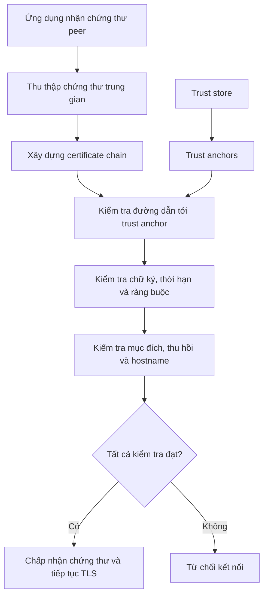

# Trust store

Trong chương **Certificate và public key** của module `SECURITY_KEY_MANAGEMENT_FUNDAMENTALS`, bài học này giải thích trust store và vai trò của nó trong việc xác minh danh tính bằng chứng thư số. Trust store cung cấp các điểm tin cậy mà ứng dụng dùng để đánh giá chứng thư của máy chủ, người dùng hoặc dịch vụ khác. Cấu hình trust store sai có thể khiến ứng dụng chấp nhận chứng thư giả mạo, từ chối dịch vụ hợp lệ hoặc tiếp tục tin cậy một CA đã bị xâm phạm.

## 1. Trust store là gì?

**Trust store** là kho lưu trữ các chứng thư số hoặc khóa công khai được một ứng dụng, hệ điều hành hay môi trường thực thi xem là đáng tin cậy. Các mục tin cậy thường là chứng thư CA gốc (root CA) hoặc một điểm tin cậy được tổ chức cấu hình trực tiếp. Chúng được dùng làm cơ sở để kiểm tra chuỗi chứng thư mà một bên kết nối trình bày.

Ví dụ, khi một ứng dụng Java kết nối HTTPS tới `api.example.com`, máy chủ gửi chứng thư của nó và có thể gửi thêm các chứng thư CA trung gian. Ứng dụng kiểm tra chuỗi này để xác định có thể xây dựng đường dẫn hợp lệ từ chứng thư máy chủ tới một trust anchor có trong trust store hay không. Nếu các kiểm tra khác cũng đạt, ứng dụng mới có cơ sở chấp nhận chứng thư.

Trust store thường chứa chứng thư CA, nhưng một trust store cũng có thể được cấu hình với chứng thư tự ký hoặc điểm tin cậy nội bộ theo chính sách. Trust store không phải danh sách mọi chứng thư mà ứng dụng sẽ chấp nhận một cách vô điều kiện: chứng thư vẫn phải vượt qua các kiểm tra về chữ ký, thời hạn, mục đích sử dụng, tên máy chủ, trạng thái thu hồi và các ràng buộc khác.

## 2. Trust store, keystore và trust anchor

Các thuật ngữ này có liên quan nhưng phục vụ những vai trò khác nhau.

| Khái niệm | Nội dung thường lưu | Mục đích chính |
|---|---|---|
| Trust store | Chứng thư CA gốc, chứng thư CA nội bộ hoặc các trust anchor | Xác định những điểm tin cậy dùng để kiểm tra chứng thư bên đối tác |
| Keystore | Khóa riêng cùng chứng thư tương ứng và chuỗi chứng thư; tùy định dạng có thể chứa nhiều loại entry | Giữ danh tính mật mã của chính ứng dụng hoặc chủ thể để ký số, giải mã hay xác thực hai chiều |
| Trust anchor | Điểm gốc mà tại đó quá trình xác minh chuỗi chứng thư được neo vào một miền tin cậy | Là cơ sở để quyết định chuỗi chứng thư có dẫn tới một nguồn tin cậy được cấu hình hay không |
| Certificate chain | Chứng thư máy chủ/chủ thể và các chứng thư CA trung gian nối tới trust anchor | Cung cấp đường dẫn để kiểm tra chữ ký và quan hệ phát hành giữa các chứng thư |

Trong Java, `KeyStore` là API và định dạng lưu trữ có thể chứa nhiều loại entry. Tên `truststore` mô tả cách ứng dụng sử dụng một keystore để lấy trust anchors; nó không phải một định dạng tệp riêng. Một tệp JKS hoặc PKCS#12 có thể được dùng làm trust store hoặc keystore tùy nội dung và cách cấu hình.

Không nên đưa khóa riêng của ứng dụng vào trust store chỉ vì cả hai đều được gọi là kho khóa. Khóa riêng cần được bảo vệ như bí mật có quyền thực hiện thao tác mật mã. Trust store dùng cho xác minh thường chỉ cần chứng thư và khóa công khai tương ứng.

## 3. Trust store tham gia xác minh chứng thư như thế nào?

Khi thiết lập kết nối TLS, bên xác minh nhận chứng thư của peer và xây dựng một đường dẫn chứng thư tới một trust anchor phù hợp. Quá trình xác minh thường bao gồm:

1. **Xây dựng chuỗi:** xác định chứng thư nào được CA nào phát hành, tìm các chứng thư trung gian cần thiết và nối đường dẫn tới trust anchor.
2. **Kiểm tra chữ ký:** xác minh chữ ký của các chứng thư trong đường dẫn bằng khóa công khai của issuer tương ứng. Trust anchor là điểm neo được cấu hình cho quá trình xác minh, không nhất thiết phải được kiểm tra như một chứng thư thông thường trong chuỗi.
3. **Kiểm tra thời hạn:** xác nhận thời điểm hiện tại nằm trong khoảng `Not Before` và `Not After` của các chứng thư liên quan.
4. **Kiểm tra ràng buộc CA:** xác nhận chứng thư CA có `Basic Constraints` phù hợp, `Key Usage` cho phép ký chứng thư và các giới hạn path length hoặc name constraints được tuân thủ.
5. **Kiểm tra mục đích sử dụng:** kiểm tra `Extended Key Usage` và `Key Usage` của chứng thư cuối có phù hợp với vai trò, chẳng hạn TLS server authentication hoặc client authentication.
6. **Kiểm tra chính sách và trạng thái thu hồi:** áp dụng certificate policy, CRL hoặc OCSP theo cấu hình và yêu cầu của hệ thống.
7. **Kiểm tra danh tính peer:** với HTTPS/TLS server, xác minh hostname hoặc địa chỉ được yêu cầu khớp với Subject Alternative Name (SAN) của chứng thư.

Trust store cung cấp điểm tin cậy cho bước xây dựng và xác minh đường dẫn. Nó không tự thực hiện mọi kiểm tra nêu trên. Đặc biệt, xác minh hostname là bước kiểm tra danh tính dịch vụ riêng; một chứng thư có chuỗi hợp lệ nhưng SAN không khớp hostname vẫn phải bị từ chối.



Một số thư viện TLS có thể tải chứng thư trung gian từ máy chủ hoặc kho chứng thư ngoài trust store. Điều đó không có nghĩa các chứng thư trung gian tự động trở thành trust anchor. Điểm neo tin cậy vẫn phải được xác định theo chính sách xác minh.

## 4. Trust store trong các môi trường phổ biến

Trust store có thể thuộc hệ điều hành, runtime, trình duyệt hoặc từng ứng dụng. Mỗi môi trường có thể có nguồn trust anchor và cơ chế cập nhật riêng.

| Môi trường | Cách sử dụng thường gặp | Điều cần lưu ý |
|---|---|---|
| Windows | Certificate Store theo các scope như Current User và Local Computer; ứng dụng có thể dùng Windows certificate APIs | Cài chứng thư vào đúng store và scope; kiểm soát quyền sửa đổi và Group Policy |
| macOS | Keychain và trust settings của hệ thống hoặc người dùng | Cấu hình trust có thể khác theo keychain và chính sách quản trị thiết bị |
| Linux | CA bundle hoặc thư mục chứng thư do bản phân phối quản lý | Cách cập nhật và đường dẫn bundle khác nhau theo distro; ứng dụng có thể dùng bundle riêng |
| Java | Một `KeyStore` được cung cấp qua cấu hình hoặc API, thường dùng JKS/PKCS#12 | Java runtime có thể có `cacerts`; ứng dụng có thể nạp trust store riêng và bỏ qua cấu hình mặc định |
| Trình duyệt | Danh sách CA tích hợp hoặc trust store của hệ điều hành, tùy trình duyệt và nền tảng | Không nên giả định mọi trình duyệt dùng cùng một nguồn chứng thư |
| Container | CA bundle được cài trong image hoặc mount từ môi trường triển khai | Image cũ có thể chứa trust anchors lỗi thời; cập nhật image và runtime cần được quản lý |
| Ứng dụng doanh nghiệp | Trust store riêng chứa CA nội bộ hoặc CA đối tác | Cần quản lý phiên bản, phân phối, quyền truy cập và quy trình thu hồi |

Một ứng dụng có thể dùng trust store riêng thay vì trust store của hệ điều hành. Ví dụ, một Java service chạy trong container có thể dùng `cacerts` của JRE trong image, một tệp PKCS#12 do nhóm vận hành mount vào, hoặc một trust store được nạp trực tiếp trong mã nguồn. Khi điều tra lỗi TLS, cần xác định chính xác trust manager nào đang được ứng dụng sử dụng.

## 5. Ví dụ trust store trong Java

### Liệt kê chứng thư trong trust store

Lệnh sau liệt kê các entry của một trust store PKCS#12:

```bash
keytool -list -v \
  -keystore /etc/my-service/truststore.p12 \
  -storetype PKCS12
```

Kết quả cho biết alias, loại entry, subject, issuer, thời hạn và fingerprint. Cần kiểm tra fingerprint bằng một kênh đáng tin cậy khác trước khi chấp nhận một CA mới.

### Thêm chứng thư CA đã xác minh

```bash
keytool -importcert \
  -alias internal-root-ca-2026 \
  -file internal-root-ca.pem \
  -keystore /etc/my-service/truststore.p12 \
  -storetype PKCS12
```

Lệnh import chỉ đưa chứng thư vào kho. Trước khi thực hiện, quản trị viên phải xác minh nguồn phát hành, fingerprint hoặc hash của chứng thư qua kênh độc lập và phê duyệt theo chính sách. Không chấp nhận một CA chỉ vì hộp thoại `keytool` hỏi có tin cậy hay không.

### Nạp trust store tường minh trong Java

Ví dụ sau tạo `TrustManagerFactory` từ một trust store riêng:

```java
import java.io.InputStream;
import java.nio.file.Files;
import java.nio.file.Path;
import java.security.KeyStore;
import javax.net.ssl.SSLContext;
import javax.net.ssl.TrustManagerFactory;

public final class TlsTrustConfiguration {
    public static SSLContext create(Path trustStorePath, char[] password)
            throws Exception {
        KeyStore trustStore = KeyStore.getInstance("PKCS12");
        try (InputStream input = Files.newInputStream(trustStorePath)) {
            trustStore.load(input, password);
        }

        TrustManagerFactory factory = TrustManagerFactory.getInstance(
                TrustManagerFactory.getDefaultAlgorithm());
        factory.init(trustStore);

        SSLContext context = SSLContext.getInstance("TLS");
        context.init(null, factory.getTrustManagers(), null);
        return context;
    }
}
```

Đoạn mã trên cấu hình trust managers cho `SSLContext`; nó không thay thế các yêu cầu xác minh danh tính hostname của HTTPS client. Ứng dụng phải dùng HTTP/TLS client có hostname verification được bật và không cài một verifier chấp nhận mọi hostname. Mật khẩu trust store cần được lấy từ cơ chế quản lý bí mật phù hợp, không hard-code vào source code hoặc log.

Java cũng hỗ trợ cấu hình trust store mặc định bằng các thuộc tính như `javax.net.ssl.trustStore` và `javax.net.ssl.trustStorePassword`. Cách này ảnh hưởng tới các thành phần dùng JSSE default context; thư viện tự tạo `SSLContext` hoặc `TrustManager` riêng có thể không sử dụng các thuộc tính đó. Cần xác minh hành vi của ứng dụng thay vì cho rằng đặt system property sẽ thay đổi mọi kết nối TLS.

## 6. Trust anchor và certificate chain

Trong mô hình PKI phân cấp, CA gốc thường tự ký chứng thư của chính nó và được phân phối như trust anchor. CA trung gian được CA cấp cao hơn ký, rồi CA trung gian phát hành chứng thư cho máy chủ hoặc người dùng.

Ví dụ một chuỗi đơn giản:

```text
Root CA (trust anchor)
    |
    +-- Intermediate CA
            |
            +-- api.example.com (server certificate)
```

Trust store thường giữ Root CA. Máy chủ gửi chứng thư của `api.example.com` cùng chứng thư Intermediate CA. Bên xác minh kiểm tra chữ ký và các ràng buộc của chuỗi cho tới Root CA đã được cấu hình làm trust anchor.

Không nhất thiết phải đưa mọi chứng thư trung gian vào trust store. Máy chủ TLS thường cần gửi đầy đủ các chứng thư trung gian để client xây dựng chain. Nếu thiếu intermediate, một số client có thể tìm được từ cache hoặc nguồn khác, nhưng ứng dụng không nên dựa vào hành vi không nhất quán này.

Một trust anchor có thể là chứng thư CA gốc hoặc một khóa công khai/định danh tin cậy được cấu hình trực tiếp theo cơ chế của nền tảng. Khi tin cậy một anchor, tổ chức đang chấp nhận phạm vi chứng thư mà anchor đó có thể xác nhận theo các ràng buộc áp dụng. Vì vậy, cài một CA gốc rộng quyền có thể mở rộng đáng kể tập máy chủ hoặc chủ thể mà ứng dụng chấp nhận.

## 7. Trust store và các loại xác minh khác

Trust store là một phần của quá trình xác minh, không phải cơ chế duy nhất.

| Cơ chế | Câu hỏi được trả lời | Quan hệ với trust store |
|---|---|---|
| Certificate path validation | Chuỗi chứng thư có hợp lệ và dẫn tới trust anchor được chấp nhận không? | Dùng trust anchors từ trust store |
| Hostname verification | Chứng thư có đại diện đúng hostname mà client kết nối không? | Là bước riêng, phải thực hiện ngoài việc chỉ tìm thấy trust anchor |
| Revocation checking | Chứng thư có bị thu hồi không? | Thường kiểm tra qua CRL/OCSP hoặc cơ chế trạng thái tương ứng |
| Certificate pinning | Chứng thư hoặc public key có khớp giá trị đã ghim cho dịch vụ không? | Là ràng buộc bổ sung; không thay thế đầy đủ path validation trong mọi thiết kế |
| Mutual TLS (mTLS) | Chứng thư client có được bên server chấp nhận không, và ngược lại? | Mỗi bên có thể dùng trust store riêng để xác minh peer |
| Application authorization | Danh tính đã xác thực có được phép thực hiện hành động không? | Xảy ra sau xác thực; trust store không quyết định quyền nghiệp vụ |

Một chứng thư có thể hợp lệ về chữ ký và chain nhưng vẫn không đại diện đúng máy chủ. Tương tự, một client certificate có chain hợp lệ không tự động cho phép người dùng truy cập API; ứng dụng còn phải kiểm tra danh tính và quyền.

## 8. Quản lý và cập nhật trust store

Trust store là cấu hình bảo mật quan trọng, cần được quản lý theo vòng đời. Các thay đổi thường phát sinh khi:

- Tổ chức triển khai CA nội bộ mới hoặc kết nối với đối tác mới.
- CA gốc hoặc CA trung gian được thay thế, hết hạn hoặc chuyển sang thuật toán mới.
- CA bị compromise hoặc bị cơ quan có thẩm quyền tuyên bố không còn đáng tin cậy.
- Ứng dụng được chuyển sang runtime, container image hoặc hệ điều hành mới.
- Một môi trường cần trust policy khác với môi trường khác.

Quy trình cập nhật nên gồm:

1. Xác định ứng dụng, môi trường và trust store chịu ảnh hưởng.
2. Thu thập chứng thư CA từ nguồn chính thức hoặc kênh đã xác thực.
3. Xác minh fingerprint, subject, issuer, thời hạn, Basic Constraints và mục đích sử dụng.
4. Đánh giá phạm vi tin cậy mà CA sẽ cấp cho ứng dụng.
5. Phê duyệt thay đổi và thử nghiệm trên môi trường kiểm soát.
6. Phân phối trust store theo phiên bản có thể truy vết, kiểm soát quyền ghi và bảo vệ tính toàn vẹn.
7. Triển khai theo đợt, theo dõi lỗi TLS và có phương án rollback phù hợp.
8. Ghi audit log về chứng thư được thêm, thay thế hoặc loại bỏ.

Không nên thêm toàn bộ CA có sẵn từ một nguồn không được kiểm soát vào trust store của mọi ứng dụng. Mỗi ứng dụng nên chỉ tin cậy các CA cần thiết cho mục đích kết nối của nó. Phạm vi trust nhỏ giúp giảm khả năng một CA bị xâm phạm ảnh hưởng tới các dịch vụ không liên quan.

## 9. Thay thế CA và chuyển đổi trust anchor

Khi CA gốc sắp hết hạn hoặc tổ chức chuyển sang CA mới, việc thay đổi trust store cần phối hợp với việc triển khai chứng thư phía máy chủ và client.

Một cách chuyển đổi thường dùng là giai đoạn overlap:

1. Phân phối CA mới vào trust store của client trước khi dịch vụ bắt đầu dùng chain mới.
2. Kiểm tra client đã nhận và tin cậy CA mới.
3. Triển khai chứng thư máy chủ được phát hành bởi CA mới.
4. Theo dõi các client cũ, thiết bị ngoại tuyến và hệ thống tích hợp chưa cập nhật.
5. Sau khi không còn dịch vụ cần chain cũ, loại bỏ CA cũ theo kế hoạch.

Nếu CA cũ bị compromise, không thể mặc định giữ CA đó trong giai đoạn overlap. Cần đánh giá sự cố, loại bỏ trust anchor bị ảnh hưởng hoặc áp dụng distrust theo cơ chế phù hợp, đồng thời chuyển dịch vụ sang chain mới. Việc thay CA cần có kế hoạch khẩn cấp vì có thể làm gián đoạn nhiều kết nối cùng lúc.

## 10. Thu hồi và loại bỏ CA không còn đáng tin cậy

Khi CA bị compromise, tổ chức có thể cần loại bỏ root hoặc intermediate CA khỏi trust store, cập nhật chính sách distrust, chặn chứng thư cụ thể hoặc áp dụng cơ chế thu hồi thích hợp. Chỉ xóa chứng thư CA khỏi một máy chủ không bảo đảm mọi client đều ngừng tin cậy CA đó.

Các bước xử lý nên gồm:

- Xác định CA, fingerprint, serial number, chain và các dịch vụ đang phụ thuộc.
- Xác định phạm vi ảnh hưởng: chứng thư nào đã được CA phát hành, trong thời gian nào và cho hệ thống nào.
- Cập nhật trust store, certificate denylist hoặc cơ chế distrust của nền tảng theo chính sách.
- Thu hồi và cấp lại chứng thư cho các dịch vụ bị ảnh hưởng.
- Phân phối cấu hình mới tới máy chủ, client, container, thiết bị và môi trường ngoại tuyến.
- Xác minh các client đã ngừng chấp nhận chain bị ảnh hưởng.
- Lưu bằng chứng, thời điểm triển khai và các ngoại lệ chưa cập nhật.

CRL và OCSP thường kiểm tra trạng thái thu hồi của chứng thư cuối hoặc chứng thư trung gian theo mô hình PKI. Chúng không thay thế việc quản lý trust anchor. Nếu chính CA gốc không còn được tin cậy, tổ chức cần xử lý trust store hoặc chính sách distrust, không chỉ dựa vào việc kiểm tra trạng thái thu hồi của chứng thư máy chủ.

## 11. Bảo vệ trust store

Trust store có thể không chứa khóa riêng, nhưng thay đổi nội dung của nó có thể thay đổi những danh tính mà ứng dụng chấp nhận. Kẻ tấn công thêm một CA không đáng tin cậy vào trust store có thể tạo điều kiện cho tấn công trung gian hoặc giả mạo chứng thư.

Các biện pháp bảo vệ quan trọng gồm:

- Giới hạn quyền ghi trust store cho nhóm quản trị được ủy quyền.
- Bảo vệ tệp, thư mục, certificate store và cơ chế cập nhật khỏi sửa đổi trái phép.
- Phân phối trust store qua kênh xác thực, có kiểm tra chữ ký hoặc checksum được xác minh độc lập.
- Quản lý phiên bản, nguồn gốc chứng thư, fingerprint và lịch sử thay đổi.
- Không đặt mật khẩu trust store trong source code, image layer hoặc log.
- Giám sát thay đổi bất thường, CA mới được thêm và trust anchor bị xóa.
- Tách trust store theo môi trường, tenant hoặc nhóm ứng dụng khi yêu cầu tin cậy khác nhau.
- Có quy trình khôi phục cấu hình đã được kiểm chứng nhưng không tự động phục hồi CA đã bị distrust.

Quyền đọc trust store thường ít nhạy cảm hơn quyền ghi, nhưng danh sách CA tin cậy vẫn có thể tiết lộ cấu trúc nội bộ hoặc chính sách kết nối. Cần bảo vệ tính toàn vẹn và giới hạn việc công bố thông tin theo nhu cầu.

## 12. Lỗi thường gặp khi sử dụng trust store

- **Trust store rỗng hoặc sai đường dẫn:** TLS handshake thất bại vì không tìm được trust anchor phù hợp.
- **Ứng dụng dùng trust store khác dự kiến:** runtime, container hoặc thư viện tạo `SSLContext` riêng bỏ qua cấu hình hệ điều hành.
- **Thiếu intermediate certificate:** client không xây dựng được chain dù root CA đã được tin cậy.
- **Thêm nhầm CA:** ứng dụng chấp nhận một miền tin cậy rộng hơn chính sách cho phép.
- **Không kiểm tra fingerprint:** chứng thư giả mạo hoặc chứng thư lấy từ nguồn không xác thực bị import.
- **Bỏ qua hostname verification:** chain hợp lệ nhưng kết nối tới sai máy chủ vẫn có thể được chấp nhận.
- **Không cập nhật CA mới:** chứng thư máy chủ chuyển sang chain mới khiến client cũ không kết nối được.
- **Giữ CA đã compromise:** các kết nối có thể tiếp tục tin cậy chứng thư do CA đó phát hành.
- **Cài CA vào sai scope:** người dùng hoặc dịch vụ khác không nhận được cấu hình mong muốn, hoặc phạm vi tin cậy rộng hơn dự kiến.
- **Coi import thành công là kiểm thử hoàn tất:** ứng dụng thực tế có thể không dùng trust store vừa cập nhật.

## 13. Ví dụ thực tế: ứng dụng nội bộ kết nối API doanh nghiệp

Một doanh nghiệp có API nội bộ được cấp chứng thư bởi CA riêng. Các Java service chạy trong container cần kết nối HTTPS tới API đó.

Quy trình triển khai có thể như sau:

1. Nhóm PKI cung cấp chứng thư root CA và fingerprint qua kênh quản trị đã xác thực.
2. Nhóm nền tảng xác minh fingerprint, thời hạn và thuộc tính CA, sau đó tạo trust store PKCS#12 riêng cho dịch vụ.
3. Trust store được lưu như một artifact có phiên bản, chỉ nhóm quản trị được phép cập nhật.
4. Container mount trust store ở đường dẫn được cấu hình; mật khẩu được lấy từ secret manager.
5. Java service nạp trust store bằng `TrustManagerFactory` và dùng TLS client có hostname verification.
6. Kiểm thử kết nối với chứng thư hợp lệ, chứng thư không được tin cậy, chứng thư hết hạn và hostname không khớp.
7. Khi CA mới được triển khai, trust store mới được phân phối trước; sau đó máy chủ chuyển sang chain mới.
8. Khi chuyển đổi hoàn tất, CA cũ được loại bỏ theo kế hoạch và các instance còn dùng phiên bản cũ được theo dõi.

Nếu chỉ thêm CA mới nhưng ứng dụng vẫn nạp trust store mặc định trong JRE, thay đổi có thể không có hiệu lực. Nếu tắt hostname verification để khắc phục lỗi kết nối, ứng dụng có thể chấp nhận nhầm máy chủ. Cần kiểm tra cấu hình runtime và TLS client thực tế trong môi trường triển khai.

## 14. Checklist vận hành trust store

- [ ] Đã xác định trust store cụ thể mà ứng dụng hoặc runtime đang sử dụng.
- [ ] Đã phân biệt trust store với keystore chứa khóa riêng.
- [ ] Đã xác định trust anchors và phạm vi tin cậy của từng CA.
- [ ] Đã xác minh fingerprint và nguồn gốc của chứng thư trước khi import.
- [ ] Đã kiểm tra certificate chain, thời hạn, Basic Constraints, Key Usage và EKU.
- [ ] Đã bật hostname verification cho TLS server authentication.
- [ ] Đã xác định cơ chế CRL/OCSP hoặc chính sách revocation phù hợp.
- [ ] Đã quản lý phiên bản và phân phối trust store qua kênh có xác thực.
- [ ] Đã có quy trình thêm, thay thế và loại bỏ CA.
- [ ] Đã kiểm thử chuyển CA và xử lý CA bị compromise.
- [ ] Đã bảo vệ quyền ghi, lưu audit log và giám sát thay đổi.
- [ ] Đã kiểm tra backup/rollback không làm sống lại trust anchor đã bị distrust.

Trust store là nền tảng để ứng dụng quyết định chứng thư của bên kết nối có thể được tin cậy hay không. Quản lý tốt trust store đòi hỏi xác định đúng trust anchor, kiểm tra đầy đủ certificate chain và danh tính peer, bảo vệ quyền thay đổi, đồng thời cập nhật hoặc loại bỏ CA theo vòng đời. Khi trust store được quản lý có kiểm soát, ứng dụng có thể xác minh chứng thư nhất quán và giảm nguy cơ chấp nhận danh tính giả mạo.
