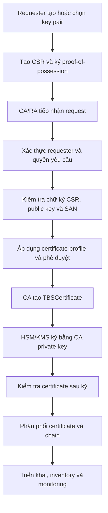
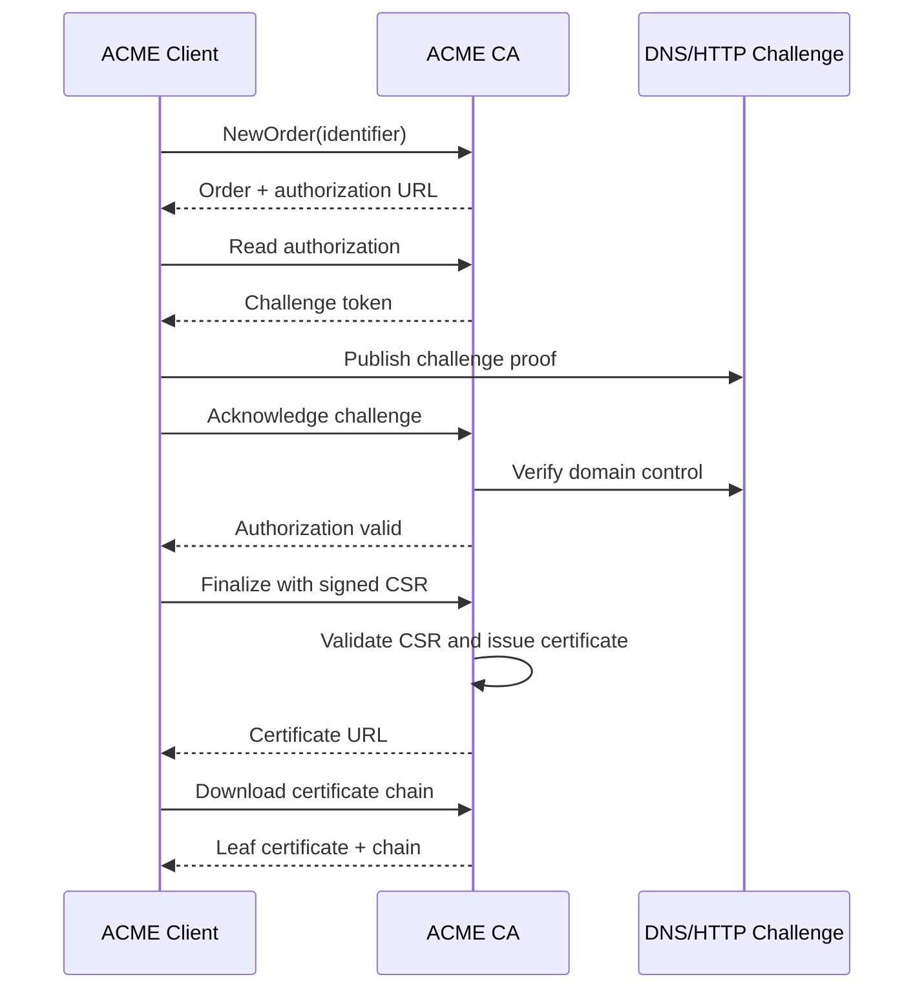

# Certificate issuance

Certificate issuance (cấp phát chứng thư số) là quy trình trong đó Certificate Authority (CA) xác minh yêu cầu, áp dụng chính sách và dùng private key của CA để ký một public key certificate. Certificate được cấp liên kết public key với danh tính, thời hạn và phạm vi sử dụng cụ thể. Quy trình này là một phần quan trọng của PKI (Public Key Infrastructure), hỗ trợ TLS, xác thực thiết bị, mTLS, chữ ký mã, chữ ký tài liệu và nhiều hệ thống quản lý danh tính.

Một certificate hợp lệ về mặt chữ ký vẫn có thể được cấp sai nếu CA không xác minh đúng danh tính, không kiểm tra quyền yêu cầu SAN, hoặc sao chép extension từ CSR mà không áp dụng policy. Vì vậy issuance phải kiểm soát cả ba yếu tố: **ai được yêu cầu**, **public key nào được chứng thực**, và **certificate được phép dùng vào việc gì**. Private key của subject phải được tạo và bảo vệ theo vòng đời riêng; CA chỉ cần public key và bằng chứng hợp lệ để cấp certificate.

Trong module quản lý khóa, issuance kết nối quy trình tạo key pair, lưu private key trong KMS/HSM, ký CSR, quản trị CA private key, cấp certificate, triển khai, gia hạn, thu hồi và kiểm toán. Nếu CA signing key bị lộ hoặc CA cấp sai danh tính, tác động có thể lan tới nhiều dịch vụ và nhiều bên tin cậy.

## 1. Certificate issuance giải quyết điều gì?

Mật mã bất đối xứng cung cấp public key và private key có quan hệ toán học. Public key có thể được phân phối, nhưng bên nhận cần biết public key thuộc về danh tính nào và được phép dùng trong ngữ cảnh nào. Certificate do CA ký tạo ra một liên kết có thể xác minh giữa public key với subject, SAN, thời hạn, issuer và các extension.

Ví dụ, một dịch vụ `api.example.com` cần certificate TLS server. Nhóm vận hành tạo key pair, giữ private key trong HSM hoặc kho khóa phù hợp, tạo CSR chứa public key và tên miền cần cấp. CA kiểm tra quyền kiểm soát `example.com`, xác minh yêu cầu nằm trong phạm vi được phép, áp dụng profile TLS server, tạo certificate có SAN `api.example.com` và ký bằng intermediate CA private key. Client sau đó có thể xác minh chain tới trust anchor đã cấu hình và xác minh tên máy chủ.

Issuance không tự chứng minh rằng mọi thông tin trong CSR là đúng. CSR được ký chỉ chứng minh bên tạo yêu cầu kiểm soát private key tương ứng tại thời điểm ký. CA vẫn phải xác minh danh tính và quyền yêu cầu theo policy. Ví dụ, một người có thể tự tạo CSR chứa `DNS:bank.example` nhưng điều đó không chứng minh họ có quyền kiểm soát tên miền hoặc được phép nhận certificate cho tên đó.

## 2. Các thành phần tham gia

| Thành phần | Vai trò trong issuance | Điều cần bảo vệ |
|---|---|---|
| Subject/requester | Cá nhân, máy chủ, workload, thiết bị hoặc tổ chức yêu cầu certificate | Danh tính, quyền yêu cầu và private key tương ứng |
| Key pair | Public key được đưa vào certificate; private key dùng để chứng minh possession và thực hiện thao tác | Tính bí mật, tính toàn vẹn, quyền sử dụng và phiên bản |
| CSR | Chứa public key, subject/extension được đề nghị và chữ ký của requester | Tính toàn vẹn, nguồn gốc và dữ liệu đầu vào chưa được tin cậy |
| Registration Authority (RA) | Tiếp nhận và xác minh danh tính/quyền trước khi CA ký | Quy trình xác minh, phê duyệt và audit trail |
| Certificate Authority (CA) | Áp dụng policy, gán serial, tạo và ký certificate | CA signing key, certificate profile và quyền ký |
| HSM/KMS | Bảo vệ CA private key hoặc subject private key, thực hiện thao tác mật mã | Security boundary, access policy, quorum và audit |
| Certificate repository | Phân phối certificate, CRL hoặc thông tin cần thiết | Tính toàn vẹn, tính sẵn sàng và quyền ghi |
| Relying party | Client hoặc dịch vụ xác minh certificate và sử dụng public key | Trust store, path validation, hostname/identity và revocation policy |
| Inventory/monitoring | Theo dõi certificate, key reference, expiry, owner và trạng thái | Định danh chính xác, audit và cảnh báo |

Trong một PKI nhỏ, RA và CA có thể là cùng một hệ thống. Trong PKI doanh nghiệp hoặc CA công cộng, vai trò thường được tách để một người không thể tự yêu cầu, tự xác minh, tự phê duyệt và tự ký một certificate có quyền cao.

## 3. Phân biệt CSR, certificate và private key

| Đối tượng | Nội dung | Ai tạo hoặc ký? | Ý nghĩa bảo mật |
|---|---|---|---|
| Private key | Bí mật của key pair | Subject tạo trong HSM/KMS hoặc môi trường được kiểm soát | Không gửi cho CA và không nhúng vào CSR |
| Public key | Thành phần công khai của key pair | Sinh cùng private key | CA chứng thực public key này sau khi kiểm tra yêu cầu |
| CSR | Public key, subject, extension được đề nghị và chữ ký proof-of-possession | Requester ký bằng private key tương ứng | Đầu vào cần xác minh; không phải bằng chứng danh tính đã được CA xác nhận |
| Certificate | Public key, danh tính, issuer, validity, extensions và chữ ký CA | CA ký `TBSCertificate` | Bằng chứng có thể xác minh về liên kết danh tính-public key theo policy |

CSR thường dùng định dạng PKCS#10. Các trường như Common Name, SAN hoặc extension request có thể do requester cung cấp, nhưng CA phải áp dụng profile và chỉ chấp nhận giá trị đã được xác minh. Không nên sao chép toàn bộ extension trong CSR vào certificate một cách mù quáng.

Certificate không chứa private key. Tuy nhiên, một file container có thể chứa cả certificate và private key, ví dụ một số file PKCS#12. Phải phân loại theo nội dung thực tế, không theo phần mở rộng hoặc tên tệp.

## 4. Quy trình issuance end-to-end

Một quy trình có kiểm soát thường đi qua các bước sau:

1. **Tạo hoặc chọn key pair:** xác định thuật toán, kích thước/tham số, mục đích và nơi lưu private key.
2. **Tạo CSR:** đưa public key và thông tin yêu cầu vào CSR; ký CSR để chứng minh possession.
3. **Tiếp nhận yêu cầu:** xác thực requester, tạo request ID và ghi nhận profile được yêu cầu.
4. **Xác minh danh tính/quyền:** kiểm tra domain control, tổ chức, người dùng, thiết bị hoặc workload theo policy.
5. **Kiểm tra CSR:** xác minh chữ ký, thuật toán, public key, subject, SAN và extension request.
6. **Phê duyệt:** áp dụng RA workflow, dual control hoặc approval bổ sung cho certificate nhạy cảm.
7. **Tạo certificate:** gán serial, issuer, validity, extensions và ký `TBSCertificate` bằng CA private key.
8. **Kiểm tra sau ký:** xác minh chữ ký, profile, chain, SAN, KU/EKU, thời hạn và các ràng buộc.
9. **Phân phối:** trả certificate và chain cho requester, công bố theo cơ chế PKI và cập nhật inventory.
10. **Triển khai/giám sát:** liên kết certificate với đúng private key, kiểm tra handshake hoặc chữ ký và theo dõi expiry/revocation.



Nếu một bước thất bại, yêu cầu phải dừng ở trạng thái tương ứng và lưu lý do. Không cấp certificate chỉ vì requester có quyền truy cập API hoặc CSR có chữ ký hợp lệ.

## 5. Tạo key pair cho subject

Trước khi tạo CSR, xác định mục đích certificate: TLS server, TLS client, code signing, email protection, document signing, device identity hay một use case nội bộ. Mục đích ảnh hưởng tới thuật toán, key usage, extended key usage, thời hạn, cách bảo vệ private key và quy trình thu hồi.

### 5.1. Chọn thuật toán và tham số

Chính sách CA cần quy định thuật toán và tham số được chấp nhận. Một số lựa chọn thường gặp là RSA với kích thước phù hợp, ECDSA trên curve được cho phép, hoặc EdDSA trong môi trường mà toàn bộ CA, client và giao thức hỗ trợ. Không nên chọn thuật toán chỉ dựa vào việc thư viện requester mặc định cung cấp.

Các yếu tố cần cân nhắc:

- Mức an toàn mật mã theo thời gian sử dụng dự kiến.
- Khả năng tương thích với TLS stack, thiết bị, hệ điều hành và ứng dụng.
- Hỗ trợ của CA, HSM, KMS và thư viện ký.
- Hiệu năng ký/xác minh và số lượng handshake hoặc giao dịch.
- Chính sách thuật toán của tổ chức và hệ sinh thái certificate liên quan.
- Khả năng rotation, backup, recovery và destruction của private key.

Không dùng một kích thước hoặc curve cố định cho mọi use case. Profile của CA phải nêu rõ tham số được phép và thời điểm loại bỏ thuật toán yếu.

### 5.2. Tạo private key ở đâu?

Private key có thể được tạo trong HSM, KMS có hỗ trợ asymmetric key, TPM, secure element hoặc phần mềm được bảo vệ tùy yêu cầu. Nếu private key phải non-exportable, tạo trực tiếp trong security boundary và chỉ xuất public key hoặc CSR. Không tạo key trong một máy không kiểm soát rồi chuyển private key vào HSM nếu việc chuyển đó làm tăng số bản sao hoặc vi phạm policy.

Với TLS workload, có thể dùng HSM/PKCS#11 hoặc một dịch vụ quản lý certificate tích hợp để TLS stack gọi thao tác ký. Một số thiết bị nhỏ có thể dùng TPM hoặc secure element. Certificate issuance phải lưu key reference và thuộc tính exportability, không lưu raw private key trong inventory.

### 5.3. Proof of possession

CSR thường có chữ ký trên cấu trúc yêu cầu bằng private key tương ứng. CA xác minh chữ ký đó để kiểm tra requester có quyền sử dụng private key tại thời điểm tạo CSR. Nếu chữ ký không hợp lệ, public key bị thay đổi hoặc thuật toán không được hỗ trợ, yêu cầu phải bị từ chối.

Proof-of-possession không chứng minh danh tính hoặc quyền đối với SAN. Một CSR hợp lệ với `DNS:payments.example.com` vẫn cần xác minh domain control hoặc authorization của requester trước khi CA cấp certificate.

## 6. Tạo và kiểm tra CSR

CSR có thể chứa subject, public key, attributes và extension request. Các giá trị do requester đề nghị là dữ liệu đầu vào chưa được tin cậy. CA cần parse theo chuẩn, giới hạn kích thước, từ chối cấu trúc bất thường và chỉ đưa các extension được policy cho phép vào certificate.

Ví dụ cấu hình CSR cho một TLS server:

```ini
[ req ]
prompt = no
distinguished_name = subject
req_extensions = requested_extensions

[ subject ]
CN = api.example.com
O = Example Services

[ requested_extensions ]
subjectAltName = @san

[ san ]
DNS.1 = api.example.com
DNS.2 = api.internal.example.com
```

Nếu private key được giữ trong HSM/KMS, CSR phải được tạo bằng provider hoặc công cụ tích hợp tương ứng. Không export private key ra file chỉ để chạy lệnh CSR thông thường. Ví dụ lệnh sau giả định `server.key` là private key file đã được bảo vệ và requester được phép dùng nó:

```bash
openssl req -new \
  -key server.key \
  -config server-req.cnf \
  -out server.csr
```

Không đưa private key hoặc password vào command line, shell history, CI log hay ticket. Với production, ưu tiên key handle/provider integration và secret input channel phù hợp. CSR là public request object nhưng có thể chứa metadata nội bộ; chỉ phân phối qua kênh được kiểm soát.

### 6.1. Kiểm tra CSR

CA/RA cần kiểm tra:

- Chữ ký CSR hợp lệ và tương ứng với public key trong CSR.
- Thuật toán và tham số public key được policy cho phép.
- Subject và SAN thuộc namespace/requester được phép.
- Không có extension request cấm, critical extension không hỗ trợ hoặc giá trị mâu thuẫn.
- Kích thước và encoding hợp lệ; không có dữ liệu thừa hoặc cấu trúc gây lỗi parser.
- Requester được xác thực và có quyền yêu cầu đúng certificate profile.
- Key pair chưa bị ghi nhận compromised hoặc bị cấm sử dụng.

CA nên chuẩn hóa hostname, IDN, wildcard, IP và URI theo quy tắc rõ ràng trước khi so sánh quyền. Không dùng so khớp chuỗi đơn giản nếu có thể bỏ qua dấu chấm cuối, khác biệt chữ hoa/thường, Unicode normalization hoặc wildcard scope.

## 7. Xác minh danh tính và quyền yêu cầu

Đây là bước phân biệt CSR hợp lệ về mật mã với một yêu cầu certificate hợp lệ về nghiệp vụ. Phương thức xác minh phụ thuộc certificate profile và mức tin cậy.

| Loại certificate | Bằng chứng/quy trình thường dùng | Rủi ro nếu xác minh sai |
|---|---|---|
| TLS domain validation | DNS challenge, HTTP challenge hoặc phương thức domain control được CA chấp nhận | Cấp certificate cho tên miền requester không kiểm soát |
| Tổ chức/doanh nghiệp | Hồ sơ pháp nhân, người đại diện, kiểm tra liên hệ và quy trình RA | Gắn public key với tổ chức hoặc cá nhân sai |
| TLS client/user | Danh tính qua IdP, HR, device management hoặc phê duyệt chủ sở hữu dịch vụ | Certificate giả mạo user/service account |
| Device identity | Enrollment token, chứng thực thiết bị, serial/asset identity hoặc quy trình bootstrap | Thiết bị giả mạo được tham gia mạng |
| Code signing | Xác minh tổ chức, vai trò ký, phê duyệt release và kiểm soát key custody | Phát hành artifact độc hại với chữ ký có vẻ hợp lệ |
| CA/intermediate certificate | CA policy, key ceremony, phê duyệt nhiều bên và kiểm tra hierarchy | Mở rộng quyền cấp certificate cho CA không được phép |

### 7.1. Domain validation

Với certificate TLS công khai, CA cần xác minh requester kiểm soát domain theo phương thức và quy tắc áp dụng. ACME thường dùng challenge như HTTP-01, DNS-01 hoặc TLS-ALPN-01 tùy môi trường và CA. Mỗi phương thức có điều kiện riêng:

- HTTP-01 yêu cầu requester chứng minh khả năng phục vụ challenge tại endpoint/domain tương ứng.
- DNS-01 yêu cầu tạo record challenge trong DNS zone được kiểm soát; phù hợp wildcard issuance và một số môi trường không public HTTP.
- TLS-ALPN-01 dùng một TLS endpoint được cấu hình cho challenge theo giao thức.

CA phải kiểm tra challenge theo chuẩn và giới hạn scope; requester không thể chứng minh quyền với `example.com` rồi tự động được cấp cho mọi domain khác. Wildcard certificate cần cơ chế xác minh phù hợp, thường dựa vào DNS challenge trong ACME ecosystem.

### 7.2. Authorization theo tenant và workload

Trong PKI nội bộ hoặc multi-tenant, xác minh domain không đủ. CA cần ánh xạ requester tới tenant, application, environment và namespace được phép. Ví dụ, workload của tenant A không được yêu cầu certificate cho `service.tenant-b.internal`. Authorization phải dựa trên identity đã xác thực từ control plane đáng tin, không dựa vào trường subject/SAN do requester tự khai.

## 8. Certificate profile và policy

Certificate profile định nghĩa cấu trúc và giới hạn cho một loại certificate. CA dùng profile để quyết định subject, SAN, validity, algorithm, KU/EKU, Basic Constraints, policies, name constraints và các extension khác.

| Thành phần profile | Quyết định cần có |
|---|---|
| Profile ID/version | Định danh profile và phiên bản policy được áp dụng |
| Subject/SAN policy | Namespace, loại identifier, wildcard và quy tắc chuẩn hóa |
| Public key algorithm | Thuật toán, kích thước/curve và tham số được chấp nhận |
| Signature algorithm | Thuật toán CA dùng để ký certificate |
| Validity | Thời hạn, notBefore, notAfter và quy tắc gia hạn |
| Basic Constraints | CA hay end-entity, path length nếu có |
| Key Usage | Thao tác mật mã được phép |
| Extended Key Usage | Mục đích ứng dụng được phép |
| Certificate Policies | OID và điều kiện áp dụng nếu có |
| Name Constraints | Namespace mà CA được phép cấp |
| Revocation | CRL/OCSP profile, reason code và thời gian công bố |
| Approval | Trường hợp cần RA hoặc phê duyệt nhiều bên |

Ví dụ, TLS server profile có thể yêu cầu `CA:FALSE`, EKU `serverAuth`, SAN DNS/IP hợp lệ và KU phù hợp với thuật toán được chọn. Code signing profile cần EKU riêng, quy trình phê duyệt release và key custody nghiêm ngặt hơn. CA certificate cần `CA:TRUE`, `keyCertSign` và các ràng buộc path phù hợp. Không dùng cùng một profile quá rộng cho mọi mục đích.

### 8.1. Không tin extension do requester tự chọn

CSR có thể yêu cầu `CA:TRUE`, `keyCertSign`, `anyExtendedKeyUsage`, SAN tùy ý hoặc thời hạn không phù hợp. CA phải xây certificate từ profile đã được phê duyệt và dữ liệu đã xác minh. Extension request chỉ là đề xuất; không được copy nguyên trạng.

Một lỗi nghiêm trọng là cấp certificate end-entity nhưng để `CA:TRUE` hoặc cấp SAN ngoài phạm vi. Certificate đó có thể tạo đường cấp phát tiếp hoặc cho phép mạo danh dịch vụ khác. Kiểm tra sau ký phải xác nhận các extension thực tế khớp profile, không chỉ kiểm tra CSR ban đầu.

## 9. Tạo X.509 certificate và ký bằng CA

Sau khi yêu cầu được xác minh và phê duyệt, CA tạo `TBSCertificate`. Các trường chính gồm:

- Version, thường là X.509 v3 để dùng extensions.
- Serial number duy nhất trong phạm vi issuer theo policy và chuẩn áp dụng.
- Signature algorithm và tham số phù hợp.
- Issuer name của CA cấp phát.
- Validity (`notBefore`, `notAfter`).
- Subject và Subject Public Key Info từ yêu cầu đã được xác minh.
- Extensions được tạo từ certificate profile.

CA ký byte encoding của `TBSCertificate` bằng CA private key. Chữ ký được gắn vào certificate cùng thông tin thuật toán. Relying party sau này dùng public key của issuer trong certificate chain để xác minh chữ ký. Certificate phải được kiểm tra lại sau khi ký để phát hiện lỗi encoding, sai extension, sai issuer hoặc sai key reference.

Serial number cần được quản lý duy nhất theo issuer và có thể tra cứu trong inventory, CRL/OCSP và audit. Với public TLS CA, các quy tắc ngành có thể quy định yêu cầu bổ sung về serial và randomness; CA phải áp dụng baseline hiện hành tương ứng thay vì tự chọn một quy tắc yếu.

## 10. Bảo vệ CA signing key bằng KMS/HSM

CA private key là tài sản có ảnh hưởng lớn. Ai kiểm soát private key của issuing CA có thể tạo certificate mà relying party tin cậy trong phạm vi CA đó. Vì vậy thao tác ký cần nằm trong security boundary được bảo vệ và có policy chặt chẽ.

Các kiểm soát quan trọng gồm:

- Tạo CA key trong HSM phù hợp với yêu cầu bảo vệ; hạn chế hoặc cấm export private key.
- Phân tách root CA và issuing/intermediate CA; root có thể offline và chỉ được kích hoạt trong ceremony.
- RBAC và separation of duties giữa requester, RA, approver, CA operator và auditor.
- Dual control hoặc quorum cho thao tác nhạy cảm như kích hoạt CA key, backup/restore và thay đổi policy.
- Giới hạn signing operation theo CA profile, workload, rate và thời gian.
- Audit mọi thao tác ký, thay đổi cấu hình, login, backup, restore và thay đổi trust.
- Backup CA key bằng cơ chế HSM/provider được hỗ trợ, security domain độc lập và quy trình restore được kiểm thử.
- Theo dõi bất thường về số lượng certificate, SAN, issuer, requester và thời điểm issuance.

Không để CA private key nằm trong file PEM trên máy chủ web chỉ vì CA cần ký nhanh. Nếu cần high availability, thiết kế HA HSM hoặc signing service theo cơ chế được hỗ trợ, có kiểm soát failover và audit tương đương.

### 10.1. Root CA và intermediate CA

Root CA là trust anchor; private key thường ít được sử dụng và cần bảo vệ cao. Intermediate CA thực hiện issuance thường xuyên hơn, nên có thể đặt trong HSM online với quyền ký giới hạn. Khi intermediate bị compromise, phạm vi thu hồi và thay thế khác với khi root bị compromise. CA hierarchy cần có kế hoạch riêng cho việc cấp lại intermediate, cập nhật trust chain và thông báo cho relying parties.

### 10.2. Không dùng CA key cho mục đích khác

CA signing key chỉ nên dùng để ký các đối tượng thuộc vai trò CA theo policy. Không dùng cùng key để ký artifact, JWT, tài liệu, backup manifest hoặc dữ liệu ứng dụng. Key separation giúp giới hạn tác động khi một workload hoặc credential bị compromise và làm rõ quyền sử dụng trong audit.

## 11. Phê duyệt và kiểm soát issuance

Không phải mọi certificate đều cần phê duyệt thủ công. Có thể tự động hóa issuance cho workload có identity đáng tin và policy hẹp. Tuy nhiên, certificate có quyền cao như CA, code signing, client authentication đặc quyền hoặc domain quan trọng có thể cần approval nhiều bên.

| Kiểu issuance | Kiểm soát phù hợp |
|---|---|
| Workload ephemeral trong một namespace | Workload identity, short-lived certificate, profile cố định và audit tự động |
| TLS server nội bộ | Owner approval, domain/namespace authorization và tự động hóa renewal |
| TLS public | Domain validation và các quy tắc CA công cộng áp dụng |
| User/client certificate | Identity proofing, manager/owner approval tùy quyền truy cập |
| Code signing | Release approval, dual control, HSM signing policy và audit artifact |
| Intermediate CA | Key ceremony, phê duyệt nhiều bên, kiểm tra policy và HSM custody |
| Root CA | Offline ceremony, quorum, inventory và biên bản độc lập |

Tự động hóa cần giới hạn số certificate, SAN scope, validity, requester identity và profile. Nếu một token enrollment bị đánh cắp, attacker không được phép dùng nó để yêu cầu certificate tùy ý hoặc cấp cho một tenant khác.

## 12. Giao thức và API cấp phát

Các hệ thống PKI có thể cung cấp issuance qua giao thức hoặc API khác nhau:

- **ACME:** tự động hóa issuance và renewal, thường dùng cho TLS certificate; quy trình gồm order, authorization, challenge, finalize và certificate retrieval.
- **EST (Enrollment over Secure Transport):** hỗ trợ enrollment certificate trong môi trường enterprise/device, thường dùng TLS để bảo vệ enrollment channel.
- **SCEP:** giao thức enrollment lâu đời, còn gặp trong một số hệ thống quản lý thiết bị và mạng.
- **CMP:** giao thức quản lý certificate có thể hỗ trợ các hoạt động PKI phức tạp hơn.
- **CA portal/API nội bộ:** quy trình tích hợp RA, identity provider, approval và inventory của tổ chức.

Chọn giao thức dựa trên loại subject, khả năng thiết bị, mô hình identity, yêu cầu bảo mật và khả năng quản trị. Giao thức enrollment bảo vệ kênh và cấu trúc thông điệp, nhưng không tự thay thế xác minh danh tính hay authorization.

### 12.1. ACME issuance flow

Một ACME client tạo account key, tạo order cho identifier, hoàn thành authorization challenge, finalize order bằng CSR và tải certificate khi CA phát hành. Account key dùng để xác thực các thông điệp ACME; certificate key là key pair mà certificate sẽ chứa. Hai key này có mục đích khác nhau và không nên tái sử dụng tùy tiện.



ACME client cần bảo vệ account key, private key của certificate và quyền cập nhật DNS/web challenge. DNS API credential có quyền rộng có thể cho phép attacker hoàn thành challenge cho nhiều tên miền; nên giới hạn zone, record và thời hạn credential.

## 13. Kiểm tra certificate sau khi ký

Không phân phối certificate ngay sau khi CA ký mà chưa kiểm tra kết quả. Post-issuance validation nên xác minh:

- Certificate parse được và chữ ký CA hợp lệ.
- Serial, issuer, subject, public key và validity khớp request đã phê duyệt.
- SAN đúng tuyệt đối với danh sách đã xác minh; không có SAN thừa.
- Basic Constraints, KU, EKU, Name Constraints và Certificate Policies đúng profile.
- Signature algorithm, public key algorithm và tham số còn được cho phép.
- Chain xây dựng tới đúng trust anchor và không tạo đường dẫn ngoài policy.
- Certificate không vô tình được cấp `CA:TRUE` hoặc quyền ký CA.
- Key reference tương ứng với public key trong certificate.
- Thời gian hiệu lực phù hợp clock, policy và thời điểm triển khai.
- Với public TLS issuance, xử lý yêu cầu Certificate Transparency/SCT và các nghĩa vụ công bố theo quy định áp dụng.

Nếu post-issuance check thất bại, certificate phải bị cách ly khỏi deployment; CA cần thu hồi nếu certificate đã được phát hành hoặc phân phối và không thể bảo đảm chưa có relying party sử dụng. Ghi incident hoặc issuance error để điều tra nguyên nhân.

## 14. Phân phối và triển khai certificate

Sau khi kiểm tra, CA hoặc repository trả certificate và chain cho requester qua kênh được xác thực. Requester cần liên kết certificate với đúng private key đã tạo CSR. Nếu public key trong certificate không khớp key object đang được workload sử dụng, TLS handshake hoặc chữ ký sẽ thất bại; không được giải quyết bằng cách export một private key khác để thử ngẫu nhiên.

Các bước triển khai thường gồm:

1. Lưu certificate và intermediate chain vào vị trí được quản lý.
2. Gắn certificate với key reference hoặc private key entry tương ứng.
3. Cập nhật TLS listener, service mesh, gateway, device hoặc application config.
4. Kiểm tra certificate chain, SAN, validity, EKU và private-key possession.
5. Reload/restart theo cơ chế an toàn; tránh downtime khi có thể dùng overlap.
6. Kiểm tra từ phía client và giám sát lỗi handshake.
7. Ghi endpoint, owner, serial, key version và ngày hết hạn vào inventory.

Certificate có thể công khai, nhưng deployment metadata như hostname nội bộ, endpoint quản trị, key reference và topology cần được phân loại phù hợp. Không để certificate deployment làm lộ private key hoặc keystore password.

## 15. Renewal và rotation

Renewal là cấp certificate mới khi certificate cũ sắp hết hạn hoặc cần thay đổi metadata. Renewal có thể dùng lại key pair cũ hoặc tạo key pair mới. Rotation là thay key pair và cập nhật các thành phần phụ thuộc. Hai hoạt động thường đi cùng nhau nhưng không đồng nghĩa.

| Tình huống | Cách xử lý |
|---|---|
| Certificate sắp hết hạn, private key vẫn an toàn và policy cho phép reuse | Cấp certificate mới theo renewal policy; theo dõi deployment và expiry cũ |
| Certificate sắp hết hạn và policy yêu cầu key rotation | Tạo key pair mới, CSR mới, cấp certificate mới và cutover |
| Private key bị compromise | Chặn sử dụng, tạo key pair mới, cấp certificate mới và revoke certificate cũ theo incident response |
| SAN hoặc danh tính thay đổi | Xác minh lại quyền, tạo CSR/request mới và cấp certificate theo profile |
| CA/intermediate key thay đổi | Cấp lại chain hoặc chuyển issuer, cập nhật trust path và thông báo relying parties |

Để tránh gián đoạn, có thể triển khai certificate mới trước khi certificate cũ hết hạn, xác minh endpoint, sau đó chuyển traffic và thu hồi/xóa certificate cũ theo policy. Với certificate pinning, cần có kế hoạch cập nhật pin và overlap phù hợp.

## 16. Revocation sau issuance

Certificate đã cấp có thể cần thu hồi trước `notAfter`. Nguyên nhân thường gặp gồm private key compromise, cấp sai danh tính/SAN, thay đổi quyền, requester không còn hợp lệ hoặc lỗi CA. CA phải cập nhật trạng thái thu hồi theo cơ chế đã công bố, thường là CRL và/hoặc OCSP.

Revocation không xóa certificate đã được phát hành khỏi mọi máy client. Relying party phải kiểm tra trạng thái thu hồi theo policy và freshness. Nếu certificate được cấp sai SAN, chỉ xóa bản triển khai ở một server không đủ; phải xử lý trạng thái tin cậy toàn hệ thống.

Certificate revocation và private key destruction là hai thao tác khác nhau. Revoke certificate làm relying party từ chối certificate theo chính sách; destroy private key loại bỏ khả năng tiếp tục thực hiện thao tác private-key. Có thể cần cả hai, nhưng bằng chứng và trạng thái phải được quản lý riêng.

## 17. Inventory và audit issuance

Mỗi lần issuance cần tạo bản ghi có thể truy xuất từ request tới certificate, CA signing operation và key reference. Các trường gợi ý:

| Nhóm | Trường |
|---|---|
| Request | Request ID, requester identity, tenant/workload, thời điểm và nguồn yêu cầu |
| Authorization | Domain/identity proof, challenge result, owner approval, RA decision |
| CSR | CSR fingerprint, public key fingerprint, thuật toán và subject/SAN đã đề nghị |
| Profile | Profile ID/version, validity policy, KU/EKU và extension policy |
| Certificate | Serial, issuer, subject, SAN, validity, certificate fingerprint và chain reference |
| CA signing | CA key ID/version, HSM/KMS operation reference, actor/service identity và audit event |
| Deployment | Endpoint, environment, service owner, key reference và thời điểm triển khai |
| Lifecycle | Issued, active, renewal, expired, revoked, retired và destruction linkage |
| Evidence | Approval reference, validation result, SCT/CT reference nếu áp dụng và audit log pointer |

Không lưu private key, password, token hoặc recovery share trong inventory. Certificate và CSR thường không phải bí mật mật mã, nhưng có thể chứa thông tin nội bộ; kiểm soát quyền truy cập và phân loại dữ liệu phù hợp.

### 17.1. Theo dõi và cảnh báo

Các chỉ số hữu ích gồm:

- Số lượng certificate được cấp theo CA, profile, tenant, requester và thời gian.
- Tỷ lệ CSR bị từ chối và lý do: proof-of-possession, SAN, algorithm, authorization hoặc profile.
- Certificate sắp hết hạn theo mốc cảnh báo và số endpoint chưa renewal.
- Certificate được cấp với SAN bất thường hoặc requester mới.
- CA signing operation tăng đột biến hoặc phát sinh ngoài lịch.
- CRL/OCSP publication delay và trạng thái responder.
- Certificate không có owner, không có key reference hoặc không xác định endpoint triển khai.
- Sự khác biệt giữa inventory và certificate thực tế đang được endpoint phục vụ.

Alert nên hướng tới hành động cụ thể: owner, certificate serial, endpoint, expiry, profile và remediation deadline. Không đưa private key hoặc token vào alert payload.

## 18. Kiểm soát chống lạm dụng issuance

CA là một điểm tin cậy có quyền chứng thực danh tính. Nếu attacker chiếm được enrollment credential, RA account hoặc CA signing key, họ có thể xin certificate cho danh tính không thuộc quyền kiểm soát. Các biện pháp sau giúp giảm rủi ro:

- Xác thực requester bằng workload identity, MFA hoặc credential phù hợp với use case.
- Authorization theo tenant, namespace, domain và certificate profile.
- Xác minh SAN ở server side; không tin trường CSR do client tự khai.
- Proof-of-possession và kiểm tra public key parameters.
- Giới hạn rate, số lượng certificate, validity và wildcard issuance.
- Phê duyệt nhiều bên cho CA, code signing và identity có quyền cao.
- HSM/KMS policy giới hạn CA signing key cho đúng signing service.
- Audit append-only, phân tách operator/auditor và cảnh báo issuance bất thường.
- Quản lý enrollment token ngắn hạn, scope hẹp và khả năng thu hồi.
- Kiểm thử parser CSR, policy engine, SAN normalization và authorization boundary.

Đặc biệt, CA không được cho phép requester tự đặt `CA:TRUE`, `keyCertSign`, EKU rộng hoặc SAN ngoài quyền chỉ bằng cách đưa extension đó vào CSR. Certificate profile phải do CA kiểm soát.

## 19. Ví dụ certificate profile

Ví dụ YAML mô tả profile TLS server. Các giá trị chỉ minh họa; tổ chức cần điều chỉnh thuật toán, thời hạn, SAN policy và extension theo chuẩn áp dụng.

```yaml
certificate_profile:
  profile_id: internal-tls-server-v3
  subject_policy:
    dns_suffixes:
      - "svc.example.internal"
    san_types:
      - DNS
    wildcard_allowed: false
  public_key_policy:
    algorithms:
      - RSA
      - EC
    minimum_rsa_bits: 2048
    allowed_curves:
      - P-256
      - P-384
  validity:
    max_days: 90
    backdate_minutes: 5
  extensions:
    basic_constraints: "CA:FALSE"
    key_usage:
      - digitalSignature
    extended_key_usage:
      - serverAuth
  issuance:
    require_csr_signature: true
    require_identity_authorization: true
    require_owner_approval: true
    ca_key_reference: issuing-ca-02
```

Ví dụ trên không phải cấu hình chuẩn có thể áp dụng nguyên trạng. Ví dụ `minimum_rsa_bits` hoặc `max_days` phải được chọn theo baseline đang áp dụng; CA công cộng có các yêu cầu riêng. `dns_suffixes` cần được so khớp theo ranh giới nhãn DNS và kết hợp authorization gắn với requester, không chỉ dùng substring hoặc regex đơn giản.

## 20. Ví dụ inventory sau khi cấp certificate

```yaml
certificate:
  request_id: CERT-REQ-2026-0217
  certificate_id: api-orders-2026-01
  serial_number: "04B2917AC2"
  issuer: "CN=Example Issuing CA 02,O=Example PKI"
  subject: "CN=orders.svc.example.internal"
  san:
    - "DNS:orders.svc.example.internal"
  public_key:
    algorithm: EC
    curve: P-256
    spki_fingerprint: "SHA256:example-spki-fingerprint"
  private_key_reference:
    provider: hsm-cluster-a
    key_id: orders-tls
    version: "v5"
    exportable: false
  profile:
    id: internal-tls-server-v3
    version: "3"
  validity:
    not_before: "2026-11-28T00:00:00Z"
    not_after: "2027-02-26T00:00:00Z"
  lifecycle:
    status: ISSUED
    owner: orders-platform
    deployment_status: PENDING
```

`private_key_reference` chỉ là tham chiếu tới key object. Không đưa private key vào inventory hoặc certificate repository. Sau khi triển khai và kiểm tra endpoint, cập nhật `deployment_status` và lưu bằng chứng kiểm thử.

## 21. Ví dụ logic CA issuance

Giả mã dưới đây cho thấy CA cần kiểm tra authorization và policy trước khi ký. Đây là luồng khái niệm, không phải API của một CA cụ thể.

```text
function issueCertificate(request):
    requester = authenticate(request.identity)
    profile = loadApprovedProfile(request.profileId)

    csr = parseCsrStrictly(request.csr)
    if not verifyCsrSignature(csr):
        reject("invalid-proof-of-possession")

    if not profile.allowsPublicKey(csr.publicKey):
        reject("public-key-policy-violation")

    requestedNames = normalizeIdentifiers(csr.requestedNames)
    if not authorizeNames(requester, requestedNames, profile):
        reject("identifier-not-authorized")

    if not approvalSatisfied(request, profile):
        reject("approval-required")

    extensions = profile.buildExtensions(requestedNames)
    tbs = buildTbsCertificate(
        serial = allocateUniqueSerial(),
        issuer = profile.issuer,
        subject = profile.subjectFor(requester),
        publicKey = csr.publicKey,
        validity = profile.validity,
        extensions = extensions
    )

    certificate = caSigner.sign(tbs, profile.caKeyReference)
    validateIssuedCertificate(certificate, profile, requester)
    recordIssuanceAudit(request, certificate)
    publishCertificate(certificate)
    return certificate
```

Trong hệ thống thật, `allocateUniqueSerial` phải chống race condition và collision; `normalizeIdentifiers` cần xử lý IDN, wildcard và IP theo chuẩn; `caSigner` phải kiểm soát quyền gọi HSM/KMS; `recordIssuanceAudit` phải ghi được event trước khi trả kết quả theo yêu cầu nhất quán của hệ thống. Nếu post-issuance validation hoặc audit thất bại, CA cần có quy trình xử lý để không phát hành một certificate không kiểm soát.

## 22. Tình huống thực tế: cấp certificate cho workload mới

Một nhóm triển khai dịch vụ `orders` trong Kubernetes. Workload cần certificate TLS nội bộ để mTLS với service mesh. Cluster có workload identity được cấp qua service account và một CA nội bộ có intermediate private key trong HSM.

Khi pod khởi động, agent enrollment xác thực workload identity, lấy profile `internal-tls-server-v3` và yêu cầu tạo key pair trong security boundary phù hợp. Agent tạo CSR với public key và SAN dựa trên workload identity. CA xác minh chữ ký CSR, ánh xạ service account tới namespace `orders`, kiểm tra SAN nằm trong namespace được phép và áp dụng EKU `serverAuth` cùng các extension của profile. CA signing service gọi HSM để ký certificate.

Certificate được trả về agent, liên kết với key reference, sau đó service mesh kiểm tra chain, SAN, validity và proof-of-possession trong handshake. Inventory ghi request ID, serial, key version, profile, owner, endpoint và expiry. Monitoring cảnh báo trước khi certificate hết hạn; renewal có thể tự động nếu workload identity vẫn hợp lệ. Nếu service account bị thu hồi hoặc private key bị compromise, CA/RA có thể chặn issuance mới, revoke certificate hiện tại và khởi động quy trình rotation.

Thiết kế này tránh việc lưu một private key dùng chung trong image của mọi pod. Mỗi workload có identity và key riêng, giúp giới hạn phạm vi compromise và hỗ trợ audit theo service account.

## 23. Lỗi thường gặp trong certificate issuance

- **Tin CSR đã ký là đủ:** chữ ký chỉ chứng minh possession; CA vẫn phải xác minh identity và authorization.
- **Sao chép SAN trực tiếp từ CSR:** có thể cấp certificate cho domain/tenant không thuộc requester.
- **Không kiểm tra proof-of-possession:** CSR có thể bị sửa hoặc chứa public key không thuộc requester.
- **Cho phép extension tùy ý:** requester có thể yêu cầu `CA:TRUE`, `keyCertSign` hoặc EKU quá rộng.
- **Dùng profile chung cho mọi use case:** TLS server, client auth, code signing và CA cần giới hạn khác nhau.
- **Không quản lý serial duy nhất:** gây khó tra cứu, thu hồi và audit.
- **CA private key nằm ngoài HSM không kiểm soát:** tăng nguy cơ export, sao chép và lạm dụng quyền ký.
- **Một người có toàn quyền issuance:** requester, approver và signer không được tách khi rủi ro yêu cầu SoD.
- **Không kiểm tra certificate sau ký:** SAN, KU/EKU, validity hoặc issuer có thể không khớp policy.
- **Không theo dõi expiry:** certificate hết hạn gây gián đoạn TLS hoặc xác thực thiết bị.
- **Renewal nhầm với rotation:** certificate mới dùng private key đã compromise vẫn không an toàn.
- **Không ghi inventory:** khó xác định owner, endpoint, key version, serial và thời hạn.
- **Không thu hồi khi cấp sai:** certificate có thể tiếp tục được relying party chấp nhận cho tới khi hết hạn.
- **Enrollment credential quá rộng:** token bị lộ có thể cho phép cấp certificate ngoài namespace.
- **Không giám sát issuance bất thường:** attacker có thể lạm dụng CA trước khi phát hiện.

## 24. Checklist vận hành certificate issuance

- [ ] Requester được xác thực bằng identity phù hợp.
- [ ] Request ID và certificate profile/version được ghi nhận.
- [ ] Key pair được tạo theo thuật toán và tham số được phép.
- [ ] Private key được bảo vệ trong HSM/KMS/TPM hoặc kho phù hợp; exportability được kiểm soát.
- [ ] CSR parse hợp lệ và chữ ký proof-of-possession được xác minh.
- [ ] Subject, SAN và identifier được chuẩn hóa và authorization theo requester/tenant.
- [ ] CA xác minh domain/identity bằng phương thức được policy cho phép.
- [ ] Extension request trong CSR được lọc; certificate chỉ nhận extension từ profile được duyệt.
- [ ] KU, EKU, Basic Constraints, Name Constraints, validity và policy phù hợp.
- [ ] Serial number được cấp duy nhất theo issuer và có thể truy xuất.
- [ ] Thao tác ký bằng CA private key được thực hiện trong security boundary với IAM, quorum và audit phù hợp.
- [ ] Post-issuance validation xác nhận chữ ký, chain, SAN, public key và profile.
- [ ] Certificate và intermediate chain được phân phối qua kênh được xác thực.
- [ ] Certificate được liên kết với đúng private key reference và endpoint.
- [ ] Inventory có owner, serial, key version, profile, validity và deployment state.
- [ ] Monitoring cảnh báo expiry, issuance bất thường, lỗi revocation và CA signing anomalies.
- [ ] Có quy trình renewal, key rotation, revocation và destruction riêng.
- [ ] Bằng chứng audit không chứa private key, password, token hoặc recovery share.

Certificate issuance là một quyết định tin cậy có tác động tới mọi relying party chấp nhận CA. Khi requester identity, proof-of-possession, authorization, certificate profile, CA signing key và post-issuance validation được kiểm soát xuyên suốt, certificate mới phản ánh đúng public key và danh tính đã được xác minh, đồng thời có thể quản lý an toàn trong toàn bộ vòng đời khóa.
