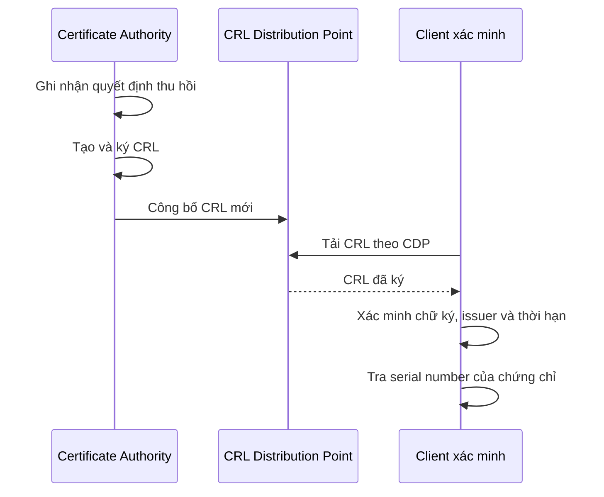
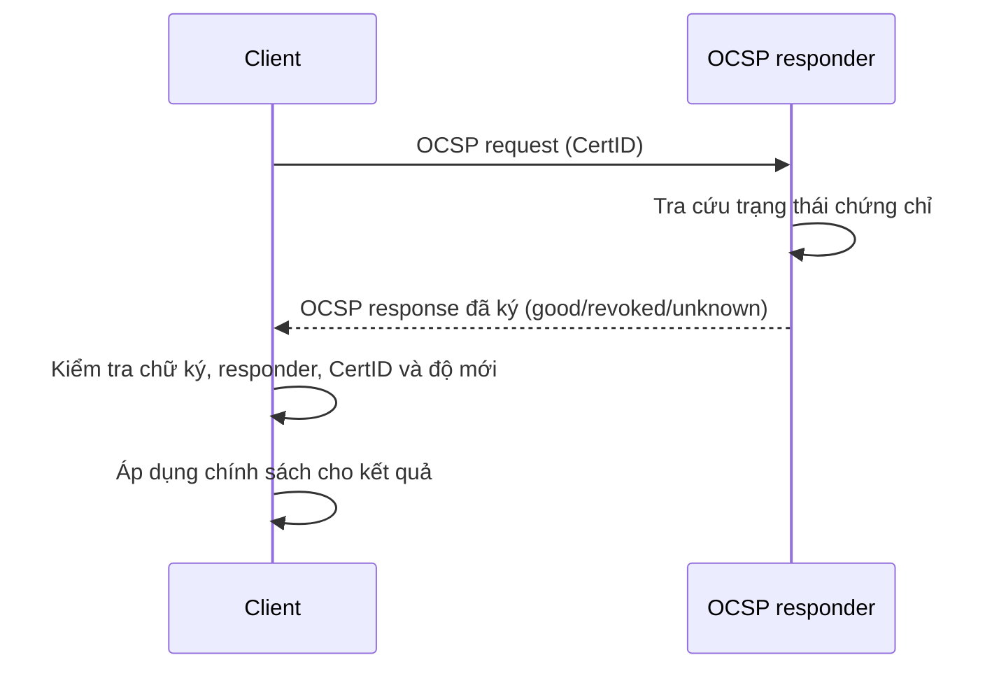

# Certificate revocation

Certificate revocation (thu hồi chứng chỉ) là việc tổ chức cấp chứng chỉ (Certificate Authority, CA) đánh dấu một chứng chỉ X.509 không còn được chấp nhận trước ngày hết hạn đã ghi trong chứng chỉ. Bên xác minh cần có cơ chế nhận biết trạng thái này để ngừng tin cậy chứng chỉ khi khóa riêng bị lộ, chứng chỉ được cấp sai hoặc quyền sử dụng đã thay đổi.

Trong module `SECURITY_KEY_MANAGEMENT_FUNDAMENTALS`, thu hồi chứng chỉ là điểm nối giữa PKI, chữ ký số và quản lý vòng đời khóa. Một chứng chỉ có thể còn hạn nhưng không còn an toàn để sử dụng. Khi private key bị xâm phạm, chỉ thu hồi chứng chỉ là chưa đủ: tổ chức còn phải thay key pair, phát hành chứng chỉ mới, triển khai thay thế và điều tra phạm vi ảnh hưởng.

## 1. Vì sao phải thu hồi chứng chỉ?

Chứng chỉ X.509 thường có trường `Not Before` và `Not After` xác định khoảng thời gian hiệu lực. Hết hạn là cơ chế kết thúc hiệu lực theo lịch. Thu hồi xử lý những tình huống phát sinh trước mốc đó.

Các lý do thường gặp gồm:

- **Key compromise:** private key tương ứng đã bị lộ, bị sao chép hoặc có dấu hiệu bị sử dụng trái phép.
- **CA compromise:** private key của CA bị xâm phạm, khiến kẻ tấn công có thể phát hành chứng chỉ giả.
- **Sai thông tin hoặc cấp sai:** chứng chỉ được cấp cho sai chủ thể, sai tên miền, sai public key hoặc không đáp ứng chính sách cấp phát.
- **Thay đổi quyền và quan hệ:** người dùng rời tổ chức, thiết bị bị mất, tên miền đổi chủ hoặc chủ thể không còn được phép sử dụng chứng chỉ.
- **Thay thế hoặc ngừng dịch vụ:** chứng chỉ được thay bằng chứng chỉ mới, hoặc dịch vụ không còn cần danh tính đó.
- **Vi phạm chính sách:** phát hiện chứng chỉ được phát hành hoặc sử dụng trái với quy định của CA hay tổ chức.

Ví dụ, một máy chủ HTTPS có chứng chỉ còn hiệu lực thêm sáu tháng nhưng private key bị lấy từ máy chủ. Kẻ tấn công có thể dùng key đó để giả mạo máy chủ trong các điều kiện phù hợp. Tổ chức cần thu hồi chứng chỉ cũ, tạo key pair mới, xin chứng chỉ mới và triển khai nó. Chờ chứng chỉ cũ hết hạn sẽ để lại một khoảng thời gian rủi ro không cần thiết.

## 2. Thu hồi khác gì hết hạn, xóa khóa và vô hiệu hóa tài khoản?

| Cơ chế | Điều gì thay đổi? | Giới hạn |
|---|---|---|
| Hết hạn (expiration) | Chứng chỉ vượt quá `Not After` | Không xử lý sự cố cần phản ứng trước ngày hết hạn |
| Thu hồi chứng chỉ | CA công bố chứng chỉ không còn được chấp nhận | Client phải nhận được và thực thi thông tin thu hồi theo chính sách |
| Xóa hoặc hủy private key | Khóa riêng bị loại khỏi nơi lưu trữ hoặc không thể sử dụng nữa | Không xóa được bản sao mà kẻ tấn công có thể đã lấy; cũng không tự thông báo cho các client |
| Vô hiệu hóa tài khoản | Quyền đăng nhập hoặc quyền ứng dụng của một tài khoản bị thu hồi | Không nhất thiết làm chứng chỉ X.509 đã phát hành mất hiệu lực |

Các cơ chế này bổ sung cho nhau. Ví dụ, khi nhân viên rời công ty, tổ chức có thể vô hiệu hóa tài khoản, thu hồi chứng chỉ người dùng, thu hồi hoặc thay các token liên quan, đồng thời xử lý private key trên thiết bị theo chính sách. Với khóa bị lộ, việc xóa bản sao tại máy chủ không chứng minh rằng mọi bản sao đã biến mất.

## 3. Cơ chế nhận biết trạng thái thu hồi

Hai cơ chế phổ biến trong PKI là Certificate Revocation List (CRL) và Online Certificate Status Protocol (OCSP). CA thường công bố địa chỉ liên quan trong các extension của chứng chỉ:

- `CRL Distribution Points` (CDP) chỉ đến nơi lấy CRL.
- `Authority Information Access` (AIA) có thể chứa địa chỉ OCSP responder và thông tin lấy chứng chỉ issuer.

Client cần xác minh nguồn và chữ ký của dữ liệu trạng thái, kiểm tra dữ liệu có đúng issuer/chứng chỉ cần hỏi hay không và đánh giá độ mới của dữ liệu. Chỉ tải được một tệp CRL hoặc nhận được một phản hồi OCSP không đồng nghĩa trạng thái đã được xác minh đúng.

## 4. CRL — Certificate Revocation List

CRL là danh sách chứng chỉ đã bị thu hồi do CA hoặc CRL issuer được chỉ định phát hành và ký số. Mỗi mục thường chứa số serial của chứng chỉ và thời điểm thu hồi; có thể có thêm lý do thu hồi. Client tải CRL, xác minh chữ ký bằng public key của CRL issuer thích hợp, kiểm tra phạm vi và thời hạn cập nhật, sau đó tra serial của chứng chỉ cần xác minh.



### Trường quan trọng trong CRL

| Trường | Ý nghĩa |
|---|---|
| `issuer` | CA hoặc CRL issuer phát hành CRL |
| `thisUpdate` | Thời điểm CRL hiện tại được phát hành hoặc có hiệu lực |
| `nextUpdate` | Thời điểm dự kiến phải có CRL mới |
| `revokedCertificates` | Các mục chứng chỉ bị thu hồi, thường nhận diện bằng serial number |
| `revocationDate` | Thời điểm thu hồi được ghi nhận cho mục chứng chỉ |
| `CRL Number` | Số thứ tự CRL giúp nhận biết phiên bản mới hơn |
| `Authority Key Identifier` | Hỗ trợ xác định khóa CA đã ký CRL |
| `CRL Reason` | Lý do thu hồi nếu được cung cấp |

CRL phải được kiểm tra chữ ký và tính mới. CRL quá cũ có thể chưa chứa sự kiện thu hồi vừa xảy ra; CRL đã vượt `nextUpdate` không nên được xem như dữ liệu cập nhật theo chính sách thông thường. Một client có thể lưu cache để giảm tải, nhưng thời gian cache ảnh hưởng trực tiếp đến khoảng trễ phát hiện thu hồi.

### Base CRL và Delta CRL

Với CA có số lượng chứng chỉ lớn, danh sách đầy đủ có thể tăng nhanh. **Base CRL** chứa trạng thái tại một mốc, còn **Delta CRL** chứa các thay đổi kể từ base CRL được tham chiếu. Client cần kết hợp đúng base và delta, kiểm tra số CRL, issuer, phạm vi và các định danh liên quan. Delta CRL không thể được dùng độc lập như một danh sách đầy đủ nếu không có base CRL tương ứng.

CRL phù hợp khi tổ chức muốn phân phối trạng thái theo lô, client có thể tải và cache dữ liệu, hoặc môi trường có nhiều client cần cùng một tập trạng thái. Nhược điểm là kích thước danh sách, độ trễ giữa các lần phát hành và nhu cầu phân phối dữ liệu đến client.

## 5. OCSP — Online Certificate Status Protocol

OCSP cho phép client hỏi một OCSP responder về trạng thái của một chứng chỉ cụ thể. Yêu cầu thường nhận diện chứng chỉ bằng `CertID`, bao gồm thông tin băm của issuer và serial number của chứng chỉ. Responder trả về trạng thái, thường là một trong ba giá trị:

- **good:** responder không có lý do để cho rằng chứng chỉ đã bị thu hồi trong phạm vi dữ liệu mà nó tra cứu. `good` không tự chứng minh chứng chỉ đã được phát hành, còn hiệu lực, có certificate chain hợp lệ, hostname đúng hoặc đáp ứng mọi chính sách khác.
- **revoked:** responder cho biết chứng chỉ đã bị thu hồi; phản hồi có thể kèm thời điểm và lý do.
- **unknown:** responder không thể xác định trạng thái của chứng chỉ đó.



Phản hồi OCSP cần được xác minh. Responder có thể ký bằng private key của CA phát hành hoặc bằng khóa của một responder được ủy quyền. Trong trường hợp ủy quyền, chứng chỉ của responder phải được xác thực theo quy tắc OCSP, bao gồm quyền sử dụng phù hợp cho việc ký phản hồi OCSP (`id-kp-OCSPSigning`). Client cũng cần kiểm tra phản hồi gắn với đúng CertID và có thời gian phù hợp.

Các trường thời gian như `producedAt`, `thisUpdate` và `nextUpdate` giúp đánh giá thời điểm tạo phản hồi và khoảng thời gian trạng thái được xem là mới. Một phản hồi đã ký nhưng quá cũ không nên được chấp nhận như trạng thái hiện tại. OCSP nonce có thể giúp liên kết phản hồi với yêu cầu cụ thể và giảm khả năng phát lại trong một số cấu hình, nhưng ảnh hưởng đến cache và cần được hỗ trợ nhất quán.

OCSP giảm nhu cầu tải toàn bộ danh sách thu hồi, nhưng phụ thuộc vào khả năng truy cập responder, độ sẵn sàng dịch vụ và chính sách cache. Truy vấn OCSP trực tiếp cũng có thể tiết lộ cho responder thông tin về chứng chỉ mà client đang kiểm tra.

## 6. OCSP stapling và Must-Staple

Với OCSP stapling, máy chủ TLS định kỳ lấy phản hồi OCSP đã được ký từ responder rồi gửi kèm phản hồi đó trong quá trình bắt tay TLS. Client có thể kiểm tra chữ ký và thời gian của phản hồi mà không cần tự truy vấn responder trong mỗi kết nối.

Lợi ích chính:

- Giảm số truy vấn trực tiếp từ client đến OCSP responder.
- Giảm độ trễ và phụ thuộc mạng của client trong lúc bắt tay TLS.
- Giảm việc responder quan sát từng client đang kết nối đến máy chủ.
- Cho phép máy chủ chủ động làm mới và cache phản hồi theo thời hạn hợp lệ.

Stapling chỉ có ích khi máy chủ lấy và cập nhật phản hồi đúng hạn, gửi đúng chứng chỉ và client kiểm tra phản hồi theo chính sách. Một số client có thể tiếp tục kết nối khi phản hồi stapled vắng mặt hoặc không thể xác minh; hành vi phụ thuộc chính sách và nền tảng.

**TLS Feature extension**, thường được gọi là OCSP Must-Staple trong một số ngữ cảnh triển khai, cho phép chứng chỉ biểu thị rằng client cần yêu cầu phản hồi OCSP stapled theo quy tắc tương ứng. Mức hỗ trợ và cách xử lý vẫn phụ thuộc client. Trước khi sử dụng, tổ chức phải bảo đảm máy chủ có thể cung cấp phản hồi hợp lệ liên tục; nếu không, kết nối có thể bị từ chối.

## 7. Soft fail và hard fail

Ngay cả khi chứng chỉ chưa bị thu hồi, client vẫn có thể không lấy được CRL hoặc không kết nối được OCSP responder do DNS, mạng, proxy, lỗi dịch vụ hay cấu hình sai. Tổ chức phải xác định cách xử lý tình huống không biết được trạng thái.

| Chính sách | Hành vi khi không xác định được trạng thái | Tác động |
|---|---|---|
| Soft fail | Tiếp tục xác minh nếu các điều kiện khác đạt | Tăng khả năng sẵn sàng, nhưng có thể chấp nhận chứng chỉ đã bị thu hồi khi dịch vụ trạng thái gặp lỗi |
| Hard fail | Từ chối kết nối hoặc xác minh | Tăng mức bảo vệ trước chứng chỉ bị thu hồi, nhưng lỗi CRL/OCSP có thể gây gián đoạn dịch vụ |

Soft fail và hard fail áp dụng cho trường hợp **không xác định được trạng thái**. Nếu phản hồi xác thực cho biết `revoked`, client phải xử lý theo chính sách thu hồi và không được diễn giải nó thành lỗi mạng để bỏ qua. Kết quả `unknown` cũng khác với `good`; cách xử lý cần được quy định rõ.

Chính sách có thể khác nhau theo mức độ nhạy cảm của hệ thống. Hệ thống xác thực quản trị, thiết bị hạ tầng trọng yếu hoặc dịch vụ có yêu cầu bảo đảm cao thường cần chính sách chặt hơn. Hệ thống hướng người dùng đại trà có thể cần thiết kế khả năng sẵn sàng cho responder, cache và phương án xử lý sự cố để tránh tạo ra điểm lỗi đơn.

## 8. Lý do thu hồi và phạm vi ảnh hưởng

CRL có thể chứa reason code cho biết lý do thu hồi. Một số giá trị thường gặp gồm:

| Reason code | Ý nghĩa khái quát |
|---|---|
| `unspecified` | Không nêu lý do cụ thể |
| `keyCompromise` | Private key tương ứng bị xâm phạm |
| `cACompromise` | Khóa của CA bị xâm phạm |
| `affiliationChanged` | Thông tin liên kết hoặc tổ chức của chủ thể thay đổi |
| `superseded` | Chứng chỉ được thay thế bởi chứng chỉ khác |
| `cessationOfOperation` | Hoạt động cần chứng chỉ đã chấm dứt |
| `certificateHold` | Chứng chỉ tạm thời bị đặt ở trạng thái giữ/không chấp nhận |
| `privilegeWithdrawn` | Quyền hoặc đặc quyền liên quan đã bị rút |
| `AACompromise` | Khóa của Attribute Authority bị xâm phạm |

Ý nghĩa vận hành của từng reason code cần được hiểu theo chuẩn và chính sách CA. `certificateHold` có thể được gỡ bằng quy trình phù hợp; `removeFromCRL` được dùng trong một số ngữ cảnh delta CRL để biểu thị việc loại mục đang hold khỏi danh sách. Không nên coi mọi lý do thu hồi đều có thể đảo ngược theo cùng một cách.

Phạm vi ảnh hưởng phụ thuộc loại khóa và vị trí chứng chỉ trong PKI:

- **Leaf certificate bị thu hồi:** ảnh hưởng đến danh tính của một máy chủ, người dùng hoặc thiết bị.
- **Intermediate CA bị thu hồi:** có thể ảnh hưởng đến nhiều leaf certificate do CA đó phát hành và các chain phụ thuộc.
- **Root CA bị mất tin cậy hoặc khóa bị xâm phạm:** ảnh hưởng có thể lan rộng đến toàn bộ nhánh PKI. Vì trust anchor thường được cấu hình riêng trong trust store, việc xử lý root thường cần phân phối thay đổi trust store hoặc chính sách distrust, không chỉ dựa vào CRL thông thường.

## 9. Quy trình ứng phó khi cần thu hồi

Quy trình cần có người chịu trách nhiệm, bằng chứng, thời hạn và phương án thay thế để tránh việc thu hồi gây gián đoạn kéo dài.

1. **Phát hiện và xác minh sự kiện.** Thu thập bằng chứng về key compromise, sai sót cấp phát, thay đổi quyền hoặc yêu cầu ngừng chứng chỉ. Ghi nhận serial number, issuer, chủ thể, thời điểm và hệ thống sử dụng.
2. **Đánh giá phạm vi.** Xác định chứng chỉ nào bị ảnh hưởng, key pair nào liên quan, CA nào phát hành và các dịch vụ nào đang tin cậy chứng chỉ đó.
3. **Kiểm soát nguy cơ tức thời.** Nếu khóa bị lộ, hạn chế quyền truy cập, dừng sử dụng khóa cũ và áp dụng biện pháp giảm thiểu trên dịch vụ. Thu hồi chứng chỉ không tự động ngắt mọi kết nối hoặc phiên đã được thiết lập.
4. **Phê duyệt và thực hiện thu hồi.** CA hoặc người có thẩm quyền cập nhật trạng thái thu hồi theo quy trình, ghi rõ lý do và thời điểm.
5. **Công bố trạng thái mới.** Phát hành CRL mới, cập nhật OCSP responder và kiểm tra các endpoint công bố có thể truy cập được.
6. **Tạo key pair thay thế.** Khi private key có nguy cơ bị lộ, tạo khóa mới trong môi trường được kiểm soát. Không tái sử dụng key pair cũ chỉ để cấp lại chứng chỉ.
7. **Phát hành và triển khai chứng chỉ mới.** Cập nhật cấu hình máy chủ, thiết bị hoặc người dùng; xác minh chain, hostname, mục đích và khả năng tương thích.
8. **Kiểm tra việc thực thi thu hồi.** Kiểm thử từ các client và môi trường khác nhau, xác minh CRL/OCSP mới được nhận và trạng thái cũ không còn được chấp nhận theo chính sách.
9. **Điều tra và hoàn tất hồ sơ.** Kiểm tra log sử dụng khóa, bản sao lưu, quyền truy cập và dấu hiệu giả mạo; lưu bằng chứng, quyết định và kết quả khắc phục.

Nếu private key CA bị xâm phạm, sự cố cần quy trình khẩn cấp ở cấp PKI. Tổ chức phải xác định khoảng thời gian và chứng chỉ có thể đã bị ký trái phép, đánh giá các intermediate/leaf phụ thuộc, xử lý trust anchor nếu cần và phối hợp cập nhật cho các bên sử dụng. Việc thay CA có thể yêu cầu tái cấp phát hàng loạt chứng chỉ và phân phối trust store mới.

## 10. Những giới hạn cần hiểu khi kiểm tra thu hồi

Thu hồi là cơ chế phân phối trạng thái, nên hiệu quả phụ thuộc vào thời gian phát hiện, thời gian CA công bố, cache và tần suất client kiểm tra. Một chứng chỉ vừa bị thu hồi có thể vẫn được một client chấp nhận trong một khoảng thời gian nếu client đang dùng CRL/OCSP cache chưa cập nhật hoặc không thực thi kiểm tra thu hồi.

Ngoài ra:

- Một kết nối TLS đã thiết lập không tự động bị ngắt chỉ vì chứng chỉ được thu hồi sau đó.
- Phiên TLS được tiếp tục (session resumption), kết nối keep-alive hoặc cơ chế cache có thể không thực hiện đầy đủ quy trình xác minh chứng chỉ mới như một kết nối mới; hành vi cụ thể phụ thuộc giao thức và triển khai.
- `good` trong OCSP chỉ thể hiện responder không ghi nhận chứng chỉ bị thu hồi theo dữ liệu của nó; client vẫn phải xác minh chain, hostname, thời hạn và mục đích.
- Root CA thường là trust anchor cấu hình ngoài đường dẫn chứng chỉ thông thường. Gỡ bỏ hoặc distrust root cần cập nhật trust store/policy của các client liên quan.
- Việc xóa khóa tại một kho không chứng minh bản sao, snapshot, bản sao lưu hoặc bản đã bị đánh cắp đều đã bị xóa.

Do đó, với sự cố khóa bị lộ, ngoài thu hồi cần vô hiệu hóa hoặc thay thế credential ở lớp ứng dụng, đóng các phiên có nguy cơ, rà soát log và thay các bí mật có thể đã bị truy cập.

## 11. Thực hành kiểm tra CRL và certificate bằng OpenSSL

Các lệnh sau dùng tệp chứng chỉ và CRL của môi trường thử nghiệm. Tên tệp và đường dẫn phải được thay bằng dữ liệu thực tế từ CA mà bạn có quyền kiểm tra.

Đọc thông tin CRL:

```bash
openssl crl -in intermediate.crl.pem -noout \
  -issuer -lastupdate -nextupdate -crlnumber -text
```

Xác minh leaf certificate với CRL của issuer và root trust anchor:

```bash
openssl verify -crl_check \
  -CAfile root-ca.pem \
  -untrusted intermediate-ca.pem \
  -CRLfile intermediate.crl.pem \
  server.pem
```

`-crl_check` yêu cầu kiểm tra trạng thái thu hồi của chứng chỉ đầu cuối theo CRL được cung cấp. Để kiểm tra CRL cho toàn bộ chain, có tùy chọn `-crl_check_all`, nhưng cần cung cấp đầy đủ CRL thích hợp cho các CA liên quan. Kết quả phụ thuộc vào chain, CRL, trust store và phiên bản OpenSSL.

Có thể truy vấn OCSP bằng OpenSSL khi có URL responder và chứng chỉ issuer phù hợp:

```bash
openssl ocsp \
  -issuer intermediate-ca.pem \
  -cert server.pem \
  -url http://ocsp.example.test \
  -CAfile root-ca.pem \
  -resp_text
```

Ví dụ trên minh họa cách gửi yêu cầu và hiển thị phản hồi. Trong môi trường thực tế, cần cấu hình đúng chuỗi tin cậy của responder, kiểm tra chứng chỉ responder được ủy quyền nếu có, kiểm tra độ mới của phản hồi và đánh giá kết quả `good`, `revoked` hoặc `unknown`. Không coi việc nhận được phản hồi là đủ nếu chữ ký hoặc thời gian phản hồi chưa được xác minh.

## 12. Liên hệ với KMS/HSM và quản lý vòng đời khóa

CA ký chứng chỉ bằng private key của CA; CRL có thể được ký bằng khóa CA hoặc khóa của CRL issuer được chỉ định. OCSP responder cũng cần khóa để ký phản hồi, có thể là khóa CA hoặc khóa responder được ủy quyền. Vì vậy, hạ tầng thu hồi phụ thuộc trực tiếp vào bảo vệ khóa:

- **Bảo vệ khóa ký CA:** dùng HSM hoặc dịch vụ quản lý khóa có kiểm soát phù hợp, hạn chế xuất khóa, phân quyền người yêu cầu và người phê duyệt, áp dụng kiểm soát nhiều người cho thao tác nhạy cảm.
- **Bảo vệ khóa OCSP responder:** tách quyền ký phản hồi khỏi quyền quản trị CA khi kiến trúc cho phép; giới hạn mục đích và thời gian sử dụng khóa responder.
- **Kiểm toán:** ghi lại yêu cầu thu hồi, người phê duyệt, serial, reason code, thời điểm phát hành CRL, cập nhật OCSP và các thao tác với khóa. Không ghi private key hoặc bí mật vào log.
- **Sẵn sàng và khôi phục:** giám sát endpoint CRL/OCSP, thời điểm `nextUpdate`, độ trễ công bố và khả năng khôi phục dịch vụ. Cần kiểm thử cả tình huống responder hoặc kho khóa bị gián đoạn.
- **Xoay vòng khóa:** khi thay khóa CA hoặc responder, cập nhật chứng chỉ, cấu hình xác minh và đường dẫn tin cậy liên quan; xác minh client chấp nhận trạng thái mới.
- **Sao lưu:** bảo vệ bản sao lưu khóa CA theo chính sách và kiểm tra khả năng khôi phục. Với khóa đã bị xâm phạm, không khôi phục để tiếp tục sử dụng khóa cũ.

KMS/HSM có thể giúp bảo vệ thao tác ký và kiểm soát quyền sử dụng private key, nhưng không tự làm cho chứng chỉ bị thu hồi ở tất cả client. Ngược lại, CRL/OCSP có thể thông báo trạng thái thu hồi nhưng không thay thế việc vô hiệu hóa, thay khóa và điều tra sự cố trong hệ thống sở hữu private key.

## 13. Checklist thiết kế và vận hành

- [ ] Xác định các loại chứng chỉ, issuer, chủ sở hữu và hệ thống đang sử dụng chúng.
- [ ] Công bố CDP/AIA chính xác và bảo đảm endpoint CRL/OCSP sẵn sàng.
- [ ] Xác minh chữ ký, issuer, CertID/serial và thời gian cập nhật của CRL/OCSP.
- [ ] Đặt chính sách soft fail hoặc hard fail theo mức độ nhạy cảm và kiểm thử khi dịch vụ trạng thái bị lỗi.
- [ ] Theo dõi `thisUpdate`, `nextUpdate`, CRL Number và độ trễ công bố trạng thái.
- [ ] Bảo vệ khóa ký CA và OCSP responder bằng phân quyền tối thiểu, HSM/KMS và audit log.
- [ ] Có quy trình thu hồi khẩn cấp khi leaf key, intermediate CA key hoặc root CA key bị xâm phạm.
- [ ] Khi key compromise, tạo key pair mới, cấp chứng chỉ mới và thay credential liên quan.
- [ ] Kiểm tra hành vi của client, session resumption và các phiên đang hoạt động sau sự kiện thu hồi.
- [ ] Diễn tập khôi phục CRL/OCSP responder và quy trình phân phối thay đổi trust anchor.

Thu hồi chứng chỉ giúp PKI phản ứng với sự cố trước khi chứng chỉ hết hạn. Mức bảo vệ thực tế phụ thuộc vào việc CA công bố trạng thái kịp thời, client xác minh và thực thi đúng chính sách, cùng quy trình thay khóa và xử lý sự cố được vận hành đầy đủ.
