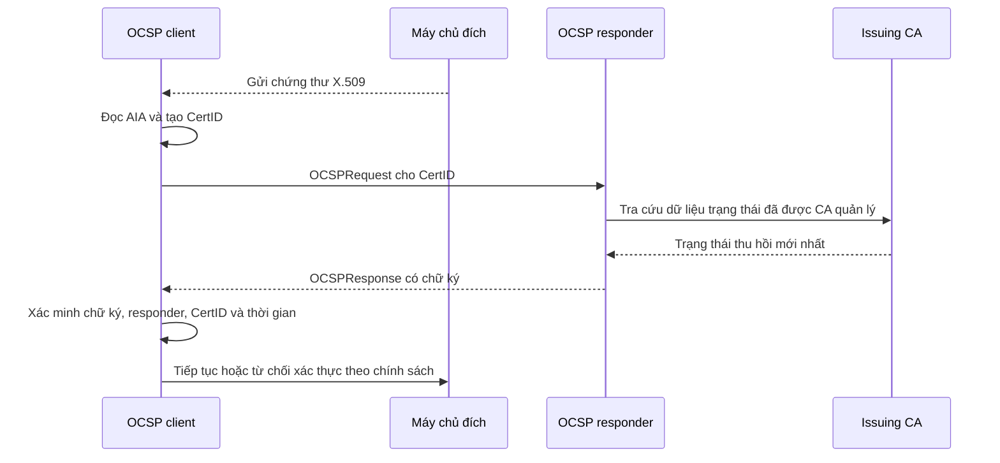
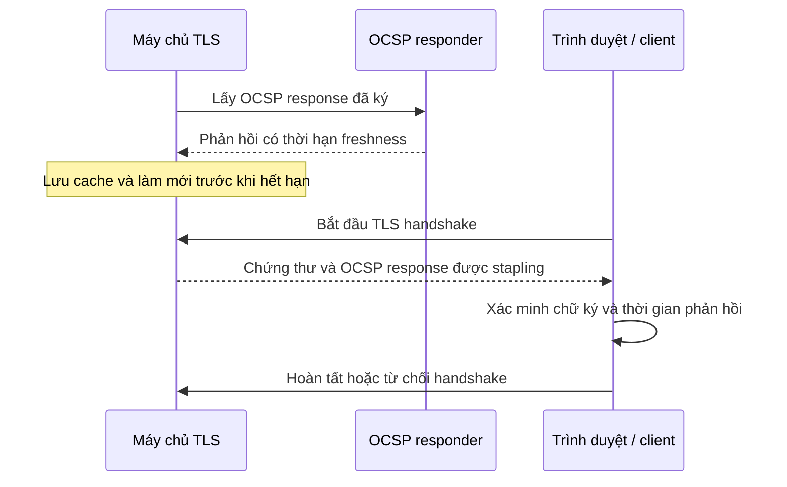

# OCSP

Khi một máy chủ trình bày chứng thư TLS, trình duyệt cần xác định chứng thư đó có được một CA tin cậy phát hành và còn được phép sử dụng hay không. Chữ ký của CA, thời hạn hiệu lực và tên miền trong chứng thư là những phần quan trọng, nhưng chúng chưa trả lời được một câu hỏi khác: **CA có thu hồi chứng thư này trước ngày hết hạn hay chưa?**

OCSP (Online Certificate Status Protocol) là giao thức cho phép bên kiểm tra hỏi dịch vụ của CA về trạng thái thu hồi của một chứng thư X.509. OCSP kết nối trực tiếp việc phát hành, sử dụng và thu hồi chứng thư với hoạt động quản lý khóa: CA phải duy trì dữ liệu trạng thái chính xác, bảo vệ khóa ký phản hồi và cung cấp phản hồi đủ mới để bên nhận có thể tin cậy.

## 1. OCSP giải quyết vấn đề gì?

Một chứng thư có thể vẫn nằm trong thời hạn `Not Before` và `Not After` nhưng không còn an toàn để sử dụng. Ví dụ:

- Khóa riêng tương ứng với chứng thư máy chủ bị lộ.
- Máy chủ hoặc thiết bị được cấp chứng thư đã ngừng thuộc quyền quản lý của tổ chức.
- Chứng thư được cấp nhầm hoặc thông tin định danh trong chứng thư không còn đúng.
- CA phát hiện một sự cố khiến chứng thư cần bị thu hồi trước hạn.

CA ghi nhận quyết định thu hồi và công bố trạng thái để các bên phụ thuộc vào chứng thư có thể kiểm tra. Nếu không có cơ chế kiểm tra, một bên có thể tiếp tục chấp nhận chứng thư đã bị thu hồi cho đến ngày hết hạn.

Trước OCSP, một cách phổ biến là tải **CRL (Certificate Revocation List)**, tức danh sách chứng thư đã bị thu hồi. OCSP cho phép hỏi trạng thái của một chứng thư cụ thể theo nhu cầu. Vì vậy, bên kiểm tra thường không phải tải toàn bộ danh sách thu hồi lớn chỉ để kiểm tra một chứng thư.

OCSP chỉ cung cấp thông tin về trạng thái thu hồi. Nó **không thay thế** các bước xác minh chứng thư khác như xây dựng chuỗi tin cậy, kiểm tra chữ ký, thời hạn, mục đích sử dụng, tên máy chủ và chính sách của bên nhận.

## 2. Các thành phần tham gia

| Thành phần | Vai trò |
|---|---|
| Certificate holder | Máy chủ, người dùng hoặc thiết bị sở hữu chứng thư cần được kiểm tra. |
| OCSP client | Trình duyệt, thư viện TLS, hệ điều hành hoặc ứng dụng gửi yêu cầu OCSP. |
| OCSP responder | Dịch vụ nhận yêu cầu và trả về trạng thái chứng thư. Responder có thể do CA vận hành hoặc được CA ủy quyền. |
| Issuing CA | CA đã phát hành chứng thư; chịu trách nhiệm về trạng thái thu hồi và việc ủy quyền responder. |
| Relying party | Bên dựa vào chứng thư để thiết lập kết nối hoặc xác thực danh tính. Trong nhiều trường hợp, đây cũng là OCSP client. |

Chứng thư X.509 thường chứa phần mở rộng **Authority Information Access (AIA)**. Trong AIA có thể có một URI với phương thức truy cập OCSP (`id-ad-ocsp`). OCSP client đọc URI này để biết nơi gửi yêu cầu. Không phải chứng thư nào cũng có AIA OCSP; ứng dụng cần xử lý theo chính sách của mình khi thông tin này vắng mặt.

Yêu cầu OCSP nhận diện chứng thư bằng `CertID`. Thông tin này bao gồm thuật toán băm, giá trị băm tên issuer, giá trị băm khóa issuer và số sê-ri của chứng thư. Việc ghép issuer với số sê-ri giúp responder xác định đúng chứng thư cần tra cứu, kể cả khi các CA khác nhau có thể phát hành chứng thư với cùng số sê-ri.

## 3. Luồng kiểm tra OCSP

Một luồng kiểm tra trực tiếp thường diễn ra như sau:



Các bước chính:

1. Máy chủ gửi chứng thư trong quá trình bắt tay TLS hoặc trong một quy trình xác thực khác.
2. Client đọc AIA để tìm OCSP responder, rồi tạo yêu cầu chứa `CertID` của chứng thư cần kiểm tra.
3. Client gửi yêu cầu bằng HTTP GET hoặc HTTP POST. Với POST, nội dung thường là dữ liệu ASN.1 DER và kiểu nội dung `application/ocsp-request`.
4. Responder tra cứu trạng thái và tạo `OCSPResponse`. Phản hồi thường được ký số; kiểu nội dung HTTP tương ứng là `application/ocsp-response`.
5. Client xác minh phản hồi: chữ ký, danh tính và quyền của responder, `CertID`, trạng thái chứng thư và khoảng thời gian hiệu lực của thông tin.
6. Client áp dụng chính sách để quyết định tiếp tục hay từ chối xác thực.

Chữ ký số của phản hồi là yếu tố bảo vệ tính toàn vẹn và nguồn gốc dữ liệu. Việc truyền OCSP qua HTTPS có thể bổ sung bảo vệ đường truyền và quyền riêng tư, nhưng client vẫn phải xác minh chữ ký phản hồi theo quy tắc OCSP; chỉ dựa vào TLS của kết nối đến responder là chưa đủ.

## 4. Phân biệt trạng thái phản hồi và trạng thái chứng thư

OCSP có hai lớp trạng thái rất dễ bị nhầm lẫn.

**Lớp thứ nhất là trạng thái xử lý yêu cầu (`OCSPResponseStatus`).** Nó cho biết responder có xử lý được thông điệp hay không.

| Trạng thái giao thức | Ý nghĩa |
|---|---|
| `successful` | Responder tạo được phản hồi OCSP. Client cần đọc tiếp trạng thái chứng thư bên trong. |
| `malformedRequest` | Yêu cầu không đúng định dạng. |
| `internalError` | Responder gặp lỗi nội bộ. |
| `tryLater` | Responder đề nghị client thử lại sau. |
| `sigRequired` | Responder yêu cầu yêu cầu phải có chữ ký. |
| `unauthorized` | Responder không được phép xử lý yêu cầu đó. |

**Lớp thứ hai là trạng thái chứng thư (`CertStatus`)**, xuất hiện trong một phản hồi xử lý thành công.

| Trạng thái chứng thư | Ý nghĩa và cách hiểu |
|---|---|
| `good` | Responder không ghi nhận chứng thư đã bị thu hồi tại thời điểm trạng thái được xác định. Điều này không chứng minh chứng thư hợp lệ về mọi mặt, cũng không tự chứng minh chứng thư đã được phát hành đúng hoặc chuỗi tin cậy đáng tin cậy. |
| `revoked` | Chứng thư đã bị thu hồi. Phản hồi có thể nêu thời điểm thu hồi và lý do thu hồi. Client cần từ chối chứng thư theo chính sách áp dụng. |
| `unknown` | Responder không có đủ thông tin để xác định trạng thái của chứng thư. Không được diễn giải `unknown` thành `good`. |

Ví dụ, `OCSPResponseStatus=successful` chỉ có nghĩa là responder trả lời được yêu cầu. Nếu `CertStatus=revoked`, chứng thư vẫn bị thu hồi. Ngược lại, lỗi `tryLater` là lỗi xử lý yêu cầu, không phải kết luận rằng chứng thư đã bị thu hồi.

Một số lý do thu hồi thường gặp gồm `keyCompromise` (khóa riêng bị lộ), `cACompromise` (khóa CA bị lộ), `superseded` (được thay thế bởi chứng thư khác), `cessationOfOperation` (ngừng hoạt động) và `certificateHold` (tạm đình chỉ). Lý do thu hồi giúp hệ thống quản trị hiểu sự kiện và xử lý theo quy trình ứng phó tương ứng.

## 5. Chữ ký phản hồi và độ tin cậy của responder

OCSP response không chỉ là một chuỗi văn bản thông báo `good` hoặc `revoked`. Phản hồi cơ bản (`BasicOCSPResponse`) chứa dữ liệu trạng thái, thuật toán chữ ký, chữ ký số và có thể kèm chứng thư của responder. Phần dữ liệu trạng thái xác định responder, chứng thư được tra cứu, trạng thái và các mốc thời gian liên quan.

Có hai mô hình ký phản hồi phổ biến:

- **CA trực tiếp ký phản hồi:** khóa ký của CA được dùng để ký dữ liệu OCSP. Mô hình này đơn giản về quan hệ tin cậy nhưng làm tăng số hoạt động phải thực hiện bằng khóa CA.
- **Responder được ủy quyền ký phản hồi:** CA cấp một chứng thư riêng cho OCSP responder. Chứng thư này phải cho phép mục đích ký OCSP, thường được biểu thị bằng Extended Key Usage `id-kp-OCSPSigning`. Client xác minh chứng thư responder và chữ ký phản hồi theo quy tắc OCSP, đồng thời kiểm tra responder được CA phát hành chứng thư gốc ủy quyền phù hợp.

Với responder được ủy quyền, khóa ký OCSP nên được tách khỏi khóa CA gốc. Tổ chức có thể đặt khóa này trong HSM hoặc dịch vụ KMS có khả năng ký phù hợp, giới hạn quyền gọi thao tác ký, ghi log người hoặc dịch vụ yêu cầu ký và giám sát bất thường. Việc tách khóa giúp giảm số nơi và số quy trình cần sử dụng khóa CA có mức ảnh hưởng rất lớn.

Một số chứng thư responder có thể chứa phần mở rộng `id-pkix-ocsp-nocheck`. Phần mở rộng này cho biết client không cần thực hiện kiểm tra thu hồi đối với chính chứng thư responder theo cơ chế được quy định, nhằm tránh vòng lặp kiểm tra trạng thái. Đây là lựa chọn triển khai cần được cân nhắc trong chính sách PKI; nó không loại bỏ yêu cầu xác minh chữ ký và quyền ký OCSP của responder.

Nếu khóa ký responder bị xâm phạm, kẻ tấn công có thể tạo phản hồi giả trong phạm vi khóa đó được tin cậy. Vì vậy, khóa responder cần có chủ sở hữu, mục đích sử dụng, thời hạn, quyền truy cập, quy trình xoay vòng, giám sát và kế hoạch ứng phó sự cố rõ ràng giống các khóa quan trọng khác.

## 6. Thời gian hiệu lực, cache và nonce

Trạng thái thu hồi thay đổi theo thời gian. Một phản hồi OCSP cần mang đủ thông tin thời gian để client đánh giá dữ liệu có còn mới hay không.

| Trường thời gian | Ý nghĩa |
|---|---|
| `producedAt` | Thời điểm responder tạo phản hồi. |
| `thisUpdate` | Thời điểm trạng thái được xác định là đúng gần nhất. |
| `nextUpdate` | Thời điểm dự kiến có thông tin trạng thái mới. Trường này có thể không xuất hiện; khi đó client phải áp dụng chính sách freshness của mình. |

Client cần kiểm tra thời gian hệ thống, giới hạn độ lệch đồng hồ được chấp nhận và từ chối phản hồi quá cũ hoặc có mốc thời gian không hợp lý. Nếu client chấp nhận phản hồi cũ quá lâu, một chứng thư vừa bị thu hồi vẫn có thể được chấp nhận dựa trên trạng thái `good` trước đó.

OCSP responder và các thành phần trung gian có thể cache phản hồi để giảm tải. Cache phải tôn trọng `thisUpdate`, `nextUpdate` và chính sách freshness; không được kéo dài thời gian sử dụng vượt quá giới hạn mà client cho phép. Khi CA thu hồi chứng thư, dữ liệu trạng thái cần được cập nhật và các cache cần hết hạn hoặc được làm mới đủ nhanh theo mục tiêu vận hành.

OCSP có thể dùng phần mở rộng **nonce** để gắn yêu cầu với phản hồi tương ứng. Nonce giúp giảm nguy cơ kẻ tấn công phát lại một phản hồi cũ cho yêu cầu mới. Tuy nhiên, nonce làm giảm khả năng dùng chung cache vì mỗi yêu cầu có giá trị riêng; mức hỗ trợ cũng phụ thuộc vào client và responder. Do đó, cần cân nhắc giữa tính mới của phản hồi, khả năng tương thích và hiệu năng thay vì bật nonce một cách máy móc.

## 7. OCSP stapling

Trong kiểm tra OCSP trực tiếp, mỗi client có thể phải liên hệ responder. Cách này tạo thêm độ trễ, tải cho responder và có thể tiết lộ cho CA biết client đang kiểm tra chứng thư nào. **OCSP stapling** giảm các vấn đề đó bằng cách để máy chủ lấy phản hồi OCSP đã ký trước, lưu trong thời gian phù hợp và gửi kèm phản hồi đó trong quá trình bắt tay TLS.



Máy chủ không tự ký trạng thái. Nó chỉ chuyển tiếp phản hồi đã được OCSP responder ký, vì vậy client vẫn phải xác minh chữ ký và freshness như khi nhận phản hồi trực tiếp. Máy chủ cần tự động làm mới phản hồi trước khi hết hạn, theo dõi lỗi lấy phản hồi và cảnh báo khi phản hồi sắp hết hạn.

Stapling giúp giảm số truy vấn trực tiếp từ client đến CA, cải thiện độ trễ và hạn chế việc CA quan sát từng lần client kiểm tra chứng thư. Nó cũng chuyển một phần trách nhiệm vận hành sang máy chủ TLS: nếu máy chủ không cập nhật phản hồi, nó có thể gửi trạng thái cũ hoặc không gửi được phản hồi.

Một số hệ thống hỗ trợ **TLS Feature `status_request`**, thường được gọi là *Must-Staple*, để yêu cầu client chỉ chấp nhận chứng thư khi máy chủ cung cấp OCSP response stapled hợp lệ. Cơ chế này có thể tăng mức bảo vệ trước tình huống không có phản hồi, nhưng cần xác nhận khả năng hỗ trợ của client và bảo đảm quy trình làm mới stapling ổn định. Nếu triển khai mà máy chủ thường xuyên thiếu phản hồi, kết nối hợp lệ có thể bị từ chối.

## 8. OCSP và CRL khác nhau thế nào?

| Tiêu chí | CRL | OCSP trực tiếp | OCSP stapling |
|---|---|---|---|
| Dữ liệu nhận được | Danh sách nhiều chứng thư đã thu hồi | Trạng thái của chứng thư được hỏi | Phản hồi OCSP được máy chủ gửi kèm |
| Cách phân phối | Client tải danh sách từ điểm phân phối CRL | Client gửi yêu cầu đến responder | Máy chủ TLS chủ động lấy và gửi phản hồi |
| Tải mạng | Có thể lớn khi danh sách dài | Thường nhỏ cho mỗi truy vấn; tăng theo số client | Giảm truy vấn lặp lại từ từng client |
| Độ mới | Phụ thuộc chu kỳ phát hành CRL và cache | Phụ thuộc thời gian cập nhật và freshness của phản hồi | Phụ thuộc chu kỳ làm mới của máy chủ và freshness của phản hồi |
| Quyền riêng tư | Client tải danh sách, ít tiết lộ chứng thư đơn lẻ đang kiểm tra | Truy vấn có thể tiết lộ chứng thư client đang quan tâm | Giảm việc client liên hệ trực tiếp CA cho mỗi lần kiểm tra |
| Vận hành | Phải phát hành, phân phối và cache danh sách | Phải duy trì responder sẵn sàng | Phải duy trì responder và tự động làm mới dữ liệu trên máy chủ |

Không có một lựa chọn phù hợp cho mọi hệ thống. CRL có thể thích hợp với môi trường cần phân phối danh sách theo lô hoặc khi client không hỗ trợ OCSP. OCSP phù hợp khi cần tra cứu từng chứng thư. Stapling thường hữu ích cho dịch vụ TLS có lưu lượng lớn và có khả năng quản lý phản hồi định kỳ. Một PKI có thể hỗ trợ nhiều cơ chế để phù hợp với các loại client khác nhau.

## 9. Xử lý lỗi và các rủi ro vận hành

Không phải mọi lần kiểm tra OCSP đều nhận được một phản hồi hợp lệ. Responder có thể ngừng hoạt động, mạng có thể bị gián đoạn, phản hồi có thể quá hạn hoặc trạng thái có thể là `unknown`. Client và ứng dụng cần có chính sách rõ ràng cho từng tình huống.

Hai cách xử lý lỗi thường được nhắc đến là:

- **Soft-fail / fail-open:** nếu không thể lấy hoặc xác minh trạng thái OCSP, client vẫn có thể tiếp tục xác thực chứng thư. Cách này cải thiện khả năng sẵn sàng nhưng có nguy cơ chấp nhận chứng thư đã bị thu hồi trong thời gian responder gặp sự cố.
- **Hard-fail / fail-closed:** nếu không có trạng thái đáng tin cậy, client từ chối chứng thư. Cách này giảm nguy cơ chấp nhận chứng thư bị thu hồi nhưng có thể làm gián đoạn kết nối khi responder hoặc mạng gặp sự cố.

Chính sách phù hợp phụ thuộc mức độ nhạy cảm của dịch vụ, khả năng hỗ trợ của client và yêu cầu sẵn sàng. Hệ thống thanh toán, quản trị hạ tầng hoặc xác thực nội bộ có thể cần chính sách nghiêm ngặt hơn một website công khai. Dù chọn chính sách nào, `revoked`, `unknown`, lỗi giao thức, chữ ký sai và phản hồi quá hạn phải được phân biệt trong log và trong quyết định xác thực.

Các rủi ro cần được quản lý gồm:

1. **Responder không sẵn sàng:** theo dõi tỷ lệ lỗi, độ trễ, dung lượng và thời gian phục hồi; triển khai dự phòng khi cần.
2. **Phản hồi quá cũ:** cảnh báo trước `nextUpdate`, tự động làm mới và đặt giới hạn tuổi tối đa cho dữ liệu cache.
3. **Phát lại phản hồi cũ:** xác minh chữ ký, `CertID` và các mốc thời gian; cân nhắc nonce khi mô hình triển khai yêu cầu.
4. **Khóa ký responder bị lộ:** bảo vệ khóa bằng HSM/KMS phù hợp, phân quyền tối thiểu, ghi audit, giới hạn tốc độ ký và có quy trình thu hồi chứng thư responder.
5. **Lộ thông tin truy vấn:** cân nhắc OCSP stapling, chính sách log và bảo vệ dữ liệu truy vấn tại responder.
6. **Sai lệch trạng thái giữa CA và responder:** bảo đảm sự kiện thu hồi được truyền đến hệ thống trạng thái đúng hạn, có kiểm tra đồng bộ và quy trình xử lý sự cố.

Không nên xem một phản hồi `good` là bằng chứng duy nhất cho an toàn của kết nối. Client vẫn cần kiểm tra đầy đủ chuỗi chứng thư và các điều kiện xác thực khác. Tương tự, tổ chức vận hành PKI cần giám sát cả quy trình thu hồi ở CA lẫn dịch vụ OCSP để trạng thái được công bố đúng và kịp thời.

## 10. Thực hành kiểm tra bằng OpenSSL

Giả sử có ba thông tin:

- `leaf.pem`: chứng thư cần kiểm tra.
- `issuer.pem`: chứng thư CA đã phát hành `leaf.pem`.
- `http://ocsp.example.test`: địa chỉ OCSP responder lấy từ AIA của chứng thư (địa chỉ ví dụ, cần thay bằng URI thực tế).

Có thể gửi yêu cầu OCSP và hiển thị phản hồi bằng lệnh:

```bash
openssl ocsp \
  -issuer issuer.pem \
  -cert leaf.pem \
  -url http://ocsp.example.test \
  -CAfile issuer-chain.pem \
  -resp_text
```

Trong đó, `-issuer` cung cấp chứng thư issuer để tạo `CertID`, `-cert` chỉ định chứng thư cần kiểm tra, `-url` chỉ định responder, `-CAfile` cung cấp CA tin cậy để xác minh phản hồi và `-resp_text` hiển thị nội dung phản hồi. Tùy cấu hình PKI, cần cung cấp đúng chuỗi CA và chứng thư responder được ủy quyền để xác minh thành công.

Để kiểm tra máy chủ TLS có gửi OCSP stapling hay không, có thể dùng:

```bash
openssl s_client \
  -connect example.com:443 \
  -servername example.com \
  -status
```

Thay `example.com` bằng tên máy chủ cần kiểm tra. Tùy chọn `-status` yêu cầu máy chủ gửi OCSP response stapled nếu có. Đọc phần `OCSP response` trong kết quả để xem máy chủ có gửi phản hồi hay không và phản hồi có thông tin thời gian, trạng thái như mong đợi không. Việc lệnh hiển thị một phản hồi không tự thay thế toàn bộ quy trình xác minh của ứng dụng thực tế.

## 11. Checklist triển khai OCSP trong hệ thống

- Lấy URI responder từ AIA của chứng thư và xử lý trường hợp chứng thư không có URI OCSP.
- Xác minh chữ ký phản hồi, danh tính responder, quyền ký OCSP và quan hệ với CA phát hành.
- Đối chiếu `CertID` trong phản hồi với chứng thư đang được kiểm tra.
- Phân biệt `good`, `revoked`, `unknown` với các lỗi `OCSPResponseStatus`.
- Kiểm tra `thisUpdate`, `nextUpdate`, `producedAt` và độ lệch đồng hồ theo chính sách freshness.
- Đặt giới hạn cache, timeout, retry và cơ chế dự phòng phù hợp với mức độ quan trọng của dịch vụ.
- Xác định rõ cách xử lý khi responder không truy cập được hoặc phản hồi không hợp lệ.
- Bảo vệ khóa ký responder, giới hạn quyền sử dụng, ghi audit và diễn tập quy trình xoay vòng hoặc thu hồi khóa.
- Với OCSP stapling, tự động làm mới phản hồi, giám sát thời điểm hết hạn và kiểm tra hành vi của các client mục tiêu.
- Theo dõi độ trễ, tỷ lệ phản hồi `unknown`, lỗi xác minh chữ ký, phản hồi hết hạn và độ trễ công bố trạng thái thu hồi.

## 12. Liên hệ OCSP với vòng đời quản lý khóa

OCSP là một phần của vòng đời chứng thư và PKI. Khi khóa riêng của một máy chủ bị lộ, tổ chức cần thu hồi chứng thư gắn với khóa đó, cập nhật trạng thái tại CA và bảo đảm responder công bố trạng thái mới. Khi khóa ký của responder bị lộ, tổ chức phải xử lý chứng thư responder, thay thế khóa ký và xác minh các phản hồi được phát hành trong khoảng thời gian có rủi ro.

Vì vậy, thiết kế OCSP cần gắn với các hoạt động quản lý khóa: phân tách khóa CA và khóa responder, lưu trữ khóa ký trong môi trường được bảo vệ, cấp quyền theo nguyên tắc tối thiểu, kiểm toán thao tác ký, xoay vòng đúng kế hoạch và có quy trình ứng phó khi khóa bị xâm phạm. Một dịch vụ OCSP chỉ có giá trị khi trạng thái thu hồi chính xác, phản hồi được ký bằng khóa đáng tin cậy và client có thể xác minh phản hồi đúng thời điểm.
