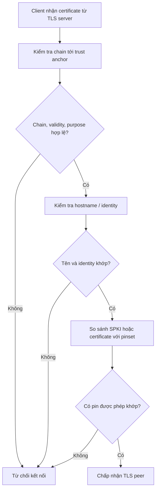
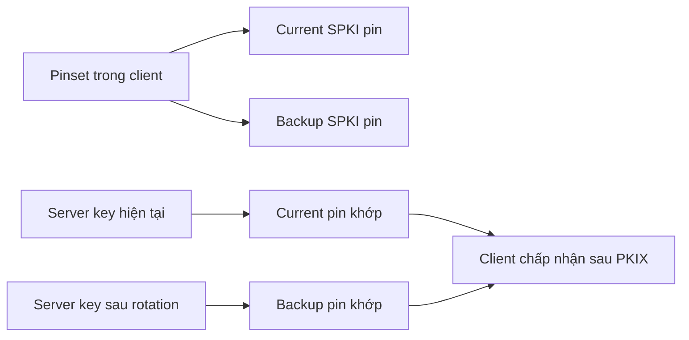
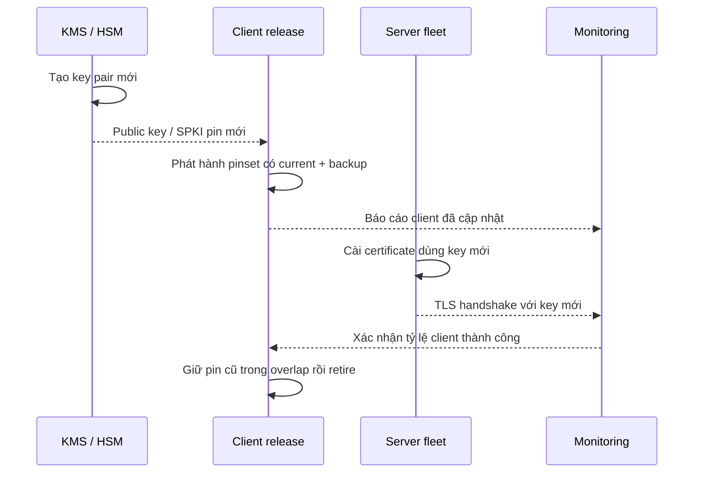

# Certificate pinning

## Mục tiêu học tập

Sau bài học này, bạn có thể:

- Giải thích certificate pinning là gì và vì sao pinning bổ sung một điều kiện tin cậy ngoài kiểm tra chứng thư TLS thông thường.
- Phân biệt pin theo toàn bộ certificate, Subject Public Key Info (SPKI), intermediate CA và trust anchor.
- Thiết kế pinset có pin đang dùng và pin dự phòng, đồng thời lên kế hoạch bootstrap, rotation và emergency recovery.
- Hiểu tác động của pinning tới certificate renewal, key rotation, CA rollover, CDN, multi-region và các ứng dụng có vòng đời cập nhật dài.
- Triển khai pinning mà vẫn giữ kiểm tra certificate path, hostname, validity, purpose và trạng thái thu hồi.
- Nhận diện những tình huống pinning tạo ra outage hoặc làm suy yếu bảo mật, đặc biệt khi thiếu pin dự phòng và kênh cập nhật đáng tin cậy.

## 1. Certificate pinning là gì?

Certificate pinning là kỹ thuật giới hạn những certificate hoặc public key mà một client chấp nhận cho một dịch vụ cụ thể. Client lưu trước một hoặc nhiều giá trị được kỳ vọng, sau đó so sánh chúng với certificate hoặc public key nhận được trong quá trình thiết lập kết nối TLS.

Trong TLS thông thường, client kiểm tra chuỗi chứng thư có dẫn tới trust anchor được tin cậy, tên máy chủ có khớp, chứng thư còn hiệu lực và mục đích sử dụng phù hợp hay không. Nếu mọi điều kiện đều đạt, client có thể chấp nhận một certificate mới được cấp bởi bất kỳ CA nào mà trust store của client tin cậy và được phép cấp cho hostname đó.

Pinning thêm một ràng buộc: ngoài việc certificate hợp lệ theo PKI, một certificate hoặc public key trong chuỗi phải khớp với pin đã được cấu hình cho dịch vụ. Điều này có thể giảm nguy cơ một CA bị lạm dụng hoặc một certificate không mong muốn được cấp cho domain.

Pinning không thay thế PKI. Một pin trùng khớp không chứng minh certificate còn hiệu lực, đúng hostname, đúng EKU hoặc chưa bị thu hồi. Thiết kế an toàn phải giữ nguyên các bước xác minh TLS thông thường và chỉ dùng pinning như một điều kiện bổ sung.

## 2. Pinning bổ sung điều gì cho TLS?

Một client TLS thường dựa vào trust store chứa root CA và các quy tắc xác minh certificate. Khi một CA đáng tin cậy bị compromise, cấu hình sai hoặc cấp certificate sai cho một domain, một số client có thể chấp nhận certificate giả nếu certificate đó vượt qua kiểm tra thông thường.

Với pinning, client còn yêu cầu public key hoặc certificate nhận được thuộc tập giá trị đã được phê duyệt trước. Kẻ tấn công cần có được private key tương ứng với pin, hoặc phải vượt qua cả cơ chế phân phối/cập nhật pin của client, mới có thể giả mạo endpoint theo cách client chấp nhận.



Pinning có thể hữu ích khi client kiểm soát được trust policy, ví dụ ứng dụng di động kết nối tới API nhạy cảm, thiết bị nhúng kết nối về control plane hoặc service nội bộ dùng mTLS. Nó cũng làm tăng trách nhiệm vận hành: thay certificate hoặc key mà không cập nhật pin có thể làm toàn bộ client bị từ chối kết nối.

## 3. Threat model và giới hạn của pinning

Pinning thường nhằm giảm rủi ro từ:

- CA công cộng hoặc CA doanh nghiệp cấp nhầm certificate cho hostname.
- CA bị compromise hoặc bị lạm dụng để phát hành certificate ngoài dự kiến.
- Trust store trên client có quá nhiều CA mà dịch vụ không cần tin cậy.
- Một số hình thức interception TLS dựa trên certificate được client tin cậy nhưng không thuộc key được dịch vụ phê duyệt.
- Sai sót trong quy trình quản lý certificate của dịch vụ có mức độ nhạy cảm cao.

Pinning không giải quyết được mọi vấn đề:

- Nếu attacker lấy được private key tương ứng với pin, pinning vẫn chấp nhận key đó cho đến khi pin được thay đổi hoặc certificate bị từ chối bởi kiểm tra khác.
- Nếu ứng dụng, thiết bị hoặc hệ điều hành của client bị kiểm soát, attacker có thể sửa logic pinning, đọc dữ liệu sau giải mã hoặc thay pin trong bộ nhớ.
- Nếu server bị compromise và attacker có quyền dùng private key đang được pin, pinning không phân biệt được server hợp lệ với server bị chiếm quyền.
- Nếu pinset được cập nhật qua một kênh không an toàn, attacker có thể thay pin bằng giá trị của họ.
- Pinning không bảo vệ dữ liệu sau khi TLS kết thúc ở một proxy hoặc endpoint bị xâm nhập.
- Pinning không thay thế authorization, kiểm soát truy cập, mã hóa dữ liệu lưu trữ hay bảo vệ API.

Trước khi bật pinning, phải xác định rõ attacker mà hệ thống muốn chống lại, client nào nằm trong quyền kiểm soát, cách phân phối pin và khả năng khôi phục khi pin sai.

## 4. Các loại pin thường gặp

Pinning có thể áp dụng lên nhiều đối tượng trong certificate chain. Lựa chọn pin quyết định mức độ chặt chẽ và độ nhạy với thay đổi hạ tầng.

| Loại pin | Giá trị được lưu | Khi certificate thay đổi | Phạm vi tin cậy |
|---|---|---|---|
| Certificate fingerprint | Hash của toàn bộ certificate DER | Thường đổi khi certificate được cấp lại, kể cả khi public key giữ nguyên | Rất cụ thể cho một certificate |
| Leaf SPKI pin | Hash của Subject Public Key Info trong leaf certificate | Giữ nguyên nếu certificate mới dùng cùng public key | Cụ thể cho key của endpoint |
| Intermediate CA SPKI pin | Hash SPKI của intermediate CA | Giữ nguyên khi leaf thay đổi dưới cùng intermediate key | Rộng hơn, chấp nhận các leaf hợp lệ từ CA đó |
| Root/trust anchor pin | Hash SPKI hoặc định danh trust anchor | Có thể ổn định qua nhiều intermediate/leaf | Rộng nhất trong các lựa chọn phổ biến |
| Pin theo tập chain | Một hoặc nhiều hash của certificate/key trong path | Phụ thuộc chain được client xây dựng | Có thể linh hoạt nhưng phụ thuộc path building |

Không có loại pin tốt nhất cho mọi hệ thống. Leaf SPKI thường là lựa chọn có phạm vi rõ cho một endpoint, nhưng đòi hỏi kế hoạch key rotation. Pin intermediate hoặc root giảm số lần phải cập nhật khi leaf thay đổi, nhưng cho phép nhiều certificate được cấp bởi CA đó và vì vậy giới hạn bổ sung hẹp hơn.

## 5. Certificate fingerprint pinning

Certificate fingerprint pinning tính hash trên toàn bộ certificate DER, thường dùng SHA-256. Client so sánh fingerprint nhận được với giá trị đã lưu.

```text
certificatePin = Base64(SHA-256(certificateDER))
```

Ưu điểm là định danh chính xác certificate. Nhược điểm là bất kỳ thay đổi nào trong certificate đều làm fingerprint thay đổi: serial number, validity, SAN, issuer, extension hoặc chữ ký. Khi gia hạn certificate, pin thường phải được cập nhật dù public key không thay đổi.

Loại pin này phù hợp hơn với những thiết bị hoặc kết nối có certificate tĩnh, vòng đời thay đổi hiếm và có kênh quản trị pin đáng tin cậy. Với dịch vụ TLS thay certificate thường xuyên, pin toàn bộ certificate dễ tạo outage.

Không nên nhầm fingerprint của certificate với fingerprint của public key. Chúng được tính trên dữ liệu khác nhau và có hành vi rotation khác nhau.

## 6. SPKI pinning

Subject Public Key Info (SPKI) là cấu trúc trong X.509 chứa thuật toán public key và phần public key. SPKI pinning tính hash trên DER encoding của SPKI, thay vì toàn bộ certificate.

```text
spkiPin = Base64(SHA-256(DER(SubjectPublicKeyInfo)))
```

Nếu CA cấp lại certificate với serial, validity hoặc extension mới nhưng subject tiếp tục dùng cùng key pair, SPKI pin không đổi. Khi subject thay key pair, SPKI pin đổi và client cần được cập nhật pinset trước khi server chuyển sang key mới.

SPKI pinning thường phù hợp hơn certificate fingerprint pinning cho ứng dụng cần gia hạn certificate định kỳ. Tuy nhiên, nếu key bị compromise và vẫn giữ nguyên, pinning sẽ tiếp tục chấp nhận public key đó miễn là các kiểm tra khác không từ chối. Khi key compromise, phải thay key pair và cập nhật pin.

Một SPKI pin thường được biểu diễn dưới dạng Base64 của SHA-256 digest. Cần thống nhất cách mã hóa, padding, chữ hoa/thường và cách lưu để tránh so sánh sai do khác định dạng.

## 7. Pin leaf, intermediate hay root?

### Pin leaf public key

Pin leaf SPKI giới hạn kết nối vào public key của endpoint. Phạm vi hẹp và dễ giải thích. Nó phù hợp khi tổ chức kiểm soát server key và có thể cập nhật client trước khi đổi key.

Rủi ro chính là key rotation. Nếu server chuyển sang key mới mà client chưa có pin mới, kết nối sẽ thất bại dù certificate mới hoàn toàn hợp lệ theo PKI.

### Pin intermediate CA

Pin intermediate SPKI cho phép leaf certificate thay đổi miễn là chain vẫn chứa intermediate key đã pin và các kiểm tra PKIX khác đạt. Cách này ít nhạy với leaf renewal và thay key của endpoint.

Đổi lại, pinning chấp nhận nhiều leaf certificate có thể được intermediate đó cấp. Nếu intermediate có quyền cấp quá rộng, pinning không giới hạn endpoint chặt như leaf pin.

### Pin root hoặc trust anchor

Pin root SPKI thường tương tự việc giới hạn trust anchor mà client chấp nhận. Nếu client đã có trust store rộng, pin root có thể thu hẹp phạm vi CA; nhưng nếu root đó có nhiều intermediate và namespace, pin vẫn không tự xác định endpoint cụ thể.

Khi root rollover, client cần được cập nhật pin hoặc trust anchor. Đây thường là thay đổi khó nhất vì root có thể được phân phối trên nhiều phiên bản ứng dụng và thiết bị.

### Pin nhiều thành phần trong chain

Một số triển khai kiểm tra xem ít nhất một SPKI trong chain có khớp pinset. Cách này có thể hỗ trợ nhiều path, nhưng phải định nghĩa rõ chain nào được kiểm tra, certificate nào được xem là leaf/intermediate, cách xử lý cross-signing và cách thư viện xây path.

Không nên pin một certificate tùy ý trong chain mà không hiểu chain building của client. Cùng một leaf có thể được xây dựng thành nhiều path khác nhau trên các thiết bị khác nhau.

## 8. Pinning là điều kiện bổ sung cho PKIX

Một client phải tiếp tục kiểm tra:

1. Chữ ký của từng certificate trong path.
2. Trust anchor nằm trong trust store được chấp nhận.
3. Validity của leaf và CA certificate.
4. Hostname hoặc service identity khớp với SAN/identity mong đợi.
5. Basic Constraints, Key Usage, EKU và purpose phù hợp.
6. Name Constraints, policy và critical extension nếu áp dụng.
7. Trạng thái thu hồi theo chính sách CRL/OCSP hoặc cơ chế tương đương.
8. Pin được phép khớp với certificate/key thuộc đúng endpoint.

Nếu client bỏ qua xác minh chain và chỉ so sánh pin, pin có thể trở thành một cơ chế trust yếu hơn dự kiến. Ví dụ, một certificate tự ký chứa public key đã pin có thể được chấp nhận dù certificate không có chain hợp lệ, hostname sai hoặc validity không phù hợp.

Pinning không làm certificate hợp lệ hơn. Nó chỉ giới hạn thêm key hoặc certificate nào được chấp nhận sau khi các điều kiện xác minh nền tảng đã đạt.

## 9. Static pinning và Trust On First Use

**Static pinning** lưu pin được phê duyệt trước trong ứng dụng, cấu hình hoặc thiết bị. Pin có thể được đóng gói trong binary, firmware, configuration được ký hoặc trust policy triển khai qua MDM.

Ưu điểm là client có thể kiểm tra key ngay từ kết nối đầu tiên mà không phải học key từ một kết nối chưa được tin cậy. Nhược điểm là pin cần được cập nhật khi key thay đổi; client cũ có thể không nhận được pin mới.

**Trust On First Use (TOFU)** ghi nhận key ở lần kết nối đầu tiên, rồi cảnh báo hoặc từ chối khi key thay đổi. Cách này hữu ích trong một số môi trường quản trị nhưng có rủi ro nếu kết nối đầu tiên bị MITM. Attacker có thể khiến client ghi nhận key của họ làm key tin cậy.

TOFU cần một kênh bootstrap đáng tin cậy hoặc bước xác nhận ngoài băng, chẳng hạn fingerprint được cung cấp qua kênh độc lập. Không nên coi lần kết nối đầu tiên qua mạng không tin cậy là bằng chứng đủ để xác lập pin.

## 10. Pinset và pin dự phòng

Một pinset là tập hợp các pin mà client chấp nhận cho endpoint. Pinset nên có ít nhất:

- **Current pin:** pin của key đang phục vụ traffic hiện tại.
- **Backup pin:** pin của key dự phòng đã được tạo và bảo vệ, nhưng có thể chưa được dùng trên production.

Khi key hiện tại cần rotation, client đã có backup pin nên có thể chấp nhận key mới sau khi server chuyển đổi. Backup pin phải đại diện cho public key thực sự đã được tạo và private key tương ứng phải được quản lý an toàn; không nên chỉ tạo một chuỗi ngẫu nhiên rồi gọi là backup pin.



Pinset có thể có hơn hai pin nếu hệ thống có nhiều region, nhiều endpoint hoặc giai đoạn chuyển đổi. Tuy nhiên, mỗi pin bổ sung mở rộng tập key được chấp nhận; chỉ đưa vào pinset những key đã được phê duyệt và có owner.

## 11. Quản lý pin như một tài sản mật mã

Pin không phải private key, nhưng là metadata bảo mật quan trọng. Pin sai có thể gây outage; pin quá rộng có thể làm giảm hiệu quả giới hạn tin cậy.

Một inventory pin nên lưu:

| Trường | Mục đích |
|---|---|
| Pin ID | Định danh duy nhất trong hệ thống quản lý |
| Endpoint/hostname | Dịch vụ mà pin áp dụng |
| Pin type | Certificate fingerprint, leaf SPKI, intermediate SPKI hoặc trust anchor |
| Digest algorithm | Ví dụ SHA-256 theo policy |
| Pin value | Digest đã chuẩn hóa và encode |
| Key ID/version | Liên kết với key trong HSM/KMS hoặc key inventory nếu có |
| Status | Current, backup, scheduled, retired hoặc revoked |
| Valid from / until | Khoảng thời gian pin được phép dùng theo kế hoạch |
| Owner / approver | Người chịu trách nhiệm và người phê duyệt |
| Client versions | Phiên bản ứng dụng/firmware chứa pin |
| Rotation ticket | Bằng chứng thay đổi và kiểm thử |

Không lưu private key cùng pin. Không đưa pin vào log như dữ liệu định danh nhạy cảm nếu không cần thiết; thay vào đó dùng Pin ID hoặc fingerprint rút gọn để đối soát.

## 12. Bootstrap pin an toàn

Client phải nhận pin từ nguồn đáng tin cậy. Một số cách bootstrap:

- Đóng gói pin trong ứng dụng được ký bởi nền tảng phân phối đáng tin cậy.
- Đưa pin vào firmware hoặc cấu hình thiết bị trong quy trình manufacturing/enrollment được kiểm soát.
- Phân phối pin qua MDM hoặc configuration service được xác thực và ký số.
- Dùng trust anchor hoặc metadata ký số đã được provision ngoài băng.
- Với hệ thống nội bộ, gắn pin vào service identity được cấp và quản lý bởi control plane đáng tin cậy.

Nếu pin được tải từ chính endpoint đang được pin mà không có chữ ký hoặc xác thực độc lập, attacker có thể thay cả certificate và pin. Cập nhật pin cần có tính toàn vẹn, xác thực nguồn, chống replay và chống rollback.

Một cấu hình pin có chữ ký nên gắn với endpoint, phiên bản policy, thời điểm hiệu lực và version tăng đơn điệu. Client phải xác minh chữ ký bằng trust key đã được provision trước và từ chối cấu hình cũ hơn version đã chấp nhận.

## 13. Quy trình rotation pin và server key

Rotation phải được thiết kế trước khi pin đầu tiên được phát hành. Quy trình tổng quát:

1. Tạo key pair mới trong HSM, KMS hoặc boundary bảo vệ phù hợp.
2. Tính SPKI pin của public key mới và kiểm tra bằng công cụ độc lập.
3. Đưa pin mới vào pinset backup của client qua kênh cập nhật đáng tin cậy.
4. Đo mức độ client đã nhận pin mới và xác minh phiên bản đang hoạt động.
5. Cấp certificate cho key mới, kiểm tra chain, SAN, EKU và các điều kiện TLS.
6. Triển khai certificate mới theo region/cụm với khả năng rollback.
7. Theo dõi handshake, pin mismatch, lỗi PKIX và tỷ lệ client cũ.
8. Khi đủ điều kiện, chuyển pin mới thành current và giữ pin cũ trong khoảng overlap được phê duyệt.
9. Chỉ loại bỏ pin cũ khi client population và server fleet đã chuyển đổi theo tiêu chí.



Không triển khai server key mới trước khi các client quan trọng đã có pin mới, trừ khi có một đường fallback được kiểm soát. Với ứng dụng di động có người dùng cập nhật chậm, cần tính đến nhiều tháng hoặc nhiều năm tồn tại của phiên bản cũ.

## 14. Certificate renewal khác key rotation

Renewal và key rotation là hai sự kiện khác nhau:

- **Renew certificate với cùng key:** certificate DER thay đổi nhưng SPKI không đổi. Certificate fingerprint pin thường phải cập nhật; SPKI pin có thể giữ nguyên.
- **Renew certificate với key mới:** cả certificate DER và SPKI đều thay đổi. Client cần pin mới.
- **CA rollover:** issuer hoặc chain thay đổi. Leaf SPKI có thể giữ nguyên nhưng pin intermediate/root có thể thay đổi.
- **Server migration:** endpoint có thể chuyển sang CDN, load balancer hoặc nhà cung cấp khác với key khác.

Lịch rotation pin phải gắn với key lifecycle và certificate lifecycle. Chỉ theo dõi ngày hết hạn certificate là chưa đủ nếu key có thể bị thay sớm do compromise hoặc thay đổi hạ tầng.

## 15. Pinning và KMS/HSM

Pinning liên quan trực tiếp tới việc quản lý public/private key pair. KMS hoặc HSM có thể tạo và bảo vệ private key; public key được xuất để tạo certificate và tính pin.

Quy trình điển hình:

1. Tạo key pair trong HSM hoặc KMS hỗ trợ asymmetric key.
2. Đọc public key/SPKI theo API được phép.
3. Gửi CSR hoặc yêu cầu CA cấp certificate cho public key.
4. Tính pin từ SPKI DER đã chuẩn hóa.
5. Ghi lại liên kết Pin ID ↔ key ID/version ↔ certificate serial ↔ endpoint.
6. Phân phối pin cho client và triển khai certificate.
7. Theo dõi trạng thái key, certificate, pin và client version.

Private key không cần rời khỏi HSM để tạo pin. SPKI là dữ liệu public. Cần bảo đảm public key được lấy từ đúng key ID/version và không bị nhầm giữa môi trường test, staging và production.

Nếu KMS tạo key mới khi rotate, pin mới phải được tính và phê duyệt trước khi server dùng key đó. Không được tái sử dụng một pin cũ cho key khác hoặc cập nhật pin chỉ dựa trên alias có thể đổi đích.

## 16. Pinning cho ứng dụng di động

Ứng dụng mobile thường kiểm soát được HTTP/TLS client và có thể đóng gói pin trong app. Điều này hữu ích khi ứng dụng giao tiếp với API nhạy cảm, nhưng tạo thách thức do vòng đời phát hành và cập nhật của client không đồng bộ với server.

Các yếu tố cần tính:

- Có bao nhiêu phiên bản app còn hoạt động?
- Người dùng có thể trì hoãn cập nhật bao lâu?
- App có cơ chế bắt buộc update khi pin sắp hết hiệu lực không?
- Pin được lưu trong binary, native library hay signed remote config?
- Có pin dự phòng cho key rotation không?
- Có cơ chế dừng kết nối an toàn khi pin mismatch không?
- Có thể phát hành emergency update nhanh đến các store và thiết bị không?
- Có cách quan sát pin mismatch mà không ghi dữ liệu nhạy cảm không?

Obfuscation hoặc native code không biến pin thành bí mật. Attacker kiểm soát thiết bị có thể phân tích binary hoặc sửa logic. Mục tiêu của pinning là tăng ràng buộc tin cậy trong điều kiện client còn đáng tin, không phải chống lại mọi hình thức reverse engineering.

## 17. Pinning cho server-to-server và workload

Trong server-to-server, tổ chức thường kiểm soát cả client và server nên có thể phối hợp rotation chặt hơn. Pinning có thể áp dụng cho:

- Payment gateway hoặc đối tác có endpoint ổn định.
- API nội bộ có mức độ nhạy cảm cao.
- Control plane của thiết bị hoặc agent.
- Kết nối mTLS giữa service hoặc giữa các domain quản trị.

Với workload nội bộ, private PKI và short-lived certificate có thể đơn giản hóa trust. Một service mesh có thể quản lý certificate và trust bundle tự động; khi đó cần xác định pinning có bổ sung giá trị gì ngoài trust bundle và identity policy.

Nếu pinning dùng cho đối tác bên ngoài, phải thống nhất trước quy trình thông báo key rotation, thời gian overlap, backup pin, endpoint failover và liên hệ sự cố. Không giả định đối tác sẽ giữ nguyên key hoặc thông báo thay đổi theo lịch của mình.

## 18. Pinning trong mTLS

Mutual TLS (mTLS) yêu cầu cả client và server trình certificate. Pinning có thể được dùng ở một hoặc cả hai chiều, nhưng cần phân biệt:

- Client pin server certificate/key để giới hạn server mà client chấp nhận.
- Server kiểm tra client certificate qua PKI, trust bundle, identity mapping và policy.
- Server có thể pin public key hoặc CA của client nếu mô hình enrollment yêu cầu một danh sách hẹp.

Trong mTLS, xác minh certificate không thay thế authorization. Server phải ánh xạ certificate identity (SAN URI, SPIFFE ID, subject hoặc thuộc tính được profile quy định) sang quyền gọi API. Không nên cấp quyền chỉ dựa trên việc certificate chain hợp lệ.

Pinning client key có thể gây khó khăn khi workload được tạo lại thường xuyên. Cần xem xét pinning trust domain/issuer hoặc dùng identity certificate ngắn hạn cùng trust bundle được quản lý thay vì hardcode từng leaf pin.

## 19. Pinning với CDN, load balancer và multi-region

Một hostname có thể kết thúc TLS ở nhiều điểm: CDN, edge, load balancer, ingress hoặc origin. Mỗi điểm có thể dùng certificate/key khác nhau. Nếu client pin leaf SPKI, pinset phải bao gồm mọi key hợp lệ mà client có thể gặp trong tất cả region và failover path.

Trước khi bật pinning cần lập inventory:

- Hostname và alias thực tế.
- CDN/edge provider và certificate deployment model.
- Load balancer, ingress và origin TLS termination.
- Region, disaster recovery site và failover endpoint.
- Key pair hiện tại, key dự phòng và lịch thay đổi.
- Redirect, alternate hostname và endpoint được app gọi.

Nếu một CDN thay key theo cơ chế tự động mà tổ chức không thể biết trước hoặc kiểm soát, leaf pinning có thể không phù hợp. Có thể cân nhắc pin intermediate có phạm vi rõ, dùng private PKI hoặc không pin nếu rủi ro vận hành lớn hơn lợi ích.

Redirect cũng cần được kiểm soát. Một HTTP client có thể chuyển từ hostname đã pin sang hostname khác. Client cần áp dụng policy theo origin đích và không vô tình dùng pin của endpoint A cho endpoint B. Với ví dụ triển khai, nên tắt redirect tự động hoặc kiểm tra lại hostname và pinset sau mỗi redirect.

## 20. Pinning trong trình duyệt và HPKP

HTTP Public Key Pinning (HPKP) từng cho phép website gửi header để browser ghi nhớ public key pin trong một khoảng thời gian. Cơ chế này đã bị loại bỏ khỏi các trình duyệt hiện đại do nguy cơ cấu hình sai gây khóa người dùng khỏi website, cùng các vấn đề về quản trị và khả năng khôi phục.

Không nên triển khai HPKP header mới cho website công cộng. Trình duyệt hiện đại dựa vào Web PKI, trust store, Certificate Transparency, cơ chế thu hồi và các kiểm soát khác. Những cơ chế này không tương đương pinning tĩnh trong ứng dụng native.

Certificate pinning vẫn có thể phù hợp trong ứng dụng do tổ chức kiểm soát, thiết bị nhúng hoặc kết nối service-to-service có quy trình rotation rõ. Cần đánh giá khả năng cập nhật client và recovery trước khi chọn.

## 21. Pinning và Certificate Transparency, CAA, revocation

Các cơ chế sau giải quyết những vấn đề khác nhau:

| Cơ chế | Vai trò | Không thay thế |
|---|---|---|
| Certificate pinning | Giới hạn key/certificate client chấp nhận cho endpoint | PKIX validation, hostname và revocation |
| Certificate Transparency | Tạo khả năng quan sát certificate issuance trong log | Ngăn issuance sai hoặc tự thu hồi certificate |
| DNS CAA | Giới hạn CA nào được domain cho phép cấp certificate | Kiểm tra certificate ở client |
| CRL/OCSP | Cung cấp trạng thái thu hồi | Xác minh pin hoặc hostname |
| mTLS | Xác thực cả hai phía bằng certificate | Authorization nghiệp vụ |
| Private trust store | Giới hạn CA mà client tin cậy | Giới hạn chính xác leaf key nếu trust CA cấp rộng |

Một kiến trúc có thể kết hợp CAA, CT monitoring, revocation, private trust store và pinning. Nhưng mỗi lớp cần có owner, quy trình vận hành và tiêu chí kiểm thử riêng.

## 22. Pin expiry và thời gian sống của cấu hình

Pinset có thể được quản lý theo phiên bản và thời điểm hiệu lực. Cần xác định:

- Pin bắt đầu có hiệu lực khi nào?
- Pin cũ được giữ trong overlap bao lâu?
- Pin backup tồn tại đến khi nào?
- Ai có quyền thêm, xóa hoặc thu hồi pin?
- Cấu hình pin có thể bị rollback không?
- Client offline lâu ngày sẽ xử lý pin đã hết hiệu lực như thế nào?

Không nên tự động xóa pin chỉ vì đến ngày `validUntil` nếu client hoặc server chưa hoàn tất rotation. Hệ thống cần phân biệt pin được phép dùng, pin chỉ để chuẩn bị, pin đã retire và pin bị compromise.

Với client cập nhật không thường xuyên, một pin backup có thể cần được giữ qua nhiều release. Tuy nhiên, pinset quá rộng hoặc tồn tại quá lâu làm tăng số key được chấp nhận. Cần cân bằng availability và giới hạn trust, dựa trên số liệu client thực tế.

## 23. Emergency rotation khi pin hoặc key bị compromise

Nếu private key tương ứng với current pin bị lộ, attacker có thể sử dụng key đó để giả mạo endpoint trong các điều kiện phù hợp. Quy trình khẩn cấp cần:

1. Xác định key ID, certificate serial, endpoint, region và thời điểm nghi ngờ compromise.
2. Cô lập hoặc ngừng dùng key bị ảnh hưởng; thu hồi certificate và chặn key theo policy.
3. Kích hoạt backup key nếu private key đó chưa bị ảnh hưởng và pin đã có trong client.
4. Phát hành certificate mới và chuyển traffic sang key mới.
5. Phân phối pin mới tới client qua kênh đã xác thực.
6. Xử lý client không có backup pin bằng update khẩn cấp hoặc quy trình recovery ngoài băng.
7. Đánh giá TLS session, session resumption, connection pool và các dữ liệu đã trao đổi trong thời gian compromise.
8. Theo dõi pin mismatch, certificate errors và tỷ lệ client đã chuyển đổi.
9. Lưu bằng chứng, cập nhật inventory và đánh giá nguyên nhân gốc.

Nếu cả current và backup key đều bị nghi ngờ lộ, không tiếp tục tin pin cũ chỉ để giữ availability. Cần một kênh cập nhật độc lập được xác thực bằng trust root khác hoặc quy trình recovery thiết bị. Quy trình này phải được thiết kế và diễn tập trước sự cố.

## 24. Pin mismatch và xử lý lỗi

Khi pin không khớp, client nên từ chối kết nối và ghi nhận một sự kiện bảo mật có thể điều tra. Không được tự động bỏ qua pin mismatch rồi tiếp tục bằng trust store thông thường, vì hành vi đó biến pinning thành một cảnh báo không có tác dụng.

Thông tin log nên đủ để chẩn đoán nhưng tránh ghi dữ liệu nhạy cảm:

- Endpoint/hostname và môi trường.
- Pin ID hoặc digest rút gọn đã cấu hình.
- Digest nhận được (nếu policy cho phép).
- Certificate serial, issuer và thời điểm kiểm tra.
- Phiên bản app/firmware và region.
- Lỗi PKIX, hostname, expiry hoặc pin mismatch được phân loại riêng.

Không ghi private key, session secret, token hoặc payload người dùng. Không gửi toàn bộ certificate chain tới analytics công cộng nếu chưa đánh giá privacy và dữ liệu định danh.

Phải phân biệt pin mismatch với lỗi CA, hostname, expired certificate, revocation failure, TLS protocol mismatch hoặc network failure. Các lỗi khác nhau cần hành động khác nhau.

## 25. Fail-open và fail-closed

Với pinning, fail-closed nghĩa là không có pin hợp lệ thì từ chối kết nối. Đây thường là hành vi đúng cho ràng buộc pinning. Fail-open, ví dụ bỏ qua pin khi server đổi certificate, có thể làm mất toàn bộ giá trị của pinning.

Tuy nhiên, hệ thống cần thiết kế availability bằng pinset dự phòng, rotation overlap và recovery channel, thay vì bằng cách bỏ qua pin. Một số sản phẩm có thể có chế độ break-glass, nhưng chế độ đó phải được phê duyệt, giới hạn thời gian, giới hạn endpoint, audit đầy đủ và không tự kích hoạt khi có lỗi mạng.

Không dùng một boolean `pinningEnabled=false` được điều khiển từ remote config không xác thực. Nếu cần emergency disable, phải có chữ ký số, version chống rollback, scope rõ và phê duyệt nhiều bên.

## 26. Cập nhật pin qua remote configuration

Remote pin update có thể giảm phụ thuộc vào app release, nhưng trở thành một control plane có quyền thay đổi trust. Cấu hình cần:

- Chữ ký số bằng update key được provision trước.
- Schema version và policy version.
- Endpoint/hostname và pin type rõ ràng.
- Thời gian hiệu lực, expiry và overlap.
- Chống replay và rollback bằng monotonic version/counter.
- Quy trình phê duyệt độc lập cho thay đổi pin production.
- Audit log, phân phối có xác nhận và khả năng rollback có kiểm soát.
- Cơ chế recovery khi update key bị compromise.

Không tải pin mới từ endpoint đang được cập nhật rồi tin ngay giá trị trả về. Update key nên tách khỏi server key đang được pin để một compromise của server không tự động cho phép thay đổi trust policy.

## 27. Thiết kế rollout an toàn

Trước khi bật pinning trên toàn bộ client, nên triển khai theo giai đoạn:

1. **Inventory:** thu thập endpoint, certificate chain, SPKI, CDN, region và client version.
2. **Shadow evaluation:** tính pin và ghi nhận kết quả so khớp nhưng chưa chặn kết nối, nếu nền tảng hỗ trợ.
3. **Pinset review:** kiểm tra current pin, backup pin, nguồn key, owner và approval.
4. **Canary:** bật enforcement cho nhóm client nội bộ hoặc phần trăm traffic nhỏ.
5. **Observe:** theo dõi mismatch, expiry, region và client version.
6. **Expand:** tăng dần phạm vi khi số liệu ổn định và có phương án rollback.
7. **Rotation drill:** diễn tập chuyển sang backup pin trước khi bật cho toàn bộ client.
8. **Retire:** loại bỏ pin cũ khi đủ điều kiện và có phê duyệt.

Không dùng shadow mode như bằng chứng cuối cùng rằng pinning an toàn. Nó chỉ giúp phát hiện các key hợp lệ mà client đang gặp; vẫn cần kiểm tra độc lập nguồn gốc và ownership của từng pin.

## 28. Kiểm thử pinning

Test matrix nên có cả trường hợp thành công và thất bại:

| Kịch bản | Kết quả mong đợi |
|---|---|
| Chain hợp lệ, hostname đúng, current pin khớp | Chấp nhận |
| Chain hợp lệ, hostname đúng, backup pin khớp | Chấp nhận theo pinset đã phê duyệt |
| Chain hợp lệ nhưng pin không khớp | Từ chối |
| Pin khớp nhưng certificate hết hạn | Từ chối |
| Pin khớp nhưng hostname sai | Từ chối |
| Pin khớp nhưng EKU/purpose sai | Từ chối |
| Chain không tin cậy nhưng pin khớp | Từ chối |
| Certificate bị thu hồi theo policy | Từ chối hoặc xử lý theo revocation policy đã định |
| Certificate renewal cùng key | SPKI pin vẫn khớp; certificate fingerprint pin có thể đổi |
| Key rotation đã có backup pin | Kết nối mới được chấp nhận sau PKIX |
| Key rotation chưa cập nhật pin | Từ chối và phát cảnh báo |
| Redirect sang hostname khác | Áp dụng pinset và hostname policy của origin đích; không kế thừa mù |
| CDN failover sang key khác | Chỉ chấp nhận nếu key đã được pin trước |
| Remote pin config bị sửa chữ ký | Từ chối cấu hình |
| Remote pin config cũ bị replay | Từ chối do version rollback |
| CRL/OCSP không truy cập được | Xử lý theo revocation policy riêng, không bỏ qua pin |
| Client không có backup pin | Thực hiện recovery/update theo runbook, không fail-open |

Ngoài unit test, cần integration test trên các OS, TLS provider, proxy, CDN và thiết bị thật. Cùng một certificate chain có thể được xử lý khác nhau do path building hoặc trust store khác nhau.

## 29. Ví dụ tính SPKI pin bằng OpenSSL

Với certificate PEM, có thể trích public key dưới dạng DER SubjectPublicKeyInfo rồi tính SHA-256 và Base64:

```bash
openssl x509 -in server.pem -pubkey -noout \
  | openssl pkey -pubin -outform DER \
  | openssl dgst -sha256 -binary \
  | openssl base64 -A
```

Kết quả là SPKI pin dạng Base64. Với certificate chain, cần chỉ rõ certificate nào đang tính: leaf, intermediate hay root. Không lấy fingerprint từ lệnh `openssl x509 -fingerprint` rồi nhầm đó là SPKI pin; lệnh đó thường tính trên toàn bộ certificate DER.

Để xác minh pin độc lập, có thể tính từ public key DER đã xuất từ HSM/KMS và so sánh với pin trích từ certificate. Hai giá trị phải khớp nếu certificate chứa đúng public key của key ID/version đã phê duyệt.

## 30. Ví dụ Java 17: PKIX validation cộng SPKI pinning

Ví dụ dưới đây dùng trust manager mặc định của nền tảng để xác minh certificate chain, sau đó kiểm tra SPKI pin của leaf certificate. HTTPS endpoint identification được bật để kiểm tra hostname. HTTP redirect tự động bị tắt để ứng dụng có thể áp dụng policy riêng cho từng origin.

```java
import java.net.Socket;
import java.net.URI;
import java.net.http.HttpClient;
import java.net.http.HttpRequest;
import java.net.http.HttpResponse;
import java.security.MessageDigest;
import java.security.SecureRandom;
import java.security.cert.CertificateException;
import java.security.cert.X509Certificate;
import java.util.Base64;
import java.util.Set;
import javax.net.ssl.SSLContext;
import javax.net.ssl.SSLParameters;
import javax.net.ssl.SSLEngine;
import javax.net.ssl.TrustManager;
import javax.net.ssl.TrustManagerFactory;
import javax.net.ssl.X509ExtendedTrustManager;
import javax.net.ssl.X509TrustManager;

public final class PinnedHttpClient {
    private PinnedHttpClient() {}

    public static void main(String[] args) throws Exception {
        TrustManagerFactory factory = TrustManagerFactory.getInstance(
                TrustManagerFactory.getDefaultAlgorithm());
        factory.init((java.security.KeyStore) null);

        X509TrustManager platformTrust = null;
        for (TrustManager manager : factory.getTrustManagers()) {
            if (manager instanceof X509TrustManager x509) {
                platformTrust = x509;
                break;
            }
        }
        if (platformTrust == null) {
            throw new IllegalStateException("No platform X509TrustManager");
        }

        // Replace these examples with verified SHA-256 SPKI pins.
        Set<String> pins = Set.of(
                "BASE64_SHA256_OF_CURRENT_LEAF_SPKI",
                "BASE64_SHA256_OF_BACKUP_LEAF_SPKI");

        SSLContext context = SSLContext.getInstance("TLS");
        context.init(null, new TrustManager[] {
                new SpkiPinningTrustManager(platformTrust, pins)
        }, new SecureRandom());

        SSLParameters parameters = new SSLParameters();
        parameters.setEndpointIdentificationAlgorithm("HTTPS");

        HttpClient client = HttpClient.newBuilder()
                .sslContext(context)
                .sslParameters(parameters)
                .followRedirects(HttpClient.Redirect.NEVER)
                .build();

        URI endpoint = URI.create("https://api.example.internal/health");
        HttpRequest request = HttpRequest.newBuilder(endpoint).GET().build();
        HttpResponse<String> response = client.send(
                request, HttpResponse.BodyHandlers.ofString());
        System.out.println("HTTP status: " + response.statusCode());
    }

    static final class SpkiPinningTrustManager extends X509ExtendedTrustManager {
        private final X509TrustManager delegate;
        private final X509ExtendedTrustManager extended;
        private final Set<String> allowedPins;

        SpkiPinningTrustManager(X509TrustManager delegate,
                                Set<String> allowedPins) {
            this.delegate = delegate;
            this.extended = delegate instanceof X509ExtendedTrustManager x
                    ? x : null;
            this.allowedPins = Set.copyOf(allowedPins);
        }

        private void validateServer(X509Certificate[] chain, String authType,
                                    Socket socket, SSLEngine engine)
                throws CertificateException {
            if (extended != null) {
                if (engine != null) {
                    extended.checkServerTrusted(chain, authType, engine);
                } else if (socket != null) {
                    extended.checkServerTrusted(chain, authType, socket);
                } else {
                    extended.checkServerTrusted(chain, authType);
                }
            } else {
                delegate.checkServerTrusted(chain, authType);
            }

            if (chain == null || chain.length == 0) {
                throw new CertificateException("Empty server certificate chain");
            }
            String actualPin = spkiPin(chain[0]);
            if (!allowedPins.contains(actualPin)) {
                throw new CertificateException("Server SPKI pin mismatch");
            }
        }

        private static String spkiPin(X509Certificate certificate)
                throws CertificateException {
            try {
                byte[] spki = certificate.getPublicKey().getEncoded();
                byte[] digest = MessageDigest.getInstance("SHA-256")
                        .digest(spki);
                return Base64.getEncoder().encodeToString(digest);
            } catch (Exception e) {
                throw new CertificateException("Cannot calculate SPKI pin", e);
            }
        }

        @Override
        public void checkServerTrusted(X509Certificate[] chain, String authType)
                throws CertificateException {
            validateServer(chain, authType, null, null);
        }

        @Override
        public void checkServerTrusted(X509Certificate[] chain, String authType,
                                       Socket socket) throws CertificateException {
            validateServer(chain, authType, socket, null);
        }

        @Override
        public void checkServerTrusted(X509Certificate[] chain, String authType,
                                       SSLEngine engine)
                throws CertificateException {
            validateServer(chain, authType, null, engine);
        }

        @Override
        public void checkClientTrusted(X509Certificate[] chain, String authType)
                throws CertificateException {
            delegate.checkClientTrusted(chain, authType);
        }

        @Override
        public void checkClientTrusted(X509Certificate[] chain, String authType,
                                       Socket socket) throws CertificateException {
            if (extended != null) extended.checkClientTrusted(chain, authType, socket);
            else delegate.checkClientTrusted(chain, authType);
        }

        @Override
        public void checkClientTrusted(X509Certificate[] chain, String authType,
                                       SSLEngine engine)
                throws CertificateException {
            if (extended != null) extended.checkClientTrusted(chain, authType, engine);
            else delegate.checkClientTrusted(chain, authType);
        }

        @Override
        public X509Certificate[] getAcceptedIssuers() {
            return delegate.getAcceptedIssuers();
        }
    }
}
```

Các lưu ý quan trọng:

- Đây là ví dụ minh họa; phải thay pin placeholder bằng digest đã xác minh độc lập.
- `getPublicKey().getEncoded()` trả encoding SubjectPublicKeyInfo trên các provider Java thông dụng; cần kiểm thử provider thực tế.
- Ví dụ pin leaf SPKI và chỉ phù hợp với client được dùng cho endpoint có pin tương ứng. Không tái sử dụng client này tùy tiện cho nhiều origin khác nhau.
- Trust manager mặc định vẫn thực hiện xác minh chain theo trust store của nền tảng; hostname verification được yêu cầu bằng `SSLParameters`.
- Revocation checking không tự động được bảo đảm chỉ vì pinning đã bật. Phải cấu hình CRL/OCSP theo policy của ứng dụng và kiểm thử freshness/failure behavior.
- Không cài một trust manager chấp nhận mọi certificate, không bỏ hostname verification và không chỉ kiểm tra pin rồi bỏ qua PKIX.
- Trong production, cần xử lý redirect, proxy, connection pool, TLS session resumption và các origin phụ theo policy riêng.

## 31. Case study: ứng dụng mobile gọi API thanh toán

Một ứng dụng mobile gọi API thanh toán qua `api.pay.example`. Tổ chức muốn giảm rủi ro từ certificate cấp sai. Ứng dụng dùng leaf SPKI pinning với một current pin và một backup pin.

Nhóm vận hành tạo key hiện tại trong HSM, cấp certificate và nhúng SPKI pin vào app. Trước kỳ rotation, họ tạo key mới, tính pin mới và phát hành app version chứa cả pin hiện tại lẫn pin dự phòng. Telemetry cho biết phần lớn thiết bị đang dùng version mới; sau đó server triển khai certificate mới theo từng region.

Trong giai đoạn chuyển đổi, client cũ chỉ có pin cũ và có thể bị từ chối nếu chưa cập nhật. Vì vậy, nhóm giữ endpoint cũ trong khoảng overlap, thúc đẩy cập nhật app và chỉ loại bỏ endpoint/key cũ khi tỷ lệ client đủ điều kiện. Họ có emergency update được ký bởi update key độc lập nếu pin hiện tại bị compromise.

Bài học là pinning đòi hỏi phối hợp release client và server. Nếu không thể kiểm soát client update hoặc không có recovery path, lợi ích bảo mật có thể bị lấn át bởi nguy cơ khóa người dùng khỏi dịch vụ.

## 32. Case study: service nội bộ dùng private PKI

Một nền tảng microservice dùng private CA và short-lived workload certificate. Thay vì pin từng leaf key của hàng nghìn pod, client tin một trust bundle của intermediate dành riêng cho workload identity và kiểm tra SAN URI theo service identity.

Tổ chức cân nhắc pin intermediate SPKI để hạn chế trust vào đúng CA phát hành. Khi intermediate rollover, control plane phân phối trust bundle mới trước, cho phép overlap có thời hạn, rồi chuyển certificate workload sang nhánh mới.

Trong mô hình này, trust bundle có thể phù hợp hơn leaf pin vì workload được tạo lại thường xuyên. Pinning chỉ nên được giữ nếu nó tạo ra giới hạn tin cậy bổ sung ngoài private trust store, SAN identity và authorization policy.

## 33. Những anti-pattern cần tránh

1. **Chỉ có một pin.** Mất key hoặc đổi key có thể làm client không kết nối được.
2. **Pin certificate fingerprint cho endpoint renewal thường xuyên.** Certificate mới có thể đổi fingerprint dù key không đổi.
3. **Pin root quá rộng mà không có lý do.** Phạm vi chấp nhận có thể gần với việc tin cả CA đó.
4. **Pinning nhưng bỏ PKIX hoặc hostname verification.** Làm suy yếu xác minh nền tảng.
5. **Bỏ qua pin mismatch để giữ availability.** Khi đó pinning không còn là enforcement.
6. **Tải pin từ chính endpoint chưa được xác thực.** Attacker có thể thay certificate và pin cùng lúc.
7. **Không tính tới CDN, region và failover.** Một endpoint hợp lệ có thể dùng key khác chưa được pin.
8. **Không có inventory client version.** Không biết bao nhiêu client còn pin cũ.
9. **Dùng chung pinset cho nhiều hostname không liên quan.** Mở rộng phạm vi tin cậy ngoài dự kiến.
10. **Không diễn tập emergency rotation.** Khi key compromise, tổ chức không biết cập nhật pin thế nào.
11. **Coi TOFU là bootstrap an toàn.** Lần kết nối đầu tiên có thể bị MITM.
12. **Không phân biệt certificate renewal và key rotation.** Có thể cập nhật pin thừa hoặc thiếu.
13. **Không theo dõi pin backup.** Pin dự phòng có thể thuộc key đã mất, bị lộ hoặc không còn sử dụng được.
14. **Bỏ qua redirect và proxy.** Client có thể kết nối sang origin không có pin policy phù hợp.

## 34. Checklist trước khi bật pinning

- [ ] Threat model xác định rõ rủi ro pinning cần giảm.
- [ ] Có lý do rõ ràng cho pinning thay vì chỉ dùng private trust store hoặc mTLS.
- [ ] Chọn pin type và phạm vi chain phù hợp.
- [ ] Vẫn bật PKIX path validation, hostname/identity, validity và purpose checking.
- [ ] Đã xác định revocation policy và hành vi khi CRL/OCSP lỗi.
- [ ] Đã inventory CDN, load balancer, region, failover và redirect.
- [ ] Current pin và backup pin được tính từ đúng key đã xác minh.
- [ ] Key ID/version, certificate serial và endpoint được liên kết trong inventory.
- [ ] Pin được provision qua kênh có xác thực và chống sửa đổi.
- [ ] Có quy trình rotation, overlap, retirement và emergency update.
- [ ] Đã đánh giá số lượng client cũ và thời gian cập nhật thực tế.
- [ ] Pin mismatch từ chối kết nối và tạo log có thể điều tra.
- [ ] Đã kiểm thử trên OS, TLS provider, proxy và thiết bị thực tế.
- [ ] Có recovery path khi pinset sai hoặc key compromise.
- [ ] Đã diễn tập chuyển sang backup pin trước khi enforcement rộng.

## 35. Checklist khi rotation và sau rotation

### Trước rotation

- [ ] Tạo key pair mới và bảo vệ private key trong HSM/KMS phù hợp.
- [ ] Tính SPKI pin từ public key đúng key ID/version.
- [ ] Kiểm tra pin bằng công cụ độc lập và peer review.
- [ ] Phân phối backup pin qua signed update hoặc app release.
- [ ] Đo client adoption và xác định client chưa hỗ trợ pin mới.
- [ ] Kiểm tra certificate, SAN, EKU, chain và endpoint ở mọi region.

### Sau rotation

- [ ] Server fleet đã chuyển đúng certificate/key mới.
- [ ] Current pin và backup pin có trạng thái đúng trong inventory.
- [ ] Tỷ lệ handshake thành công và pin mismatch nằm trong ngưỡng.
- [ ] Client cũ được xử lý theo kế hoạch overlap.
- [ ] Session, connection pool và failover path được kiểm tra.
- [ ] Pin cũ chỉ được retire sau khi đạt tiêu chí và có phê duyệt.
- [ ] Audit và key inventory được cập nhật.

## 36. Câu hỏi tự kiểm tra

**1. Certificate pinning bổ sung điều kiện gì cho TLS?**

Client yêu cầu certificate hoặc public key nhận được phải thuộc tập pin đã phê duyệt, ngoài việc vượt qua các kiểm tra TLS thông thường.

**2. Pinning có thay thế certificate path validation không?**

Không. Client vẫn phải kiểm tra chain, trust anchor, validity, hostname, purpose và revocation theo policy.

**3. Certificate fingerprint và SPKI pin khác nhau thế nào?**

Fingerprint hash toàn bộ certificate DER; SPKI pin hash phần SubjectPublicKeyInfo. Certificate renewal thường đổi fingerprint nhưng có thể giữ nguyên SPKI nếu key không đổi.

**4. Vì sao nên có backup pin?**

Backup pin cho phép client chấp nhận key mới khi rotation mà không phải dựa vào kết nối chưa được pin hoặc bỏ qua kiểm tra.

**5. Pin leaf SPKI có ưu điểm gì?**

Nó giới hạn kết nối vào public key cụ thể của endpoint, giảm phạm vi tin cậy so với pin một CA rộng.

**6. Pin intermediate CA có nhược điểm gì?**

Nó chấp nhận nhiều leaf certificate hợp lệ được intermediate đó cấp, nên phạm vi pinning rộng hơn leaf pin.

**7. TOFU có rủi ro gì?**

Nếu lần kết nối đầu tiên bị MITM, client có thể ghi nhận key của attacker làm pin tin cậy.

**8. Vì sao pinning có thể gây outage khi certificate renewal?**

Nếu pin toàn bộ certificate, certificate mới có thể có fingerprint khác; client sẽ từ chối dù key vẫn giữ nguyên.

**9. Nếu server đổi key nhưng client chưa có pin mới thì sao?**

Client phải từ chối kết nối. Cần triển khai pin mới trước server key rotation hoặc dùng recovery channel đã được xác thực.

**10. Pinning có ngăn được attacker đã lấy private key đang pin không?**

Không. Attacker có thể sử dụng key đó cho đến khi key/certificate bị vô hiệu hóa và pinset được cập nhật.

**11. Pinning có thay thế CRL/OCSP không?**

Không. Pinning kiểm tra key/certificate có nằm trong pinset; CRL/OCSP cung cấp trạng thái thu hồi.

**12. Tại sao không nên tải pin mới từ chính server đang được pin?**

Nếu server hoặc kết nối bị attacker kiểm soát, attacker có thể thay cả certificate và pin. Pin update cần chữ ký hoặc kênh độc lập.

**13. HPKP có nên dùng cho website công cộng hiện nay không?**

Không. HPKP đã bị loại bỏ khỏi trình duyệt hiện đại do nguy cơ cấu hình sai khóa người dùng khỏi website và khó phục hồi.

**14. Pinning có cần xử lý CDN và multi-region không?**

Có. Client có thể gặp nhiều key hợp lệ trên edge, load balancer hoặc failover region; tất cả key được chấp nhận phải có trong pinset.

**15. Vì sao cần kiểm soát redirect?**

Redirect có thể chuyển client sang hostname khác. Client phải áp dụng hostname và pin policy của origin đích, không dùng pin của origin ban đầu một cách mù quáng.

**16. KMS/HSM hỗ trợ pinning như thế nào?**

KMS/HSM tạo và bảo vệ private key; public key/SPKI được xuất để tính pin, liên kết với certificate và phân phối cho client.

**17. Pinset quá rộng có rủi ro gì?**

Nó mở rộng số key hoặc CA được chấp nhận, làm giảm hiệu quả giới hạn tin cậy và tăng khó khăn khi audit.

**18. Pin mismatch nên được xử lý thế nào?**

Từ chối kết nối, phân loại lỗi và ghi audit/telemetry đủ để điều tra; không tự động bỏ qua pin.

**19. Remote pin configuration cần bảo vệ gì?**

Chữ ký số, nguồn xác thực, version chống rollback, scope endpoint, thời gian hiệu lực, approval và audit.

**20. Khi nào pinning không đáng dùng?**

Khi tổ chức không kiểm soát được client update, không có backup pin/recovery path hoặc rủi ro outage lớn hơn lợi ích so với private trust store và PKI chuẩn.

## 37. Kết luận

Certificate pinning giới hạn certificate hoặc public key mà client chấp nhận cho một endpoint, bổ sung một lớp kiểm soát bên cạnh PKI và TLS. SPKI pinning thường ổn định hơn certificate fingerprint khi gia hạn cùng key, còn leaf, intermediate và root pin tạo ra các phạm vi tin cậy khác nhau.

Pinning chỉ an toàn khi đi cùng PKIX validation, hostname và purpose checking, pinset có backup, bootstrap đáng tin cậy, rotation có overlap, giám sát client version và quy trình emergency recovery. Nếu tổ chức không thể cập nhật pin trước khi key thay đổi hoặc không thể khôi phục client khi pin sai, pinning có thể gây outage kéo dài. Vì vậy, quyết định pinning phải dựa trên threat model, quyền kiểm soát client và năng lực vận hành toàn bộ vòng đời certificate/key.
