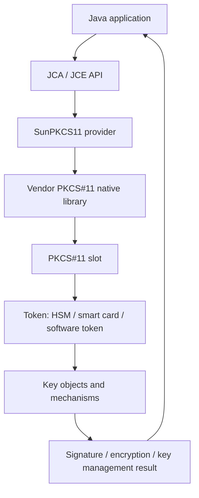
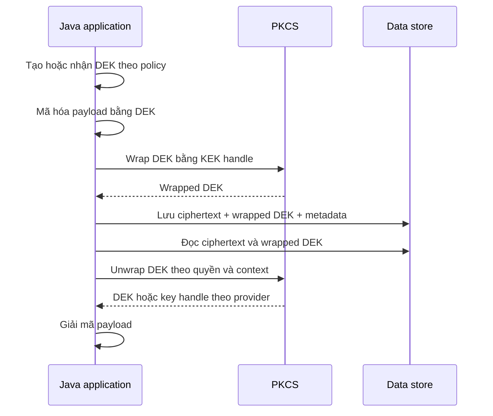

# PKCS#11

PKCS#11 là tiêu chuẩn giao diện lập trình cho thiết bị và module mật mã, thường được gọi là Cryptoki. Nó định nghĩa cách ứng dụng tìm token, mở session, xác thực người dùng, tạo và quản lý key object, cũng như yêu cầu thiết bị thực hiện các thao tác như ký, xác minh, mã hóa, giải mã, wrap và unwrap khóa. Token có thể là HSM, smart card, TPM bridge hoặc một phần mềm triển khai PKCS#11; bản thân PKCS#11 không đồng nghĩa với HSM hay một mức chứng nhận bảo mật cụ thể.

Trong Java, provider `SunPKCS11` kết nối giao diện JCA/JCE với một thư viện PKCS#11 native của nhà cung cấp. Nhờ đó, ứng dụng có thể dùng các API quen thuộc như `KeyStore`, `KeyPairGenerator`, `Signature`, `Cipher` và `KeyGenerator`, trong khi private key được giữ trong token và thao tác mật mã được thực hiện bên trong security boundary của thiết bị. Ứng dụng thường nhận một đối tượng `PrivateKey` đại diện cho key handle; đối tượng này không phải byte array chứa private key.

PKCS#11 là một phần quan trọng của kiến trúc Java KeyStore khi cần dùng khóa trong HSM hoặc token. Nó kết nối việc tạo, lưu trữ, cấp quyền, sử dụng, rotation, backup và destruction của khóa với chính sách vận hành và kiểm toán. Việc tích hợp phải kiểm tra cả khả năng của token, provider, phiên bản JDK và cơ chế mật mã được hỗ trợ.

## 1. PKCS#11 giải quyết vấn đề gì?

Nếu ứng dụng lưu private key trong file keystore, tiến trình thường phải có khả năng đọc hoặc giải mã key material trước khi dùng. Điều này tạo thêm điểm có thể lộ bí mật: filesystem, backup, memory dump, quyền của process, bản sao triển khai và quy trình cấp password. Với HSM hoặc token PKCS#11, private key có thể được tạo trực tiếp trong thiết bị, gắn thuộc tính không cho export và chỉ được sử dụng qua các thao tác được phép.

Ví dụ, một dịch vụ ký artifact cần private key RSA. Dịch vụ có thể gọi `Signature` trong Java với provider `SunPKCS11`; provider chuyển yêu cầu ký tới HSM. HSM sử dụng private key nội bộ và trả chữ ký. Ứng dụng nhận kết quả chữ ký nhưng không nhận raw private key. Nếu policy token chỉ cho phép ký và không cho phép decrypt hoặc export, một lỗi trong ứng dụng sẽ có ít khả năng làm lộ key material hơn.

PKCS#11 hữu ích khi cần:

- Tạo và giữ private key hoặc symmetric key trong security boundary riêng.
- Đặt thuộc tính key object như non-extractable, sensitive và chỉ cho phép một số thao tác.
- Dùng chung thiết bị mật mã qua nhiều ứng dụng với phân quyền và audit.
- Tích hợp HSM với Java JCA/JCE mà không phải tự viết giao thức mật mã native.
- Tách quyền quản trị thiết bị, quyền đăng nhập sử dụng khóa và quyền triển khai ứng dụng.
- Hỗ trợ các quy trình backup, recovery, rotation và key destruction theo khả năng của nhà cung cấp.

PKCS#11 không tự xác minh danh tính nghiệp vụ, không tự thiết kế quy trình rotation và cũng không tự bảo đảm ứng dụng chỉ gọi đúng key. Những kiểm soát đó vẫn cần được xây dựng ở lớp IAM, ứng dụng, CA, inventory và vận hành.

## 2. Kiến trúc tổng thể

Một ứng dụng Java thường đi qua nhiều lớp trước khi thao tác được thực hiện trên token:

1. Ứng dụng gọi API JCA/JCE, chẳng hạn `Signature`, `Cipher` hoặc `KeyStore`.
2. JCA chọn provider cung cấp dịch vụ và thuật toán được yêu cầu.
3. `SunPKCS11` ánh xạ thao tác Java sang hàm Cryptoki tương ứng.
4. Thư viện PKCS#11 native của nhà cung cấp giao tiếp với HSM, smart card hoặc token.
5. Token kiểm tra session, login, thuộc tính key object và quyền thao tác.
6. Thiết bị thực hiện thao tác mật mã và trả kết quả cho provider.



Provider là lớp tích hợp, không phải nơi lưu private key. Key material được quản lý bởi token theo thuộc tính và cơ chế của thiết bị. Một số provider có thể cache metadata hoặc quản lý session pool, nhưng điều đó không có nghĩa raw private key được tải về ứng dụng.

### 2.1. Các thành phần PKCS#11

| Thành phần | Ý nghĩa | Ví dụ |
|---|---|---|
| PKCS#11 module/library | Thư viện native triển khai Cryptoki API | `libvendor-pkcs11.so`, `vendorpkcs11.dll` |
| Slot | Vị trí giao tiếp có thể chứa token hoặc thiết bị | Slot 0, slot 1 |
| Token | Vùng logic cung cấp key object, certificate, login và cơ chế mật mã | HSM partition, smart card |
| Session | Kết nối logic giữa ứng dụng và token | Read-only hoặc read-write session |
| Object | Đối tượng được lưu hoặc quản lý trong token/session | Private key, public key, certificate, secret key |
| Attribute | Thuộc tính mô tả object và quyền sử dụng | `CKA_LABEL`, `CKA_SIGN`, `CKA_EXTRACTABLE` |
| Mechanism | Thuật toán hoặc biến thể thao tác được token hỗ trợ | `CKM_RSA_PKCS`, `CKM_ECDSA`, `CKM_AES_GCM` |
| PIN/role | Thông tin xác thực người dùng hoặc vai trò token | User PIN, Security Officer (SO) PIN |

Một slot không nhất thiết tương ứng với một thiết bị vật lý duy nhất. HSM có thể cung cấp nhiều partition hoặc token logic; token có thể được trình bày qua một hay nhiều slot tùy driver. Cần xác định chính xác slot, token label và partition theo tài liệu nhà cung cấp.

## 3. Slot, token, session và login

### 3.1. Slot và token

Slot là điểm truy cập tới token. Khi khởi tạo provider, ứng dụng có thể chọn slot bằng số slot cụ thể hoặc chỉ số trong danh sách slot. Hai khái niệm này khác nhau: `slot` là ID do module báo cáo, còn `slotListIndex` là vị trí của slot trong danh sách mà module trả về. Nếu cấu hình nhầm, ứng dụng có thể kết nối sai token hoặc không tìm thấy token.

Token có thể lưu key object lâu dài, cung cấp thông tin thiết bị, trạng thái login và danh sách mechanism. Token label thường dùng để nhận diện trong vận hành, nhưng không nên coi label là định danh duy nhất hoặc bí mật. Inventory nên liên kết vendor, serial, partition, slot, token label và provider configuration.

### 3.2. Session

Session là ngữ cảnh làm việc với token. PKCS#11 phân biệt session chỉ đọc và session đọc/ghi. Session có thể tạo object tạm hoặc thao tác với token object tùy quyền. Object có `CKA_TOKEN = false` thường là session object và mất khi session đóng; object có `CKA_TOKEN = true` là token object và được lưu theo cơ chế của thiết bị.

Ứng dụng Java sử dụng `SunPKCS11` thường không trực tiếp mở và đóng từng PKCS#11 session. Provider quản lý session để phục vụ JCA/JCE. Nếu ứng dụng gọi trực tiếp native PKCS#11 API, nó phải tự quản lý vòng đời session, lỗi, concurrency và cleanup theo tài liệu module.

### 3.3. User PIN và SO PIN

Token có thể phân biệt vai trò Security Officer (SO) và User. SO thường dùng cho khởi tạo token, quản trị PIN hoặc các tác vụ quản trị được thiết bị hỗ trợ. User login dùng để truy cập các object riêng tư và thực hiện thao tác mật mã theo policy. Vai trò và hành vi cụ thể phụ thuộc token.

Không dùng SO PIN trong ứng dụng nghiệp vụ. Ứng dụng nên nhận credential theo cơ chế secret management hoặc tích hợp xác thực của HSM; không hardcode PIN trong source code, file cấu hình version control, command line hoặc log. Một số token có cơ chế retry limit và khóa PIN sau nhiều lần nhập sai. Tự động retry vô hạn có thể khóa token và làm gián đoạn toàn bộ dịch vụ.

### 3.4. Login và logout

Trong một số token, trạng thái login có phạm vi rộng hơn một session; các session trong cùng application có thể chia sẻ trạng thái xác thực. Hành vi cụ thể tùy module và token. `KeyStore.load(null, pin)` trong SunPKCS11 thường là điểm provider thực hiện login để truy cập token. Không giả định mọi provider đều có cùng semantics về login, logout, session pooling hoặc concurrent access.

## 4. Key object và thuộc tính quan trọng

PKCS#11 quản lý khóa dưới dạng object. Mỗi object có class, key type và các attribute quyết định danh tính, quyền sử dụng, khả năng export và vòng đời.

| Attribute | Ý nghĩa khái quát | Lưu ý bảo mật |
|---|---|---|
| `CKA_CLASS` | Loại object, ví dụ public key, private key, secret key hoặc certificate | Phải đối chiếu đúng loại trước khi sử dụng |
| `CKA_KEY_TYPE` | Loại khóa như RSA, EC hoặc AES | Không thay thế kiểm tra thuật toán và tham số |
| `CKA_TOKEN` | Object có tồn tại như token object hay chỉ trong session | `true` thường dùng cho object cần tồn tại sau khi session đóng |
| `CKA_PRIVATE` | Object cần quyền login để truy cập theo semantics token | Không có nghĩa object chính là private key; public/certificate object cũng có thể private |
| `CKA_LABEL` | Nhãn dễ đọc của object | Có thể trùng hoặc đổi; không dùng làm định danh duy nhất |
| `CKA_ID` | Định danh object thường dùng để liên kết key pair và certificate | Nên quản lý ổn định theo quy ước của tổ chức |
| `CKA_SENSITIVE` | Hạn chế đọc các thuộc tính nhạy cảm như giá trị khóa | Hỗ trợ ngăn lộ key material qua API |
| `CKA_EXTRACTABLE` | Cho biết key có thể được trích xuất/wrap theo quy tắc token hay không | Đặt `false` khi policy yêu cầu key không exportable; kiểm tra cả cơ chế backup riêng |
| `CKA_SIGN` | Cho phép dùng key để ký | Chỉ bật nếu key có mục đích ký |
| `CKA_VERIFY` | Cho phép dùng public key để xác minh | Không đồng nghĩa quyền ký |
| `CKA_ENCRYPT` | Cho phép mã hóa bằng key phù hợp | Không bật cho key chỉ dùng ký |
| `CKA_DECRYPT` | Cho phép giải mã | Private key hoặc secret key cần được giới hạn theo mục đích |
| `CKA_WRAP` | Cho phép dùng key để wrap key khác | Cần kiểm soát quan hệ KEK/DEK |
| `CKA_UNWRAP` | Cho phép dùng key để unwrap key khác | Có thể mở rộng tác động nếu cấp quyền quá rộng |
| `CKA_DERIVE` | Cho phép dẫn xuất key theo cơ chế hỗ trợ | Cần kiểm soát input, mechanism và phạm vi khóa dẫn xuất |
| `CKA_ALWAYS_AUTHENTICATE` | Yêu cầu xác thực bổ sung cho mỗi thao tác theo hỗ trợ của token | Hữu ích cho key có rủi ro cao; ảnh hưởng trải nghiệm và throughput |

Không phải token nào cũng hỗ trợ mọi attribute hoặc cho phép thay đổi attribute sau khi tạo. Một số attribute là bất biến; một số chỉ có thể đặt trong lúc generate/import. Provider có thể áp dụng giá trị mặc định. Vì vậy, cấu hình phải được kiểm tra trên đúng model HSM, firmware và PKCS#11 module.

### 4.1. Sensitive và extractable không giống nhau

`CKA_SENSITIVE = true` giới hạn việc đọc các giá trị nhạy cảm của object. `CKA_EXTRACTABLE = false` ngăn việc trích xuất key theo quy tắc token. Hai thuộc tính có liên quan nhưng không đồng nghĩa. Một key có thể sensitive nhưng vẫn extractable theo một cơ chế wrap được phép; một key non-extractable không tự động được bảo vệ khỏi việc sử dụng trái phép nếu attacker có quyền gọi `CKA_SIGN` hoặc `CKA_DECRYPT`.

Do đó, phải kiểm soát cả việc đọc key material lẫn quyền sử dụng key. Với signing key, có thể cho phép `CKA_SIGN` và từ chối decrypt, wrap hoặc export. Với KEK, có thể cho phép wrap/unwrap trong một context cụ thể và từ chối ký. Quyền phải phản ánh đúng purpose và threat model.

### 4.2. Liên kết private key, public key và certificate

Token thường lưu private key, public key và certificate thành các object riêng. `CKA_ID` có thể được dùng để liên kết các object thuộc cùng key pair; `CKA_LABEL` hỗ trợ con người nhận diện. Cách ánh xạ alias của `KeyStore` sang các object này phụ thuộc provider và token.

Không giả định alias luôn bằng `CKA_LABEL` hoặc `CKA_ID`. Khi nhập certificate vào token, phải bảo đảm public key trong certificate khớp private key object và liên kết đúng theo quy tắc của provider. Nếu có nhiều object trùng label hoặc ID, ứng dụng có thể tìm nhầm key.

## 5. Mechanism và khả năng mật mã của token

Mechanism mô tả thuật toán hoặc biến thể thao tác mà token hỗ trợ. Một token có thể hỗ trợ RSA key generation nhưng không hỗ trợ một padding mode cụ thể; có thể hỗ trợ AES-GCM nhưng không hỗ trợ AES-KW; hoặc giới hạn kích thước key.

Một số mechanism thường gặp:

| Mechanism | Mục đích | Lưu ý |
|---|---|---|
| `CKM_RSA_PKCS_KEY_PAIR_GEN` | Tạo cặp khóa RSA | Kiểm tra kích thước và tham số được hỗ trợ |
| `CKM_RSA_PKCS` | RSA PKCS#1 v1.5 operation theo cơ chế tương ứng | Phân biệt ký và mã hóa theo API/operation |
| `CKM_SHA256_RSA_PKCS` | Ký/xác minh RSA với SHA-256 theo cơ chế tích hợp | Cần đối chiếu mapping JCA `SHA256withRSA` |
| `CKM_EC_KEY_PAIR_GEN` | Tạo cặp khóa EC | Curve phải được token hỗ trợ |
| `CKM_ECDSA` | Thực hiện ECDSA | Cần lưu ý định dạng chữ ký PKCS#11 và JCA provider mapping |
| `CKM_AES_KEY_GEN` | Tạo AES key | Xác định độ dài và attribute của secret key |
| `CKM_AES_GCM` | AEAD encryption/decryption AES-GCM | Nonce, tag và AAD phải được quản lý chính xác |
| `CKM_AES_KEY_WRAP` | Wrap/unwrap key theo AES Key Wrap | Kiểm tra hỗ trợ và thuộc tính wrap/unwrap |
| `CKM_SHA256` | Hash SHA-256 | Có thể dùng độc lập hoặc kết hợp mechanism ký tùy provider |

Tên mechanism ở đây là ví dụ tiêu biểu. Không phải mọi token hoặc phiên bản provider đều hỗ trợ tất cả. Cần kiểm tra danh sách mechanism và flags của token, tài liệu nhà cung cấp và mapping JCA của JDK. Không tự giả định rằng nếu một thuật toán tồn tại trong Java thì HSM cũng hỗ trợ nó.

### 5.1. JCA algorithm và PKCS#11 mechanism

JCA dùng tên thuật toán cấp cao như `SHA256withRSA`, `RSASSA-PSS`, `AES/GCM/NoPadding` hoặc `ECDSA`. PKCS#11 dùng mechanism ID và parameter structure. `SunPKCS11` ánh xạ giữa hai lớp. Mapping có thể khác theo JDK, token, mechanism và cấu hình provider.

Một số thao tác có thể được provider thực hiện một phần trong Java và một phần trên token. Ví dụ, digest có thể được tính trong software provider rồi HSM chỉ thực hiện RSA operation, tùy mapping. Nếu policy yêu cầu toàn bộ thao tác trong HSM, phải xác minh mechanism được dùng thực tế và cấu hình provider để không vô tình fallback sang software.

### 5.2. Giới hạn mechanism

Provider SunPKCS11 có thể được cấu hình để giới hạn hoặc tắt mechanism. Việc này hữu ích khi tổ chức muốn ngăn thuật toán yếu hoặc không được phê duyệt. Tuy nhiên, tắt mechanism có thể làm ứng dụng không khởi tạo được `Signature`, `Cipher` hoặc `KeyPairGenerator`. Cần kiểm thử tương thích trước khi triển khai policy mới.

## 6. Java JCA và SunPKCS11 provider

Java Cryptography Architecture (JCA) cung cấp API và cơ chế provider cho các dịch vụ mật mã. JCE bổ sung các dịch vụ như cipher và key agreement. Provider là implementation cung cấp thuật toán cụ thể. `SunPKCS11` là bridge provider, chuyển các thao tác Java sang PKCS#11 module native.

Trên JDK hiện đại, provider `SunPKCS11` thường được cấu hình từ provider cơ sở bằng `Provider.configure(...)`. Tên provider sau cấu hình thường có hậu tố theo `name` trong file cấu hình, ví dụ `SunPKCS11-HSM`. Đây là tên provider đã cấu hình, khác với tên provider cơ sở `SunPKCS11`.

Một số runtime tối giản có thể không đóng gói module `jdk.crypto.cryptoki`; cần xác nhận module JDK và provider hiện diện. Cách cấu hình và khả năng của provider có thể thay đổi theo JDK vendor/version.

## 7. Cấu hình SunPKCS11

SunPKCS11 dùng một file cấu hình để chỉ định tên provider, đường dẫn native library và slot/token. Ví dụ tối thiểu:

```properties
name = HSM
library = /opt/vendor/lib/libvendor-pkcs11.so
slot = 0
```

Trên Windows, `library` sẽ trỏ tới DLL do nhà cung cấp cài đặt. Đường dẫn phải khớp kiến trúc tiến trình Java (32-bit/64-bit), phiên bản thư viện và dependency native. Trên Linux, cần kiểm tra quyền đọc/thực thi, loader path và các thư viện phụ thuộc.

Có thể chọn `slotListIndex` thay cho `slot`. Hai tùy chọn có ý nghĩa khác nhau: `slot` chọn slot ID cụ thể, `slotListIndex` chọn vị trí trong danh sách slot. Không cấu hình cả hai cùng lúc nếu provider không cho phép. Cần xác minh slot sau khi module khởi tạo, nhất là môi trường có nhiều partition hoặc thiết bị thay đổi thứ tự.

### 7.1. Thuộc tính mặc định khi tạo key

SunPKCS11 cho phép khai báo thuộc tính PKCS#11 được áp dụng cho object được tạo qua provider. Cú pháp và khả năng phụ thuộc JDK/provider; ví dụ minh họa cho key pair RSA:

```properties
name = HSM
library = /opt/vendor/lib/libvendor-pkcs11.so
slot = 0

attributes(generate, CKO_PRIVATE_KEY, CKK_RSA) = {
  CKA_TOKEN = true
  CKA_PRIVATE = true
  CKA_SENSITIVE = true
  CKA_EXTRACTABLE = false
  CKA_SIGN = true
}

attributes(generate, CKO_PUBLIC_KEY, CKK_RSA) = {
  CKA_TOKEN = true
  CKA_VERIFY = true
}
```

Ví dụ đặt private key thành token object, private, sensitive và không extractable; public key được phép verify. Đây không phải policy dùng chung cho mọi key. Nếu key cần decrypt, wrap hoặc derive, attribute tương ứng phải được thiết kế riêng. Token có thể từ chối một số thuộc tính hoặc yêu cầu cơ chế backup riêng. Luôn kiểm tra object attributes sau khi tạo bằng công cụ được nhà cung cấp hỗ trợ.

### 7.2. Cấu hình provider trong JDK

Ví dụ Java 9 trở lên:

```java
import java.security.Provider;
import java.security.Security;

public final class Pkcs11ProviderLoader {
    public static Provider load(String configPath) {
        Provider base = Security.getProvider("SunPKCS11");
        if (base == null) {
            throw new IllegalStateException(
                "SunPKCS11 provider is unavailable in this JDK"
            );
        }

        Provider configured = base.configure(configPath);
        if (Security.getProvider(configured.getName()) == null) {
            Security.addProvider(configured);
        }
        return configured;
    }
}
```

`configure` trả về provider đã cấu hình; không nên giả định provider cơ sở ban đầu đã trở thành provider token-specific. Ứng dụng cần dùng đúng instance hoặc tên provider sau cấu hình khi lấy `KeyStore`, `Signature` và các service khác.

Với JDK cũ, cơ chế cấu hình provider có thể khác. Không sao chép ví dụ JDK 9+ sang runtime cũ mà không kiểm tra tài liệu tương ứng.

## 8. Dùng PKCS#11 như Java KeyStore

Java KeyStore là abstraction để truy cập key entry và certificate entry. Khi dùng file-based keystore như JKS hoặc PKCS12, dữ liệu nằm trong file. Với `PKCS11`, keystore được provider ánh xạ tới token; dữ liệu được quản lý bởi HSM/token chứ không phải một file keystore thông thường.

| Đặc điểm | JKS/PKCS12 | PKCS11 KeyStore |
|---|---|---|
| Nơi lưu | File hoặc storage do ứng dụng quản lý | Token/HSM thông qua PKCS#11 module |
| Mở keystore | Đọc file và password | Thường `load(null, pin)` sau khi provider được cấu hình |
| Private key | Có thể được lưu mã hóa trong file keystore | Có thể nằm trong token và không exportable |
| Vòng đời | File, backup, permission và password | Token object, HSM policy, PIN, session và vendor backup |
| Di chuyển | Có thể sao chép file nếu được phép | Phụ thuộc cơ chế backup/restore và security domain của token |
| Khả năng ghi | Theo implementation của keystore | Phụ thuộc provider/token; không giả định mọi thao tác KeyStore đều được hỗ trợ |

Khi mở PKCS11 KeyStore, `InputStream` thường là `null` vì không có file để đọc. Password argument được dùng như PIN theo implementation SunPKCS11 và token. Một số provider yêu cầu callback hoặc cơ chế login riêng.

### 8.1. Liệt kê alias và certificate

Ví dụ Java dưới đây tải token và liệt kê alias/certificate. Phần lấy PIN được trừu tượng hóa để tránh đưa PIN vào source code.

```java
import java.security.KeyStore;
import java.security.Provider;
import java.security.cert.Certificate;
import java.util.Enumeration;

public final class TokenInventory {
    public static void list(Provider pkcs11, char[] pin)
            throws Exception {
        if (pin == null) {
            throw new IllegalArgumentException("PIN must be supplied");
        }
        KeyStore keyStore = KeyStore.getInstance("PKCS11", pkcs11);
        try {
            keyStore.load(null, pin);

            Enumeration<String> aliases = keyStore.aliases();
            while (aliases.hasMoreElements()) {
                String alias = aliases.nextElement();
                Certificate certificate = keyStore.getCertificate(alias);

                System.out.println("Alias: " + alias);
                System.out.println("Key entry: "
                    + keyStore.isKeyEntry(alias));
                System.out.println("Certificate entry: "
                    + keyStore.isCertificateEntry(alias));
                if (certificate != null) {
                    System.out.println("Certificate type: "
                        + certificate.getType());
                }
            }
        } finally {
            java.util.Arrays.fill(pin, '\0');
        }
    }
}
```

Đoạn mã chỉ minh họa thao tác inventory; trong production, không nên in alias hoặc certificate metadata nhạy cảm nếu log có phạm vi truy cập rộng. PIN phải được lấy từ nguồn secret phù hợp và mảng ký tự được xóa best-effort sau khi dùng. Việc xóa mảng không chứng minh mọi bản sao nội bộ của provider/JVM đã bị xóa khỏi bộ nhớ.

### 8.2. Lấy private key handle và ký

Ví dụ sau giả định token đã chứa private key RSA và certificate tương ứng. Chữ ký được thực hiện qua provider PKCS#11; private key object không được chuyển thành byte array.

```java
import java.security.KeyStore;
import java.security.PrivateKey;
import java.security.Provider;
import java.security.Signature;
import java.security.cert.Certificate;
import java.util.Arrays;

public final class HsmSigning {
    public static byte[] sign(
            Provider pkcs11,
            char[] pin,
            String alias,
            byte[] message) throws Exception {

        if (pin == null) {
            throw new IllegalArgumentException("PIN must be supplied");
        }
        KeyStore keyStore = KeyStore.getInstance("PKCS11", pkcs11);
        try {
            keyStore.load(null, pin);

            if (!keyStore.isKeyEntry(alias)) {
                throw new IllegalArgumentException(
                    "Alias does not identify a key entry"
                );
            }

            PrivateKey privateKey = (PrivateKey) keyStore.getKey(alias, null);
            Certificate certificate = keyStore.getCertificate(alias);
            if (privateKey == null || certificate == null) {
                throw new IllegalStateException(
                    "Private key or certificate is unavailable"
                );
            }

            Signature signer = Signature.getInstance("SHA256withRSA", pkcs11);
            signer.initSign(privateKey);
            signer.update(message);
            byte[] signature = signer.sign();

            Signature verifier = Signature.getInstance("SHA256withRSA");
            verifier.initVerify(certificate.getPublicKey());
            verifier.update(message);
            if (!verifier.verify(signature)) {
                throw new IllegalStateException(
                    "Signature verification failed"
                );
            }
            return signature;
        } finally {
            Arrays.fill(pin, '\0');
        }
    }
}
```

Ví dụ dùng `SHA256withRSA`; key, mechanism và token phải hỗ trợ thuật toán này. Nếu token dùng ECDSA hoặc RSA-PSS, phải chọn JCA algorithm và tham số phù hợp. Không được bỏ qua xác minh certificate/key mapping trong hệ thống thực. Mã kiểm tra chữ ký chỉ xác nhận cặp thao tác ký/xác minh tương thích; production còn phải kiểm tra danh tính người ký, policy, nội dung cần ký và audit.

### 8.3. Tạo key pair trong token

Khi provider và token hỗ trợ, Java có thể yêu cầu tạo key pair trực tiếp trên token:

```java
import java.security.KeyPair;
import java.security.KeyPairGenerator;
import java.security.Provider;

public final class HsmKeyGeneration {
    public static KeyPair generateRsa(Provider pkcs11)
            throws Exception {
        KeyPairGenerator generator =
            KeyPairGenerator.getInstance("RSA", pkcs11);
        generator.initialize(3072);
        return generator.generateKeyPair();
    }
}
```

Kết quả `PrivateKey` là object handle do provider quản lý. Để key tồn tại sau khi session đóng hoặc process restart, thuộc tính `CKA_TOKEN` và các mặc định object phải được cấu hình đúng. Không dựa vào default của provider; xác minh object trên token sau khi tạo. Kích thước 3072 chỉ là ví dụ, cần chọn theo policy và khả năng HSM.

## 9. Cấu hình và sử dụng bằng keytool

`keytool` có thể truy cập PKCS11 token như một keystore không dựa trên file. Khi provider đã được cấu hình trong `java.security` hoặc được nạp theo cơ chế phù hợp, có thể liệt kê token bằng lệnh:

```bash
keytool -list \
  -keystore NONE \
  -storetype PKCS11 \
  -providerName SunPKCS11-HSM
```

`NONE` báo cho keytool rằng keystore không phải file. `SunPKCS11-HSM` phải khớp tên provider sau khi cấu hình; tên thực tế phụ thuộc `name` trong config. keytool có thể yêu cầu PIN qua prompt. Tránh truyền PIN bằng `-storepass` trong command line vì có thể lộ qua process list, shell history hoặc log.

Các thao tác `-genkeypair`, `-importcert`, `-delete` hoặc `-changealias` có thể phụ thuộc provider và token. Không giả định mọi thao tác file keystore đều được hỗ trợ trên PKCS11. Thử nghiệm trên token thử nghiệm và đọc tài liệu JDK/vendor trước khi thao tác trên key production.

## 10. Cấu hình bảo mật và quyền sử dụng

Tích hợp PKCS#11 cần cấu hình key object và quyền sao cho chỉ đúng workload được phép gọi đúng thao tác. Các nguyên tắc quan trọng:

- Tạo private key trong token nếu yêu cầu non-exportable.
- Đặt `CKA_SENSITIVE` và `CKA_EXTRACTABLE` theo policy; xác minh giá trị thực tế sau khi tạo.
- Chỉ bật `CKA_SIGN`, `CKA_DECRYPT`, `CKA_WRAP`, `CKA_UNWRAP` hoặc `CKA_DERIVE` khi purpose yêu cầu.
- Phân tách signing key, KEK, DEK và CA key; không tái sử dụng một key cho nhiều vai trò.
- Giới hạn token login, PIN, service account và quyền truy cập native library.
- Bảo vệ file cấu hình provider vì đường dẫn library, slot và mechanism có thể tiết lộ topology hoặc ảnh hưởng security boundary.
- Không cho ứng dụng dùng SO role hoặc quyền quản trị token nếu chỉ cần ký.
- Giám sát login thất bại, session exhaustion, key usage bất thường và thay đổi object.
- Có quy trình rotation, backup, restore và destruction theo khả năng thực tế của token.

`CKA_EXTRACTABLE = false` giảm nguy cơ export key material nhưng không ngăn attacker dùng key để ký nếu họ chiếm được credential và quyền gọi. Vì vậy cần kiểm soát authorization ở cả HSM và ứng dụng. Có thể giới hạn key operation theo service identity, partition, application allowlist hoặc policy của vendor nếu hỗ trợ.

## 11. Quản lý session, concurrency và hiệu năng

HSM có giới hạn số session, tốc độ ký và số thao tác đồng thời. Java provider có thể pool hoặc tái sử dụng session, nhưng cách quản lý phụ thuộc JDK và provider. Ứng dụng cần xử lý lỗi tạm thời, timeout, token removal, network partition, login expiry và session exhaustion.

Các lưu ý thực tế:

- Không tạo provider hoặc khởi tạo login mới cho mỗi request nếu không cần thiết.
- Không chia sẻ một đối tượng `Signature` đang ở trạng thái mutable giữa nhiều thread.
- Tạo instance `Signature` phù hợp cho từng thao tác hoặc thread theo mô hình của ứng dụng.
- Kiểm tra giới hạn session và cơ chế pool; tránh mở session không đóng trong native integration.
- Dùng bounded concurrency và backpressure để không dồn quá nhiều request vào HSM.
- Xử lý retry có giới hạn và idempotency cho các thao tác phù hợp; không retry vô hạn khi PIN sai.
- Đo latency, throughput, queue depth, session errors và HSM health.
- Kiểm thử failover và khôi phục sau khi token/network bị ngắt.

Không phải thao tác nào cũng an toàn để retry mù. Ví dụ, tạo key object có thể tạo object trùng nếu client không biết request trước đã thành công hay chưa. Cần request ID hoặc quy tắc tìm object theo `CKA_ID` để xử lý trạng thái không rõ.

## 12. Quản lý vòng đời key object

PKCS#11 hỗ trợ thao tác object, nhưng vòng đời cần được tổ chức quản trị ở cấp cao hơn. Inventory nên ghi `key_id`, version, token/partition, object class, key type, `CKA_ID`, label, purpose, attributes, owner, creation event và trạng thái.

### 12.1. Tạo và đăng ký

Khi tạo key, dùng cơ chế generate trong token nếu có thể. Chọn attribute trước khi tạo vì nhiều thuộc tính không thể thay đổi sau đó. Lưu key reference và ID ổn định vào inventory. Đối với key pair, liên kết public key/private key/certificate qua ID và xác minh public key trong certificate khớp key object.

### 12.2. Sử dụng

Mỗi thao tác phải có authorization và purpose rõ. Signing key chỉ dùng để ký; KEK chỉ dùng wrap/unwrap; key agreement key chỉ dùng cho cơ chế được duyệt. Ứng dụng không nên cho phép người gọi tùy ý truyền alias nếu chưa kiểm tra tenant, resource, purpose và trạng thái key version.

### 12.3. Rotation

Rotation thường tạo object mới với `CKA_ID` hoặc key reference mới, sau đó cập nhật certificate/workload. Nếu dữ liệu cũ cần giải mã, giữ phiên bản cũ trong phạm vi và thời gian được phê duyệt; không xóa object cũ ngay khi tạo key mới. Với certificate signing, cần phát hành certificate mới và xử lý certificate cũ theo PKI policy.

### 12.4. Backup và recovery

Backup key trong HSM không nhất thiết là export private key thông thường. Nhà cung cấp có thể yêu cầu secure backup domain, quorum, wrapping key, backup appliance hoặc cơ chế replication riêng. Không dùng thao tác `KeyStore.store()` như giả định rằng toàn bộ HSM token đã được backup. Kiểm thử restore theo tài liệu provider và chứng minh object, attribute, certificate mapping cùng quyền truy cập được phục hồi đúng.

### 12.5. Destruction

Xóa object khỏi token có thể cần quyền, login hoặc trạng thái thiết bị cụ thể. Xóa một object không xóa bản backup hoặc replica. Trước khi hủy, kiểm tra dependency, certificate, ciphertext, wrapped DEK, backup, legal hold và recovery path. Sau khi hủy, lưu tombstone/audit event để snapshot cũ không tái tạo key đã bị hủy trái chính sách.

## 13. PKCS#11 và certificate

HSM thường lưu private key object cùng certificate object. Certificate là dữ liệu công khai được CA ký; private key là bí mật. Có thể import certificate sau khi CA cấp, rồi liên kết certificate với private key bằng `CKA_ID` theo cách token/provider hỗ trợ.

Quy trình điển hình:

1. Tạo key pair trong HSM.
2. Lấy public key từ token.
3. Tạo CSR bằng provider/tool có thể ký bằng key handle.
4. Gửi CSR tới CA và hoàn thành xác minh danh tính.
5. Nhận certificate và xác minh SAN, issuer, validity, KU/EKU và chain.
6. Import certificate object vào token hoặc certificate repository.
7. Liên kết certificate với private key object đúng ID.
8. Kiểm tra TLS/signature operation thực tế.

JDK chuẩn không cung cấp API tổng quát cấp CSR cho mọi loại certificate. Ứng dụng thường dùng thư viện PKI phù hợp hoặc công cụ của CA/provider để tạo CSR; phải xác nhận thư viện có thể dùng private key handle qua JCA mà không yêu cầu export key material.

Không coi việc certificate xuất hiện trong PKCS11 KeyStore là bằng chứng private key tương ứng đã tồn tại hoặc khớp. Cần kiểm tra key entry, certificate chain và proof-of-possession bằng thao tác ký/xác minh.

## 14. PKCS#11 và envelope encryption

Trong envelope encryption, ứng dụng tạo hoặc yêu cầu DEK để mã hóa dữ liệu, sau đó dùng KEK trong HSM/KMS để wrap DEK. HSM có thể giữ KEK non-extractable và thực hiện wrap/unwrap; ứng dụng chỉ nhận wrapped DEK và có thể nhận DEK theo thiết kế của provider. Một số dịch vụ cung cấp thao tác mã hóa/giải mã hoàn toàn bên trong boundary, một số trả plaintext DEK cho ứng dụng. Cần phân biệt hai mô hình.



Nếu DEK được trả về dạng raw bytes, ứng dụng phải bảo vệ memory, log, crash dump và thời gian tồn tại. Nếu provider hỗ trợ key handle không exportable, thiết kế có thể giữ nhiều thao tác bên trong token, nhưng phải xác minh khả năng và hiệu năng. AAD, tenant ID, resource ID và purpose cần được gắn vào context theo cơ chế phù hợp; không để wrapped DEK bị dùng chéo tenant.

## 15. Tích hợp PKCS#11 trong môi trường nhiều ứng dụng

Một HSM có thể phục vụ nhiều service hoặc tenant. Cần phân vùng key object, role, partition, credential và policy. Không dùng chung PIN hoặc một key object có quyền quá rộng cho nhiều ứng dụng nếu có thể tách theo service identity.

Các câu hỏi thiết kế:

- Mỗi ứng dụng có token/partition riêng hay dùng chung partition với policy tách biệt?
- `CKA_ID` và label có namespace để tránh collision không?
- Ai được tạo, liệt kê, ký, wrap, unwrap, backup và xóa object?
- HSM audit log có thể gắn thao tác với service identity cụ thể không?
- Có giới hạn số operation, rate và session theo workload không?
- Failover cluster có giữ nguyên object ID, attribute và replication consistency không?
- Làm sao ngăn một workload biết alias của tenant khác rồi sử dụng key đó?

Trong ứng dụng, alias không nên là authorization token. Trước khi dùng alias, service phải xác thực caller và đối chiếu key inventory với tenant, resource, purpose và trạng thái. HSM policy nên là lớp kiểm soát cuối cùng nếu sản phẩm hỗ trợ.

## 16. Lỗi thường gặp khi tích hợp PKCS#11

- **Chọn sai thư viện native:** kiến trúc 32/64-bit hoặc dependency không khớp khiến provider không load.
- **Nhầm slot ID và slot list index:** ứng dụng kết nối nhầm token hoặc không tìm thấy token.
- **Dùng sai provider name:** `SunPKCS11` là provider cơ sở; tên sau cấu hình có thể là `SunPKCS11-HSM`.
- **Không cấu hình CKA_TOKEN:** key object có thể chỉ tồn tại trong session và biến mất khi session đóng.
- **Đặt CKA_EXTRACTABLE hoặc CKA_SENSITIVE sai:** key có thể export được hoặc không thể đáp ứng thao tác cần thiết.
- **Tin label là duy nhất:** alias có thể trỏ nhầm object khi label trùng; cần ID và mapping được quản lý.
- **Nhập SO PIN vào ứng dụng:** mở rộng quyền quản trị và tăng tác động khi ứng dụng bị compromise.
- **Hardcode PIN hoặc truyền qua command line:** credential có thể xuất hiện trong source, process list, shell history hoặc log.
- **Giả định mọi JCA algorithm đều chạy trên HSM:** token có thể thiếu mechanism hoặc provider mapping.
- **Fallback âm thầm sang software:** private key hoặc thao tác có thể không còn nằm trong security boundary dự kiến.
- **Không kiểm tra key/certificate pair:** certificate có thể không tương ứng với private key alias.
- **Không xử lý session exhaustion:** tải cao làm HSM từ chối request hoặc tăng latency.
- **Retry không kiểm soát:** PIN sai có thể khóa token; generate key có thể tạo object trùng.
- **Coi PKCS11 KeyStore là file:** `KeyStore.store()` và thao tác ghi có thể không được hỗ trợ hoặc có semantics riêng.
- **Nhầm PKCS#11 với FIPS validation:** dùng PKCS#11 không tự chứng minh HSM/module đã được chứng nhận hoặc đang vận hành trong mode được yêu cầu.
- **Không kiểm thử backup/restore:** object có thể không phục hồi đúng partition, attribute, certificate mapping hoặc quyền.

## 17. Kiểm thử và xác minh triển khai

Trước khi đưa vào production, kiểm thử trên token và firmware tương ứng. Các bài test nên bao gồm:

| Nhóm kiểm thử | Tình huống | Kết quả mong đợi |
|---|---|---|
| Provider loading | Sai path, thiếu dependency, sai kiến trúc native | Khởi tạo thất bại rõ ràng; không fallback ngoài ý muốn |
| Slot/token | Slot không tồn tại, token chưa insert hoặc partition sai | Báo lỗi xác định được; không dùng nhầm token |
| Authentication | PIN sai, PIN hết hạn, retry limit | Từ chối an toàn và không retry vô hạn |
| Object attributes | Private key sensitive/non-extractable | Không thể đọc raw key hoặc export trái policy |
| Operation policy | Signing key thử decrypt hoặc wrap | Token từ chối thao tác không được cấp |
| Mechanism | Thuật toán không hỗ trợ hoặc bị disable | Lỗi rõ ràng; ứng dụng không tự dùng provider không được phép |
| Key/certificate mapping | Certificate không khớp key pair | Kiểm tra proof-of-possession thất bại |
| Concurrency | Vượt giới hạn session hoặc request đồng thời | Backpressure/retry có giới hạn, không leak session |
| Failover | Mất HSM node hoặc network | Chuyển node theo thiết kế; không mất hoặc nhầm key version |
| Lifecycle | Rotation, backup, restore, revoke và destroy | Inventory, object attributes và trạng thái đồng nhất |

Không chỉ kiểm tra thao tác thành công. Cần negative test để chứng minh token từ chối quyền sai, key không exportable và object đã bị xóa không thể tiếp tục được dùng. Lưu test ID, provider/JDK version, firmware, slot/partition reference, mechanism và audit event; không ghi PIN hoặc key material.

## 18. Ví dụ cấu hình và triển khai hoàn chỉnh

Một cấu hình triển khai có thể gồm ba phần: cài native library, tạo provider config và cấu hình ứng dụng. Trình tự minh họa:

1. Cài driver/library PKCS#11 đúng phiên bản và kiến trúc.
2. Tạo partition/token trên HSM theo quy trình quản trị và quorum.
3. Tạo User PIN/credential bằng kênh an toàn; không dùng SO PIN cho ứng dụng.
4. Viết provider config với `name`, `library` và `slot` hoặc `slotListIndex`.
5. Kiểm tra provider load và token visibility bằng công cụ/vendor utility.
6. Cấu hình attribute cho key generation; tạo key thử nghiệm.
7. Kiểm tra object attribute, key/certificate mapping và operation.
8. Tích hợp JCA trong ứng dụng; đo latency và concurrency.
9. Thiết lập audit, alert, backup, restore và rotation runbook.
10. Chỉ triển khai production sau khi security review và recovery test đạt.

Không đưa file cấu hình có đường dẫn nội bộ, PIN, SO credential hoặc thông tin nhạy cảm của HSM vào repository công khai. File config không nhất thiết chứa bí mật nhưng có thể ảnh hưởng việc chọn thiết bị và cơ chế được phép.

## 19. Ví dụ inventory cho key trong HSM

Inventory nên ghi metadata và tham chiếu, không chứa raw key.

```yaml
key_object:
  key_id: artifact-signing-key
  version: "v4"
  provider: SunPKCS11-HSM
  token:
    vendor: example-hsm
    partition_reference: signing-partition
    slot_id: 0
    token_label: ARTIFACT-SIGNING
  object:
    class: CKO_PRIVATE_KEY
    key_type: CKK_RSA
    cka_id: "artifact-signing-v4"
    cka_label: "artifact-signing"
  attributes:
    token: true
    private: true
    sensitive: true
    extractable: false
    sign: true
    decrypt: false
    wrap: false
    unwrap: false
  purpose: code-signing
  lifecycle:
    status: ACTIVE
    owner: release-security
    created_at: "2026-11-28T03:00:00Z"
  certificate:
    serial: "03A81F20"
    issuer: "Example Code Signing CA"
```

Đây là dữ liệu minh họa. `slot_id`, `token_label`, `CKA_ID` và provider name cần lấy từ môi trường thực tế. Không đưa PIN, private key, recovery share hoặc credential vào inventory.

## 20. Tình huống thực tế: Java service ký artifact bằng HSM

Một pipeline phát hành phần mềm cần ký mỗi artifact bằng private key của tổ chức. Trước đây key được lưu trong file PKCS12 trên máy build. Mô hình này khiến mỗi agent có thể cần đọc file và password, đồng thời tạo bản sao trong image, backup và workspace.

Nhóm chuyển signing key vào HSM. Key pair được tạo trong partition riêng với `CKA_TOKEN = true`, `CKA_PRIVATE = true`, `CKA_SENSITIVE = true`, `CKA_EXTRACTABLE = false` và `CKA_SIGN = true`. Public key được dùng để cấp certificate code signing. Java service cấu hình `SunPKCS11`, tải PKCS11 KeyStore và lấy private key handle theo alias đã đăng ký.

Pipeline chỉ được xác thực bằng workload identity đã phê duyệt. Signing service kiểm tra release authorization, artifact digest, key version và trạng thái certificate trước khi gọi `Signature`. HSM thực hiện thao tác ký và trả signature. Audit ghi service identity, key ID/version, thời điểm, digest reference và operation result; log không chứa private key hoặc PIN.

Khi rotation, nhóm tạo key version mới trong HSM, cấp certificate mới, cập nhật signing service và verify artifact bằng public key/certificate tương ứng. Key cũ được giữ theo thời hạn cần thiết để xác minh artifact lịch sử nếu policy yêu cầu, sau đó được hủy qua quy trình HSM backup/replica/destruction. Nhóm không xóa key cũ ngay khi cutover vì artifact đã phát hành có thể còn cần xác minh.

## 21. Checklist vận hành PKCS#11

- [ ] Đã xác định đúng PKCS#11 module, vendor library, phiên bản và kiến trúc native.
- [ ] Đã xác minh slot ID, slot list index, token label và partition.
- [ ] Provider `SunPKCS11` được cấu hình đúng; dùng đúng provider instance/name sau configure.
- [ ] JDK có module `jdk.crypto.cryptoki` và tương thích với provider.
- [ ] User PIN được lấy qua secret channel; SO PIN không nằm trong ứng dụng.
- [ ] Không hardcode PIN, truyền PIN qua command line hoặc ghi PIN vào log.
- [ ] Key object có `CKA_TOKEN`, `CKA_PRIVATE`, `CKA_SENSITIVE`, `CKA_EXTRACTABLE` đúng policy.
- [ ] Attribute sign/decrypt/wrap/unwrap/derive phản ánh đúng purpose.
- [ ] `CKA_ID`, label và alias mapping được quản lý để tránh nhầm object.
- [ ] JCA algorithm được ánh xạ tới mechanism mà token thực sự hỗ trợ.
- [ ] Không có software fallback ngoài ý muốn khi policy yêu cầu thao tác trong HSM.
- [ ] Private key được tạo trong token nếu yêu cầu non-exportable.
- [ ] Certificate khớp public key và private key object đã chọn.
- [ ] Session, concurrency, timeout, retry và failover được kiểm thử.
- [ ] Audit ghi được actor, key ID/version, operation và kết quả.
- [ ] Backup/restore, rotation, revocation và destruction có runbook riêng.
- [ ] Đã kiểm thử cả thao tác được phép lẫn thao tác phải bị từ chối.
- [ ] Inventory chỉ chứa metadata/reference, không chứa key material hoặc credential.

## 22. Câu hỏi tự kiểm tra

1. PKCS#11 là tiêu chuẩn giao diện hay một loại HSM? Giải thích mối quan hệ giữa Cryptoki module, slot và token.
2. Phân biệt `slot` với `slotListIndex`. Vì sao cấu hình nhầm có thể làm ứng dụng dùng sai partition?
3. Session object khác token object ở điểm nào? Attribute nào quyết định phạm vi tồn tại?
4. `CKA_PRIVATE`, `CKA_SENSITIVE` và `CKA_EXTRACTABLE` bảo vệ các khía cạnh nào?
5. Vì sao non-extractable không có nghĩa là không thể bị lạm dụng để ký?
6. `CKA_SIGN` và `CKA_DECRYPT` nên được thiết kế theo purpose ra sao?
7. `CKA_ID` và `CKA_LABEL` hỗ trợ liên kết key/certificate như thế nào? Vì sao label không nên là định danh duy nhất?
8. SunPKCS11 ánh xạ JCA algorithm sang PKCS#11 mechanism như thế nào?
9. Vì sao cần kiểm tra mechanism thực tế thay vì giả định mọi thuật toán JCA đều có trong HSM?
10. `Provider.configure(...)` trên JDK hiện đại trả về đối tượng gì và vì sao phải dùng đúng tên provider đã cấu hình?
11. Vì sao PKCS11 KeyStore thường được load bằng `load(null, pin)`?
12. Vì sao không nên truyền PIN qua command line hoặc hardcode trong source?
13. Làm sao chứng minh certificate object và private key object thuộc cùng key pair?
14. Vì sao phải tách CA signing key, artifact signing key và KEK?
15. Khi HSM hết session, ứng dụng nên xử lý concurrency và retry ra sao?
16. Vì sao `KeyStore.store()` không thể được mặc định coi là backup của HSM?
17. Khi rotation, điều gì quyết định thời điểm có thể hủy key object cũ?
18. PKCS#11 có tự bảo đảm FIPS validation hoặc quy trình audit đầy đủ không? Giải thích.

PKCS#11 cung cấp giao diện chuẩn để Java sử dụng token và HSM thông qua provider, nhưng mức bảo vệ thực tế phụ thuộc vào object attribute, quyền login, mechanism, cấu hình provider và quy trình vận hành. Khi private key được tạo và giữ trong token, Java chỉ cần làm việc với key handle và API JCA; tổ chức vẫn phải quản lý đúng danh tính, purpose, session, backup, rotation, audit và destruction để duy trì an toàn xuyên suốt vòng đời khóa.
